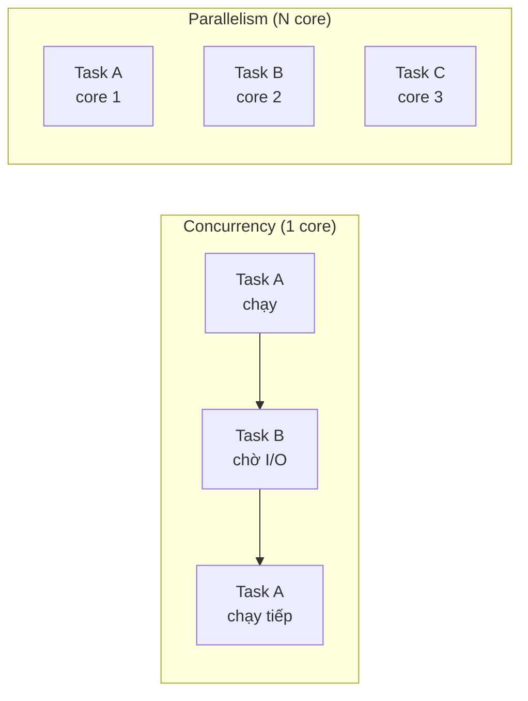
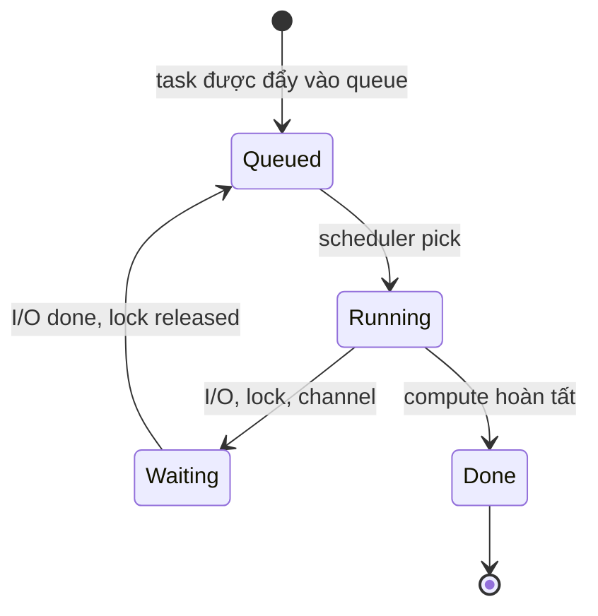

# What is the difference between parallelism and concurrency?

> Bài này phân biệt concurrency (xử lý nhiều việc trong cùng khoảng thời gian) và parallelism (xử lý nhiều việc đúng cùng một lúc), kèm so sánh multithreading (nhiều thread trong một process, chia sẻ heap) và multiprocessing (nhiều process độc lập, có memory riêng). Bài đi vào GIL của CPython, process pool vs thread pool, và khi nào chọn cái nào theo I/O-bound hay CPU-bound workload.

Chủ đề: Concurrency · Ngày: 2026-10-16

## 1. Là gì

Concurrency là cấu trúc của chương trình: các tác vụ (task) được tổ chức để có thể tiến triển theo thứ tự chồng chéo, không nhất thiết chạy cùng lúc. Một web server xử lý nhiều request trên một thread là concurrency (chuyển context khi request chờ I/O). Parallelism là sự thực thi: hai hay nhiều tác vụ chạy đúng cùng một thời điểm trên hai hay nhiều đơn vị xử lý (CPU core, GPU SM). Một vòng lặp xử lý ảnh chia trên 8 core là parallelism.

Concurrency không cần nhiều core; parallelism cần. Một chương trình concurrent có thể chạy trên một core (qua context switch), một chương trình parallel cần ít nhất hai đơn vị thực thi thật. Multithreading là kỹ thuật hiện thực concurrency/parallelism bằng nhiều thread trong một process; multiprocessing hiện thực bằng nhiều process độc lập.



*Sơ đồ vị trí: concurrency = xen kẽ (1 core đủ); parallelism = đồng thời thật (cần N core).*

### Trả lời 30 giây

"Concurrency là cấu trúc chương trình có thể xử lý nhiều việc chồng chéo; không cần nhiều core. Parallelism là thực thi nhiều việc đúng cùng lúc, cần nhiều CPU core. Ví dụ: một web server async xử lý 10.000 request trên 1 core là concurrency; xử lý 8 luồng video trên 8 core là parallelism. Multithreading tạo nhiều thread trong một process, chia sẻ heap, nhẹ nhưng cần đồng bộ (mutex, channel). Multiprocessing tạo nhiều process độc lập, memory riêng, nặng hơn nhưng không cần đồng bộ và tránh được GIL. Chọn thread cho I/O-bound, process cho CPU-bound, async cho I/O-bound ở scale rất lớn."

## 2. Cơ chế cốt lõi

### Bước 1. Concurrency qua context switch

Một CPU core chỉ chạy một thread tại một thời điểm. OS scheduler chuyển context giữa các thread đang sẵn sàng. Context switch ~1-10µs trên Linux x86_64, tốn nhiều cache miss. Concurrency đơn thuần (không có I/O wait) chỉ tăng overhead, không tăng throughput. Concurrency thật sự có lợi khi có thời gian chờ: I/O, lock, network round-trip — scheduler chuyển sang thread khác trong khi thread hiện tại chờ.

### Bước 2. Parallelism qua đa nhân

Hai thread chạy trên hai core khác nhau thực sự song song. Overhead nhỏ (gửi message giữa core qua cache coherence protocol, ~100ns). Throughput gần tuyến tính với số core khi workload có thể chia độc lập. Khi phải đồng bộ (mutex, channel blocking), Amdahl's law giới hạn speedup: nếu 10% code bắt buộc tuần tự, tối đa tăng tốc 10 lần dù có 1000 core.

### Bước 3. Multithreading — chia sẻ memory, cần đồng bộ

- Mỗi thread có stack riêng (1-8MB), program counter, registers; nhưng chia sẻ heap, code, file descriptor, biến global.
- Thread tạo chi phí thấp (~50µs goroutine, ~1ms OS thread, ~50µs Java Thread); so với process tạo ~10-100ms (fork + exec).
- Đồng bộ qua mutex, RWMutex, channel, condition variable. Race condition là lỗi phổ biến nhất — xem [race-condition](race-condition.md).
- Race detector (`go test -race`, `ThreadSanitizer`, `Helgrind`) phát hiện data race ở runtime; chi phí 2-10x slowdown.
- Mỗi thread có scheduler riêng (goroutine do Go runtime quản lý, OS thread do kernel quản lý).

### Bước 4. Multiprocessing — memory độc lập, IPC nặng hơn

- Mỗi process có address space riêng, không truy cập trực tiếp memory của process khác. Crash một process không ảnh hưởng process khác (cùng user).
- Tạo process qua `fork()` (Linux/macOS) nặng hơn thread; có thể dùng copy-on-write để giảm overhead.
- Liên lạc qua IPC: pipe, socket, shared memory (`mmap`), message queue, file. Tốn hơn mutex ~1000 lần.
- Ưu điểm chính: tránh được GIL (CPython), tránh được memory leak lan giữa các phần, tận dụng nhiều core mà không cần thread-safe code.

### Bước 5. GIL của CPython — tại sao thread không tăng tốc CPU-bound

CPython có Global Interpreter Lock: chỉ một thread chạy Python bytecode tại một thời điểm, dù có nhiều core. Lý do: quản lý reference count và memory allocator không thread-safe trong C. Hệ quả: thread Python không tăng tốc CPU-bound (image processing, hash). Vẫn tăng tốc I/O-bound vì GIL nhả khi gọi I/O syscall (`read`, `write`, `socket.recv`). Workaround: `multiprocessing` (process pool), C extension nhả GIL (`numpy` tính toán), `concurrent.futures.ProcessPoolExecutor`.

PyPy, Jython, IronPython, JavaScript (Node.js single-thread), Ruby (với JIT) đều có GIL hoặc cơ chế tương đương — implementation choice, không phải tính chất ngôn ngữ. Java (OpenJDK) không có GIL, có thể tận dụng nhiều core với thread.

### Bước 6. Sơ đồ trạng thái task chạy song song



*Vòng đời task: từ Queued có thể vào Running, hoặc vào Waiting (I/O, lock); khi Quay chờ xong quay lại Queued. Done là trạng thái cuối. Concurrency đạt được nhờ chuyển đổi giữa Running và Waiting ở nhiều task.*

### Quan sát

```bash
# Linux: xem số core và process nào chạy trên core nào
nproc
# 8

# Linux: xem thread của process
ps -L -p <pid> -o pid,tid,psr,cmd
# psr = processor (core) hiện đang chạy

# Linux: xem context switch rate
cat /proc/<pid>/status | grep ctxt_switches
# voluntary_ctxt_switches: số lần thread tự nguyện nhường (I/O wait)
# nonvoluntary_ctxt_switches: bị scheduler đẩy ra

# Go: race detector
go test -race ./...
```

### Ví dụ chạy từng bước

Kịch bản: batch processor xử lý 1.000 task, mỗi task có 90ms I/O chờ + 10ms CPU compute. Máy có 4 core. Cần tính throughput với 1 thread (chỉ concurrency) và 4 thread (concurrency + parallelism), rồi kiểm chứng Amdahl's law.

**Bước 1 (baseline, 1 thread).** T1 gọi task 1. Task 1 chạy 10ms CPU (thread busy), rồi 90ms I/O (sleep, OS schedule thread sang task khác — không có task khác nên thread idle). Tổng: 100ms/task × 1.000 = 100.000ms = **100 giây**. Throughput: 10 task/s. Đây là concurrency đơn thuần: I/O wait tạo cơ hội context switch, nhưng không có parallelism.

**Bước 2 (4 thread trên 4 core).** Scheduler đặt 4 thread lên 4 core. Mỗi thread nhận 250 task. Tại t=0: T1-T4 cùng chạy CPU 10ms trên 4 core. Tại t=10ms: cả 4 vào I/O wait; OS vẫn giữ thread trên core (vì I/O chưa xong). Tại t=100ms: T1 hoàn thành task 1, nhận task 5. Tương tự T2-T4 nhận task 6-8. Chu kỳ lặp: mỗi 100ms, 4 task hoàn thành. **Thời gian tổng: 100ms × 250 = 25 giây.** Speedup = 100/25 = **4×** — tăng tuyến tính với số core vì I/O wait cho phép thread khác chạy.

**Bước 3 (8 core, task 100% CPU).** Tách I/O ra, task trở thành pure CPU: mỗi task 100ms compute. 1.000 task × 100ms / 8 core = 12.500ms = 12,5 giây. Speedup = 100/12,5 = **8×**. Đạt tuyến tính.

**Bước 4 (Amdahl's law kiểm chứng).** Phần tuần tự thực tế trong task: 5ms overhead quản lý (submit, join, gather). Phần parallel: 95ms. s = 5/100 = 5%. N = 4 core → speedup = 1 / (0,05 + 0,95/4) = 1 / 0,2875 = **3,48×**, không phải 4×. Cần benchmark đo overhead thực tế:

```python
# chưa chạy thử
# throughput vs thread count, task 1000 × (90ms io + 10ms cpu)
# for n in [1, 2, 4, 8]:
#     start = time.time()
#     with ThreadPoolExecutor(max_workers=n) as p:
#         list(p.map(do_task, range(1000)))
#     print(n, (time.time()-start))
```

| Cores | Model | Time (s) | Speedup |
|---|---|---|---|
| 1 | baseline | 100 | 1× |
| 4 | 4 thread | 25 | 4× |
| 8 | pure CPU | 12,5 | 8× |
| 4 | Amdahl (5% seq) | 28,75 | 3,48× |

Nếu đặt `GOMAXPROCS=1` trên 8 core: chỉ 1 core chạy, concurrency vẫn có (I/O wait), parallelism = 0. 4 thread trên 1 core: OS context switch ~1-10µs mỗi lần, overhead không đáng kể với task dài 100ms, throughput gần baseline. Nhưng nếu task ngắn 1ms và thread tạo mỗi task: overhead tạo thread (~50µs goroutine, ~1ms OS thread) lớn hơn task → throughput *giảm*.

Điều rút ra: với 4 core × (1 I/O-bound task), concurrency trên 1 core đạt 4× speedup nhờ I/O wait xen kẽ; parallelism trên nhiều core chỉ thắng thêm khi task CPU-bound — nối với Câu 5 "Amdahl's law": phần tuần tự 5% giới hạn speedup còn 3,48×.

## 3. Câu hỏi phỏng vấn

### 3A. Câu hỏi đào sâu

<details class="qa">
<summary>Câu 1. Concurrency và parallelism khác nhau ở điểm nào, cho ví dụ thực tế?</summary>

**Trả lời ngắn:** Concurrency là cấu trúc chương trình xử lý nhiều việc chồng chéo (có thể 1 core); parallelism là thực thi nhiều việc đúng cùng lúc (cần nhiều core). Ví dụ: web server async xử lý 10k request trên 1 core là concurrency; render video trên 8 core là parallelism.

**Đào sâu:**
- Concurrency là property của design: "chương trình được viết để xử lý nhiều việc độc lập". Implementation có thể là thread, process, goroutine, callback, async/await.
- Parallelism là property của runtime: "tại thời điểm này, có nhiều task đang chạy đồng thời". Phụ thuộc phần cứng.
- Một chương trình concurrent có thể chạy song song (nếu đủ core) hoặc không (nếu chỉ 1 core). Một chương trình parallel thì bản chất cũng concurrent (đã có nhiều tác vụ chạy độc lập).
- Concurrency khó vì phải quản lý state shared; parallelism khó vì phải quản lý đồng bộ và chia việc.

**Bẫy:** "Concurrency = multithreading". Sai — async/await (Node.js, Python asyncio), coroutine (Goroutine, Kotlin coroutine), event loop đều concurrent mà không có thread truyền thống.

**Follow-up:** Go có concurrency mà không có parallelism? Đúng — Go dùng goroutine, scheduler map N goroutine vào M OS thread. Nếu GOMAXPROCS=1, chỉ 1 OS thread chạy, nhưng vẫn concurrent.
</details>

<details class="qa">
<summary>Câu 2. Multithreading và multiprocessing khác nhau thế nào về memory và overhead?</summary>

**Trả lời ngắn:** Thread chia sẻ heap, code, file descriptor trong một process — nhẹ (~50µs tạo goroutine, ~1ms OS thread), cần đồng bộ (mutex, channel). Process có address space riêng — nặng (~10-100ms fork), liên lạc qua IPC (pipe, socket), không cần đồng bộ memory.

**Đào sâu:**
- Memory: thread cùng process truy cập chung biến global, không cần copy. Process phải copy data qua pipe hoặc shared memory (`mmap`); kernel không cho truy cập chéo.
- Tạo thread: Linux `clone(2)` nhanh vì share page table. Tạo process: `fork()` copy page table (copy-on-write trên Linux), sau đó `exec()` load binary mới.
- IPC overhead: mutex ~50ns, pipe ~1µs, socket localhost ~10µs, shared memory ~100ns (nhanh nhất nhưng cần sync).
- Ưu điểm process: an toàn (crash một process không ảnh hưởng), tránh GIL, scale tốt với nhiều core mà không lock contention.
- Nhược: tốn memory (mỗi process ~10-50MB overhead), khởi động chậm, IPC phức tạp.

**Bẫy:** "Process luôn chậm hơn thread". Sai — process tránh được GIL nên cho CPU-bound trên CPython có thể nhanh hơn thread 8x (8 core). Cần đo trên workload thật.

**Follow-up:** Khi nào dùng multiprocessing cho web server? Khi handler CPU-bound (image resize, PDF render, ML inference). Hầu hết web server là I/O-bound, dùng thread/async đủ.
</details>

<details class="qa">
<summary>Câu 3. GIL của CPython là gì và ảnh hưởng thế nào đến concurrency?</summary>

**Trả lời ngắn:** GIL (Global Interpreter Lock) chỉ cho một thread chạy Python bytecode tại một thời điểm, dù có nhiều core. Thread CPU-bound không tăng tốc; thread I/O-bound vẫn tăng tốc vì GIL nhả khi gọi I/O syscall.

**Đào sâu:**
- Lý do GIL tồn tại: CPython dùng reference count cho memory management; race trên refcount có thể crash process. GIL đơn giản hóa việc bảo vệ refcount.
- GIL được nhả trong `read`, `write`, `socket.recv`, `time.sleep`, và một số blocking syscall. Numpy/Pandas/SciPy C extension nhả GIL khi tính toán vector.
- I/O-bound (web request, database query, file read): thread hoặc asyncio đều concurrent hiệu quả, dùng `multiprocessing` thừa.
- CPU-bound (image processing, hash, ML inference trong Python): `multiprocessing` hoặc viết C/Rust extension nhả GIL.
- Python 3.13 có thử nghiệm "free-threaded" mode (PEP 703) — tắt GIL, multi-thread chạy song song thật.

**Bẫy:** "Thread Python chậm vì GIL". Không chính xác — thread Python vẫn nhanh cho I/O-bound. Chỉ CPU-bound mới không tăng tốc.

**Follow-up:** Java có GIL không? Không — OpenJDK không có GIL, thread chạy song song thật. Đó là lý do Java mạnh cho CPU-bound.
</details>

<details class="qa">
<summary>Câu 4. Async/await khác thread ở điểm nào, khi nào nên dùng?</summary>

**Trả lời ngắn:** Async/await là concurrency model dùng event loop trên một thread; thread là concurrency model dùng OS thread. Async rẻ hơn (~1KB stack goroutine, ~100KB thread), scale hơn hẳn (hàng trăm nghìn task), nhưng blocking call trong async sync chặn toàn bộ event loop.

**Đào sâu:**
- Thread: mỗi thread ~1-8MB stack, tốn memory khi mở nhiều; blocking call chỉ chặn thread đó.
- Async: mỗi task vài KB; blocking call (CPU-intensive loop, sync I/O) chặn cả event loop → tất cả task khác chờ. Bug nghiêm trọng nhất của async.
- Async phù hợp: HTTP server (Node.js, Python aiohttp), WebSocket, chat, nhiều I/O chờ đợi.
- Thread phù hợp: CPU-bound, blocking library (không có async version), code đơn giản không cần event loop.
- Mixing: một số runtime (Rust tokio, Go goroutine) cho phép kết hợp — goroutine có thể blocking, async Rust có `spawn_blocking`.

**Bẫy:** "Async luôn nhanh hơn thread". Sai — cho CPU-bound, async chậm hơn thread (overhead event loop). Async chỉ thắng khi có hàng nghìn task I/O-bound.

**Follow-up:** Go goroutine là thread hay async? Cả hai — runtime map N goroutine vào M OS thread. Blocking syscall dùng thread riêng; goroutine nhẹ như async nhưng an toàn như thread.
</details>

<details class="qa">
<summary>Câu 5. Amdahl's law áp dụng thế nào vào parallelism?</summary>

**Trả lời ngắn:** Speedup = 1 / (s + (1-s)/N), trong đó s là phần code bắt buộc tuần tự. Nếu 10% code tuần tự, tối đa tăng tốc 10x dù 1000 core. Phần song song cần chia độc lập (không share state), phần tuần tự là đồng bộ, lock, I/O chờ.

**Đào sâu:**
- Ví dụ: một task lấy 10s, trong đó 8s CPU (parallel được), 2s lock database (tuần tự). Với 8 core: tốc độ 8s/8 + 2s = 3s. Speedup = 10/3 = 3.3x, không phải 8x.
- Phần tuần tự thường là: I/O đồng bộ (sync DB call), lock contention, Amdahl bottleneck ở cuối (reduce/aggregate).
- Để tăng speedup: giảm phần tuần tự (async DB, batch), giảm chia nhỏ hơn (overhead tăng), tăng core (chỉ hiệu quả khi phần parallel > tuần tự).
- Trong thực tế speedup hiếm khi đạt lý thưởng; thường đạt 50-70% lý thuyết do overhead (thread tạo, IPC, sync).

**Bẫy:** "Thêm core tăng tốc tuyến tính". Sai — chỉ khi phần parallel > tuần tự và overhead nhỏ. Thực tế hiếm khi đạt > 70% hiệu suất lý thuyết.

**Follow-up:** Gustafson's law nói gì khác? Gustafson's: khi tăng kích thước bài toán theo số core, tốc độ tổng thể tăng gần tuyến tính. Khác Amdahl: Amdahl giả sử bài toán cố định, Gustafson cho phép bài toán lớn hơn.
</details>

<details class="qa">
<summary>Câu 6 (Debug). Service Python xử lý 1000 request/giây, CPU 80% trên 8 core nhưng latency tăng khi tải tăng. Nghi ngờ GIL. Cách xác nhận và xử lý?</summary>

**Trả lời ngắn:** Xác nhận bằng cách profile: dùng `py-spy dump --pid <pid>` xem thread nào chiếm CPU. Nếu chỉ 1 thread Python đang chạy ở mọi thời điểm → GIL bottleneck. Xử lý: (1) dùng `multiprocessing` hoặc ProcessPoolExecutor; (2) refactor CPU-bound sang C extension nhả GIL; (3) thử Python 3.13 free-threaded build.

**Đào sâu:**
- Bước 1: `top -H -p <pid>` xem thread nào CPU cao. Nếu chỉ một thread Python đang chạy → GIL. Nếu nhiều thread đang chạy ~1/N core → không phải GIL.
- Bước 2: Profile CPU: `py-spy dump --pid <pid>` hoặc `py-spy record --pid <pid> --output trace.html`. Xem flame graph.
- Bước 3: Xác định phần CPU-bound: regex, JSON parse, image processing, hashing?
- Bước 4: Nếu là pure Python (regex, JSON): chuyển sang `multiprocessing.Pool`, mỗi worker là process riêng.
- Bước 5: Nếu là external lib (PIL, pandas): kiểm tra có nhả GIL không. Numpy/pandas/PIL đã nhả GIL khi tính toán vector.
- Bước 6: Nếu latency vẫn tệ, xem xét chuyển sang gRPC service với worker process pool cố định (ví dụ gunicorn với 4 worker process, mỗi worker 1 thread).

**Bẫy:** Thêm thread pool lớn hơn — sẽ không tăng tốc CPU-bound vì GIL. Chỉ multiprocessing mới bypass GIL.

**Follow-up:** Làm sao biết lib có nhả GIL không? Tài liệu lib (numpy, pandas có ghi). Hoặc test: code CPU-bound dùng lib đó chạy multi-thread; nếu CPU > 100% một core → lib nhả GIL.
</details>

<details class="qa">
<summary>Câu 7 (Thiết kế). Thiết kế hệ thống xử lý 10.000 request/giây, mỗi request cần gọi 3 API bên ngoài (mỗi API ~150ms). Chọn mô hình concurrency nào?</summary>

**Trả lời ngắn:** Async/await event loop (Node.js, Python aiohttp, Rust tokio). Lý do: (1) I/O-bound hoàn toàn; (2) 10k connection đồng thời quá nhiều cho thread (memory); (3) event loop xử lý 10k connection với 1 thread là khả thi.

**Đào sâu:**
- **Async/await**: 1 thread xử lý 10k task chờ I/O. Memory ~10k × 2KB = 20MB. Throughput 10k req/s với 3 API × 150ms = 450ms latency P50, nếu 4 worker × event loop có thể đạt.
- **Thread pool**: 10k thread × 1MB stack = 10GB memory. Không khả thi.
- **Multiprocessing**: 8 process × 1250 thread/process. Tốn memory; IPC phức tạp nếu cần share state.
- **Go goroutine**: 10k goroutine × 2KB = 20MB. Mỗi goroutine chờ I/O không block khác. Tương đương async nhưng an toàn hơn (blocking syscall dùng OS thread riêng).
- **Trade-off**: độ phức tạp code. Async đòi hỏi mọi lib phải async-aware (DB driver, HTTP client). Nếu có lib blocking, event loop bị choke.
- **Fallback**: nếu một lib bắt buộc blocking (legacy JDBC, sync SDK), kết hợp — async cho HTTP I/O, thread pool riêng cho blocking call.

**Bẫy:** "Thread pool 10k thread đủ rồi". Sai — memory không đủ, context switch overhead cao, kernel không scale tốt với hàng nghìn thread.

**Follow-up:** Nếu một trong 3 API có thể chậm 5-10 giây timeout, chiến lược nào? Dùng `asyncio.wait_for` với giá trị timeout, fail nhanh. Hoặc dùng circuit breaker: nếu API đó fail > 50% trong 1 phút, tạm thời bỏ qua.
</details>

### 3B. Câu hỏi phỏng vấn liên quan

<details class="qa">
<summary>Câu 8. Khi nào dùng multiprocessing thay cho multithreading?</summary>

**Trả lời:** CPU-bound workload trên interpreter có GIL (CPython, Ruby MRI). Workload cần isolation mạnh (crash một phần không ảnh hưởng phần khác). Khi cần scale vượt giới hạn thread của OS (vài nghìn). Nhược: tốn memory, IPC phức tạp, khởi động chậm.
</details>

<details class="qa">
<summary>Câu 9. Tại sao Go phổ biến cho concurrent backend?</summary>

**Trả lời:** Goroutine nhẹ (~2KB stack), scheduler do Go runtime quản lý (M:N mapping), channel cho communication, không có GIL, GC concurrent. Goroutine dễ dùng hơn thread (không cần quan tâm stack size, thread pool). Blocking syscall tự động dùng OS thread riêng, không block runtime.
</details>
<details class="qa">
<summary>Câu 10. ConcurrentHashMap của Java đảm bảo thread-safe bằng cách nào?</summary>

**Trả lời:** Chia bucket thành segment, mỗi segment lock riêng. Read không lock (volatile read); write lock segment. JDK 8+: dùng `synchronized` + CAS cho node đầu, lock striping cải tiến. Throughput cao hơn `Hashtable` (lock toàn bảng) ~10x.
</details>

<details class="qa">
<summary>Câu 11. True or false: "Single-threaded code không có data race."</summary>

**Trả lời:** Đúng trong phần lớn trường hợp — không có thread song song truy cập cùng memory, không race. Ngoại lệ: reentrancy (signal handler trong C, interrupt), async/await (event loop đơn thread nhưng code chạy không theo thứ tự tuyến tính), coroutine (Coroutine A nhả control cho B, B đọc state của A). Trong Go, dù một goroutine có thể single-thread, race vẫn có thể xảy ra qua `go` statement.
</details>

<details class="qa">
<summary>Câu 12. Context switch tốn bao nhiêu và ảnh hưởng throughput thế nào?</summary>

**Trả lời:** Linux x86_64 context switch ~1-10µs, bao gồm save/restore registers, switch page table, flush TLB. Ở 100k context switch/giây, tốn ~100ms-1s CPU chỉ cho switch. Đó là lýết hệ thống có nhiều thread chờ I/O trên 1 core có thể choke. Go goroutine switch ~100ns nhờ user-space scheduler.
</details>
<details class="qa">
<summary>Câu 13. Fiber (lightweight thread) khác goroutine ở điểm nào?</summary>

**Trả lời:** Fiber (Windows Fiber, Ruby Fiber) là coroutine do user-space quản lý, scheduler thủ công (`yield`). Goroutine là coroutine do Go runtime quản lý, scheduler preemptive (từ Go 1.14). Fiber cần yield thủ công; goroutine có thể bị preempt ngay cả trong CPU-bound loop. Fiber thường cooperate; goroutine gần như preemptive.
</details>

<details class="qa">
<summary>Câu 14. Khi nào không nên dùng parallelism?</summary>

**Trả lời:** Khi workload quá nhỏ (overhead tạo thread > thời gian xử lý). Khi có nhiều shared state và lock contention cao (parallel làm chậm). Khi code đã I/O-bound chủ yếu (thêm parallel không tăng throughput). Khi cần đơn giản và dễ debug (sequential dễ hơn). Khi tài nguyên hạn chế (1 core, ít RAM).
</details>

<details class="qa">
<summary>Câu 15. Parallelism có phải lúc nào cũng nhanh hơn không?</summary>

**Trả lời:** Không. Overhead tạo và đồng bộ thread có thể lớn hơn thời gian tính toán. Lock contention cao có thể làm parallel chậm hơn sequential. Đo bằng benchmark (Go benchmark, JMH cho Java, pytest-benchmark cho Python). Lý tưởng: speedup gần tuyến tính với số core, thực tế 50-70%.
</details>

## 4. Đánh đổi và sự cố production

### So sánh bốn mô hình concurrency

| Mô hình | Chi phí tạo task | Phù hợp | Nhược điểm |
|---|---|---|---|
| Thread (OS) | ~1ms, 1-8MB stack | CPU-bound, blocking call | Tốn memory khi nhiều, context switch nặng |
| Goroutine / lightweight thread | 2-8KB stack, ~50µs | Mix I/O và CPU, server | Phụ thuộc runtime (Go, Kotlin) |
| Process | ~10-100ms, ~10-50MB | CPU-bound, isolation, bypass GIL | IPC phức tạp, khởi động chậm |
| Async/await event loop | ~1KB task | I/O-bound ở scale lớn | Blocking call chặn cả loop; khó debug |
### Năm failure mode

| Triệu chứng | Nguyên nhân gốc | Cách kiểm tra | Cách sửa |
|---|---|---|---|
| CPU 800% trên 8 core nhưng latency cao | GIL (CPython) hoặc lock contention | Profile thread đang chạy | multiprocessing, giảm lock |
| Throughput giảm khi thêm core | Lock contention tăng theo số core | Benchmark với 1, 2, 4 core | Lock-free, redesign critical section |
| Service OOM khi mở 10k connection | Thread pool quá lớn | Memory profile | Chuyển sang async/goroutine |
| Latency tăng theo concurrency | Context switch overhead | `vmstat`, `pidstat` | Giảm thread, dùng connection pool |
| Event loop block toàn bộ service | Blocking call trong async handler | `asyncio` debug, Node.js event loop lag | Đẩy blocking call sang thread pool riêng |
## 5. Cheat sheet

| Chủ đề | Con số / quy tắc cần nhớ |
|---|---|
| Concurrency | Cấu trúc chương trình xử lý nhiều việc; 1 core đủ |
| Parallelism | Thực thi nhiều việc cùng lúc; cần nhiều core |
| Thread | Chia sẻ heap; cần mutex/channel |
| Process | Memory riêng; IPC qua pipe/socket/shared memory |
| Context switch | Linux ~1-10µs; Go ~100ns |
| Goroutine | 2-8KB stack, M:N scheduler |
| GIL (CPython) | Chỉ 1 thread Python chạy; bypass bằng multiprocessing |
| Amdahl's law | Speedup ≤ 1/(s + (1-s)/N); phần tuần tự giới hạn |
| Multiprocessing overhead | Tạo 10-100ms, IPC 1µs-10ms |
| Async/await | Event loop, 1 thread; blocking call chặn toàn bộ |

**Học tiếp:**
- [thread-pool](thread-pool.md) — quản lý thread/goroutine hiệu quả
- [race-condition](race-condition.md) — lỗi thường gặp khi concurrent
- [mutex-vs-lock](mutex-vs-lock.md) — đồng bộ giữa thread