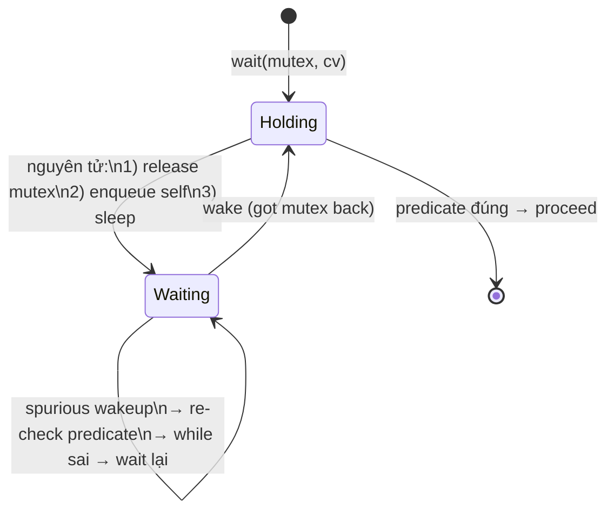

# What is a condition variable?

> Condition variable là cơ chế đồng bộ cho phép một thread chờ một điều kiện (predicate) trở thành đúng mà không cần busy-wait. Nó luôn đi kèm một mutex; nếu dùng sai (không đặt predicate, quên kiểm tra lại sau khi wake, gọi notify khi chưa giữ mutex) sẽ gây mất wakeup hoặc deadlock. Bài [mutex-vs-lock](mutex-vs-lock.md) so sánh mutex với các khóa khác.

Chủ đề: Concurrency · Ngày: 2026-10-16

## 0. Nền tảng trước khi đọc

**Bối cảnh:** Nhiều việc cùng chạy trong một chương trình. Khó ở chỗ các việc có thể chạm cùng dữ liệu và làm kết quả sai nếu không phối hợp.

**Nói đơn giản:** Condition variable cho phép một luồng ngủ cho tới khi điều kiện đúng, thay vì liên tục kiểm tra và đốt CPU.

**Từ khóa cần biết:** thread = luồng chạy; shared state = dữ liệu dùng chung; synchronization = cách phối hợp luồng.

**Ví dụ dễ hình dung:** Worker ngủ khi hàng đợi rỗng và được đánh thức khi producer thêm việc, thay vì kiểm tra hàng đợi liên tục.

Khi đọc, luôn hỏi ba câu: nó giải quyết vấn đề gì, nó làm việc theo những bước nào, và khi nào không nên dùng?

**Cách học bài này:** Đọc phần này trước để nắm từ khóa; đọc phần 1 để lấy câu trả lời 30 giây; đọc phần 2 để hiểu cơ chế; cuối cùng mở từng câu hỏi ở phần 3 để luyện nói. Các con số và lệnh trong bài là bằng chứng cho câu trả lời, không cần học thuộc nếu chưa hiểu cơ chế.

## 1. Là gì

### Đọc nhanh trước khi đi sâu

**Ý chính:** Condition variable cho phép một luồng ngủ cho tới khi điều kiện đúng, thay vì liên tục kiểm tra và đốt CPU.

**Ví dụ interview:** Worker ngủ khi hàng đợi rỗng và được đánh thức khi producer thêm việc, thay vì kiểm tra hàng đợi liên tục.

**Luồng 4 bước:**

1. Có nhiều task cùng chạy.
2. Các task chạm vào dữ liệu hoặc tài nguyên chung.
3. Chương trình dùng message passing, atomic hoặc lock để phối hợp.
4. Task tiếp tục và kết quả không bị mất, trùng hoặc kẹt.

**Nói như trong interview:** Condition variable cho phép một luồng ngủ cho tới khi điều kiện đúng, thay vì liên tục kiểm tra và đốt CPU. Hãy nói theo bốn bước trên trước; nếu interviewer hỏi sâu, chuyển sang cơ chế **Bước 1. CV không tự bảo vệ dữ liệu — chỉ là hàng đợi**, rồi nêu trade-off và failure mode ở các phần sau.

## 2. Cơ chế cốt lõi

### Bước 1. CV không tự bảo vệ dữ liệu — chỉ là hàng đợi

CV gồm một hàng đợi (FIFO) chứa thread đang `wait()`. CV không chứa trạng thái về predicate. Nếu gọi `notify` mà chưa có thread nào đang `wait`, signal bị mất vĩnh viễn. Nếu gọi `notify` mà predicate vẫn sai, thread được wake sẽ thấy predicate sai và lại `wait`. Mutex phải bảo vệ predicate; CV chỉ thông báo predicate có thể đã đổi.

### Bước 2. `wait()` nguyên tử: nhả mutex → ngủ → lấy lại mutex

Trên POSIX, `pthread_cond_wait(mutex, cv)` thực hiện nguyên tử tại kernel:

1. Thread đang giữ mutex → gọi `wait`.
2. Kernel nguyên tử nhả mutex và đưa thread vào hàng đợi CV — giữa nhả mutex và ngủ không có window cho thread khác nhảy vào.
3. Thread ngủ (state = `TASK_INTERRUPTIBLE`). CPU rảnh.

Khi `signal` hoặc `broadcast` được gọi, kernel đánh thức thread trong hàng đợi.

### Bước 3. Thread wake phải lấy lại mutex

4. Thread thức dậy và phải chờ lấy lại mutex — có thể bị thread khác giữ. Sau khi có mutex, kiểm tra predicate. Nếu sai → `wait` lại. Vì vậy `while`, không phải `if`.

### Bước 4. Spurious wakeup

Spurious wakeup là thread được đánh thức mà không có `signal`. Lý do: trên nhiều OS, việc phân biệt "có signal thật" vs "interrupt nhái" tốn chi phí nên kernel cho phép. Tỉ lệ thấp nhưng có. Vì vậy phải kiểm tra predicate trong `while`.

### Bước 5. `notify_one` vs `notify_all`

- `notify_one`: đánh thức một thread. Đủ khi chỉ một thread mỗi lần được phép tiếp tục (producer-consumer queue đúng 1 consumer xử lý mỗi item).
- `notify_all`: đánh thức tất cả. Cần khi tất cả consumer đều cần chạy (barrier, shutdown) hoặc không chắc thread nào nên chạy. Trên Linux, `notify_all` gửi broadcast; chi phí O(n) với n thread đang chờ.

### Bước 6. `wait` với predicate và timeout

Nhiều API cung cấp overload `wait_for(predicate, timeout)` hoặc `wait_until(predicate, deadline)` tự động kiểm tra predicate sau timeout. Ví dụ Java:

```java
synchronized (lock) {
    while (!predicate) {
        lock.wait(timeoutMillis);
    }
}
```

Nếu predicate đúng trước timeout → OK. Nếu timeout trước → hết thời gian chờ, phải quyết định (retry, throw, return error). Python:

```python
with self.lock:
    while not self._ready:
        self.cv.wait(timeout=5.0)
```

### Bước 7. State diagram cho thread chờ CV



*Vòng đời thread chờ CV: hold mutex → wait() nguyên tử nhả mutex và ngủ → wake (signal hoặc spurious) → phải lấy lại mutex → kiểm tra predicate trong while → proceed nếu đúng.*

### Quan sát

```cpp
// C++11: kiểm tra race khi dùng CV sai (notification giữa hai statement)
// chưa chạy thử, output minh họa
// if (!queue.empty()) {
//     int v = queue.front(); queue.pop();
//     cv.notify_one();
// }
// Nguy cơ: queue.empty() → true lúc kiểm tra, nhưng thread khác pop trước khi ta pop.
// Fix: dùng while và bao bọc cả "kiểm tra + xử lý" trong mutex.
```

```bash
# Linux: xem threads đang chờ condition variable
# /proc không phân biệt được chờ mutex hay CV
strace -f -e trace=pthread_cond_wait,pthread_cond_signal,pthread_mutex_lock ./myapp
# GDB: 'thread apply all bt' lúc freeze để xem stack.
```

### Ví dụ chạy từng bước

Kịch bản: bounded queue đơn hàng, capacity=3. Producer nhận đơn từ HTTP API và đẩy vào queue. Hai consumer đọc queue để xử lý. Mỗi bước nói **ai làm gì và vì sao** thay vì chỉ làm gì. Trạng thái ban đầu: queue rỗng, size=0, chưa có thread nào chờ.

| Bước | Thread | Hành động | Trạng thái sau bước |
|---|---|---|---|
| 1 | Producer | `mtx.lock()` → ghi ORD-1 vào queue, size=1 → `not_empty.notify_one()` → `mtx.unlock()` | size=1, predicate "queue không rỗng" đúng, chưa có waiter |
| 2 | Consumer-1 | `while (size==0) not_empty.wait(mtx)` → thức ngay vì size=1, kiểm tra while: đúng → pop ORD-1, size=0 | size=0, predicate "queue không rỗng" sai |
| 3 | Producer | `mtx.lock()` → push ORD-2, push ORD-3 liên tiếp → size=3 → `not_empty.notify_one()` → `mtx.unlock()` | size=3, producer ghi và notify ngay dưới mutex nên không mất wakeup |
| 4 | Producer | `mtx.lock()` → push ORD-4: kiểm tra `while (size==3)` → đúng → `not_full.wait(mtx)` → **ngủ, nhả mutex nguyên tử** | size=3, Producer trong hàng đợi not_full; không chiếm CPU |
| 5 | Consumer-2 | `while (size==0) not_empty.wait(mtx)` → thức ngay (size=3), pop ORD-2, size=2 → `not_full.notify_one()` → `mtx.unlock()` | size=2, Consumer-2 giải phóng 1 slot; not_full.notify_one wake Producer |
| 6 | Producer | thức dậy, phải **tái lấy mutex** (Consumer-2 đang giữ) → sau khi có mutex, kiểm tra `while (size==3)` → size=2, không đúng nữa → push ORD-4, size=3 | size=3, hàng đợi lại đầy, Producer proceed |

Tại sao dùng `while` chứ không `if` ở bước 4? Vì sau khi producer ngủ ở bước 4, nếu có spurious wakeup (kernel đánh thức mà không có notify), producer thức dậy mà không cần tái lấy mutex. Nếu dùng `if`, producer sẽ push ORD-4 khi size vẫn bằng 3 → capacity bị vi phạm. Với `while`, producer kiểm tra lại size sau spurious wakeup và ngủ lại nếu size vẫn bằng 3. Đây là lý do `while` là bắt buộc, nêu rõ ở Câu 2 trong phần 3.

Tại sao notify phải nằm **bên trong** mutex (bước 3)? Vì nếu producer unlock rồi mới notify, consumer có thể chạy giữa unlock và notify, thấy predicate sai rồi call wait — lúc này notify đã phát rồi, consumer ngủ mãi (lost wakeup). Gọi notify trong mutex đảm bảo mọi thay đổi predicate đã xong trước khi consumer thấy.

Biến thể lỗi 1: producer quên `not_empty.notify_one()` ở bước 1 → consumer gọi `wait` ở bước 2 và ngủ vĩnh viễn. Không có signal nào phát đến. Consumer treo, hàng đợi tích đầy. Đây là **lost wakeup** kinh điển, giải thích ở Câu 4 trong phần 3.

Biến thể lỗi 2: dùng `notify_all` thay `notify_one` ở bước 5. Consumer-1 và Consumer-2 cùng wake, cùng tranh mutex. Chỉ một consumer thật sự consume, các thread còn lại quay lại `wait`. CPU tốn vô ích — đây là **thundering herd**, tránh bằng `notify_one` khi chỉ một item được thêm.

Điều rút ra: mỗi bước trong ví dụ minh chứng đúng một quy tắc từ phần 3 — `while` chống spurious (Câu 2), notify trong mutex chống lost wakeup (Câu 4), `notify_one` cho single-item (Câu 3), tái lấy mutex sau wake (Bước 3 trong phần 2). Không có bước nào thừa, không có quy tắc nào không được minh họa.

## 3. Câu hỏi phỏng vấn

### 3A. Câu hỏi đào sâu

<details class="qa">
<summary>Câu 1. Condition variable dùng sai khác gì với semaphore? Tại sao CV không thay thế mutex?</summary>

**Trả lời ngắn:** CV không phải mutex và không thay thế mutex. CV chỉ là hàng đợi thread "đang chờ predicate"; nó không khóa hay bảo vệ state. Dùng CV mà không có mutex bảo vệ predicate thì predicate có thể bị thay đổi giữa lúc kiểm tra và lúc wait → mất wakeup. Dùng CV để "khóa" tài nguyên thì không có exclusive access.

**Đào sâu:**
- POSIX: `pthread_cond_wait` luôn nhận mutex. POSIX CV không dùng được nếu chưa lock mutex (compile error).
- Java `Object.wait()` phải nằm trong khối `synchronized(obj)`; nếu không sẽ ném `IllegalMonitorStateException`.
- Semaphore có counter và atomic acquire/release; dùng một mình được. CV thì không — nó cần predicate + mutex.
- Nhầm CV với "channel/signal" là lỗi phổ biến của người mới. Hệ quả: signal bị mất vĩnh viễn (lost wakeup), producer treo mãi mãi.

**Bẫy:** "CV là biến đếm, giống semaphore". Sai — CV không đếm. `notify` trên CV rỗng (chưa có thread wait) sẽ mất. Đếm số "slot" thì dùng semaphore.

**Follow-up:** Nếu dùng semaphore thay CV thì sai chỗ nào? Semaphore phù hợp khi đếm resource (slot, license). CV phù hợp khi chờ state có cấu trúc ("queue không rỗng", "buffer < limit"). Lẫn lộn → deadlock hoặc code khó hiểu.
</details>

<details class="qa">
<summary>Câu 2. Vì sao `while (!predicate)` chứ không phải `if (!predicate)`?</summary>

**Trả lời ngắn:** Ba lý do: (a) spurious wakeup — kernel có thể đánh thức thread mà không có signal; (b) thread được wake có thể thấy predicate vẫn sai vì thread khác giành mutex trước; (c) khi nhiều thread đang chờ cùng CV, `notify_all` đánh thức tất cả nhưng chỉ một thread thỏa predicate.

**Đào sâu:**
- Spurious wakeup: POSIX, Windows, Java đều cho phép. Không có implementation nào đảm bảo không spurious; chuẩn POSIX mô tả hiện tượng này rõ ràng.
- Lost wakeup: nếu `if` thay vì `while`, và sau khi wake predicate sai, thread sẽ proceed với state sai. Kinh điển: hai producer đẩy vào full queue, một consumer `wait` ở `count > 0`, sau khi wake count có thể sai.
- Race chính: khi nhiều consumer chờ CV, `notify_one` chỉ đánh thức một, các thread còn lại vẫn nằm trong queue và sẽ wake nhưng điều kiện đã được thread khác consume.
- `while` làm cho thread an toàn khi predicate phức tạp (ví dụ: `predicate = !queue.empty() && queue.front().priority >= threshold`).

**Bẫy:** Nghĩ rằng "spurious wakeup hiếm lắm, bỏ qua cũng được". Sai — không hiếm; production race condition khó tái hiện. Phải dùng `while` mọi lúc.

**Follow-up:** Có ngôn ngữ nào tự check predicate sau wake không? C++11 `std::condition_variable::wait` overload có tham số predicate; Java có một số wrapper. Nhưng bên dưới vẫn `while`; chỉ là cú pháp ngắn hơn.
</details>

<details class="qa">
<summary>Câu 3. `notify_one` khác `notify_all` khi nào? Sai lầm thường gặp?</summary>

**Trả lời ngắn:** `notify_one` đánh thức một thread; dùng khi chỉ một thread mỗi lần được phép tiếp tục. `notify_all` đánh thức tất cả; dùng khi nhiều thread cần kiểm tra lại, hoặc khi shutdown. Sai lầm: gọi `notify_all` mọi lúc "cho chắc" — lãng phí CPU và gây thundering herd khi có nhiều thread.

**Đào sâu:**
- `notify_one` đủ cho producer-consumer queue: mỗi item chỉ cần một consumer. Nếu nhiều consumer, các thread khác vẫn `wait` (predicate sai) → an toàn.
- `notify_all` cần cho barrier, shutdown (mọi thread phải thoát), hoặc khi predicate phụ thuộc vào thread khác.
- Thundering herd: nhiều thread cùng wake, lấy mutex tuần tự, cuối cùng chỉ 1 thread proceed; phần lớn thread quay lại `wait`. CPU tốn vô ích.
- Linux NPTL: `notify_all` dùng futex broadcast, chi phí thấp nhưng vẫn O(n) wake.
- Quy tắc: chọn `notify_one` trừ khi biết chắc cần `notify_all`.

**Bẫy:** "Dùng `notify_all` luôn an toàn hơn `notify_one`". Sai — `notify_all` không làm code đúng hơn, chỉ tốn CPU khi sai chỗ. Đôi khi dùng `notify_all` để tránh deadlock do nhầm lẫn → sau khi fix root cause, đổi về `notify_one`.

**Follow-up:** `notify_one` nhưng nhiều thread đang chờ thì sao? Chỉ một thread được đánh thức (lấy mutex, kiểm tra predicate). Nếu predicate sai → thread wait lại. Predicate đúng → consume. Cực kỳ hiệu quả.
</details>

<details class="qa">
<summary>Câu 4. Lost wakeup là gì? Khi nào xảy ra?</summary>

**Trả lời ngắn:** Lost wakeup là producer `notify` mà consumer chưa `wait` (hoặc đã `wait` nhưng chưa vào hàng đợi). Signal bị mất; consumer ngủ mãi mãi.

**Đào sâu:**
- Race cổ điển: thread A kiểm tra `if (!ready) wait`, nhưng giữa kiểm tra và `wait`, thread B chạy `ready = true; notify`. Signal phát trước khi A ngủ → A vào wait mà không có notify tới.
- Ví dụ cụ thể: hai thread chia sẻ biến `data_ready`. Producer: `data = X; data_ready = true; notify`. Consumer (sai): `while (!data_ready); process(data);`. Consumer bỏ qua CV, dùng busy-wait — không phải CV.
- Consumer (CV, sai): `if (!data_ready) wait; process(data);`. Consumer 1: kiểm tra `data_ready` false; producer chạy set true + notify; consumer gọi `wait`. Signal đã mất → consumer ngủ.
- Fix: viết đúng CV pattern: `while (!data_ready) { lock.lock(); cv.wait(lock); }`. Nguyên tử: trong khi `wait` kernel kiểm tra predicate rồi mới enqueue. Producer chỉ `notify` khi đã thay đổi predicate dưới mutex.

**Bẫy:** "Notify khi thread khác đang busy-wait ở predicate thì không mất". Sai — `notify` chỉ wake thread đang ở trong hàng đợi CV. Thread busy-wait không nằm trong hàng đợi; signal mất.

**Follow-up:** POSIX `pthread_cond_wait` có đảm bảo không mất wakeup không? Có, **khi CV + mutex dùng đúng**. Mất wakeup chỉ xảy ra khi lập trình sai.
</details>

<details class="qa">
<summary>Câu 5. Hai CV có thể dùng chung một mutex không?</summary>

**Trả lời ngắn:** Có, đây là pattern phổ biến. Một mutex bảo vệ state; nhiều CV khác nhau cho các điều kiện khác nhau. Producer-consumer: CV "not_empty" và "not_full" cùng dùng một mutex; consumer `wait` trên not_empty, producer `wait` trên not_full.

**Đào sâu:**
- Pattern: mutex bảo vệ biến chung; mỗi điều kiện logic là một CV riêng.
- Ví dụ bounded queue: mutex `mtx`, CV `not_empty`, CV `not_full`. Consumer `wait(not_empty)` khi rỗng; producer `wait(not_full)` khi đầy. Như vậy các thread không đánh thức lẫn nhau khi không cùng điều kiện.
- Ưu điểm: chỉ wake thread thật sự liên quan. Tránh thundering herd.
- Khi nào sai: dùng 1 CV cho 2 predicate khác nhau → wake nhầm thread, thread phải tự kiểm tra predicate lại, vẫn dùng được nhưng kém hiệu quả.
- Lưu ý: `notify_all` trên 1 CV cũng đánh thức thread đang chờ CV kia nếu cùng mutex? Không — `notify_all` chỉ wake thread chờ CV đó. Tuy nhiên producer tiêu thụ thời gian mutex khiến thread kia đợi lâu hơn.

**Bẫy:** Một CV cho tất cả điều kiện. Sai về hiệu năng, không sai logic, nhưng dễ dẫn đến thundering herd.

**Follow-up:** Java `ReentrantLock.newCondition()` cho phép một lock có nhiều Condition. Đây chính là pattern này.
</details>

<details class="qa">
<summary>Câu 6 (Debug). Worker thread bị treo ở `cv.wait`, không thoát. Điều tra theo thứ tự nào?</summary>

**Trả lời ngắn:** 1) Kiểm producer có `notify` không (log). 2) Kiểm predicate có thật sự đổi trước khi `notify`. 3) Kiểm thread dùng đúng CV + đúng mutex. 4) Kiểm không có thread khác "nuốt" mutex. 5) Chạy ThreadSanitizer hoặc helgrind để bắt race.

**Đào sâu:**
- Bước 1: thêm log trước/sau `notify`. Nếu producer không tới dòng notify → không có signal. Có thể do bug logic producer.
- Bước 2: producer `data_ready = true; notify`. Nếu `data_ready = true` nhưng notify bên ngoài mutex, và consumer kiểm tra `data_ready` trước khi wait → vẫn có thể mất wakeup (race).
- Bước 3: phổ biến là nhầm CV — dùng `cv1.wait` nhưng producer notify `cv2`. Hoặc nhầm mutex — dùng `mtx1.wait` nhưng producer đổi state dưới `mtx2`.
- Bước 4: nếu producer `wait` ở một CV khác trong khi giữ mutex, các thread khác (kể cả consumer) không wake được. Đây là deadlock chéo.
- Bước 5: `clang -fsanitize=thread -g -O2` chạy chương trình; TSan báo race. `valgrind --tool=helgrind` trên Linux báo lock order error.
- Sau khi sửa: thêm test với timeout để bắt trường hợp deadlock sớm hơn (thay vì phải đợi user báo).

**Bẫy:** Tăng timeout rồi thôi. Đúng cho hệ production (timeout ngắn để bắt lỗi sớm), nhưng nếu không fix gốc thì timeout chỉ giấu lỗi.

**Follow-up:** Làm sao test treo tự động? Test inject timeout ngắn vào `wait_for(deadline)`; khi timeout mà predicate vẫn sai → fail test. Production: metric `waiters` tăng mà không giảm → alert.
</details>

<details class="qa">
<summary>Câu 7 (Thiết kế). Thiết kế bounded blocking queue dùng mutex + 2 CV. Quyết định chính?</summary>

**Trả lời ngắn:** Bounded queue dùng mutex + 2 CV: `not_empty` để consumer đợi khi rỗng, `not_full` để producer đợi khi đầy. Mỗi put/take phải kiểm tra predicate trong `while`. Producer `push` xong gọi `not_empty.notify_one`; consumer `pop` xong gọi `not_full.notify_one`. Hai CV chung một mutex.

**Đào sâu:**
- Quyết định 1: `put` chỉ block nếu queue.size() == capacity → producer `wait(not_full)`. `take` chỉ block nếu rỗng → consumer `wait(not_empty)`. Dùng 2 CV để wake đúng bên.
- Quyết định 2: dùng `notify_one`. Producer chỉ cần đánh thức 1 consumer (vì chỉ cần 1 item); consumer chỉ cần đánh thức 1 producer (vì chỉ giải phóng 1 slot).
- Quyết định 3: `while` cho predicate; nếu wake mà queue vẫn rỗng (do consumer khác chen vào) → wait lại.
- Quyết định 4: `wait_for` kèm timeout để phòng producer bị shutdown; consumer có thể chấp nhận exception.
- Quyết định 5: quan sát. Metric: queue size, số producer/consumer đang chờ. Alert nếu size = capacity trong thời gian dài.
- Đánh đổi: blocking queue giảm CPU so với spin-lock backoff nhưng thêm context switch (~10µs mỗi lần wake, phụ thuộc Linux scheduling).

**Bẫy:** Dùng 1 CV duy nhất và `notify_all` cho mọi thay đổi — thundering herd khi tải cao, tốn CPU.

**Follow-up:** Drop-front queue dùng 1 CV có đủ không? Đủ, nhưng producer và consumer chung CV phải tự kiểm tra predicate nào đúng. 2 CV hiệu quả hơn.
</details>

### 3B. Câu hỏi phỏng vấn liên quan

<details class="qa">
<summary>Câu 8. CV có atomic với mutex không khi wait?</summary>

**Trả lời:** Có. POSIX, Java, C++11 đều đảm bảo `wait(mutex)` nguyên tử: nhả mutex + enqueue vào hàng đợi CV là một bước duy nhất tại kernel. Khi wake, thread cũng nguyên tử "re-acquire mutex" trước khi return. Không có khoảng trống giữa nhả mutex và ngủ — đây là điều kiện tránh lost wakeup.
</details>

<details class="qa">
<summary>Câu 9. CV có thể dùng thay semaphore không?</summary>

**Trả lời:** Dùng được, nhưng ngược. CV chờ "predicate đúng" — phù hợp chờ state có cấu trúc. Semaphore đếm số "slot" — phù hợp resource pool. Có thể implement bounded semaphore bằng CV + counter nhưng phải thêm state và predicate. Library-level cung cấp sẵn semaphore nên không cần CV cho use case thuần đếm.
</details>

<details class="qa">
<summary>Câu 10. `Object.wait()` của Java khác `pthread_cond_wait` ở điểm nào?</summary>

**Trả lời:** Java dùng intrinsic lock của object: phải `synchronized(obj)` mới `obj.wait()` được. POSIX chỉ định mutex rõ ràng. Java có `notify` và `notifyAll`; Java 5+ thêm `java.util.concurrent.locks.Condition` cho nhiều Condition trên một `ReentrantLock` — pattern 1-mutex-nhiều-CV.
</details>

<details class="qa">
<summary>Câu 11. CV có dùng được cross-process không?</summary>

**Trả lời:** POSIX `pthread_cond_t` chỉ trong một process (lưu trong memory riêng). Cần đồng bộ cross-process: semaphore trong shared memory (POSIX `sem_init` + `shm_open`), eventfd trên Linux, hoặc Windows `CreateEvent`. Đây là lý do semaphore shared memory vẫn phổ biến cho IPC đồng bộ.
</details>

<details class="qa">
<summary>Câu 12. Tại sao không lock mutex, `wait`, rồi unlock bên ngoài `wait`?</summary>

**Trả lời:** `wait(mutex)` tự nhả mutex khi ngủ và tự lấy lại khi wake. Nếu lock thêm lần trước khi `wait`, hành vi sai. POSIX yêu cầu mutex lock đúng một lần trước khi `wait`. Nếu dùng recursive lock hai lần rồi `wait`, count giảm một, mutex vẫn lock → các thread khác (kể cả producer) không vào được → consumer treo.
</details>

<details class="qa">
<summary>Câu 13. Spurious wakeup có tỉ lệ bao nhiêu? Có thể tắt không?</summary>

**Trả lời:** POSIX không quy định tỉ lệ. Trên Linux NPTL, spurious wakeup rất hiếm (gần như 0 trong workload bình thường), vẫn có — đặc biệt dưới stress test hoặc SMP signal. Không có API tắt; code phải chịu. Quy tắc: luôn `while`, không bao giờ `if`.
</details>

<details class="qa">
<summary>Câu 14. Khi nào CV không phải lựa chọn tốt nhất?</summary>

**Trả lời:** (a) Chờ timeout cực ngắn và tải CPU rất thấp → spin/futex trực tiếp có thể nhanh hơn. (b) Cross-process → semaphore IPC hoặc eventfd. (c) Gửi message không có "predicate" → channel/queue với semaphore. (d) Task độc lập không cần thứ tự → worker pool + semaphore đếm slot.
</details>

<details class="qa">
<summary>Câu 15. Đúng hay sai: "CV đảm bảo wake-up ngay lập tức và theo thứ tự FIFO."</summary>

**Trả lời:** Sai cả hai. CV chỉ đảm bảo nguyên tử release-lock-và-enqueue, không đảm bảo latency. Sau `notify`, thread wake có thể phải chờ mutex (nếu thread khác giữ trước) vài µs đến vài ms tuỳ tải. POSIX không yêu cầu FIFO wakeup; Linux NPTL gần FIFO, nhưng không có guarantee trong chuẩn. Dùng thứ tự FIFO cần FIFO queue riêng, không dựa vào CV.
</details>

## 4. Đánh đổi và sự cố production

### So sánh các cách chờ điều kiện

| Tiêu chí | `while + cv.wait` | Semaphore | busy-wait / spin | Future + callback |
|---|---|---|---|---|
| CPU khi chờ | 0 | 0 | full core | 0 (chạy ở thread khác) |
| Context switch khi wake | ~1-10 µs | ~1-10 µs | 0 | 0 (không switch) |
| Bảo vệ state | Tự kiểm tra predicate | Counter atomic | Cần atomic riêng | Không (chỉ signal) |
| Đánh đổi code | Phức tạp nhất | Đơn giản | Dễ | Dễ (call stack lồng nhau) |
| Phù hợp | Chờ state có cấu trúc | Đếm slot/resource | Polling cực ngắn | Event-driven async |

### Năm failure mode

| Triệu chứng | Nguyên nhân gốc | Cách kiểm tra | Cách sửa |
|---|---|---|---|
| Worker treo ở `cv.wait` mãi mãi | Producer không `notify`, hoặc notify CV khác; hoặc predicate chưa đổi thật | Log trước/sau notify; ThreadSanitizer; deadline test | Producer luôn notify đúng CV khi đổi predicate dưới mutex; thêm test với `wait_for(timeout)` |
| Mất wakeup (consumer không bao giờ thức) | `if` thay vì `while`, hoặc producer đổi predicate rồi notify ngoài mutex | Stress test, code review rule "while, not if" | Đổi `if` → `while`; producer notify trong mutex |
| Thundering herd (nhiều thread wake cùng lúc khi chỉ 1 item có sẵn) | `notify_all` cho producer-consumer 1-item | Đếm số thread wake khi có 1 item put; đo CPU | Đổi `notify_all` → `notify_one`; tách CV theo predicate |
| Deadlock với mutex khác | Thread A giữ mutex_1, wait(mutex_2); thread B ngược lại | `helgrind` / TSan; dump mutex; chạy test concurrent | Lock ordering toàn hệ thống; nếu cần, dùng `std::lock` (deadlock avoidance) |
| CPU 100% dù đang dùng CV | Predicate race khiến `wait` return ngay lập tức, không thật sự wait | Profile CPU; đo số lần `wait` vs số wake | Đảm bảo `while` đúng và mọi thay đổi predicate dưới mutex; nếu cần, dùng semaphore ngược dấu (release trước acquire) |

**Ví dụ failure mode worker treo (deadlock khử vòng lặp).** Producer và consumer dùng hai mutex khác nhau, mỗi bên giữ một và chờ cái kia — classic lock-order deadlock. Triệu chứng: `cv.wait` không bao giờ return vì producer không bao giờ vào được critical section. Khi gặp, kiểm tra bằng cách dump stack của tất cả thread (`gdb --pid <pid>`, `thread apply all bt`) và xác nhận hai bên đang chờ nhau. Trong production, metric `cv.wait_count_total` và `wake_count_total` tăng song song là dấu hiệu; nếu một bên tăng mà bên kia không → deadlock.

## 5. Cheat sheet

| Chủ đề | Con số / quy tắc cần nhớ |
|---|---|
| Quy tắc sống còn | Luôn `while (!predicate) cv.wait(mutex)` — không bao giờ `if` |
| Predicate | Biểu thức logic cần đúng để tiếp tục; CV không chứa predicate |
| Lost wakeup | `notify` khi chưa có thread `wait` → signal mất vĩnh viễn |
| Spurious wakeup | Kernel có thể wake không có signal — phải re-check predicate |
| `notify_one` vs `notify_all` | Một thread vs tất cả; `notify_all` chỉ khi shutdown / barrier |
| Cặp mutex | Một mutex có thể đi với nhiều CV (mỗi predicate một CV) |
| `wait` nguyên tử | release-lock + enqueue + sleep là 1 bước tại kernel |
| `wait_for` | Tự kiểm tra predicate sau timeout; nếu timeout trước → xử lý |
| Cross-process | CV không dùng; dùng semaphore trong shared memory hoặc eventfd |

**Học tiếp:**
- [mutex-vs-lock](mutex-vs-lock.md) — mutex là khóa nguyên thuỷ; CV là cơ chế chờ điều kiện
- [compare-and-swap](compare-and-swap.md) — primitive atomic dùng để implement mutex hiệu năng cao
- [race-condition](race-condition.md) — CV giải quyết race condition dạng chờ điều kiện
- [Operating Systems/cpu-scheduling](../Operating%20Systems/cpu-scheduling.md) — kernel quyết định thread nào chạy khi CV wake

**Kiểm tra trước khi vào phòng:**
- Khi nhắc "condition variable", phải nói được ngay: `while (!predicate) cv.wait(mutex)` + producer notify khi đổi predicate dưới mutex. Không nhắc `if`/`notify khi chưa lock mutex` là bài sai từ vòng loại.
- Ba failure mode hay hỏi: spurious wakeup, lost wakeup, thundering herd. Từng cái có nguyên nhân cụ thể — không được trả lời chung chung "race condition".
- Biết dùng `notify_one` vs `notify_all`, và tại sao cross-process không dùng CV trong cùng process.
