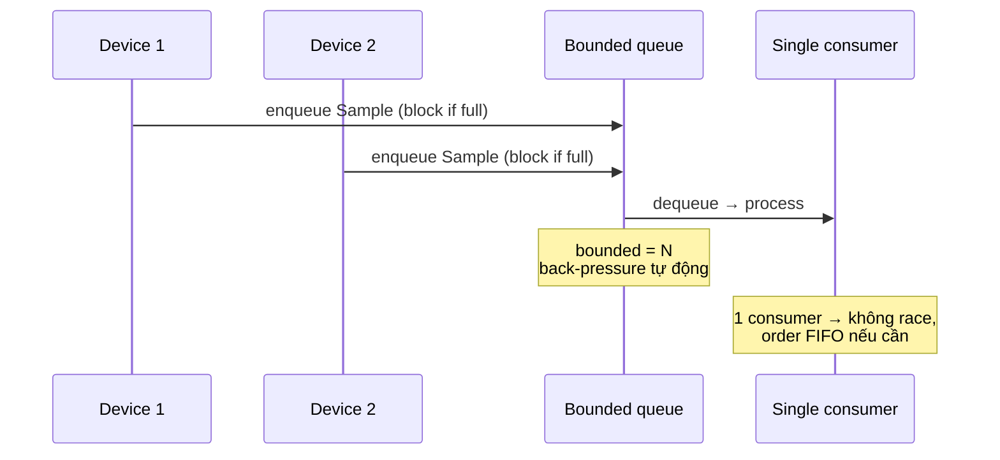

# What is a race condition and how do you prevent it?

> Race condition là lỗi chương trình khi kết quả phụ thuộc thứ tự thực thi xen kẽ giữa hai thread xử lý cùng dữ liệu. Nguyên nhân là thao tác không-nguyên-tử trên shared state. Phòng bằng cách loại bỏ shared state (immutable + message passing), atomic primitive (CAS, fetch_add), mutex/condition variable cho critical section, hoặc transaction. Bài [compare-and-swap](compare-and-swap.md) trình bày primitive atomic quan trọng nhất; bài [mutex-vs-lock](mutex-vs-lock.md) bàn lock chuẩn cho critical section.

Chủ đề: Concurrency · Ngày: 2026-10-16

## 0. Nền tảng trước khi đọc

**Bối cảnh:** Nhiều việc cùng chạy trong một chương trình. Khó ở chỗ các việc có thể chạm cùng dữ liệu và làm kết quả sai nếu không phối hợp.

**Nói đơn giản:** Race condition xảy ra khi kết quả phụ thuộc vào việc luồng nào chạy trước. Ví dụ hai luồng cùng tăng một bộ đếm nhưng một lần tăng bị mất.

**Từ khóa cần biết:** thread = luồng chạy; shared state = dữ liệu dùng chung; synchronization = cách phối hợp luồng.

**Ví dụ dễ hình dung:** Hai người cùng bấm mua món cuối cùng. Nếu không đồng bộ, cả hai có thể được báo mua thành công dù kho chỉ còn một.

Khi đọc, luôn hỏi ba câu: nó giải quyết vấn đề gì, nó làm việc theo những bước nào, và khi nào không nên dùng?

**Cách học bài này:** Đọc phần này trước để nắm từ khóa; đọc phần 1 để lấy câu trả lời 30 giây; đọc phần 2 để hiểu cơ chế; cuối cùng mở từng câu hỏi ở phần 3 để luyện nói. Các con số và lệnh trong bài là bằng chứng cho câu trả lời, không cần học thuộc nếu chưa hiểu cơ chế.

## 1. Là gì

### Đọc nhanh trước khi đi sâu

**Ý chính:** Race condition xảy ra khi kết quả phụ thuộc vào việc luồng nào chạy trước. Ví dụ hai luồng cùng tăng một bộ đếm nhưng một lần tăng bị mất.

**Ví dụ interview:** Hai người cùng bấm mua món cuối cùng. Nếu không đồng bộ, cả hai có thể được báo mua thành công dù kho chỉ còn một.

**Luồng 4 bước:**

1. Có nhiều task cùng chạy.
2. Các task chạm vào dữ liệu hoặc tài nguyên chung.
3. Chương trình dùng message passing, atomic hoặc lock để phối hợp.
4. Task tiếp tục và kết quả không bị mất, trùng hoặc kẹt.

**Nói như trong interview:** Race condition xảy ra khi kết quả phụ thuộc vào việc luồng nào chạy trước. Ví dụ hai luồng cùng tăng một bộ đếm nhưng một lần tăng bị mất. Hãy nói theo bốn bước trên trước; nếu interviewer hỏi sâu, chuyển sang cơ chế **Bước 1. Ba dạng race cốt lõi**, rồi nêu trade-off và failure mode ở các phần sau.

## 2. Cơ chế cốt lõi

### Bước 1. Ba dạng race cốt lõi

- **Read-modify-write (TOCTOU cho biến)**: `x = x + 1` tách thành ba bước; thread B xen giữa, ghi đè. Counter tăng 1 thay vì 2.
- **Check-then-act (TOCTOU cho cấu trúc)**: `if (map.has(k)) v = map[k];` — thread B xóa `k` giữa has và get.
- **Publication race**: thread A tạo object, ghi vào biến atomic, thread B load atomic, nhưng không memory ordering — B thấy object chưa init.

### Bước 2. `count++` không atomic trên mọi kiến trúc

`count++` trong C compile thành:
1. `mov eax, [count]` (load)
2. `add eax, 1`
3. `mov [count], eax` (store)

Ba bước, không atomic. Thread B xen giữa bước 1 và 3. Kết quả cuối = 1 (mất một increment).

Trên Java: `i++` không atomic cho non-`volatile long`. `AtomicInteger.incrementAndGet()` atomic qua CAS.

### Bước 3. Công cụ phát hiện race

- **ThreadSanitizer (TSan)**: instrument runtime, báo race ngay khi access mà không synchronization. Trên clang/gcc `-fsanitize=thread`. Chi phí 5-15× chậm hơn, ~5× memory.
- **Helgrind (Valgrind)**: trên Linux, phát hiện lock order + race read/write. Chậm hơn TSan.
- **Race detector Go (`-race`)**: instrument runtime Go, báo race trên channel/mutex sai. Cực kỳ phổ biến.
- **Java StallDetector hoặc `findbugs`**: static analysis, báo pattern race.

### Bước 4. Bốn cách phòng race

1. **Immutability + message passing**: dữ liệu immutable, giao tiếp qua channel/queue (Go channel, Rust message, Kafka). Không shared state → không race.
2. **Atomic primitive**: counter, flag, refcount dùng `std::atomic`, `AtomicLong` Java, `int64` Go atomic. CAS hoặc `fetch_add`.
3. **Mutex + critical section**: khóa mutex, làm việc, unlock. Xem bài [mutex-vs-lock](mutex-vs-lock.md).
4. **Database transaction**: race trên data nằm trong DB thì dùng transaction với isolation level phù hợp (PostgreSQL REPEATABLE READ, InnoDB REPEATABLE READ, optimistic locking).

### Bước 5. Backpressure khi streaming từ nhiều device

Quy tắc: producer nhanh hơn consumer → unbounded queue → OOM. Cần bounded queue (channel capacity N), producer block khi đầy → back-pressure lan lên device layer (giảm sample rate, drop packet, signal upstream).

```go
// Go: streaming từ nhiều device tránh race
// Producer N goroutines + 1 consumer goroutine + bounded channel
queue := make(chan Sample, 256)
for _, dev := range devices {
    go func(d Device) {
        for {
            s := d.Read()
            queue <- s  // block khi queue đầy → back-pressure
        }
    }(dev)
}
go func() {
    for s := range queue {
        process(s)  // 1 consumer duy nhất, không race
    }
}()
```

### Bước 6. Lock-free ring buffer cho high-throughput

Khi contention cao và mutex quá đắt, lock-free ring buffer (SPSC hoặc MPMC) thay thế:

- **SPSC** (single producer single consumer): 2 goroutine, 1 atomic đầu head, 1 atomic đầu tail. Không CAS loop, chỉ `fetch_add`. Hiệu năng ~50-100 ns.
- **MPMC** (multi producer multi consumer): CAS cho cả push và pop. Phức tạp hơn, có ABA, dùng `boost::lockfree::queue` hoặc `ConcurrentQueue` (Java).

Lock-free không phải không có race — vẫn là atomic operations nhưng đảm bảo tốt hơn mutex khi contention cao.

### Bước 7. Race có thể gây gì trong production

- **Wrong data**: counter sai, balance sai, tổng tiền lệch.
- **Lost data**: insert hai bản ghi, một bị xóa trong khi write, mất bản ghi (database).
- **Crash**: pointer được dereference trước khi construct xong (Java NPE, C++ segfault).
- **Hang**: deadlock (chuỗi chờ vòng) hoặc lost wakeup.
- **Performance degrade**: cache ping-pong, contention.

### Bước 8. Stream từ nhiều device — pattern chuẩn



*Sequence: producer enqueue có thể block khi full → back-pressure; 1 consumer dequeue tuần tự. Mỗi sample xử lý 1 lần → không race.*

### Quan sát

```bash
# Go: chạy race detector
go run -race ./myapp

# Compile với ThreadSanitizer
clang -fsanitize=thread -g -O2 main.c -lpthread -o app
# Hoặc GCC:
gcc -fsanitize=thread -g -O2 main.c -lpthread -o app

# Output minh họa (chưa chạy):
# WARNING: ThreadSanitizer: data race (pid=12345)
#   Write of size 8 at 0x7f... by thread T1:
#     #0 counter++
#     #1 main goroutine ...
```

### Ví dụ chạy từng bước

Kịch bản: ví dụ `count++` kinh điển trên C, shared `int counter = 0` trong memory, 2 thread T1 và T2 mỗi thread gọi `counter++` đúng 1 lần. Kết quả mong đợi counter=2, nhưng race cho phép counter=1. Compiler GCC trên x86_64 compile `count++` thành 3 instruction: `mov eax, [counter]` (load), `add eax, 1` (compute), `mov [counter], eax` (store). Không atomic, kernel có thể xen giữa 3 instruction.

| Bước | Thread | Hành động (instruction) | counter (mem) |
|---|---|---|---|
| 1 | T1 | `mov eax, [counter]` — load, eax=0 | 0 |
| 2 | T1 | `add eax, 1` — tính local, eax=1 | 0 |
| 3 | T2 | `mov eax, [counter]` — xen vào, eax=0 | 0 |
| 4 | T2 | `add eax, 1` — tính local, eax=1 | 0 |
| 5 | T2 | `mov [counter], eax` — ghi 1 | 1 |
| 6 | T1 | `mov [counter], eax` — ghi đè, vẫn 1 | 1 |

Kết quả cuối cùng counter=1, mất 1 lần increment. T1 và T2 đều "đúng" trong góc nhìn từng thread (mỗi thread thấy EAX của mình đi từ 0→1), nhưng khi merge vào shared memory, một lần increment bị mất. Đây là **lost update**, dạng read-modify-write, nêu ở Bước 1 và Câu 4 trong phần 3.

Tại sao race xảy ra ở đây? Vì compiler/CPU không biết `counter` được share. Compiler sinh 3 instruction tách rời, vì vậy giữa load và store có "khoảng trống" cho thread khác xen vào. Nếu compiler biết counter atomic (C++ `std::atomic<int>` hoặc GCC `__atomic_load_n`), compiler sẽ sinh `lock inc` (x86) hoặc `ldxr/stxr` (ARM), một instruction nguyên tử, không xen được. Tại sao mutex không giải quyết? Mutex cũng giải quyết được — lock mutex, load+add+store, unlock — nhưng đắt hơn `fetch_add` cho counter đơn giản (xem bài [compare-and-swap](compare-and-swap.md)).

Biến thể lỗi 1 (check-then-act): `if (counter < 10) { process(counter); counter++; }` với 2 thread. Cả hai đọc counter=9, cả hai vào nhánh, cả hai `process(9)`, counter cuối=10 (mất 1). Đây là TOCTOU (check-then-act), dạng thứ 2 trong 3 dạng race ở Bước 1 phần 2. Fix: dùng `AtomicInteger.incrementAndGet` trả old value, kiểm tra old<10 trước khi xử lý.

Biến thể lỗi 2 (publication): thread A tạo object, ghi `obj_ptr = new Object()`, thread B đọc `obj_ptr` rồi dereference. Nếu không có memory ordering (Java non-volatile, C++ plain pointer), B có thể thấy pointer hợp lệ nhưng object chưa fully constructed (Java NPE, C++ segfault). Race này khó reproduce vì phụ thuộc CPU reorder. Fix: `volatile` Java, `std::atomic<Object*>` C++, hoặc channel receive Go (channel đảm bảo happens-before).

Điều rút ra: ví dụ `count++` chứng minh race xảy ra ở mức instruction, không phải high-level logic. Đây là lập luận ở Câu 1 và Câu 4 trong phần 3: race cần atomic primitive hoặc mutex để serialize critical section, không thể dựa vào "chỉ 1 thread dùng" hay test single-threaded.

## 3. Câu hỏi phỏng vấn

### 3A. Câu hỏi đào sâu

<details class="qa">
<summary>Câu 1. Định nghĩa race condition và lấy ví dụ `count++` không atomic.</summary>

**Trả lời ngắn:** Race là lỗi khi kết quả phụ thuộc thứ tự xen kẽ giữa các thread truy cập shared state. Ví dụ `count++`: compile thành ba bước `load; add; store`; thread B xen giữa load và store → kết quả cuối = old+1 thay vì old+2 (lost update). Tần suất lỗi phụ thuộc timing, thường cực hiếm trong test, dễ nổ tung trong production.

**Đào sâu:**
- `count++` không atomic vì kiến trúc RISC/CISC đều tách 3 micro-op.
- Compiler có thể reorder; CPU có thể reorder (ngoại trừ mỗi thread tự observe coherent).
- Race không phát hiện ở debug build với single-threaded test. Trên production với timing khác, có thể thấy counter = 999 thay vì 1000.
- Trên Java: `int counter` non-volatile + `counter++` cũng race. Fix: `AtomicInteger.incrementAndGet()`.
- Cách viết compiler/bytecode/Java nào cũng có nguy cơ; giải pháp chính là atomic primitive hoặc mutex.

**Bẫy:** "Race chỉ xảy ra khi nhiều process cùng truy cập file". Sai — race là bất kỳ concurrent truy cập shared state, dù trong cùng process.

**Follow-up:** Race condition và data race khác nhau không? Data race là "hai thread cùng access memory cùng lúc, ít nhất một là write, không có happens-before". Race condition là broader — bao gồm data race, logical race (vd phase ordering). Data race là một dạng của race condition.
</details>

<details class="qa">
<summary>Câu 2. Race condition xảy ra khi streaming từ nhiều device đồng thời. Bạn thiết kế thế nào?</summary>

**Trả lời ngắn:** Mỗi device một goroutine/thread đọc sample, đẩy vào bounded queue có capacity. 1 consumer goroutine xử lý tuần tự. Race tránh vì consumer đơn nhất, queue là channel/queue có synchronization. Bounded queue cho back-pressure: producer block khi đầy → thiết bị chậm lại, không OOM.

**Đào sâu:**
- Bước 1: phân tách producer/consumer. Mỗi producer chỉ write queue, không read state khác.
- Bước 2: bounded queue. Không dùng unbounded channel hoặc slice tăng vô hạn — sẽ OOM khi consumer chậm. Capacity = `min(device_rate × N × safe_margin, memory_budget)`.
- Bước 3: 1 consumer duy nhất. Single-threaded consumer đơn giản hóa logic xử lý (không cần mutex). Nếu cần parallel processing, fan-out ở downstream.
- Bước 4: timestamp + sequence number để detect packet reorder/loss; merge logic ở consumer nếu multi-device cần correlation.
- Bước 5: monitor. `len(queue)`, `cap(queue)`, sample drops, lag từ device-time.
- Nếu contention cao (~millions sample/giây) và đo thấy mutex là bottleneck: lock-free ring buffer SPSC + per-device producer đẩy vào MPMC queue (boost `lockfree::queue`), consumer single poll.

**Bẫy:** Dùng `slice` trong Go rồi mutex append — dễ contention. Channel Go channel tối ưu vì runtime riêng.

**Follow-up:** Nếu device rate lệch lớn (một device 1kHz, một 100kHz), consumer không kịp xử lý 100kHz → back-pressure không lan về device? Có thể — thiết bị 100kHz cần buffer ring riêng (hardware) hoặc sample decimation. Pipeline hai tầng: fast pre-aggregation → bounded queue → main consumer.
</details>

<details class="qa">
<summary>Câu 3. Check-then-act khác read-modify-write thế nào? Cho ví dụ.</summary>

**Trả lời ngắn:** Read-modify-write: thread đọc-sửa-ghi trên cùng biến (`x = x + 1`). Check-then-act (TOCTOU): thread kiểm tra điều kiện trên một tập, rồi hành động trên kết quả (`if (map.has(k)) get(k)`). TOCTOU thường gặp với collection, file existence, lazy init.

**Đào sâu:**
- TOCTOU kinh điển: `if (!cache.containsKey(k)) { cache.put(k, compute()); } return cache.get(k);` — giữa contains và put, thread khác insert → compute lần hai, hoặc get miss.
- File: `if (file.exists()) file.delete();` — file có thể bị xóa giữa check và delete; delete trả false.
- Race fix: atomic operation. ConcurrentHashMap Java `computeIfAbsent` atomic — không cần check rồi put riêng.
- Lazy init singleton: `if (instance == null) instance = new Singleton();` — thread khác cũng thấy null và tạo hai instance. Fix: double-checked locking với `volatile` (Java 5+) hoặc holder idiom.

**Bẫy:** "Check-then-act chỉ áp dụng cho file". Sai — áp dụng cho mọi object có state có thể thay đổi giữa hai bước.

**Follow-up:** `ConcurrentHashMap.computeIfAbsent` lock toàn map không? Không — lock ở mức bin/node. Các key khác không bị block.
</details>

<details class="qa">
<summary>Câu 4. Lost update và cách phòng tránh.</summary>

**Trả lời ngắn:** Lost update: hai thread cùng đọc old value, mỗi bên tính new value dựa trên old, ghi new → cuối cùng chỉ có 1 update tồn tại. Phòng bằng: atomic increment (`fetch_add` hoặc `UPDATE col = col + ?`), hoặc optimistic locking với version column (`UPDATE ... WHERE version = ?`).

**Đào sâu:**
- Ví dụ: tài khoản balance = 100. T1 và T2 cùng `balance += 10`. Cả hai đọc 100, ghi 110. Cuối cùng balance = 110, mất 10.
- Cách 1: SQL `UPDATE accounts SET balance = balance + 10 WHERE id = ?` — engine xử lý atomic.
- Cách 2: optimistic: `UPDATE ... SET balance = 110, version = version + 1 WHERE id = ? AND version = 5`. Nếu 0 row affected → retry.
- Cách 3: mutex trong app. Lock trước khi đọc-sửa-ghi.
- Cách 4: `AtomicLong.compareAndSwap` cho in-memory counter (chỉ khi logic đơn giản).
- Cách 5: database transaction với isolation REPEATABLE READ → fail với "could not serialize" → retry. Xem bài [Database/database-isolation-levels.md](../Database/database-isolation-levels.md).

**Bẫy:** "Mutex tự giải quyết lost update". Đúng nếu khóa cả đoạn đọc-sửa-ghi. Sai nếu khóa riêng từng phần.

**Follow-up:** Khi nào dùng optimistic vs pessimistic? Optimistic khi contention thấp (retry ít), pessimistic khi contention cao (tránh retry storm).
</details>

<details class="qa">
<summary>Câu 5. Immutability + message passing có thật sự loại bỏ race?</summary>

**Trả lời ngắn:** Có, nếu dữ liệu immutable (không thể thay đổi sau khi tạo) và giao tiếp qua message passing (channel, queue). Không có shared mutable state → không có race. Đây là triết lý của Go ("Don't communicate by sharing memory; share memory by communicating"), Erlang/Elixir, Rust (hệ thống ownership/borrow checker compile-time).

**Đào sâu:**
- Go: mỗi goroutine có state riêng; giao tiếp qua channel. Nếu chỉ channel + immutable value, race bị loại bỏ. Go race detector (`-race`) vẫn có thể báo nếu goroutine ghi slice map được share.
- Rust: ownership đảm bảo 1 thread sở hữu dữ liệu tại 1 thời điểm; `&T` immutable borrow nhiều thread OK, `&mut T` chỉ 1 thread. Compile-time guarantee, không cần runtime check.
- Erlang: process là actor, message queue per process, immutable message. Khái niệm "let it crash" cho phép supervisory tree.
- Java: không có compile-time guarantee, nhưng nếu dùng `final` fields + constructor + safe publication, race tránh được.
- Tuy nhiên: shared state vẫn cần ở đâu đó (config, logger, metrics). Đó chỗ dùng atomic hoặc mutex.

**Bẫy:** "Immutable = thread-safe". Đúng nếu immutable hoàn toàn (final fields, sau constructor không thay đổi). Sai nếu chỉ là "tôi không gọi setter" mà field không final.

**Follow-up:** `final` trong Java có atomic không? Có — JMM đảm bảo final fields không bị reorder với constructor. Nhờ vậy `final` + safe publication (vd init trong static block hoặc synchronized) cho object immutable tránh publication race.
</details>

<details class="qa">
<summary>Câu 6. Công cụ nào phát hiện race ngoài runtime race detector?</summary>

**Trả lời ngắn:** Static analysis (FindBugs, error-prone), dynamic race detector (ThreadSanitizer TSan, Helgrind, Go `-race`), code review (pattern lock), kết hợp cả ba. Production: log với timestamp chính xác, distributed tracing, replay để tìm ordering.

**Đào sâu:**
- ThreadSanitizer (TSan) compile-time instrumentation; phát hiện data race; không phát hiện higher-level race condition (TOCTOU). Chi phí 5-15×.
- Helgrind (Valgrind) không cần recompile; chậm hơn nhiều; tốt cho C/C++ single-process.
- Go `-race` runtime detection; chạy được trên production nếu traffic thấp. Không phát hiện channel deadlock cố ý.
- FindBugs/error prone (Java): static analysis phát hiện pattern race (`SimpleDateFormat` shared, `HashMap` không synchronized).
- Runtime: log assertion trong invariant, kiểm tra trên production (vd counter cuối ngày phải = tổng insert).
- Khi race rất hiếm (< 1/1M): dùng chaos testing hoặc stress test (ThreadFuzz) để tăng khả năng lộ.

**Bẫy:** "Race detector phát hiện mọi race". Sai — chỉ data race. Logic race (vd TOCTOU với java.util.HashMap) có thể không bị báo.

**Follow-up:** TSan có chạy production được không? Về kỹ thuật được nhưng chi phí cao (5-15×) + overhead memory; chỉ chạy staging + canary.
</details>

<details class="qa">
<summary>Câu 7 (Debug). Service production ghi log sai thứ tự khi scale concurrency. Bạn điều tra thế nào?</summary>

**Trả lời ngắn:** 1) Reproduce với concurrency cao hơn (scaling stress). 2) Tìm `print`/`log` chia sẻ giữa các thread/goroutine; log thường ghi ra stdout/stderr — race trên buffer. 3) Race trên formatting (fmt.Sprintf chia sẻ). 4) Race trên timestamp. 5) Chạy `go -race` hoặc TSan.

**Đào sâu:**
- Bước 1: production scale: tăng worker/connection, xem log có trộn không.
- Bước 2: `fmt.Print` trong Go với nhiều goroutine — `os.Stdout.Write` không atomic ở line level; hai goroutine có thể "Hello" + "World" trộn thành "HWeolrlldo".
- Bước 3: `StringBuilder` trong Java chia sẻ; `sprintf` trong C trên buffer share.
- Bước 4: timestamp từ `time.Now()` đa thread gần như unique nhưng nếu resolution thấp (millisecond) có thể thấy trùng.
- Bước 5: logger chuyên nghiệp: log4j2 async, zap (Uber), slog (Go) — write từng dòng với mutex hoặc lock-free buffer.
- Metric: log reorder (timestamp trước ở log sau) — dùng sequence number hoặc monotonic clock.

**Bẫy:** Sửa bằng cách gọi `fmt.Println` với mutex. Đúng nhưng chậm với high-throughput — logger chuẩn có buffered writer, nhiều log level, sampling tốt hơn.

**Follow-up:** Logger async có drop log khi quá tải? Có — async logger bounded queue, drop khi đầy cùng `lost_logs` counter.
</details>

<details class="qa">
<summary>Câu 8 (Thiết kế). Thiết kế ứng dụng thu thập sample từ 10 sensors mỗi sensor 100Hz, ghi vào Kafka. Quyết định chính?</summary>

**Trả lời ngắn:** Mỗi sensor 1 goroutine đọc → bounded channel; 1 worker batch ghi Kafka producer.send. Bounded channel 10K sample cho ~1 giây data. Kafka partition key = sensor_id để FIFO trong partition.

**Đào sâu:**
- Quyết định 1: bounded channel N=10K (1000 sample/s × 10 × safe margin). Back-pressure khi Kafka chậm.
- Quyết định 2: 1 goroutine consumer. Single-threaded xử lý format, partition key.
- Quyết định 3: batching Kafka producer.send. Set `batch.size=100`, `linger.ms=50`.
- Quyết định 4: Kafka partition key = sensor_id. Sample từ cùng sensor vào cùng partition, FIFO. Consumer parallelism trên sensor khác.
- Quyết định 5: monitoring — Kafka producer metric (`record_send_rate`, `buffer_outgoing`), channel len/cap, sensor lag.
- Trade-off: bounded channel không tránh drop khi Kafka chết lâu hơn capacity/rate. Cần ring buffer spill-to-disk cho H/A.

**Bẫy:** Chia 10 worker, mỗi worker 1 sensor — không bounded queue, không batch, không back-pressure tập trung.

**Follow-up:** Sensor gửi audio raw, không structured: binary frame + length prefix; Kafka `compression.type=lz4` giảm network.
</details>

### 3B. Câu hỏi phỏng vấn liên quan

<details class="qa">
<summary>Câu 9. Data race và race condition khác nhau thế nào?</summary>

**Trả lời:** Data race: hai thread cùng access memory lúc, ít nhất một là write, không có happens-before ordering (định nghĩa JLS/C++ standard). Race condition: broader — kết quả phụ thuộc timing, có thể là data race, có thể là TOCTOU/logical race. Data race là một dạng race condition nhưng race condition không nhất thiết là data race. Tránh nhầm lẫn khi trả lời.
</details>

<details class="qa">
<summary>Câu 10. Tại sao dùng channel/queue có bounded là pattern chuẩn cho streaming multiple devices?</summary>

**Trả lời:** Channel/queue có cap → producer block khi đầy, lan back-pressure lên device. Single consumer → không race trên state xử lý. Memory bounded → không OOM. Triết lý Go "Don't communicate by sharing memory; share memory by communicating" — channel là building block mặc định, race detector bắt được mọi sai lệch.
</details>

<details class="qa">
<summary>Câu 11. Bounded queue nên có capacity bao nhiêu?</summary>

**Trả lời:** Rule of thumb: capacity = `consumer_rate_ratio × burst_time × safe_margin`. Ví dụ consumer xử lý 10k sample/s, burst 1 giây → capacity ~10K. Quá nhỏ: producer block thường, latency tăng. Quá lớn: tốn RAM, OOM rủi ro. Thường 1K-100K tuỳ workload. Metric: `len(queue)/cap(queue)` ratio nên < 0.5 để back-pressure không kick in liên tục.
</details>

<details class="qa">
<summary>Câu 12. Producer-consumer có thể dùng `sync.Map` Go không?</summary>

**Trả lời:** Được, nhưng `sync.Map` không phù hợp producer-consumer. `sync.Map` tối ưu cho read-mostly workload và use case có key ổn định; không có `len()`, iteration không atomic toàn map. Producer-consumer cần channel là tự nhiên hơn. `sync.Map` thường dùng cho cache hoặc session store.
</details>

<details class="qa">
<summary>Câu 13. Spurious "race" trong Go race detector có thật là race không?</summary>

**Trả lời:** Nếu race detector báo, thường là race thật (data race đúng nghĩa). Tuy nhiên nó có thể báo race trên finalizer hoặc goroutine teardown không thật sự ảnh hưởng behavior. Cần đọc stack trace cẩn thận — đôi khi cần `//nolint:race` cho trường hợp biết rõ. Đa số báo race detector là race cần fix.
</details>

<details class="qa">
<summary>Câu 14. Làm sao scale stream processing khi 1 consumer không kịp?</summary>

**Trả lời:** Fan-out: n worker chia sẻ load. Hai pattern: (a) dispatch theo key — cùng key vào cùng worker tránh race trên per-key state; (b) sharded queue mỗi worker poll từ queue riêng. Trade-off: routing overhead, mất FIFO toàn cục. Đo đạc; thường 1 consumer + async batching đủ trước khi cần fan-out.
</details>

<details class="qa">
<summary>Câu 15. Đúng hay sai: "Race chỉ quan trọng cho write; read là an toàn."</summary>

**Trả lời:** Sai nghe đúng nhưng sai. Reader có thể publication-race: thread A publish object, thread B đọc pointer rồi dereference — không có happens-before, B thấy object chưa fully init (Java NPE, C++ segfault). Read phụ thuộc write mới phát sinh race. Pure immutable data thì read an toàn; publication race vẫn là race.
</details>

<details class="qa">
<summary>Câu 16. Khi nào nên dùng database transaction thay mutex trong app?</summary>

**Trả lời:** Khi dữ liệu thật sự persistent và nhiều app instance cùng access. Mutex trong app chỉ lock trong 1 process; nếu có 3 service instances cùng update row, mutex không phối hợp được. Database transaction với isolation level REPEATABLE READ + application retry là đúng cho cross-process. App mutex cho in-memory data, DB transaction cho persistent data.
</details>

<details class="qa">
<summary>Câu 17. Đúng hay sai: "Race chỉ quan trọng cho write; read là an toàn."</summary>

**Trả lời:** Sai nghe đúng nhưng sai. Nhiều reader có thể race cho publication: thread A publish object, thread B đọc pointer và dereference — nếu không có happens-before, B có thể thấy object chưa fully init (Java NPE, C++ segfault). Đọc phụ thuộc write mới phát sinh race. Đúng với pure immutable data thì read an toàn, nhưng publication race vẫn là race.
</details>

## 4. Đánh đổi và sự cố production

### So sánh chiến lích phòng race

| Tiêu chí | Mutex | Channel/queue | Atomic primitive | DB transaction |
|---|---|---|---|---|
| Cross-process | Không | Không (shared memory mới được) | Không (shared memory) | Có |
| Blocking | Sleep | Block/select | Không (retry hoặc fail) | Sleep (transaction) |
| Back-pressure | Không tự nhiên | Có (bounded) | Không | Không |
| Composability | Thấp | Cao (chain queue) | Thấp | Cao |
| Failure mode | Deadlock, lock-order | Queue đầy → block | ABA, livelock | Serialization failure |
| Phù hợp khi | Shared state cụm, logic phức tạp | Streaming/pipeline, producer-consumer | Counter, flag, refcount | Persistent data nhiều instance |

### Năm failure mode

| Triệu chứng | Nguyên nhân gốc | Cách kiểm tra | Cách sửa |
|---|---|---|---|
| Counter cuối ngày thấp hơn kỳ vọng | Many thread tăng counter non-atomic (lost update) | `go test -race`, atomic counter check | `AtomicInteger.incrementAndGet` hoặc `UPDATE col = col + n` |
| Bản ghi trùng lặp hoặc bị mất | Race giữa check-then-insert trong DB | UNIQUE constraint vi phạm; log | Upsert (`INSERT ... ON CONFLICT`) hoặc optimistic + retry |
| OOM trong streaming pipeline | Unbounded queue/channel tăng khi consumer chậm | `len(channel)/cap(channel)` ratio | Bounded channel + back-pressure; sampling |
| NPE / segfault sau deploy | Publication race — thread đọc object chưa init | TSan, log stack, heap dump | `volatile` Java, atomic publication, safe construction |
| Performance suy giảm ở high core count | False sharing + cache contention | `perf c2c`, benchmark multi-core | Padding, sharded counter, thread-local |

## 5. Cheat sheet

| Chủ đề | Con số / quy tắc cần nhớ |
|---|---|
| Race | Kết quả phụ thuộc thứ tự xen kẽ giữa thread truy cập shared state |
| 3 dạng race | Read-modify-write, check-then-act, publication |
| `count++` | Không atomic; tách 3 micro-op |
| 4 cách phòng | Immutable + message, atomic, mutex, DB transaction |
| TSan overhead | ~5-15× chậm; staging only |
| Bounded channel | `cap = rate_ratio × burst × safe_margin` |
| Back-pressure | Bounded queue → producer block → tự cân bằng |
| Streaming N devices | 1 goroutine/thread đọc → channel → 1 consumer → sink |
| Lock-free ring buffer | SPSC ~50-100 ns; MPMC dùng CAS + ABA fix |
| Safe publication | Final fields + safe init (Java); atomic flag (C/C++); channel receive (Go) |

**Học tiếp:**
- [compare-and-swap](compare-and-swap.md) — primitive atomic cốt lõi
- [mutex-vs-lock](mutex-vs-lock.md) — cách đồng bộ hóa shared state
- [condition-variable](condition-variable.md) — CV cho read-write với predicate
- [Database/database-isolation-levels.md](../Database/database-isolation-levels.md) — phòng race trên persistent data

**Kiểm tra nhanh trước phỏng vấn:**
- Định nghĩa race bằng ví dụ `count++`.
- Phân biệt 3 dạng race cốt lõi (read-modify-write, TOCTOU, publication).
- Nhắc bounded queue + back-pressure cho streaming pipeline.
- Không nhầm "lock-free" với "no race"; chỉ là giảm lock, vẫn cần atomic.
- Giải thích TSan / Go `-race` chạy được ở dev, không chạy production.
- Biết cách "race vs deadlock vs livelock" — deadlock chờ nhau, race xen kẽ, livelock chạy mãi không progress.
