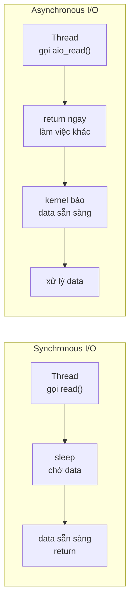
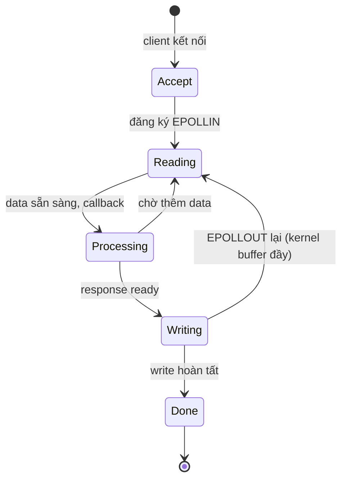

# What is the difference between synchronous and asynchronous I/O?

> Bài này phân biệt synchronous I/O (thread chờ đến khi I/O hoàn tất) và asynchronous I/O (thread gửi yêu cầu, tiếp tục làm việc khác, nhận kết quả qua callback/future/event). Bài đi vào blocking vs non-blocking syscall ở Linux, epoll/kqueue/IOCP, và so sánh với Node.js, Python asyncio, Go goroutine, Java NIO. Bài liên quan: [thread-pool](thread-pool.md), [concurrency-vs-parallelism](concurrency-vs-parallelism.md).

Chủ đề: Concurrency · Ngày: 2026-10-16

## 1. Là gì

Synchronous I/O là mô hình mà thread gọi một thao tác I/O (đọc file, gửi network) phải chờ cho đến khi thao tác hoàn tất hoặc lỗi trước khi nhận kết quả và tiếp tục. Trong thời gian chờ, thread không làm gì khác. Asynchronous I/O là mô hình thread gửi yêu cầu rồi nhận về ngay (không chờ), tiếp tục xử lý công việc khác; khi I/O xong, kết quả được đưa về qua callback, future/promise, event hoặc signal.

Phân biệt thêm: blocking vs non-blocking ở mức syscall. Blocking syscall (read, write, recv) đặt thread vào trạng thái sleep cho đến khi kernel có dữ liệu. Non-blocking syscall trả về ngay với EAGAIN nếu chưa có dữ liệu; thread phải poll hoặc dùng cơ chế thông báo (epoll, kqueue, IOCP). Asynchronous I/O thường dùng non-blocking syscall kết hợp event notification; synchronous I/O thường dùng blocking syscall.



*Sơ đồ vị trí: sync I/O block thread cho đến khi data; async I/O trả thread về ngay, kernel báo khi xong.*

### Trả lời 30 giây

"Sync I/O block thread trong khi chờ kernel xử lý I/O; thread không làm gì khác. Async I/O trả thread về ngay, làm việc khác, kernel báo khi xong. Trên OS: blocking syscall (read) đặt thread vào sleep; non-blocking syscall (read với O_NONBLOCK) trả EAGAIN; true async I/O (io_uring trên Linux 5.1+, IOCP trên Windows) yêu cầu kernel xử lý và báo qua completion event. Trên application: Node.js dùng libuv (epoll/kqueue/IOCP); Python asyncio tương tự; Go runtime dùng goroutine + netpoller; Java NIO dùng Selector + CompletionHandler. Sync đơn giản, dễ debug; Async scale tốt với hàng nghìn connection nhưng code khó đọc và blocking call trong async chặn cả event loop."

## 2. Cơ chế cốt lõi

### Bước 1. Kernel xử lý I/O như thế nào

Khi thread gọi read(file, buf, n) trên Linux:

1. Thread đi vào kernel space (qua syscall).
2. Nếu file descriptor sẵn sàng (data có trong buffer): copy data từ kernel buffer sang buf, return số byte đọc được.
3. Nếu chưa có data: kernel đặt thread vào wait queue trên file descriptor đó, gọi scheduler chuyển sang thread khác.
4. Khi I/O device (disk, NIC) hoàn tất, driver gọi `wake_up()` trên wait queue; thread được đánh dấu runnable, scheduler chạy lại.

Blocking I/O: thread nằm trong wait queue cho đến khi driver wake. Non-blocking I/O: nếu wait queue rỗng, kernel return `-EAGAIN` ngay; thread phải poll hoặc dùng event notification (epoll).

### Bước 2. Non-blocking I/O + epoll — Linux model

```c
// Pseudo-code: epoll-based echo server
int epfd = epoll_create1(0);
struct epoll_event ev, events[MAX_EVENTS];

// Add listening socket
ev.events = EPOLLIN;
ev.data.fd = listen_fd;
epoll_ctl(epfd, EPOLL_CTL_ADD, listen_fd, &ev);

// Set all sockets O_NONBLOCK
fcntl(listen_fd, F_SETFL, O_NONBLOCK);

while (1) {
    int n = epoll_wait(epfd, events, MAX_EVENTS, -1);
    for (int i = 0; i < n; i++) {
        if (events[i].data.fd == listen_fd) {
            // accept new connection, add to epoll
        } else if (events[i].events & EPOLLIN) {
            // read available data (non-blocking)
        }
    }
}
```

epoll_wait trả về danh sách file descriptor có sự kiện. Một thread có thể xử lý hàng nghìn connection. Tốn memory cho mỗi fd (~1KB struct) nhưng không tốn thread stack. macOS dùng kqueue (API tương tự), Windows dùng IOCP (I/O Completion Port).

### Bước 3. True async I/O — io_uring (Linux 5.1+)

epoll vẫn cần thread poll và gọi read/write; chưa phải true async. io_uring (2019) đưa SQE (Submission Queue Entry) vào ring buffer shared với kernel, kernel xử lý và đưa CQE (Completion Queue Entry) vào ring buffer khác. Thread submit batch operation và kiểm tra completion ring — không cần gọi syscall cho mỗi I/O.

- Linux 5.6+: io_uring hỗ trợ file I/O (read, write, fsync).
- Hiệu năng: giảm syscall overhead, batch submission, có thể đạt 1M IOPS trên NVMe.
- Trade-off: ít library hỗ trợ; liburing API tương đối mới. Production thường dùng epoll vì mature.

### Bước 4. Cách các runtime hiện thực async I/O

- **Node.js**: libuv trên Linux dùng epoll, macOS kqueue, Windows IOCP. Một main thread, event loop, callback queue. Mỗi I/O submit một watcher, kernel báo qua libuv.
- **Python asyncio**: event loop trên một thread, dùng `selectors` (epoll/kqueue/IOCP theo OS). Mỗi coroutine await sẽ đăng ký callback; khi I/O sẵn sàng, event loop gọi callback.
- **Go**: goroutine + netpoller. Khi goroutine gọi syscall network (read trên TCP socket), nếu chưa có data, goroutine vào wait queue của netpoller; thread OS xử lý goroutine khác. Khi socket có data, goroutine được đánh dấu runnable.
- **Java NIO**: Selector + Channel. Selector.select() block cho đến khi có channel sẵn sàng. CompletionHandler (NIO.2) cho true async I/O file.
- **Rust tokio**: mio ở tầng dưới (epoll/kqueue/IOCP), trên đó là reactor pattern; mỗi future await đăng ký interest vào reactor.

### Bước 5. Synchronous I/O dạng thread-per-connection

```python
# Thread-per-connection (blocking I/O)
def handle(client_socket):
    request = client_socket.recv(4096)  # block
    response = process(request)
    client_socket.sendall(response)     # block

# Server
while True:
    client, _ = server.accept()
    threading.Thread(target=handle, args=(client,)).start()
```

Mỗi connection một thread. Đơn giản, dễ hiểu, nhưng tốn memory (1-8MB stack mỗi thread), context switch overhead (~1-10µs). Giới hạn thực tế vài nghìn connection trên một box. Vẫn phổ biến trong app server truyền thống (Tomcat, Spring MVC).

### Bước 6. Sơ đồ state machine cho một connection async



*Vòng đời connection async: từ Accept đăng ký EPOLLIN, sang Reading; khi data sẵn chuyển Processing, response sẵn sang Writing; nếu kernel buffer đầy quay lại Reading đợi EPOLLOUT.*

### Quan sát

```bash
# Linux: xem thread đang chờ I/O ở đâu
cat /proc/<pid>/wchan
# futex, ep_poll, inet_csk_wait_data: thread đang chờ futex, epoll, hoặc socket data

# strace: xem thread block trong syscall nào
strace -p <pid> -e trace=read,write,recv,send,epoll_wait

# ss: thống kê socket ở trạng thái nào
ss -tan state time-wait | wc -l
ss -tan state established | wc -l

# /proc/<pid>/io: tổng bytes read/write
cat /proc/<pid>/io
```
### Ví dụ chạy từng bước

Kịch bản: HTTP server nội bộ, 1.000 request đến cùng lúc, mỗi request gọi một API downstream mất 50ms. So sánh hai cách triển khai: thread-per-connection (sync) và single-thread + epoll (async).

**Bước 1 (thread-per-connection).** Mỗi request → `accept()` → `pthread_create` (≈1ms overhead) → thread vào blocking `recv()` chờ body. 1.000 request → 1.000 thread × 1MB stack ≈ 1GB RSS. Mỗi thread phải tạo TCP connection riêng tới API downstream. Trạng thái: 1.000 thread ở `S` (sleeping) trong `/proc/<pid>/status`, wchan `inet_csk_wait_data` hoặc `futex`.

**Bước 2 (tính throughput sync).** 50ms I/O + 5ms compute = 55ms/task. 1.000 thread chạy song song, throughput ≈ 1.000 / 0,055s = **18.000 req/s** lý thuyết, nhưng context switch overhead ~1-10µs × 1.000 thread cao. Thực tế benchmark sync server (Tomcat thread pool 200) đạt 2-5k req/s cho loại workload này.

**Bước 3 (single-thread + epoll).** Main thread `epoll_wait` trên 1.000 fd. Mỗi request thêm fd vào epoll qua `epoll_ctl(EPOLL_CTL_ADD)`. Main thread không block trên `recv()`; thay vào đó, kernel báo fd nào có data qua `EPOLLIN`. Memory: 1.000 fd × ~1KB epoll struct + ~32KB TCP buffer mỗi fd ≈ 32MB. Stack: 1 thread × 8MB = 8MB. Tổng **~40MB**, thay vì 1GB.

**Bước 4 (tính throughput async).** Event loop xử lý tuần tự: 1.000 fd × 50ms I/O (kernel xử lý song song) + 5ms compute trong main thread. Compute: 1.000 × 5ms = 5.000ms = 5 giây pure CPU. Tổng: max(50ms, 5s) = 5s. Throughput: 1.000 / 5s = **200 req/s**. Tệ hơn sync!

**Bước 5 (phát hiện nghịch lý).** Compute 5ms/task × 1.000 task = 5s. Event loop single-thread không tận dụng 4 core. **Fix**: chuyển compute sang thread pool (libuv `UV_THREADPOOL_SIZE=4`). Compute: 1.000 × 5ms / 4 = 1,25s. Tổng: max(50ms I/O, 1,25s) = 1,25s. Throughput: **800 req/s**, vẫn thua sync 2-5k.

| Mô hình | Memory | Compute song song | Throughput |
|---|---|---|---|
| Thread-per-connection (1.000 thread) | ~1GB | 1.000 thread (nhưng ~4 core thật) | 2-5k req/s |
| Async single-thread | ~40MB | 0 (single thread) | 200 req/s |
| Async + worker pool 4 | ~50MB | 4 | 800 req/s |
| Async + worker pool 100 | ~200MB | 100 (vẫn chỉ 4 core thật) | ~1,8k req/s |

Nếu compute tăng từ 5ms lên 50ms: 1.000 × 50ms = 50s. Async single-thread: throughput 20 req/s. Sync 1.000 thread: kernel chỉ chạy 4-8 thread thật, throughput ≈ 80 req/s. Async + worker pool 4: max(50ms I/O, 12.500ms compute) = 12,5s → **80 req/s**. Bắt đầu ngang sync.

Điều rút ra: async thắng khi I/O-bound nặng và compute nhỏ; sync thread pool thắng khi compute trung bình trở lên vì kernel scheduling trên 4 core hiệu quả — nối với Câu 5 "Khi nào sync vẫn tốt hơn async": câu trả lời phụ thuộc tỉ lệ W/C, không phải mặc định.

## 3. Câu hỏi phỏng vấn

### 3A. Câu hỏi đào sâu

<details class="qa">
<summary>Câu 1. Synchronous và blocking I/O là một hay khác nhau?</summary>

**Trả lời ngắn:** Khác. Synchronous vs asynchronous nói về mối quan hệ giữa caller và callee khi I/O hoàn tất (caller có phải đợi không). Blocking vs non-blocking nói về trạng thái thread khi gọi syscall (thread có bị sleep không). Synchronous I/O thường dùng blocking syscall; asynchronous I/O thường dùng non-blocking syscall.

**Đào sâu:**
- Synchronous I/O: caller gọi read(), phải đợi read() return trước khi biết kết quả. read() thường là blocking syscall — thread sleep. Caller không làm gì trong khi đợi.
- Asynchronous I/O: caller gửi yêu cầu qua aio_read() hoặc submit SQE (io_uring); return ngay, caller làm việc khác; kernel báo qua completion event khi xong.
- Non-blocking I/O + poll/epoll: read() không block, trả EAGAIN nếu chưa có data. Caller phải loop hoặc dùng epoll để biết khi nào có data. Đây là async "thực dụng" mặc dù read() gọi sync từng lần.
- true async I/O (io_uring, IOCP): kernel xử lý hoàn toàn, caller không cần poll, completion notification.

**Bẫy:** "Sync = blocking, async = non-blocking". Sai — sync I/O có thể dùng non-blocking syscall (read O_NONBLOCK rồi poll); async I/O có thể dùng blocking syscall (aio_read submit, kernel dùng thread riêng).

**Follow-up:** Node.js là sync hay async? Từ góc nhìn API: callback-based, async; từ góc nhìn kernel: libuv dùng epoll (non-blocking). Hai khái niệm cùng tồn tại.
</details>

<details class="qa">
<summary>Câu 2. epoll, kqueue, IOCP khác nhau thế nào?</summary>

**Trả lời ngắn:** Cả ba đều là cơ chế event notification cho nhiều file descriptor. epoll (Linux), kqueue (BSD/macOS), IOCP (Windows). epoll và kqueue API tương tự (event-driven); IOCP dùng completion port (kernel queue + thread pool xử lý).

**Đào sâu:**
- epoll (Linux 2.6+): `epoll_create`, `epoll_ctl`, `epoll_wait`. Trả về danh sách fd có sự kiện. Scale O(1) với số fd (so với select O(n)).
- kqueue (BSD/macOS): `kqueue`, `kevent`. API giống epoll, thêm hỗ trợ filter (file, socket, signal, vnode).
- IOCP (Windows): khác biệt lớn — caller submit async operation (ReadFile/WSASend với OVERLAPPED), kernel queue completion vào port. Thread pool gọi GetQueuedCompletionStatus lấy completion. Mô hình khác: kernel chủ động làm thay vì user poll.
- select (legacy): O(n) scan tất cả fd, giới hạn 1024 fd. poll (legacy): O(n), không giới hạn fd. Cả hai vẫn dùng cho code portable.
- Hiệu năng: epoll/kqueue tương đương nhau; IOCP hiệu quả cho I/O nặng vì kernel overlap I/O với compute.

**Bẫy:** "Select tốt cho vài trăm connection". Có thể đúng — select O(n) nhưng với 100 fd thì overhead 1µs × 100 = 100µs, vẫn chấp nhận được. Nhưng đừng dùng select cho hàng nghìn fd.

**Follow-up:** io_uring khác epoll thế nào? io_uring dùng ring buffer shared với kernel, không cần syscall cho mỗi I/O. Batch submission hiệu quả hơn epoll cho I/O-bound nặng. Trade-off: code phức tạp hơn, ít library hỗ trợ.
</details>

<details class="qa">
<summary>Câu 3. Node.js event loop hoạt động thế nào, blocking call ảnh hưởng gì?</summary>

**Trả lời ngắn:** Event loop Node.js là một thread single, lặp qua các phase (timers, I/O callbacks, idle, poll, check, close). Mỗi I/O đăng ký callback với libuv; khi kernel báo (qua epoll/kqueue/IOCP), callback được enqueue và chạy trong main thread. Blocking call (sync loop, sync I/O, JSON.parse trên string lớn) chặn event loop, tất cả callback khác chờ.

**Đào sâu:**
- Các phase: timers (setTimeout, setInterval), pending callbacks (I/O error), idle, poll (epoll_wait, lấy I/O mới), check (setImmediate), close callbacks.
- microtask queue (Promise, process.nextTick) chạy giữa các phase. Promise resolve chạy trước I/O nếu cùng tick.
- Blocking call ví dụ: `fs.readFileSync` (sync), vòng lặp tính toán nặng (regex, JSON.parse, crypto). Một blocking call 100ms = tất cả request khác phải chờ 100ms latency.
- Worker threads (Node.js 10.5+): tách blocking code sang thread riêng, giao tiếp qua MessageChannel. Tương đương worker process nhưng nhẹ hơn.
- Cluster module: spawn nhiều process Node.js, mỗi process có event loop riêng. Dùng để tận dụng nhiều core.

**Bẫy:** "Node.js xử lý được mọi thứ async". Sai — chỉ I/O (file, network, timer). CPU-bound (JSON lớn, crypto, hash) vẫn block. Phải dùng worker thread hoặc native module.

**Follow-up:** Event loop lag đo thế nào? Dùng `perf_hooks.monitorEventLoopDelay()` (Node.js 14+). Trả về histogram độ trễ event loop. Nếu p99 > 100ms → có blocking issue.
</details>

<details class="qa">
<summary>Câu 4. Go netpoller là gì, goroutine chờ I/O như thế nào?</summary>

**Trả lời ngắn:** Go runtime có netpoller — một goroutine đặc biệt chạy epoll/kqueue/IOCP. Khi goroutine gọi syscall network (read trên TCP socket), nếu chưa có data, goroutine được đặt vào wait queue của netpoller, OS thread xử lý goroutine khác. Khi socket có data, netpoller đánh thức goroutine.

**Đào sâu:**
- Go dùng `runtime.pollDesc` để theo dõi mỗi fd. Khi goroutine gọi `net.Conn.Read`, runtime gọi `runtime_pollWait`; nếu chưa sẵn sàng, goroutine vào wait queue.
- Goroutine này nhẹ (~2KB stack); không block OS thread. So với thread-per-connection (1MB thread), Go tiết kiệm memory hơn nhiều.
- File I/O trên Go không qua netpoller — gọi trực tiếp `read()` syscall. Blocking file I/O sẽ block OS thread. Workaround: dùng thread pool riêng hoặc `os.NewFile` + async I/O (chưa hoàn thiện).
- Trade-off: code Go trông giống sync I/O (goroutine chờ read return), nhưng runtime lo phần async. Lập trình viên không cần viết callback, nhưng có thể bị "nghẽn" nếu không hiểu cơ chế.

**Bẫy:** "Goroutine block OS thread". Sai cho network I/O (netpoller), nhưng đúng cho file I/O (syscall blocking). Code nhiều file I/O có thể đói thread.

**Follow-up:** Khi nào Go nên dùng goroutine, khi dùng process? Phần lớn: goroutine đủ. Khi CPU-bound và có thể chia độc lập: process (đa core thật). Go có GOMAXPROCS để giới hạn OS thread.
</details>

<details class="qa">
<summary>Câu 5. Khi nào synchronous I/O vẫn tốt hơn asynchronous?</summary>

**Trả lời ngắn:** Khi workload đơn giản, ít connection, code đọc dễ quan trọng hơn scale. Khi có sẵn thread pool ổn định. Khi latency không quan trọng (batch job, ETL). Khi library không có phiên bản async.

**Đào sâu:**
- Sync code dễ đọc, dễ debug, stack trace rõ ràng. Async code: callback hell, exception khó trace, state machine phức tạp.
- Blocking thread có thể tận dụng đa core nếu mỗi thread chạy CPU-bound song song. Async single-thread, CPU-bound phải đẩy sang worker.
- Batch job đọc 1 triệt file: không cần async, sync I/O + thread pool đơn giản hơn.
- Library cũ (JDBC sync, JPA) không có async version — phải sync kèm thread pool.
- Serverless (Lambda, Cloud Functions): cold start quan trọng, async giúp handle nhiều invocation trong cùng instance.
- Edge case: nếu latency mạng cỡ µs (cùng DC), async overhead có thể lớn hơn thời gian I/O — sync tốt hơn.

**Bẫy:** "Async luôn nhanh hơn". Sai — cho workload nhỏ, ít connection, sync + thread pool đơn giản và nhanh hơn.

**Follow-up:** Hybrid approach? Một số server (Python Tornado, Node.js) cho phép blocking call trong thread pool riêng, async cho I/O chính. Kết hợp ưu điểm cả hai.
</details>

<details class="qa">
<summary>Câu 6 (Debug). Service Node.js latency từ 50ms → 800ms sau deploy mới. CPU chỉ 30%. Nghi ngờ blocking call. Cách xác nhận và xử lý?</summary>

**Trả lời ngắn:** Xác nhận bằng `--inspect` và Chrome DevTools; chụp heap profile và CPU profile. Tìm function chiếm > 50ms synchronous CPU. Nguyên nhân thường: JSON.parse/stringify dữ liệu lớn, regex catastrophic backtracking, sync crypto, sync file read. Xử lý: đẩy vào worker thread, hoặc thay bằng streaming API.

**Đào sâu:**
- Bước 1: Bật `--inspect` hoặc dùng `clinic.js` (clinic.js flame). Chụp CPU profile khi latency tăng.
- Bước 2: Tìm "long synchronous task" trong profile (> 50ms). Chrome DevTools highlight màu vàng/đỏ.
- Bước 3: Nghi phạm phổ biến:
  - `JSON.parse` trên string > 1MB
  - `JSON.stringify` lặp qua array lớn
  - `child_process.execSync` (chạy sync, block event loop)
  - `crypto.pbkdf2Sync`, `crypto.scryptSync`
  - `fs.readFileSync` thay vì `fs.promises.readFile`
  - `Object.keys(obj).length === 0` trên object rất lớn
- Bước 4: Với dữ liệu lớn, dùng streaming: `JSONStream`, `stream-json`, `oboe.js`. Parse từng phần thay vì load toàn bộ.
- Bước 5: Với CPU-bound, đẩy sang `worker_threads`. Mỗi worker có event loop riêng.
- Bước 6: Bật `monitorEventLoopDelay` để theo dõi event loop lag, alert nếu p99 > 100ms.

**Bẫy:** Tăng kích thước event loop queue — Node.js queue vô hạn; queue đầy chỉ thêm latency, không giải quyết blocking.

**Follow-up:** Làm sao test xem lib có block event loop? Dùng `node-bench` hoặc viết benchmark: tạo timer mỗi 1ms, gọi lib, đo timer bị trễ bao nhiêu.
</details>

<details class="qa">
<summary>Câu 7 (Thiết kế). Thiết kế HTTP server nhận 50.000 request/giây, mỗi request gọi 1 API downstream (~30ms latency). Sync hay async? Tại sao?</summary>

**Trả lời ngắn:** Async. Lý do: 50k req/s với 30ms latency = cần 1500 request đang xử lý đồng thời. Thread pool 1500 thread × 1MB stack = 1.5GB memory. Async 1 thread xử lý 1500 task = vài MB memory. Scale hơn hẳn.

**Đào sâu:**
- **Async/await** (Node.js, Python aiohttp, Rust tokio, Go goroutine): 1 thread xử lý hàng nghìn task chờ I/O. Memory thấp. Throughput cao.
- **Sync thread pool**: 1500 thread, memory 1.5GB, context switch overhead cao. Có thể cần scale-out (nhiều process).
- **Python aiohttp + uvicorn**: ví dụ production. Mỗi request vào coroutine, await HTTP call, trả response. Benchmark: 50k req/s đạt được trên một process 4 worker.
- **Go stdlib net/http**: mỗi request một goroutine, netpoller lo phần async. Code sync-style nhưng runtime async. Dễ đọc hơn callback/async-await.
- **Trade-off**: code async phức tạp hơn. Phải đảm bảo mọi lib downstream là async-aware (DB driver async, HTTP client async). Nếu lib blocking, phải đẩy vào thread pool riêng.
- **Giám sát**: event loop lag, p99 latency, queue depth.

**Bẫy:** Dùng Flask/Django sync — thread pool Tomcat-style. Đạt 5-10k req/s trên một instance; scale 50k cần 5-10 instance, tốn tài nguyên.

**Follow-up:** Nếu API downstream có 5% timeout 5 giây, ảnh hưởng gì? Tất cả task đang chờ API đó sẽ giữ connection 5s. Tổng concurrent request tăng 25%, throughput giảm. Cần circuit breaker và timeout riêng cho mỗi API downstream.
</details>

### 3B. Câu hỏi phỏng vấn liên quan

<details class="qa">
<summary>Câu 8. File I/O và network I/O khác nhau thế nào về async?</summary>

**Trả lời:** Network I/O trên Linux qua socket có netpoller (Go), epoll (Node.js), IOCP (Windows) — async hiệu quả. File I/O qua `read()`/`write()` syscall thường là blocking; async qua libaio (Linux), io_uring (5.1+), hoặc thread pool riêng. Go runtime không async file I/O, chỉ network. Java NIO.2 có `AsynchronousFileChannel`.
</details>

<details class="qa">
<summary>Câu 9. Callback hell là gì và Promise/async-await giải quyết thế nào?</summary>

**Trả lời:** Callback hell: nhiều callback lồng nhau (Pyramid of Doom), code khó đọc, error handling khó. Promise (ES6) cho phép chain `.then().catch()`, error propagate tốt hơn. async/await (ES2017) cho phép viết code "sync-style" trong async context, dễ đọc như try/catch. Đều chạy trên cùng event loop, không tạo thread mới.
</details>
<details class="qa">
<summary>Câu 10. Tại sao Python có asyncio mà vẫn cần multiprocessing?</summary>

**Trả lời:** asyncio chỉ giải quyết I/O-bound (network, file, timer). CPU-bound vẫn block event loop vì GIL + Python không preempt CPU-bound code trong coroutine. multiprocessing chạy CPU-bound trên process riêng, bypass GIL, tận dụng nhiều core. Kết hợp: asyncio cho I/O, run_in_executor đẩy CPU-bound sang process pool.
</details>

<details class="qa">
<summary>Câu 11. True or false: "Asynchronous I/O luôn có throughput cao hơn synchronous I/O."</summary>

**Trả lời:** Sai trong một số trường hợp. Sync thread pool có thể có throughput cao hơn async single-thread nếu mỗi thread xử lý được CPU-bound và overhead async (event loop, callback) lớn. Async thắng khi: nhiều connection đồng thời, I/O-bound chủ yếu. Sync thread pool thắng khi: ít connection, CPU-bound mỗi connection. Đo benchmark trên workload thật.
</details>

<details class="qa">
<summary>Câu 12. libuv là gì, vai trò trong Node.js?</summary>

**Trả lời:** libuv là thư viện C cung cấp async I/O abstraction. Trên Linux dùng epoll, macOS kqueue, Windows IOCP. Node.js dùng libuv cho file I/O, network, timer, child process, thread pool. Cho phép Node.js có API async portable trên nhiều OS. libuv cũng có thread pool 4 thread (mặc định, UV_THREADPOOL_SIZE) cho các blocking call không thể async (DNS lookup, file ops nặng).
</details>
<details class="qa">
<summary>Câu 13. Zero-copy I/O (sendfile, splice) là gì?</summary>

**Trả lời:** Zero-copy: data di chuyển từ file sang socket (hoặc giữa hai socket) mà không qua user-space buffer. Kernel DMA trực tiếp từ page cache sang NIC. `sendfile(out_fd, in_fd, offset, count)` trên Linux, `sendfile` trên macOS. Lợi: giảm CPU overhead, tăng throughput. Hạn chế: chỉ file-to-socket, không filter data.
</details>

<details class="qa">
<summary>Câu 14. Khi nào dùng io_uring thay cho epoll?</summary>

**Trả lời:** Khi cần throughput rất cao (> 500k IOPS), batch submission nhiều I/O, latency-sensitive (giảm syscall overhead). io_uring có shared ring buffer với kernel, không cần enter kernel cho mỗi operation. Trade-off: code phức tạp hơn, liburing API mới, ít library hỗ trợ. Cho web server thông thường epoll đủ.
</details>

<details class="qa">
<summary>Câu 15. C10K problem là gì và async I/O giải quyết thế nào?</summary>

**Trả lời:** C10K: xử lý 10.000 client đồng thời trên một server. Thread-per-connection tốn 10.000 × 1MB = 10GB memory, context switch overhead cao. Async I/O + epoll/event loop xử lý 10k connection trên 1 thread với vài MB memory. Dan Kegel 1999 phát biểu; ngày nay C10K không còn là vấn đề, nhưng C100K, C1M vẫn thách thức.
</details>

## 4. Đánh đổi và sự cố production

### So sánh sync vs async I/O

| Tiêu chí | Sync I/O (thread-per-conn) | Async I/O (event loop) |
|---|---|---|
| Memory per connection | 1-8MB stack | ~1-10KB |
| Throughput per thread | 1 connection đang xử lý | Hàng nghìn connection |
| Độ phức tạp code | Dễ, code tuyến tính | Callback/promise/future |
| Debug | Stack trace rõ | Khó trace qua callback |
| Blocking call | An toàn (chỉ block thread đó) | Chặn cả event loop |
| Tận dụng multi-core | Tự nhiên qua thread | Cần worker process/thread |
| Phù hợp | CPU-bound, ít connection | I/O-bound, nhiều connection |
### Năm failure mode

| Triệu chứng | Nguyên nhân gốc | Cách kiểm tra | Cách sửa |
|---|---|---|---|
| Event loop lag cao (Node.js) | Blocking call trong handler | `perf_hooks` monitor | Worker thread, streaming API |
| Latency tăng khi concurrent cao | Thread pool exhausted (sync) | Thread dump, executor metric | Tăng pool size, async |
| File descriptor cạn (`EMFILE`) | Mỗi connection một fd không đóng | `lsof -p <pid> \| wc -l` | Connection pool, timeout |
| TCP TIME_WAIT nhiều | Connection đóng không tái sử dụng | `ss -tan state time-wait` | `tcp_tw_reuse=1`, keepalive |
| Outbound connection không còn khả dụng | Connection pool toàn bộ ở state chờ I/O | Pool metric | Tăng pool, async, circuit breaker |
## 5. Cheat sheet

| Chủ đề | Con số / quy tắc cần nhớ |
|---|---|
| Sync vs async | Sync: caller đợi; Async: caller làm việc khác, kernel báo |
| Blocking vs non-blocking | Blocking: thread sleep; Non-blocking: return EAGAIN |
| epoll/kqueue | Linux/macOS event notification, O(1) scale |
| IOCP | Windows completion port, kernel queue |
| io_uring | Linux 5.1+, shared ring buffer, batch submission |
| Node.js | libuv + event loop single thread; blocking call chặn |
| Go goroutine | netpoller xử lý TCP socket; file I/O vẫn block thread |
| Thread stack | 1-8MB OS thread; 2-8KB goroutine |
| Event loop lag | p99 > 100ms là dấu hiệu blocking |
| libuv thread pool | Mặc định 4 thread (UV_THREADPOOL_SIZE) |

**Học tiếp:**
- [thread-pool](thread-pool.md) — quản lý thread cho sync I/O
- [concurrency-vs-parallelism](concurrency-vs-parallelism.md) — bức tranh lớn
- [compare-and-swap](compare-and-swap.md) — đồng bộ lock-free