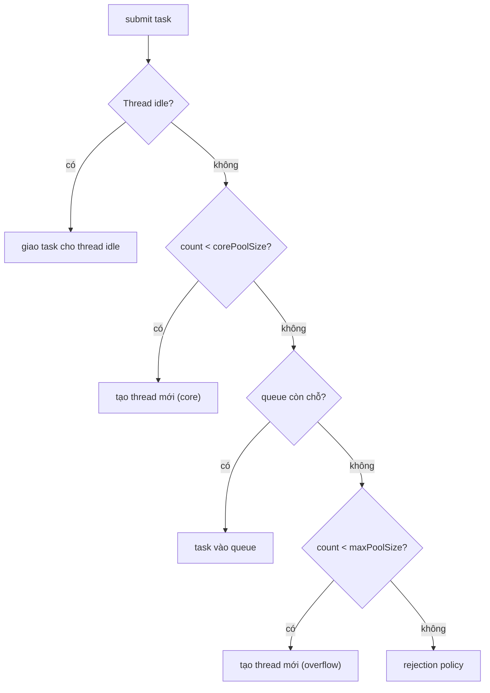

# What is a thread pool and why use one?

> Bài này giải thích thread pool là gì (tập thread được tạo trước, tái sử dụng để xử lý task từ queue), vì sao cần (tránh chi phí tạo/hủy thread, giới hạn concurrency), và các tham số quan trọng: corePoolSize, maxPoolSize, queueCapacity, keepAliveTime, rejection policy. Bài đi vào cách Java ThreadPoolExecutor, Python concurrent.futures.ThreadPoolExecutor, Go worker pool pattern, và các failure mode thường gặp (thread starvation, deadlock trong pool, OOM). Bài liên quan: [sync-vs-async-io](sync-vs-async-io.md), [concurrency-vs-parallelism](concurrency-vs-parallelism.md), [connection-pooling](../Database/connection-pooling.md).

Chủ đề: Concurrency · Ngày: 2026-10-16

## 0. Nền tảng trước khi đọc

**Bối cảnh:** Nhiều việc cùng chạy trong một chương trình. Khó ở chỗ các việc có thể chạm cùng dữ liệu và làm kết quả sai nếu không phối hợp.

**Nói đơn giản:** Thread pool tạo sẵn một nhóm luồng, rồi cho các luồng lấy việc từ hàng đợi. Cách này tránh tạo quá nhiều luồng và giới hạn tải.

**Từ khóa cần biết:** thread = luồng chạy; shared state = dữ liệu dùng chung; synchronization = cách phối hợp luồng.

**Ví dụ dễ hình dung:** API nhận 10.000 request nhưng chỉ cho 100 task gọi database cùng lúc bằng pool và queue có giới hạn.

Khi đọc, luôn hỏi ba câu: nó giải quyết vấn đề gì, nó làm việc theo những bước nào, và khi nào không nên dùng?

**Cách học bài này:** Đọc phần này trước để nắm từ khóa; đọc phần 1 để lấy câu trả lời 30 giây; đọc phần 2 để hiểu cơ chế; cuối cùng mở từng câu hỏi ở phần 3 để luyện nói. Các con số và lệnh trong bài là bằng chứng cho câu trả lời, không cần học thuộc nếu chưa hiểu cơ chế.

## 1. Là gì

### Đọc nhanh trước khi đi sâu

**Ý chính:** Thread pool tạo sẵn một nhóm luồng, rồi cho các luồng lấy việc từ hàng đợi. Cách này tránh tạo quá nhiều luồng và giới hạn tải.

**Ví dụ interview:** API nhận 10.000 request nhưng chỉ cho 100 task gọi database cùng lúc bằng pool và queue có giới hạn.

**Luồng 4 bước:**

1. Có nhiều task cùng chạy.
2. Các task chạm vào dữ liệu hoặc tài nguyên chung.
3. Chương trình dùng message passing, atomic hoặc lock để phối hợp.
4. Task tiếp tục và kết quả không bị mất, trùng hoặc kẹt.

**Nói như trong interview:** Thread pool tạo sẵn một nhóm luồng, rồi cho các luồng lấy việc từ hàng đợi. Cách này tránh tạo quá nhiều luồng và giới hạn tải. Hãy nói theo bốn bước trên trước; nếu interviewer hỏi sâu, chuyển sang cơ chế **Bước 1. Vòng đời một task trong pool**, rồi nêu trade-off và failure mode ở các phần sau.

## 2. Cơ chế cốt lõi

### Bước 1. Vòng đời một task trong pool

1. Submit task: `pool.execute(task)` hoặc `pool.submit(callable)`.
2. Nếu pool có thread idle: giao task cho thread đó, thread chạy task.
3. Nếu pool chưa đạt corePoolSize: tạo thread mới, giao task.
4. Nếu pool đã đạt corePoolSize và queue có chỗ: task vào queue, chờ thread xử lý.
5. Nếu queue đầy và pool chưa đạt maxPoolSize: tạo thread mới.
6. Nếu pool đạt maxPoolSize và queue đầy: áp dụng rejection policy (AbortException, Discard, CallerRuns).

### Bước 2. Java ThreadPoolExecutor cụ thể

```java
ExecutorService pool = new ThreadPoolExecutor(
    2,                       // corePoolSize
    10,                      // maxPoolSize
    60L, TimeUnit.SECONDS,   // keepAliveTime
    new LinkedBlockingQueue<>(100),  // queueCapacity
    new ThreadPoolExecutor.CallerRunsPolicy() // rejection
);

// Submit task
pool.execute(() -> {
    // do work
});
```

Java 8+ có `Executors.newFixedThreadPool(n)`, `newCachedThreadPool()`, `newWorkStealingPool()`. Mỗi loại có cấu hình mặc định phù hợp workload khác nhau. Fixed thread pool: tất cả task dùng đúng n thread. Cached thread pool: tạo thread mới nếu cần, hủy thread idle sau 60s — dễ OOM nếu workload burst. Work-stealing pool (ForkJoinPool): mỗi thread có queue riêng, thread idle "steal" task từ queue thread khác — tốt cho workload chia nhỏ đều.

### Bước 3. Python concurrent.futures.ThreadPoolExecutor

```python
from concurrent.futures import ThreadPoolExecutor

with ThreadPoolExecutor(max_workers=8) as pool:
    futures = [pool.submit(do_work, item) for item in items]
    for f in futures:
        f.result()  # block cho đến khi task xong
```

Python mặc định `max_workers = min(32, os.cpu_count() + 4)` từ Python 3.8. Không có queue riêng rõ ràng như Java; pool giữ task trong internal queue. Reject: nếu vượt capacity, `submit()` return Future nhưng task phải chờ; không có rejection exception.

### Bước 4. Go worker pool pattern

Go không có thread pool built-in; dùng channel + goroutine:

```go
func worker(id int, jobs <-chan int, results chan<- int) {
    for j := range jobs {
        results <- j * 2
    }
}

func main() {
    jobs := make(chan int, 100)
    results := make(chan int, 100)
    for w := 1; w <= 3; w++ {
        go worker(w, jobs, results)
    }
    for j := 1; j <= 9; j++ {
        jobs <- j
    }
    close(jobs)
    for r := 1; r <= 9; r++ {
        <-results
    }
}
```

Go có thư viện `errgroup.Group` (golang.org/x/sync/errgroup) cho worker pool có error handling. Hoặc dùng `ants` (github.com/panjf2000/ants) — goroutine pool phổ biến, có max capacity, blocking khi full.

### Bước 5. Cấu hình tối ưu cho workload

**corePoolSize**: thread giữ lâu dài để xử lý workload baseline.
- CPU-bound: bằng số core. Thêm không tăng throughput do context switch.
- I/O-bound: gấp 2-4× số core. Thread chờ I/O có thể nhường cho task khác.
- Mixed: tùy tỉ lệ. Benchmark trên workload thật.

**maxPoolSize**: trần tuyệt đối. Không đặt quá cao (OOM). Thường gấp 2-4× corePoolSize. Một số hệ thống đặt max = corePoolSize để giữ concurrency cố định.

**queueCapacity**: bộ nhớ đệm cho burst. LinkedBlockingQueue không giới hạn → OOM. ArrayBlockingQueue giới hạn → reject khi đầy. SynchronousQueue zero capacity → mỗi task phải có thread nhận ngay.

**keepAliveTime**: thread idle bao lâu thì hủy (chỉ áp dụng thread vượt corePoolSize). 0 = hủy ngay khi idle. Long = giữ thread warm sẵn sàng.

**rejectionPolicy**: khi queue đầy và pool max.
- AbortPolicy (mặc định Java): ném `RejectedExecutionException`. Caller phải xử lý.
- DiscardPolicy: bỏ task im lặng. Có thể mất data.
- DiscardOldestPolicy: bỏ task cũ nhất trong queue, thêm task mới.
- CallerRunsPolicy: caller thread chạy task. Backpressure tự nhiên nhưng caller bị block.

### Bước 6. Sơ đồ quyết định khi submit task



*Quy trình xử lý task: thread idle → giao; không thì tạo core → queue đợi → tạo overflow → reject.*

### Quan sát

```bash
# Java: dump thread pool status
jstack <pid> | grep -A 5 "pool-N-thread"
# Thread name: pool-N-thread-M (N = pool hash, M = thread index)

# Java: JMX metrics
java -jar ... -Dcom.sun.management.jmxremote
jconsole, jmc, hoặc Jolokia scrape MBean

# Linux: thread count per process
ps -L -p <pid> -o lwp | wc -l

# Go: goroutine dump
curl http://localhost:6060/debug/pprof/goroutine?debug=2

# Python: thread list
python -c "import threading; print(threading.active_count())"
```
### Ví dụ chạy từng bước

Kịch bản: batch processor xử lý 1 triệu job/ngày, mỗi job gọi API downstream mất 80ms + compute 20ms. Máy có 4 core. Chạy ban đêm 1 giờ. Cần cấu hình thread pool để hết việc trong 1 giờ, và xác định điểm saturation.

**Bước 1 (tính capacity cần thiết).** Mỗi job: W = 80ms (I/O), C = 20ms (CPU). Tổng job = 1.000.000. Thời gian có = 1 giờ = 3.600 giây. Để hết trong 1 giờ: throughput tối thiểu = 1.000.000 / 3.600 ≈ **278 job/s**. Mỗi job mất 80ms I/O + 20ms CPU = 100ms. Trên 4 core: throughput tối đa = 4 / 0,02s = **200 job/s** (CPU là bottleneck). Vậy cần hơn 4 core hoặc kéo dài thời gian.

**Bước 2 (cấu hình pool).** Dùng công thức `threads = N_cpu × (1 + W/C) = 4 × (1 + 80/20) = 4 × 5 = 20`. Cấu hình: `corePoolSize=20`, `maxPoolSize=40`, `queueCapacity=10.000`, `keepAliveTime=60s`. Tính CPU: 20 thread × 20ms = 400ms CPU mỗi giây → CPU utilization = 400ms / 1.000ms = 40%. I/O: 20 thread × 80ms = 1.600ms I/O mỗi giây → I/O utilization = 1.600ms / 1.000ms = 160% (vài thread đợi đồng thời).

**Bước 3 (tính throughput thực tế).** 20 thread: 1 giây xử lý 20 / 0,1s = 200 job. 1 triệu job / 200 job/s = **5.000s ≈ 83 phút**, quá 1 giờ. Để đạt 1 giờ: cần 278 job/s → thread count = 278 × 0,1s = **28 thread**. CPU utilization = 28 × 20ms = 560ms/s = 56%. Khả thi trên 4 core.

**Bước 4 (điểm saturation).** Tăng thread từ 28 lên 50. CPU utilization = 50 × 20ms = 1.000ms/s = **100%** (bão hòa). Throughput không tăng thêm vì CPU là bottleneck. Queue depth tăng. Latency p99 tăng vì job phải chờ queue. Nếu queueCapacity=10.000, khi queue đầy → reject. Metric `activeCount == maxPoolSize` và `queue.size() == capacity` là dấu hiệu saturation.

| Thread count | CPU util | Throughput (job/s) | Latency p99 |
|---|---|---|---|
| 4 (cores) | 40% | 200 | thấp |
| 20 | 40% | 200 | thấp |
| 28 | 56% | 278 | trung bình |
| 50 | 100% | 278 (bão hòa) | cao |
| 100 | 100% (cxt switch) | <278 | rất cao |

Nếu downstream rate-limit 100 req/s: mỗi thread chờ trung bình thêm 10ms, W/C tăng từ 4 lên 4,5 → threads cần = 4 × 4,5 = 18. Đặt `corePoolSize=18` để không gây retry storm ở downstream. Dùng semaphore hoặc token bucket để giới hạn concurrent downstream call độc lập với thread count.

Điều rút ra: pool size tối ưu = N_cpu × (1 + W/C); CPU-bound vượt quá core count chỉ gây context switch, không tăng throughput — nối với Câu 2 "Công thức chọn corePoolSize": benchmark thực tế cho kết quả chính xác hơn công thức khi có rate limit và overhead khác.

## 3. Câu hỏi phỏng vấn

### 3A. Câu hỏi đào sâu

<details class="qa">
<summary>Câu 1. Thread pool giải quyết vấn đề gì so với tạo thread mỗi task?</summary>

**Trả lời ngắn:** (1) Giảm chi phí tạo/hủy thread (1-10ms OS, có thể chiếm phần lớn thời gian task nhỏ); (2) giới hạn số thread đồng thời, tránh OOM khi burst; (3) cung cấp backpressure qua queue và rejection policy.

**Đào sâu:**
- Tạo thread OS tốn ~1ms (Linux `clone`), JVM Thread ~1ms, goroutine ~50µs. Task ngắn (HTTP request 5ms) mà tốn 1ms tạo thread là lãng phí 20%.
- Thread tốn memory stack (1-8MB OS, 512KB-1MB JVM). 10.000 thread × 1MB = 10GB. Pool giới hạn 100 thread → 100MB.
- Queue cho phép burst được "hấp thụ": request đến nhanh được xếp hàng, thread xử lý đều đặn. Nếu queue đầy, reject thay vì tiếp tục nhận → caller nhận 503, có cơ hội retry.
- Backpressure quan trọng: nếu hệ thống quá tải, nên từ chối sớm thay vì nhận và xử lý chậm (latency tăng, queue đầy, OOM).
- Reuse: thread sau khi xử lý task ở lại pool, không cần khởi tạo lại. Có thể warm: pre-start core thread sẵn sàng nhận task ngay.

**Bẫy:** "Thread pool lúc nào cũng tốt hơn tạo thread mới". Sai — cho task rất dài (batch 1 giờ), tạo thread riêng có thể đơn giản hơn. Pool phù hợp task ngắn-trung bình, request burst.

**Follow-up:** Khi nào CachedThreadPool (Java) nguy hiểm? Khi workload burst: pool tạo thread không giới hạn, mỗi thread 1MB stack. 10.000 task đồng thời = 10GB memory → OOM. Dùng FixedThreadPool + bounded queue + rejection policy.
</details>

<details class="qa">
<summary>Câu 2. Công thức chọn corePoolSize và maxPoolSize?</summary>

**Trả lời ngắn:** corePoolSize: CPU-bound = số core; I/O-bound = số core × (1 + W/C), trong đó W = wait time, C = compute time. maxPoolSize: thường 2-4× corePoolSize, giới hạn trên cho burst.

**Đào sâu:**
- Brian Goetz (Java Concurrency in Practice): `threads = N_cpu × U_cpu × (1 + W/C)`. Với N_cpu = 4, U_cpu (target) = 1, W (wait time) = 200ms, C (compute) = 50ms: threads = 4 × 1 × (1 + 4) = 20.
- I/O-bound (HTTP call 100ms, compute 10ms): threads = core × (1 + 10) = 44 cho 4 cores.
- Mixed workload: tính theo phần bottleneck. Nếu 50% I/O, 50% CPU: trung bình.
- Đo bằng benchmark: tăng pool size, đo throughput, tìm điểm bão hòa.
- maxPoolSize: tránh đặt quá lớn. Thường gấp 2× corePoolSize. Quá lớn → context switch overhead, OOM risk.
- Số core: `Runtime.getRuntime().availableProcessors()` (Java), `runtime.NumCPU()` (Go), `multiprocessing.cpu_count()` (Python). Lưu ý: trong container có thể giới hạn CPU khác host.

**Bẫy:** "Thread pool size = 1000 đủ cho mọi thứ". Sai — context switch overhead, lock contention. Đo và benchmark.

**Follow-up:** Container giới hạn CPU 1 core nhưng code set pool size = 32 thì sao? Context switch rất nhiều, throughput tệ. Đọc cgroup limit (`cat /sys/fs/cgroup/cpu/cpu.cfs_quota_us`).
</details>

<details class="qa">
<summary>Câu 3. Rejection policy nào phù hợp khi nào?</summary>

**Trả lời ngắn:** AbortPolicy: client nhận lỗi rõ ràng (HTTP 503), retry phía client. CallerRunsPolicy: backpressure tự nhiên (caller chậm lại), nhưng caller block có thể timeout request khác. Discard: cảnh báo log, dùng cho task không quan trọng (analytics). DiscardOldest: queue metrics, dùng khi task mới quan trọng hơn task cũ.

**Đào sâu:**
- AbortPolicy: mặc định Java. Ném `RejectedExecutionException`. Caller phải handle (retry, fail, queue lại). Tốt cho HTTP request — fail rõ ràng.
- CallerRunsPolicy: caller thread chạy task thay vì submit. Đảm bảo task không mất, nhưng caller block. Caller thường là request thread — request chậm hơn.
- DiscardPolicy: bỏ task, không thông báo. Phù hợp analytics, log mức INFO. KHÔNG dùng cho payment, message — mất data.
- DiscardOldestPolicy: bỏ task cũ nhất trong queue, submit task mới. Dùng khi task mới quan trọng hơn (real-time price, current state).
- Custom: implement `RejectedExecutionHandler`. Ví dụ: log + alert + persist task ra file/queue bên ngoài (RabbitMQ DLQ) để xử lý sau.

**Bẫy:** CallerRunsPolicy không phải lúc nào cũng "an toàn". Nếu caller là request thread của web server, caller block = request timeout. Nguy cơ deadlock nếu caller và pool phụ thuộc lẫn nhau.

**Follow-up:** Khi nào nên dùng bounded queue thay vì unbounded? Bounded queue cung cấp backpressure. Unbounded queue có thể tích task đến OOM. Production: luôn bounded.
</details>

<details class="qa">
<summary>Câu 4. Java ForkJoinPool khác ThreadPoolExecutor thế nào?</summary>

**Trả lời ngắn:** ForkJoinPool dùng work-stealing: mỗi thread có deque riêng, thread idle "steal" task từ deque thread khác. Tốt cho workload chia nhỏ đều (parallel stream, divide-and-conquer). ThreadPoolExecutor có queue chung, FIFO.

**Đào sâu:**
- Work-stealing giảm contention: thread không cần lock queue chung. Mỗi thread có deque riêng, push/pop từ cuối (lock-free), steal từ đầu deque thread khác.
- ForkJoinTask: `RecursiveTask` (return value), `RecursiveAction` (no return), `CountedCompleter`. Task lớn fork thành task nhỏ, join kết quả.
- ForkJoinPool.commonPool() dùng cho `parallelStream`, `CompletableFuture` không chỉ định executor. Kích thước: `Runtime.availableProcessors() - 1`.
- Java 8 streams parallel: tự dùng ForkJoinPool. Nếu operation có side effect hoặc blocking I/O → thread chiếm giữ, parallelStream bị starve.
- ThreadPoolExecutor phù hợp: task độc lập, queue chung. ForkJoinPool phù hợp: task chia nhỏ, divide-and-conquer, recursive.

**Bẫy:** Dùng parallelStream cho blocking I/O → chiếm ForkJoinPool thread, các parallelStream khác bị starve. Dùng custom Executor riêng cho blocking task.

**Follow-up:** ForkJoinPool có phù hợp cho HTTP server? Thường không — HTTP request là task độc lập, queue chung (ThreadPoolExecutor) đơn giản hơn. ForkJoinPool thắng cho compute-bound chia nhỏ (sort, sum array).
</details>

<details class="qa">
<summary>Câu 5. Virtual thread (Java 21+) thay đổi thread pool thế nào?</summary>

**Trả lời ngắn:** Virtual thread (Project Loom) là lightweight thread do JVM quản lý, ~1KB stack. Cho phép tạo hàng triệu virtual thread mà không tốn memory như OS thread. Mỗi virtual thread chạy trên carrier thread (OS thread). Mô hình pool thay đổi: có thể không cần pool — mỗi request một virtual thread, JVM scheduler map N virtual vào M carrier.

**Đào sâu:**
- OS thread: 1-8MB stack, blocking syscall block carrier. Virtual thread: 1KB stack, JVM-level scheduling, khi block chuyển sang virtual thread khác.
- Throughput benchmark (TechEmpower): virtual thread tăng throughput 2-10× so với platform thread cho I/O-bound (web server, DB query).
- Không cần ThreadPoolExecutor cho I/O-bound workload nữa — `Executors.newVirtualThreadPerTaskExecutor()` tạo virtual thread mới cho mỗi task.
- Virtual thread vẫn có cost khi tạo (~1µs), không free hoàn toàn. Production benchmark trước khi migrate.
- Synchronized block: pinning virtual thread vào carrier, giảm lợi ích. Java 24+ đã cải thiện (JEP 491).
- Go goroutine đã làm điều này từ đầu; Kotlin coroutine tương tự.

**Bẫy:** "Virtual thread thay thế hoàn toàn reactive (WebFlux, Node.js)". Sai — virtual thread giúp code sync-style chạy được như async; reactive vẫn tốt cho một số pattern (backpressure, streaming). Đo trên workload thật.

**Follow-up:** Khi nào nên dùng virtual thread? Khi code sync-style có nhiều blocking I/O (JDBC, HTTP sync client). Khi muốn giảm dependency vào reactive library. Khi workload I/O-bound nặng. Không cần khi code đã reactive hoặc CPU-bound.
</details>

<details class="qa">
<summary>Câu 6 (Debug). Service Java phục vụ 1000 req/s, đột nhiên latency tăng từ 50ms lên 5s. Thread pool metric: active=200, queue=10000 (full), rejected=500/s. Nguyên nhân và xử lý?</summary>

**Trả lời ngắn:** Thread pool bão hòa: tất cả thread đều bận, queue đầy, request mới bị reject. Nguyên nhân: dependency downstream chậm (DB, API), thread chiếm giữ quá lâu, không timeout. Cách xử lý: (1) kiểm tra downstream; (2) set timeout cho mỗi operation; (3) tăng capacity hoặc tách pool; (4) circuit breaker.

**Đào sâu:**
- Bước 1: Kiểm tra pool metric. Nếu active = maxPoolSize, queue = capacity: pool bão hòa. Rejection rate cao → caller nhận lỗi.
- Bước 2: Tìm task chiếm thread lâu. Thread dump (`jstack <pid>`) xem stack. Thường gặp: HTTP call không timeout, DB query chậm, lock.
- Bước 3: Set timeout cho mỗi operation: HTTP `connect timeout=500ms, read timeout=2s`, DB `statement timeout=5s`, lock `tryLock(2s)`.
- Bước 4: Tách pool: pool riêng cho downstream A, pool riêng cho downstream B. Một pool chậm không ảnh hưởng pool khác.
- Bước 5: Circuit breaker: nếu downstream fail > 50%, tạm dừng gọi 30s. Resilience4j, Hystrix (legacy).
- Bước 6: Bulkhead pattern: giới hạn concurrent call downstream. Nếu cho phép tối đa 50, thì queue/thread còn lại phục vụ request khác.
- Bước 7: Nếu capacity thật sự thiếu, tăng maxPoolSize. Nhưng đảm bảo tăng đủ resource (DB connection, downstream rate limit).

**Bẫy:** Chỉ tăng maxPoolSize → che triệu chứng, nguyên nhân gốc (downstream chậm) vẫn còn. Pool lớn + downstream chậm = OOM.

**Follow-up:** Queue lớn có ưu điểm gì? Hấp thụ burst ngắn hạn, throughput tốt cho traffic đều. Nhưng queue lớn = latency tăng (request cuối queue chờ lâu). Queue nhỏ + reject nhanh = backpressure tốt, latency ổn định.
</details>

<details class="qa">
<summary>Câu 7 (Thiết kế). Thiết kế batch processor xử lý 1 triệu job/ngày, mỗi job mất 100ms. Cần finish trong 1 giờ vào ban đêm. Cấu hình thread pool thế nào?</summary>

**Trả lời ngắn:** Pool size = số core × 2 (I/O-bound nhẹ). 1 triệu job × 100ms = 100.000 giây CPU. Trong 1 giờ = 3.600 giây → cần ~28 core. Nếu có 4 core, đẩy sang distributed worker (Kafka, RabbitMQ). Hoặc chấp nhận chạy 7 giờ.

**Đào sâu:**
- **Tính capacity**: Tổng CPU-seconds = jobs × avg_time. Tổng time có = cores × duration. Nếu lớn hơn → thiếu capacity.
- **Ví dụ 1**: 1M job × 100ms = 100.000s. 4 core × 1 giờ = 14.400s. Thiếu ~7x. Cần 28 core hoặc kéo dài 7 giờ.
- **Cấu hình pool**: corePoolSize = cores × 2, maxPoolSize = cores × 4. Queue lớn (10.000). Rejection: log + persist ra file để retry sau.
- **Giảm thời gian mỗi job**: optimize job (DB batch insert, parallel I/O). Mỗi job 100ms → 50ms: giảm một nửa.
- **Distributed**: chia job cho N worker machines. Mỗi machine xử lý 1M/N job. Dùng Kafka partition theo key, mỗi partition một consumer thread.
- **Checkpoint**: lưu progress vào DB, restart được từ checkpoint khi crash. Idempotent job để retry an toàn.
- **Monitoring**: throughput (jobs/sec), ETA, error rate, queue depth, active thread.

**Bẫy:** Đặt pool size = 1000 trên 4-core machine — context switch overhead, throughput không tăng. Số thread hữu ích = số core × (1 + W/C), không quá vài chục trên 1 box.

**Follow-up:** Nếu job phải gọi API có rate limit 100 req/s thì sao? Pool size phải ≤ rate limit / avg_time = 100 / 0.1 = 1000 req đang xử lý. Token bucket / semaphore giới hạn concurrent.
</details>

### 3B. Câu hỏi phỏng vấn liên quan

<details class="qa">
<summary>Câu 8. Process pool khác thread pool ở điểm nào?</summary>

**Trả lời:** Process pool dùng process thay thread. Mỗi process có memory riêng, không share state, bypass GIL (Python). Chi phí tạo/hủy cao hơn (10-100ms). IPC phức tạp hơn. Dùng cho CPU-bound workload trên interpreter có GIL. Python `multiprocessing.Pool`, Java không có sẵn (dùng process riêng).
</details>

<details class="qa">
<summary>Câu 9. Connection pool khác thread pool thế nào?</summary>

**Trả lời:** Connection pool giữ connection tới resource (DB, HTTP service) để tái sử dụng. Thread pool giữ thread để chạy task. Cả hai đều dựa trên nguyên tắc pre-spawn + reuse + bound. Connection pool thường nhỏ (10-100), vì mỗi connection tốn tài nguyên phía server. Xem [connection-pooling](../Database/connection-pooling.md).
</details>
<details class="qa">
<summary>Câu 10. Tại sao newCachedThreadPool (Java) nguy hiểm?</summary>

**Trả lời:** Tạo thread không giới hạn khi workload burst. Mỗi thread ~512KB-1MB stack. 10.000 task đồng thời → OOM. Không có queue capacity giới hạn (SynchronousQueue + unbounded thread). Production: tránh dùng, thay bằng FixedThreadPool + bounded queue + rejection policy.
</details>

<details class="qa">
<summary>Câu 11. True or false: "Thread pool size càng lớn càng tốt."</summary>

**Trả lời:** Sai. Quá nhiều thread gây: (1) context switch overhead, (2) lock contention tăng (nhiều thread cùng tranh lock), (3) memory tốn, (4) cache miss tăng (mỗi thread có working set riêng). Tối ưu ở điểm bão hòa throughput: tăng pool size → throughput tăng đến peak, sau đó giảm. Đo bằng benchmark.
</details>

<details class="qa">
<summary>Câu 12. Thread pool starvation là gì, xử lý thế nào?</summary>

**Trả lời:** Starvation: thread trong pool bị block lâu (lock, blocking I/O không timeout) hoặc chiếm CPU quá lâu, các task khác trong queue phải chờ. Xử lý: (1) set timeout cho mọi blocking call; (2) tách pool theo workload; (3) tránh long synchronous task; (4) dùng ForkJoinPool cho task chia nhỏ.
</details>
<details class="qa">
<summary>Câu 13. ThreadPoolExecutor có monitor được không?</summary>

**Trả lời:** Có, qua JMX MBean `ThreadPoolExecutor`. Extends `AbstractExecutorService`. Có method `getActiveCount`, `getQueue().size()`, `getCompletedTaskCount`, `getTaskCount`, `getLargestPoolSize`. Production: dùng Micrometer + Prometheus exporter. Hoặc tự wrap ExecutorService và expose metric.
</details>

<details class="qa">
<summary>Câu 14. Khi nào nên tạo thread pool riêng cho từng loại task?</summary>

**Trả lời:** Khi task thuộc loại khác nhau: (1) latency-sensitive vs throughput-oriented; (2) CPU-bound vs I/O-bound; (3) cần priority khác nhau; (4) cần isolation (một loại chậm không ảnh hưởng loại khác — bulkhead pattern). Ví dụ: pool cho HTTP request (8 thread), pool cho background job (4 thread), pool cho cron task (2 thread).
</details>

<details class="qa">
<summary>Câu 15. Kotlin coroutine có thay thế thread pool không?</summary>

**Trả lời:** Không hoàn toàn. Coroutine là lightweight concurrency, dispatcher quyết định chạy trên thread pool nào. `Dispatchers.IO` (mặc định 64 thread), `Dispatchers.Default` (số core). Code có thể trông như async/await nhưng vẫn map xuống thread pool. Ưu: structured concurrency, cancellation, exception handling. Khác thread pool: coroutine có thể suspend/resume không tốn thread.
</details>

## 4. Đánh đổi và sự cố production

### So sánh các loại pool

| Loại pool | Phù hợp | Nhược điểm |
|---|---|---|
| FixedThreadPool (Java) | Workload ổn định, biết trước concurrency | Không scale với burst |
| CachedThreadPool (Java) | Task ngắn, ít đồng thời | OOM khi burst |
| WorkStealingPool / ForkJoinPool | Divide-and-conquer, parallel stream | Starve khi blocking I/O |
| ThreadPoolExecutor (custom) | Production — kiểm soát queue, rejection | Phải cấu hình cẩn thận |
| Virtual thread per task (Java 21+) | I/O-bound nặng, nhiều connection | Mới, chưa ổn định với synchronized |
| Go worker pool pattern | Lightweight, idiomatic Go | Tự code, không có lib chuẩn |
### Năm failure mode

| Triệu chứng | Nguyên nhân gốc | Cách kiểm tra | Cách sửa |
|---|---|---|---|
| Latency tăng đột biến | Pool bão hòa (active = max, queue full) | Pool metric | Tăng capacity, tối ưu task, timeout |
| Thread leak (số thread tăng mãi) | Custom thread pool không giải phóng | Thread dump theo thời gian | Check `allowCoreThreadTimeOut` |
| Task bị bỏ mất | Rejection policy Discard không log | Rejected counter | Log + DLQ + alert |
| OOM khi burst | Unbounded queue hoặc maxPoolSize quá lớn | Heap dump | Bounded queue, fixed max |
| Deadlock trong pool | Task submit task mới vào cùng pool đợi | Thread dump "BLOCKED" | Dùng pool khác, hoặc fork-join |
## 5. Cheat sheet

| Chủ đề | Con số / quy tắc cần nhớ |
|---|---|
| Thread pool purpose | Pre-spawn thread, reuse, limit concurrency |
| Java FixedThreadPool | core = max = N; unbounded LinkedBlockingQueue |
| Java CachedThreadPool | Không giới hạn thread; OOM risk |
| Công thức size | N_cpu × (1 + W/C); CPU-bound = cores; I/O-bound = cores × (1 + W/C) |
| Rejection policy | Abort (fail rõ), CallerRuns (backpressure), Discard (mất task) |
| Queue | Bounded ArrayBlockingQueue (backpressure) > Unbounded LinkedBlockingQueue |
| ForkJoinPool | Work-stealing, tốt cho divide-and-conquer |
| Virtual thread | Java 21+, ~1KB, I/O-bound không block carrier |
| Thread stack | 1-8MB OS; ~512KB JVM; ~2KB goroutine; ~1KB virtual |
| Work-stealing | Mỗi thread có deque riêng, idle steal từ thread khác |

**Học tiếp:**
- [sync-vs-async-io](sync-vs-async-io.md) — bên dưới I/O là gì
- [concurrency-vs-parallelism](concurrency-vs-parallelism.md) — bức tranh lớn
- [concurrency-deadlock](concurrency-deadlock.md) — deadlock có thể xảy ra trong pool
- [connection-pooling](../Database/connection-pooling.md) — pool concept áp dụng cho connection
