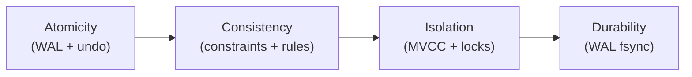

# What are ACID properties?

> Bài này phân tích bốn chữ cái ACID: Atomicity (WAL + undo), Consistency (ràng buộc + transaction hợp lệ), Isolation (MVCC/lock theo level), Durability (WAL fsync). Bài [database-transaction](database-transaction.md) giải thích transaction là gì; bài [database-isolation-levels](database-isolation-levels.md) đi sâu Isolation.

Chủ đề: Database · Ngày: 2026-10-16

## 1. Là gì

ACID là bốn tính chất mà một hệ RDBMS hứa cho mỗi transaction: Atomicity (A) — tất cả hoặc không; Consistency (C) — transaction chỉ đưa CSDL từ trạng thái hợp lệ sang trạng thái hợp lệ; Isolation (I) — các transaction song song không "thấy" trạng thái nửa vời của nhau theo mức isolation level đã chọn; Durability (D) — khi COMMIT trả OK, dữ liệu sống sót qua crash, restart, mất điện.

ACID là kim chỉ nam cho thiết kế engine, không phải thuộc tính tự nhiên của mọi hệ thống: BASE (Basically Available, Soft state, Eventual consistency) là cách thay thế cho distributed store. Hầu hết RDBMS (PostgreSQL, MySQL InnoDB, Oracle, SQL Server) hứa ACID cho cụm single-instance; replication có thể phá D khi có lag hoặc failover.



*Sơ đồ vị trí: ACID là bốn trụ cột của một transaction; Atomicity cung cấp cơ chế, Consistency là hệ quả, Isolation đảm bảo cô lập, Durability đảm bảo bền.*

### Trả lời 30 giây

"ACID là bốn tính chất của transaction RDBMS: Atomicity — tất cả hoặc không, đảm bảo bởi WAL và undo log; Consistency — transaction đi từ trạng thái hợp lệ sang trạng thái hợp lệ, dựa vào constraint (FK, unique, check) và logic nghiệp vụ; Isolation — các transaction song song thấy nhau theo level (READ COMMITTED mặc định PostgreSQL/Oracle/SQL Server, REPEATABLE READ mặc định InnoDB), dùng MVCC hoặc lock; Durability — sau COMMIT, dữ liệu sống sót qua crash nhờ WAL fsync. ACID áp dụng cho single-instance; replication đồng bộ giữ D ở mức cụm, async thì có thể mất vài giây."

## 2. Cơ chế cốt lõi

### Bước 1. Atomicity: tất cả hoặc không

1. Engine ghi mọi thay đổi của transaction vào redo log (WAL) và undo log. Khi COMMIT, redo log được fsync xuống disk; transaction đánh dấu committed.
2. Khi ROLLBACK hoặc crash trước COMMIT, engine dùng undo log để revert từng thay đổi về snapshot ban đầu. Sau crash, redo log dùng để redo các transaction đã COMMIT nhưng chưa flush xuống data file.
3. Chi phí: undo log phình theo lượng thay đổi đã ghi; transaction dài nhiều undo. WAL flush có thể ~1-10 ms tuỳ disk.

### Bước 2. Consistency: trạng thái hợp lệ

1. Consistency không có cơ chế riêng trong engine; nó là **hệ quả** của A + I + ràng buộc (constraint). Mỗi constraint (PRIMARY KEY, FOREIGN KEY, UNIQUE, CHECK, NOT NULL, trigger) đảm bảo một quy tắc.
2. Khi một câu SQL vi phạm constraint, engine báo lỗi (`23505` unique violation trong PostgreSQL, `1062` trong MySQL) và huỷ câu. Các câu trước đó trong transaction vẫn còn; cần rollback để khôi định.
3. Consistency cũng do application: chuyển tiền phải trừ trước rồi cộng sau; nếu logic sai, dữ liệu lưu vẫn nhất quán với constraint nhưng sai logic nghiệp vụ.

### Bước 3. Isolation: cô lập giữa transaction

1. Hai cơ chế chính: **MVCC** (Multi-Version Concurrency Control) và **lock-based**.
2. PostgreSQL dùng MVCC: mỗi transaction thấy một snapshot tại thời điểm `BEGIN` (REPEATABLE READ) hoặc tại mỗi câu (READ COMMITTED). Đọc không block ghi và ngược lại; writer xung đột mới block.
3. InnoDB cũng dùng MVCC với undo log, nhưng mặc định REPEATABLE READ dùng snapshot ở lần đọc đầu tiên (consistent read).
4. Một số engine cũ (MyISAM) hoặc isolation cao (SERIALIZABLE) dùng predicate lock, gap lock, key-range lock. Chi tiết ở [database-isolation-levels](database-isolation-levels.md).

### Bước 4. Durability: sống sót qua crash

1. COMMIT trả OK khi WAL record (bao gồm COMMIT marker) đã fsync xuống disk. Sau đó, restart có thể replay WAL để khôi phục tất cả transaction đã COMMIT.
2. PostgreSQL `synchronous_commit = on` (mặc định) yêu cầu fsync; `off` cho phép tối đa vài trăm ms mất dữ liệu. InnoDB `innodb_flush_log_at_trx_commit = 1` (mặc định) mỗi COMMIT fsync; `=2` fsync mỗi giây.
3. Data file flush qua checkpoint (PostgreSQL `checkpoint_timeout` mặc định 5 phút, InnoDB adaptive). WAL đủ để khôi phục nên delay flush OK.

### Bước 5. ACID qua replication

```mermaid
sequenceDiagram
    participant App as Application
    participant P as Primary
    participant R as Replica
    participant DiskP as Disk primary
    App->>P: BEGIN; UPDATE
    P->>P: ghi WAL, undo
    App->>P: COMMIT
    P->>DiskP: fsync WAL (D đảm bảo local)
    P-->>App: OK
    P->>R: stream WAL records (async hoặc sync)
    R->>R: replay WAL
    Note over P,R: Nếu async: có thể mất transaction<br/>khi primary crash trước khi stream xong
```

*ACID trên single-node: WAL fsync trước COMMIT đảm bảo D local. Qua replication: nếu async, D ở mức cụm suy yến khi primary crash trước khi stream đến replica. Replication sync (PostgreSQL `synchronous_commit = remote_apply`) mới giữ D toàn cụm nhưng tăng latency.*

### Bước 6. Ràng buộc và cách chúng bảo vệ C

| Ràng buộc | Engine kiểm tra khi nào | Khi vi phạm |
|---|---|---|
| PRIMARY KEY / UNIQUE | INSERT và UPDATE | Trả lỗi 23505/1062; câu huỷ, transaction vẫn mở |
| FOREIGN KEY | INSERT/UPDATE/DELETE | Trả lỗi 23503/1452; câu huỷ |
| CHECK | INSERT/UPDATE | Trả lỗi 23514/3819; câu huỷ |
| NOT NULL | INSERT/UPDATE | Trả lỗi 23502/1048; câu huỷ |
| Trigger | INSERT/UPDATE/DELETE | Trigger raise; câu huỷ |

### Bước 7. CAP và đánh đổi với ACID

ACID single-instance đảm bảo C và D. Khi scale ra cụm partition, CAP buộc đánh đổi: trong partition, chọn A (availability, eventual consistency) hoặc C (consistency, không chấp nhận ghi). NewSQL (CockroachDB, Spanner) cố giữ ACID xuyên cụm nhưng tăng latency; PostgreSQL/MySQL async replication chấp nhận mất D ở mức cụm khi primary crash.

### Quan sát

```bash
# PostgreSQL: kiểm tra synchronous_commit và WAL flush
psql -c "SHOW synchronous_commit; SHOW wal_level;"
# synchronous_commit = on → WAL fsync trước COMMIT
# wal_level = replica → đủ cho streaming replication

# MySQL InnoDB: kiểm tra flush log setting
mysql -e "SHOW VARIABLES LIKE 'innodb_flush_log_at_trx_commit';"
# = 1 an toàn nhất; = 2 mất tối đa 1s nếu OS crash

# PostgreSQL: xem constraint nào đang vi phạm gần đây
psql -c "SELECT relname, conname, conrelid::regclass FROM pg_constraint WHERE NOT convalidated;"
# NOT VALID → chưa áp dụng cho dữ liệu cũ

# MySQL: replication type
mysql -e "SHOW VARIABLES LIKE 'sync_binlog';"
# sync_binlog = 1 → fsync mỗi COMMIT, an toàn; > 1 nhanh hơn nhưng mất n transaction khi crash
```

### Ví dụ chạy từng bước

Kịch bản: chuyển khoản 100 đô từ account A (balance 200) sang account B (balance 50), kèm ghi nhận vào bảng `transfers`. Một transaction duy nhất đụng 3 bảng (`accounts`, `accounts`, `transfers`) và 1 CHECK constraint. Engine: PostgreSQL, isolation `READ COMMITTED`, `synchronous_commit = on`. Transaction T1 chạy đồng thời T2 đọc account A. Mục tiêu: thấy đủ 4 chữ cái ACID cùng lúc trong cùng một kịch bản, từ cấp khóa (I) cho tới fsync (D).

| Bước | Thời điểm | Hành động (ai làm gì) | Vì sao | Trạng thái sau bước |
|---|---|---|---|---|
| 1 | t0 | App mở `BEGIN` ở `READ COMMITTED` | Engine chưa cấp khóa nào, mới khởi tạo transaction id | T1 = active, lock = {} |
| 2 | t0+1ms | T1: `UPDATE accounts SET balance = balance - 100 WHERE id = 5` | Cấp row lock X trên A, ghi undo (200→100), ghi redo WAL | A.visible=200, undo=200 |
| 3 | t0+2ms | T2: `SELECT balance FROM accounts WHERE id = 5` (T2 song song) | MVCC trả snapshot tại thời điểm câu bắt đầu | T2 thấy A=200 |
| 4 | t0+3ms | T1: `UPDATE accounts SET balance = balance + 100 WHERE id = 7`; `INSERT INTO transfers(id, 5, 7, 100)`; `COMMIT` | Cấp X trên B, ghi undo (50→150), insert transfers, fsync WAL | WAL có COMMIT record, D đảm bảo |
| 5 | t0+4ms | T2: `SELECT balance FROM accounts WHERE id = 5` lần 2 | READ COMMITTED thấy snapshot mới của câu này → 100 | T2 thấy A=100, minh hoạ I |
| 6 | t0+5ms | `COMMIT OK` trả về client T1 | WAL đã bền | T1 = committed, locks giải phóng, A=100, B=150 |

**Diễn giải**: A được bảo vệ bởi redo/undo ở bước 2 và 4 — nếu T1 crash trước bước 6, undo sẽ revert A từ 100 về 200, B từ 150 về 50, row transfers biến mất. C đảm bảo vì tổng A+B cuối cùng không đổi (200+100=300) và FK trong transfers trỏ tới account tồn tại. I thể hiện ở bước 3 và 5: T2 đọc A hai lần thấy hai giá trị khác nhau (200, 100) — đặc trưng của READ COMMITTED, khác với REPEATABLE READ. D thể hiện ở bước 6: COMMIT trả OK chỉ khi WAL đã fsync; nếu server crash ngay sau đó, restart vẫn replay WAL và thấy A=100, B=150, transfers=1 row.

**Biến thể lỗi**: nếu schema có CHECK `balance >= 0`, giả sử A.balance = 50 trước T1 (thay vì 200). Bước 2 tính `50 - 100 = -50`, vi phạm constraint ngay. Engine trả `23514 check_violation` tại bước 2, huỷ câu UPDATE, nhưng transaction vẫn mở. Bước 4 không chạy; locks đã cấp được giải phóng. App phải chủ động `ROLLBACK` rồi xử lý riêng (báo user "không đủ tiền"). Nếu app quên rollback và cố `COMMIT`, engine commit nhưng không có thay đổi nào. CHECK bảo vệ consistency nhưng không tự rollback.

Điều rút ra: CHECK constraint chạy row-level từng câu, không deferred đến COMMIT; vi phạm huỷ câu nhưng transaction vẫn sống. Điều này nối với câu "Constraint fail thì transaction còn nguyên vẹn không?" trong cheat sheet và với [database-isolation-levels](database-isolation-levels.md) vì READ COMMITTED thấy giá trị mới ở mỗi câu SELECT.

## 3. Câu hỏi phỏng vấn

### 3A. Câu hỏi đào sâu

<details class="qa">
<summary>Câu 1. Giải thích ngắn gọn bốn chữ cái ACID và cơ chế engine đảm bảo từng cái.</summary>

**Trả lời ngắn:** A: tất cả hoặc không, đảm bảo bởi WAL + undo log. C: transaction đi từ trạng thái hợp lệ sang trạng thái hợp lệ, là hệ quả của A + I + ràng buộc. I: các transaction song song thấy nhau theo level, dùng MVCC hoặc lock. D: sau COMMIT dữ liệu sống sót qua crash, nhờ WAL fsync xuống disk.

**Đào sâu:**
- **A**: redo log để redo khi crash, undo log để revert khi rollback. Xem [write-ahead-log](write-ahead-log.md).
- **C**: PRIMARY KEY, FOREIGN KEY, UNIQUE, CHECK, NOT NULL, trigger. Nếu constraint vi phạm giữa transaction, câu huỷ nhưng transaction vẫn mở; cần rollback.
- **I**: PostgreSQL/InnoDB dùng MVCC. READ COMMITTED thấy snapshot mỗi câu; REPEATABLE READ/SERIALIZABLE thấy snapshot ở BEGIN. SERIALIZABLE dùng SSI (Serializable Snapshot Isolation) trong PostgreSQL để phát hiện xung đột thay vì khóa rộng.
- **D**: WAL fsync trước COMMIT. Nếu `synchronous_commit = off` (PostgreSQL) hoặc `innodb_flush_log_at_trx_commit = 2` (InnoDB) thì D suy yến.

**Bẫy:** "A và D giống nhau". Khác — A là "không nửa vời", D là "sống sót qua crash". Một transaction có thể nguyên tử nhưng mất sau crash (nếu WAL không fsync).

**Follow-up:** ACID có tự nhiên cho mọi distributed DB không? Không — CAP buộc đánh đổi. CockroachDB/Spanner giữ ACID xuyên cụm nhưng tăng latency; PostgreSQL streaming replication async chấp nhận mất D ở cụm.
</details>

<details class="qa">
<summary>Câu 2. Atomicity đảm bảo bởi cơ chế nào? WAL làm gì trong A?</summary>

**Trả lời ngắn:** Atomicity đảm bảo bởi WAL (redo log + undo log). WAL ghi mọi thay đổi vào redo log trước khi data file flush; undo log giúp revert khi rollback. Crash trước COMMIT thì redo log không commit, undo log xoá. Crash sau COMMIT thì redo log replay để khôi phục.

**Đào sâu:**
- **Redo log** ghi trước khi thay đổi áp dụng lên data file, đảm bảo khôi phục được nếu crash. Khi COMMIT, redo log fsync → D được đảm bảo.
- **Undo log** ghi trạng thái cũ của dòng; dùng để ROLLBACK và MVCC (đọc phiên bản cũ).
- PostgreSQL gọi tổng quát là WAL + `pg_xact`/undo. InnoDB gọi là redo log + rollback segment.
- Không có WAL, atomicity vẫn có thể đảm bảo qua shadow paging (đổi con trỏ page) nhưng WAL phổ biến hơn.

**Bẫy:** "Rollback không tốn chi phí". Sai — phải đọc undo log và viết ngược vào buffer; transaction càng lớn, chi phí revert càng lớn.

**Follow-up:** Có thể rollback transaction đã commit không? Không (trừ khi có inverse operation). Đó là lý do compensation logic trong saga phức tạp hơn ROLLBACK DB.
</details>

<details class="qa">
<summary>Câu 3. Consistency thuộc về engine hay application? Cho ví dụ boundary.</summary>

**Trả lời ngắn:** Consistency là hệ quả của A + I + ràng buộc. Engine đảm bảo ràng buộc schema (PK, FK, UNIQUE, CHECK, NOT NULL, trigger). Application chịu trách nhiệm logic nghiệp vụ (tổng tiền không âm, đơn hàng phải có khách hàng tồn tại trước khi tạo). Engine không biết logic nghiệp vụ.

**Đào sâu:**
- Engine kiểm tra constraint ngay khi INSERT/UPDATE/DELETE. Vi phạm → trả lỗi, câu huỷ, transaction vẫn mở.
- Constraint như `balance >= 0` có thể là CHECK trong schema nhưng cũng có thể chỉ trong application. CHECK đảm bảo ở mọi nơi truy cập DB; logic app chỉ đảm bảo qua app đó.
- Application phải tự validate trước khi INSERT để giảm câu lỗi; constraint là lưới an toàn cuối cùng.
- Trigger có thể mở rộng logic nghiệp vụ trong engine nhưng làm chậm và khó debug.

**Bẫy:** "Engine đảm bảo Consistency". Một phần — engine đảm bảo ràng buộc schema; logic nghiệp vụ do app. Dữ liệu có thể pass mọi CHECK mà vẫn sai nghiệp vụ.

**Follow-up:** Có thể dùng CHECK để đảm bảo `total >= 0` không? Được, nhưng CHECK chạy khi row thay đổi, không chạy khi trigger app khác update từ nhiều câu. Một số engine có deferred constraint (PostgreSQL `DEFERRABLE INITIALLY DEFERRED`) chạy ở COMMIT.
</details>

<details class="qa">
<summary>Câu 4. Isolation level ảnh hưởng I như thế nào? READ COMMITTED mặc định ở đâu, REPEATABLE READ ở đâu?</summary>

**Trả lời ngắn:** READ COMMITTED mặc định ở PostgreSQL, Oracle, SQL Server: mỗi câu thấy snapshot của riêng nó. REPEATABLE READ mặc định ở MySQL InnoDB: cả transaction thấy snapshot ở lần đọc đầu tiên (consistent read). SERIALIZABLE thêm predicate lock/SSI để chống phantom read.

**Đào sâu:**
- **READ COMMITTED**: thấy thay đổi đã commit trước khi câu bắt đầu. Cùng câu SELECT chạy hai lần có thể thấy dữ liệu khác.
- **REPEATABLE READ** (InnoDB): consistent read ở câu đầu; có thể dùng gap lock để chống phantom.
- **SERIALIZABLE**: PostgreSQL dùng SSI (Serializable Snapshot Isolation); InnoDB dùng SELECT ... LOCK IN SHARE MODE hoặc SELECT ... FOR UPDATE (predicate lock cũ). Hiệu năng thấp nhất.
- Chi tiết phenomena (dirty read, non-repeatable read, phantom read, serialization anomaly) ở [database-isolation-levels](database-isolation-levels.md).

**Bẫy:** "READ COMMITTED = cùng transaction thấy cùng dữ liệu". Sai — đó là REPEATABLE READ. READ COMMITTED thấy snapshot mỗi câu.

**Follow-up:** Default của MySQL InnoDB là REPEATABLE READ nhưng nhiều team set session thành READ COMMITTED vì gap lock làm chậm. Đúng hay sai tuỳ workload; với replication row-based, READ COMMITTED an toàn.
</details>

<details class="qa">
<summary>Câu 5. Durability suy yến khi nào? Cho ví dụ cấu hình giảm D để tăng throughput.</summary>

**Trả lời ngắn:** D suy yến khi cấu hình tối ưu latency/throughput mà bỏ fsync. PostgreSQL `synchronous_commit = off`; InnoDB `innodb_flush_log_at_trx_commit = 0` hoặc `= 2`. Cả hai đều chấp nhận mất tối đa vài trăm ms đến 1 giây dữ liệu khi crash.

**Đào sâu:**
- **PostgreSQL `synchronous_commit = off`**: COMMIT trả OK ngay khi ghi WAL vào OS cache, không chờ fsync. WAL vẫn flush sau; nếu OS crash trong vài trăm ms, mất transaction. WAL vẫn đầy đủ nếu chỉ DB crash.
- **InnoDB `= 2`**: ghi WAL xuống OS cache mỗi giây; mất tối đa 1 giây nếu OS crash.
- **InnoDB `= 0`**: ghi WAL mỗi giây, không đảm bảo flush; mất dữ liệu nhiều hơn.
- Trade-off: tăng commit throughput ~10x, đặc biệt cho OLTP ghi nặng. Không dùng cho hệ thống tài chính.
- Replication: PostgreSQL `synchronous_commit = remote_write` đảm bảo WAL đã ghi ở replica nhưng chưa flush; `remote_apply` flush + apply, mạnh hơn.

**Bẫy:** "D đảm bảo 100% khi COMMIT". Sai trong các cấu hình trên; đọc kỹ `synchronous_commit` và `innodb_flush_log_at_trx_commit`.

**Follow-up:** Replication đồng bộ giữ D ở cụm nhưng tăng latency bao nhiêu? 1 RTT đến replica (cùng DC ~0.5 ms, xa hơn nhiều hơn). Với cluster 3 node majority, latency ~2 RTT đến 2/3 node.
</details>

<details class="qa">
<summary>Câu 6 (Debug). Sau restart PostgreSQL, mất transaction đã commit trong 30 giây gần nhất. Nguyên nhân có thể?</summary>

**Trả lời ngắn:** 1) `synchronous_commit = off` — WAL chưa fsync khi COMMIT. 2) Disk cache write-back (BBU hết pin, hoặc cloud disk không có fsync guarantee). 3) `fsync` bị ghi đè bởi cấu hình khác (vd `full_page_writes = off`). 4) Replication async đã drop WAL segment.

**Đào sâu:**
- Bước 1: `SHOW synchronous_commit;` — `off` hoặc `local` không đảm bảo fsync nếu disk controller write-back cache không có battery.
- Bước 2: `mount | grep data; df -h` — cloud disk (AWS gp3, GCP pd-standard) có eventual flush. Dùng provisioned IOPS với fsync guarantee.
- Bước 3: `SHOW full_page_writes;` — `off` cho phép torn page trong checkpoint đầu tiên sau thay đổi; nên để on.
- Bước 4: `SELECT * FROM pg_stat_replication;` — replay lag > 0. Nếu primary crash trước khi stream xong, mất transaction. Cấu hình `synchronous_standby_names` để có ít nhất một replica sync.
- Bước 5: kiểm WAL archive: nếu `archive_mode = on` và `archive_command` thất bại, WAL segment có thể bị recycle trước khi stream. Xem `pg_archive_status`.

**Bẫy:** Chỉ check `synchronous_commit = on` rồi yên tâm — disk controller có thể nói dối về flush; dùng disk có "write-through" hoặc test với `pg_test_fsync`.

**Follow-up:** Recovery point objective (RPO) mục tiêu 0 cho mọi transaction? Dùng synchronous replication + fsync trên tất cả node. Cost: latency tăng đáng kể, throughput giảm.
</details>

<details class="qa">
<summary>Câu 7 (Thiết kế). Thiết kế database cho hệ thống tài chính: cấu hình ACID và replication ra sao?</summary>

**Trả lời ngắn:** ACID đầy đủ ở single-node; replication synchronous để giữ D ở cụm; constraint chặt; không bao giờ giảm `synchronous_commit`.

**Đào sâu:**
- **Engine**: PostgreSQL với `synchronous_commit = on`, `full_page_writes = on`, `fsync = on`. WAL archive bật.
- **Replication**: ít nhất 2 replica `synchronous_standby_names = '*'` (PostgreSQL) hoặc `innodb_flush_log_at_trx_commit = 1` + semi-sync replication (MySQL). Đảm bảo ít nhất 2 node (1 primary + 1 sync) ghi WAL bền trước COMMIT.
- **Constraint**: `CHECK (balance >= 0)` cho tài khoản; FK giữa order, payment, account; unique constraint cho idempotency key. Trigger audit log nếu cần.
- **Idempotency**: mỗi transaction có idempotency key (UUID) để retry không double-charge.
- **Isolation**: READ COMMITTED đủ cho hầu hết; báo cáo cuối ngày dùng REPEATABLE READ + retry khi serialization failure.
- **Quan sát**: monitoring `pg_stat_replication.replay_lag`, alert khi > 1s. WAL archive lag, alert khi > 10 segment.

**Bẫy:** Dùng async cho "tăng tốc" — chấp nhận mất vài giây dữ liệu là không chấp nhận được cho tài chính.

**Follow-up:** Quorum commit trên 3 node có an toàn bằng synchronous replication không? Có, nhưng latency cao hơn; CockroachDB/Spanner cung cấp tương tự với consensus.
</details>

### 3B. Câu hỏi phỏng vấn liên quan

<details class="qa">
<summary>Câu 8. Atomicity có đảm bảo Consistency không?</summary>

**Trả lời:** Một phần. A đảm bảo transaction không rơi vào trạng thái nửa vời. Consistency còn cần constraint (FK, UNIQUE, CHECK, trigger) và logic nghiệp vụ. A mà không có CHECK vẫn có thể lưu `balance = -1e9` hợp lệ với engine.
</details>

<details class="qa">
<summary>Câu 9. MySQL InnoDB mặc định REPEATABLE READ, PostgreSQL mặc định READ COMMITTED. Tại sao khác?</summary>

**Trả lời:** PostgreSQL đặt READ COMMITTED là mặc định vì gap lock để chống phantom trong REPEATABLE READ phức tạp và dễ gây deadlock; InnoDB dùng MVCC kết hợp gap lock khi cần, REPEATABLE READ thực tế vẫn cho phép phantom trong một số trường hợp (SELECT ... FOR UPDATE có phantom). Hai triết lý khác nhau về trade-off giữa strictness và performance.
</details>

<details class="qa">
<summary>Câu 10. CHECK constraint có đảm bảo business rule "tổng đơn = sum(items)" không?</summary>

**Trả lời:** Không. CHECK chỉ kiểm tra trên một dòng (row-level). Đảm bảo total = sum(items) cần trigger hoặc logic app trong transaction. Engine không kiểm tra consistency xuyên dòng trừ khi có trigger hoặc materialized view + check.
</details>

<details class="qa">
<summary>Câu 11. Dùng NO SQL (MongoDB) có ACID không?</summary>

**Trả lời:** MongoDB single-document atomic, multi-document chỉ ACID từ 4.0 với replica set. DynamoDB không có ACID xuyên item; chỉ eventual consistency. Redis single-command atomic, multi-command qua MULTI/EXEC nhưng không có rollback. Hầu hết NoSQL từ bỏ một phần C để có A và partition tolerance (CAP).
</details>

<details class="qa">
<summary>Câu 12. True or false: "WAL flush đồng nghĩa với data file flush."</summary>

**Trả lời:** Sai. WAL flush ghi WAL record xuống disk; data file flush ghi page dữ liệu xuống disk. COMMIT chỉ cần WAL flush; data file flush qua checkpoint. WAL đủ để khôi phục sau crash (replay các thay đổi đã commit nhưng chưa flush).
</details>

<details class="qa">
<summary>Câu 13. Trigger có thể đảm bảo Consistency không?</summary>

**Trả lời:** Có thể. Trigger chạy trong engine, có quyền truy cập bảng khác, có thể RAISE EXCEPTION để huỷ thao tác. Nhưng trigger chậm, khó debug, có thể đệ quy vô tận. CHECK constraint nhẹ hơn cho rule đơn giản; trigger cho rule xuyên bảng.
</details>

<details class="qa">
<summary>Câu 14. ACID áp dụng cho single hay multi-row?</summary>

**Trả lời:** Cả hai. Atomicity áp dụng cho toàn bộ transaction (một hay nhiều câu). Consistency áp dụng cho mọi ràng buộc mà transaction vi phạm. Isolation áp dụng cho tương tác giữa các transaction cùng chạm tài nguyên. Durability áp dụng cho mọi byte dữ liệu đã commit.
</details>

<details class="qa">
<summary>Câu 15. Khi nào nên chọn BASE thay vì ACID?</summary>

**Trả lời:** Khi cần availability cao và chấp nhận eventual consistency (counter view trên social network, search index, cart tạm thời). Khi scale toàn cầu và latency quan trọng hơn consistency tuyệt đối. Khi business cho phép sai lệch có thể vá sau (audit log, recommendation). Hệ thống tài chính/inventory cần ACID; hệ thống feed/notification có thể dùng BASE.
</details>

## 4. Đánh đổi và sự cố production

### So sánh ba mức đảm bảo

| Tiêu chí | ACID đầy đủ (sync) | ACID local + async replication | BASE (NoSQL) |
|---|---|---|---|
| Durability ở cụm | Mạnh (commit khi ≥1 sync replica ghi WAL) | Yếu (mất khi primary crash) | Yếu (eventual) |
| Latency COMMIT | 1-2 RTT (sync replica) | 1 fsync local | Rất thấp |
| Throughput | Thấp nhất | Trung bình | Cao nhất |
| Consistency | Mọi node thấy cùng dữ liệu | Replica có thể lệch | Có thể lệch vài giây |
| Khi network partition | Mất availability (chờ sync) | Tiếp tục ghi local | Tiếp tục ghi mọi node |
| Phù hợp khi | Tài chính, inventory | Đa số app scale read | Feed, counter, log |

### Năm failure mode

| Triệu chứng | Nguyên nhân gốc | Cách kiểm tra | Cách sửa |
|---|---|---|---|
| Mất transaction đã COMMIT sau crash | `synchronous_commit = off`, `innodb_flush_log_at_trx_commit > 1`, hoặc disk cache không có BBU | `SHOW synchronous_commit;`; `pg_test_fsync` | Bật synchronous_commit = on, dùng disk có write-through |
| Phantom read xuất hiện trong InnoDB | SELECT không dùng index hoặc isolation không đủ | `SELECT * FROM t WHERE x BETWEEN 1 AND 10;` hai lần | `SELECT ... FOR UPDATE` hoặc nâng isolation lên SERIALIZABLE |
| Constraint FK violation lúc COMMIT (deferred) | Dùng `DEFERRABLE INITIALLY DEFERRED` | `SHOW CONSTRAINTS;` trong PostgreSQL | Đổi sang IMMEDIATE nếu cần fail sớm |
| Replication lag > 30s, COMMIT vẫn nhanh | WAL flush nhanh ở primary nhưng stream chậm | `pg_stat_replication.replay_lag`, `Seconds_Behind_Master` | Tăng network bandwidth giữa primary/replica, dùng replica đồng bộ nếu cần |
| Unique violation khi INSERT dù chưa có row | Race condition giữa hai INSERT đồng thời | `pg_stat_activity` với cùng query, log | Thêm ON CONFLICT DO NOTHING / retry với backoff |

## 5. Cheat sheet

| Chủ đề | Con số / quy tắc cần nhớ |
|---|---|
| A | WAL + undo log; redo để khôi phục, undo để rollback |
| C | Ràng buộc (PK, FK, UNIQUE, CHECK, NOT NULL, trigger) + logic app |
| I | MVCC hoặc lock; READ COMMITTED mặc định PG/Oracle/MSSQL, REPEATABLE READ mặc định InnoDB |
| D | WAL fsync trước COMMIT; `synchronous_commit = on`, `innodb_flush_log_at_trx_commit = 1` |
| Từ viết tắt | Atomicity, Consistency, Isolation, Durability |
| Consistency ở cụm | ACID single-node; replication sync giữ D cụm, async chấp nhận mất |
| Constraint fail | Trả lỗi SQLSTATE; câu huỷ; transaction vẫn mở, cần rollback |
| Crash recovery | Replay WAL để redo các commit; undo các transaction chưa commit |
| CHECK | Row-level; trigger cho rule xuyên bảng |
| Deferred FK | Check lúc COMMIT thay vì lúc UPDATE; dùng khi cần fail cuối |

**Học tiếp:**
- [database-transaction](database-transaction.md) — đơn vị nguyên tử và ranh giới
- [database-isolation-levels](database-isolation-levels.md) — các level và phenomena
- [write-ahead-log](write-ahead-log.md) — WAL đảm bảo A và D
- [two-phase-commit](two-phase-commit.md) — atomic xuyên DB, đánh đổi latency/SPOF