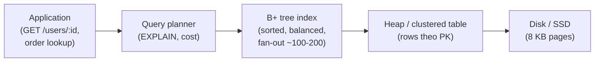
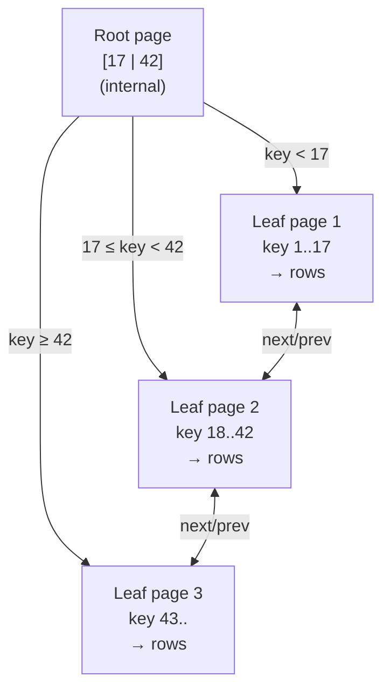

# Explain database indexing — how does a B+ tree index work?

> Bài này giải thích index trong database là gì, vì sao cần, cấu trúc B+ tree (internal node, leaf node, separator key, doubly-linked leaves), cách thực hiện point query, range query, equality + range, cùng các khái niệm kèm theo (clustered index, height, fill factor, page split, secondary index). Bài [clustered-vs-non-clustered-index](clustered-vs-non-clustered-index.md) phân biệt hai loại index theo cách lưu row; bài [indexing-for-get-requests](indexing-for-get-requests.md) đi vào cách chọn index cho workload GET.

Chủ đề: Database · Ngày: 2026-10-16

## 1. Là gì

Database index là một cấu trúc dữ liệu phụ, được storage engine duy trì song song với bảng, giúp tra cứu row theo giá trị (hoặc cụm cột) mà không phải quét toàn bộ bảng. B+ tree là cấu trúc index mặc định trong hầu hết RDBMS quan hệ (PostgreSQL, MySQL InnoDB, SQL Server, Oracle, SQLite), vì nó giữ dữ liệu đã sắp xếp, hỗ trợ equality, range và prefix scan với số trang đĩa phải đọc tỷ lệ với `log_fanout(N)`, không phải `N`.

Cần B+ tree vì bảng lớn không thể sort trong RAM, và hash index không giữ thứ tự nên range query vẫn phải quét bảng. B+ tree lưu bản sao đã sắp xếp của key kèm con trỏ tới row (hoặc chính row), và giữ cân bằng để mọi node nằm ở cùng độ sâu.



*Sơ đồ vị trí: Application gửi query, planner chọn index, B+ tree trỏ tới row trong heap (PostgreSQL) hoặc chính row (MySQL InnoDB clustered PK). Disk là các page 8 KB.*

### Trả lời 30 giây

"Index là cấu trúc phụ lưu bản sao đã sắp xếp của key và con trỏ tới row. B+ tree giữ tất cả data record ở leaf node, internal node chỉ chứa separator key để dẫn đường, các leaf nối nhau thành danh sách liên kết đôi. Một lookup equality mất `O(log_fanout N)` disk page, với fan-out ~100-200 trên page 8 KB nên tree 3 tầng chứa được vài triệu row. Range query chạy nhanh vì leaf đã sort, chỉ cần quét liên tục. Hash index nhanh hơn cho equality nhưng không range được, nên B+ tree là lựa chọn mặc định."

## 2. Cơ chế cốt lõi

### Bước 1. Cấu trúc một node B+ tree

Một node B+ tree vừa một page đĩa (8 KB phổ biến, không chắc cho mọi engine). Có hai loại:

- **Internal node**: lưu `(separator_key, child_page_id)` xếp theo thứ tự. Số child pointer = số key + 1. Trên page 8 KB với key 8 byte + child pointer 6 byte thì fan-out ~100-200. Không chứa row.
- **Leaf node**: lưu `(key, value)` trong đó `value` là row pointer (PostgreSQL) hoặc chính row (MySQL InnoDB clustered PK). Các leaf nối nhau bằng doubly-linked list để range scan đi tiếp mà không quay lên tree.



*Cấu trúc B+ tree: root/internal chỉ chứa separator key, mọi record nằm ở leaf, leaf nối nhau bằng doubly-linked list. Tree luôn cân bằng: mọi leaf cùng độ sâu.*

### Bước 2. Point query: tìm key = K

1. Planner đọc root page vào buffer pool. Với key 8 byte, so sánh nhị phân tìm child pointer phù hợp. 1 page read, ~10-100 µs SSD.
2. Lặp lại với child page cho tới khi tới leaf. Tổng số page = height `h`.
3. Tại leaf, tìm key K bằng binary search, lấy row pointer. Nếu K không có → "not found". Cùng trang hoặc trang kế (nếu K nằm giữa hai leaf, key phải có trong leaf).
4. Theo row pointer, đọc row. Nếu index là clustered PK (InnoDB), value chính là row, không cần bước này.

Chi phí: `h` page read cho tree, cộng 0-1 page read cho row. Với fan-out 100 và N = 10^7, `h ≈ 4`. Tăng fan-out lên 200 → `h ≈ 3`.

### Bước 3. Range query: key trong [A, B]

1. Point query với key = A, tìm leaf page chứa A.
2. Quét leaf page đó sang phải qua doubly-linked list, đọc từng leaf, lọc key ≤ B.
3. Dừng khi gặp key > B hoặc hết leaf.

Chi phí: `h` page cho tìm điểm bắt đầu, cộng số leaf page chứa khoảng [A, B] (thường rất nhỏ nếu range hẹp, hoặc lớn nếu range rộng). Vì leaf đã sort, không cần quét row không liên quan.

### Bước 4. Insert và page split

1. Tìm leaf page phù hợp với key mới. Nếu leaf còn chỗ → insert tại vị trí giữa, cập nhật doubly-linked list, ghi lại page.
2. Nếu leaf đầy → page split: tách làm hai leaf, một nửa key cũ sang leaf mới, nửa còn lại ở leaf cũ. Một key được đẩy lên parent (separator key mới).
3. Nếu parent đầy → split đẩy lên tiếp. Trường hợp xấu nhất split lan tới root → tăng height lên 1.
4. PostgreSQL ghi lại bằng WAL trước khi sửa page (xem [write-ahead-log](write-ahead-log.md)). InnoDB dùng `innodb_fill_factor` mặc định 15/16 để trì hoãn split.

Page split làm tăng chi phí insert từ O(log N) lên O(log N + số page bị split). Split ngẫu nhiên (random key) phổ biến hơn insert tuần tự (append-only, dùng sequence/identity).

### Bước 5. Delete và merge

1. Tìm leaf, xoá key. Nếu leaf còn trên ngưỡng fill factor → xong.
2. Nếu leaf xuống dưới ngưỡng → mượn từ sibling hoặc merge với sibling. Merge giảm số entry ở parent, có thể lan lên.

PostgreSQL không merge ngay, đánh dấu page là "dead" và chờ VACUUM. InnoDB merge ngay trong một số trường hợp, không chắc cho mọi phiên bản.

### Bước 6. Multi-column (composite) index

Index trên `(a, b, c)` lưu key theo thứ tự từ điển: `(a, b, c)`. Query `WHERE a = 1 AND b = 2` đi được vì phần đầu của key trùng. Query `WHERE b = 2` không đi được vì leaf sắp xếp theo `a` trước, B+ tree không nhảy thẳng tới `b` được.

Đây là lý do thứ tự cột trong composite index rất quan trọng (xem [indexing-for-get-requests](indexing-for-get-requests.md)).

### Bước 7. Covering index (index-only scan)

Nếu mọi cột mà query cần đều nằm trong key + `INCLUDE` hoặc trong cùng index, planner không cần đọc heap. PostgreSQL gọi là Index Only Scan, InnoDB gọi là covering index. Tiết kiệm 1 lần random I/O cho mỗi row matched.

### Quan sát

Các lệnh thật, output minh hoạ (chưa chạy thật).

```sql
-- PostgreSQL: xem index của bảng, đọc cả height và số leaf
\d orders
CREATE INDEX idx_orders_user_id ON orders (user_id);

-- Lấy height, số leaf page, số row
SELECT
  relname,
  pg_relation_size(idx.indexrelid) AS index_bytes,
  pg_stat_get_live_tuples(idx.indexrelid) AS row_estimate
FROM pg_index i
JOIN pg_class t ON t.oid = i.indrelid
JOIN pg_class idx ON idx.oid = i.indexrelid
WHERE t.relname = 'orders';
-- index_bytes ~ 8 KB × số page; row_estimate gần số row thật

-- EXPLAIN: chú ý "Index Scan using idx_orders_user_id"
EXPLAIN (ANALYZE, BUFFERS)
SELECT * FROM orders WHERE user_id = 42 AND created_at >= '2026-01-01';
-- output minh hoạ, chưa chạy
-- Index Scan using idx_orders_user_id on orders
--   Index Cond: (user_id = 42)
--   Filter: (created_at >= '2026-01-01')
--   Buffers: shared hit=4 read=2

-- MySQL InnoDB: xem height và số leaf
SHOW TABLE STATUS LIKE 'orders'\G
-- Data_length / Index_length ước lượng dung lượng

ANALYZE TABLE orders;
EXPLAIN SELECT * FROM orders WHERE user_id = 42;
-- type=ref, key=idx_orders_user_id, rows=1, Extra=Using index
```

```bash
# Đếm số lần page split (PostgreSQL, từ pg_stat_user_tables)
SELECT relname, n_tup_ins, n_tup_upd, n_tup_hot_upd
FROM pg_stat_user_tables WHERE relname = 'orders';
-- n_tup_ins tăng nhanh + autovacuum chạy nhiều lần → split nhiều
```

### Ví dụ chạy từng bước

Kịch bản: xây B+ tree bậc nhỏ trên cột `id` (key INT, value = row id giả lập) bằng cách insert lần lượt 10, 20, 30, 40, 50, 60, 70. Bậc = 3 nghĩa mỗi node chứa tối đa 3 key. Sau mỗi insert, in cấu trúc cây để quan sát lúc nào split xảy ra và key nào được đẩy lên parent.

| Bước | Insert | Trạng thái cây sau insert |
|---|---|---|
| 1 | 10, 20 | Leaf[10,20] — leaf còn chỗ (2/3 key) |
| 2 | 30 | Leaf[10,20,30] — leaf đầy (3/3 key) |
| 3 | 40 | Int[20] → Leaf[10,20] — Leaf[30,40] — split, separator `20` copy lên parent |
| 4 | 50 | Int[20] → Leaf[10,20] — Leaf[30,40,50] — leaf phải còn chỗ, không split |
| 5 | 60 | Int[20,40] → Leaf[10,20] — Leaf[30,40] — Leaf[50,60] — split leaf phải, separator `40` copy lên |
| 6 | 70 | Int[20,40] → Leaf[10,20] — Leaf[30,40] — Leaf[50,60,70] — leaf cuối còn 1 slot, không split |

Vì sao bước 3 split mà bước 4 không? Bước 2 leaf đã có 3 key (đầy), bước 3 insert `40` phải tách: leaf cũ giữ `[10,20]`, leaf mới giữ `[30,40]`, key `20` được copy lên internal làm separator (cho B+ tree: leaf giữ full key, internal chỉ dẫn đường). Bước 4 insert `50` rơi vào leaf phải, leaf còn chỗ (2/3 key), không cần split. Bước 5 insert `60` khiến leaf phải tràn: tách thành `[30,40]` và `[50,60]`, key `40` được copy lên internal làm separator mới; internal giờ có `[20,40]` và 3 child. Bước 6 insert `70` vào leaf cuối, leaf còn 1 chỗ, không split.

**Biến thể lỗi**: nếu insert theo thứ tự khác, ví dụ `30, 10, 50, 20, 70, 40, 60`, cùng bậc 3 nhưng split xảy ra sớm hơn vì key mới rơi vào leaf ngẫu nhiên. Tree cùng cấu trúc cuối cùng (cân bằng) nhưng chi phí ghi gấp đôi vì phải split nhiều leaf khác nhau. Đây là lý do BIGINT auto-increment được khuyến nghị cho PK clustered: insert tuần tự chỉ split leaf cuối.

Điều rút ra: split được kích hoạt khi leaf chạm `order`, separator key được copy lên parent (không phải move); insert tuần tự giảm split so với insert random. Điều này nối với câu "Tại sao PK UUID phá clustered PK" ở bài [clustered-vs-non-clustered-index](clustered-vs-non-clustered-index.md) và với cheat sheet dòng "Fill factor InnoDB".

## 3. Câu hỏi phỏng vấn

### 3A. Câu hỏi đào sâu

<details class="qa">
<summary>Câu 1. Mô tả cấu trúc một node B+ tree và cách tree tổ chức cây phân cấp. Internal node và leaf node khác nhau thế nào?</summary>

**Trả lời ngắn:** Internal node chỉ chứa `(separator_key, child_page_id)` để dẫn đường. Leaf node chứa `(key, value)` với value là row pointer (PostgreSQL) hoặc chính row (InnoDB clustered). Các leaf nối nhau bằng doubly-linked list. Tree luôn cân bằng nên mọi leaf cùng độ sâu.

**Đào sâu:**
- Vì internal node không chứa row, mỗi page 8 KB chứa được nhiều separator key, fan-out 100-200 là bình thường.
- B+ tree khác B-tree ở chỗ toàn bộ row chỉ nằm ở leaf, internal chỉ làm "mục lục". Đổi lại leaf nối với nhau thành linked list, range scan không phải trèo lên trèo xuống tree.
- InnoDB fill factor mặc định 15/16 (93.75%) để insert tuần tự tránh split ngay. Insert random key split nhiều hơn.

**Bẫy:** Nhầm B+ tree với B-tree cổ điển. B-tree cũ lưu data trong cả internal node, range scan phải truy cập nhiều node rải rác; B+ tree gom data về leaf và nối list.

**Follow-up:** Tại sao internal node không chứa row pointer mà phải đi tiếp xuống leaf? Vì row có thể di chuyển (page split, vacuum), lưu trong internal sẽ phải cập nhật nhiều chỗ; gom về leaf giữ internal bất biến khi leaf thay đổi.
</details>

<details class="qa">
<summary>Câu 2. Point query theo khóa chính mất bao nhiêu lần đọc đĩa? Công thức liên hệ với chiều cao cây.</summary>

**Trả lời ngắn:** Point query mất `h` lần đọc page cho tree, cộng 0-1 lần cho row tuỳ engine. Với N = 10^7, fan-out 100, height khoảng 4. Tăng fan-out lên 200 → height 3. InnoDB clustered PK không tốn thêm lần đọc row vì value ở leaf chính là row.

**Đào sâu:**
- Công thức: `h ≈ log_fanout(N)`. Fan-out phụ thuộc page size (8 KB phổ biến) và độ dài key. Key 4 byte (INT) → fan-out ~500. Key 256 byte (UUID) → fan-out ~30, height 5-6.
- UUID làm index phình: mỗi key tốn 256 byte, internal node chứa ít key hơn, fan-out giảm, height tăng. Dùng UUID 7 (timestamp prefix) hoặc bigserial.
- I/O không đồng đều: lần đầu đọc page có thể là buffer hit (~100 ns RAM), lần sau SSD ~10-100 µs. Buffer cache giữ page nóng nên thực tế thường 0-2 page read.

**Bẫy:** Nói "B+ tree lookup mất O(log N) disk I/O". Sai nếu hiểu là O(log_2 N) — log ở đây là log cơ số fan-out, không phải cơ số 2. Với fan-out 100, O(log_2 10^7) ≈ 23, O(log_100 10^7) ≈ 3.5.

**Follow-up:** Nếu index có 1 tỷ row và key là BIGINT, height bao nhiêu? Với fan-out ~300, height ≈ log_300(10^9) ≈ 5.8 → 6. Vì vậy production thường set page 16 KB để giảm height (PostgreSQL `block_size` 8 KB, MySQL 16 KB).
</details>

<details class="qa">
<summary>Câu 3. Range query `WHERE created_at BETWEEN A AND B ORDER BY id LIMIT 100` chạy thế nào và làm sao tăng tốc?</summary>

**Trả lời ngắn:** Index trên `(created_at, id)` cho phép quét leaf từ A đến B theo thứ tự id đã sắp, lấy 100 dòng đầu rồi dừng. Nếu chỉ index `(created_at)`, range scan trả về các row đã sort theo created_at nhưng MySQL cần thêm một bước sort theo id hoặc filesort.

**Đào sâu:**
- B+ tree range scan đi theo doubly-linked leaf, đọc tuần tự, không cần truy cập lại internal node. Vì thế range query nhanh hơn quét bảng (seq scan) dù cùng dữ liệu.
- Tăng tốc: chọn index có cả cột trong ORDER BY (tránh filesort), hoặc dùng keyset pagination thay vì OFFSET (OFFSET 100000 vẫn phải đọc 100000 row rồi bỏ).
- Nếu range rất hẹp và selectivity cao, planner dùng index scan + filter. Nếu range rộng, planner đổi sang seq scan vì I/O tuần tự trên heap rẻ hơn random I/O trên index.

**Bẫy:** Tạo index `(created_at)` cho cả WHERE lẫn ORDER BY nhưng quên rằng MySQL vẫn filesort nếu ORDER BY cột khác key. Phải dùng `(created_at, id)` mới sort được.

**Follow-up:** Nếu LIMIT lớn (10.000) thì sao? Vẫn dùng index range scan, nhưng cần đọc nhiều leaf. Nếu LIMIT rất nhỏ (1) và selectivity cao, planner có thể chuyển sang index scan + limit 1 dừng sớm.
</details>

<details class="qa">
<summary>Câu 4. Page split là gì, khi nào xảy ra, và tác động tới write performance?</summary>

**Trả lời ngắn:** Page split xảy ra khi insert vào leaf đã đầy (vượt fill factor). Engine tách leaf làm hai, đẩy một separator key lên parent. Nếu parent đầy, split lan lên. Tác động: tăng chi phí insert từ O(log N) lên O(log N + số page bị split), phình index, có thể tăng height.

**Đào sâu:**
- InnoDB mặc định fill factor 15/16 (~93.75%) để insert thêm vài key trước khi split, tránh split liên tục với insert tuần tự.
- Random key (UUID, MD5) dẫn tới split nhiều hơn vì key mới rơi vào leaf ngẫu nhiên, các leaf cũ thường đầy. Sequence/identity key chỉ split ở leaf cuối, còn lại chừa chỗ.
- PostgreSQL cho phép `ALTER INDEX ... SET (fillfactor = N)` không chắc cho mọi phiên bản. Thực tế: fill factor 100% cho sequence, 70-90% cho random key.
- WAL ghi lại split, recovery dựa vào WAL (xem [write-ahead-log](write-ahead-log.md)). Split không kéo theo downtime.

**Bẫy:** Nghĩ rằng tăng page size từ 8 KB lên 32 KB giảm split. Đúng một nửa: split ít hơn vì mỗi page chứa nhiều key hơn, nhưng mỗi lần split tốn 32 KB ghi một lần thay vì 8 KB, và trong lúc split dễ buffer miss hơn. Không chắc cho mọi engine.

**Follow-up:** Random UUID có nên làm PK clustered? Không. Mỗi insert vào PK clustered (InnoDB) sẽ split leaf. Dùng BIGINT auto-increment hoặc UUID 7 (có timestamp prefix) làm PK, UUID full random chỉ làm unique constraint phụ.
</details>

<details class="qa">
<summary>Câu 5. Composite index (a, b, c) — query `WHERE b = 2 AND c = 3` có dùng được index không? Tại sao?</summary>

**Trả lời:** Không dùng được để lookup equality. B+ tree sắp xếp theo `a` trước, nên không nhảy thẳng tới `b = 2` được. Planner chỉ dùng index nếu query có điều kiện trên cột đầu tiên `a`.

**Đào sâu:**
- Thứ tự key trong composite index quyết định selectivity thực sự của từng cột. Cột đầu phải là cột có selectivity cao nhất.
- Index `(a, b, c)` phục vụ: `a = ?`, `a = ? AND b = ?`, `a BETWEEN ? AND ?`, `a = ? ORDER BY b, c`. Không phục vụ: `b = ?`, `c = ?`, `ORDER BY b`.
- Mẹo: đặt equality trước, range sau. `WHERE a = 1 AND b BETWEEN 10 AND 20` → index `(a, b)`, không phải `(b, a)`.

**Bẫy:** Tạo composite `(a, b)` cho query thường chỉ filter `b`. Index không được dùng, planner đổi sang seq scan, query chậm.

**Follow-up:** Index `(a, b, c)` với query `WHERE a = 1 ORDER BY b DESC LIMIT 10` chạy thế nào? Index scan range từ `a = 1`, đi ngược leaf theo thứ tự giảm dần, dừng sau 10 dòng. Không cần sort.
</details>

<details class="qa">
<summary>Câu 6 (Debug). Một query đột nhiên chậm sau khi bảng tăng từ 1 triệu lên 50 triệu row, dù đã có index. Bạn kiểm tra gì theo thứ tự nào?</summary>

**Trả lời ngắn:** 1) EXPLAIN xem còn dùng index không. 2) So sánh row estimate với thực tế (statistics lỗi thời). 3) Kiểm height tăng. 4) Kiểm fragmentation/leaf split. 5) Kiểm buffer cache hit rate. 6) Kiểm wait event: lock, WAL, replication.

**Đào sâu:**
- Bước 1: `EXPLAIN (ANALYZE, BUFFERS)` so sánh `actual rows` với `estimated rows`. Lệch 10x → statistics sai → chạy `ANALYZE` (PostgreSQL) hoặc `ANALYZE TABLE` (MySQL).
- Bước 2: `pg_stat_user_tables` kiểm `n_tup_ins` có khớp với bảng thật không. Statistics lỗi thời là lý do phổ biến nhất khiến planner chọn sai plan sau khi data tăng.
- Bước 3: `pg_relation_size(index)` × số entry. Height có thể lấy bằng `bt_metap('orders')` hoặc nhìn vào `EXPLAIN (ANALYZE, VERBOSE)`.
- Bước 4: `VACUUM (VERBOSE, ANALYZE) orders` (PostgreSQL) hoặc `OPTIMIZE TABLE` (MySQL InnoDB) để gom dead tuple, defragment leaf.
- Bước 5-6: `pg_statio_user_indexes` cho hit rate, `pg_stat_activity` cho wait event (`Lock:transactionid`, `WALWrite`).

**Bẫy:** Tạo thêm index mới mà không phân tích. Có thể planner đã bỏ index cũ vì statistics sai, tạo thêm index chỉ tốn write cost, không tăng tốc query.

**Follow-up:** Sau khi `ANALYZE`, query vẫn chậm vài lần rồi nhanh lại. Vì sao? Plan cache chưa invalidate, hoặc OS cache chưa warm. Chạy lại `EXPLAIN ANALYZE` vài lần để xác nhận.
</details>

<details class="qa">
<summary>Câu 7 (Thiết kế). Bảng `events(user_id, created_at, type, payload)` có 500 triệu row, query GET nặng nhất là `WHERE user_id = ? AND created_at >= ? ORDER BY created_at DESC LIMIT 50`. Đề xuất index.</summary>

**Trả lời ngắn:** Composite index `(user_id, created_at DESC)` vì WHERE dùng cả hai cột (equality trước, range sau), ORDER BY đã theo thứ tự index nên không cần sort, LIMIT 50 dừng sớm. Tránh index `(created_at)` vì selectivity thấp và không tận dụng được user_id.

**Đào sâu:**
- Thứ tự cột: equality trước (`user_id`), range/sort sau (`created_at`). Nếu đảo lại `(created_at, user_id)`, range scan trên `created_at` trả về nhiều user, planner phải filter `user_id` rồi sort, tốn I/O.
- DESC trong index: PostgreSQL hỗ trợ từ 9.x, MySQL 8.0+. Không chắc cho mọi phiên bản. Nếu không hỗ trợ, tạo index ASC vẫn dùng được nhưng range scan ngược sẽ đọc toàn bộ leaf rồi mới LIMIT.
- `payload` không nên đưa vào index vì là TEXT/JSONB lớn, làm index phình. Nếu cần covering, tạo index riêng với cột nhỏ.
- Khi không có đủ RAM, partition theo `user_id` hoặc `created_at` để giảm index size, tăng hit rate. Clustered PK có thể chọn `(user_id, created_at)` để range query đọc tuần tự.
- Test với `EXPLAIN (ANALYZE, BUFFERS)` trên tập dữ liệu thật, đo `Buffers: shared hit/read` để xem cache hit.

**Bẫy:** Tạo index `(user_id)` riêng và `(created_at)` riêng, rồi nghĩ planner sẽ dùng cả hai. B+ tree không thể "intersect" hai index cho query này hiệu quả bằng composite index duy nhất.

**Follow-up:** Nếu 1% user có 10 triệu event, còn lại có vài chục event. Index `(user_id, created_at)` có vấn đề gì? Leaf chứa key của user "hot" rất dài, còn leaf của user "cold" ngắn. Khi range scan trên user hot, range trên `created_at` phải đọc hàng triệu entry. Cân nhắc partial index hoặc partition.
</details>

### 3B. Câu hỏi phỏng vấn liên quan

<details class="qa">
<summary>Câu 8. Hash index khác B+ tree index ở những điểm nào, khi nào nên dùng hash?</summary>

**Trả lời:** Hash index chỉ phục vụ equality lookup, không range được và không sort. PostgreSQL không dùng hash index cho bảng thường trong nhiều phiên bản; MySQL có MEMORY engine dùng hash nhưng mất dữ liệu khi restart. B+ tree mặc định vì hỗ trợ equality, range, ORDER BY cùng lúc.
</details>

<details class="qa">
<summary>Câu 9. Tại sao internal node trong B+ tree không lưu row mà chỉ lưu key?</summary>

**Trả lời:** Vì row có thể di chuyển giữa các page khi split, merge hoặc vacuum. Lưu row trong internal sẽ phải cập nhật nhiều node khi row di chuyển. Gom về leaf giữ internal ổn định và fan-out cao.
</details>

<details class="qa">
<summary>Câu 10. Covering index là gì và khi nào nên dùng?</summary>

**Trả lời:** Covering index (index-only scan) là index chứa đủ cột mà query cần, planner không phải đọc row trong heap/clustered. Nên dùng khi query đọc vài cột nhỏ và bảng rộng. Đánh đổi: index lớn hơn, tốn write cost, giảm hit rate.
</details>

<details class="qa">
<summary>Câu 11. Index selectivity là gì, ảnh hưởng tới lựa chọn index thế nào?</summary>

**Trả lời:** Selectivity là tỷ lệ row distinct / tổng row. `user_id` selectivity cao (mỗi user vài dòng), `gender` thấp (2 giá trị). Planner chọn index có selectivity cao để giảm row phải đọc. Composite index hiệu quả khi phần đầu key có selectivity đủ tốt.
</details>

<details class="qa">
<summary>Câu 12. VACUUM / OPTIMIZE TABLE có vai trò gì với B+ tree index?</summary>

**Trả lời:** VACUUM (PostgreSQL) và OPTIMIZE TABLE (MySQL) đánh dấu dead tuple, gom leaf, defragment index. Sau VACUUM số leaf page giảm, hit rate tăng. Không chạy thì index phình.
</details>

<details class="qa">
<summary>Câu 13. Khi nào planner chọn seq scan thay vì index scan, dù có index?</summary>

**Trả lời:** Khi range rộng, selectivity thấp (hơn ~5-10% row bị filter), hoặc bảng đã nằm trong buffer pool. Random I/O của index scan tốn hơn sequential I/O của seq scan. Planner dùng cost-based.
</details>

<details class="qa">
<summary>Câu 14. Index có chi phí gì khi ghi (INSERT, UPDATE, DELETE)?</summary>

**Trả lời:** Mỗi ghi phải cập nhật tất cả index trên bảng: tìm leaf, insert key, có thể split page, ghi WAL. Càng nhiều index, write càng chậm và tốn WAL. UPDATE cột có index tốn vì phải xoá key cũ + insert key mới. Chỉ tạo index thật sự dùng tới.
</details>

<details class="qa">
<summary>Câu 15. Index unique và index thường khác nhau thế nào về cấu trúc và semantics?</summary>

**Trả lời:** Index unique thêm ràng buộc không cho phép hai row có cùng key, engine phải kiểm tra khi insert. Cấu trúc B+ tree giống nhau nhưng có thêm bước "find key" trước khi insert. Index thường chỉ tăng tốc tra cứu, không có ràng buộc.
</details>

<details class="qa">
<summary>Câu 16. Tại sao PostgreSQL dùng MVCC kết hợp với B+ tree mà không phải undo log kiểu InnoDB?</summary>

**Trả lời:** PostgreSQL giữ nhiều version của row trong heap, index trỏ tới version hợp lệ theo transaction visibility. InnoDB giữ row mới nhất trong clustered index, bản cũ trong undo log. VACUUM PostgreSQL dọn dead tuple; InnoDB purge undo log.
</details>

<details class="qa">
<summary>Câu 17. True or false: "Index luôn luôn làm query nhanh hơn".</summary>

**Trả lời:** Sai. Index chỉ nhanh khi selectivity cao và range hẹp. Với range rộng, planner có thể chọn seq scan. Index còn làm INSERT/UPDATE/DELETE chậm hơn. Phải đo bằng EXPLAIN ANALYZE trước khi kết luận.
</details>

## 4. Đánh đổi và sự cố production

### So sánh các cấu trúc index phổ biến

| Tiêu chí | B+ tree (mặc định) | Hash index | BRIN (PostgreSQL) | GIN (PostgreSQL) |
|---|---|---|---|---|
| Equality | Nhanh, O(log N) | O(1) | Không phù hợp | Phụ thuộc |
| Range scan | Nhanh, leaf sorted | Không | Hợp lý nếu dữ liệu tuần tự | Không |
| ORDER BY dùng được | Có | Không | Có (hạn chế) | Không |
| Dung lượng | Trung bình | Nhỏ | Rất nhỏ (vài trang) | Lớn |
| Phù hợp | Bảng chung, OLTP | Cache trong RAM, key tản mạn | Bảng log append-only | full-text, jsonb, array |

### Năm failure mode

| Triệu chứng | Nguyên nhân gốc | Cách kiểm tra | Cách sửa |
|---|---|---|---|
| Query chậm dù đã có index | Statistics lỗi thời, planner chọn seq scan | `EXPLAIN ANALYZE` so sánh estimated vs actual rows | `ANALYZE` (PostgreSQL) / `ANALYZE TABLE` (MySQL) |
| Insert chậm, tăng latency từng đợt | Page split liên tục do random key | `pg_stat_user_tables.n_tup_ins`, wait event `WALWrite` | Đổi PK sang auto-increment hoặc UUID 7; tăng fill factor |
| Tốn nhiều dung lượng đĩa, index lớn hơn bảng | Quá nhiều index, hoặc index chứa cột rộng | `pg_relation_size` so sánh với heap | Xoá index thừa, dùng partial index |
| Query có WHERE dùng index nhưng vẫn chậm | Index lookup trỏ về heap nhiều random I/O (InnoDB secondary) | `EXPLAIN` thấy `Using where`, `Using index` không xuất hiện | Tạo covering index với các cột SELECT |
| Index phình, hit rate giảm sau VACUUM/REINDEX | Fragmentation, dead leaf | `pgstatgin`, `OPTIMIZE TABLE` | `REINDEX CONCURRENTLY` (PostgreSQL), `ALTER TABLE ... ENGINE=InnoDB` (MySQL) |

Tham khảo: [clustered-vs-non-clustered-index](clustered-vs-non-clustered-index.md) — cách InnoDB và PostgreSQL lưu row ảnh hưởng tới số lần đọc heap; [indexing-for-get-requests](indexing-for-get-requests.md) — quy trình chọn index cho workload GET; [write-ahead-log](write-ahead-log.md) — cơ chế WAL đảm bảo crash-safe khi split/merge.

Tóm tắt trade-off: B+ tree là lựa chọn mặc định vì cân bằng giữa read, range, write và ORDER BY. Hash index chỉ thắng khi key tản mạn và chỉ equality. BRIN tiết kiệm dung lượng cho log append-only, không phù hợp OLTP. GIN cần cho full-text, jsonb nhưng tốn nhiều write. Chọn index sai loại là một trong những nguyên nhân phổ biến nhất khiến query chậm dù vẫn có index.

Khi debug, luôn đo bằng `EXPLAIN (ANALYZE, BUFFERS)` trước. Số `Buffers: shared read` là số page đĩa thật sự phải đọc; `shared hit` là page đã có trong cache. Tỷ lệ `read/(read+hit)` dưới 5% là tốt cho workload OLTP, trên 20% cho thấy cache quá nhỏ hoặc index quá lớn. Nếu `read` cao mà `index_bytes` lớn, REINDEX hoặc VACUUM FULL có thể giảm kích thước index đáng kể.

Quy tắc vận hành: bảng lớn hơn 10 GB nên có chính sách autovacuum/autoanalyze rõ ràng, vì statistics lỗi thời dẫn tới plan sai. Replication async có thể làm read replica thấy index chưa tối ưu nếu vacuum chưa chạy tới. Khi tăng instance, tăng `shared_buffers` (PostgreSQL) hoặc `innodb_buffer_pool_size` (MySQL) trước khi tăng CPU, vì hit rate cải thiện nhiều hơn. Cuối cùng, đừng quên xoá index thừa: một index không được dùng chỉ tốn write cost và cache.

## 5. Cheat sheet

| Chủ đề | Con số / quy tắc cần nhớ |
|---|---|
| B+ tree node | Internal: separator key + child page; Leaf: key + value, nối doubly-linked list |
| Chiều cao cây | `h ≈ log_fanout(N)`, fan-out 100-200 trên page 8 KB |
| Point query | `h` page read cho tree + 0-1 page read cho row (PostgreSQL) |
| Range query | `h` page để vào leaf, rồi quét tuần tự leaf theo linked list |
| Page split | Khi leaf đầy, fill factor mặc định InnoDB 15/16 |
| Composite | Equality trước, range/sort sau; cột đầu phải dùng được |
| Covering | Index chứa đủ cột cần, planner không đọc heap |
| Selectivity | Cao (nhiều distinct) → planner thường dùng; thấp → có thể bỏ |
| Index làm chậm ghi | Mỗi index thêm ~1-3 page write mỗi lần INSERT/UPDATE/DELETE |
| Debug query chậm | `EXPLAIN ANALYZE` so sánh `actual rows` vs `estimated rows` |
| Buffer hit rate | Dưới 95% → cache nhỏ hoặc index quá lớn |
| Fill factor InnoDB | Mặc định 15/16, sequence key không split nhiều |
| UUID làm PK | Fan-out giảm, height tăng, insert chậm; dùng UUID 7 hoặc bigserial |
| Trước khi tạo index | Đo workload, kiểm selectivity, đảm bảo EXPLAIN dùng |
| Xoá index thừa | Mỗi index thêm write cost, giảm cache hit |
| Khi nào dùng B+ tree | Mặc định cho mọi bảng OLTP có equality + range |
| Khi nào dùng BRIN | Bảng log append-only, không có UPDATE/DELETE đáng kể |

Trước khi vào phòng, nhớ: mỗi index là một bản sao đã sort của key, B+ tree cân bằng với fan-out cao nên point query mất O(log_fanout N) page. Range query quét leaf theo doubly-linked list. Composite index phải đặt equality trước, range/sort sau. Covering index tránh đọc heap nhưng phình index. Insert random key split nhiều, sequence key thì không. Luôn đo bằng `EXPLAIN ANALYZE` trước khi thêm index mới.

**Học tiếp:**
- [clustered-vs-non-clustered-index](clustered-vs-non-clustered-index.md) — clustered PK InnoDB vs heap PostgreSQL
- [indexing-for-get-requests](indexing-for-get-requests.md) — quy trình chọn index cho GET
- [write-ahead-log](write-ahead-log.md) — cơ chế đảm bảo crash-safe cho split/merge
- [database-transaction](database-transaction.md) — MVCC, isolation level ảnh hưởng cách đọc index

