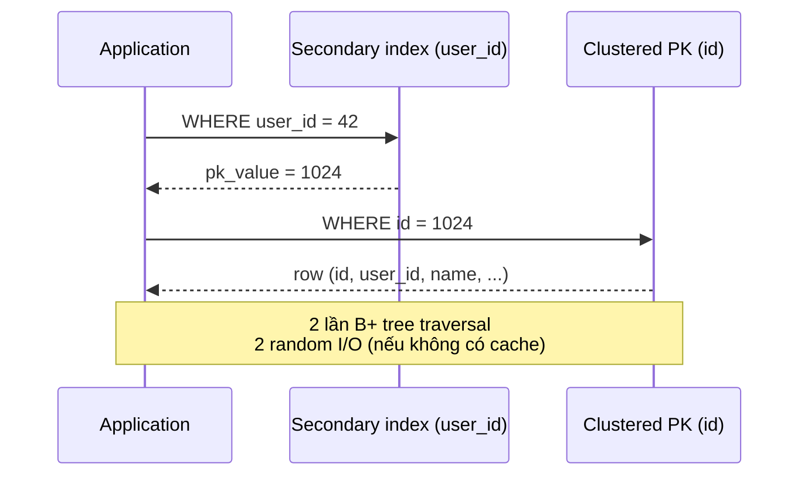

# What is the difference between clustered and non-clustered indexes?

> Bài này phân biệt clustered index (lưu row theo thứ tự key) và non-clustered index (lưu row ở heap, key trỏ tới row). So sánh MySQL InnoDB, PostgreSQL, SQL Server, Oracle IOT. Cơ chế secondary index trong bảng clustered, vì sao range query trên PK nhanh hơn secondary, và cách chọn PK đúng. Bài [b-plus-tree-index](b-plus-tree-index.md) giải thích cấu trúc B+ tree; bài [indexing-for-get-requests](indexing-for-get-requests.md) chọn index cho GET.

Chủ đề: Database · Ngày: 2026-10-16

## 0. Nền tảng trước khi đọc

**Bối cảnh:** Nơi ứng dụng lưu dữ liệu và đọc lại dữ liệu. Khó ở chỗ dữ liệu phải đúng khi nhiều người cùng đọc, ghi, hoặc khi máy bị lỗi.

**Nói đơn giản:** Clustered index sắp dữ liệu thật theo khóa; non-clustered index giữ một danh sách khóa rồi trỏ tới dòng. Khác biệt này ảnh hưởng tốc độ đọc và ghi.

**Từ khóa cần biết:** row = một dòng dữ liệu; query = câu hỏi gửi database; transaction = một nhóm thay đổi được xử lý cùng nhau.

**Ví dụ dễ hình dung:** Đọc các đơn hàng liên tiếp theo user_id nhanh hơn khi dòng dữ liệu nằm gần nhau theo đúng khóa clustered.

Khi đọc, luôn hỏi ba câu: nó giải quyết vấn đề gì, nó làm việc theo những bước nào, và khi nào không nên dùng?

**Cách học bài này:** Đọc phần này trước để nắm từ khóa; đọc phần 1 để lấy câu trả lời 30 giây; đọc phần 2 để hiểu cơ chế; cuối cùng mở từng câu hỏi ở phần 3 để luyện nói. Các con số và lệnh trong bài là bằng chứng cho câu trả lời, không cần học thuộc nếu chưa hiểu cơ chế.

## 1. Là gì

### Đọc nhanh trước khi đi sâu

**Ý chính:** Clustered index sắp dữ liệu thật theo khóa; non-clustered index giữ một danh sách khóa rồi trỏ tới dòng. Khác biệt này ảnh hưởng tốc độ đọc và ghi.

**Ví dụ interview:** Đọc các đơn hàng liên tiếp theo user_id nhanh hơn khi dòng dữ liệu nằm gần nhau theo đúng khóa clustered.

**Luồng 4 bước:**

1. Ứng dụng gửi query qua driver hoặc connection pool.
2. Database engine tìm dữ liệu, kiểm tra constraint và xử lý transaction.
3. Engine dùng index, lock/MVCC và log tùy loại thao tác.
4. Kết quả được trả về; thay đổi chỉ bền vững sau COMMIT.

**Nói như trong interview:** Clustered index sắp dữ liệu thật theo khóa; non-clustered index giữ một danh sách khóa rồi trỏ tới dòng. Khác biệt này ảnh hưởng tốc độ đọc và ghi. Hãy nói theo bốn bước trên trước; nếu interviewer hỏi sâu, chuyển sang cơ chế **Bước 1. MySQL InnoDB: bảng chính là clustered PK**, rồi nêu trade-off và failure mode ở các phần sau.

## 2. Cơ chế cốt lõi

### Bước 1. MySQL InnoDB: bảng chính là clustered PK

InnoDB lưu row trong leaf của B+ tree primary key. Mỗi leaf page chứa nhiều row, mỗi row có đủ cột (còn cột TEXT/BLOB quá lớn có thể tách ra overflow page, không chắc chi tiết từng phiên bản). Vì row đã sắp theo PK nên:

- Point query `WHERE id = ?` đi theo B+ tree, đọc `h` page, có row ngay trong leaf.
- Range query `WHERE id BETWEEN A AND B` đọc tuần tự các leaf page liên tiếp, không cần truy cập lại internal node.
- Insert PK tuần tự (auto-increment) chỉ split leaf cuối, các leaf trước y nguyên.
- Insert PK random (UUID) split nhiều leaf vì key mới rơi vào leaf ngẫu nhiên.

Secondary index trong InnoDB không trỏ trực tiếp tới row mà trỏ tới PK. Khi query dùng secondary index, InnoDB tìm key trong index, lấy PK, rồi lại đi theo clustered PK để đọc row. Hai lần B+ tree traversal, hai lần I/O.



*InnoDB secondary index lookup: secondary trỏ tới PK, PK trỏ tới row. Nếu covering index chứa đủ cột, bước 2 bỏ qua.*

### Bước 2. PostgreSQL: heap + mọi index non-clustered

PostgreSQL lưu row trong heap, không có thứ tự. Mỗi row có ROWID ẩn. Mọi index (kể cả PK) đều trỏ tới ROWID, từ ROWID engine đọc row trong heap.

- Point query trên PK: index lookup trả ROWID, engine đọc heap page qua ROWID. 1 index page + 1 heap page. Có thể 2 random I/O nếu cache miss.
- Range query trên PK: index scan trả nhiều ROWID, engine phải đọc từng heap page. Vì heap row không sắp theo PK, nhiều ROWID trỏ tới các page rải rác, dẫn tới random I/O.
- Ưu điểm heap: insert không cần duy trì thứ tự, không bị page split vì lý do sắp xếp. Tốt cho bảng nhiều update/delete không sắp theo key.
- Index-only scan (covering) tránh đọc heap: nếu index chứa đủ cột cần, planner trả dữ liệu từ index. PostgreSQL phải kiểm tra visibility qua heap (vm bitmap) trừ khi VACUUM đã cập nhật, không chắc chi tiết từng phiên bản.

### Bước 3. SQL Server: clustered hoặc non-clustered tuỳ chọn

SQL Server cho phép chọn: nếu tạo bảng với clustered index, bảng trở thành clustered; nếu không, bảng là heap. Cú pháp:

```sql
-- Clustered
CREATE TABLE orders (id INT PRIMARY KEY CLUSTERED, user_id INT, ...);
-- Non-clustered (heap)
CREATE TABLE logs (id INT PRIMARY KEY NONCLUSTERED, ...);
-- Secondary index
CREATE NONCLUSTERED INDEX idx_user ON orders (user_id);
```

SQL Server cũng hỗ trợ `INCLUDE (col)` để covering index, thêm cột vào leaf mà không tham gia key.

### Bước 4. Oracle IOT

Oracle Index-Organized Table (IOT) là clustered: row lưu trong B+ tree primary key. Khác InnoDB ở chỉ có thể dùng cho bảng mà PK truy cập là chính, vì row không có rowid riêng. Khi cần secondary, IOT dùng logical rowid (primary key) làm con trỏ. Bảng heap thông thường của Oracle giống PostgreSQL: row trong heap, index trỏ tới ROWID.

### Bước 5. Cách InnoDB và PostgreSQL phục vụ range query

- InnoDB clustered PK range: đọc tuần tự leaf page từ vị trí bắt đầu đến cuối, tất cả row đã sort theo PK. Sequential I/O, đầy đủ cache. Nhanh.
- InnoDB secondary range: quét leaf theo `user_id` sort, mỗi row phải quay lại PK để đọc đủ cột. Random I/O mỗi row. Chậm nếu nhiều row matched.
- PostgreSQL heap PK range: quét index lấy ROWID sort theo key, rồi đọc heap page theo ROWID. ROWID có thể trỏ tới page không liên quan. Random I/O.
- PostgreSQL heap secondary range: tương tự PK range, vì heap cũng không sắp theo secondary key.

### Bước 6. Ảnh hưởng tới thiết kế PK

Vì clustered PK quyết định thứ tự vật lý row, chọn PK sai sẽ phá clustered:

- PK UUID random → mỗi insert split leaf → IOPS tăng, index phình, fill factor giảm.
- PK BIGINT auto-increment → insert ở cuối, không split → IOPS ổn định.
- PK composite (status, id) → row group theo status, range theo status nhanh nhưng range theo id chậm vì row rải rác trong các nhóm status.

Nếu bảng không có truy vấn theo range và insert nhiều, có thể chọn PK ngẫu nhiên nhưng bảng sẽ chậm dần. Nếu workload chủ yếu là point query theo user_id, secondary index vẫn đủ tốt.

### Bước 7. Khi nào chọn heap (PostgreSQL) thay vì clustered

- Bảng nhiều cột wide (TEXT, JSONB), clustered sẽ làm leaf page lớn, fan-out giảm.
- Bảng có nhiều UPDATE làm row dài ra, clustered sẽ split nhiều.
- Workload chủ yếu secondary index access, không range theo PK, lợi ích clustered không rõ.

### Quan sát

```sql
-- MySQL InnoDB: xem cấu trúc
SHOW TABLE STATUS LIKE 'orders'\G
-- Row_format: Dynamic, Clustered PK trên PRIMARY

-- Secondary index trỏ qua PK, tốn 2 B+ tree traversal
EXPLAIN SELECT * FROM orders WHERE user_id = 42;
-- type=ref, key=idx_user_id, rows=1
-- Extra: NULL (không covering) hoặc "Using index" (covering)

-- PostgreSQL: kiểm tra bảng có clustered không
SELECT pg_relation_size('orders') AS heap_bytes;
-- Mọi index trỏ tới rowid (ctid), heap chứa row
\d orders
-- "btree" indexes trên id, user_id; bản thân heap

-- SQL Server: kiểm tra loại index
EXEC sp_helpindex 'orders';
-- index_description có chữ "clustered" hoặc "nonclustered"

-- Oracle: kiểm tra bảng IOT hay heap
SELECT table_name, iot_type FROM user_tables WHERE table_name = 'ORDERS';
-- IOT_TYPE: IOT (clustered) hoặc NULL (heap)
```

### Ví dụ chạy từng bước

Kịch bản: bảng `orders(id PK, user_id, created_at, total)` với 1 triệu row, query `WHERE user_id = 42 AND created_at >= '2026-01-01' LIMIT 50` chạy trên hai engine khác nhau: MySQL InnoDB (clustered PK) và PostgreSQL (heap). So sánh số page read cho cùng một query để thấy khác biệt về I/O giữa clustered và heap.

| Bước | Hành động (ai làm gì) | InnoDB (clustered theo PK `id`) | PostgreSQL (heap) |
|---|---|---|---|
| 1 | Planner phân tích query, chọn index `idx_user_created` | Đi theo secondary `idx_user_created`, lấy danh sách `id` | Đi theo index `idx_user_created`, lấy danh sách `ctid` |
| 2 | Với mỗi `id` matched, lấy row đầy đủ | Bước 2: đi theo clustered PK `id`, đọc leaf chứa row | Bước 2: nhảy tới `ctid` trong heap, đọc row |
| 3 | Đếm số page read giả định match 50 row trải 50 page | 1 secondary root + 1 leaf = 2 page cho index, + 50 random I/O tới clustered PK | 1 index root + 1 leaf = 2 page cho index, + 50 random I/O tới heap |
| 4 | Kết luận | 50 row matched → tối đa 52 page read; cache hit có thể giảm xuống 5-10 page | 50 row matched → tối đa 52 page read; vì heap row không sắp theo PK, tỉ lệ cache hit thấp hơn |

Vì sao InnoDB tốn 2 lần traversal? Secondary index trong InnoDB không trỏ trực tiếp tới row mà trỏ tới PK, để tránh phải cập nhật khi row di chuyển giữa các leaf (page split). Bước 1 lấy `id`, bước 2 mới đi theo clustered PK để đọc row đầy đủ. PostgreSQL cũng tốn 2 bước tương tự: index lấy `ctid` (row id ẩn), rồi đọc heap. Khác biệt cốt lõi: InnoDB clustered PK range scan `WHERE id BETWEEN 1000 AND 1050` đọc tuần tự, vì leaf đã sort theo `id`; PostgreSQL PK range scan vẫn random I/O vì heap không sắp theo `id`.

**Biến thể lỗi**: nếu query trở thành `WHERE user_id = 42 AND created_at >= '2026-01-01'` không có LIMIT, planner có thể bỏ index và dùng seq scan. Với 1 triệu row, seq scan mất ~1000 page read tuần tự (heap hoặc clustered), nhanh hơn 50 random I/O. Đây là lý do covering index quan trọng: nếu `idx_user_created` covering đủ cột SELECT, bướng bước 2 (đọc row) được bỏ qua, giảm từ 52 xuống 2 page read.

Điều rút ra: InnoDB secondary index luôn qua PK (2 traversal), PostgreSQL heap cũng qua rowid; range trên clustered PK mới là sequential I/O thật. Điều này nối với câu "Tại sao range trên clustered PK nhanh hơn nhiều so với secondary index range" trong cheat sheet và với câu 7 phần 3A.

## 3. Câu hỏi phỏng vấn

### 3A. Câu hỏi đào sâu

<details class="qa">
<summary>Câu 1. Clustered index là gì, khác non-clustered ở điểm nào cốt lõi?</summary>

**Trả lời:** Clustered index lưu row theo thứ tự key trong B+ tree, mỗi bảng chỉ có một (vì row không thể sắp theo hai key). Non-clustered index là cấu trúc riêng, key sort và trỏ tới row thật. InnoDB clustered theo PK, PostgreSQL mặc định heap (mọi index non-clustered).

**Đào sâu:**
- Clustered: row là leaf. Lookup PK mất `h` page read. Range query đọc tuần tự leaf.
- Non-clustered: row ở heap/clustered PK. Lookup tốn `h` page read + 1 random I/O để đọc row.
- Một số engine (SQL Server) cho chọn clustered hoặc non-clustered khi tạo bảng. PostgreSQL không có clustered mặc định, có thể dùng `CLUSTER` lệnh một lần nhưng không duy trì.
- Oracle có IOT (Index-Organized Table) là clustered, có `ROWID` ảo.

**Bẫy:** Nói "mỗi bảng chỉ có một non-clustered index". Sai. Mỗi bảng chỉ có một clustered, nhưng có thể có nhiều non-clustered.

**Follow-up:** Tại sao mỗi bảng chỉ có một clustered? Vì row vật lý chỉ có một thứ tự; hai clustered nghĩa là hai cách sắp xếp cùng lúc, không khả thi.
</details>

<details class="qa">
<summary>Câu 2. InnoDB secondary index lookup mất mấy lần B+ tree traversal? Vì sao?</summary>

**Trả lời:** Hai lần: một cho secondary index để lấy PK, một cho clustered PK để đọc row. Vì secondary index trong InnoDB không trỏ trực tiếp tới row mà trỏ tới PK, để tránh phải cập nhật khi row di chuyển (page split, vacuum).

**Đào sâu:**
- Nếu covering index chứa đủ cột mà query cần, bước 2 bỏ qua → 1 lần traversal. Đây là lý do covering index quan trọng trong InnoDB.
- Buffer pool giữ cả secondary root và clustered root cùng lúc, lookup thực tế có thể là 0-2 page read nếu cache hit.
- Nếu PK lớn (UUID 256 byte), secondary index cũng lớn vì mỗi entry phải lưu PK. Đổi PK sang BIGINT auto-incent tiết kiệm dung lượng secondary.
- `Using index` trong EXPLAIN nghĩa là covering, không phải secondary thông thường.

**Bẫy:** Nghĩ secondary index trong InnoDB trỏ thẳng tới row. Sai — InnoDB luôn trỏ qua PK để tránh cập nhật khi row di chuyển.

**Follow-up:** Nếu dùng UUID làm PK, secondary index sẽ lớn hơn bao nhiêu? Mỗi entry secondary lưu PK 16 byte thay vì 4 byte của BIGINT → index to gấp 4 lần, số leaf page gấp 4, lookup chậm hơn.
</details>

<details class="qa">
<summary>Câu 3. PostgreSQL heap table khác InnoDB clustered PK ở những điểm nào, hệ quả ra sao?</summary>

**Trả lời:** PostgreSQL lưu row trong heap không sắp theo key. Mọi index (kể cả PK) trỏ tới ROWID. InnoDB lưu row trong leaf của B+ tree PK. Hệ quả: PostgreSQL range query trên PK vẫn tốn random I/O vì ROWID trỏ tới page rải rác trong heap; InnoDB range query trên PK đọc tuần tự.

**Đào sâu:**
- PostgreSQL ưu điểm: insert không cần duy trì thứ tự vật lý, không split leaf vì lý do sắp xếp. Phù hợp bảng có nhiều update làm row dài ra, hoặc bảng wide.
- PostgreSQL nhược điểm: heap có thể phình do MVCC (dead tuple), cần VACUUM thường xuyên. InnoDB clustered có MVCC riêng (undo log), heap sạch hơn.
- VACUUM FULL rebuild heap nhưng lock bảng. Trong InnoDB, `OPTIMIZE TABLE` rebuild clustered PK nhưng cũng lock.
- Index-only scan: PostgreSQL vẫn phải check visibility (vm bitmap) trong heap trừ khi VACUUM cập nhật. InnoDB covering index không cần check visibility (undo log riêng).

**Bẫy:** Nghĩ PostgreSQL cũng clustered. Không — mặc định là heap. Lệnh `CLUSTER table` chỉ sắp xếp một lần, không duy trì.

**Follow-up:** Nếu muốn clustered trong PostgreSQL thì sao? Có thể dùng `CLUSTER` lệnh một lần, hoặc dùng BRIN cho dữ liệu tuần tự, hoặc chọn bảng ngoài (Citus, TimescaleDB) cho workload chuyên biệt.
</details>

<details class="qa">
<summary>Câu 4. Vì sao range query trên PK clustered nhanh hơn nhiều so với secondary index range query?</summary>

**Trả lời:** Vì clustered PK range scan đọc tuần tự các leaf page đã sắp theo PK, sequential I/O. Secondary index range scan quét leaf của secondary (đã sắp theo key phụ) rồi mỗi row phải trở lại PK hoặc heap để đọc row, random I/O cho mỗi row.

**Đào sâu:**
- Innodb: secondary range scan 1000 row có thể tốn 1000 random I/O. Clustered PK range scan 1000 row trong cùng page block thì tuần tự, 5-10 page read tổng.
- Heap PostgreSQL: PK range scan vẫn random I/O vì heap không sắp theo PK. Khoảng cách này thu hẹp so với InnoDB.
- Để secondary range scan nhanh, cần covering index chứa đủ cột, hoặc tạo clustered index theo cột range query.
- Vì vậy thiết kế PK rất quan trọng: cột hay dùng cho range query (timestamp, status) nên đưa vào PK.

**Bẫy:** Tạo clustered index trên UUID, sau đó tạo secondary index trên `created_at` cho range query. Kết quả: range query `WHERE created_at BETWEEN ?` vẫn chậm vì secondary trỏ qua PK ngẫu nhiên, random I/O.

**Follow-up:** Nếu cả range query theo `created_at` lẫn point theo UUID đều quan trọng? Hai cách: tạo clustered theo `created_at` (PK composite (created_at, uuid)) và chấp nhận point theo uuid chậm, hoặc tạo clustered theo uuid và covering index cho range.
</details>

<details class="qa">
<summary>Câu 5. Chọn PK cho InnoDB thế nào? Vì sao auto-increment thường được khuyến nghị?</summary>

**Trả lời:** PK nên là BIGINT auto-increment vì insert chỉ thêm vào cuối leaf, không split các leaf cũ, IOPS ổn định, secondary index nhỏ (PK chỉ 8 byte). PK UUID ngẫu nhiên phá clustered: insert rơi vào leaf bất kỳ, split nhiều, fill factor giảm, secondary index phình.

**Đào sâu:**
- Auto-increment: insert tuần tự, leaf cuối luôn đầy nhưng split ngay khi đầy, fill factor 15/16 để chừa chỗ. Clustered PK thân thiện với cache vì row mới liên tiếp nhau.
- UUID random: mỗi insert rơi vào leaf ngẫu nhiên, nhiều leaf đầy cùng lúc, split lan rộng. Index phình, lookup chậm hơn vài lần.
- PK composite: `(status, id)` group row theo status. Range theo status rất nhanh, range theo id rải rác, point theo id cũng tốn nhiều page.
- Nếu cần UUID, dùng UUID 7 (timestamp prefix) hoặc ULID — vẫn globally unique, vẫn có thứ tự thời gian, clustered insert ổn định.

**Bẫy:** Dùng UUID v4 làm PK cho bảng lớn vì "cần globally unique". Quên rằng clustered PK phá hiệu năng nghiêm trọng, nên dùng UUID ở secondary index (unique constraint) và BIGINT làm PK.

**Follow-up:** Bảng cần natural key (email, số điện thoại) làm unique constraint. Có nên đó làm PK không? Không, vì natural key thay đổi (user đổi email), update PK clustered cực kỳ tốn. Thêm cột BIGINT auto-increment làm PK, đặt unique constraint trên email.
</details>

<details class="qa">
<summary>Câu 6 (Debug). Một bảng InnoDB 100 GB, query `SELECT * FROM orders WHERE user_id = 42` chậm dù đã có index `idx_user_id`. Bạn kiểm tra gì theo thứ tự nào?</summary>

**Trả lời ngắn:** 1) EXPLAIN xem có dùng index và `Using index` không. 2) Kiểm buffer pool hit rate. 3) Kiểm PK có phải UUID không (clustered phá). 4) Kiểm số row matched có vượt quá dự kiến. 5) Kiểm số page read, có quá nhiều random I/O.

**Đào sâu:**
- Bước 1: `EXPLAIN` xem `type=ref`, `key=idx_user_id`, `Extra=NULL` nghĩa là secondary index thường, không covering. Tốn 2 lần traversal.
- Bước 2: `SHOW GLOBAL STATUS LIKE 'Innodb_buffer_pool_read_requests'` và `Innodb_buffer_pool_reads`. Hit rate dưới 95% → cache nhỏ hoặc quét nhiều.
- Bước 3: `SHOW CREATE TABLE orders\G` xem PK. Nếu PK là UUID 36 ký tự, secondary index mỗi entry 16+36 byte → rất lớn.
- Bước 4: `EXPLAIN` rows estimate so với thực tế. Lệch lớn → statistics sai → `ANALYZE TABLE`.
- Bước 5: `EXPLAIN ANALYZE` đọc `Handler_read_rnd_next` cao = quét nhiều row. Nếu user_id match 100k row, mỗi row trỏ qua PK → 100k random I/O.

**Bẫy:** Thêm index `(user_id, *)` covering khi user_id match quá nhiều row. Index lớn, write chậm, mà query vẫn trả nhiều data.

**Follow-up:** Tại sao cùng query chạy nhanh vào buổi sáng nhưng chậm vào buổi chiều? Buffer pool warm lúc sáng do workload đều; chiều workload khác làm cache bị thrash. Cần tách cache (multiple buffer pool instance) hoặc tăng RAM.
</details>

<details class="qa">
<summary>Câu 7 (Thiết kế). Bảng `events(tenant_id, event_id BIGINT, created_at, payload)` 200 triệu row đa tenant, query phổ biến là `WHERE tenant_id = ? ORDER BY created_at DESC LIMIT 50`. Đề xuất cách chọn clustered và secondary index.</summary>

**Trả lời ngắn:** InnoDB: composite PK `(tenant_id, event_id)` để phân vùng row theo tenant, range theo tenant nhanh. Thêm secondary `(tenant_id, created_at DESC)` covering cho query. PostgreSQL: tương tự nhưng heap, nên secondary quan trọng hơn.

**Đào sâu:**
- PK `(tenant_id, event_id)`: insert tuần tự theo tenant_id giúp clustered phân nhóm, range theo tenant_id đọc tuần tự trong InnoDB.
- Secondary `(tenant_id, created_at DESC)`: query chính dùng index này, có thể covering thêm `payload` (cẩn thận index phình). Nếu `payload` lớn, không covering.
- Vì secondary trỏ qua PK, mỗi row matched tốn 1 random I/O nếu `payload` không covering. Nếu 50 row matched và 50 page rải rác → 50 random I/O.
- Partition theo `tenant_id` (PostgreSQL declarative, MySQL theo range) để mỗi partition chỉ vài triệu row, index nhỏ, cache tốt hơn.
- Đo bằng `EXPLAIN (ANALYZE, BUFFERS)` trên production-like data, xem `Buffers: shared read` cao hay thấp.

**Bẫy:** Tạo clustered PK theo `event_id` đơn lẻ, để secondary `(tenant_id, created_at)`. Khi range theo tenant_id phải nhảy qua nhiều page rải rác, clustered không giúp ích.

**Follow-up:** Nếu 1 tenant có 90% data (hot tenant), partition có giúp? Partition giúp quản lý (drop old, archive) nhưng vẫn có 1 partition lớn. Cân nhắc tách hot tenant sang bảng riêng.
</details>

### 3B. Câu hỏi phỏng vấn liên quan

<details class="qa">
<summary>Câu 8. SQL Server có gì khác InnoDB và PostgreSQL về clustered index?</summary>

**Trả lời:** SQL Server cho chọn khi tạo bảng: `PRIMARY KEY CLUSTERED` hoặc `NONCLUSTERED`. Mặc định (không chỉ định) tạo non-clustered, khác InnoDB. Hỗ trợ `INCLUDE (col)` cho covering index.
</details>

<details class="qa">
<summary>Câu 9. Oracle IOT khác InnoDB clustered như thế nào?</summary>

**Trả lời:** IOT (Index-Organized Table) là clustered, row lưu trong B+ tree primary key. Khác InnoDB ở chỗ: secondary index dùng logical rowid (chính PK) làm con trỏ, nếu PK thay đổi phải cập nhật tất cả secondary. Oracle cũng có heap table thông thường, không clustered.
</details>

<details class="qa">
<summary>Câu 10. Clustered index có ảnh hưởng tới INSERT performance không? Khi nào?</summary>

**Trả lời:** Có. Insert tuần tự (auto-increment PK) chỉ thêm ở cuối leaf, không split các leaf cũ. Insert random (UUID PK) rơi vào leaf bất kỳ, split nhiều, IOPS tăng. Bảng lớn chênh lệch 5-10 lần giữa hai cách chọn PK.
</details>

<details class="qa">
<summary>Câu 11. Update cột PK trong InnoDB có tốn không? Vì sao?</summary>

**Trả lời:** Tốn. Update PK = xoá row cũ trong clustered leaf + insert row mới ở leaf khác + cập nhật tất cả secondary index (vì chúng trỏ qua PK). Vì vậy không nên chọn PK có thể thay đổi (email, username). Dùng BIGINT auto-increment hoặc UUID cố định.
</details>

<details class="qa">
<summary>Câu 12. VACUUM PostgreSQL có cần thiết cho index không? Vì sao?</summary>

**Trả lời:** VACUUM đánh dấu dead tuple trong heap, vm bitmap cập nhật. Index-only scan dùng vm bitmap để biết tuple nào visible mà không đọc heap. Nếu VACUUM chậm, index-only scan vẫn phải đọc heap.
</details>

<details class="qa">
<summary>Câu 13. Tại sao PostgreSQL không mặc định clustered như InnoDB?</summary>

**Trả lời:** Lịch sử thiết kế: PostgreSQL chọn heap để đơn giản hoá MVCC (nhiều version trong heap), tránh page split vì lý do sắp xếp, hỗ trợ bảng wide tốt hơn. InnoDB vì ban đầu tối ưu cho workload OLTP có nhiều range query theo PK. Mỗi cách có đánh đổi riêng, không có cách nào tốt cho mọi workload.
</details>

<details class="qa">
<summary>Câu 14. Secondary index trong SQL Server có khác InnoDB không?</summary>

**Trả lời:** SQL Server non-clustered index trỏ tới row bằng row identifier (RID cho heap, clustered key cho clustered table). InnoDB luôn trỏ qua clustered PK. Nếu bảng SQL Server là heap, non-clustered trỏ tới RID; nếu clustered, trỏ tới clustered key. Khái niệm giống InnoDB nhưng tên gọi khác nhau.
</details>

<details class="qa">
<summary>Câu 15. Có thể tạo clustered index sau khi bảng đã có dữ liệu không?</summary>

**Trả lời:** Được. InnoDB không có clustered PK cố định nếu không khai báo PRIMARY KEY — nó chọn UNIQUE NOT NULL đầu tiên, nếu không có thì tạo rowid ẩn. SQL Server cho `CREATE CLUSTERED INDEX` trên bảng heap, rebuild bảng. Tốn thời gian, lock, cần ONLINE nếu production.
</details>

<details class="qa">
<summary>Câu 16. Bảng không có PRIMARY KEY nào thì sao?</summary>

**Trả lời:** InnoDB tạo clustered index ẩn trên rowid nội bộ (GEN_CLUST_INDEX), 6 byte. PostgreSQL tạo rowid ẩn (ctid) cho heap, không có clustered. Best practice luôn khai báo PK để tránh rowid ẩn và clustered không tối ưu.
</details>

<details class="qa">
<summary>Câu 17. True or false: "Clustered index luôn nhanh hơn non-clustered index".</summary>

**Trả lời:** Sai. Clustered chỉ nhanh hơn cho range và point theo PK. Point theo cột khác secondary vẫn dùng được. Bảng nhiều UPDATE clustered có thể chậm hơn vì split.
</details>

## 4. Đánh đổi và sự cố production

### So sánh ba triển khai clustered phổ biến

| Tiêu chí | InnoDB (MySQL) | PostgreSQL (heap) | SQL Server (clustered chọn được) | Oracle IOT |
|---|---|---|---|---|
| Mặc định | Clustered theo PK | Heap (không clustered) | Non-clustered nếu không chỉ định | Heap (IOT phải chọn) |
| PK làm clustered | Có, tự động | Không | Có nếu khai báo `CLUSTERED` | Có (IOT) |
| Secondary trỏ qua | PK | ROWID (ctid) | RID hoặc clustered key | Logical rowid (PK) |
| Range query trên PK | Tuần tự, nhanh | Random I/O qua heap | Tuần tự nếu clustered | Tuần tự |
| Insert ngẫu nhiên | Phá clustered | Không ảnh hưởng | Phá clustered nếu clustered | Phá clustered |
| MVCC | Undo log | Dead tuple trong heap | Version store riêng | Undo log |
| Vacuum/defrag | `OPTIMIZE TABLE` (lock) | `VACUUM` (online) | `REBUILD` (lock nếu không ONLINE) | `COALESCE` (online một số case) |

### Năm failure mode

| Triệu chứng | Nguyên nhân gốc | Cách kiểm tra | Cách sửa |
|---|---|---|---|
| Range query theo `created_at` chậm dù có secondary index | Secondary index trỏ qua PK, random I/O; clustered PK không sắp theo created_at | `EXPLAIN` thấy `Using where` không `Using index`; `Handler_read_rnd_next` cao | Thêm covering index `(created_at, *)` hoặc đổi clustered PK theo `created_at` |
| Insert chậm, IOPS cao bất thường | PK UUID random, split liên tục trong clustered | `SHOW ENGINE INNODB STATUS` thấy page splits; `information_schema.INNODB_METRICS` | Đổi PK sang BIGINT auto-increment hoặc UUID 7 |
| Tốn disk bất thường cho secondary index | PK lớn (UUID), mỗi entry secondary lưu PK | `SELECT index_length FROM information_schema.tables` | Dùng PK nhỏ hơn (BIGINT) |
| VACUUM PostgreSQL chạy liên tục, IOPS cao | Bảng có nhiều UPDATE/DELETE, dead tuple phình heap | `pg_stat_user_tables.n_dead_tup` | Tăng autovacuum, partition bảng, archive data cũ |
| Bảng clustered với row wide, leaf page ít row | Row quá lớn, fan-out giảm, height tăng | `SHOW TABLE STATUS` Rows/Page, `EXPLAIN` height | Tách cột wide (JSONB, TEXT) sang bảng phụ, dùng heap |

Tham khảo: [b-plus-tree-index](b-plus-tree-index.md) — cấu trúc B+ tree chung cho mọi index; [indexing-for-get-requests](indexing-for-get-requests.md) — quy trình chọn index cho workload GET, bao gồm cả clustered; [write-ahead-log](write-ahead-log.md) — InnoDB redo log, PostgreSQL WAL bảo vệ clustered/heap khi ghi.

Tóm tắt đánh đổi: InnoDB clustered mặc định phù hợp OLTP với range query theo PK, nhưng phụ thuộc nặng vào việc chọn PK đúng. PostgreSQL heap linh hoạt hơn, chấp nhận nhiều workload nhưng range query trên PK tốn random I/O. SQL Server cho chọn linh hoạt nhất, nhưng phải hiểu rõ mới chọn đúng. Oracle IOT ít dùng vì phải thiết kế lại khi truy cập thay đổi.

Trong production, hãy kiểm tra số lần `Handler_read_rnd_next` (InnoDB) hoặc `pg_stat_user_tables.seq_scan` (PostgreSQL) để biết có bao nhiêu query phải quét nhiều row. Nếu cao, secondary index chưa phủ hết hoặc statistics sai. Khi chuyển từ heap sang clustered (hoặc ngược lại), test trên bản sao dữ liệu thật: clustered thay đổi hoàn toàn cách secondary index lookup hoạt động, kết quả benchmark có thể khác xa so với dự đoán. Cuối cùng, đừng quên chính sách vacuum/optimize định kỳ cho cả hai kiểu bảng: clustered phình vì split, heap phình vì dead tuple. Trên PostgreSQL bật autovacuum với ngưỡng phù hợp; trên MySQL lên lịch `OPTIMIZE TABLE` vào giờ thấp điểm. Nếu bảng quá lớn để lock, cân nhắc partition hoặc `pt-online-schema-change` để rebuild clustered mà không cần downtime dài.

## 5. Cheat sheet

| Chủ đề | Con số / quy tắc cần nhớ |
|---|---|
| Clustered | Row lưu trong leaf của B+ tree, mỗi bảng một |
| Non-clustered | Key trỏ tới row ở heap hoặc clustered PK |
| InnoDB | Clustered theo PK; secondary luôn trỏ qua PK (2 lần traversal) |
| PostgreSQL | Heap; mọi index (kể cả PK) trỏ tới ROWID |
| SQL Server | `CLUSTERED` hoặc `NONCLUSTERED` tuỳ chọn; mặc định non-clustered |
| Oracle IOT | Clustered nếu khai báo; secondary dùng logical rowid |
| Range scan clustered PK | Tuần tự, sequential I/O, nhanh |
| Range scan secondary | Random I/O vì row rải rác |
| Chọn PK InnoDB | BIGINT auto-increment; tránh UUID v4 |
| Chọn PK PostgreSQL | PK không ảnh hưởng thứ tự vật lý, nhưng nên auto-increment vì secondary nhỏ hơn |
| 2 lần traversal | InnoDB secondary → PK → row, tốn 2 random I/O nếu cache miss |
| Covering index | `Using index` trong EXPLAIN, planner không đọc row |
| VACUUM/OPTIMIZE | Cần thiết cả cho clustered và heap, đặc biệt sau nhiều UPDATE |
| Online rebuild | PostgreSQL `REINDEX CONCURRENTLY`, MySQL `OPTIMIZE TABLE`, SQL Server `ONLINE = ON` |
| Khi nào chọn heap | Bảng wide, nhiều UPDATE không range theo PK |

Trước khi vào phòng, nhớ: clustered = row theo key, non-clustered = trỏ tới row. InnoDB mặc định clustered, PostgreSQL mặc định heap. Secondary trong InnoDB luôn trỏ qua PK. Range query trên clustered PK là sequential I/O, nhanh hơn secondary nhiều vì tránh random I/O. Chọn PK đúng (BIGINT auto-increment) là yếu tố quan trọng nhất với clustered.

**Học tiếp:**
- [b-plus-tree-index](b-plus-tree-index.md) — cấu trúc B+ tree, page split, doubly-linked leaf
- [indexing-for-get-requests](indexing-for-get-requests.md) — thiết kế index cho GET, composite, covering
- [write-ahead-log](write-ahead-log.md) — WAL cho InnoDB và PostgreSQL
- [database-transaction](database-transaction.md) — MVCC ảnh hưởng cách clustered/heap lưu version

