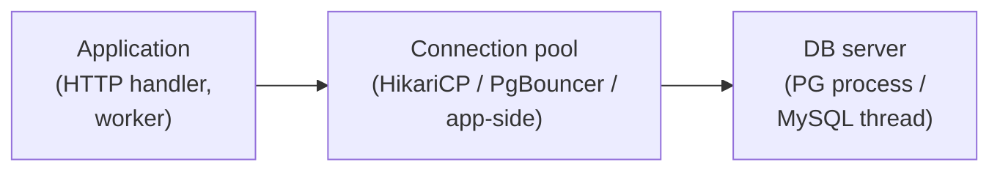
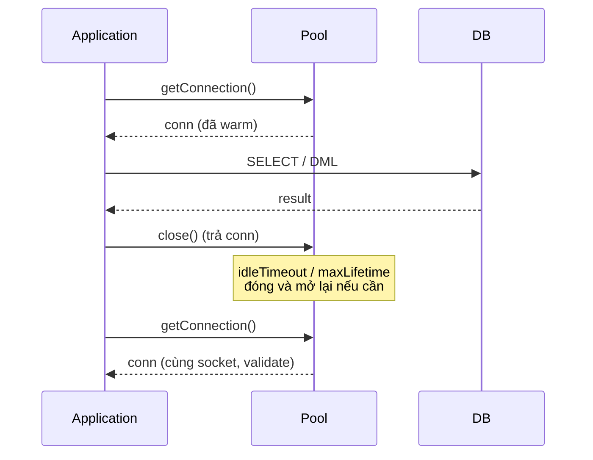

# What is connection pooling and why is it used?

> Bài này giải thích connection pool là gì, vì sao TCP socket tới RDBMS tốn kém, cách chọn size (heuristic), khác biệt process-per-connection của PostgreSQL với thread-per-connection của MySQL, ba chế độ của PgBouncer và giới hạn của chúng, app-side pool (HikariCP) so với external proxy, leak detection và timeouts. Liên quan: [acid-properties](acid-properties.md), [write-ahead-log](write-ahead-log.md).

Chủ đề: Database · Ngày: 2026-10-16

## 1. Là gì

Connection pool là một vùng đệm giữ sẵn một tập kết nối (TCP socket + session state) tới database server, để application lấy-ra/trả-vào thay vì mở kết nối mới cho mỗi request. Lý do: TCP handshake + TLS + auth + "làm nóng" session (cache plan, parse, pool buffer của server) tốn vài chục mili-giây đến hàng trăm mili-giây cho mỗi kết nối mới, trong khi cùng workload trên connection đã warm chỉ tốn ~1 ms cho query ngắn. Pool cho phép giới hạn số kết nối thật tới server (để server không chết dưới tải) đồng thời che giấu chi phí mở kết nối với application.



*Sơ đồ vị trí: Application mượn connection từ pool; pool giữ sẵn N socket tới DB và cho application đặt hàng vào hàng chờ khi hết. DB server chỉ nhìn thấy tối đa N connection thật.*

### Trả lời 30 giây

"Connection pool giữ sẵn một tập TCP socket tới database để khỏi mở/đóng cho mỗi request, vì TCP+TLS+auth tốn ~5-100 ms mỗi lần mở và server-side state cũng cần warm-up. App lấy một connection từ pool, chạy query, trả lại. Heuristic size: `pool ≈ ((core_count × 2) + effective_spindle_count)` theo HikariCP wiki, và nên chỉnh theo quan sát thật. PostgreSQL dùng một process per connection nên pool nên nhỏ (vài chục); MySQL dùng thread per connection nên chịu được vài trăm tới vài nghìn connection. Pool có thể đặt trong app (HikariCP, c3p0, Druid) hoặc trong proxy ngoài (PgBouncer, ProxySQL, RDS Proxy)."

## 2. Cơ chế cốt lõi

### Bước 1. Vì sao mỗi connection tốn

1. **Client side**: TCP 3-way handshake (~1 RTT), TLS nếu bật (1-2 RTT với TLS 1.3, 2 RTT với 1.2), auth (`SCRAM`, `md5`, `caching_sha2_password`). Cộng lại 5-100 ms tuỳ RTT và auth method.
2. **Server side**: server fork/spawn process (PostgreSQL) hoặc tạo thread (MySQL), phân bổ memory cho session state (catalog cache, plan cache, prepared statement cache, work_mem, session GUC). Trên PostgreSQL mỗi process tiêu tốn vài MB RSS khi idle; MySQL thread nhẹ hơn nhưng vẫn có overhead.

### Bước 2. PostgreSQL: process per connection

PostgreSQL có một backend process riêng cho mỗi connection (model multi-process từ thời sử dụng `fork()` từ `postmaster`). Mỗi backend giữ catalog cache, plan cache, prepared statements, temporary namespace, locks. Khi connection idle vẫn chiếm RAM (~5-10 MB tuỳ phiên bản, extension và workload). Vì lý do này cộng đồng khuyến nghị tổng số connection thật tới một PG instance nên ở mức vài chục tới ~100-200 tuễ server, không hơn.

### Bước 3. MySQL: thread per connection

MySQL từ bản cũ dùng một thread per connection (kiến trúc trên nền thread pool của server, không phải thread pool của app). Mặc định `max_connections = 151`, nhưng cộng đồng hay nâng lên ~500-1000 trên server đủ RAM. Thread rẻ hơn process về RAM (~1-2 MB mỗi thread tuỳ buffer), nhưng context switch và lock contention (`LOCK_open` cũ, nay đã cải tiến) vẫn tăng theo số connection. Không chắc cho mọi workload và version.

### Bước 4. Heuristic size pool

Một vài heuristic phổ biến (không phải định luật vật lý, là quy tắt kinh nghiệm):

- **HikariCP wiki**: `connections = ((core_count × 2) + effective_spindle_count)`. Với 4-core server và SSD (spindle = 1): `4*2 + 1 = 9`. Nên bắt đầu từ đây, đo `active connections`, `connection acquisition time`, `query latency`, rồi chỉnh.
- **PostgreSQL world**: tổng connection thật tới server `≈ (cores × 2)` cho OLTP workload. Vượt ~200 thì nên đặt PgBouncer ở phía trước.
- **MySQL world**: nhiều hơn, ~100-500 tuỳ RAM và version. Nhưng vẫn nên có proxy ở phía trước để có thể scale app mà không đụng server.

Quan điểm: không có công thức nào đúng cho mọi workload. Bắt đầu từ heuristic, đo `db.server.active_connections`, `db.connection.acquisition_time`, p95/p99 latency, rồi tăng/giảm.

### Bước 5. PgBouncer: ba chế độ pool

PgBouncer (proxy PostgreSQL phổ biến nhất, viết bằng C) có ba chế độ chính:

- **`session`**: client giữ một server connection trong suốt lifetime của client connection. Hỗ trợ session state (temp table, `SET`, advisory lock, prepared statement thông thường). An toàn nhất nhưng tiết kiệm ít nhất.
- **`transaction`**: client connection được gán một server connection từ lúc `BEGIN` tới `COMMIT`/`ROLLBACK`. Khi client idle giữa các transaction, server connection trả về pool. Hỗ trợ `SET` ở mức transaction-local. Không hỗ trợ: prepared statement qua nhiều transaction (cần `prepared_statement_cache` hoặc dùng protocol extended), session-level `SET`, temporary table, advisory lock thường (chỉ hold trong transaction).
- **`statement`**: mỗi statement riêng lẻ được gán server connection. Giới hạn nhất, gần như không dùng cho app thường.

Một số giới hạn quan trọng của `transaction` mode: **server-side prepared statement qua pool có thể bị trộm server khác** và trả protocol error; cách phổ biền là disable server-side prep (`pgbouncer`'s `max_prepared_statements = 0`, hoặc driver JDBC `prepareThreshold=0`).

### Bước 6. Leak detection, timeouts, validation

App-side pool (HikariCP, Druid) cung cấp:

- **`connectionTestQuery`** / `connection-init-sql` / JDBC4 `isValid()`: gọi lệnh rẻ (`SELECT 1`) trước khi đưa connection cho app, tránh nhận socket đã chết.
- **`idleTimeout`**, **`maxLifetime`**: đóng connection idle quá lâu, hoặc xoay vòng sau N phút (chống memory leak, server-side aging, DNS thay đổi).
- **`connectionTimeout`**: app chờ lấy connection tối đa bao lâu. Ngắn (vài giây) để fail fast dưới tải.
- **`leakDetectionThreshold`**: nếu connection không được trả sau N ms, log stack trace. Bắt code thiếu `finally`/`close()`.
- **Server-side**: PostgreSQL `idle_in_transaction_session_timeout` chống transaction idle; MySQL `wait_timeout`, `interactive_timeout`.



*Vòng đời connection: app mượn, dùng, trả; pool validate trước khi reuse, đóng sau khi vượt `maxLifetime`.*

### Bước 7. App-side pool vs external proxy

- **App-side (HikariCP, c3p0, Druid)**: pool gần application, latency thấp, dễ code (chỉ set config). Không tập trung: mỗi app instance có pool riêng, tổng connection = pool size × số instance.
- **External proxy (PgBouncer, ProxySQL, RDS Proxy, pgbouncer-in-front-of-pg)**: tập trung ở giữa app và DB. App mở nhiều connection tới proxy (cheap vì socket ngắn), proxy giữ ít connection thật tới DB. Cho phép scale app ngang mà không tăng tải DB. Đánh đổi: thêm một hop, một điểm lỗi, và nhiều feature bị giới hạn (xem các chế độ PgBouncer ở bước 5).

Quan điểm: ở production thường có cả hai. App-side pool giới hạn connection từ app tới proxy vài chục; proxy gom từ nhiều app instance và giữ ~vài chục tới ~100 connection thật tới DB.

### Quan sát

```bash
# PostgreSQL: tổng connection thật tới server, group theo state
SELECT state, count(*) FROM pg_stat_activity GROUP BY state;
# (output minh họa, chưa chạy)
# state        | count
# active       |  42
# idle         | 130
# idle in txn  |   3

# Connection đang idle quá lâu (idle_in_transaction là leak nguy hiểm)
SELECT pid, query_start, state, now() - state_change AS idle_for
FROM pg_stat_activity
WHERE state = 'idle in transaction' AND now() - state_change > interval '5 min';

# MySQL: tổng connection và theo user/host
SHOW STATUS LIKE 'Threads_connected';
SHOW PROCESSLIST;
# (output minh họa, chưa chạy)

# HikariCP metric (Micrometer/Prometheus): quan sát hàng đợi
hikaricp_connections_acquire_seconds_count
hikaricp_connections_pending
# pending > 0 ổn định nghĩa là pool quá nhỏ.
```

### Ví dụ chạy từng bước

Kịch bản: hệ thống bán hàng có 20 pod (Kubernetes), mỗi pod chịu 200 RPS, query p95 latency 50 ms, backend PostgreSQL chịu tối đa 100 connection thật. Tính pool size theo Little's Law và quyết định có cần PgBouncer hay không.

| Bước | Thời điểm | Hành động (ai làm gì) | Vì sao | Trạng thái hệ thống |
|---|---|---|---|---|
| 1 | t0 | Tính concurrency mỗi pod: 200 RPS × 0.05 s = 10 query đồng thời | Little's Law: concurrency = throughput × latency | Cần ≥10 connection/pod |
| 2 | t0+1ms | Set HikariCP `maximumPoolSize = 8` cho mỗi pod, chừa headroom | Pool nhỏ hơn concurrency đỉnh 10 để tránh context switch | Tổng app-side: 20 × 8 = 160 connection tới proxy |
| 3 | t0+1ms | Đặt PgBouncer phía trước PostgreSQL với `default_pool_size = 100` | DB chỉ chịu 100 connection thật; 160 socket tới proxy là rẻ | Proxy → DB: ≤100 connection thật |
| 4 | t0+10ms | Request đầu tiên tới pod 1, mượn connection từ pool | Pool chưa có connection sẵn → mở mới, warm ~5 ms | Pod 1 pool: active=1, idle=0 |
| 5 | t0+100ms | 8 request đồng thời tới pod 1, pool đầy | HikariCP xếp hàng request thứ 9 trong 30 s connectionTimeout | Pod 1 pool: active=8, pending=1 |
| 6 | t0+200ms | Tải giảm xuống 100 RPS mỗi pod | Pool tự trả connection idle sau 10 phút (idleTimeout) | active giảm dần về 2-3, pending=0 |

Vì sao pool size = 8 mà không phải 10? Vì concurrency đỉnh chỉ là trung bình, có idle xen kẽ; pool lớn hơn thì context switch và memory tăng mà không tăng throughput thật. HikariCP heuristic `((cores × 2) + spindles)` cho 4-core SSD = 9, gần với 8. Tại sao cần PgBouncer? Vì 20 pod × 8 = 160 connection tới PostgreSQL vượt `max_connections = 100`. PgBouncer ở `transaction` mode gom 160 socket thành ≤100 connection thật tới DB, app vẫn scale thoải mái.

**Biến thể lỗi**: nếu không đặt PgBouncer và set pool size = 16 mỗi pod, tổng = 320 connection tới PostgreSQL. Server sẽ từ chối connection mới với `FATAL: sorry, too many clients already` (mã lỗi `53300`); app thấy exception, retry storm, latency tăng gấp 10. Đó là lý do heuristic phải đi kèm quan sát thật (`hikaricp_connections_pending`, `pg_stat_activity`).

Điều rút ra: pool size nên nhỏ, đặt proxy trước DB khi scale app ngang, và phải đo `pending` cùng `acquire time` để biết khi nào pool quá nhỏ. Điều này nối với câu "Larger connection pool always improves throughput" trong 3B và cheat sheet dòng "App-side + proxy".

## 3. Câu hỏi phỏng vấn

### 3A. Câu hỏi đào sâu

<details class="qa">
<summary>Câu 1. Vì sao cần connection pool? Mở connection mới cho mỗi request có vấn đề gì?</summary>

**Trả lời ngắn:** TCP + TLS + auth tốn 5-100 ms mỗi lần mở, server-side mỗi connection PostgreSQL tốn vài MB RAM và MySQL tốn vài trăm KB tới 1-2 MB. Mở connection mới mỗi request sẽ thắt cổ chai DB dưới tải, vừa tăng latency vừa phình RAM server.

**Đào sâu:**
- TCP 3-way handshake ~1 RTT (~0.5 ms cùng DC, ~50 ms xuyên đại dương). TLS 1.3 thêm 1 RTT, TLS 1.2 thêm 2 RTT. Auth (SCRAM-SHA-256 cho PostgreSQL, `caching_sha2_password` cho MySQL 8) cộng thêm 1 round-trip.
- Server-side: PostgreSQL fork một backend process, load catalog, set session GUC. MySQL tạo thread, nạp session buffers.
- Dưới 1000 RPS, latency mở connection có thể là phần lớn tổng latency. Pool giữ connection warm, latency chỉ còn vài chục micro-giây tới vài mili-giây cho việc.

**Bẫy:** "Pool chỉ tiết kiệm TCP handshake". Sai — nó còn tránh việc khởi tạo session state (plan cache, catalog cache) và là một **cơ chế giới hạn tải** (backpressure) tới DB.

**Follow-up:** Pool là backpressure đúng nghĩa thế nào? Khi app cần 1000 query đồng thời mà pool size = 50, 950 request phải xếp hàng với timeout. DB chỉ thấy 50 connection; queue phía app nhận lỗi timeout thay vì để DB chết. Không có pool, tất cả 1000 connection sẽ được mở và DB có thể OOM hoặc CPU 100%.
</details>

<details class="qa">
<summary>Câu 2. PostgreSQL process-per-connection khác MySQL thread-per-connection ở chỗ nào, và ảnh hưởng tới pool như thế nào?</summary>

**Trả lời ngắn:** PostgreSQL fork một backend process cho mỗi connection, mỗi process ~5-10 MB RAM khi idle. MySQL dùng thread pool, mỗi thread rẻ hơn ~1-2 MB. Vì thế PostgreSQL thường chỉ chịu vài chục tới ~200 connection thật, MySQL chịu vài trăm tới vài nghìn.

**Đào sâu:**
- PostgreSQL backend process chạy độc lập, crash một process không kéo theo cả server (robust). Nhưng context switch giữa nhiều process tốn hơn thread context switch.
- MySQL thread dùng chung bộ nhớ toàn cục (innodb_buffer_pool chẳng hạn), gắn là khoá toàn cục truy cập metadata (`LOCK_open` cũ, đã thay bằng MDL lock).
- Ảnh hưởng pool: PostgreSQL cần external proxy (PgBouncer) để scale app ngang; MySQL có thể chịu trực tiếp nhiều connection hơn.
- Không chắc cho mọi phiên bản (PostgreSQL có những cải tiến qua các bản 12/13/14/15/16, MySQL 8 cũng qua nhiều bản nhỏ). Cần đo trên workload thật.

**Bẫy:** "PostgreSQL chỉ chịu ~100 connection vì lý do kỹ thuật cố hữu, không cách nào tăng". Sai — có thể tăng `max_connections` lên 500-1000, nhưng RAM và context switch tăng theo, thường không đáng. Giải pháp là PgBouncer phía trước.

**Follow-up:** Có thể tăng `max_connections` PostgreSQL lên 5000 không? Được, nhưng tốn RAM, lâu khi crash recovery, và contention trên `ProcArrayLock`. Không thay thế được proxy.
</details>

<details class="qa">
<summary>Câu 3. Ba chế độ pool của PgBouncer khác nhau ở đâu, và session state nào bị mất ở mỗi chế độ?</summary>

**Trả lời ngắn:** `session` pool giữ server connection cả lifetime client, an toàn cho mọi session state. `transaction` chỉ giữ trong transaction, hỗ trợ `SET LOCAL` nhưng mất server-side prepared statement qua nhiều transaction, session-level `SET`, temporary table, advisory lock ngoài transaction. `statement` chỉ giữ trong một statement, giới hạn nhất.

**Đào sâu:**
- **`session`**: `SET search_path = 'audit'` được nhìn ở transaction sau. Server-side prepared statement giữ được. An toàn nhất nhưng tỉ lệ pooling thấp (client idle giữa transaction chiếm server connection).
- **`transaction`**: khi client idle giữa transaction, server connection trả về pool. Client `BEGIN` lại có thể nhận server connection khác. Session-level state "bốc hơi" giữa hai transaction. Workaround: `SET LOCAL` (chỉ trong transaction) hoặc reset state đầu transaction.
- **`statement`**: hiếm dùng; chỉ phù hợp khi workload chỉ là `SELECT` không transaction.
- **Server-side prepared statement**: client `PREPARE name AS ...` rồi `EXECUTE name` ở transaction sau có thể chạy trên backend khác. Cách xử lý: JDBC `prepareThreshold=0` hoặc PgBouncer `max_prepared_statements = 0`, hoặc chuyển chế độ.

**Bẫy:** "Dùng `transaction` mode là xong". Sai — nhiều ORM (Hibernate, SQLAlchemy) dùng session-level `SET` hoặc advisory lock; cần kiểm tra trước khi bật.

**Follow-up:** Nếu bật `transaction` mode mà connection vẫn "kẹt", kiểm tra gì? `pgbouncer` log xem connection có đang trong transaction thật không; client có để transaction idle (idle in transaction) không; ORM có dùng session-level config không.
</details>

<details class="qa">
<summary>Câu 4. Connection leak là gì, làm sao phát hiện và xử lý?</summary>

**Trả lời ngắn:** Connection leak là app mượn connection từ pool nhưng không trả (thiếu `close()` trong `finally`, exception không bắt, hoặc deadlock). Triệu chứng: pool `pending` tăng, `active = max`, timeout tăng. Phát hiện bằng `leakDetectionThreshold` (HikariCP) hoặc `idle_in_transaction_session_timeout` (PG).

**Đào sâu:**
- **Code path thiếu `finally`**: try-with-resources trong Java, `with conn.cursor()` trong Python psycopg, RAII scope guard trong Rust.
- **HikariCP `leakDetectionThreshold = 30000`**: sau 30 s không trả, log stack trace cho thread đang giữ.
- **PostgreSQL `idle_in_transaction_session_timeout = '10min'`**: server tự đóng transaction idle quá lâu. Tốt để bảo vệ server khỏi code bug.
- **MySQL `wait_timeout = 28800`**: server đóng connection idle sau timeout này. Nếu app không nhận tín hiệu, connection ở app tưởng còn dùng nhưng server đã đóng → exception.
- **MySQL 8**: mặc định `mysqlx_wait_timeout`, `net_read_timeout`, `net_write_timeout`. Cần kiểm tra version.

**Bẫy:** Chỉ set timeout phía server mà không set `validation` trong pool. Khi connection bị server đóng im lặng, lần mượn tiếp theo có thể trả socket chết. Pool nên `isValid()` hoặc `SELECT 1` trước khi đưa cho app.

**Follow-up:** Connection bị server đóng và app phát hiện qua exception khi chạy query đầu tiên thay vì khi lấy từ pool — xử lý sao? Bật `connectionTestQuery` / `connection-init-sql`, hoặc dùng JDBC4 `isValid(timeout)`. Một số driver (PostgreSQL JDBC) đã tự validate socket; MySQL Connector/J 8 thì tương tự. Không chắc cho mọi driver.
</details>

<details class="qa">
<summary>Câu 5. App-side pool (HikariCP) khác external proxy (PgBouncer) ở chỗ nào? Khi nào dùng cái nào?</summary>

**Trả lời ngắn:** App-side pool gần app, config đơn giản, mỗi app instance có pool riêng. External proxy đặt giữa nhiều app instance và DB, cho phép scale app ngang mà không tăng connection tới DB, nhưng thêm một hop và một số giới hạn (xem `transaction` mode). Production thường dùng cả hai.

**Đào sâu:**
- **HikariCP, Druid, c3p0**: pool trong JVM, latency thấp (no extra hop), validation chặt, leak detection. Nhưng tổng connection = `poolSize × instances`. 10 instance × 50 connection = 500 connection tới DB.
- **PgBouncer, ProxySQL, RDS Proxy, Odyssey**: proxy ngoài. App mở hàng trăm connection rẻ tới proxy, proxy giữ vài chục tới ~100 connection thật tới DB. Cho phép blue-green, restart DB, fail-over mà không đổi app config.
- **Đánh đổi proxy**: thêm hop (latency ~0.1-0.5 ms), thêm điểm lỗi, một số session state bị mất (xem bước 5 phần 2). App-side pool thì không có hop nhưng không tập trung.
- **Cloud RDS Proxy**: managed, tích hợp với RDS, hỗ trợ IAM auth, tự động scale. Phù hợp khi đã ở trên AWS.

**Bẫy:** "Dùng proxy là xong, app không cần pool". Sai — app vẫn nên pool vì không muốn 1000 RPS mỗi instance liên tục tới proxy. Pool + proxy thường đi cùng nhau.

**Follow-up:** Một dự án có 50 microservice, 100 instance, DB chỉ chịu ~100 connection — thiết kế pool như thế nào? Mỗi instance pool size 5, tổng 500 connection tới proxy. Proxy pool size 100. Mỗi request qua 1 connection app → 1 connection proxy → 1 connection DB (khi query thật).
</details>

<details class="qa">
<summary>Câu 6 (Debug). Triệu chứng: app log `Connection is not available, request timed out` sau 30 s, tải tăng 3 lần. Bạn kiểm tra gì theo thứ tự?</summary>

**Trả lời ngắn:** 1) Xem metric pool (`pending`, `active`, `acquire`). 2) Xem DB có phải đang chậm (`pg_stat_activity`, slow query log). 3) Xem có connection leak không. 4) Kiểm timeout. 5) Nếu cần scale, xem DB có thật sự bão hoà không.

**Đào sâu:**
- Bước 1: `hikaricp_connections_pending > 0` ổn định, `hikaricp_connections_usage_seconds_max` tăng → pool quá nhỏ hoặc query quá chậm.
- Bước 2: `SELECT count(*) FROM pg_stat_activity WHERE state = 'active';` xem có query chạy lâu không. `SHOW PROCESSLIST` trên MySQL. Xem `pg_stat_statements` hoặc `performance_schema.events_statements_history` để tìm query chậm.
- Bước 3: `SELECT * FROM pg_stat_activity WHERE state = 'idle in transaction' AND now() - state_change > interval '5 min';` — transaction idle là leak điển hình. `leakDetectionThreshold` log trong app log.
- Bước 4: `connectionTimeout` có quá cao không (mặc định HikariCP 30 s). Nếu app phải chờ 30 s rồi mới fail thì đã tốn rồi. Giảm xuống 1-3 s.
- Bước 5: metric CPU, IOPS, replication lag. Nếu CPU 100% thì tăng pool không giúp, cần tối ưu query hoặc scale DB.

**Bẫy:** Chỉ tăng pool size mà không xem nguyên nhân query chậm. Pool lớn hơn không giúp query đã full scan.

**Follow-up:** App dùng ORM (Hibernate, SQLAlchemy) — vấn đề thường gặp gì? N+1 query, thiếu eager loading, không dùng batch update. Xem `pg_stat_statements.mean_exec_time` sort giảm dần.
</details>

<details class="qa">
<summary>Câu 7 (Thiết kế). Thiết kế pool cho microservice trên Kubernetes: 20 pod, mỗi pod chịu 200 RPS, query p95 50 ms, backend PostgreSQL chịu tối đa 100 connection.</summary>

**Trả lời ngắn:** Mỗi pod có HikariCP pool size 5 (vừa đủ cho 200 RPS × 50 ms = 10 query đồng thời trên trung bình, chừa headroom), tổng tối đa 100 connection tới DB. Đặt PgBouncer phía trước nếu cần scale pod > 20.

**Đào sâu:**
- **Tính nhanh**: Little's Law, `concurrency = RPS × latency`. 200 × 0.05 = 10 query đồng thời trên mỗi pod. Pool size 8-10 chừa headroom cho burst.
- **Tổng tối đa**: 20 pod × 10 = 200 connection vượt 100. Hai lựa chọn: (a) giảm pod xuống 10, (b) thêm PgBouncer.
- **PgBouncer trước DB**: 100 connection thật tới DB. Pod connect 200 socket tới PgBouncer (cheap). PgBouncer ở `transaction` mode.
- **Timeout**: `connectionTimeout = 2s`, `idleTimeout = 10 phút`, `maxLifetime = 30 phút`, `leakDetectionThreshold = 30s`.
- **Validate**: JDBC4 `isValid()` (không cần `connectionTestQuery`).
- Không chắc cho workload thật; cần benchmark.

**Bẫy:** Quên rằng pool size còn phải nhân với số instance. Một con số "an toàn" ở dev có thể thành disaster ở prod.

**Follow-up:** App có đoạn chạy batch nightly chiếm nhiều connection — xử lý sao? Tách pool riêng cho batch (kích thước lớn hơn, route qua PgBouncer khác), hoặc batch chạy async worker riêng không đi qua API path.
</details>

### 3B. Câu hỏi phỏng vấn liên quan

<details class="qa">
<summary>Câu 8. Server-side prepared statement và PgBouncer transaction mode?</summary>

**Trả lời:** Prep gắn với một backend. PgBouncer giao connection khác cho transaction sau, `EXECUTE` chạy trên backend chưa `PREPARE` → `ERROR: prepared statement does not exist`. Fix: `prepareThreshold=0` (JDBC) hoặc `max_prepared_statements=0` (PgBouncer).
</details>

<details class="qa">
<summary>Câu 9. Phân biệt 3 timeout HikariCP?</summary>

**Trả lời:** `connectionTimeout` (30 s): app chờ lấy connection. `idleTimeout` (10 phút): idle bao lâu thì đóng. `maxLifetime` (30 phút): tổng thời gian sống, kể cả khi đang dùng.
</details>

<details class="qa">
<summary>Câu 10. Tại sao MySQL thread, PostgreSQL process per connection?</summary>

**Trả lời:** Lịch sử. MySQL chọn thread cho web workload nhẹ từ đầu. PostgreSQL dựa trên Postgres (Berkeley) với process-per-backend để cô lập crash. Cả hai giữ mô hình cũ vì ổn định.
</details>

<details class="qa">
<summary>Câu 11. Connection trong pool khi DB server restart?</summary>

**Trả lời:** Connection chết (RST hoặc timeout). App exception ở query tiếp theo. Pool validate khi mượn, đóng socket, mở connection mới. App cần code retry idempotent trước khi fail.
</details>

<details class="qa">
<summary>Câu 12. True or false: "Larger connection pool always improves throughput."</summary>

**Trả lời:** Sai. Pool lớn quá context switch và lock contention tăng (PG `ProcArrayLock`, MySQL MDL). DB CPU/IOPS bão hoà thì thêm connection chỉ thêm wait time. Heuristic chỉ là điểm bắt đầu, cần đo và chỉnh.
</details>

<details class="qa">
<summary>Câu 13. Có nên bật TLS cho DB connection?</summary>

**Trả lời:** Production thường có. TLS bảo vệ password và dữ liệu, nhất là DB ở subnet khác hoặc cloud. Đánh đổi: thêm 1 RTT (TLS 1.3) cho first-time handshake và CPU overhead. Khi pool, chi phí chỉ là CPU mỗi query. Khuyến nghị TLS 1.3, verify certificate.
</details>

<details class="qa">
<summary>Câu 14. Phân biệt `minPoolSize` và `maxPoolSize`?</summary>

**Trả lời:** `minPoolSize` là connection tối thiểu pool cố giữ; `maxPoolSize` là tối đa. Set `minPoolSize` thấp (~vài) cho idle, `maxPoolSize` cao hơn cho burst. Pool mở lazy tới khi đạt `minPoolSize`.
</details>

<details class="qa">
<summary>Câu 15. Pooling với read replicas?</summary>

**Trả lời:** Nhiều DataSource: một master (write), một mỗi replica (read). Routing ở app (`@Transactional(readOnly=true)`) hoặc proxy (ProxySQL, RDS Proxy). Cần xử lý replication lag khi read-after-write cần strong consistency. Xem [database-replication](database-replication.md).
</details>

## 4. Đánh đổi và sự cố production

### So sánh ba chiến lược pool

| Tiêu chí | App-side pool (HikariCP) | External proxy (PgBouncer session) | External proxy (PgBouncer transaction) |
|---|---|---|---|
| Hop giữa app và DB | 0 | 1 | 1 |
| Hỗ trợ session state | Full | Full | Không (trừ SET LOCAL) |
| Hỗ trợ server-side prepared stmt | Có | Có | Hạn chế (cần config) |
| Tập trung / scale app ngang | Không (mỗi app một pool) | Có | Có |
| Connection thật tới DB | poolSize × instances | config pool_size | config pool_size |
| Phù hợp khi | Workload ổn, ít instance | Cần full session state | Cần scale cao, app không dùng session state ngoài transaction |

### Năm failure mode

| Triệu chứng | Nguyên nhân gốc | Cách kiểm tra | Cách sửa |
|---|---|---|---|
| Pool `pending` tăng, app timeout | Pool quá nhỏ hoặc query chậm | `hikaricp_connections_pending`, `pg_stat_activity` | Tăng pool (nếu DB còn dư tải), tối ưu query |
| `Connection is not available, request timed out` | Connection leak (thiếu close) | `leakDetectionThreshold` log, `pg_stat_activity` idle in txn | Sửa code path (try-with-resources), set `idle_in_transaction_session_timeout` |
| Connection bị server đóng im lặng | `wait_timeout` PG/MySQL hoặc failover | App exception khi chạy query, không khi lấy từ pool | Bật JDBC4 `isValid()` / `connectionTestQuery` |
| Query chậm sau khi scale app | DB CPU/IOPS bão hoà, lock contention | `pg_stat_activity` wait_event, `top`, `iostat` | Tối ưu query, scale DB, thêm index; không tăng pool vô hạn |
| Proxy trả "prepared statement does not exist" | `transaction` mode + server-side prep | Log PgBouncer | `prepareThreshold=0` hoặc `max_prepared_statements=0` |

## 5. Cheat sheet

| Chủ đề | Con số / quy tắc cần nhớ |
|---|---|
| Heuristic size HikariCP | `(cores × 2) + spindles` (SSD = 1). Đo, không tin. |
| PostgreSQL connection thật | Vài chục tới ~200. Cần PgBouncer khi scale ngang. |
| MySQL connection thật | Vài trăm tới ~1000. Tăng `max_connections`, vẫn nên có proxy. |
| PgBouncer `transaction` | Hỗ trợ `SET LOCAL`, không hỗ trợ session `SET`, advisory lock ngoài txn, server-side prep giữa txn |
| PgBouncer `session` | An toàn nhất, ít pooling nhất |
| HikariCP timeout | `connectionTimeout` 1-3 s, `idleTimeout` 10 phút, `maxLifetime` 30 phút, `leakDetectionThreshold` 30 s |
| MySQL `wait_timeout` | 28800 s mặc định. App cần `isValid()` khi mượn connection. |
| PostgreSQL `idle_in_transaction_session_timeout` | Set 5-10 phút để chống leak nguy hiểm. |
| App-side + proxy | Hay đi cùng nhau: app pool vài chục, proxy giữ vài chục tới ~100 tới DB. |

**Học tiếp:**
- [database-transaction](database-transaction.md) — transaction chạy trên connection, lock contention là phần lớn deadlock
- [write-ahead-log](write-ahead-log.md) — connection idle vẫn giữ WAL buffer
- [database-replication](database-replication.md) — pool với read replicas, route read/write