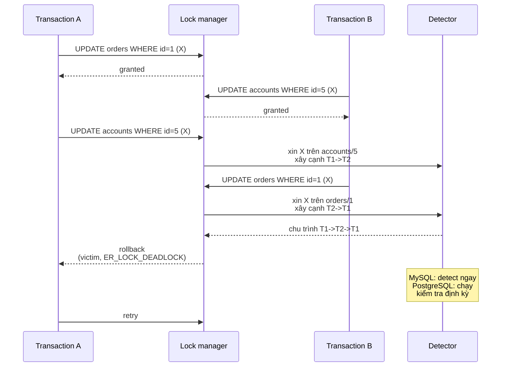

# How can deadlock occur in a database?

> Bài này giải thích deadlock xảy ra khi nhiều transaction giữ khóa chéo, cách engine phát hiện bằng wait-for graph và xử lý bằng việc chọn nạn nhân để abort, cùng các cách phòng tránh qua thứ tự khóa, isolation level và khóa hạt mịn. Bài [optimistic-vs-pessimistic-locking](optimistic-vs-pessimistic-locking.md) bàn về chọn chiến lược khóa; bài [database-isolation-levels](database-isolation-levels.md) cho biết mức cô lập nào tạo ra loại khóa nào.

Chủ đề: Database · Ngày: 2026-10-16

## 0. Nền tảng trước khi đọc

**Bối cảnh:** Nơi ứng dụng lưu dữ liệu và đọc lại dữ liệu. Khó ở chỗ dữ liệu phải đúng khi nhiều người cùng đọc, ghi, hoặc khi máy bị lỗi.

**Nói đơn giản:** Database deadlock xảy ra khi hai transaction giữ các khóa khác nhau rồi chờ khóa của nhau. Engine phải chọn một transaction để hủy.

**Từ khóa cần biết:** row = một dòng dữ liệu; query = câu hỏi gửi database; transaction = một nhóm thay đổi được xử lý cùng nhau.

**Ví dụ dễ hình dung:** Transaction thanh toán khóa account trước, transaction hoàn tiền khóa payment trước; thứ tự đảo nhau tạo vòng chờ.

Khi đọc, luôn hỏi ba câu: nó giải quyết vấn đề gì, nó làm việc theo những bước nào, và khi nào không nên dùng?

**Cách học bài này:** Đọc phần này trước để nắm từ khóa; đọc phần 1 để lấy câu trả lời 30 giây; đọc phần 2 để hiểu cơ chế; cuối cùng mở từng câu hỏi ở phần 3 để luyện nói. Các con số và lệnh trong bài là bằng chứng cho câu trả lời, không cần học thuộc nếu chưa hiểu cơ chế.

## 1. Là gì

### Đọc nhanh trước khi đi sâu

**Ý chính:** Database deadlock xảy ra khi hai transaction giữ các khóa khác nhau rồi chờ khóa của nhau. Engine phải chọn một transaction để hủy.

**Ví dụ interview:** Transaction thanh toán khóa account trước, transaction hoàn tiền khóa payment trước; thứ tự đảo nhau tạo vòng chờ.

**Luồng 4 bước:**

1. Ứng dụng gửi query qua driver hoặc connection pool.
2. Database engine tìm dữ liệu, kiểm tra constraint và xử lý transaction.
3. Engine dùng index, lock/MVCC và log tùy loại thao tác.
4. Kết quả được trả về; thay đổi chỉ bền vững sau COMMIT.

**Nói như trong interview:** Database deadlock xảy ra khi hai transaction giữ các khóa khác nhau rồi chờ khóa của nhau. Engine phải chọn một transaction để hủy. Hãy nói theo bốn bước trên trước; nếu interviewer hỏi sâu, chuyển sang cơ chế **Bước 1. Khóa được cấp khi SQL chạm dữ liệu, không phải lúc `BEGIN`**, rồi nêu trade-off và failure mode ở các phần sau.

## 2. Cơ chế cốt lõi

### Bước 1. Khóa được cấp khi SQL chạm dữ liệu, không phải lúc `BEGIN`

- Lệnh `BEGIN` chỉ mở transaction; chưa cấp khóa nào. Khóa được cấp khi statement chạm vào bản ghi.
- Trong PostgreSQL: SELECT ở `READ COMMITTED` chỉ giữ tuple lock tới cuối statement; `UPDATE`/`DELETE` giữ `FOR UPDATE` cho tới hết transaction. Trong InnoDB mặc định `REPEATABLE READ`: SELECT dùng MVCC không giữ shared lock; chỉ `SELECT ... FOR UPDATE` / `LOCK IN SHARE MODE` mới giữ lock. Khác biệt này ảnh hưởng trực tiếp khả năng xảy ra deadlock.
- Hai transaction có thể đọc cùng một hàng cùng lúc mà không xung đột. Xung đột chỉ phát sinh khi một bên muốn ghi hoặc giữ khóa exclusive.

### Bước 2. Cập nhật dữ liệu chuyển sang exclusive lock

1. T1 chạy `UPDATE accounts SET balance = balance - 100 WHERE id = 5`. InnoDB cấp exclusive lock (X) trên row `accounts/5`; ghi vào undo log; chưa flush ra data file.
2. Đồng thời T2 chạy `UPDATE accounts SET balance = balance + 100 WHERE id = 5`. T2 cần X lock trên cùng row. InnoDB chờ T1; T2 vào hàng đợi lock.

### Bước 3. Chuỗi chờ khóa vòng tròn hình thành

1. T1 giữ X lock trên `orders/1`. T2 giữ X lock trên `accounts/5`. Cùng lúc T1 xin X lock trên `accounts/5` (đang bị T2 giữ); T2 xin X lock trên `orders/1` (đang bị T1 giữ).
2. Cả hai transaction đều ở trạng thái "waiting"; lock manager thấy chuỗi T1 → T2 → T1. Đây là deadlock.
3. Quan trọng: deadlock không tự biến mất vì cả hai đều chờ nhau. Chỉ có can thiệp từ bên ngoài (hoặc một bên bị timeout) mới phá vỡ.

### Bước 4. Phát hiện deadlock bằng wait-for graph



*Wait-for graph: mỗi node là transaction, cạnh T1→T2 nghĩa là T1 đang chờ T2 nhả khóa. Khi đồ thị có chu trình, deadlock được phát hiện và một transaction bị chọn làm nạn nhân.*

- InnoDB: mỗi khi một transaction vào trạng thái wait, nó dựng cạnh trong wait-for graph và kiểm tra chu trình ngay (chi phí O(transaction count)). Đây là chế độ `innodb_deadlock_detect = ON` mặc định.
- PostgreSQL: chạy kiểm tra khi `deadlock_timeout` bị vượt bằng cách quét `pg_locks` (chi phí thấp nếu ít lock). Hệ quả: khi deadlock thật xảy ra, victim phải đợi `deadlock_timeout` mới được abort.

### Bước 5. Chọn nạn nhân và abort

- InnoDB chọn transaction có `TRX_WEIGHT` nhỏ nhất — undo records ít nhất, hiểu là transaction đã làm ít thay đổi nhất. Đây là heuristic.
- PostgreSQL cũng chọn "nhỏ nhất" theo tài liệu, không công bố chi tiết thuật toán; hành vi thực tế có thể khác phiên bản.
- Khi abort: engine rollback transaction đó nhờ undo log, trả lỗi về client, giải phóng toàn bộ khóa của nó. Bên kia tiếp tục chạy.

### Bước 6. Client phải retry

- Sau deadlock, transaction bị abort là "như chưa từng chạy" về mặt dữ liệu (không có gì được COMMIT). Client thấy lỗi phải retry với cùng nghiệp vụ. Retry có thể đơn giản (vòng lặp với backoff ngắn) hoặc phức tạp (idempotency key, saga).
- Retry không triệt tiêu deadlock: nếu logic transaction giữ nguyên thứ tự khóa, hai retry có thể lại deadlock. Vì vậy **khóa theo thứ tự cố định** là biện pháp căn bản.

### Bước 7. Khóa theo thứ tự cố định và các mẹo phòng tránh

- Quy tắc số 1: mọi transaction chạm nhiều bảng phải khóa theo cùng thứ tự (ví dụ luôn `accounts` trước `orders`). Hai transaction truy cập ngược chiều sẽ tạo chuỗi chờ vòng.
- Giữ transaction ngắn: khóa kéo dài vài giây dễ sinh deadlock hơn transaction vài chục ms. Tách nghiệp vụ dài thành nhiều transaction nhỏ.
- Dùng index phù hợp: `UPDATE WHERE id = 5` chỉ khóa 1 row, `UPDATE WHERE status = 'new'` có thể quét nhiều row, lock nhiều, dễ chồng lấn.
- `SELECT ... FOR UPDATE` chỉ trên row thật sự cần khóa. Dùng `SKIP LOCKED` (PostgreSQL 9.5+, MySQL 8.0+) cho hàng đợi.
- Isolation level thấp hơn (`READ COMMITTED`) giảm khóa chia sẻ, giảm khả năng chờ vòng.

### Bước 8. Khóa hạt mịn (row vs page vs table)

- MySQL InnoDB row-level lock chỉ phủ 1 row và gap lock xung quanh (xem [b-plus-tree-index](b-plus-tree-index.md)). `UPDATE` không có index có thể phải khóa nhiều row.
- PostgreSQL row-level lock trên tuple khi UPDATE; không có gap lock, dùng predicate locking cho serializable.
- SQL Server row-level lock với lock escalation: nếu một transaction giữ quá nhiều row lock (mặc định > 5000), SQL Server nâng lên table lock để tiết kiệm bộ nhớ. Escalation có thể tạo deadlock bất ngờ. Tắt qua `ALTER TABLE SET (LOCK_ESCALATION = DISABLE)`.
- Oracle khóa row, có thể escalate lên table; lock conversion khác nhau.

### Bước 9. Quan sát deadlock thật

```sql
-- MySQL: xem deadlock gần nhất (yêu cầu log_output = TABLE)
SHOW ENGINE INNODB STATUS\G
-- LATEST DETECTED DEADLOCK
-- TRANSACTION 1, ACTIVE 0.001 sec inserting
-- mysql tables in use 1, locked 1
-- LOCK WAIT 2 lock struct(s), ... waiting for X lock on orders/1
-- TRANSACTION 2, ACTIVE 0.001 sec inserting
-- ... waiting for X lock on accounts/5

-- PostgreSQL: xem các lock hiện thời
SELECT pg_class.relname, pg_locks.locktype, mode, granted
FROM pg_locks JOIN pg_class ON pg_class.oid = pg_locks.relation
WHERE NOT granted;

-- Đếm deadlock theo thời gian (output minh họa, chưa chạy)
-- mysql: SHOW GLOBAL STATUS LIKE 'Innodb_deadlocks_total'
-- postgresql: SELECT deadlocks FROM pg_stat_database;
```

### Ví dụ chạy từng bước

Kịch bản: hai transaction đồng thời trên MySQL InnoDB, REPEATABLE READ, cập nhật 2 bảng `orders` và `accounts` theo hai thứ tự ngược nhau. Đây là deadlock cổ điển nhất: T1 khóa `orders/1` rồi xin `accounts/5`, T2 khóa `accounts/5` rồi xin `orders/1`. Mục tiêu: quan sát wait-for graph và victim selection.

| Bước | Hành động (ai làm gì) | Vì sao | Trạng thái sau bước |
|---|---|---|---|
| 1 | T1: `UPDATE orders SET status='paid' WHERE id = 1` | Cấp X lock orders/1 | T1 giữ: orders/1 |
| 2 | T2: `UPDATE accounts SET balance = balance - 100 WHERE id = 5` | Cấp X lock accounts/5, không xung đột | T2 giữ: accounts/5 |
| 3 | T1: `UPDATE accounts ... WHERE id = 5` | accounts/5 đang bị T2 giữ → T1 chờ | wait-for: T1 → T2 |
| 4 | T2: `UPDATE orders SET status='shipped' WHERE id = 1` | orders/1 đang bị T1 giữ → T2 chờ | wait-for: T2 → T1, chu trình T1→T2→T1 |
| 5 | InnoDB detector dựng cạnh, thấy chu trình | `innodb_deadlock_detect = ON` mặc định | Detector chọn victim |
| 6 | T1 rollback, T2 nhận lock còn lại, COMMIT | Heuristic TRX_WEIGHT; T1 trả lỏ `1213 ER_LOCK_DEADLOCK` | T1 lỗi, T2 = committed |

Vì sao T1 được chọn làm victim? InnoDB tính `TRX_WEIGHT` = số row lock + undo records; transaction nào nhẹ hơn thì được ưu tiên rollback vì chi phí undo ít. Trong kịch bản này cả T1 và T2 đều giữ 1 row lock trước khi xin thêm, nên engine có thể chọn bất kỳ bên nào; kết quả minh hoạ T1 bị chọn. Vì sao deadlock xảy ra ở bước 4 chứ không phải 3? Vì ở bước 3 T1 chỉ chờ T2, chưa có chu trình; chu trình chỉ hình thành khi T2 cũng xin một khóa mà T1 đang giữ.

**Biến thể lỗi**: nếu cả T1 và T2 khóa theo cùng thứ tự (ví dụ luôn `orders` trước `accounts`), bước 4 sẽ không xảy ra — T2 khóa `orders/1` trước `accounts/5` sẽ chờ T1 ngay từ đầu, không tạo chu trình, không deadlock. Đây là lý do quy tắc "khóa theo thứ tự cố định" là biện pháp phòng tránh hiệu quả nhất. Nếu T2 lại chạy `SELECT ... FOR UPDATE` thay vì UPDATE thì vẫn tạo X lock và vẫn deadlock.

Điều rút ra: deadlock cần chuỗi chờ vòng tròn, không phải cùng UPDATE một row; engine phát hiện ngay và chọn victim theo heuristic, app phải retry. Điều này nối với câu "Engine chọn nạn nhân (victim) theo tiêu chí gì?" và với cheat sheet dòng "Mã lỗi".

## 3. Câu hỏi phỏng vấn

### 3A. Câu hỏi đào sâu

<details class="qa">
<summary>Câu 1. Định nghĩa deadlock trong database. Nó khác lock contention thường như thế nào?</summary>

**Trả lời ngắn:** Deadlock là trạng thái hai transaction trở lên chờ khóa chéo vòng tròn, không bên nào có thể tiếp tục. Lock contention thường là một transaction chờ khóa đang bị bên khác giữ; nếu bên kia giữ tạm thời và sớm nhả thì transaction vẫn tiến được.

**Đào sâu:**
- Contention chỉ chậm: transaction chờ FIFO rồi lấy khóa, vẫn tiến được. Deadlock khiến một transaction chắc chắn thất bại — không thể tự giải, engine phải abort một bên.
- Khác biệt vận hành: contention giảm bằng tăng tài nguyên (CPU, RAM, IO) hoặc khóa hẹp hơn. Deadlock cần đổi thứ tự khóa hoặc logic transaction.
- Kinh nghiệm: contention thấp nhưng deadlock cao = sai thứ tự khóa; contention cao nhưng deadlock thấp = nhiều transaction đụng một hot row, cần partition/shard hoặc optimistic.

**Bẫy:** Trả lời "deadlock là chờ quá lâu". Sai — chờ quá lâu là timeout (`innodb_lock_wait_timeout`), không nhất thiết là deadlock.

**Follow-up:** Làm sao phân biệt deadlock với timeout? Mã lỗi: InnoDB 1213 `ER_LOCK_DEADLOCK`, PostgreSQL `40P01 deadlock_detected`. Timeout là `1205 ER_LOCK_WAIT_TIMEOUT` (InnoDB) hoặc statement timeout qua `statement_timeout` (PostgreSQL).
</details>

<details class="qa">
<summary>Câu 2. Vẽ một kịch bản deadlock kinh điển với hai transaction và hai row.</summary>

**Trả lời ngắn:** T1 khóa `accounts/5` rồi xin `orders/1`, đồng thời T2 khóa `orders/1` rồi xin `accounts/5`. Hai transaction chờ nhau, không ai tiến. Engine phát hiện chuỗi T1 → T2 → T1, chọn một bên làm victim.

**Đào sâu:**
- Yêu cầu cốt lõi: hai bên giữ khóa ở các tài nguyên khác nhau và xin khóa mà bên kia đang giữ.
- Trong SQL, deadlock hay xảy ra khi mỗi transaction chạm nhiều bảng theo thứ tự khác nhau, ví dụ một service đọc `orders` trước `accounts`, một service khác làm ngược lại.
- Trong MVCC (InnoDB REPEATABLE READ, PostgreSQL READ COMMITTED), đọc thuần không giữ khóa nên deadlock chỉ phát sinh ở ghi, hoặc ở `SELECT ... FOR UPDATE` rõ ràng.
- Tổng quát hoá, deadlock cần 4 điều kiện (Coffman): mutual exclusion (khóa exclusive), hold and wait (giữ + xin thêm), no preemption (engine không ép nhả khóa), circular wait (chuỗi chờ vòng). Phá một trong bốn điều kiện là hết deadlock.

**Bẫy:** "Deadlock xảy ra khi hai transaction cùng UPDATE một row". Sai — deadlock cần hai bên giữ **khác** row rồi xin của nhau, không phải cùng một row (cùng row mà không ai giữ trước thì chỉ là contention).

**Follow-up:** Có thể deadlock giữa ba transaction không? Có; wait-for graph chấp nhận chu trình bất kỳ độ dài. InnoDB/PostgreSQL đều detect được chu trình >= 2.
</details>

<details class="qa">
<summary>Câu 3. InnoDB và PostgreSQL phát hiện deadlock khác nhau thế nào? Hệ quả ra sao?</summary>

**Trả lời ngắn:** InnoDB phát hiện **ngay** mỗi khi phát sinh chờ khóa mới, duy trì wait-for graph nội bộ. PostgreSQL phát hiện khi một transaction vượt `deadlock_timeout` (mặc định 1 giây), bằng cách quét `pg_locks`.

**Đào sâu:**
- InnoDB: O(số transaction) mỗi lần có wait mới. Tải rất nhiều transaction nhỏ có thể đẩy chi phí detect lên cao (`innodb_deadlock_detect` có thể tắt và dùng `innodb_lock_wait_timeout` như fallback).
- PostgreSQL: chi phí quét `pg_locks` thấp nếu ít lock, nhưng khi deadlock thật xảy ra, victim phải đợi `deadlock_timeout` mới được abort. Đổi lại CPU nhàn hơn.
- Việc `deadlock_timeout` của PostgreSQL là **detect timeout**, không phải lock wait timeout. Lock wait thực sự có thể lâu hơn nếu phía kia vẫn tiếp tục mà không tạo chu trình.
- MySQL 8.0 hỗ trợ `innodb_deadlock_detect = OFF` để chuyển sang dùng `innodb_lock_wait_timeout` — chỉ nên tắt khi tải rất cao và đã quyết định chấp nhận "đợi rồi abort" thay vì detect ngay.

**Bẫy:** Tắt `innodb_deadlock_detect = OFF` để "tiết kiệm CPU" mà không hiểu hệ quả: transaction có thể chờ 50 giây (`innodb_lock_wait_timeout` mặc định) rồi mới abort, kéo dài thời gian lỗi.

**Follow-up:** Nếu deadlock xảy ra với tần suất rất cao (nhiều nghìn/giây), chi phí detect có thể trở thành bottleneck. Giải pháp: tách hot row sang bảng riêng, partition, đổi sang optimistic locking.
</details>

<details class="qa">
<summary>Câu 4. Liệt kê ít nhất bốn cách phòng tránh deadlock, kèm điều kiện áp dụng.</summary>

**Trả lời ngắn:** (a) Khóa theo thứ tự cố định. (b) Giữ transaction ngắn. (c) Dùng index phù hợp để khóa đúng row. (d) Isolation level thấp hơn hoặc optimistic locking khi tải tranh chấp thấp.

**Đào sâu:**
- Thứ tự khóa: cả hệ thống phải tuân thủ; đặt trong coding guideline; enforce bằng code review. Phá một điều kiện Coffman là "circular wait".
- Transaction ngắn: tránh vòng lặp từ application phát sinh N câu UPDATE; tách thành batched job ngoài transaction.
- Index: `UPDATE orders SET ... WHERE status = 'new'` không có index thì engine phải khóa nhiều row, hoặc full table scan với row-level lock từng row. Index đúng giúp khóa đúng tập cần.
- Optimistic locking: gán version, kiểm tra khi commit; phù hợp khi xung đột hiếm. Tham khảo [optimistic-vs-pessimistic-locking](optimistic-vs-pessimistic-locking.md).
- SKIP LOCKED: với hàng đợi, mỗi worker chỉ lấy row chưa bị ai giữ, giảm chờ vòng.

**Bẫy:** "Tăng `innodb_lock_wait_timeout` là hết deadlock". Sai — tăng timeout chỉ mua thêm thời gian, deadlock vẫn xảy ra; chỉ là victim chờ lâu hơn rồi mới abort.

**Follow-up:** SKIP LOCKED có hoạt động trên InnoDB không? Có từ MySQL 8.0; trước đó phải dùng `NOWAIT` (MySQL 8.0) hoặc tự xử lý. PostgreSQL có `FOR UPDATE SKIP LOCKED` từ 9.5.
</details>

<details class="qa">
<summary>Câu 5. Engine chọn nạn nhân (victim) theo tiêu chí gì? Nếu logic chọn victim không tốt thì sao?</summary>

**Trả lời ngắn:** InnoDB chọn transaction có `TRX_WEIGHT` nhỏ nhất — tức undo records ít nhất, hiểu là transaction đã làm ít thay đổi nhất. PostgreSQL cũng chọn "nhỏ nhất" theo tài liệu, nhưng không công bố chi tiết thuật toán. Nếu logic chọn sai, có thể victim hóa ra là transaction lớn, gây retry nặng.

**Đào sâu:**
- InnoDB dùng heuristic: transaction nào đã touch ít row hơn thì rẻ để rollback. Đây là heuristic, không guarantee "luôn đúng".
- SQL Server: chọn victim theo chi phí ước lượng (`@deadlock_priority` LOW để thường bị chọn, HIGH để tránh bị chọn).
- Nếu logic chọn victim không phù hợp với nghiệp vụ — ví dụ client quan trọng cần chạy được nhưng vẫn bị victim do heuristic — phải kết hợp retry với circuit breaker, hoặc điều chỉnh thứ tự khóa để victim luôn rơi vào phía có thể retry dễ.

**Bẫy:** Cho rằng engine luôn chọn victim "đúng". Thực tế là heuristic. Application phải chịu được việc bị victim bất kỳ lúc nào.

**Follow-up:** Có cách nào để application "gợi ý" engine không abort mình? Không trực tiếp. Gián tiếp: chọn isolation level cao hơn (`SERIALIZABLE` ở PostgreSQL cho semantic có thể rollback bên mình), hoặc đảm bảo transaction giữ ít khóa.
</details>

<details class="qa">
<summary>Câu 6. Index thiếu hoặc SELECT không điều kiện có thể tạo deadlock kiểu gì?</summary>

**Trả lời ngắn:** UPDATE không có index có thể quét nhiều row, khóa từng row theo thứ tự index; hai transaction quét cùng tập row theo thứ tự khác nhau dễ tạo deadlock.

**Đào sâu:**
- InnoDB: `UPDATE` không dùng index thì nhiều bản ghi bị khóa (cluster index); hai transaction cùng UPDATE nhưng đến row theo thứ tự khác nhau dễ chồng khóa.
- PostgreSQL: thiếu index dẫn tới seq scan, nhiều tuple lock cùng lúc. Tăng rủi ro deadlock.
- SELECT lớn không điều kiện (`SELECT * FROM orders FOR UPDATE`) khóa cả bảng (InnoDB với REPEATABLE READ dùng next-key locks trên toàn bộ index range). Hai transaction như vậy chết cứng.
- EXPLAIN trước khi viết UPDATE/DELETE; đảm bảo WHERE dùng index phù hợp.

**Bẫy:** Tin rằng row-level lock không bao giờ thành table-level. Sai — nếu UPDATE không có index, engine có thể khóa nhiều row đến mức thực tế giống table lock.

**Follow-up:** `SELECT ... FOR UPDATE` với LIMIT 1000 ở REPEATABLE READ sẽ khóa bao nhiêu row? Cả 1000 row + gap lock giữa chúng. Nếu một transaction khác `INSERT` vào gap đó, hai bên có thể tạo chờ vòng.
</details>

<details class="qa">
<summary>Câu 7 (Debug). Service payment báo lỗi `ER_LOCK_DEADLOCK` tăng vọt sau deploy. Bạn điều tra theo thứ tự nào?</summary>

**Trả lời ngắn:** 1) Lấy log deadlock gần nhất, xác định hai statement nào đụng nhau. 2) So sánh với code mới deploy: có thay đổi thứ tự khóa, thêm transaction dài, dùng isolation khác? 3) Kiểm deadlock trước deploy có tồn tại không (dashboard). 4) Xem `pg_stat_activity` / `information_schema.innodb_trx` xem transaction nào đang chờ. 5) Chọn giải pháp: fix thứ tự khóa, giảm scope khóa, hoặc đổi isolation.

**Đào sâu:**
- Bước 1: MySQL ghi vào `SHOW ENGINE INNODB STATUS\G` mục `LATEST DETECTED DEADLOCK`. PostgreSQL log chi tiết deadlock ở `log_lock_waits = on` và câu SQL kèm stack.
- Bước 2: diff code, đặc biệt commit mới thêm batch update, job worker, hoặc gọi API ngoài trong vòng transaction.
- Bước 3: đếm tỉ lệ deadlock/giây trước và sau deploy. Nếu tăng đột biến → nghi vấn logic mới.
- Bước 4: `SELECT * FROM information_schema.innodb_trx\G` (MySQL) hoặc `pg_stat_activity` (PostgreSQL) cho thấy transaction nào đang chờ lock nào.
- Bước 5: bốn phương án — (a) đảo thứ tự khóa, (b) tách transaction dài, (c) retry với backoff jitter, (d) chuyển sang optimistic locking.

**Bẫy:** Giảm `innodb_lock_wait_timeout` mà không tìm root cause. Có thể làm service "nhanh" hơn nhưng tăng tải do retry storm.

**Follow-up:** Làm sao phân biệt deadlock do logic ứng dụng hay do bảng cụ thể? Log deadlock ghi rõ table + index. Gom theo signature để biết "deadlock cluster A" hay "cluster B". Nếu một cluster chiếm 90% → focus vào transaction đụng cluster đó.
</details>

<details class="qa">
<summary>Câu 8 (Thiết kế). Thiết kế schema cho hệ thống thanh toán đảm bảo deadlock hiếm. Quyết định chính?</summary>

**Trả lời ngắn:** Order khóa theo khóa chính tăng dần, account cũng vậy; mọi transaction khóa theo cùng thứ tự (account trước, order sau). Giữ transaction dưới 100 ms. Dùng READ COMMITTED (PostgreSQL) hoặc REPEATABLE READ + lock hẹp (InnoDB). Reconciliation sau với idempotency key.

**Đào sâu:**
- Quyết định 1: Thứ tự khóa. Account luôn trước order, vì account là "tài nguyên hẹp" (một account phải ghi đúng số). Đây là ràng buộc xuyên suốt.
- Quyết định 2: Index. Order phải có index trên `account_id`; account index trên `id` đã có. UPDATE bám index, khóa đúng row.
- Quyết định 3: Phạm vi transaction. Không gọi API ngoài (HTTP, payment gateway) trong transaction. Hai-phase: ghi "intent" trong transaction ngắn, xử lý call ngoài sau, settle trong transaction riêng.
- Quyết định 4: Retry. Idempotency key cho mỗi yêu cầu thanh toán, exponential backoff + jitter, max 3 lần. Lần thứ 3 mà vẫn deadlock → trả lỗi cho user, fallback queue xử lý batch.
- Quyết định 5: Quan sát. Dashboard `mysql_deadlocks_total`, `mysql_lock_wait_timeouts_total`, top deadlock signature theo table. Alert khi tăng > 2x baseline.

**Bẫy:** Cho rằng database tự lo deadlock. Thực tế database chỉ phát hiện và phá vỡ; không thiết kế schema tốt thì deadlock lặp lại, retry storm tăng tải.

**Follow-up:** Nếu account có hàng triệu user, có nên partition account để giảm hot row không? Có thể — "ledger" partition theo `account_id % N`, hoặc dùng distributed transaction (saga). Tuy nhiên tăng độ phức tạp, chỉ làm khi contention thật.
</details>

### 3B. Câu hỏi phỏng vấn liên quan

<details class="qa">
<summary>Câu 9. Deadlock có xảy ra khi transaction chỉ SELECT không?</summary>

**Trả lời:** Tùy isolation level và công cụ. SELECT thuần trong InnoDB MVCC không giữ khóa, nên không tạo deadlock. `SELECT ... FOR UPDATE` hay `LOCK IN SHARE MODE` mới giữ khóa; hai transaction gọi `FOR UPDATE` ngược chiều trên cùng hai row sẽ deadlock. PostgreSQL: SELECT thuần trong READ COMMITTED không giữ row lock; `SELECT ... FOR UPDATE` thì có. Trong SERIALIZABLE, PostgreSQL dùng SSI (Serializable Snapshot Isolation) phát hiện conflict ngay cả ở SELECT — engine trả `serialization_failure` (SQLSTATE `40001`) và coi là một dạng "deadlock-like" phải retry.
</details>

<details class="qa">
<summary>Câu 10. `innodb_lock_wait_timeout` và `innodb_deadlock_detect` khác nhau ở điểm nào?</summary>

**Trả lời:** `innodb_lock_wait_timeout` (mặc định 50 giây) là thời gian tối đa một statement chờ một khóa trước khi tự báo lỗi `ER_LOCK_WAIT_TIMEOUT` (mã 1205) — áp dụng cho cả chờ thường và chờ trong deadlock nếu không detect. `innodb_deadlock_detect` (ON mặc định) bật/tắt cơ chế phát hiện wait-for graph. Tắt detect thì deadlock phải đợi tới `innodb_lock_wait_timeout` mới được phá. Hai tham số này tách biệt: tắt detect nhưng giữ timeout là cách tắt nhanh khi detect quá tốn CPU.
</details>

<details class="qa">
<summary>Câu 11. Deadlock có thể xảy ra giữa hai transaction ở hai connection khác nhau trong hai database instance khác nhau không?</summary>

**Trả lời:** Không. Deadlock chỉ xảy ra trong một instance, vì lock manager nằm trong một engine. Giữa hai instance thì vấn đề khác — phải dùng distributed transaction (2PC) hoặc chấp nhận eventual consistency. Một transaction kéo dài qua nhiều node mà giữ hai khóa ở hai node sẽ "chờ lẫn nhau" ở mức application (một node đang chờ response từ node kia), không phải deadlock database thuần.
</details>

<details class="qa">
<summary>Câu 12. Khoá hạt mịn (row lock) có nghĩa là "không bao giờ deadlock"?</summary>

**Trả lời:** Sai. Row lock giảm phạm vi nhưng deadlock xảy ra theo **thứ tự** giữ khóa, không theo kích thước. Hai transaction lần lượt giữ row A rồi xin row B (hoặc ngược lại) đều có thể deadlock dù mỗi row đều được khóa hẹp. Ngược lại, table-level lock hiếm deadlock hơn vì cả hai bên đều tranh chấp một khóa duy nhất — contention thuần, không có chỗ tạo chu trình.
</details>

<details class="qa">
<summary>Câu 13. PostgreSQL `pg_locks` và `pg_stat_activity` cho biết điều gì về deadlock?</summary>

**Trả lời:** `pg_locks` liệt kê mọi khóa hiện đang giữ hoặc chờ; kết hợp `pg_stat_activity` (đang chạy statement nào, transaction nào) cho biết gốc chờ. Khi log deadlock bật (`log_lock_waits = on`), PostgreSQL log chi tiết hai transaction bị chọn victim, các relation/transaction id, cho phép tái hiện kịch bản. Không có wait-for graph trực quan như InnoDB; phải tự suy ra từ `pg_locks`.
</details>

<details class="qa">
<summary>Câu 14. Deadlock xảy ra rất thường xuyên, dùng `SKIP LOCKED` để "tránh" nó có được không?</summary>

**Trả lời:** `SKIP LOCKED` không tránh deadlock nói chung, nó chỉ phù hợp với mô hình hàng đợi: worker chỉ "lấy" row chưa bị khóa, bỏ qua row đang bận. Khi hai worker `SELECT ... FOR UPDATE SKIP LOCKED LIMIT 1` chúng lấy hai row khác nhau, không chờ nhau, không tạo chuỗi chờ. Tuy nhiên trong transaction chạm nhiều bảng theo thứ tự khác nhau, SKIP LOCKED không giúp được gì — vẫn cần thứ tự khóa cố định.
</details>

<details class="qa">
<summary>Câu 15. Làm thế nào để viết test tự động tái hiện deadlock?</summary>

**Trả lời:** Mở hai connection, bật transaction, chạy statement khóa row A ở connection 1, statement khóa row B ở connection 2, rồi connection 1 khóa row B, connection 2 khóa row A. Dùng `SLEEP` hoặc breakpoint để chắc chắn hai bên chạm vào nhau. Kỳ vọng một bên nhận mã lỗi deadlock. Có thể viết bằng SQL thuần (PostgreSQL `pg_advisory_lock` để mô phỏng), hoặc dùng test framework database (testcontainers) chạy nhiều goroutine/thread.
</details>

<details class="qa">
<summary>Câu 16. Hậu quả của deadlock đối với replication là gì?</summary>

**Trả lời:** Trên primary, deadlock abort một transaction, transaction đó không COMMIT. Trên replica (MySQL ROW-based replication, PostgreSQL streaming replication), chỉ có statement đã COMMIT mới được replicate; vì transaction bị abort không COMMIT nên replica cũng không nhận. Có thể có skew thời gian (replica chậm vài ms) nhưng nhất quán cuối cùng không bị ảnh hưởng. Trong logical replication / CDC, transaction aborted không xuất hiện trong event stream.
</details>

<details class="qa">
<summary>Câu 17. True or false: "Khi deadlock xảy ra, cả hai transaction sẽ được rollback."</summary>

**Trả lời:** Sai. Chỉ một transaction (victim) bị abort; transaction còn lại tiếp tục chạy với khóa đã giữ. Nếu cả hai rollback thì cần engine chọn cả hai làm victim, không có transaction nào hoàn tất, đó là điều không xảy ra — mục tiêu của victim selection là giữ transaction nào ít tổn thương nhất khi retry, transaction còn lại tiến tới COMMIT bình thường.
</details>

## 4. Đánh đổi và sự cố production

### So sánh chiến lược khi deadlock nhiều

| Tiêu chí | Khóa thứ tự cố định | Transaction ngắn + retry | Optimistic locking | Partition / sharding |
|---|---|---|---|---|
| Độ trễ thêm | Không | Backoff retry ~50-200 ms | Tăng ~1 RTT khi xung đột | Tăng 1 hop mạng (cross-shard) |
| Độ phức tạp code | Thấp (chuẩn nội bộ) | Trung bình | Trung bình | Cao |
| Hiệu quả khi contention thấp | Cao | Cao | Cao (không bao giờ rollback) | Không cần |
| Hiệu quả khi contention cao | Vừa | Giảm (retry storm) | Giảm (rollback nhiều) | Cao nếu partition đúng hot row |
| Phụ thuộc DB | Không | Không | Phụ thuộc version column | Phụ thuộc partition scheme |
| Failure mode | Dễ quên một chỗ | Retry storm làm tải tăng | Xung đột cao, rollback nhiều | Tăng độ khó khi cross-shard transaction |

### Năm failure mode

| Triệu chứng | Nguyên nhân gốc | Cách kiểm tra | Cách sửa |
|---|---|---|---|
| Lỗi `ER_LOCK_DEADLOCK` tăng đột biến sau deploy | Code mới khóa row theo thứ tự khác, hoặc giữ transaction dài hơn | So diff code, kiểm `SHOW ENGINE INNODB STATUS` | Đảo thứ tự khóa, tách transaction |
| Deadlock xảy ra ở hot row (một row bị nhiều transaction cùng UPDATE) | Row đó là single contention point (counter, balance lớn) | Đếm truy cập row đó qua slow log | Partition row, đổi sang atomic increment, hoặc queue serialize |
| Tắt `innodb_deadlock_detect` xong service "treo" 50 giây mới abort | `innodb_lock_wait_timeout` lớn, không có detect chủ động | Đo thời gian giữa wait và abort trong log | Bật lại detect hoặc giảm timeout |
| PostgreSQL trả `40P01 deadlock_detected` chậm vài giây | `deadlock_timeout` mặc định 1 giây, plus chi phí quét `pg_locks` | So log `log_lock_waits` với application latency | Bật log, tối ưu transaction, hoặc partition |
| Deadlock khi `INSERT ... ON DUPLICATE KEY UPDATE` | Hai transaction cùng insert bản ghi trùng khóa | Log deadlock + slow query log | Đổi sang `INSERT IGNORE`, hoặc chấp nhận retry |

Tham khảo: [optimistic-vs-pessimistic-locking](optimistic-vs-pessimistic-locking.md) — chọn chiến lược khóa theo mức tranh chấp; [database-isolation-levels](database-isolation-levels.md) — mức cô lập ảnh hưởng loại khóa nào được giữ; [database-transaction](database-transaction.md) — nền tảng ACID mà deadlock xảy ra trong đó.

## 5. Cheat sheet

| Chủ đề | Con số / quy tắc cần nhớ |
|---|---|
| Định nghĩa | Hai+ transaction giữ khóa chéo vòng tròn, không bên nào tự tiến |
| 4 điều kiện Coffman | mutual exclusion, hold & wait, no preemption, circular wait |
| InnoDB detect | Ngay khi có wait mới (wait-for graph), chi phí O(transaction count) |
| PostgreSQL detect | Khi vượt `deadlock_timeout` (mặc định 1 giây), quét `pg_locks` |
| Mã lỗi | InnoDB 1213 `ER_LOCK_DEADLOCK`; PostgreSQL `40P01 deadlock_detected` |
| Victim selection | Transaction có undo records ít nhất (heuristic InnoDB) |
| Khóa theo thứ tự | Cùng chiều cho mọi transaction, convention toàn hệ thống |
| `innodb_lock_wait_timeout` | Mặc định 50 giây, dùng khi tắt deadlock detect |
| Phòng tránh | Thứ tự cố định, transaction ngắn, index đúng, isolation thấp |
| Khi cần | Retry với exponential backoff + jitter, idempotency key |

**Học tiếp:**
- [optimistic-vs-pessimistic-locking](optimistic-vs-pessimistic-locking.md) — chọn chiến lược khóa khi contention tăng
- [database-isolation-levels](database-isolation-levels.md) — mức cô lập ảnh hưởng khóa nào được giữ
- [b-plus-tree-index](b-plus-tree-index.md) — index đúng giúp khóa đúng row, giảm deadlock
- [database-transaction](database-transaction.md) — ACID, undo log, retry semantics

