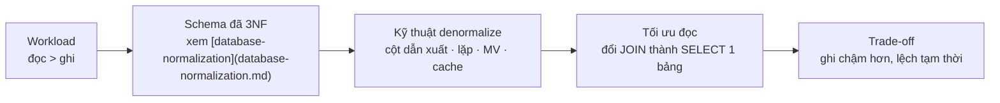
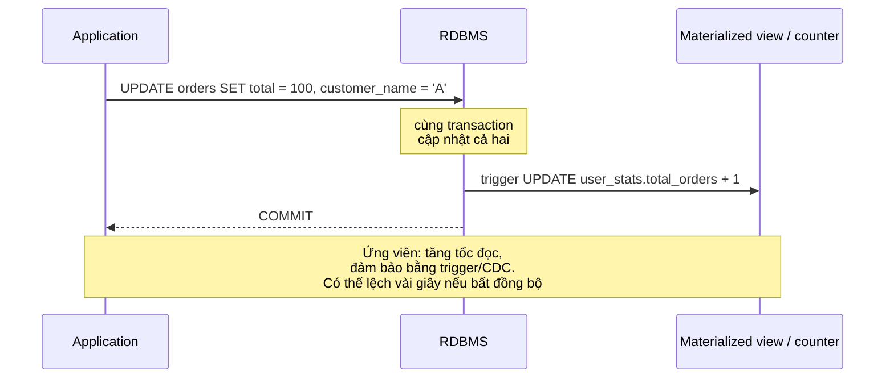

# What is database denormalization and when would you use it?

> Bài này trình bày denormalization trong thiết kế CSDL quan hệ: lý do cố ý phá chuẩn, các kỹ thuật phổ biến (kết hợp bảng, lặp cột, materialized view, cache), trade-off read-vs-write và production failure mode. Nền tảng lý thuyết ở [database-normalization](database-normalization.md).

Chủ đề: Database · Ngày: 2026-10-16

## 1. Là gì

Denormalization là quyết định thiết kế cố ý phá vỡ dạng chuẩn (1NF-3NF-BCNF) để đổi chi phí ghi lấy tốc độ đọc, đơn giản hoá truy vấn, hoặc giảm tải hệ thống phân tán. Khác với normalization là quy trình dựa trên phụ thuộc hàm, denormalization là một tập kỹ thuật có chủ đích với kiểm soát: thêm cột dẫn xuất, lặp dữ liệu từ bảng khác, precompute tổng hợp, hoặc dùng NoSQL phụ trợ. Quyết định đúng khi workload đọc áp đảo ghi, dữ liệu thay đổi chậm, và lỗi nhất quán có thể chấp nhận trong một khoảng trễ.

Giả định: phạm vi là RDBMS với OLTP cao tải đọc và OLAP tổng hợp; không bàn về việc chọn NoSQL thay RDBMS.



*Sơ đồ vị trí: workload nghiêng đọc thúc đẩy denormalization; mỗi kỹ thuật đi kèm trade-off riêng. Denormalization không thay thế chuẩn hoá mà bổ sung sau khi đã đạt 3NF.*

### Trả lời 30 giây

"Denormalization là cố ý phá chuẩn để đổi ghi lấy đọc. Sau khi đạt 3NF/BCNF, ta thêm cột dẫn xuất (`total_price`, `comment_count`), lặp dữ liệu từ bảng khác (`customer_name` trong `orders`), hoặc precompute tổng hợp vào materialized view. Đánh đổi: ghi chậm hơn vì phải cập nhật nhiều nơi, dữ liệu có thể lệch giữa các bản sao trong vài giây hoặc vài phút. Dùng khi workload đọc áp đảo ghi (dashboard, leaderboard, search) và độ trễ tổng hợp là blocker kinh doanh, không dùng cho transaction path của thanh toán."

## 2. Cơ chế cốt lõi

### Bước 1. Sáu kỹ thuật phổ biến

1. **Cột dẫn xuất (derived column)**: tính sẵn giá trị phụ thuộc từ dữ liệu khác (`total = qty * unit_price`, `comment_count`). Đọc O(1), ghi thêm logic cập nhật.
2. **Lặp dữ liệu từ bảng khác (denormalized lookup)**: lưu `customer_name`, `customer_email` thành cột trong `orders`. Tránh JOIN. Dễ lệch khi cập nhật.
3. **Gộp bảng (merged tables)**: hợp nhất 1-1 thành một bảng. Tránh JOIN. Tăng contention trên cùng nút.
4. **Precompute tổng hợp (counter / rollup)**: bảng `user_stats` chứa `total_orders`, `last_order_at`. Cập nhật qua trigger hoặc application.
5. **Materialized view**: view vật lý hoá, làm mới tuỳ chọn (REFRESH FAST/COMPLETE). Trả về JOIN phức tạp thành SELECT 1 bảng.
6. **Lưu JSON / blob**: gộp cấu trúc con vào một cột JSON (Postgres `jsonb`). Bỏ JOIN, mất khả năng truy vấn quan hệ ở mức sâu.

### Bước 2. Cách giữ nhất quán sau denormalization

1. **Đồng bộ trong transaction**: cập nhật bảng gốc + cột dẫn xuất cùng transaction. Nhanh, đúng ngay, nhưng nhiều lock.
2. **Trigger cập nhật**: trigger BEFORE/AFTER UPDATE trên bảng gốc, ghi sang bảng phụ. Tách logic khỏi application.
3. **Application-level update**: ứng dụng tự cập nhật cả hai nơi. Linh hoạt nhưng có thể quên.
4. **Bất đồng bộ (eventual consistency)**: ghi queue hoặc CDC (Debezium) để worker cập nhật tổng hợp. Trả về nhất quán trong vài giây.
5. **Materialized view REFRESH FAST**: nếu có incremental changelog, REFRESH FAST nhanh hơn COMPLETE nhiều lần.



*Cơ chế đồng bộ giữa bảng gốc và bảng phụ: trong transaction chậm nhưng đúng; trigger tách logic; CDC/queue cho eventual consistency.*

### Bước 3. Ví dụ kinh điển

1. Bảng `orders(id, user_id, total)` chuẩn hoá. Đếm số đơn của user yêu cầu `SELECT COUNT(*) FROM orders WHERE user_id = ?` quét index mỗi lần.
2. Denormalize: thêm `users.total_orders` cùng `users.last_order_at`. Trigger `AFTER INSERT ON orders` cập nhật. Đọc thành `SELECT total_orders FROM users WHERE id = ?` — O(1).
3. Đánh đổi: trigger làm chậm insert, có thể deadlock nếu hai trigger cập nhật khác nhau cùng dòng.

### Bước 4. Materialized view khác gì cache?

1. Materialized view: bảng vật lý do RDBMS quản lý. Query planner có thể dùng. REFRESH FAST (incremental) hoặc COMPLETE (full). `REFRESH MATERIALIZED VIEW CONCURRENTLY` cho phép đọc song song.
2. Cache: do ứng dụng quản lý (Redis, Memcached), ngoài RDBMS. Lát cắt tuỳ ý (key, value).
3. Khi nào chọn cái nào: tổng hợp phức tạp từ một database → materialized view. Tổng hợp xuyên database, hoặc join từ web/Redis → cache.

### Bước 5. JSON denormalization

1. Postgres `jsonb`, MySQL JSON, MSSQL JSON — cho phép lưu cấu trúc con. Ví dụ: cột `order_items jsonb` thay vì `order_items(id, order_id, ...)`.
2. Đổi: mất khả năng truy vấn quan hệ (FK, JOIN). Index `GIN` trên jsonb giúp truy vấn key nhưng tốn disk.
3. Khi nào dùng: thuộc tính hiếm truy vấn và có cấu trúc thay đổi (metadata tuỳ biến). Không dùng để thay thế hoàn toàn bảng quan hệ core.

### Bước 6. Khi nào KHÔNG denormalize

1. Bảng dùng trong transaction path của thanh toán, tồn kho, quota. Mỗi UPDATE phải chính xác tức thì. Eventual consistency không được phép.
2. Dữ liệu thay đổi nhanh (counter per-second). Cập nhật lặp nhiều nơi sẽ deadlock hoặc lệch liên tục.
3. Khối lượng ghi áp đảo đọc (logs, audit). Tối ưu ghi, không cần denormalize.

### Quan sát

```sql
-- Cột dẫn xuất: trigger cập nhật user_stats.total_orders khi insert/update orders.
CREATE TABLE user_stats (
    user_id BIGINT PRIMARY KEY REFERENCES users(id),
    total_orders INT NOT NULL DEFAULT 0,
    last_order_at TIMESTAMPTZ
);
-- output minh họa, chưa chạy thử

CREATE OR REPLACE FUNCTION bump_user_stats() RETURNS trigger AS $$
BEGIN
    INSERT INTO user_stats (user_id, total_orders, last_order_at)
    VALUES (NEW.user_id, 1, NEW.created_at)
    ON CONFLICT (user_id) DO UPDATE
    SET total_orders = user_stats.total_orders + 1,
        last_order_at = EXCLUDED.last_order_at;
    RETURN NEW;
END;
$$ LANGUAGE plpgsql;

CREATE TRIGGER trg_orders_bump_stats
AFTER INSERT ON orders
FOR EACH ROW EXECUTE FUNCTION bump_user_stats();

-- Materialized view cho tổng hợp đa bảng
CREATE MATERIALIZED VIEW daily_orders_mv AS
SELECT date_trunc('day', created_at) AS day,
       COUNT(*) AS n_orders,
       SUM(total) AS revenue
FROM orders
GROUP BY 1;
CREATE UNIQUE INDEX ON daily_orders_mv (day);
-- REFRESH FAST (Postgres 14+): chưa chắc từng phiên bản.
REFRESH MATERIALIZED VIEW CONCURRENTLY daily_orders_mv;
```

### Ví dụ chạy từng bước

Một app bán hàng có bảng `users(id, email, country_code)` và `orders(id, user_id, total, created_at)`. Ban đầu đạt 3NF, query "số đơn của user" chạy `SELECT COUNT(*) FROM orders WHERE user_id = ?` quét index mỗi lần, dashboard trang chủ mất 480 ms khi user có hơn 5000 đơn. Ta denormalize bằng cột `users.total_orders` và `users.last_order_at`, trigger `AFTER INSERT OR DELETE ON orders` cập nhật trong cùng transaction.

**Bước 1 — schema 3NF ban đầu.** `orders(id, user_id FK, total, created_at)`. Đếm đơn: `SELECT COUNT(*) FROM orders WHERE user_id = 1042` → quét index `orders_user_id_idx`, đọc 5000 leaf block, 480 ms.
**Bước 2 — thêm cột denormalized.** `ALTER TABLE users ADD COLUMN total_orders INT DEFAULT 0`. Trigger `AFTER INSERT OR DELETE ON orders` thực hiện `INSERT ... ON CONFLICT (user_id) DO UPDATE SET total_orders = total_orders + 1`. Insert 1 đơn → trigger chạy 1 UPDATE trên `users`, tốn thêm ~0.3 ms.
**Bước 3 — truy vấn mới.** `SELECT total_orders FROM users WHERE id = 1042` → index scan trên PK, 0.02 ms, 24000× nhanh hơn.
**Bước 4 — consistency check.** Sau 1 giờ insert 3000 đơn, kiểm: `SELECT (SELECT COUNT(*) FROM orders WHERE user_id = u.id) AS real, u.total_orders FROM users u WHERE u.id = 1042` → 5003 vs 5003, khớp.

| Thời điểm | Đọc `COUNT(*)` | Đọc `users.total_orders` | Insert cost |
|---|---|---|---|
| Trước denorm | 480 ms | — | ~1.2 ms |
| Sau denorm | — | 0.02 ms | ~1.5 ms |

**Biến thể "nếu trigger bị tắt".** DBA chạy `ALTER TABLE orders DISABLE TRIGGER trg_orders_bump_stats` để backfill hàng loạt mà quên bật lại → trong 2 giờ insert vẫn tăng trên `orders` nhưng `users.total_orders` đứng yên. Dashboard hiển thị sai. Phát hiện bằng `SELECT tgname, tgenabled FROM pg_trigger WHERE tgname = 'trg_orders_bump_stats'` → `tgenabled = 'D'`. Đây là failure mode điển hình: trigger nằm trong DB, application không kiểm soát.

Điều rút ra: cột dẫn xuất đổi chi phí insert tăng nhẹ (~25%) lấy đọc nhanh hơn nhiều, nhưng phải có check định kỳ vì trigger có thể bị tắt. Liên kết với câu 5 ở mục 3A: cơ chế đồng bộ chỉ an toàn khi giám sát được, không phải "thêm trigger là xong".

## 3. Câu hỏi phỏng vấn

### 3A. Câu hỏi đào sâu

<details class="qa">
<summary>Câu 1. Denormalization có phải ngược của normalization không? Vì sao?</summary>

**Trả lời ngắn:** Không hẳn. Normalization là quy trình dựa trên phụ thuộc hàm, từ 0NF lên BCNF; denormalization là tập kỹ thuật cố ý phá chuẩn cho mục tiêu cụ thể (đọc nhanh, giảm JOIN). Sau khi đạt 3NF/BCNF, ta thêm cột dẫn xuất, lặp dữ liệu, hoặc dùng materialized view — không thay thế 3NF.

**Đào sâu:**
- Normalization có điểm kết thúc rõ ràng (BCNF, 3NF); denormalization không có endpoint, mỗi kỹ thuật đi kèm đánh đổi riêng.
- Quan điểm: chuẩn hoá trước, denormalize sau. Bắt đầu từ chuẩn hoá cao giữ phương án rộng; thêm denormalize khi đo đạc chứng minh đọc là bottleneck.
- Denormalization trên schema chưa chuẩn hoá dẫn tới bội dữ liệu không kiểm soát và anomaly không lường được.

**Bẫy:** Nghĩ denormalization thay thế thiết kế schema. Sai, đó là tối ưu sau khi schema đã đúng về FD.

**Follow-up:** Làm sao biết đã đến lúc denormalize? Đo p95 latency truy vấn đọc, EXPLAIN ANALYZE thấy cost cao do JOIN, ratio đọc/ghi > 10x. Không đo thì không denormalize.
</details>

<details class="qa">
<summary>Câu 2. Khi nào denormalization là đáp án đúng?</summary>

**Trả lời ngắn:** Khi workload đọc áp đảo ghi (dashboard, search, leaderboard), dữ liệu thay đổi chậm, và độ trễ tổng hợp là blocker kinh doanh. Đặc biệt đúng khi JOIN nặng trên bảng lớn mà index không covering.

**Đào sâu:**
- Tín hiệu đo đạc: p95 truy vấn đọc > 200 ms, ratio đọc/ghi > 10:1, bảng tổng hợp lớn hơn 100 triệu dòng.
- Dữ liệu thay đổi chậm: ví dụ `user_stats.total_orders`, thay đổi vài lần một ngày. Cập nhật trigger chịu được.
- Dữ liệu thay đổi nhanh (counter per-second) không phù hợp, vì phải cập nhật liên tục, dễ lệch.
- Tránh denormalize trong transaction path của thanh toán, quota, idempotency.

**Bẫy:** Denormalize mọi nơi để "phòng". Phản tác dụng, tốn write và đồng bộ vô ích.

**Follow-up:** Tỉ lệ đọc/ghi bao nhiêu thì cân nhắc? Quan điểm: > 10:1 là dấu hiệu, > 100:1 thì gần như chắc. Phải đo trước khi quyết định.
</details>

<details class="qa">
<summary>Câu 3. Materialized view khác gì trigger cập nhật cột dẫn xuất?</summary>

**Trả lời ngắn:** Cột dẫn xuất cập nhật ngay khi ghi (qua trigger hoặc application), đảm bảo đúng tức thì nhưng tốn write. Materialized view là kết quả JOIN/AGGREGATE được vật lý hoá, cần REFRESH theo lịch hoặc FAST/COMPLETE, có thể tụt hậu vài giây đến vài phút nhưng cập nhật rẻ hơn nếu REFRESH FAST.

**Đào sâu:**
- Trigger update: chi phí cố định trên mỗi write, đảm bảo thấy ngay khi SELECT, thường khuyếch đại write lên 1.2-1.5x.
- Materialized view: REFRESH FAST dùng changelog, gần real-time. REFRESH COMPLETE quét toàn bộ, cần downtime hoặc lock.
- MV có UNIQUE index thì REFRESH CONCURRENTLY không block read. Không có UNIQUE index thì REFRESH block read.
- Postgres 14+ hỗ trợ nhiều tinh chỉnh cho MV. Không chắc cho MySQL/MSSQL — họ có cú pháp khác.

**Bẫy:** REFRESH MATERIALIZED VIEW (không có CONCURRENTLY) chặn reader. Trên view lớn có thể block mọi query mấy giây.

**Follow-up:** Làm sao REFRESH FAST incremental? Cần UNIQUE index và changelog đủ để xác định chỉ phần thay đổi.
</details>

<details class="qa">
<summary>Câu 4. Lưu JSON trong cột quan hệ có phải denormalization không? Khi nào nên/không nên?</summary>

**Trả lời ngắn:** Có, JSON trong cột là denormalization vì cấu trúc phẳng trong quan hệ, dữ liệu không chuẩn hoá theo FD. Nên dùng cho thuộc tính meta, payload ít truy vấn quan hệ. Không nên thay thế bảng quan hệ core với FK, JOIN, hay aggregate.

**Đào sâu:**
- JSON giúp cấu trúc thay đổi mà không migration: thêm trường mới không cần ALTER TABLE.
- Postgres `jsonb` có GIN index cho query theo key (`WHERE metadata @> '{"k": "v"}'`). MySQL JSON có generated column để index.
- Nhược: không FK, không JOIN quan hệ ở mức field con, validate schema khó. Phải dùng `JSON_SCHEMA_VALID` (MySQL 8) hoặc CHECK constraint (Postgres 15+).
- Khi nên: metadata tuỳ biến, cấu hình UI, attributes tự do. Khi không nên: danh sách thực thể con cần JOIN (`order_items`, `comments`).

**Bẫy:** Lưu danh sách thực thể vào JSON thay vì bảng quan hệ. Mất khả năng enforce constraint, index kém hiệu quả, query phức tạp.

**Follow-up:** Làm sao truy vấn JSON nhanh? Index GIN trên jsonb, generated column trên MySQL. Nhưng vẫn chậm hơn bảng quan hệ có index chuẩn.
</details>

<details class="qa">
<summary>Câu 5. Làm sao giữ nhất quán giữa bảng gốc và dữ liệu denormalized?</summary>

**Trả lời ngắn:** Bốn cách: (1) cùng transaction, (2) trigger BEFORE/AFTER, (3) application-level, (4) CDC/eventual. Mỗi cách đổi độ trễ nhất quán lấy chi phí ghi hoặc phức tạp vận hành.

**Đào sâu:**
- Cùng transaction: chậm nhất vì phải update nhiều bảng, lock dài, nhưng đảm bảo ACID. Phù hợp khi cập nhật vài dòng mỗi lần.
- Trigger: logic ở DB, không phụ thuộc application. Trigger có thể chính là nơi sinh deadlock nếu hai trigger cùng khóa.
- Application: linh hoạt, nhưng có nguy cơ quên. Khi service thứ 2 cập nhật DB mà không qua service 1 thì lệch.
- CDC (Debezium → Kafka → worker): eventual, độ trễ vài giây. Tốt cho lượng ghi lớn. Không dùng cho transaction path.

**Bẫy:** Tưởng dùng Redis là xong. Redis ngoài transaction, có thể mất key khi restart và có network partition.

**Follow-up:** Trigger và CDC cái nào rẻ hơn? Trigger tốn CPU DB, CDC tốn CPU ngoài DB và bandwidth Kafka. Quan điểm: trigger cho chi phí thấp và tỉ lệ cập nhật thấp, CDC cho lượng lớn.
</details>

<details class="qa">
<summary>Câu 6 (Debug). Triệu chứng: hai dashboard đọc cùng một dữ liệu denormalized mà trả về hai con số khác nhau. Bạn kiểm tra gì?</summary>

**Trả lời ngắn:** Nghi nhất quán không đảm bảo. Kiểm tra: 1) REFRESH của materialized view chạy lúc nào, có chạy không. 2) Trigger có bị tắt không. 3) Application có cập nhật mọi nơi cần denormalize không. 4) Đo p95 latency đọc sau khi REFRESH.

**Đào sâu:**
- Bước 1: xem lịch REFRESH. Cronjob, view lần cuối 30 phút trước? `SELECT * FROM pg_stat_user_tables WHERE relname = 'daily_orders_mv';` hoặc lịch từ scheduler (pg_cron, k8s CronJob).
- Bước 2: trigger còn không. `SELECT tgname, tgenabled FROM pg_trigger WHERE NOT tgisinternal;`. Nếu `tgenabled = 'D'` → disabled.
- Bước 3: quan sát `pg_stat_statements` xem có INSERT vào orders không kèm update trigger. Hoặc viết script so sánh row-level ngẫu nhiên.
- Bước 4: thống kê `EXPLAIN ANALYZE` để so sánh cost.

**Bẫy:** Tưởng 2 dashboard khác nhau vì cache khác nhau. Kiểm tra cache layer (Redis, CDN) trước: TTL, invalidation.

**Follow-up:** Đã REFRESH nhưng số vẫn lệch? Có thể REFRESH chỉ chạy trên một shard, hoặc partition chưa refresh hết.
</details>

<details class="qa">
<summary>Câu 7 (Thiết kế). Thiết kế hệ thống phân tích đơn hàng với 100 triệu dòng, p95 truy vấn đọc dưới 200 ms. Quyết định denormalize gì?</summary>

**Trả lời ngắn:** Dùng 3NF cho OLTP gốc, tách một read replica hoặc data warehouse cho analytics. Trên read replica, materialize tổng hợp theo ngày/tuần/tháng bằng materialized view. Cột dẫn xuất (`total`) trong `orders` nếu hay query. Snapshot dữ liệu khách (`customer_name`, `customer_email`) trong `order_view` không vi phạm ACID vì đó là bản sao cho đọc.

**Đào sâu:**
- Bước 1: 3NF cho bảng gốc. Thêm `orders.total` (cột dẫn xuất) — trigger cập nhật. Tính 1 lần khi insert hoặc thay đổi quantity.
- Bước 2: materialized view `daily_revenue_mv` tổng hợp theo ngày. UNIQUE index trên `day`. REFRESH CONCURRENTLY mỗi 5 phút qua pg_cron hoặc scheduler ngoài.
- Bước 3: replica hoặc kho dữ liệu (Snowflake, BigQuery, Postgres logical replica) cho các câu BI. Snapshot bảng `customer_orders_v` với thông tin khách lặp (lúc REFRESH) — không phải bảo toàn nếu khách đổi tên.
- Bước 4: cache Redis cho tổng hợp top-N (top seller, recent orders). Key TTL 60-300s cho phép lệch tạm thời.

**Bẫy:** Tạo MV cho mọi truy vấn. Quá nhiều MV tốn đĩa, REFRESH expensive, conflict với nhau.

**Follow-up:** Khi dữ liệu quá lớn thì sao? Partition theo `created_at` monthly, archive partition cũ vào warehouse, giữ lại 90 ngày online. Xem [database-sharding](database-sharding.md).
</details>

### 3B. Câu hỏi phỏng vấn liên quan

<details class="qa">
<summary>Câu 8. What is an anti-pattern in denormalization?</summary>

**Trả lời:** Lặp dữ liệu mà không có cơ chế đồng bộ rõ ràng. Ví dụ: lưu `customer_email` trong `orders` mà application quên cập nhật khi khách đổi email. Hoặc tạo trigger nhưng tắt trong maintenance rồi quên bật. Hoặc dùng cột tính sẵn nhưng query lại lấy dữ liệu gốc, so sánh gây khó hiểu.
</details>

<details class="qa">
<summary>Câu 9. Why might you choose a separate read replica over denormalization?</summary>

**Trả lời:** Read replica (Postgres streaming replica, MySQL async replica) giữ nguyên schema 3NF, chuyển tải đọc ra khỏi primary mà không thay đổi tính đúng của dữ liệu. Đánh đổi: replica lag (vài trăm ms tới vài giây), không giảm cost JOIN. Denormalization thì giảm JOIN và latency, nhưng phải tự chịu trách nhiệm nhất quán. Hai cách bổ trợ: replica cho đọc tổng quát, MV cho tổng hợp nặng.
</details>

<details class="qa">
<summary>Câu 10. How does caching relate to denormalization?</summary>

**Trả lời:** Cache là denormalization ở tầng application — lưu kết quả truy vấn ngoài DB vào Redis/Memcached. Cùng nguyên lý (đổi ghi lấy đọc), nhưng cache quản lý ở application. Cache nhanh hơn MV (~1 ms) nhưng volatile. MV còn sống khi restart cache. Quan điểm: cache cho tổng hợp biến đổi linh hoạt, MV cho tổng hợp cố định theo lịch.
</details>

<details class="qa">
<summary>Câu 11. How does denormalization interact with foreign keys?</summary>

**Trả lời:** Khi lặp dữ liệu từ bảng khác vào bảng hiện tại, FK không còn bắt buộc ở cột lặp (vì đó là bản sao). FK ở cột tham chiếu (`user_id`) giữ nguyên. Khi xóa cha, có hai lựa chọn: ON DELETE CASCADE nếu muốn xóa cả bản sao, hoặc SET NULL cho cột FK trong bản sao. Snapshot đọc thường không cần FK tới bảng gốc; join trên snapshot sẽ tự nhiên.
</details>

<details class="qa">
<summary>Câu 12. What is the difference between horizontal and vertical partitioning, and is it denormalization?</summary>

**Trả lời:** Phân vùng ngang (sharding theo hàng): cùng schema, phân theo key (user_id % N). Phân vùng dọc (theo cột): tách cột ít dùng sang bảng khác. Cả hai đều không phải denormalization vì vẫn giữ FD — chỉ di chuyển dữ liệu. Sharding còn xem [database-sharding](database-sharding.md). Denormalization thì phá FD, lặp dữ liệu. Hai kỹ thuật này hay đi cùng.
</details>

<details class="qa">
<summary>Câu 13. True or false: "If performance is bad, denormalize."</summary>

**Trả lời:** Sai. Denormalize là phương án cuối sau khi đã index, query rewrite, EXPLAIN, materialized view, replica, cache. Đôi khi chỉ thiếu index phù hợp, hoặc câu SELECT viết chưa tối ưu. Đo trước khi denormalize, đo lại sau để chứng minh tăng throughput.
</details>

<details class="qa">
<summary>Câu 14. True or false: "Materialized views can replace indexes in 3NF schemas."</summary>

**Trả lời:** Sai. MV thay thế JOIN hoặc AGGREGATE; index thay thế quét tuần tự. Hai cách phục vụ mẫu truy vấn khác nhau. Nếu truy vấn chỉ là `WHERE user_id = ?` thì index vẫn cần. Nếu truy vấn là tổng hợp nặng trên nhiều bảng, MV mới là lựa chọn.
</details>

<details class="qa">
<summary>Câu 15. What is eventual consistency in the context of denormalization?</summary>

**Trả lời:** Là khi cập nhật không đồng bộ tức thì mà qua CDC/queue, người đọc có thể thấy dữ liệu cũ trong vài giây. Đánh đổi: latency cập nhật thấp, throughput cao; nhưng trong cửa sổ đó người đọc thấy dữ liệu "lệch". Phù hợp khi người dùng chấp nhận độ trễ tổng hợp (dashboard, recommendation). Không phù hợp cho core transaction. Xem [acid-properties](acid-properties.md).
</details>

## 4. Đánh đổi và sự cố production

Chuẩn hoá 3NF giữ integrity tốt nhưng tốn JOIN. Denormalization cắt JOIN nhưng kéo theo vấn đề đồng bộ, và cần một cơ chế cập nhật riêng. Nguyên tắc chung: mỗi byte lặp thêm đều có chi phí, và chi phí đó tăng theo số lượng bảng phụ thuộc. Khi cột dẫn xuất cần cập nhật từ nhiều nguồn, trigger trở nên khó maintain; khi snapshot tổng hợp nằm trên nhiều bảng, công cụ đồng bộ phải xử lý concurrent updates và tránh lost update. Hai bảng dưới so sánh các chiến lược phổ biến, đo trên năm tiêu chí rồi liệt kê năm failure mode hay gặp. Ngoài chi phí kỹ thuật, còn chi phí vận hành: REFRESH MATERIALIZED VIEW mỗi đêm ảnh hưởng SLO, CDC thêm dịch vụ Kafka phải giám sát. Sau khi sửa cần đo lại p95 latency và tỉ lệ đọc/ghi để chứng minh cải thiện; đo đầu tiên, đo cuối cùng.

### So sánh bốn chiến lược đồng bộ

| Tiêu chí | Cùng transaction | Trigger DB | Application-level | CDC/eventual |
|---|---|---|---|---|
| Độ trễ thấy dữ liệu | 0 | 0 | 0 | vài giây |
| Chi phí ghi | +50-200% trên bảng nhiều cột dẫn xuất | +20-100% tuỳ trigger | tuỳ code | thấp ngay tại DB |
| Ảnh hưởng deadlock | trung bình | cao nếu trigger nối chuỗi | thấp | thấp |
| Điểm rơi | cùng DB | trong DB | ở mỗi service | queue, consumer |
| Khi nên dùng | Critical path, ít cập nhật | Trung bình, logic ít thay đổi | Nhiều service cùng schema | Tổng hợp lớn, lượng ghi cao |
| Khi không nên | Lượng ghi lớn, contention nặng | Logic phức tạp (multi-table) | Khi service mới quên cập nhật | Khi cần ACID tức thì |

### Năm failure mode

| Triệu chứng | Nguyên nhân gốc | Cách kiểm tra | Cách sửa |
|---|---|---|---|
| Dashboard lệch nhau | MV chưa REFRESH, hoặc REFRESH lỗi | Xem scheduler, `pg_stat_user_tables` | Chạy REFRESH CONCURRENTLY thủ công, kiểm tra lịch |
| Insert chậm đột ngột | Trigger phức tạp, hoặc trigger cascade nhiều tầng | `EXPLAIN ANALYZE` trên INSERT; xem `pg_stat_activity` | Tối ưu trigger (dùng batch), hoặc chuyển sang application |
| UPDATE chậm do cột dẫn xuất | Mỗi dòng update trigger lại nhiều bảng | Đo thời gian UPDATE, đếm trigger fired | Tách trigger ra ngoài (CDC), precompute bất đồng bộ |
| Foreign key "ma" do denormalize | Snapshot bảng phụ tham chiếu dòng không còn tồn tại | Đếm snapshot orphan với LEFT JOIN | Refresh snapshot theo lịch; hoặc bỏ FK vì snapshot không cần |
| Out-of-sync sau service mới | Service mới chỉ cập nhật bảng gốc, không cập nhật bảng phụ | So row giữa bảng gốc và bảng phụ; đo drift | Chuyển sang CDC tập trung thay vì ghi đa điểm |

## 5. Cheat sheet

Bảng dưới — gợi ý nhớ nhanh trước buổi phỏng vấn.

| Chủ đề | Con số / quy tắc cần nhớ |
|---|---|
| Quan điểm | Chuẩn hoá 3NF trước, denormalize sau khi đo |
| Khi denormalize | Workload đọc > 10:1 so với ghi, dữ liệu ít đổi |
| Cột dẫn xuất | `total`, `comment_count`, cập nhật trigger cùng transaction |
| Lặp dữ liệu | `customer_name` trong `orders`; chịu lệch tạm thời |
| Precompute tổng hợp | Materialized view + REFRESH CONCURRENTLY |
| JSON denormalize | Metadata tuỳ biến, không thay bảng quan hệ core |
| Đồng bộ | Trigger (trong DB), application, CDC (Debezium → Kafka) |
| Eventual consistency | Vài giây tới vài phút; không dùng cho transaction path |
| Khi KHÔNG denormalize | Thanh toán, tồn kho, quota, idempotency |
| Đo lường | p95 latency, ratio đọc/ghi, EXPLAIN ANALYZE trước & sau |

**Học tiếp:**
- [database-normalization](database-normalization.md) — nền tảng 1NF/2NF/3NF/BCNF
- [acid-properties](acid-properties.md) — khi nào nhất quán tức thì quan trọng hơn tốc độ đọc
- [database-replication](database-replication.md) — read replica thay thế denormalize một phần
- [database-sharding](database-sharding.md) — phân vùng ngang khi dữ liệu vượt node đơn


