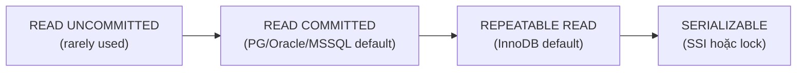
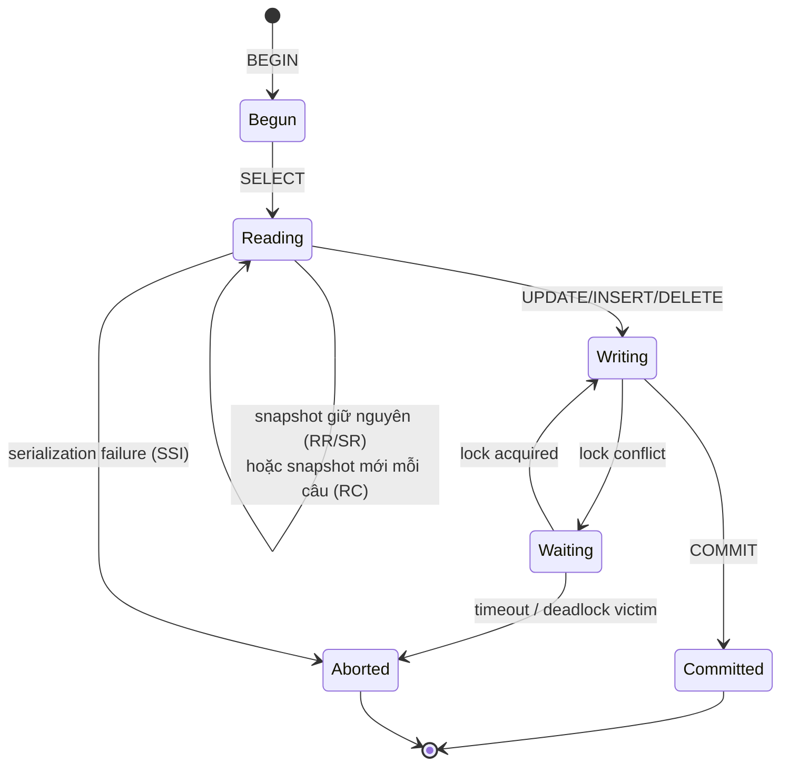

# What are database isolation levels?

> Bài này so sánh bốn isolation level SQL chuẩn (READ UNCOMMITTED, READ COMMITTED, REPEATABLE READ, SERIALIZABLE), phenomena (dirty read, non-repeatable read, phantom read, serialization anomaly), cách PostgreSQL/InnoDB/Oracle/SQL Server hiện thực từng level, và khi nào nên dùng. Bài [acid-properties](acid-properties.md) giải thích I trong ACID; bài [database-transaction](database-transaction.md) nền tảng transaction.

Chủ đề: Database · Ngày: 2026-10-16

## 1. Là gì

Isolation level là mức độ cô lập giữa các transaction chạy đồng thời mà engine hứa cho ứng dụng. SQL chuẩn định nghĩa bốn level, xếp từ yếu đến mạnh: READ UNCOMMITTED, READ COMMITTED, REPEATABLE READ, SERIALIZABLE. Level càng mạnh, transaction càng "giống chạy tuần tự" nhưng throughput và contention càng thấp.

Engine hiện thực mỗi level khác nhau. PostgreSQL dùng MVCC snapshot ở mức câu (READ COMMITTED) hoặc transaction (REPEATABLE READ), SERIALIZABLE qua SSI (Serializable Snapshot Isolation). MySQL InnoDB cũng MVCC, kết hợp gap lock; mặc định REPEATABLE READ. Oracle chỉ hỗ trợ READ COMMITTED và SERIALIZABLE (qua `SERIALIZABLE` keyword) — không có READ UNCOMMITTED chuẩn, không REPEATABLE READ như SQL chuẩn. SQL Server hỗ trợ cả bốn với lock-based; dùng `SET TRANSACTION ISOLATION LEVEL`.



*Sơ đồ vị trí: bốn level xếp theo strictness tăng dần. Engine thường mặc định READ COMMITTED hoặc REPEATABLE READ.*

### Trả lời 30 giây

"Isolation level kiểm soát transaction thấy nhau thế nào khi chạy đồng thời. SQL chuẩn có bốn level: READ UNCOMMITTED (thấy cả uncommitted), READ COMMITTED (snapshot mỗi câu, không thấy uncommitted nhưng câu sau có thể khác câu trước), REPEATABLE READ (snapshot transaction, cùng transaction cùng câu thấy cùng dữ liệu), SERIALIZABLE (như chạy tuần tự). PostgreSQL mặc định READ COMMITTED, dùng MVCC; InnoDB mặc định REPEATABLE READ, dùng MVCC + gap lock; SERIALIZABLE dùng SSI ở PG hoặc lock mạnh ở InnoDB. Chọn level cao khi cần correctness tuyệt đối (báo cáo tài chính), thấp khi cần throughput (feed, log). Trong thực tế 80% OLTP chạy READ COMMITTED."

## 2. Cơ chế cốt lõi

### Bước 1. Bốn phenomena SQL chuẩn định nghĩa

1. **Dirty read**: transaction A đọc dữ liệu transaction B đang sửa nhưng chưa commit. B rollback → A đã đọc dữ liệu "ma".
2. **Non-repeatable read (fuzzy read)**: transaction A đọc cùng dòng hai lần, giữa hai lần transaction B commit thay đổi dòng đó → A thấy giá trị khác.
3. **Phantom read**: transaction A chạy cùng câu `WHERE` hai lần, giữa hai lần transaction B INSERT/UPDATE thêm/bớt dòng thỏa điều kiện → tập kết quả khác.
4. **Serialization anomaly**: kết quả cuối cùng của một tập transaction không thể tái tạo bằng bất kỳ thứ tự tuần tự nào.

### Bước 2. Bốn level chuẩn SQL

| Level | Dirty read | Non-repeatable read | Phantom read | Serialization anomaly |
|---|---|---|---|---|
| READ UNCOMMITTED | Có thể | Có thể | Có thể | Có thể |
| READ COMMITTED | Không | Có thể | Có thể | Có thể |
| REPEATABLE READ | Không | Không | Có thể (PG) / Không (InnoDB gap lock) | Có thể |
| SERIALIZABLE | Không | Không | Không | Không |

Lưu ý: bảng này là SQL chuẩn. PostgreSQL REPEATABLE READ thực tế chống phantom (qua snapshot của cả page) nhưng không chống serialization anomaly — cần SERIALIZABLE + SSI.

### Bước 3. Cách PostgreSQL hiện thực

1. **MVCC**: mỗi row có `xmin` (transaction insert), `xmax` (transaction xoá/update). Snapshot của transaction lọc ra row do transaction chưa commit.
2. **READ COMMITTED**: snapshot lấy ở đầu mỗi câu SQL. Cùng câu SELECT chạy hai lần có thể thấy dữ liệu khác (vì commit khác đã xảy ra). UPDATE/DELETE chỉ chạm các row phiên bản mới nhất tại thời điểm câu bắt đầu, tránh lost update.
3. **REPEATABLE READ**: snapshot lấy ở `BEGIN` (hay câu đầu tiên). Cùng transaction, cùng câu SELECT → cùng dữ liệu. UPDATE/DELETE có thể fail với "could not serialize access due to concurrent update" nếu row đã bị transaction khác commit sau snapshot.
4. **SERIALIZABLE**: cùng REPEATABLE READ + SSI. SSI theo dõi đồ thị xung đột; nếu phát hiện chu trình nguy cơ serialization anomaly, một transaction bị abort với lỗi `40001` (serialization_failure). Application retry.

### Bước 4. Cách InnoDB (MySQL) hiện thực

1. **MVCC + undo log**: row có `trx_id`; consistent read ở REPEATABLE READ dùng undo log để tạo phiên bản cũ.
2. **REPEATABLE READ** mặc định: consistent read snapshot ở câu đầu tiên trong transaction. SELECT thuần (không `FOR UPDATE`) đọc snapshot; SELECT ... FOR UPDATE đọc hiện tại và lock.
3. **Gap lock**: REPEATABLE READ chống phantom bằng cách lock cả vùng giữa các key index (gap), không chỉ row khớp. UPDATE/DELETE chạm cả row match và gap xung quanh.
4. **READ COMMITTED** (tùy chọn, phổ biến với replication row-based): snapshot mỗi câu; không dùng gap lock (chỉ record lock) → ít contention hơn REPEATABLE READ.

### Bước 5. Oracle và SQL Server

- **Oracle**: chỉ READ COMMITTED (mặc định) và SERIALIZABLE. READ COMMITTED dùng statement-level snapshot qua undo. SERIALIZABLE thực ra là "snapshot isolation" giống REPEATABLE READ của PG/InnoDB — chống non-repeatable read, không chống serialization anomaly đúng nghĩa SQL chuẩn (Oracle gọi đó là `SERIALIZABLE`).
- **SQL Server**: hỗ trợ cả bốn level qua lock-based. READ COMMITTED dùng shared lock + lock release; REPEATABLE READ giữ lock đến cuối transaction; SERIALIZABLE thêm key-range lock. Snapshot isolation (`ALLOW_SNAPSHOT_ISOLOLATION ON`) là lựa chọn MVCC riêng.

### Bước 6. State diagram cho transaction isolation



*Vòng đời transaction theo isolation: từ BEGIN có thể đọc/ghi; lock conflict đưa vào Waiting; SSI phát hiện serialization anomaly đưa vào Aborted; COMMIT đưa sang Committed. Mức isolation ảnh hưởng khả năng rơi vào Waiting hoặc Aborted.*

### Bước 7. Lost update và cách phòng tránh

Lost update: A và B cùng đọc row balance=100; A ghi balance=110; B ghi balance=105; kết quả cuối 105 mất cập nhật của A (giá trị đúng phải 115).

- READ COMMITTED: PostgreSQL UPDATE tự khóa row; InnoDB dùng row-level lock khi UPDATE. Hai transaction serialize.
- REPEATABLE READ PostgreSQL: có thể fail với "could not serialize access" → application retry.
- Optimistic: thêm version column, app kiểm tra version trước khi UPDATE (`UPDATE t SET balance=110, version=version+1 WHERE id=1 AND version=5`). Xem [optimistic-vs-pessimistic-locking](optimistic-vs-pessimistic-locking.md).
- Pessimistic: `SELECT ... FOR UPDATE` lấy lock trước khi đọc-sửa.

### Quan sát

```sql
-- PostgreSQL: xem isolation hiện tại
SHOW transaction_isolation;
-- READ COMMITTED (mặc định)

-- Đổi sang REPEATABLE READ cho transaction
BEGIN ISOLATION LEVEL REPEATABLE READ;
SELECT * FROM accounts WHERE id = 1;

-- InnoDB: kiểm tra isolation hiện tại
SELECT @@transaction_isolation;
-- REPEATABLE-READ (mặc định)

-- PostgreSQL: xem transaction nào đang chờ lock
SELECT pid, mode, granted, query FROM pg_locks WHERE NOT granted;
```

### Ví dụ chạy từng bước

Hai transaction xen kẽ trên bảng số dư `accounts(id, balance)`. User A và user B đều có `balance = 100`. T1 (chuyển 50 từ A sang B) và T2 (chuyển 30 từ A sang B) chạy đồng thời. Quan sát dưới 4 level.

**Bước 1 — READ COMMITTED (PostgreSQL).** T1 `BEGIN; SELECT balance FROM accounts WHERE id = 1` → 100. T2 `BEGIN; SELECT balance FROM accounts WHERE id` → 100. T2 `UPDATE accounts SET balance = 70 WHERE id = 1`; COMMIT. T1 `UPDATE accounts SET balance = 50 WHERE id = 1` → PG phát hiện row đã đổi từ sau snapshot, tự UPDATE dựa trên giá trị mới 70, ghi 70−50 = 20. T1 COMMIT. Kết quả A=20, B=180. Không mất update nhờ PostgreSQL tự khóa row ở UPDATE trong RC.

**Bước 2 — REPEATABLE READ (PostgreSQL).** Cùng kịch bản. T1 BEGIN chụp snapshot `xmin=750`. T2 COMMIT. T1 `UPDATE accounts SET balance = 50 WHERE id = 1` → lỗi `ERROR: could not serialize access due to concurrent update` (SQLSTATE 40001). Application retry.

**Bước 3 — SERIALIZABLE (PostgreSQL SSI).** T1 BEGIN snapshot, đọc A=100. T2 BEGIN, đọc A=100. T2 `UPDATE ... SET balance = 70`, COMMIT. T1 `UPDATE ... SET balance = 50` → SSI phát hiện chu trình đọc-ghi giữa T1 và T2, abort T1 với cùng lỗi 40001.

**Bước 4 — InnoDB REPEATABLE READ.** T1 `SELECT balance FROM accounts WHERE id = 1` → 100 (consistent read snapshot). T2 UPDATE A=70, COMMIT. T1 `UPDATE accounts SET balance = 50 WHERE id = 1` → InnoDB lock chờ T2, khi lock nhận được áp giá trị mới 70−50 = 20 (không mất update, vì InnoDB re-read row hiện tại trước khi UPDATE).

| Level | Kết quả A | Lỗi | Retry |
|---|---|---|---|
| READ COMMITTED (PG) | 20 | — | Không |
| REPEATABLE READ (PG) | — | 40001 | Có |
| SERIALIZABLE (PG) | — | 40001 | Có |
| RR InnoDB | 20 | — | Không |

**Biến thể "đảo thứ tự UPDATE".** Nếu T1 và T2 cùng thao tác trên A và B với logic check-then-update (không dùng `balance = balance - ?`), dưới REPEATABLE READ có thể xảy ra write skew: T1 đọc A=100, B=100; T2 đọc A=100, B=100; T1 set A=50 (vì B đủ); T2 set B=70 (vì A đủ); cả hai commit → A=50, B=70, tổng 120 thay vì 100 (invariant "tổng tài khoản không đổi" bị phá). SERIALIZABLE mới chặn.

Điều rút ra: PG READ COMMITTED + atomic UPDATE (`balance = balance - ?`) an toàn cho lost update, nhưng không chống write skew — câu 5 ở 3A cho thấy SERIALIZABLE mới phát hiện.

## 3. Câu hỏi phỏng vấn

### 3A. Câu hỏi đào sâu

<details class="qa">
<summary>Câu 1. Bốn phenomena SQL chuẩn là gì, mỗi cái thuộc level nào?</summary>

**Trả lời ngắn:** Dirty read (đọc uncommitted), non-repeatable read (đọc cùng dòng thấy giá trị khác), phantom read (cùng WHERE thấy số dòng khác), serialization anomaly (kết quả không tái tạo bằng chạy tuần tự). Bốn level xếp từ yếu đến mạnh: READ UNCOMMITTED (cả 4), READ COMMITTED (3 trừ dirty), REPEATABLE READ (2 trừ dirty/non-repeatable), SERIALIZABLE (0).

**Đào sâu:**
- Dirty read: A đọc row mà B đang sửa chưa commit. B rollback → A có dữ liệu "ma". Engine mặc định nào cũng chặn trừ READ UNCOMMITTED.
- Non-repeatable read: A đọc row hai lần, B commit giữa hai lần → A thấy giá trị khác.
- Phantom read: A chạy `SELECT WHERE` hai lần, B INSERT thêm dòng thỏa điều kiện giữa hai lần.
- Serialization anomaly: ví dụ hai giao dịch A, B đọc tổng tài khoản X+Y, mỗi cái chuyển tiền giữa X và Y, tổng cuối khác tổng ban đầu (write skew).

**Bẫy:** "REPEATABLE READ chống phantom read". Đúng trong InnoDB (gap lock), đúng trong PG REPEATABLE READ cho SELECT (snapshot) nhưng UPDATE có thể fail "could not serialize". Không chống serialization anomaly.

**Follow-up:** Snapshot isolation (MVCC) có chống serialization anomaly không? Không — write skew xảy ra được. Cần SERIALIZABLE + SSI (PG) hoặc predicate lock (InnoDB).
</details>

<details class="qa">
<summary>Câu 2. PostgreSQL hiện thực REPEATABLE READ và SERIALIZABLE khác nhau thế nào?</summary>

**Trả lời ngắn:** REPEATABLE READ dùng snapshot transaction: cùng câu SELECT trong cùng transaction thấy cùng dữ liệu. UPDATE/DELETE có thể fail "could not serialize access due to concurrent update" (40001) nếu row đã bị transaction khác commit sau snapshot. SERIALIZABLE thêm SSI: theo dõi đồ thị xung đột đọc-ghi; phát hiện chu trình nguy cơ anomaly → abort transaction, lỗi 40001.

**Đào sâu:**
- Snapshot REPEATABLE READ: lấy ở câu đầu tiên (không phải BEGIN thuần tuý, trừ khi câu đầu là SELECT). Một số implementation chi tiết còn phụ thuộc phiên bản PG.
- SSI (Serializable Snapshot Isolation) trong SERIALIZABLE: theo dõi "read set" và "write set", phát hiện chu trình có thể gây serialization anomaly. Cost thêm ~10-30% so với REPEATABLE READ.
- Ứng dụng phải bắt lỗi 40001 và retry; không phải lỗi "lập trình sai" mà là cơ chế bảo vệ.
- Cùng code trên REPEATABLE READ có thể chạy nhưng ẩn bug write skew; SERIALIZABLE phát hiện sớm.

**Bẫy:** "REPEATABLE READ = chạy tuần tự". Sai — vẫn có thể có write skew. SERIALIZABLE mới bảo đảm serializability.

**Follow-up:** SSI tốn bao nhiêu overhead? Khoảng 10-30% so với REPEATABLE READ tuỳ workload. Không nhiều bằng lock-based SERIALIZABLE của SQL Server.
</details>

<details class="qa">
<summary>Câu 3. InnoDB REPEATABLE READ có chống phantom read không? Gap lock hoạt động thế nào?</summary>

**Trả lời ngắn:** Có, nhờ gap lock. Khi SELECT WHERE giữa hai key, InnoDB lock cả vùng gap giữa key đó. INSERT mới vào vùng phải chờ. Cùng SELECT chạy hai lần thấy cùng tập row.

**Đào sâu:**
- Gap lock chỉ áp dụng ở REPEATABLE READ; READ COMMITTED không dùng (chỉ record lock).
- Gap lock lock cả khoảng giữa các index entry, kể cả phần không có row thực. SELECT WHERE id BETWEEN 1 AND 10 lock khoảng (1,10) — INSERT id=5 phải chờ.
- Nhược: deadlock dễ hơn vì nhiều lock overlap. Workaround: dùng READ COMMITTED cho workload ghi nhiều.
- Index không có WHERE khớp (full scan) → InnoDB lock cả table trong một số trường hợp, giảm concurrency nghiêm trọng.

**Bẫy:** "Gap lock trên mọi SELECT". Sai — gap lock chỉ trong REPEATABLE READ, không có ở READ COMMITTED.

**Follow-up:** InnoDB RR có thể cho phantom read không? Có trong trường hợp SELECT không dùng index (full scan lock toàn bộ vùng, INSERT khác range có thể chèn vào). Hiếm nhưng có.
</details>

<details class="qa">
<summary>Câu 4. Lost update xảy ra thế nào và cách phòng?</summary>

**Trả lời ngắn:** A và B cùng đọc balance=100; A ghi 110; B ghi 105; mất cập nhật của A. Phòng bằng: (1) `SELECT ... FOR UPDATE` trước đọc (pessimistic); (2) version column + `WHERE version = X` (optimistic); (3) atomic UPDATE trực tiếp (`UPDATE ... SET balance = balance + 10`).

**Đào sâu:**
- PostgreSQL READ COMMITTED: UPDATE tự khóa row, hai transaction chạy tuần tự trên cùng row → không lost update.
- PostgreSQL REPEATABLE READ: UPDATE có thể trả "could not serialize access" → app retry.
- InnoDB REPEATABLE READ: SELECT thuần đọc snapshot, UPDATE lại chạm row hiện tại và lock; nếu B SELECT sau A UPDATE, B vẫn đọc 100 (snapshot) nhưng UPDATE ... SET balance=110 WHERE id=1 sẽ lock chờ A COMMIT, sau đó ghi 110 dựa trên giá trị hiện tại 110 (đúng). Nếu B đọc 100 rồi dùng logic app `balance = 100 + 5 = 105` ghi vào → mất 5 của A.
- Optimistic: thêm `version` column, `UPDATE ... WHERE id=1 AND version=X`. Nếu 0 row affected → retry.
- Đơn giản nhất: `UPDATE accounts SET balance = balance + ? WHERE id = ?` — engine tự xử lý race.

**Bẫy:** "MVCC chống lost update". Sai — MVCC chỉ giải quyết read conflict; write-write conflict cần lock hoặc version.

**Follow-up:** Read-modify-write lặp lại 1000 lần có hiệu quả không? Không — nên dùng bulk UPDATE với `balance = balance + X` để một câu SQL.
</details>

<details class="qa">
<summary>Câu 5. Write skew xảy ra thế nào? Cho ví dụ cụ thể.</summary>

**Trả lời ngắn:** Write skew xảy ra khi hai transaction đọc overlap, mỗi transaction thấy snapshot rồi viết theo hướng hợp lệ với riêng nó, nhưng tổng hợp cuối cùng vi phạm constraint. SERIALIZABLE (PG SSI, InnoDB lock) mới phát hiện; REPEATABLE READ không.

**Đào sâu:**
- Ví dụ: bảng doctors có hai bác sĩ trực. Constraint: ≥1 bác sĩ phải trực. T1 đọc 2 bác sĩ đang trực; đặt bác sĩ A nghỉ. T2 đọc 2 bác sĩ; đặt bác sĩ B nghỉ. Cả hai commit → 0 bác sĩ trực, vi phạm constraint.
- REPEATABLE READ cho phép write skew; SERIALIZABLE + SSI phát hiện qua đồ thị xung đột (T1 và T2 đều đọc cùng điều kiện "đang trực" và viết dựa trên đó).
- Ứng dụng thường gặp: kiểm tra constraint rồi update; appointment booking; ledger "không âm" với hai đường rút.
- Cách tránh: dùng SERIALIZABLE hoặc constraint + trigger check, hoặc lock rộng.

**Bẫy:** "Constraint CHECK sẽ chặn write skew". Sai trong nhiều trường hợp vì constraint kiểm tra cuối transaction có thể thấy cả hai write đã xảy ra. CHECK `cnt >= 1` với deferred có thể vẫn pass nếu check row-level.

**Follow-up:** Write skew khác lost update thế nào? Lost update là hai transaction cùng update một row. Write skew là hai transaction update row khác nhau nhưng conflict logic.
</details>

<details class="qa">
<summary>Câu 6 (Debug). Báo cáo cuối ngày cho thấy số liệu khác nhau giữa hai lần chạy cùng query. Nguyên nhân và cách xử lý?</summary>

**Trả lời ngắn:** Nguyên nhân: READ COMMITTED — mỗi câu SELECT thấy snapshot khác nhau. Cách xử lý: REPEATABLE READ hoặc SERIALIZABLE cho transaction báo cáo; hoặc dùng snapshot/materialized view cố định tại một thời điểm.

**Đào sâu:**
- Bước 1: `SHOW transaction_isolation;` — xác nhận level hiện tại. Nếu READ COMMITTED, đó là root cause.
- Bước 2: Đổi level cho transaction báo cáo:
  ```sql
  BEGIN ISOLATION LEVEL REPEATABLE READ;
  SELECT sum(balance) FROM accounts;
  SELECT count(*) FROM orders WHERE created_at > now() - interval '1 day';
  COMMIT;
  ```
- Bước 3: Vẫn không nhất quán tuyệt đối? SERIALIZABLE.
- Bước 4: Nếu cần consistent snapshot toàn cụm, dùng replication read replica có replay lag = 0 (PostgreSQL synchronous replica, MySQL semi-sync) và chạy báo cáo trên replica đó.
- Bước 5: Nếu workload ghi nặng, REPEATABLE READ có thể gây serialization failure nhiều. Cân nhắc snapshot MVCC + retry.

**Bẫy:** Tăng lock timeout thay vì đổi isolation — chỉ che triệu chứng, hai báo cáo vẫn khác nhau.

**Follow-up:** Có cần SERIALIZABLE cho báo cáo tài chính không? Có — REPEATABLE READ cho phép write skew. SERIALIZABLE + retry là cách an toàn nhất.
</details>

<details class="qa">
<summary>Câu 7 (Thiết kế). Thiết kế isolation cho app nhiều microservice: order, payment, inventory. Mỗi service chọn level gì?</summary>

**Trả lời ngắn:** READ COMMITTED cho OLTP thường (order/payment/inventory write); REPEATABLE READ hoặc SERIALIZABLE cho batch/báo cáo cuối ngày. Tránh tăng level khi không cần vì giảm throughput.

**Đào sâu:**
- **Order service (write)**: READ COMMITTED, single UPDATE trực tiếp. Throughput quan trọng.
- **Payment service (write)**: READ COMMITTED + pessimistic lock (`SELECT ... FOR UPDATE`) cho dòng tiền quan trọng. Không dùng REPEATABLE READ vì retry phức tạp.
- **Inventory service**: READ COMMITTED + atomic decrement (`UPDATE stock SET qty = qty - 1 WHERE id = ? AND qty > 0`). Tránh read-then-write pattern.
- **Báo cáo cuối ngày**: SERIALIZABLE + retry on 40001. Chạy batch trong khung giờ thấp.
- **Multi-service transaction (saga)**: mỗi service là transaction riêng; toàn bộ flow là eventual consistency, không ACID xuyên service. Dùng idempotency + outbox.
- **Monitoring**: counter `serialization_failure` tăng → giảm isolation hoặc tối ưu retry.

**Bẫy:** Mọi service dùng SERIALIZABLE để "an toàn nhất" — throughput sụt, serialization failure tăng, retry storm.

**Follow-up:** Khi nào multi-service nên dùng 2PC thay vì saga? Khi business thật sự cần atomic (rút tiền liên ngân hàng, booking inventory từ nhiều kho). 2PC đắt, dùng cuối cùng.
</details>

### 3B. Câu hỏi phỏng vấn liên quan

<details class="qa">
<summary>Câu 8. READ UNCOMMITTED có thực sự hữu ích không?</summary>

**Trả lời:** Hầu như không. Dirty read nguy hiểm (đọc dữ liệu sẽ rollback). PostgreSQL không hỗ trợ dirty read ở bất kỳ level nào (snapshot luôn ổn định). InnoDB hỗ trợ nhưng không khuyến nghị. Trong thực tế người ta chọn READ COMMITTED thay.
</details>

<details class="qa">
<summary>Câu 9. Tại sao InnoDB mặc định REPEATABLE READ còn PostgreSQL mặc định READ COMMITTED?</summary>

**Trả lời:** Lịch sử và triết lý khác nhau. PostgreSQL: READ COMMITTED đủ cho hầu hết OLTP, REPEATABLE READ gây "could not serialize" surprises. InnoDB: REPEATABLE READ + gap lock chống phantom hiệu quả, consistent read ổn định cho cùng transaction. Nhiều team MySQL set READ COMMITTED vì gap lock gây deadlock, đặc biệt với replication row-based.
</details>

<details class="qa">
<summary>Câu 10. Snapshot isolation (SI) khác gì với SERIALIZABLE?</summary>

**Trả lời:** SI chống dirty read, non-repeatable read, phantom read (qua snapshot) nhưng không chống serialization anomaly (write skew). SERIALIZABLE bổ sung cơ chế phát hiện write skew: SSI (PG), predicate lock (InnoDB, SQL Server). SI về bản chất là REPEATABLE READ mà nhiều engine gọi tên khác.
</details>

<details class="qa">
<summary>Câu 11. PostgreSQL REPEATABLE READ có chống phantom read không?</summary>

**Trả lời:** Cho SELECT, có — snapshot toàn transaction. Cho UPDATE/DELETE trên range, có thể fail "could not serialize access" nếu row mới được insert bởi transaction khác vào range đó sau snapshot. SERIALIZABLE + SSI mới chống chắc chắn cả phantom read và write skew.
</details>

<details class="qa">
<summary>Câu 12. True or false: "READ COMMITTED luôn đủ cho OLTP."</summary>

**Trả lời:** Sai trong trường hợp cần correctness nghiêm ngặt. READ COMMITTED cho phép non-repeatable read và phantom read — hai lần SELECT cùng câu có thể thấy dữ liệu khác. Với báo cáo tài chính hay logic dựa trên snapshot ổn định, cần REPEATABLE READ hoặc SERIALIZABLE. 80% OLTP đúng là đủ với READ COMMITTED, nhưng không phải tất cả.
</details>

<details class="qa">
<summary>Câu 13. Application phải xử lý serialization failure (40001) thế nào?</summary>

**Trả lời:** Bắt lỗi SQLSTATE `40001` (PostgreSQL) hoặc `1213` (MySQL deadlock), retry transaction với backoff (exponential). Đảm bảo logic trong transaction idempotent hoặc có idempotency key để retry không double-charge. Có thể giới hạn số retry (3-5 lần) trước khi trả lỗi cho client.
</details>

<details class="qa">
<summary>Câu 14. Isolation level nào phù hợp cho view materialized?</summary>

**Trả lời:** View materialized (PostgreSQL `MATERIALIZED VIEW`, Oracle) chạy trong transaction riêng khi REFRESH; thường dùng READ COMMITTED hoặc snapshot tại thời điểm REFRESH. Không liên quan trực tiếp đến isolation của query đọc materialized view.
</details>

<details class="qa">
<summary>Câu 15. Làm sao kiểm tra isolation level hiện tại trong JDBC?</summary>

**Trả lời:** PostgreSQL JDBC: `conn.setTransactionIsolation(Connection.TRANSACTION_REPEATABLE_READ);`. Kiểm tra: `conn.getTransactionIsolation()`. MySQL Connector/J: cùng API. Cũng có thể set qua SQL: `SET TRANSACTION ISOLATION LEVEL ...`. Lưu ý connection pool có thể reset isolation giữa các lần borrow; set mỗi lần mở transaction.
</details>

## 4. Đánh đổi và sự cố production

### So sánh bốn level về throughput và safety

| Tiêu chí | READ UNCOMMITTED | READ COMMITTED | REPEATABLE READ | SERIALIZABLE |
|---|---|---|---|---|
| Throughput | Cao nhất | Cao | Trung bình | Thấp nhất |
| Read lock conflict | Không có | Thấp (snapshot) | Không (snapshot) | Không (snapshot) |
| Write lock conflict | Thấp | Trung bình | Trung bình-cao | Cao |
| Retry cần thiết | Không | Hiếm | Thường | Rất thường |
| Phù hợp | Không nên dùng | OLTP thường | Báo cáo nhẹ | Báo cáo tài chính |
| Khả năng write skew | Có | Có | Có (PG) | Không |

### Năm failure mode

| Triệu chứng | Nguyên nhân gốc | Cách kiểm tra | Cách sửa |
|---|---|---|---|
| Báo cáo hai lần ra số khác nhau | READ COMMITTED + query trải câu trên nhiều snapshot | `SHOW transaction_isolation` | REPEATABLE READ hoặc SERIALIZABLE cho transaction báo cá |
| Deadlock tăng đột biến sau deploy | Gap lock (InnoDB RR) hoặc lock escalation (MSSQL) | `SHOW ENGINE INNODB STATUS`, deadlock log | Đổi READ COMMITTED, tối ưu index, lock theo thứ tự cố định |
| Serialization failure (40001) tăng | REPEATABLE READ hoặc SERIALIZABLE + retry chưa đúng | Log lỗi, app metric | Retry với backoff, idempotency key |
| Mất update khi concurrent update | Read-modify-write không lock | App log + DB log | `SELECT ... FOR UPDATE` hoặc version column |
| Write skew trong ledger "không âm" | Snapshot isolation cho phép hai rút cùng lúc | Test case bằng hai transaction song song | SERIALIZABLE hoặc constraint + trigger |

## 5. Cheat sheet

| Chủ đề | Con số / quy tắc cần nhớ |
|---|---|
| 4 level SQL chuẩn | READ UNCOMMITTED, READ COMMITTED, REPEATABLE READ, SERIALIZABLE |
| 4 phenomena | Dirty read, non-repeatable read, phantom read, serialization anomaly |
| PostgreSQL mặc định | READ COMMITTED |
| InnoDB mặc định | REPEATABLE READ |
| Oracle mặc định | READ COMMITTED |
| SQL Server mặc định | READ COMMITTED (lock-based) |
| SERIALIZABLE PG | SSI; abort khi phát hiện chu trình, lỗi 40001 |
| SERIALIZABLE InnoDB | SELECT ... FOR UPDATE, gap lock rộng |
| Lost update | Dùng `UPDATE SET col = col + N` hoặc version |
| Write skew | Chỉ SERIALIZABLE chống; REPEATABLE READ không |

**Học tiếp:**
- [acid-properties](acid-properties.md) — I trong ACID
- [database-transaction](database-transaction.md) — ranh giới và auto-commit
- [optimistic-vs-pessimistic-locking](optimistic-vs-pessimistic-locking.md) — chiến lược khóa ứng dụng
- [database-deadlock](database-deadlock.md) — khi hai transaction chờ nhau vĩnh viễn