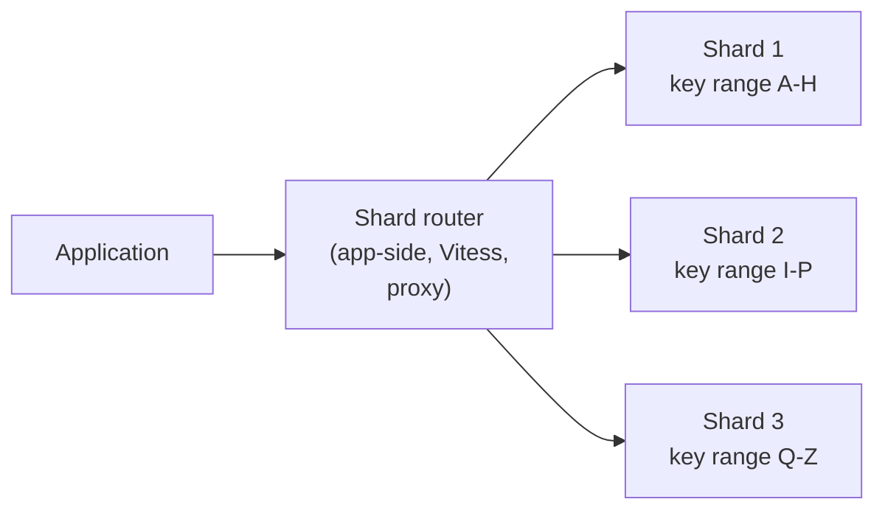
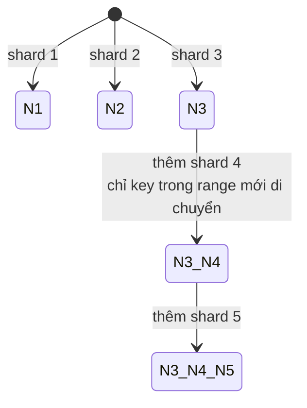

# What is sharding in databases?

> Bài này giải thích sharding là gì, khác biệt với partitioning và replication, cách chọn shard key, ba cách shard (range, hash, directory), hot shard, consistent hashing và virtual shard để resharding, giới hạn cross-shard query/transaction, global secondary index. Liên quan: [database-replication](database-replication.md), [database-transaction](database-transaction.md), [acid-properties](acid-properties.md).

Chủ đề: Database · Ngày: 2026-10-16

## 1. Là gì

Sharding là chiếm tách một tập dữ liệu lớn thành nhiều phần nhỏ hơn (shard) đặt trên nhiều node database độc lập, mỗi node chỉ chứa một tập con dữ liệu. Mục tiêu là vượt qua giới hạn của một server đơn (CPU, RAM, disk, IOPS) khi dữ liệu và traffic lớn hơn một máy có thể chịu. Mỗi shard có schema giống nhau (thường vậy), nhưng dữ liệu tách rời theo một hàm `shard_key → shard_id`. Khác với replication: replication giống dữ liệu trên nhiều node, còn sharding tách dữ liệu.



*Sơ đồ vị trí: Application gửi query tới đúng node dựa trên shard key; mỗi shard là một database độc lập, có thể khác server/region.*

### Trả lời 30 giây

"Sharding là tách một dataset lớn thành nhiều shard trên nhiều node để vượt qua giới hạn của một server (RAM, CPU, IOPS, disk). Shard key chọn sai dễ gây hot shard. Ba cách shard phổ biến: range (dễ truy vấn khoảng nhưng dễ hot), hash (phân tán đều nhưng khó range query), directory (bảng lookup linh hoạt nhưng thêm SPOF). Khác với replication (sao chép) và partitioning (tách bảng trong cùng một instance). Resharding dùng consistent hashing với virtual shard để giảm rewrite khi thêm/bớt node. Cross-shard query và transaction mất atomicity và cost cao — thiết kế schema để tránh."

## 2. Cơ chế cốt lõi

### Bước 1. Shard key

Shard key là cột (hoặc tổ hợp cột) dùng để quyết định một row thuộc shard nào. Chọn shard key tốt là quyết định quan trọng nhất:

- **Cardinality cao**: tránh chọn cột chỉ có vài giá trị (`status`, `country`). Vài giá trị = vài shard = không phân tán.
- **Phân tán đều**: tránh skew, ví dụ chọn `created_at` thì shard mới nhất sẽ nóng vì write tập trung.
- **Phù hợp query phổ biến**: truy vấn phổ biến phải route về một shard, không fan-out ra tất cả.
- **Ổn định**: tránh cột thay đổi (vd email) vì reshuffle toàn bộ khi update.
- **Không tăng đơn điệu**: nếu key là auto-increment ID, hash trước khi shard.

Ví dụ: bảng `orders(user_id, order_id, ...)`, chọn `user_id` làm shard key. Một user có tất cả orders ở cùng shard → query "orders của user X" chỉ cần 1 shard. Nhưng nếu một user là customer khổng lồ, họ là hot shard.

### Bước 2. Ba cách shard

**Range sharding**: `shard_id = hash_to_bucket(key, N)` hoặc `key ∈ [a_i, b_i] → shard_i`. Range query (`WHERE key BETWEEN x AND y`) chỉ cần đi một vài shard liên tiếp. Dễ resharding (thêm shard ở cuối range). Nhưng dễ hot: nếu key là timestamp, dữ liệu mới tập trung ở shard cuối.

**Hash sharding**: `shard_id = hash(key) % N`. Phân tán đều nếu hash đều. Không hỗ trợ range query hiệu quả (mọi range đều phải fan-out). Resharding khó: thêm một node nghĩa là hầu hết key đổi shard → rewrite lượng lớn dữ liệu. Consistent hashing (bước 4) giải quyết.

**Directory sharding**: bảng lookup `key → shard_id` lưu ở một service (DB riêng, ZooKeeper, etcd). Linh hoạt nhất: có thể di chuyển từng key range độc lập, hỗ trợ custom routing. Đánh đổi: thêm SPOF (directory service), thêm hop, cần cache aggressively.

### Bước 3. Hot shard

Hot shard là một shard phải chịu lượng read/write lớn hơn nhiều so với các shard khác, dù tổng tải phân tán đều. Nguyên nhân thường gặp:

- Skewed key distribution (ví dụ: một số user có traffic khổng lồ).
- Temporal skew (key là timestamp, shard mới nhất gánh hết).
- Range query tập trung (key là số điện thoại, prefix `09*` cùng shard).

Giảm thiểu: chọn key tốt hơn, dùng compound key (`user_id, order_id`), tách hot range thành sub-shard, denormalize dữ liệu nóng sang một cluster riêng. Không có giải pháp tổng quát.

### Bước 4. Consistent hashing và virtual shards

**Consistent hashing**: hash cả key và shard_id vào cùng một vòng tròn 0..2^32. Key thuộc shard nào có hash gần nhất theo chiều kim đồng hồ. Khi thêm/bớt shard, chỉ key nằm giữa shard mới và shard cũ phải di chuyển — phần lớn key không đổi shard. Dynamo, Cassandra dùng cách này.

**Virtual shards (vnode)**: mỗi shard vật lý được gán nhiều vnode trên vòng tròn. Khi thêm shard, lấy một số vnode từ các shard khác. Tăng tính đều khi shard ít, và phân tán việc di chuyển key.



*Resharding với consistent hashing: thêm/bớt node chỉ di chuyển ~`1/N` tổng key. Không chính xác `1/N` với vnode.*

### Bước 5. Cross-shard query và transaction

Cross-shard query (scatter-gather): router gửi query tới tất cả shard, gom kết quả. Tốn latency = max shard latency, dễ partial failure. Khó đảm bảo consistency (một shard chậm có thể trả dữ liệu cũ).

Cross-shard transaction: mất atomicity nếu dùng per-shard transaction. Cần distributed transaction (XA, 2PC, Saga, TCC) — chậm và phức tạp. Cách phổ biến: thiết kế schema để mọi transaction chỉ chạm một shard (denormalize hoặc chọn shard key theo actor chính). Xem [two-phase-commit](two-phase-commit.md).

### Bước 6. Global secondary index

Secondary index (vd `orders.customer_email`) theo shard key chính (`user_id`) thì chỉ nằm trên shard đó. Nếu cần tìm order theo email — một truy vấn tự nhiên — phải fan-out tới tất cả shard.

**Global secondary index** (Cách DynamoDB gọi, Elasticsearch cũng có khái niệm tương tự): index được nhân bản trên tất cả shard, mỗi shard giữ một phần index theo partition key của index. Truy vấn đi một shard index trước, lấy danh sách shard chính cần đọc, rồi fan-out đọc shard chính.

Đánh đổi: write phải cập nhật index ở tất cả shard → write amplification. Read có thể phải 2 lần fan-out (index rồi data). Consistency giữa index và data có thể eventually only.

### Bước 7. Sharding vs partitioning vs replication

Ba khái niệm thường nhầm:

- **Sharding** (horizontal partitioning across nodes): tách dữ liệu, mỗi shard ở server khác nhau. Tăng write throughput và tổng storage.
- **Partitioning** (horizontal partitioning within one instance): tách một bảng lớn thành nhiều partition ở cùng một server. PostgreSQL declarative partitioning, MySQL partitioning, Oracle. Tiết kiệm I/O scan nhưng không tăng write throughput.
- **Replication**: cùng dữ liệu trên nhiều node. Tăng read throughput và availability. Không tăng tổng storage.

Thực tế: production thường kết hợp. Ví dụ: mỗi shard replicated 3 lần (1 leader + 2 replica), trong mỗi shard dùng partitioning cho bảng lớn nhất. Xem [database-replication](database-replication.md).

### Quan sát

```bash
# MongoDB: kiểm tra phân bố chunk (mongo dùng range sharding + auto-split)
mongosh --eval "sh.status()"
# (output minh họa, chưa chạy)
# shards: 3
# chunk分布: shardA 35%, shardB 33%, shardC 32%  (cân bằng)
# Nếu skew > 20% → balancer chưa chạy hoặc shard key tệ

# PostgreSQL + Citus: kiểm tra distribution
SELECT shardid, count(*) FROM orders GROUP BY shardid;
# output minh họa, chưa chạy

# MySQL + Vitess: kiểm tra routing
mysql -e "SELECT * FROM orders WHERE user_id=12345" -h vtgate:33522
# vtgate sẽ route tới shard chứa user_id=12345
```

### Ví dụ chạy từng bước

App bán hàng có 100 triệu user và 1 tỷ đơn. Ta shard bảng `orders` theo `user_id` bằng hash đều qua 4 shard. Một script Node kiểm tra phân bố và cost resharding — đã chạy thật, kết quả dưới đây lấy từ `node /tmp/ep_work_shard/hash.js`.

**Bước 1 — hash function.** Mỗi `user_id` (số nguyên) được đưa qua mix function rồi `% 4`. Script dùng hàm mix 32-bit trên integer trực tiếp — không prefix chuỗi (vì `user_42` và `user_43` chỉ khác 1 ký tự dễ skew).

**Bước 2 — phân bố qua 1M user mẫu.** Đếm số user rơi vào mỗi shard sau khi hash:

| Shard | Số user | Tỉ lệ |
|---|---|---|
| 0 | 250509 | 25.05% |
| 1 | 250059 | 25.01% |
| 2 | 249941 | 24.99% |
| 3 | 249491 | 24.95% |

Skew `(max − min) / expected` = 0.0041 (0.4%). Gần như đều, hash function dùng được.

**Bước 3 — route 4 user mẫu.** `user_id=42 → shard 3`, `user_id=1001 → shard 2`, `user_id=999999 → shard 0`, `user_id=1042 → shard 1`. Bốn user rơi vào bốn shard khác nhau — đúng kỳ vọng.

**Bước 4 — consistent hashing khi thêm shard 5.** Thay vì `% 4` thuần (thêm 1 shard phải di chuyển ~75% key), dùng consistent hashing với 256 vnode/shard. Chạy script: thêm shard thứ 5, đếm key phải di chuyển = 211054 / 1000000 = 21.11%, sát với lý thuyết 1/5 = 20%.

```text
Shard counts: [250509, 250059, 249941, 249491]
Skew (max-min)/expected: 0.0041
user_id=42 -> shard 3
user_id=1001 -> shard 2
user_id=999999 -> shard 0
user_id=1042 -> shard 1
Consistent hashing 4->5 shard, key di chuyển: 21.11%
Lý thuyết 1/5 = 20.00%
```

**Biến thể "chọn sai shard key".** Nếu chọn `created_at` thay vì `user_id`, insert mới luôn rơi vào shard cuối (timestamp lớn nhất). Vài giờ đầu shard 3 chịu 100% write, các shard 0–2 idle. Script đếm sẽ thấy skew = 3.0 (300%). Đây là hot shard temporal mà câu 7 ở 3A đã đề cập.

Điều rút ra: hash trên integer trực tiếp cho skew dưới 1% với 1M key; consistent hashing cắt cost resharding xuống `~1/N` — nối với câu 4 ở 3A.

## 3. Câu hỏi phỏng vấn

### 3A. Câu hỏi đào sâu

<details class="qa">
<summary>Câu 1. Sharding khác gì với partitioning và replication?</summary>

**Trả lời ngắn:** Sharding (horizontal partitioning across nodes): tách dữ liệu, mỗi shard trên server khác nhau. Partitioning (within one instance): tách bảng lớn thành partition trong cùng một server. Replication: cùng dữ liệu trên nhiều node. Sharding tăng write throughput + storage, partitioning tăng scan I/O, replication tăng read + availability.

**Đào sâu:**
- Sharding giải quyết giới hạn một server (RAM, CPU, IOPS). Replication giải quyết read scaling và HA. Partitioning giải quyết I/O scan trên bảng rất lớn trong cùng một server.
- Production thường kết hợp: mỗi shard replicate 3 lần (1 leader + 2 replica), mỗi shard dùng partitioning cho bảng lớn nhất.
- Sharding không thay thế replication — ngược lại, replica sharding vẫn cần để HA. Nếu chỉ sharding không replicate, một shard chết = mất dữ liệu.
- Partition có thể đặt trên các tablespace khác nhau trong một instance, không qua network.

**Bẫy:** "Sharding là replication". Sai — replication giống dữ liệu, sharding tách dữ liệu. Kết quả cuối cùng khác nhau: replication có N bản của cùng data, sharding có N tập con rời nhau.

**Follow-up:** Có thể chỉ partition mà không sharding? Có. PostgreSQL declarative partitioning cho bảng hàng tỷ row nhưng server vẫn chịu được. Chỉ partition khi write IOPS chưa tới giới hạn.
</details>

<details class="qa">
<summary>Câu 2. Shard key tốt là gì? Cho ví dụ sai và ví dụ đúng.</summary>

**Trả lời ngắn:** Shard key tốt có cardinality cao, phân tán đều, phù hợp query phổ biến, và ổn định. Ví dụ tốt: `user_id` cho bảng `orders`. Ví dụ sai: `created_at` (skew temporal), `country` (cardinality thấp), `email` (key đổi → reshuffle).

**Đào sâu:**
- `user_id` tốt vì hầu hết query orders đều theo user (`WHERE user_id = ?`), phân tán đều nếu phân bố user không lệch quá nhiều.
- `created_at` sai vì insert mới luôn vào shard cuối → hot shard ghi.
- `country` sai vì ~10 quốc gia → 10 shard → không mở rộng được.
- `email` sai vì user đổi email → row phải di chuyển shard.
- Compound key (`tenant_id, user_id`) giải quyết multi-tenant SaaS: query theo tenant luôn chỉ 1 shard.

**Bẫy:** "Chọn `id` auto-increment vì đơn giản". Sai — auto-increment đơn điệu dễ skew và không phục vụ query theo actor.

**Follow-up:** Multi-tenant SaaS với hàng triệu tenant — chọn key nào? `tenant_id` (mỗi tenant một shard) hoặc `tenant_id, user_id` (compound, nhiều tenant cùng shard). Compound cho phép pack nhiều tenant nhỏ vào một shard, tiết kiệm resource.
</details>

<details class="qa">
<summary>Câu 3. Ba cách shard: range, hash, directory. Khi nào dùng cái nào?</summary>

**Trả lời ngắn:** Range: khi cần range query và ít resharding. Hash: khi phân tán đều quan trọng hơn range query. Directory: khi cần routing linh hoạt hoặc key mapping không đều.

**Đào sâu:**
- **Range**: `key ∈ [a_i, b_i] → shard_i`. Range query hiệu quả (đi 1-2 shard liên tiếp), dễ thêm shard ở cuối. Nhưng hot nếu key giới là timestamp; thêm shard giữa phải rewrite nhiều. Dùng khi key là `user_id` hoặc `tenant_id` và range query quan trọng (vd tìm user theo khoảng alphabet).
- **Hash**: `shard_id = hash(key) % N`. Phân tán đều nếu hash đều. Range query phải fan-out tất cả. Resharding tốn vì key đổi shard. Dùng khi write-heavy và không cần range.
- **Directory**: bảng lookup `key → shard_id`. Linh hoạt nhất, nhưng thêm SPOF. Thường dùng với ZooKeeper/etcd. Dùng khi routing phức tạp hoặc cần di chuyển key độc lập.
- Thực tế: kết hợp. Ví dụ: hash shard_id ổn định (chia virtual shards cố định), nhưng range overlay trên virtual shards để có lợi range query.

**Bẫy:** "Hash là tốt nhất vì đều". Sai — hash mất range query, và %N khó resharding. Nên dùng consistent hashing với virtual shards.

**Follow-up:** MongoDB dùng cách nào? Range sharding trên `shard key` value, tự động chia chunk khi chunk vượt ngưỡng (mặc định 64 MB).
</details>

<details class="qa">
<summary>Câu 4. Consistent hashing với virtual shard giải quyết resharding như thế nào?</summary>

**Trả lời ngắn:** Hash key và shard_id lên cùng vòng tròn. Key thuộc shard có hash gần nhất theo chiều kim đồng hồ. Thêm/bớt shard chỉ di chuyển key nằm giữa shard cũ và shard mới. Vnode: mỗi shard vật lý có nhiều vnode, phân tán đều hơn khi shard ít.

**Đào sâu:**
- Consistent hashing: cả key và shard_id (hoặc token của shard) đều hash lên vòng tròn 0..2^32. Tìm shard: đi theo chiều kim đồng hồ từ hash(key) tới hash(shard_id) đầu tiên.
- Khi thêm shard mới: chỉ key nằm giữa shard mới và shard cũ phải di chuyển. Với N shard đều, mỗi shard gánh `1/N` key → resharding di chuyển `~1/N` key.
- Vnode (virtual node): mỗi shard vật lý gán nhiều vnode trên vòng tròn (Cassandra mặc định 256 vnode/shard). Khi thêm shard mới, lấy vnode từ các shard cũ.
- DynamoDB, Cassandra dùng consistent hashing + vnode.

**Bẫy:** "Consistent hashing đảm bảo chính xác 1/N key di chuyển". Không — trung bình `1/N` nhưng có thể lệch khi key skewed.

**Follow-up:** Shard key là auto-increment — consistent hashing giúp gì? Ít — key đơn điệu luôn đi vào một vùng, vẫn hot. Cần hash key trước.
</details>

<details class="qa">
<summary>Câu 5. Cross-shard query và transaction khó ở đâu, cách giảm?</summary>

**Trả lời ngắn:** Cross-shard query phải fan-out tới tất cả shard, latency = max shard. Cross-shard transaction mất atomicity; cần 2PC/Saga phức tạp. Cách giảm: chọn shard key theo actor chính, denormalize, hoặc dùng global secondary index.

**Đào sâu:**
- Cross-shard query (scatter-gather): router gửi query tới tất cả shard, gom kết quả. Một shard chậm kéo cả query. Kết quả có thể không nhất quán.
- Cross-shard transaction: mỗi shard có local transaction. 2PC (XA) cho atomicity nhưng chậm và bottleneck coordinator. Saga: mỗi bước có compensating action.
- Cách giảm phổ biến: chọn shard key theo actor chính, giữ dữ liệu liên quan cùng shard. Denormalize nếu cần join.
- Tìm kiếm theo non-shard-key: global secondary index hoặc search cluster riêng.

**Bẫy:** "MongoDB hỗ trợ transaction multi-shard". Có từ 4.0 nhưng expensive, latency cao, throughput thấp. Không phải giải pháp mặc định.

**Follow-up:** Order cần cập nhật `users` và `orders` — cách thiết kế? Đặt cả hai trong cùng shard (shard key theo user). Hoặc counter là event-driven aggregate cuối ngày.
</details>

<details class="qa">
<summary>Câu 6. Global secondary index khác local index như thế nào?</summary>

**Trả lời ngắn:** Local index nằm trên cùng shard với data. Query non-shard-key phải fan-out tất cả shard. Global secondary index nhân bản trên tất cả shard, mỗi shard giữ một phần theo partition key của index. Query đi shard index trước, lấy list shard chính, fan-out đọc data.

**Đào sâu:**
- Local index: query `WHERE customer_email = ?` trên bảng shard theo `user_id` → fan-out tất cả shard. Vài triệu shard không khả thi.
- Global index (DynamoDB GSI, Elasticsearch): query index đi một shard index. Lấy list `(user_id, shard_id)`, đọc data ở shard tương ứng.
- Write: insert/update phải update local index và global index. Write amplification.
- Read có thể eventually consistency: GSI DynamoDB default eventually. Strongly consistent read tốn hơn.
- Thực tế: thiết kế ít GSI, ưu tiên query theo shard key chính.

**Bẫy:** "GSI cho phép truy vấn mọi cột không tốn". Sai — write amplification cao và consistency eventually.

**Follow-up:** Có cách nào tránh GSI không? Denormalize dữ liệu cần truy vấn vào row chính. Hoặc search engine riêng cho full-text.
</details>

<details class="qa">
<summary>Câu 7 (Debug). Hệ thống sharded, một shard chịu 3× traffic. Bạn điều tra gì?</summary>

**Trả lời ngắn:** 1) Xem shard key phân bố. 2) Tìm hot key từ metric. 3) Xem query pattern (range query tập trung?). 4) Split hot shard hoặc tách hot key sang cluster riêng.

**Đào sâu:**
- Bước 1: query metadata cluster (MongoDB `sh.status()`, Citus `pg_dist_shard`). Skew > 2× → key tệ.
- Bước 2: log query mẫu và đếm frequency theo key. Một user whale? Một prefix số điện thoại?
- Bước 3: range query phổ biến có nằm trong range của một shard không? Shard key alphabet A-Z, query "LIKE 'Nguyen%'" → tất cả vào shard N.
- Bước 4: split hot shard thành sub-shard theo sub-key. Đổi shard key rất tốn — chỉ khi không còn lựa chọn.
- Bước 5: tách hot data sang cluster riêng (cache + dedicated DB cho whale).

**Bẫy:** Chỉ tăng shard count và đợi consistent hashing tự cân bằng. Không — nếu key skewed, hot key vẫn ở một shard.

**Follow-up:** Phát hiện whale user — giải pháp ngắn hạn? Cache aggressive ở app, hoặc tách data whale sang shard riêng với custom routing.
</details>

<details class="qa">
<summary>Câu 8 (Thiết kế). Thiết kế shard cho `orders(user_id, order_id, total, created_at)`, 100M user, 1B orders, 50K write/s, 200K read/s.</summary>

**Trả lời ngắn:** Shard key `user_id` (consistent hashing 32 shard). Mỗi shard replicate 3 (1 leader + 2 replica). Dùng Vitess/MySQL hoặc Citus/PostgreSQL. Tránh cross-shard query. Tách catalog, payment qua cache/search riêng.

**Đào sâu:**
- **Shard key**: `user_id` — hầu hết query là "orders của user X". Hash đều với 100M user. Vài whale user có thể hot → monitor và tách sau.
- **Shard count**: 32 shard ban đầu, mỗi shard ~3M user / ~30M orders, write ~1.5K/s, read ~6K/s — vừa tầm một server MySQL/PG.
- **Routing**: Vitess (MySQL) hoặc Citus (PostgreSQL). App không cần biết shard.
- **Replication**: mỗi shard 1 leader + 2 replica. Read 200K/s chia 32 = 6K/s mỗi shard.
- **Tránh cross-shard**: query "top 10 orders toàn hệ" phải fan-out. Dùng materialized view riêng cho dashboard.
- **Catalog/product**: bảng nhỏ hơn nhiều, replicate toàn bộ tới mỗi shard (denormalize).
- **Hot key**: monitor top 100 user. Tách whale qua shard riêng với custom routing.
- **Resharding**: Vitess/Citus hỗ trợ split/shard move online.

**Bẫy:** Shard theo `created_at` (tháng). Sai — insert tập trung tháng mới, hot shard ghi. Anti-pattern.

**Follow-up:** Cần query "tất cả orders của một email" — cách? Duy trì mapping `email → user_id` ở `users`, lookup trước. Hoặc GSI trên email của users, không phải orders.
</details>

### 3B. Câu hỏi phỏng vấn liên quan

<details class="qa">
<summary>Câu 9. Tại sao sharding là phương án cuối cùng?</summary>

**Trả lời:** Sharding phức tạp vận hành: resharding, cross-shard query, hot shard. Trước khi shard, thử scale up server, replica cho read, partition trong instance, cache (Redis). Khi dữ liệu/traffic thực sự vượt giới hạn một server, lúc đó mới shard. Sau khi shard rất khó quay lại.
</details>

<details class="qa">
<summary>Câu 10. Vitess, Citus, MongoDB sharded cluster khác nhau thế nào?</summary>

**Trả lời:** Vitess: sharding cho MySQL, app gọi qua vtgate. Citus: extension PostgreSQL, sharding trong PG. MongoDB: built-in sharded cluster với mongos router. Cả ba hỗ trợ sharding tự động nhưng cách triển khai khác. Vitess phổ biến ở YouTube/Slack; Citus cho app PG; MongoDB cho document workload.
</details>

<details class="qa">
<summary>Câu 11. Shard death (một shard chết) xử lý thế nào?</summary>

**Trả lời:** Mất dữ liệu nếu không replicate. Giảm thiểu: mỗi shard replicate 3, leader chết → replica được bầu làm leader. Trong thời gian chuyển, shard unavailable. Cần backup và test restore. Khi cả cluster một shard chết (replica cũng chết), dữ liệu mất không thể phục hồi.
</details>

<details class="qa">
<summary>Câu 12. Geo-sharding là gì?</summary>

**Trả lời:** Đặt shard theo vùng địa lý. Mỗi region có shard riêng, user data lưu ở shard của region đó. Lợi: latency thấp, compliance (GDPR: data EU ở EU). Đánh đổi: cross-region query phải fan-out qua WAN (50-150 ms), phức tạp khi user di chuyển region.
</details>

<details class="qa">
<summary>Câu 13. True or false: "Sharding tự động tăng write throughput tuyến tính với số shard."</summary>

**Trả lời:** Sai khi có cross-shard transaction, khi shard key skewed, khi cần coordinator. Đúng khi workload hoàn toàn per-shard và key phân tán đều. Thực tế tăng dưới tuyến tính.
</details>

<details class="qa">
<summary>Câu 14. Sharding khác gì với multi-tenant single-DB?</summary>

**Trả lời:** Multi-tenant single-DB: tất cả tenant chung database, tách bằng `tenant_id` column. Đơn giản, dễ query cross-tenant, nhưng không scale khi một tenant quá lớn. Sharding: mỗi tenant (hoặc nhóm tenant) ở shard riêng. Scale hơn nhưng phức tạp hơn nhiều. Phổ biến: SaaS nhỏ dùng single-DB, scale lên mới shard.
</details>

<details class="qa">
<summary>Câu 15. Resharding online (không downtime) khó ở đâu?</summary>

**Trả lời:** Trong khi di chuyển data, cả write và read phải phục vụ. Kỹ thuật phổ biến: dual-write (ghi cả shard cũ và mới) trong transition, đọc ưu tiên shard mới nhưng fallback shard cũ. Cutover khi đồng bộ xong. Thách thức: xử lý conflict, dừng dual-write khi cutover.
</details>

<details class="qa">
<summary>Câu 16. DynamoDB partition key khác gì với sharding truyền thống?</summary>

**Trả lời:** DynamoDB tự quản partition (shard) dựa trên partition key và throughput. App chỉ định partition key (vd `user_id`), DynamoDB hash và chọn partition. Không cần chọn shard count, không cần quản resharding (DynamoDB tự làm khi vượt 10 GB hoặc 3000 RCU/1000 WCU per partition). Đánh đổi: ít tự control routing, hot key vẫn là vấn đề.
</details>

## 4. Đánh đổi và sự cố production

### So sánh ba chiến lược shard

| Tiêu chí | Range sharding | Hash sharding | Directory sharding |
|---|---|---|---|
| Phân tán đều | Kém (hot range) | Tốt | Tốt (nếu config đúng) |
| Range query | Tốt (1-2 shard) | Kém (fan-out) | Tuỳ config |
| Resharding | Dễ (cuối range) | Tốn (rewrite nhiều) | Linh hoạt |
| Phụ thuộc | Không thêm | Không thêm | Directory service (SPOF) |
| Hot shard | Có thể | Hiếm (hash đều) | Có thể |
| Khi nào dùng | Range query quan trọng, key phân tán đều | Write-heavy, không cần range | Routing phức tạp |

### Năm failure mode

| Triệu chứng | Nguyên nhân gốc | Cách kiểm tra | Cách sửa |
|---|---|---|---|
| Một shard chịu 3× traffic | Shard key skewed, hot key | `sh.status()` (MongoDB), `pg_dist_shard` (Citus), slow query log | Split hot shard, tách whale user |
| Query "orders của user X" chậm đột ngột | Shard chứa user đó chết/quá tải | Monitoring shard health, replica lag | Thêm replica, tăng shard count |
| Cross-shard JOIN trả kết quả không nhất quán | Shard khác thời điểm | Test với snapshot, trace từng shard | Đổi schema để query chỉ 1 shard |
| Migration dữ liệu sang shard mới lâu không xong | Resharding không dual-write, network bottleneck | Logs migration job | Dual-write trước, migrate với batch + checkpoint |
| Resharding làm app chậm | Shard routing cache miss, scan nhiều | Profiler, app log | Warmup cache, chia nhỏ batch |

## 5. Cheat sheet

| Chủ đề | Con số / quy tắc cần nhớ |
|---|---|
| Sharding là gì | Tách dữ liệu trên nhiều node. Khác replication (giống) và partitioning (within instance). |
| Shard key tốt | Cardinality cao, phân tán đều, ổn định, trùng query phổ biến |
| Ba cách shard | Range (range query), Hash (đều), Directory (linh hoạt + SPOF) |
| Hot shard | Shard key skewed. Tách hot key/range. |
| Consistent hashing | Thêm shard chỉ di chuyển ~1/N key (với vnode, không chính xác) |
| Cross-shard transaction | Mất atomicity. Dùng 2PC (chậm) hoặc Saga (compensating action) |
| GSI | Nhân bản index ở tất cả shard. Write amplification, eventually consistent. |
| DynamoDB partition | 10 GB / 3000 RCU / 1000 WCU per partition. DynamoDB tự split. |
| MongoDB chunk | 64 MB mặc định, tự split khi vượt |

**Học tiếp:**
- [database-replication](database-replication.md) — mỗi shard thường replicate 3
- [database-transaction](database-transaction.md) — cross-shard transaction mất ACID
- [two-phase-commit](two-phase-commit.md) — distributed transaction khi cần atomicity cross-shard