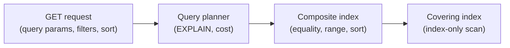
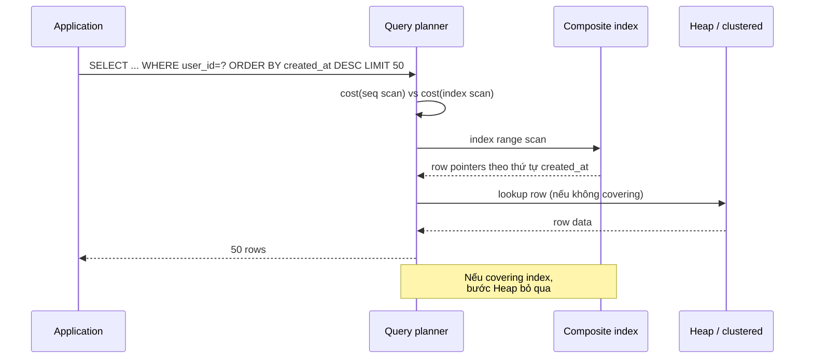

# How would you index the database to efficiently handle GET requests?

> Bài này trình bày quy trình thiết kế index cho workload GET: phân tích access pattern, chọn composite index theo thứ tự cột (equality, range, sort), dùng covering index, phân trang bằng keyset thay vì OFFSET, đo selectivity, đánh đổi write cost, và xác minh bằng EXPLAIN. Bài [b-plus-tree-index](b-plus-tree-index.md) giải thích cấu trúc B+ tree; bài [clustered-vs-non-clustered-index](clustered-vs-non-clustered-index.md) phân biệt clustered và secondary index.

Chủ đề: Database · Ngày: 2026-10-16

## 1. Là gì

Index cho GET request là composite B+ tree index (có thể kèm covering) được thiết kế để phục vụ truy vấn đọc phổ biến với số page read ít nhất, tránh quét bảng. Mục tiêu: chuyển từ seq scan (O(N)) sang index scan (O(log N) + số row matched), và khi có thể, dùng index-only scan (covering) để không đọc row.

GET request phổ biến gồm point query (tìm theo một khoá), range query (lọc theo khoảng), sort + limit (danh sách phân trang), và filter nhiều cột. Mỗi dạng cần cách chọn index khác nhau, nhưng quy tắc chung là: cột equality trước, cột range và sort sau, cột thường xuất hiện trong SELECT đưa vào covering (nếu nhỏ).



*Sơ đồ vị trí: GET request đi qua planner, planner chọn index tối ưu, composite index cho filter, covering cho SELECT không cần row.*

### Trả lời 30 giây

"Phân tích access pattern trước (query nào chạy nhiều, filter cột nào, sort cột nào), rồi tạo composite B+ tree index với thứ tự: cột equality trước, cột range/sort sau, cột trong SELECT đưa vào covering. Dùng keyset pagination thay vì OFFSET, vì OFFSET 100000 vẫn phải đọc 100000 row rồi bỏ. Đo bằng `EXPLAIN ANALYZE` xem planner có dùng index và có `Using index` (covering) không. Cân nhắc write cost: mỗi index thêm ~1-3 page write mỗi lần INSERT/UPDATE/DELETE. Một query mà planner chọn seq scan thường vì statistics lỗi thời, không phải vì index không tồn tại."

## 2. Cơ chế cốt lõi

### Bước 1. Phân tích access pattern

Trước khi tạo index, cần biết:

- **Query nào chạy nhiều nhất**: lấy từ slow query log (PostgreSQL `pg_stat_statements`, MySQL `performance_schema.events_statements_summary_by_digest`).
- **Filter cột nào**: trích `WHERE` của top 20 query chiếm 80% load.
- **Sort cột nào**: trích `ORDER BY` của các query có `LIMIT`.
- **SELECT trả cột nào**: cột wide (TEXT, JSONB) thường không đưa vào covering vì phình index.

Một sai lầm phổ biến là tạo index cho từng query, dẫn tới hàng chục index trên một bảng. Thay vào đó, gom các query có cùng filter prefix thành một composite index.

### Bước 2. Quy tắc thứ tự cột trong composite index

Index `(a, b, c)` lưu key theo `(a, b, c)`. Query chỉ dùng index khi có điều kiện trên cột đầu (`a`). Thứ tự ưu tiên:

1. **Equality** (`a = ?`): cột có selectivity cao, xuất hiện thường xuyên trong WHERE dạng bằng.
2. **Range** (`b BETWEEN ?`): cột có điều kiện khoảng, đi sau equality vì sau range thì các cột tiếp theo không dùng được.
3. **Sort** (`ORDER BY c`): cột trong ORDER BY để tránh filesort, đi cuối cùng.
4. **INCLUDE** (cột trong SELECT): thêm vào leaf mà không tham gia key (PostgreSQL không có `INCLUDE` mà dùng chỉ mục multi-column, MySQL covering chỉ cột trong key).

Ví dụ: `WHERE user_id = ? AND status = 'active' ORDER BY created_at DESC LIMIT 50` → index `(user_id, status, created_at DESC)`.

### Bước 3. Covering index (index-only scan)

Nếu mọi cột trong SELECT đều có trong index, planner trả dữ liệu từ index, không đọc row. Trong EXPLAIN thấy `Using index` (MySQL) hoặc `Index Only Scan` (PostgreSQL).

Lợi ích: tiết kiệm 1 lần random I/O cho mỗi row matched. Với secondary index InnoDB, mỗi row matched tốn 1 random I/O trỏ qua PK. Covering cắt bước này.

Cảnh báo: covering index có thể rất lớn nếu SELECT nhiều cột wide. Đôi khi tốt hơn làm 2 query nhỏ (1 lấy id, 1 lấy chi tiết) thay vì một covering index chứa mọi thứ.

### Bước 4. Pagination: keyset thay vì OFFSET

Query `LIMIT 50 OFFSET 100000` vẫn phải đọc 100050 row rồi bỏ 100000. Với bảng lớn, page càng sâu càng chậm.

Keyset pagination dùng `WHERE (created_at, id) < (last_seen_created_at, last_seen_id) ORDER BY created_at DESC, id DESC LIMIT 50`. Index trên `(created_at, id)` giúp planner đi thẳng tới vị trí bắt đầu, đọc 50 row. Page càng sâu vẫn nhanh vì chi phí tỷ lệ với số row trong page, không phải vị trí bắt đầu.

Đánh đổi: keyset không nhảy tới page N tuỳ ý, chỉ duyệt tuần tự. Phù hợp feed, danh sách cuộn vô hạn. Không phù hợp nếu user cần nhảy tới trang 1000.

### Bước 5. Selectivity và quyết định của planner

Planner ước lượng số row mỗi bước trả về. Nếu ước lượng cao (range rộng, selectivity thấp), planner chọn seq scan vì sequential I/O trên heap rẻ hơn random I/O qua index. Index chỉ thắng khi row matched đủ ít.

Selectivity cao: cột có nhiều giá trị distinct, ví dụ `user_id` (1 triệu user, mỗi user vài dòng). Selectivity thấp: cột có ít giá trị, ví dụ `status` (3 giá trị).

### Bước 6. Write cost của index

Mỗi INSERT/UPDATE/DELETE phải cập nhật tất cả index trên bảng. Tạo nhiều index không tốn disk thôi mà còn:

- Tăng WAL write (PostgreSQL) hoặc redo log (InnoDB).
- Tăng thời gian commit.
- Giảm buffer cache hit rate vì nhiều index cạnh tranh RAM.

Quy tắc: chỉ tạo index thật sự dùng tới, xoá index thừa bằng cách xem `pg_stat_user_indexes` (PostgreSQL) hoặc `sys.schema_unused_indexes` (SQL Server) để tìm index không dùng.

### Bước 7. Xác minh bằng EXPLAIN

`EXPLAIN` (estimated) và `EXPLAIN ANALYZE` (actual) cho biết planner dùng index nào, số row estimate, có covering không, có sort ngoài dự kiến không.

Ví dụ phân tích:

- `Seq Scan` không dùng index → kiểm tra WHERE có khớp index không, hoặc statistics lỗi thời.
- `Index Scan using idx` dùng index nhưng `Filter: ...` cho thấy có cột ngoài index phải lọc thêm → cần covering hoặc sửa index.
- `Using filesort` cho thấy ORDER BY không khớp index → thêm cột sort vào composite.
- `Buffers: shared read` cao → cache miss, có thể do quét nhiều leaf.



*Sequence: planner chọn index scan (không seq scan nếu statistics đúng), đi qua index theo thứ tự sort, đọc row nếu cần. Covering index bỏ qua bước heap.*

### Quan sát

```sql
-- PostgreSQL: phân tích query
EXPLAIN (ANALYZE, BUFFERS)
SELECT id, status, created_at
FROM orders
WHERE user_id = 42 AND status = 'active'
ORDER BY created_at DESC
LIMIT 50;
-- output minh hoạ, chưa chạy
-- Limit  (cost=... rows=50)
--   ->  Index Only Scan using idx_user_status_created on orders
--         Index Cond: (user_id = 42 AND status = 'active')
--         Buffers: shared hit=8 read=2
--         Planning Time: 0.2 ms
--         Execution Time: 0.5 ms

-- Nếu thấy "Filter: (status = ...)" → index chưa covering, cần thêm status
-- Nếu thấy "Sort" → ORDER BY chưa khớp index

-- Tìm index thừa (PostgreSQL)
SELECT schemaname, relname, indexrelname, idx_scan
FROM pg_stat_user_indexes
WHERE idx_scan = 0;
-- idx_scan = 0 → index không được dùng, có thể xoá

-- Tìm index thiếu (PostgreSQL)
SELECT relname, seq_scan, seq_tup_read, idx_scan, idx_tup_fetch
FROM pg_stat_user_tables
WHERE seq_scan > idx_scan;
-- seq_scan > idx_scan → bảng quét nhiều hơn dùng index
```

### Ví dụ chạy từng bước

Kịch bản: bảng `orders(user_id, status, created_at, total, items)` 50 triệu row. Query chính `WHERE user_id = ? AND status = 'paid' ORDER BY created_at DESC LIMIT 20`. Ba bước theo thời gian.

Bước 1. T0: trước khi tạo index, planner chạy `Seq Scan on orders`. Ước lượng `rows=50M`, cost cao nhưng vẫn chọn seq scan vì selectivity của `status='paid'` chỉ ~30% (15M row). Thời gian ~5 giây. EXPLAIN: `Seq Scan on orders, Filter: (user_id = ? AND status = 'paid')`.

Bước 2. T1: tạo composite `(user_id, status, created_at DESC)` (PostgreSQL 9.x+, MySQL 8.0+). `user_id` selectivity cao (~vài chục row mỗi user), `status` filter tiếp theo, `created_at` sort cuối. Planner chọn `Index Only Scan using idx_user_status_created`. Ước lượng `rows=20`. Thời gian ~0.5 ms.

Bước 3. T2: app chạy query với `user_id=42, status='paid'`. B+ tree tìm tới `user_id=42`, trong leaf quét `status='paid'`, leaf đã sắp theo `created_at DESC` nên đọc xuôi 20 dòng đầu rồi dừng. Không filesort.

Trạng thái:

| Giai đoạn | Plan | rows ước lượng | Thời gian |
|---|---|---|---|
| Trước index | Seq Scan + Filter | 15M (status=paid) | ~5s |
| Sau index | Index Only Scan | 20 | ~0.5ms |
| SELECT thêm `total, items` | Index Scan + Heap lookup | 20 | ~1ms (1 random I/O/row) |

Biến thể "nếu SELECT thêm cột wide": query cần `items` (TEXT/JSONB ~2KB). Index không chứa `items` → planner phải lookup clustered PK cho mỗi row, 1 random I/O/dòng × 20 = ~20 random I/O. Nếu thêm `items` vào composite index, index phình ~40MB, fill factor giảm, write chậm hơn ~30%. Tốt hơn: trả `id` ở query chính, gọi API phụ lấy chi tiết.

Điều rút ra: thứ tự cột `(equality, range, sort)` quyết định planner dùng composite index hiệu quả; đây là lý do câu hỏi 3A-1 ("Đề xuất index cho `WHERE user_id = ? AND status = 'paid' ORDER BY created_at DESC LIMIT 20`") đáp án đúng là `(user_id, status, created_at DESC)`.


## 3. Câu hỏi phỏng vấn

### 3A. Câu hỏi đào sâu

<details class="qa">
<summary>Câu 1. Bạn được bảng `orders(user_id, status, created_at, total, items)` 50 triệu row, query GET phổ biến nhất là `WHERE user_id = ? AND status = 'paid' ORDER BY created_at DESC LIMIT 20`. Đề xuất index.</summary>

**Trả lời:** Composite index `(user_id, status, created_at DESC)`. WHERE dùng `user_id = ?` (equality, selectivity cao) và `status = ?`, ORDER BY `created_at DESC`. Thứ tự: equality trước, sort sau. Không thêm `total`/`items`, có thể trỏ về row nếu SELECT cần.

**Đào sâu:**
- Composite này vừa dùng cho filter vừa sort: planner đi thẳng tới `user_id = ? AND status = 'paid'`, leaf đã sort theo `created_at DESC`, đọc 20 dòng đầu rồi dừng. Không cần filesort.
- Với InnoDB, secondary index trỏ qua PK. Nếu SELECT chỉ cần `(id, user_id, status, created_at)` thì covering được vì các cột đó đều trong index. Nếu SELECT cần `total, items`, planner quay lại đọc row, tốn 1 random I/O/dòng.
- DESC trong index: PostgreSQL hỗ trợ từ 9.x, MySQL từ 8.0. Không chắc cho mọi phiên bản. Nếu không hỗ trợ, tạo ASC, ORDER BY DESC vẫn dùng được nhưng phải đọc ngược.
- Nếu 90% query có `status = 'paid'`, có thể bỏ `status` khỏi index. Nếu phân bố đều, cần `status` để filter trong leaf.

**Bẫy:** Tạo hai index riêng `(user_id)` và `(status)` rồi tin planner intersect. B+ tree không phối hợp hai index cho filter+sort hiệu quả bằng một composite.

**Follow-up:** Nếu cần SELECT thêm `items` (TEXT/JSONB lớn) mà vẫn muốn tốc độ, có nên covering index? Không. Index phình, fill factor giảm, write chậm. Tốt hơn: SELECT chỉ trả id, client gọi thêm API lấy chi tiết, hoặc dùng cache (Redis) chứa payload lớn.
</details>

<details class="qa">
<summary>Câu 2. Pagination bằng OFFSET vs keyset: cách nào tốt hơn cho bảng lớn, khi nào?</summary>

**Trả lời:** Keyset tốt hơn cho bảng lớn và danh sách cuộn vô hạn, vì chi phí tỷ lệ với số row trong page, không phụ thuộc vị trí bắt đầu. OFFSET vẫn đọc hết các row bị skip, page sâu rất chậm.

**Đào sâu:**
- `LIMIT 50 OFFSET 100000`: planner đọc 100050 row, trả 50. Page 2000 (offset 100000) chậm gấp nhiều lần page 1.
- Keyset: `WHERE (created_at, id) < ($last_ts, $last_id) ORDER BY created_at DESC, id DESC LIMIT 50`. Index `(created_at, id)` đi thẳng tới vị trí bắt đầu.
- Cần composite (sort_col, unique_col) làm cursor để tránh row trùng khi cùng timestamp.
- OFFSET phù hợp khi user cần nhảy tới page N cụ thể (admin) và tổng page nhỏ. Feed vô hạn, keyset là bắt buộc.

**Bẫy:** Dùng `WHERE id > last_id` mà không kèm `created_at`. Nếu insert mới giữa các lần đọc, có thể bỏ sót hoặc lặp row.

**Follow-up:** Làm sao đếm tổng số kết quả cho UI? Dùng `count_estimate` (PostgreSQL extension) hoặc cached count, không chạy COUNT(*) mỗi request.
</details>

<details class="qa">
<summary>Câu 3. Covering index là gì, khi nào nên dùng, khi nào tránh?</summary>

**Trả lời:** Covering index (index-only scan) là index chứa đủ cột mà query cần, planner không đọc row. Nên dùng khi SELECT chỉ cần vài cột nhỏ và query chạy thường xuyên. Tránh khi SELECT cần cột wide (TEXT, JSONB) vì index phình, fill factor giảm, write chậm.

**Đào sâu:**
- InnoDB covering: secondary index luôn chứa PK ở leaf, nên covering thêm được các cột trong PK. Nếu SELECT chỉ cần `(id, user_id)` thì mọi secondary trên `user_id` đều covering tự nhiên.
- PostgreSQL covering: không có `INCLUDE`, phải đưa cột vào key. Index-only scan vẫn phải check visibility (vm bitmap) trong heap.
- SQL Server có `INCLUDE (col)` chính thức, cột đó chỉ ở leaf, không tham gia key.
- Lợi ích thực sự: tránh random I/O vào heap/clustered PK. Quan trọng khi bảng rộng, query chỉ đọc vài cột, nhiều row matched.

**Bẫy:** Covering index chứa 20 cột trong SELECT. Index to gấp đôi heap, write chậm gấp đôi. Đánh đổi không tốt. Thường chỉ nên covering cho 1-3 cột nhỏ.

**Follow-up:** Nếu cần 2 query khác nhau cùng filter nhưng SELECT khác cột, tạo 2 covering index? Không. Một composite cho cả hai, hoặc hai query cùng dùng một index (vì filter giống, chỉ SELECT khác).
</details>

<details class="qa">
<summary>Câu 4. Tại sao planner chọn seq scan dù đã có composite index? Nguyên nhân và cách xử lý.</summary>

**Trả lời:** Thường vì statistics lỗi thời (ước lượng ít row thật ra rất nhiều), hoặc range rộng khiến index scan tốn hơn seq scan. Cách xử lý: chạy `ANALYZE` (PostgreSQL) hoặc `ANALYZE TABLE` (MySQL) để cập nhật statistics, hoặc dùng index hint để buộc planner dùng index.

**Đào sâu:**
- PostgreSQL: `ANALYZE table` cập nhật `pg_statistic`. Planner dùng statistic này để ước lượng row. Sau khi data tăng gấp 5-10 lần, statistic cũ ước lượng sai.
- MySQL InnoDB: `ANALYZE TABLE` chạy persistent statistics, lưu trong `mysql.innodb_table_stats`. Không chạy thì statistics từ lúc tạo index.
- Index hint: PostgreSQL không có native hint (chỉ `enable_indexscan` on/off), MySQL có `USE INDEX`, `FORCE INDEX`. Hint chỉ dùng khi planner sai, không thay thế statistics đúng.
- Nếu statistics đúng mà planner vẫn seq scan: range quá rộng. Ví dụ `WHERE created_at > '2020-01-01'` trên bảng 5 năm → 80% row, seq scan rẻ hơn. Chấp nhận hoặc partition theo `created_at`.

**Bẫy:** Buộc planner dùng index bằng hint khi statistics đúng. Planner đúng, range rộng, index scan tốn hơn. Hint chỉ làm query chậm hơn.

**Follow-up:** Autovacuum / autoanalyze có đáng tin không? Trên PostgreSQL có nhưng có thể không đủ nếu data thay đổi rất nhanh. Có thể tăng tần suất: `ALTER TABLE ... SET (autovacuum_analyze_scale_factor = 0.05)` để chạy khi 5% row thay đổi thay vì 10% mặc định.
</details>

<details class="qa">
<summary>Câu 5. Composite `(a, b, c)` phục vụ được những query nào, không phục vụ được những query nào?</summary>

**Trả lời:** Phục vụ khi query có điều kiện trên cột đầu `a` (equality hoặc range). Không phục vụ khi filter chỉ trên `b` hoặc `c`, vì B+ tree sắp xếp theo `a` trước, không nhảy thẳng tới `b` được.

**Đào sâu:**
- Phục vụ: `a = ?`, `a = ? AND b = ?`, `a = ? AND b = ? AND c = ?`, `a BETWEEN ? AND ?`, `a = ? ORDER BY b, c`, `a = ? ORDER BY b DESC, c DESC`.
- Không phục vụ: `b = ?`, `c = ?`, `b = ? AND c = ?`, `ORDER BY b`, `ORDER BY a, c` (bỏ cột giữa).
- Mẹo: cột equality trước, range sau. `WHERE a = 1 AND b BETWEEN 10 AND 20 ORDER BY c` → index `(a, b, c)`. Nếu `(a, c, b)`, range trên `b` chỉ dùng prefix `(a, c)`, sort/filter `b` chậm.
- Nếu query chỉ filter `b`, tạo index riêng `(b)` hoặc đảo `(b, a, c)`.
- Index dùng cho ORDER BY chỉ khi thứ tự cột trong ORDER BY khớp thứ tự key (cùng chiều hoặc tất cả DESC).

**Bẫy:** Tạo `(a, b)` rồi query `WHERE b = ?` không dùng được. Thấy index vẫn "tồn tại" mà tưởng planner dùng.

**Follow-up:** Nếu có 3 query chính: filter `a` only, filter `a AND b`, filter `b` only, tạo mấy index? Hai: `(a, b)` cho query 1, 2; và `(b)` cho query 3. Hoặc một `(b, a)` nếu query 1, 3 quan trọng hơn query 2.
</details>

<details class="qa">
<summary>Câu 6 (Debug). Sau khi thêm index `(user_id, status, created_at)`, query GET vẫn chậm. Bạn kiểm tra gì theo thứ tự nào?</summary>

**Trả lời ngắn:** 1) EXPLAIN xem planner có dùng index không. 2) So sánh row estimate vs actual. 3) Kiểm có `Using filesort` không (sort ngoài index). 4) Kiểm có `Using where` không (filter cột ngoài index). 5) Kiểm buffer hit rate, có cache miss nặng không.

**Đào sâu:**
- Bước 1: `EXPLAIN` thấy `Index Scan using idx_user_status_created` → planner dùng index. Thấy `Seq Scan` → index bị bỏ, có thể vì range quá rộng hoặc statistics lỗi.
- Bước 2: `EXPLAIN ANALYZE` so sánh `rows=1000` (estimate) và `actual rows=50000`. Lệch 50x → chạy `ANALYZE table`.
- Bước 3: `Using filesort` trong Extra → ORDER BY không khớp index. Có thể vì chiều sort ngược hoặc thiếu cột. Thêm cột sort vào composite.
- Bước 4: `Filter: (status = 'active')` ngoài Index Cond → status không trong index, planner đọc hết row matched bởi user_id rồi filter. Thêm status vào index.
- Bước 5: `Buffers: shared read=500` → cache miss nặng. Có thể vì index vừa tạo chưa warm, hoặc buffer pool nhỏ. Chạy vài lần để warm.

**Bẫy:** Thấy `Index Scan` tưởng là nhanh. Thực ra index scan + filter + filesort vẫn chậm. Phải đọc toàn bộ plan, không chỉ nhìn tên index.

**Follow-up:** Sau khi sửa, query nhanh ổn định nhưng latency tăng dần sau vài giờ. Vì sao? Index phình vì insert mới, fill factor giảm, planner chọn lại seq scan. Chạy REINDEX hoặc VACUUM ANALYZE.
</details>

<details class="qa">
<summary>Câu 7 (Thiết kế). Thiết kế index cho bảng `events(tenant_id, user_id, event_type, created_at, payload)` 1 tỷ row, workload chính: 1) `WHERE tenant_id = ? AND user_id = ? ORDER BY created_at DESC LIMIT 50`, 2) `WHERE tenant_id = ? AND event_type = ? AND created_at > ? LIMIT 1000` cho export. Đề xuất.</summary>

**Trả lời:** Hai composite index: `(tenant_id, user_id, created_at DESC)` cho query 1, `(tenant_id, event_type, created_at)` cho query 2. PK là BIGINT auto-increment để tránh UUID phá clustered. Partition theo `tenant_id` nếu số tenant lớn, mỗi partition chỉ vài triệu row.

**Đào sâu:**
- Query 1: filter equality (`tenant_id`, `user_id`) + sort (`created_at`). Composite `(tenant_id, user_id, created_at DESC)` cho phép index range scan sort sẵn.
- Query 2: filter equality (`tenant_id`, `event_type`) + range (`created_at`). Composite `(tenant_id, event_type, created_at)` phục vụ, sort theo `created_at` tự nhiên.
- Không dùng chung một index vì cột `user_id` vs `event_type` khác nhau. Một index `(tenant_id, created_at)` phục vụ cả hai nhưng filter `user_id` / `event_type` tốn thêm.
- Partition theo `tenant_id`: PostgreSQL declarative partition, mỗi partition là bảng riêng, index nhỏ hơn, planner chỉ quét partition phù hợp. MySQL tương tự với PARTITION BY HASH.
- Tránh covering index với `payload` (TEXT/JSONB lớn). Để covering chỉ các cột nhỏ.
- Khi export 1000 row, có thể dùng keyset pagination hoặc stream. Không load hết vào memory.

**Bẫy:** Tạo một index duy nhất `(tenant_id, created_at)`. Query 1 vẫn chạy nhưng tốn vì mỗi user có hàng triệu event, phải đọc hết để filter user_id. Cần `(tenant_id, user_id, ...)` riêng.

**Follow-up:** 1 tenant có 90% data. Partition theo tenant_id có giúp? Partition giúp quản lý nhưng partition hot vẫn lớn. Cân nhắc tách hot tenant sang bảng riêng hoặc dùng sharding.
</details>

### 3B. Câu hỏi phỏng vấn liên quan

<details class="qa">
<summary>Câu 8. Tại sao cột trong ORDER BY nên là cột cuối trong composite index?</summary>

**Trả lời:** Vì sau khi filter bằng equality, leaf node đã sắp xếp theo thứ tự cột trong key. Nếu cột sort là cột cuối, leaf scan trả kết quả đã sort, không cần filesort. Nếu cột sort không phải cột cuối, các cột sau phải bằng nhau để sort đúng, hiếm khi xảy ra.
</details>

<details class="qa">
<summary>Câu 9. Selectivity của index là gì, ảnh hưởng tới lựa chọn index thế nào?</summary>

**Trả lời:** Selectivity là tỷ lệ row distinct / tổng row. Cột `user_id` selectivity cao, `gender` thấp. Planner ưu tiên index có selectivity cao ở vị trí đầu. Composite hiệu quả khi phần đầu key đã đủ selective.
</details>

<details class="qa">
<summary>Câu 10. Khi nào nên xoá một index?</summary>

**Trả lời:** Khi index không còn query nào dùng. PostgreSQL `pg_stat_user_indexes.idx_scan = 0`; MySQL `sys.schema_unused_indexes`. Trước khi xoá đảm bảo không có batch job dùng. Có thể tạm `DROP INDEX` rồi khôi phục.
</details>

<details class="qa">
<summary>Câu 11. VACUUM / OPTIMIZE TABLE có cần thiết không nếu đã có đủ index?</summary>

**Trả lời:** VACUUM (PostgreSQL) đánh dấu dead tuple, cập nhật visibility map cho index-only scan. OPTIMIZE TABLE (MySQL InnoDB) rebuild clustered PK, defragment leaf. Bỏ thì index phình, query chậm.
</details>

<details class="qa">
<summary>Câu 12. Hash index có thể dùng cho GET request không? Khi nào?</summary>

**Trả lời:** Hash index chỉ phục vụ equality, không range và không ORDER BY. Dùng khi GET chỉ là point query theo một khoá, ví dụ cache trong RAM. Trong RDBMS, B+ tree mặc định.
</details>

<details class="qa">
<summary>Câu 13. DESC trong composite index có ý nghĩa gì, khi nào quan trọng?</summary>

**Trả lời:** ASC/DESC trong composite định chiều sort của leaf. Nếu query ORDER BY DESC, ASC index vẫn dùng được nhưng phải đọc ngược leaf từ cuối về. Nếu index DESC, đọc xuôi từ đầu. DESC trong index quan trọng khi keyset pagination theo DESC và range scan cần khớp chiều.
</details>

<details class="qa">
<summary>Câu 14. Composite index có thể thay thế nhiều index đơn lẻ không?</summary>

**Trả lời:** Có, nếu các query có cùng filter prefix. `(user_id, status)` thay thế được `(user_id)` nếu mọi query filter `user_id` cũng kèm `status`. Nếu một số query chỉ filter `user_id`, vẫn cần `(user_id)` riêng vì `(user_id, status)` vẫn dùng được (prefix). Thực tế: `(user_id, status)` đủ cho cả hai trường hợp.
</details>

<details class="qa">
<summary>Câu 15. Tại sao nên test index bằng EXPLAIN ANALYZE thay vì chỉ EXPLAIN?</summary>

**Trả lời:** EXPLAIN chỉ ước lượng dựa trên statistics, có thể sai. EXPLAIN ANALYZE chạy query thật và trả số row thực tế, thời gian thực, số buffer. So sánh `actual` vs `estimated` biết statistics lỗi thời. EXPLAIN ANALYZE chậm hơn, không dùng cho production.
</details>

<details class="qa">
<summary>Câu 16. Index có thể được dùng cho JOIN không? Cần thiết kế thế nào?</summary>

**Trả lời:** Được. Index trên cột JOIN giúp planner dùng nested loop, hash join, hoặc merge join. Với nested loop, inner table cần index trên cột join. Với merge join, cả hai bảng cần sort theo cột join (index giúp). Index thường trên cột FK là đủ, vì FK thường xuất hiện trong JOIN.
</details>

<details class="qa">
<summary>Câu 17. True or false: "Tạo càng nhiều index càng tốt cho GET request".</summary>

**Trả lời:** Sai. Mỗi index thêm write cost, tốn disk, tăng WAL, giảm buffer hit rate. Index thừa tệ hơn không có. Quy tắc: tạo cho top query 80% load, đo lại bằng EXPLAIN, xoá index không dùng.
</details>

## 4. Đánh đổi và sự cố production

### So sánh các chiến lược index cho GET

| Tiêu chí | Composite `(a,b)` | Composite + covering | Composite DESC | Partial index |
|---|---|---|---|---|
| Equality trên `a` | Nhanh | Nhanh, không đọc row | Nhanh | Nhanh cho subset |
| Range trên `a` | Nhanh | Nhanh | Nhanh | Tuỳ predicate |
| ORDER BY `b` | Theo index, nhanh | Theo index, nhanh | Theo DESC, nhanh | Theo index |
| SELECT cột ngoài index | Random I/O vào heap | 0 (covering) | Random I/O | Random I/O |
| Kích thước index | Trung bình | Lớn (nếu SELECT nhiều cột) | Trung bình | Nhỏ |
| Write cost | Trung bình | Cao | Trung bình | Thấp |
| Phù hợp | Query filter+sort thường gặp | SELECT chỉ cột nhỏ, query hot | Keyset pagination DESC | Bảng có subset hot |

### Năm failure mode

| Triệu chứng | Nguyên nhân gốc | Cách kiểm tra | Cách sửa |
|---|---|---|---|
| GET endpoint chậm dù đã có index | Statistics lỗi thời, planner chọn seq scan | `EXPLAIN ANALYZE` so sánh estimated vs actual rows | `ANALYZE` (PostgreSQL) / `ANALYZE TABLE` (MySQL) |
| Page sâu (OFFSET lớn) latency tăng đột biến | OFFSET phải đọc hết row bị skip | `EXPLAIN` thấy `rows=100000` nhưng `LIMIT 50` | Chuyển sang keyset pagination |
| Index phình sau vài tháng | Dead tuple, fragmentation | `pg_relation_size(index)`, `OPTIMIZE TABLE` | `REINDEX CONCURRENTLY` hoặc `OPTIMIZE TABLE` |
| Insert chậm, write IOPS tăng | Quá nhiều index, mỗi insert cập nhật tất cả | `pg_stat_user_tables` so sánh `n_tup_ins` với write latency | Xoá index thừa bằng `pg_stat_user_indexes.idx_scan` |
| Query nhanh trên small dataset, chậm trên production | Plan thay đổi vì statistics, hoặc cache miss | `EXPLAIN` trên production data | Re-analyze, partition bảng, tăng buffer pool |

Tham khảo: [b-plus-tree-index](b-plus-tree-index.md) — cơ chế B+ tree, page split, height; [clustered-vs-non-clustered-index](clustered-vs-non-clustered-index.md) — InnoDB secondary trỏ qua PK, ảnh hưởng tới GET; [write-ahead-log](write-ahead-log.md) — WAL/redo log ảnh hưởng write cost khi thêm index.

Tóm tắt đánh đổi: index cho GET là bài toán cân bằng giữa tốc độ đọc, write cost, và disk. Composite `(a, b)` phục vụ filter+sort với write cost trung bình. Covering thêm cột trong SELECT tiết kiệm random I/O nhưng tốn disk. Partial index (PostgreSQL) tiết kiệm rất nhiều nếu chỉ một subset hot. DESC index hữu ích cho keyset pagination theo DESC.

Trong production, luôn đo bằng EXPLAIN ANALYZE trên bản sao dữ liệu thật vì EXPLAIN ước lượng có thể sai. Sau khi thêm index mới, monitor write latency trong 1-2 ngày vì có thể làm INSERT chậm hơn. Cuối cùng, lập lịch VACUUM/REINDEX định kỳ vì index phình theo thời gian ngay cả khi data tăng chậm. Một số workload có seasonality (đầu tháng, cuối năm) thì monitor vài chu kỳ để bắt edge case. Khi tối ưu cho GET endpoint có p99 cao, thử giảm số lượng index còn 1-2 cái quan trọng nhất. Mỗi index làm tăng ngưỡng buffer pool, giảm hit rate cho index khác. Quan sát `pg_statio_user_indexes` hoặc `INFORMATION_SCHEMA.INNODB_SYS_INDEXES` để biết index nào thực sự được dùng. Đừng ngại DROP index thừa vì khôi phục bằng CREATE lại cũng nhanh. Đôi khi một composite thay thế được nhiều index đơn lẻ nếu cùng filter prefix.

## 5. Cheat sheet

| Chủ đề | Con số / quy tắc cần nhớ |
|---|---|
| Thứ tự cột | Equality → range → sort → include |
| Composite dùng được khi | Filter trên cột đầu |
| Composite không dùng được khi | Filter chỉ trên cột giữa |
| Covering | Index chứa đủ cột SELECT, `Using index` / `Index Only Scan` |
| Keyset pagination | `WHERE (sort_col, id) < (last_ts, last_id)`, tránh OFFSET lớn |
| OFFSET 100000 | Vẫn đọc 100000 row rồi bỏ, latency tỷ lệ vị trí |
| Selectivity cao | Cột có nhiều distinct, planner ưu tiên |
| Statistics lỗi thời | Planner chọn seq scan, chạy `ANALYZE` |
| Write cost | Mỗi index thêm ~1-3 page write / INSERT |
| Index thừa | `pg_stat_user_indexes.idx_scan = 0` → DROP |
| VACUUM/REINDEX | Cần thiết sau nhiều UPDATE/DELETE |
| Auto index hint | Hạn chế, planner đúng nếu statistics đúng |
| Trước khi tạo index | Phân tích access pattern, top 20 query, 80% load |
| Partial index | PostgreSQL hỗ trợ `WHERE` predicate, tiết kiệm disk |
| Test trên production data | EXPLAIN trên small data có thể chọn plan khác |

Trước khi vào phòng, nhớ: phân tích access pattern trước, composite `(equality, range, sort)`, covering cho SELECT ít cột, keyset thay OFFSET, đo bằng EXPLAIN ANALYZE, cân nhắc write cost. Index phình theo thời gian, cần VACUUM/REINDEX định kỳ. Một số index có thể thay thế nhau nếu cùng filter prefix, đừng tạo trùng.

**Học tiếp:**
- [b-plus-tree-index](b-plus-tree-index.md) — cấu trúc B+ tree, page split, height
- [clustered-vs-non-clustered-index](clustered-vs-non-clustered-index.md) — clustered PK ảnh hưởng covering
- [write-ahead-log](write-ahead-log.md) — WAL/redo log, write cost khi thêm index
