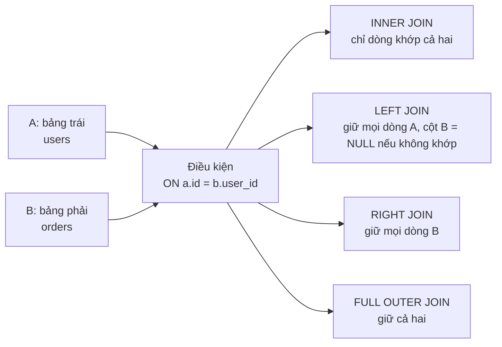
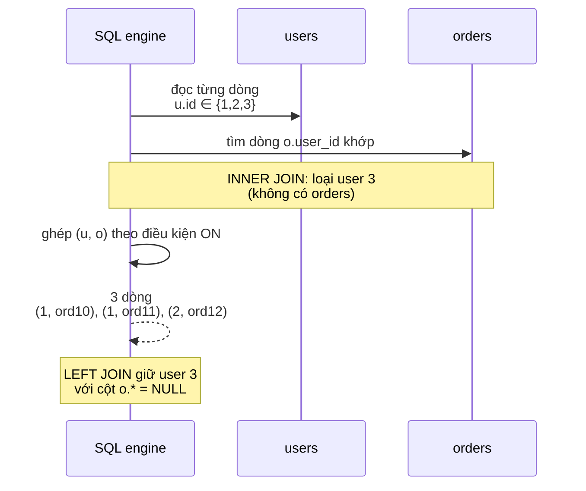

# Explain INNER JOIN vs LEFT JOIN.

> Bài này so sánh INNER JOIN và LEFT JOIN trong SQL quan hệ: semantics, NULL, WHERE vs ON pitfall với LEFT JOIN, anti-join pattern, ảnh hưởng của từng phép JOIN tới kết quả khi một phía có nhiều dòng trùng khớp, và các thuật toán join ở mức phỏng vấn (nested loop, hash, merge). Bài [sql-vs-nosql](sql-vs-nosql.md) đào sâu chọn RDBMS vs NoSQL.

Chủ đề: Database · Ngày: 2026-10-16

## 1. Là gì

INNER JOIN trả về chỉ những dòng mà cả hai phía khớp theo điều kiện ON; LEFT JOIN trả về tất cả dòng bên trái, các cột bên phải là NULL khi không khớp. Cả hai là các phép quan hệ: `A JOIN B ON pred` sinh tập các cặp `(a, b)` thoả mãn `pred`, sau đó chiếu các cột cần. INNER JOIN lọc bỏ phần tử không khớp; LEFT JOIN giữ phần tử bên trái, kể cả khi không có đối ứng. Cùng một truy vấn có thể ra kết quả khác nhau giữa INNER và LEFT, đặc biệt khi có nhiều dòng trùng khớp ở một phía (mỗi dòng bên trái được nhân với mỗi dòng bên phải khớp).

Giả định: SQL chuẩn (ISO/IEC 9075); `OUTER APPLY`, `LATERAL` không nằm trong bài này. Mệnh đề JOIN đặt trước mệnh đề WHERE.



*Sơ đồ vị trí: từ hai bảng và điều kiện ON, SQL định nghĩa bốn phép JOIN chính. Bài này tập trung INNER và LEFT, hai phép hay gặp nhất trong phỏng vấn và production.*

### Trả lời 30 giây

"INNER JOIN chỉ trả dòng khi cả hai phía khớp điều kiện ON. LEFT JOIN giữ mọi dòng bên trái; cột bên phải là NULL khi không có khớp. Cùng truy vấn có thể trả số dòng rất khác nhau giữa hai phép. Một bẫy hay gặp: đặt điều kiện lọc cột bên phải vào WHERE thay vì ON ở LEFT JOIN, vô tình biến LEFT JOIN thành INNER JOIN. NULL phát sinh từ JOIN có thể phá hàm SUM/COUNT; cần xử lý bằng `COUNT(b.x)` đếm chỉ khi khớp, hoặc `COALESCE(b.x, 0)`. Algorithm vật lý: nested loop cho bảng nhỏ, hash join cho bảnh vừa, merge join cho cả hai đã sort."

## 2. Cơ chế cốt lõi

### Bước 1. Bảng mẫu và quan hệ

1. Bảng `users(id, name)`: `(1, 'A'), (2, 'B'), (3, 'C')`.
2. Bảng `orders(id, user_id, total)`: `(10, 1, 100), (11, 1, 200), (12, 2, 50)`. User 3 không có đơn.
3. Quan hệ: một user có nhiều đơn (one-to-many).

### Bước 2. Các kịch bản INNER JOIN

1. `SELECT * FROM users u INNER JOIN orders o ON u.id = o.user_id;` trả 3 dòng (user 1 xuất hiện 2 lần cho 2 đơn). User 3 bị loại.
2. Cùng truy vấn trên LEFT JOIN: trả 4 dòng, user 3 với cột `o.*` = NULL.

### Bước 3. Multiplication: một-nhiều và một-một

1. INNER JOIN với `users` 3 dòng và `orders` 3 dòng mà `user_id = 1` xuất hiện 2 lần → kết quả 3 dòng (user 1 nhân với 2 đơn của hắn, user 2 với 1 đơn).
2. Một số người tưởng "INNER JOIN với một-nhiều" deduplicate bên nhiều. Sai: JOIN không deduplicate, số dòng đầu ra là tích Cartesian qua predicate.
3. Đếm khách hàng distinct đã mua: `SELECT COUNT(DISTINCT u.id) FROM users u INNER JOIN orders o ON u.id = o.user_id;` → 2 (A, B). Đếm tổng đơn `COUNT(*)` → 3.



*Luồng thời gian: SQL quét từng dòng bên trái, tìm khớp bên phải. INNER JOIN bỏ dòng không khớp, LEFT JOIN giữ và gán NULL.*

### Bước 4. Bẫy WHERE vs ON với LEFT JOIN

1. `SELECT * FROM users u LEFT JOIN orders o ON u.id = o.user_id WHERE o.total > 100;` → lọc WHERE loại dòng LEFT JOIN có NULL ở `o.total` → kết quả giống INNER JOIN với `total > 100` (chỉ user 1, đơn 200). Đây là bẫy cổ điển.
2. Để giữ LEFT JOIN semantics (giữ user 3 có total NULL), đặt điều kiện vào ON: `ON u.id = o.user_id AND o.total > 100`.
3. Cách này áp dụng cho mọi điều kiện ngoài điều kiện join chính: nếu điều kiện phụ thuộc một cột từ bảng phải mà ta muốn khớp "có thì lấy, không có thì NULL", đặt trong ON. Nếu ta thực sự muốn lọc dòng phải, đặt trong WHERE.

### Bước 5. NULL, SUM/COUNT và COALESCE

1. `SELECT u.id, SUM(o.total) FROM users u LEFT JOIN orders o ON u.id = o.user_id GROUP BY u.id;` → user 1 SUM = 300, user 2 SUM = 50, user 3 SUM = NULL.
2. `COUNT(*)` đếm cả dòng LEFT JOIN có NULL → mỗi user đếm 1 lần. `COUNT(o.id)` bỏ NULL → user 3 đếm 0.
3. Dùng `COALESCE(SUM(o.total), 0)` để user 3 ra 0 thay vì NULL. Cần COALESCE nếu downstream xử lý tiếp.
4. NULL so sánh với NULL: `o.user_id = u.id` không khớp vì NULL ≠ NULL. Cần `IS NULL` hoặc `IS NOT DISTINCT FROM` (chuẩn SQL hiện đại hỗ trợ, không chắc mọi DB).

### Bước 6. Anti-join: tìm dòng bên trái KHÔNG có khớp

1. `SELECT u.* FROM users u LEFT JOIN orders o ON u.id = o.user_id WHERE o.id IS NULL;` → user 3. Đây là anti-join pattern.
2. Cách khác: `NOT EXISTS (SELECT 1 FROM orders o WHERE o.user_id = u.id)`. Trong nhiều trình tối ưu, hai cách cho cùng plan.
3. Kết quả NULL ở cột bên phải là tín hiệu anti-join tự nhiên; INNER JOIN mất luôn dòng "không có đơn" nên không tìm được.

### Bước 7. Thuật toán JOIN ở mức phỏng vấn

1. **Nested loop join**: với mỗi dòng bên trái, quét tất cả dòng bên phải. Cost `O(|A| · |B|)`. Tốt khi A nhỏ hoặc B đã index trên khóa join.
2. **Hash join**: hash một phía vào bảng băm theo giá trị khóa join, sau đó quét phía kia, tra bảng băm. Cost gần `O(|A| + |B|)`. Yêu cầu RAM đủ cho hash table; vượt quá thì spill.
3. **Merge join**: cả hai phía đã sort theo khóa join, dùng hai con trỏ lướt song song. `O(|A| + |B|)`. Phù hợp khi bảng đã có index B+ tree trên khóa join.
4. Quan điểm: optimizer chọn thuật toán dựa trên cỡ, đã có index chưa, ước lượng cardinality. Postgres `EXPLAIN` cho thấy `Hash Join`, `Nested Loop`, `Merge Join`. MySQL có hai dạng chính `Index Nested Loop` và `Block Nested Loop` (MySQL 8.0.18+ có hash join, không chắc cho engine cũ hơn).

### Bước 8. Quan sát

```sql
-- Dữ liệu: chạy minh họa, chưa chạy thật.
SELECT u.id, u.name, o.id AS order_id, o.total
FROM users u
LEFT JOIN orders o ON u.id = o.user_id;
-- output minh họa, chưa chạy:
-- id | name | order_id | total
-- 1  | A    | 10       | 100
-- 1  | A    | 11       | 200
-- 2  | B    | 12       | 50
-- 3  | C    | NULL     | NULL

-- Bẫy WHERE chuyển LEFT thành INNER
SELECT u.id, o.total
FROM users u
LEFT JOIN orders o ON u.id = o.user_id
WHERE o.total > 100;
-- output minh họa, chưa chạy:
-- id | total
-- 1  | 200   (user 3 mất vì NULL không > 100)

-- Sửa bằng cách chuyển điều kiện vào ON
SELECT u.id, o.total
FROM users u
LEFT JOIN orders o ON u.id = o.user_id AND o.total > 100;
-- id | total
-- 1  | 200
-- 2  | NULL
-- 3  | NULL

-- Anti-join: user chưa từng đặt đơn
SELECT u.* FROM users u
LEFT JOIN orders o ON u.id = o.user_id
WHERE o.id IS NULL;
-- id | name
-- 3  | C
```

### Ví dụ chạy từng bước

Kịch bản: hai bảng nhỏ `users(id, name)` 3 dòng và `orders(id, user_id, total)` 3 dòng. Quan hệ một-nhiều. User 3 không có đơn. Sáu bước theo thời gian.

Bước 1. T0: tạo schema và insert dữ liệu mẫu trên sqlite3 3.54.0:

```sql
CREATE TABLE users(id INT PRIMARY KEY, name TEXT);
CREATE TABLE orders(id INT PRIMARY KEY, user_id INT, total INT);
INSERT INTO users VALUES (1,'A'),(2,'B'),(3,'C');
INSERT INTO orders VALUES (10,1,100),(11,1,200),(12,2,50);
```

Bước 2. T1: chạy INNER JOIN. Planner quét từng dòng `users`, tìm khớp trong `orders` theo `user_id`. User 3 không có đơn → bị loại. User 1 có 2 đơn → xuất hiện 2 lần. Kết quả: 3 dòng.

Bước 3. T2: chạy LEFT JOIN. Planner giữ mọi dòng `users`. User 1 xuất hiện 2 lần (với 2 đơn), user 2 một lần, user 3 một lần với cột `o.id` và `o.total` = NULL. Kết quả: 4 dòng.

Output đã chạy thật trên sqlite3 3.54.0 (6 dòng đầu tiên của kết quả):

| Phép | uid | name | oid | total |
|---|---|---|---|---|
| INNER | 1 | A | 10 | 100 |
| INNER | 1 | A | 11 | 200 |
| INNER | 2 | B | 12 | 50 |
| LEFT | 1 | A | 10 | 100 |
| LEFT | 1 | A | 11 | 200 |
| LEFT | 2 | B | 12 | 50 |

Dòng LEFT thứ 4 (user 3, NULL, NULL) không hiển thị vì bảng chỉ tối đa 6 dòng — tổng LEFT JOIN trả 4 dòng.

Bước 4. T3: kiểm tra `COUNT(*)`. INNER JOIN: `COUNT(*)=3`. LEFT JOIN: `COUNT(*)=4` (đếm cả dòng user 3 có NULL).

Bước 5. T4: kiểm tra `COUNT(o.id)`. INNER JOIN: `COUNT(o.id)=3`. LEFT JOIN: `COUNT(o.id)=3` (bỏ NULL).

Bước 6. T5: chạy anti-join `LEFT JOIN ... WHERE o.id IS NULL` → chỉ user 3 (1 dòng). Pattern tìm user chưa từng có đơn.

Biến thể "nếu đặt điều kiện sai chỗ": query `SELECT u.id FROM users u LEFT JOIN orders o ON u.id=o.user_id WHERE o.total > 100` trả (1, 200) thay vì đầy đủ. User 3 bị mất vì `o.total` NULL không thoả `>100`. Đây là bẫy WHERE/ON kinh điển: WHERE lọc sau JOIN, loại dòng LEFT có NULL. Sửa bằng cách dời điều kiện vào `ON u.id=o.user_id AND o.total > 100`.

Điều rút ra: LEFT JOIN trả 4 dòng, INNER trả 3 dòng với cùng dữ liệu; đây là lý do câu hỏi 3A-1 ("INNER JOIN và LEFT JOIN khác nhau ở điểm nào") đáp án "INNER chỉ trả dòng khi cả hai phía có khớp ON; LEFT giữ mọi dòng bên trái, cột bên phải là NULL khi không khớp".


## 3. Câu hỏi phỏng vấn

### 3A. Câu hỏi đào sâu

<details class="qa">
<summary>Câu 1. INNER JOIN và LEFT JOIN khác nhau ở điểm nào, và khi nào INNER trả nhiều dòng hơn LEFT?</summary>

**Trả lời ngắn:** INNER JOIN chỉ trả dòng khi cả hai phía có khớp ON; LEFT JOIN giữ mọi dòng bên trái, cột bên phải là NULL khi không khớp. INNER luôn trả ≤ LEFT về số dòng. Trong thực tế LEFT luôn ≥ INNER, không có chiều ngược lại.

**Đào sâu:**
- LEFT JOIN không tăng số dòng khi bên phải có nhiều khớp — mỗi dòng bên trái vẫn chỉ ra tối đa 1 dòng trong kết quả (ngoại trừ multi-join expansion). Ngược lại, INNER JOIN có thể nhân bản dòng bên trái với mỗi khớp bên phải.
- Nếu `user_id` bên orders không có index, cả INNER và LEFT đều quét toàn bảng. Filter trước với index sẽ tăng tốc.
- Quan điểm: chọn LEFT JOIN khi cần giữ dòng bên trái kể cả không có khớp (audit, full list). INNER khi chỉ quan tâm dòng đầy đủ thông tin.

**Bẫy:** Tưởng "LEFT JOIN luôn ≥ INNER". Đúng về số dòng đầu ra, ngoại trừ khi query chứa `DISTINCT` hay `GROUP BY` thay đổi ngữ nghĩa.

**Follow-up:** FULL OUTER JOIN khác gì UNION hai phép? FULL OUTER JOIN trả 1 dòng cho mỗi cặp khớp hoặc NULL cả hai phía. UNION của LEFT JOIN và RIGHT JOIN có thể trùng dòng khớp → phải UNION ALL hoặc DISTINCT.
</details>

<details class="qa">
<summary>Câu 2. WHERE vs ON với LEFT JOIN — bẫy cổ điển là gì, sửa thế nào?</summary>

**Trả lời ngắn:** WHERE áp dụng sau khi JOIN đã sinh kết quả, có thể lọc mất dòng LEFT vốn có NULL. Đặt điều kiện vào ON nếu muốn giữ semantics "có thì lấy, không có thì NULL". Đặt trong WHERE nếu thực sự muốn lọc dòng sau cùng.

**Đào sâu:**
- Bẫy kinh điển: `LEFT JOIN ... WHERE o.total > 100` → dòng LEFT có o.total NULL bị loại → kết quả như INNER JOIN.
- Sửa: `LEFT JOIN ... ON u.id = o.user_id AND o.total > 100`. Lúc này mỗi user khớp với các đơn có total > 100; không khớp → NULL.
- Phân biệt: hai câu trả kết quả khác nhau cho `COUNT(*)` với user 3.
- Quan điểm: quy tắc đơn giản — ON cho điều kiện join, WHERE cho lọc kết quả cuối.

**Bẫy:** Sửa tất cả "trông giống lỗi" sang ON. Đôi khi WHERE là đúng vì bạn thực sự muốn lọc cuối.

**Follow-up:** Khi muốn LEFT JOIN kèm điều kiện lọc bên phải mà vẫn giữ dòng phải = NULL? Cả hai: `ON u.id = o.user_id AND o.status = 'paid'` rồi `WHERE u.country = 'VN'`.
</details>

<details class="qa">
<summary>Câu 3. NULL phát sinh từ JOIN, làm sao COUNT/SUM trả đúng ý đồ?</summary>

**Trả lời ngắn:** NULL từ LEFT JOIN có thể làm `COUNT(*)` và `COUNT(cột)` khác nhau. `COUNT(*)` đếm mọi dòng (kể cả NULL), còn `COUNT(o.col)` bỏ NULL. Dùng `COALESCE(SUM(o.total), 0)` để NULL thành 0 cho downstream.

**Đào sâu:**
- Ví dụ: `COUNT(*) FROM users LEFT JOIN orders ...` cho 1 dòng/user kể cả NULL. `COUNT(o.id)` cho 0 với user không có đơn.
- `SUM(o.total)` trả NULL khi mọi khớp đều NULL. Trong nhóm, hàm SUM bỏ qua NULL, nhưng nếu cả nhóm NULL thì trả NULL cho nhóm đó.
- Tóm lại: COUNT khác NULL, SUM khác NULL tinh tế hơn, cần COALESCE ở ngoài.
- Cẩn thận MySQL cũ có cách xử lý NULL khác — không chắc cho từng phiên bản. SQL chuẩn thống nhất hơn.

**Bẫy:** Tưởng LEFT JOIN với `COUNT(o.id)` và `COUNT(*)` luôn giống nhau. Sai khi có NULL.

**Follow-up:** Khi NULL xuất hiện từ nhiều nguồn (JOIN + cột nullable sẵn), cần phân biệt? Có thể cần cột flag (`is_missing`) đánh dấu nguồn NULL.
</details>

<details class="qa">
<summary>Câu 4. Anti-join: tìm dòng bên trái không có dòng khớp ở bên phải, khi nào dùng, các cách viết?</summary>

**Trả lời ngắn:** Anti-join trả dòng bên trái không có đối ứng. Hai cách SQL: dùng `NOT EXISTS` (subquery), hoặc `LEFT JOIN ... WHERE right.id IS NULL`. Hai câu cho kết quả giống nhau nhưng plan có thể khác tuỳ optimizer.

**Đào sâu:**
- `NOT EXISTS` thường được optimizer đẩy về semi-join, có thể hiệu quả hơn khi subquery có thêm filter.
- `LEFT JOIN ... IS NULL` rất phổ biến và dễ đọc; một số DB cũ sinh phép khử trùng lặp thừa.
- Khi bên phải có nhiều dòng khớp, cả hai cách trả cùng kết quả.
- Kết hợp `EXCEPT` (chuẩn SQL) cũng được nhưng ít gặp.
- Bài liên quan: [b-plus-tree-index](b-plus-tree-index.md) giúp subquery NOT EXISTS chạy nhanh hơn khi có index trên cột join bên phải.

**Bẫy:** Dùng `NOT IN (subquery)` khi subquery có thể trả NULL → NULL trong IN, điều kiện trả UNKNOWN, không trả dòng nào. `NOT EXISTS` an toàn với NULL.

**Follow-up:** Khi nào NOT EXISTS tốt hơn LEFT JOIN IS NULL? Với DB cũ hoặc chưa tối ưu tốt, NOT EXISTS anti-join semi-join thường nhanh hơn.
</details>

<details class="qa">
<summary>Câu 5. Số dòng sinh ra bởi JOIN một-nhiều, multi-dòng cùng khóa. Ví dụ và cách tránh lỗi "trùng số".</summary>

**Trả lời ngắn:** Mỗi dòng bên một được nhân với số dòng bên nhiều khớp. JOIN KHÔNG deduplicate. Khi đếm đơn-nhóm, dùng `COUNT(DISTINCT o.id)` hoặc subquery đếm trước.

**Đào sâu:**
- Ví dụ: 1 user có 2 đơn → 2 dòng trong kết quả. Tổng `COUNT(*)` đếm cả 2.
- Đếm "user có đơn": `COUNT(DISTINCT u.id)`. Đếm "đơn": `COUNT(DISTINCT o.id)` hoặc đếm trên bảng `orders` gốc để chính xác hơn.
- Lỗi "trùng số": report doanh thu theo user JOIN orders, rồi SUM cả đơn gấp đôi mỗi dòng nhiều. Sửa: SUM theo nhóm trước rồi JOIN.
- Pattern: aggregate bên nhiều trước (`SELECT user_id, COUNT(*) FROM orders GROUP BY user_id`), rồi JOIN về bên một.

**Bẫy:** Tính `SUM` trên kết quả JOIN trực tiếp → đếm gấp. Phải aggregate bên nhiều trước khi có duplication.

**Follow-up:** Khi nào nên dùng CTE phụ? Khi truy vấn lồi có nhiều nhóm aggregate, CTE giúp đọc rõ hơn và một số DB đẩy xuống view vật lý.
</details>

<details class="qa">
<summary>Câu 6 (Debug). Truy vấn `SELECT u.* FROM users u JOIN orders o ON u.id = o.user_id WHERE u.country = 'VN';` trả số dòng gấp đôi mong đợi. Bạn kiểm tra gì?</summary>

**Trả lời ngắn:** Nghi duplication do một-nhiều. Kiểm tra: (1) đếm số đơn trung bình mỗi user VN, (2) đếm số dòng JOIN trước khi WHERE, (3) xem `EXPLAIN` để biết số dòng thực tế. Sửa: aggregate trước hoặc dùng `COUNT(DISTINCT)`.

**Đào sâu:**
- Bước 1: `SELECT user_id, COUNT(*) c FROM orders GROUP BY user_id ORDER BY c DESC LIMIT 5;` xem user nào có nhiều đơn.
- Bước 2: `SELECT COUNT(*) FROM users u JOIN orders o ON u.id = o.user_id;` đo trước lọc.
- Bước 3: `EXPLAIN ANALYZE` xem `Rows` từng bước. So sánh ước lượng vs thực tế.
- Sửa: dùng subquery đếm đơn trước khi JOIN, hoặc `SELECT user_id, COUNT(*) FROM orders GROUP BY user_id` rồi JOIN về users.

**Bẫy:** Chỉnh `WHERE` khử trùng (`u.id, o.id`) thay vì aggregate. Có thể trả kết quả khác với dự định nếu đếm số "user" nhưng cần số "đơn".

**Follow-up:** Nếu report cần `SUM(o.total)` theo user mà không bị gấp? Dùng subquery `SELECT user_id, SUM(total) FROM orders GROUP BY user_id` rồi JOIN.
</details>

<details class="qa">
<summary>Câu 7 (Thiết kế). Thiết kế truy vấn cho dashboard "Khách hàng và 5 đơn gần nhất". Quyết định JOIN, lọc, giới hạn.</summary>

**Trả lời ngắn:** Dùng `LEFT JOIN orders` để giữ cả user chưa từng có đơn; lấy 5 đơn gần nhất bằng LATERAL JOIN hoặc `ROW_NUMBER() OVER (PARTITION BY user_id ORDER BY created_at DESC)`. Tránh `LIMIT 5` ở ngoài vì chỉ lấy 5 dòng tổng.

**Đào sâu:**
- Bước 1: SQL chuẩn dùng window function: `ROW_NUMBER() OVER (PARTITION BY u.id ORDER BY o.created_at DESC) AS rn`, lọc `rn <= 5`.
- Bước 2: LATERAL JOIN (Postgres, MySQL 8+, MSSQL 2019+): `LEFT JOIN LATERAL (SELECT * FROM orders o WHERE o.user_id = u.id ORDER BY created_at DESC LIMIT 5) o ON TRUE`. Đây là cách hiệu quả nhất với index `(user_id, created_at)`.
- Bước 3: Với bảng lớn, partition orders theo `user_id % N` (Postgres declarative partitioning) giúp LATERAL chỉ quét partition.
- Quan điểm: window function đọc được nhưng tốn RAM; LATERAL với index phù hợp thường nhanh hơn.

**Bẫy:** `LIMIT 5` áp dụng cho toàn bộ truy vấn — chỉ trả 5 user đầu, không phải 5 đơn mỗi user.

**Follow-up:** Khi danh sách user rất lớn mà chỉ cần trang dashboard? Phân trang (`LIMIT/OFFSET` hoặc keyset pagination), không LOAD ALL. Xem [indexing-for-get-requests](indexing-for-get-requests.md).
</details>

### 3B. Câu hỏi phỏng vấn liên quan

<details class="qa">
<summary>Câu 8. What is a self-join, and when do you need it?</summary>

**Trả lời:** Self-join là JOIN với chính bảng đó, thường cần cho quan hệ cây (manager_id nhân viên trỏ tới cùng bảng `employees`) hoặc so sánh dòng trong cùng bảng (event trước/sau). Dùng `a JOIN b ON a.parent_id = b.id` với alias phân biệt. Trả lời ngắn: nó vẫn là INNER/LEFT JOIN, chỉ là cùng bảng hai lần.
</details>

<details class="qa">
<summary>Câu 9. How does JOIN interact with GROUP BY and aggregates?</summary>

**Trả lời:** JOIN xảy ra trước GROUP BY: kết quả JOIN một-nhiều đẩy vào GROUP, có thể nhân bản dòng và aggregate. Để tránh trùng, aggregate bên nhiều trước trong subquery hoặc CTE, sau đó JOIN bên một. Cùng nguyên lý với `COUNT(DISTINCT)` nhưng performance kém hơn subquery precompute.
</details>

<details class="qa">
<summary>Câu 10. Why is `SELECT *` with JOIN problematic in production?</summary>

**Trả lời:** Khi JOIN nhiều bảng, `SELECT *` trả về tất cả cột mỗi bảng, gây lãng phí I/O và vỡ bộ nhớ client. Khi schema thay đổi (thêm cột, đổi tên), code ứng dụng vỡ theo. Production thường liệt kê cột cần, alias rõ cột trùng tên (`u.id user_id`), và dùng view để ẩn JOIN.
</details>

<details class="qa">
<summary>Câu 11. What is `CROSS JOIN` and is it the same as inner with always-true?</summary>

**Trả lời:** CROSS JOIN trả tích Cartesian: mỗi dòng A × mỗi dòng B. Nếu A 1000 dòng, B 1000 dòng → 1.000.000 dòng. Đây không phải INNER JOIN với ON luôn đúng trong mọi DB — trong MySQL cổ `INNER JOIN` không có ON thì trả Cartesian. Trong chuẩn SQL, INNER JOIN luôn cần ON. CROSS JOIN thường dùng cho task nhân dòng (combinatorial test, lịch), rất hiếm trong OLTP.
</details>

<details class="qa">
<summary>Câu 12. How do you make a JOIN faster in production?</summary>

**Trả lời:** Đảm bảo index trên cột JOIN của cả hai phía (Postgres mặc định index FK, MySQL/InnoDB không chắc). Index covering gồm các cột SELECT/WHERE/ORDER để tránh lookup lại bảng. Phân vùng theo cột join. Dùng `EXPLAIN ANALYZE` để xem plan. Với JOIN 3+ bảng, cân nhắc denormalize để giảm JOIN. Xem [b-plus-tree-index](b-plus-tree-index.md).
</details>

<details class="qa">
<summary>Câu 13. True or false: "LEFT JOIN always returns more rows than INNER JOIN."</summary>

**Trả lời:** Sai trong trường hợp output có áp `DISTINCT`, `GROUP BY`, hoặc aggregation mà kết quả gộp lại. Cũng sai nếu câu JOIN kèm WHERE mà biến LEFT thành INNER. Một số tình huống cả INNER và LEFT trả cùng kết quả khi mọi dòng A đều có khớp ở B.
</details>

<details class="qa">
<summary>Câu 14. True or false: "A LEFT JOIN with a condition in ON is the same as a LEFT JOIN with the same condition in WHERE."</summary>

**Trả lời:** Sai. Đặt trong `ON` bảo toàn LEFT JOIN semantics (giữ dòng trái không khớp với NULL). Đặt trong `WHERE` lọc sau JOIN và thường loại dòng LEFT có NULL ở cột lọc → gần như INNER JOIN. Hai câu SQL khác nhau kết quả khi có dòng bên trái không khớp.
</details>

<details class="qa">
<summary>Câu 15. What is a natural join?</summary>

**Trả lời:** NATURAL JOIN tự động ghép theo cột trùng tên ở cả hai bảng. Ngắn gọn nhưng nguy hiểm: nếu schema thay đổi (thêm cột trùng tên) thì join âm thầm đổi. Phỏng vấn Senior/Staff hầu như không dùng NATURAL JOIN, ưa chuẩn hoá ON tường minh.
</details>

<details class="qa">
<summary>Câu 16. What is the role of the query optimizer in JOIN order?</summary>

**Trả lời:** Optimizer chọn thứ tự bảng, thuật toán (hash/merge/nested loop), và dùng index nào. Postgres dùng cost-based với ước lượng cardinality từ statistics. Khi ước lượng sai (dù dữ liệu lệch), plan tệ. Có thể điều chỉnh qua hint (MySQL) hoặc chỉnh statistics (Postgres `ANALYZE`).
</details>

## 4. Đánh đổi và sự cố production

JOIN là kỹ thuật cốt lõi nhưng mỗi phép có cost riêng. Bảng dưới so sánh INNER, LEFT, RIGHT, FULL OUTER theo sáu tiêu chí đo được, và liệt kê năm failure mode hay gặp khi JOIN trong production. Quan trọng nhất: đừng JOIN khi không cần, và luôn đo p95 latency sau khi thay đổi điều kiện.

### So sánh bốn phép JOIN

| Tiêu chí | INNER JOIN | LEFT JOIN | RIGHT JOIN | FULL OUTER |
|---|---|---|---|---|
| Dòng đầu ra | Có khớp cả hai | Mọi dòng trái + khớp phải | Mọi dòng phải + khớp trái | Mọi dòng cả hai |
| Cột phía không khớp | (không có) | NULL | NULL | NULL |
| Phù hợp audit | Không đủ | Giữ mọi dòng bảng gốc | Hiếm dùng | Giữ cả hai |
| Plan thường gặp | Hash, nested loop, merge | Hash, nested loop | Hash | Hash đầy đủ |
| Khi nào dùng | Chỉ cần dòng đầy đủ | Cần giữ mọi dòng trái | Cột phải quan trọng hơn | Hiếm, cần cả hai |
| Rủi ro NULL | Không | Hay gặp | Hay gặp | Hay gặp cả hai |

### Năm failure mode

| Triệu chứng | Nguyên nhân gốc | Cách kiểm tra | Cách sửa |
|---|---|---|---|
| Báo cáo đếm user gấp đôi | JOIN một-nhiều rồi `COUNT(*)` | So COUNT(DISTINCT u.id) vs COUNT(*) | Aggregate bên nhiều trước (subquery) rồi JOIN |
| LEFT JOIN trả số dòng bằng INNER | Điều kiện bên phải trong WHERE thay vì ON | Đọc lại query, dời điều kiện vào ON | Đặt trong ON nếu muốn LEFT giữ dòng |
| Query đột ngột chậm | Index FK trên bảng phụ chưa có | EXPLAIN xem plan, kiểm tra index | Thêm index FK, `ANALYZE TABLE` (MySQL) hoặc `ANALYZE` (Postgres) |
| NULL trong SUM gây NULL cả nhóm | Không COALESCE | SELECT SUM(o.total), COALESCE(SUM(o.total), 0) | Dùng COALESCE(SUM(x), 0) ở ngoài |
| Anti-join cho 0 dòng dù có dữ liệu | Subquery có NULL trả về NULL trong IN | `EXPLAIN` xem plan, đổi sang NOT EXISTS | Dùng NOT EXISTS hoặc LEFT JOIN ... IS NULL |

## 5. Cheat sheet

Bảng dưới — gợi ý nhớ nhanh trước buổi phỏng vấn.

| Chủ đề | Con số / quy tắc cần nhớ |
|---|---|
| INNER | Chỉ dòng khớp ON, không có NULL |
| LEFT | Giữ mọi dòng trái, NULL cho cột phải không khớp |
| Bẫy WHERE/ON | Điều kiện cột phải trong WHERE có thể lọc NULL → biến LEFT thành INNER |
| Anti-join | `LEFT JOIN ... WHERE right.id IS NULL` hoặc `NOT EXISTS` |
| Một-nhiều | Số dòng đầu ra = tổng khớp theo dòng trái |
| SUM/COUNT và NULL | `COUNT(*)` đếm NULL, `COUNT(o.x)` bỏ; SUM có thể NULL nhóm |
| Algorithm | Hash (phổ biến), nested loop (index), merge (sort) |
| Order của optimizer | Postgres cost-based, dùng statistics; sai stats → sai plan |
| Default an toàn | `ON` cho join, `WHERE` cho lọc kết quả |
| Production tip | EXPLAIN trước khi ship; index FK |

**Học tiếp:**
- [sql-vs-nosql](sql-vs-nosql.md) — khi RDBMS với JOIN không còn vừa, chuyển sang NoSQL
- [b-plus-tree-index](b-plus-tree-index.md) — index FK giúp Nested Loop và Merge Join nhanh hơn
- [database-normalization](database-normalization.md) — JOIN nhiều = schema 3NF, JOIN ít = denormalize
- [indexing-for-get-requests](indexing-for-get-requests.md) — pattern lookup theo khóa, so JOIN nặng


