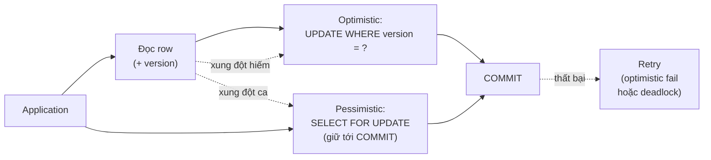

# What is optimistic vs pessimistic locking in databases?

> Bài này so sánh hai chiến lược khóa cốt lõi: pessimistic giữ khóa trước khi sửa, optimistic dùng version column và phát hiện xung đột khi COMMIT. Bài đi vào cơ chế MVCC + version check, cảnh báo về lost update ở REPEATABLE READ, và khi nào nên chọn chiến lược nào theo mức contention. Bài liên quan: [database-deadlock](database-deadlock.md), [database-isolation-levels](database-isolation-levels.md), [database-transaction](database-transaction.md).

Chủ đề: Database · Ngày: 2026-10-16

## 1. Là gì

Pessimistic locking: trước khi sửa một hàng, transaction xin khóa exclusive (SELECT ... FOR UPDATE) và giữ tới khi COMMIT. Mọi transaction khác muốn sửa cùng hàng phải chờ hoặc bị abort. Phù hợp khi xung đột dự đoán thường xuyên (counter, balance, inventory).

Optimistic locking: không khóa trước; đọc hàng cùng version (hay timestamp/row hash), sửa trong bộ nhớ, khi COMMIT gửi `UPDATE ... WHERE id = ? AND version = ?`. Chỉ một transaction thắng cuộc (version khớp), các transaction khác commit thất bại với version mismatch và phải thử lại. Phù hợp khi xung đột hiếm (hồ sơ người dùng ít ai sửa cùng lúc).

Hai chiến lược trả lời câu hỏi khác nhau: pessimistic hỏi "ai sẽ đụng row này trước?" và khóa luôn; optimistic hỏi "khả năng hai người đụng cùng lúc có cao không?" và phòng thân khi COMMIT.



*Sơ đồ vị trí: Pessimistic xin khóa ngay khi đọc, optimistic dùng version check ở COMMIT. Cả hai đều có thể dẫn tới retry khi thất bại.*

### Trả lời 30 giây

"Pessimistic locking xin khóa exclusive (SELECT FOR UPDATE) ngay khi cần sửa; giao dịch khác phải chờ. Optimistic không khóa trước: đọc hàng kèm version (hoặc timestamp), sửa, rồi UPDATE WHERE id = ? AND version = ?; xung đột phát hiện ở COMMIT và phải retry. Pessimistic phù hợp hot row có contention cao; optimistic phù hợp khi xung đột hiếm và muốn tránh deadlock. Lưu ý: MVCC (InnoDB REPEATABLE READ) không loại bỏ lost update — hai SELECT không khóa có thể đọc cùng version, hai UPDATE sau đó ghi đè nhau. Cần cơ chế rõ ràng: hoặc dùng SELECT FOR UPDATE, hoặc version column + retry."

## 2. Cơ chế cốt lõi

### Bước 1. Pessimistic: SELECT FOR UPDATE và khóa được giữ tới COMMIT

1. T1 chạy `BEGIN; SELECT * FROM accounts WHERE id = 5 FOR UPDATE;`. InnoDB cấp exclusive lock (X) trên row `accounts/5`.
2. T2 cùng chạy `SELECT ... FOR UPDATE WHERE id = 5`. InnoDB chờ T1. T2 vào hàng đợi lock.
3. T1 chạy `UPDATE accounts SET balance = balance - 100 WHERE id = 5;`. Vẫn giữ X lock vì đã cấp từ bước 1.
4. T1 chạy `COMMIT`. Lock được nhả. T2 lấy X lock, đọc bản ghi (đã thấy balance mới), sửa tiếp. Không có read-skew hay lost update vì đã khóa.

Thời gian giữ khóa: cả transaction. Vì vậy transaction phải ngắn (vài chục ms) để tránh block người khác.

### Bước 2. Optimistic: version column và điều kiện ở WHERE

1. Bảng có cột `version INTEGER DEFAULT 0`. Mỗi `INSERT` tạo `version = 0`. Mỗi lần cập nhật increment.
2. T1 đọc: `SELECT id, balance, version FROM accounts WHERE id = 5;` trả về `version = 7`.
3. T1 sửa và COMMIT: `UPDATE accounts SET balance = balance - 100, version = version + 1 WHERE id = 5 AND version = 7;`. Nếu `version` vẫn bằng 7 (chưa ai cập nhật), engine update 1 row. Nếu `version` đã khác, 0 row bị ảnh hưởng → ứng dụng biết cần retry.

Cơ chế này không phụ thuộc engine cụ thể; chạy được trên mọi RDBMS. Có thể dùng timestamp (`updated_at`) hoặc hash row, nhưng version integer là phổ biến nhất.

### Bước 3. Tại sao MVCC một mình không loại bỏ lost update

```mermaid
sequenceDiagram
    participant T1 as Transaction A
    participant T2 as Transaction B
    participant DB as InnoDB<br/>(REPEATABLE READ, MVCC)
    T1->>DB: BEGIN; SELECT balance WHERE id=5 (snapshot v=7)
    DB-->>T1: balance=1000, version=7
    T2->>DB: BEGIN; SELECT balance WHERE id=5 (snapshot v=7)
    DB-->>T2: balance=1000, version=7
    T1->>DB: UPDATE balance=900 WHERE id=5 (không dùng version)
    DB-->>T1: rows affected=1
    T2->>DB: UPDATE balance=800 WHERE id=5 (không dùng version)
    DB-->>T2: rows affected=1
    Note over T1,T2: cả hai "đọc 1000" rồi "ghi đè"<br/>kết quả 800, giao dịch T1 bị mất (lost update)
```

*Lost update dưới MVCC: SELECT không khóa đọc snapshot, hai transaction đọc cùng version, UPDATE sau không khóa gì ngoài row, ghi đè lẫn nhau. Engine không phát hiện tự động; cần pessimistic lock hoặc version column.*

- InnoDB REPEATABLE READ: SELECT thuần dùng MVCC, không giữ shared lock; SELECT FOR UPDATE mới giữ. UPDATE luôn giữ X lock cho tới hết transaction nhưng nó chỉ bảo vệ **chính transaction đó**, không ngăn transaction khác cũng UPDATE cùng row sau khi snapshot.
- PostgreSQL tương tự: SELECT READ COMMITTED thấy dữ liệu mới nhất; hai transaction cùng UPDATE row sẽ blocking-write (cái sau phải đợi cái trước COMMIT), nhưng SELECT trước đó có thể đã snapshot giá trị cũ. Cần SELECT FOR UPDATE hoặc version.
- SERIALIZABLE ở PostgreSQL (SSI) phát hiện lost update dạng read-modify-write và trả `serialization_failure` (40001). Đây là cách ngắn nhất để chống lost update mà không tự code version column.

### Bước 4. Các cơ chế phát hiện xung đột trong optimistic locking

- Version column (integer): phổ biến nhất, dễ hiểu. Cập nhật: `UPDATE ... WHERE id = ? AND version = ?`. So sánh row affected.
- Timestamp (`updated_at`): chạy được nhưng có race khi hai cập nhật trong cùng milisecond với clock skew. Không khuyến khích.
- Row hash (entire row checksum): so sánh nội dung row; chỉ phát hiện thay đổi, không phân biệt được "ai sửa cái gì".
- Hệ thống dùng ETag (REST API): client gửi `If-Match: "abc123"`; server kiểm tra.

### Bước 5. Pessimistic có thể gây deadlock; optimistic thì không (về cơ chế)

- Pessimistic giữ X lock cho tới COMMIT → hai transaction giữ khóa chéo có thể deadlock (xem [database-deadlock](database-deadlock.md)).
- Optimistic không giữ khóa trong quá trình xử lý; chỉ khi COMMIT mới kiểm tra. Không có chuỗi chờ vòng; không deadlock. Nhưng có lỗi riêng: "version mismatch" — client phải retry.
- Optimistic vẫn có thể deadlock ở một số tình huống lai: ví dụ optimistic trên bảng A nhưng cần pessimistic ở bảng B. Hai transaction có thể chồng khóa ở B.

### Bước 6. Quan sát thực tế

```sql
-- Cột version được thêm
ALTER TABLE accounts ADD COLUMN version INTEGER NOT NULL DEFAULT 0;

-- Đọc với version
SELECT id, balance, version FROM accounts WHERE id = 5;

-- UPDATE lạc quan (optimistic UPDATE)
UPDATE accounts
SET balance = balance - 100, version = version + 1
WHERE id = 5 AND version = 7;
-- rows affected = 0 nghĩa là đã có ai cập nhật row này giữa chừng

-- Pessimistic tương đương
BEGIN;
SELECT balance FROM accounts WHERE id = 5 FOR UPDATE;
UPDATE accounts SET balance = balance - 100 WHERE id = 5;
COMMIT;

-- PostgreSQL: phát hiện read-modify-write dưới SERIALIZABLE
SET TRANSACTION ISOLATION LEVEL SERIALIZABLE;
-- Trả 40001 nếu có conflict; ứng dụng retry
```

### Bước 7. Chọn chiến lược theo mức contention

| Tình huống | Chiến lược | Lý do |
|---|---|---|
| Hot row (counter, balance, inventory item) | Pessimistic hoặc atomic increment | Optimistic retry tăng tải khi contention cao |
| Cold row (profile, settings, content bài viết) | Optimistic | Xung đột hiếm, tránh deadlock |
| Multi-step workflow có thể kéo dài | Optimistic | Không giữ lock xuyên workflow |
| Queue (worker lấy job) | Pessimistic với `SELECT FOR UPDATE SKIP LOCKED` | Worker khóa ngắn, không cần version |
| Dùng framework ORM (Hibernate, EF) | Mặc định optimistic nếu có `@Version`/`[Timestamp]` | Tự động retry; cần bật field version |
| Read-many, write-rare | Optimistic | Đa số transaction chỉ đọc, không tốn lock |

### Bước 8. Retry sau khi thất bại optimistic

- Cần exponential backoff + jitter (1-50 ms cho tải nội bộ; 100-500 ms cho tải người dùng).
- Sau 3-5 lần retry mà vẫn fail → trả lỗi cho client, ghi vào queue xử lý thủ công. Retry vô hạn là cách cạn tài nguyên.
- Idempotency key quan trọng: nghiệp vụ "chuyển tiền" nếu thành công ở lần retry thứ 2 nhưng lần 1 chưa chắc đã fail phải không chuyển hai lần.

### Bước 9. Pessimistic trong hệ phân tán (cross-node)

- Pessimistic chỉ giữ được khóa trong một instance. Khóa trên nhiều primary cần distributed lock (Redis Redlock, ZooKeeper, etcd) hoặc chấp nhận eventual consistency. Tăng độ phức tạp đáng kể.
- Optimistic lock dựa trên version column trong DB → version là nguồn chân lý duy nhất, dù multi-node vẫn dùng được (miễn là không có conflict write ở hai primary).

### Ví dụ chạy từng bước

Kịch bản: hai client A và B đồng thời cập nhật số dư tài khoản 5 trong bảng `accounts(id, balance, version)`. Giá trị ban đầu `balance=1000, version=7`. Sáu bước theo thời gian.

Bước 1. T0: cả hai client mở transaction (autocommit tắt). Client A đọc `SELECT id, balance, version FROM accounts WHERE id=5` → `(5, 1000, 7)`. Client B cũng đọc được `(5, 1000, 7)`. MVCC snapshot trả cùng giá trị.

Bước 2. T1: Client A tính `new_balance = 1000 - 100 = 900`. Client B tính `new_balance = 1000 - 200 = 800`. Cả hai đều dựa trên `version=7` đọc ở T0.

Bước 3. T2: Client A gửi `UPDATE accounts SET balance=900, version=8 WHERE id=5 AND version=7`. Engine tìm key `(5, 7)` trong B+ tree index trên `id`, thấy khớp, cập nhật thành `balance=900, version=8`. Rows affected = 1.

Bước 4. T3: Client B gửi `UPDATE accounts SET balance=800, version=8 WHERE id=5 AND version=7`. Engine tìm `(5, 7)` trong index — không còn (đã bị A cập nhật thành version=8). Rows affected = 0. UPDATE thất bại.

Bước 5. T4: Client B phát hiện `rows affected = 0`, biết version đã đổi. Retry: đọc lại `SELECT ...` thấy `(5, 900, 8)`, tính `new_balance = 900 - 200 = 700`, gửi `UPDATE ... SET balance=700, version=9 WHERE id=5 AND version=8`. Lần này rows affected = 1. COMMIT thành công.

Trạng thái:

| Client | Đọc ở T0 | UPDATE gửi | Kết quả | balance cuối |
|---|---|---|---|---|
| A | version=7, bal=1000 | `WHERE version=7` | rows=1 | 900 (T2→T3) |
| B (lần 1) | version=7, bal=1000 | `WHERE version=7` | rows=0 | fail |
| B (lần 2 sau retry) | version=8, bal=900 | `WHERE version=8` | rows=1 | 700 |

Bước 6. T5: nếu Client B làm theo pessimistic thay vì optimistic: `BEGIN; SELECT balance FROM accounts WHERE id=5 FOR UPDATE;` (X lock). Client A muốn UPDATE row này phải chờ B COMMIT. A retry với delay. B commit xong, balance=800 (1000-200). Sau đó A chạy lại: đọc 800, tính `new_balance=700`, UPDATE thành công. Kết quả cuối giống optimistic nhưng A phải chờ lock thay vì retry version mismatch.

Biến thể "nếu quên bump version trong trigger": bảng có trigger AFTER UPDATE ghi log vào `account_changes` mà không tăng version. UPDATE của Client A thành công với version=8, trigger chạy UPDATE khác lên row, version vẫn 8. Client B retry với `WHERE version=8` vẫn khớp → có thể ghi đè thay đổi của trigger. Bài học: trigger tự UPDATE row phải bump version; hoặc dùng `pg_xact_id` thay vì user-defined version.

Điều rút ra: version column phát hiện xung đột tại COMMIT (rows affected = 0), trong khi pessimistic lock phát hiện ngay khi xin khóa; đây là lý do câu hỏi 3A-1 ("Phân biệt optimistic locking và pessimistic locking") đáp án "Pessimistic biết ngay khi xin khóa; optimistic biết ở COMMIT".


## 3. Câu hỏi phỏng vấn

### 3A. Câu hỏi đào sâu

<details class="qa">
<summary>Câu 1. Phân biệt optimistic locking và pessimistic locking. Điểm khác biệt cốt lõi?</summary>

**Trả lời ngắn:** Pessimistic khóa trước (`SELECT FOR UPDATE`), giữ tới COMMIT, mọi giao dịch khác phải chờ. Optimistic đọc kèm version, sửa trong bộ nhớ, khi COMMIT gửi `UPDATE ... WHERE version = ?`; xung đột phát hiện khi số row affected = 0.

**Đào sâu:**
- Điểm khác biệt cốt lõi: thời điểm phát hiện xung đột. Pessimistic biết **ngay** khi xin khóa, engine reject/wait. Optimistic biết **ở COMMIT**, có thể đã làm nhiều việc tốn công.
- Pessimistic cần engine hỗ trợ `SELECT FOR UPDATE` (mọi RDBMS chính đều có). Optimistic cần cột `version` ở schema; không phụ thuộc engine nhưng cần convention.
- Pessimistic block người khác; tốn thời gian giữ lock, dễ deadlock. Optimistic không block; retry ở client, không deadlock.
- Chi phí tổng: optimistic thấp khi xung đột < 1-5%, tăng vọt khi xung đột lên ~10-20% (retry storm). Pessimistic ổn định hơn nhưng block tài nguyên.

**Bẫy:** "Pessimistic an toàn hơn". Sai — pessimistic cũng có deadlock, cũng có vấn đề với transaction dài. Cả hai đều có cách fail riêng.

**Follow-up:** MVCC đã cô lập snapshot, vậy cần thêm version làm gì? Vì MVCC chỉ cô lập snapshot khỏi write trong tương lai, không ngăn hai transaction cùng ghi đè lẫn nhau (lost update).
</details>

<details class="qa">
<summary>Câu 2. Lost update xảy ra ở InnoDB REPEATABLE READ như thế nào? Cách phòng?</summary>

**Trả lời ngắn:** Hai SELECT không khóa đọc cùng version; cả hai UPDATE ghi lại theo giá trị cũ + delta riêng; UPDATE sau ghi đè UPDATE trước, "mất" một thay đổi. Phòng bằng SELECT FOR UPDATE, hoặc version column + retry, hoặc SERIALIZABLE (PostgreSQL).

**Đào sâu:**
- InnoDB REPEATABLE READ: SELECT thuần dùng MVCC, không giữ shared lock; UPDATE chỉ lock row đang update cho chính transaction, không đọc-thẻ "đã bị khóa chưa" trước khi sửa.
- Hai transaction A và B đều đọc `balance = 1000`; A cập nhật thành 900 (trừ 100); B cập nhật thành 800 (trừ 200, dựa trên 1000). Kết quả 800 — B dựa trên dữ liệu cũ và ghi đè A. Tổng thực tế nên trừ 300, còn 700; do lost update nên còn 800.
- Cách phòng: (a) `SELECT ... FOR UPDATE` đọc với khóa, (b) UPDATE có điều kiện version, (c) PostgreSQL SERIALIZABLE phát hiện và abort transaction "muộn", trả `40001`.
- Hệ quả nghiệp vụ: silent data corruption — code không biết thay đổi bị mất, chỉ phát hiện khi đối chiếu sổ sách sau này.

**Bẫy:** Tin rằng "REPEATABLE READ đã đảm bảo không mất dữ liệu". Không đúng — REPEATABLE READ đảm bảo cùng một transaction đọc hai lần thấy cùng dữ liệu, không đảm bảo hai transaction cùng ghi một row.

**Follow-up:** Làm sao hệ thống lớn tránh lost update mà không tự code version cho mọi bảng? Dùng cơ chế: ORM tự sinh version (Hibernate `@Version`), hoặc toàn DB SERIALIZABLE (PostgreSQL), hoặc constraint (UNIQUE + ON CONFLICT).
</details>

<details class="qa">
<summary>Câu 3. Vì sao optimistic locking đôi khi lại gây retry storm?</summary>

**Trả lời ngắn:** Khi xung đột vượt ngưỡng (5-20%), quá nhiều transaction thất bại cùng lúc, retry cùng lúc cập nhật cùng row, lại xung đột ngay. Phản hồi dương tích cực khiến hệ thống chậm dần.

**Đào sâu:**
- Mỗi retry cũng có chi phí: tải lại row, tính delta, UPDATE lại. Nếu 50% retry thất bại thì hệ thống dồn gấp đôi tải cho cùng row.
- Backoff + jitter (randomized delay) giúp tách retry khỏi nhau, nhưng cả hai đều retry trong cùng cửa sổ vẫn có thể tông nhau.
- Counter (atomic increment): optimistic chỉ cần counter, không khóa, xem `UPDATE counter = counter + 1` ở MySQL hoặc `UPDATE ... RETURNING` ở PostgreSQL. Không có "lost update" vì SQL là atomic, không có read-modify-write.
- Khi contention > 30%, cần chuyển sang pessimistic hoặc queue serialize.

**Bẫy:** Tin rằng optimistic luôn "scale hơn" pessimistic. Sai — optimistic scale tốt ở contention thấp, fail ở contention cao.

**Follow-up:** Bucket pattern? Ví dụ counter phân 64 bucket, mỗi request hash vào bucket, ghi vào bucket riêng; đọc tổng từ tất cả. Giảm contention, giữ optimistic. Dùng khi contention cao nhưng nghiệp vụ vẫn cho phép xấp xỉ.
</details>

<details class="qa">
<summary>Câu 4. Khi nào chọn pessimistic, khi nào optimistic? Đưa ra tiêu chí đo được.</summary>

**Trả lời ngắn:** Pessimistic khi contention > 5-10% (row bị hai transaction sửa > 5-10% lần truy cập). Optimistic khi contention thấp, hoặc row bị nhiều transaction đọc nhưng ít sửa.

**Đào sâu:**
- Tiêu chí đo được: (a) số transaction UPDATE đồng thời trên row, (b) tỉ lệ version mismatch / tổng UPDATE, (c) p99 latency của UPDATE ở tải peak.
- Quyết định: nếu ratio version mismatch > 10%, chuyển sang pessimistic. Nếu p99 UPDATE > 200 ms vì lock wait, optimistic có thể tốt hơn (tải retry trừ khi contention cao).
- Pessimistic + queue: pessimistic không phải chỉ khóa — có thể kết hợp với queue để serialize nghiệp vụ theo account_id.
- Optimistic + queue: optimistic không phù hợp queue vì UPDATE WHERE version cần version khớp; mỗi lần retry có thể lại cùng job, gây CPU nóng.

**Bẫy:** Quyết định "dùng optimistic vì modern" mà không đo contention. Trên row ít ai sửa thì ổn, trên hot row thì sẽ tự retry storm.

**Follow-up:** Có hybrid không? Có — pessimistic cho phần "khóa đầu tiên" (SELECT FOR UPDATE 1 row), optimistic cho phần còn lại. Cân bằng linh hoạt.
</details>

<details class="qa">
<summary>Câu 5. PostgreSQL `SERIALIZABLE` (SSI) phát hiện và abort xung đột thế nào? So với version column?</summary>

**Trả lời ngắn:** PostgreSQL Serializable Snapshot Isolation (SSI) theo dõi conflict read-write giữa các transaction dùng snapshot. Khi phát hiện chuỗi có thể dẫn tới kết quả không tương đương serial, nó abort một transaction và trả `40001`. Không cần version column ở schema; chi phí CPU cao hơn REPEATABLE READ nhưng nhàn hơn việc tự code version.

**Đào sâu:**
- SSI không khóa; nó lưu "ràng buộc" giữa transaction. Khi T1 đọc row R và T2 cập nhật R, ghi nhận conflict. Nếu cả hai đều COMMIT thì engine chọn một bên để abort.
- Điều kiện: chỉ hoạt động khi application đặt isolation level SERIALIZABLE (`SET TRANSACTION ISOLATION LEVEL SERIALIZABLE;`), không mặc định.
- Ứng dụng phải retry khi nhận `40001` giống như deadlock.
- So với version column: SSI tiện hơn (không cần sửa schema), nhưng chi phí CPU cao hơn và tỉ lệ false-positive (abort transaction dù thực tế không xung đột) có thể cao.

**Bẫy:** "Đặt SERIALIZABLE là hết lo conflict". Sai — SERIALIZABLE chỉ chống read-modify-write, vẫn có thể có hiện tượng khác (write skew, phantom) cần kết hợp constraint.

**Follow-up:** Có thể kết hợp SSI với version column không? Được nhưng dư — SSI đã chống lost update, version column là thừa. Dùng cái nào rẻ hơn tuỳ schema.
</details>

<details class="qa">
<summary>Câu 6. Làm thế nào để implement optimistic locking chuẩn trong JDBC / ORM?</summary>

**Trả lời ngắn:** Đọc row cùng `version`, ghi `UPDATE ... WHERE id = ? AND version = ?`. Kiểm tra số row affected; nếu 0 thì retry. Với ORM: thêm trường version, framework tự kiểm tra (Hibernate `@Version`, EF `[Timestamp]`, SQLAlchemy `version_id_col`).

**Đào sâu:**
- Hibernate: annotation `@Version` trên field. Khi commit, Hibernate tự sinh `UPDATE ... WHERE id = ? AND version = ?`. Nếu row affected = 0, ném `OptimisticLockException`; transaction bị rollback, client retry.
- Entity Framework: `[Timestamp]` hoặc `[ConcurrencyCheck]` trên property. Lúc SaveChanges, EF gửi UPDATE có cả version trong WHERE.
- Các sai lầm thường gặp: (a) không tăng version khi UPDATE thuần SQL (chỉ Hibernate tăng tự động); (b) đặt version lúc 1-row update nhưng quên ở bulk update; (c) không retry trong exception handler.
- Bulk update phải tự set `version = version + 1` và thêm `version` vào WHERE; hoặc dùng kiểu UPDATE batch.

**Bẫy:** Quên bump version khi raw SQL UPDATE. Framework không thấy, optimistic check sai → silent lost update.

**Follow-up:** Khi bảng có trigger tự động thay đổi row, version có phản ánh đúng không? Có thể không — trigger có thể UPDATE row mà không bump version. Test case bắt buộc.
</details>

<details class="qa">
<summary>Câu 7 (Debug). Production báo lỗi `OptimisticLockException` (hoặc 0 rows affected) trên bảng `cart_items` tăng vọt sau khi enable cache. Bạn kiểm tra gì?</summary>

**Trả lời ngắn:** 1) Bật slow log để xem cụm SQL. 2) Kiểm tra cache có trả row cũ không. 3) Đếm tỉ lệ version mismatch / UPDATE; nếu > 10% → contention thật, cần pessimistic. 4) Xem code có retry đúng không hay chỉ fail-over. 5) Kiểm ORM có bump version đầy đủ không.

**Đào sâu:**
- Bước 1: MySQL `slow_query_log` hoặc PostgreSQL `auto_explain`. Tìm các câu `UPDATE ... WHERE id = ? AND version = ?` trả 0 row.
- Bước 2: cache (Redis, Memcached, application cache) trước UPDATE. Cache trả row cũ → version cũ → UPDATE thất bại. Cache TTL phải ngắn hoặc invalidate khi ghi.
- Bước 3: ratio > 10% → optimistic không còn phù hợp, chuyển `SELECT FOR UPDATE`.
- Bước 4: retry logic kiểu `for (int i=0; i<3; i++) { try ... }` quanh transaction. Nếu retry không có backoff, ba request dồn vào tạo contention giả.
- Bước 5: ORM có thể bỏ sót version khi tự code JPQL/SQL. Query log cho thấy UPDATE có version hay không.

**Bẫy:** Đổi sang `INSERT ... ON CONFLICT DO UPDATE` mà quên set version. Cú pháp này nhả qua version check, gây lost update.

**Follow-up:** Cache có nên tự động invalidate khi UPDATE thành công không? Có — dùng cache-aside với TTL ngắn hoặc event-based invalidation. Tránh cache trước khi UPDATE.
</details>

<details class="qa">
<summary>Câu 8 (Thiết kế). Thiết kế khóa cho hệ thống "user update profile" ít ai cùng sửa. Chiến lược chọn, trade-offs?</summary>

**Trả lời ngắn:** Optimistic locking với version column. Tỉ lệ conflict thấp vì user chỉ sửa profile của mình. Trade-off: thỉnh thoảng user A và B cùng mở form, A lưu, B lưu sau thấy version mismatch — UI phải tải lại profile B và cảnh báo.

**Đào sâu:**
- Quyết định 1: cột `version BIGINT NOT NULL DEFAULT 0`. JPA/Hibernate tự quản lý.
- Quyết định 2: retry trong application — 3 lần, backoff 50-100 ms. Sau 3 lần fail → trả lỗi "người khác vừa sửa, tải lại và thử lại".
- Quyết định 3: UI hiển thị cảnh báo "Có ai đó vừa sửa" khi nhận 409 Conflict (HTTP), cho user chọn giữ phiên bản nào.
- Quyết định 4: read-only endpoint (GET) dùng cache 30 giây, không cần version; write endpoint mới cần.
- Quyết định 5: monitoring — `optimistic_lock_failures_total`, alert khi tăng > 2x baseline 7 ngày.

**Bẫy:** Nghĩ rằng "user chỉ sửa profile mình" nên optimistic "an toàn". Vẫn có thể admin sửa từ backend, hoặc job batch update, hoặc concurrent tab. Conflict vẫn xảy ra.

**Follow-up:** Có thể merge thay đổi thay vì retry hẳn không? Có, dùng JSON Patch / CRDT — nhưng phức tạp hơn nhiều, thường không đáng cho profile.
</details>

### 3B. Câu hỏi phỏng vấn liên quan

<details class="qa">
<summary>Câu 9. Pessimistic locking và mutual exclusion ở mức OS (mutex) giống và khác nhau điểm nào?</summary>

**Trả lời:** Giống: cả hai đều là cơ chế "một bên giữ, bên khác phải chờ" để bảo vệ critical section. Khác: mutex OS bảo vệ vùng nhớ trong một process (microseconds), pessimistic lock bảo vệ một row trong database và có thể trải qua nhiều statement, mạng, retry. Pessimistic DB lock còn có khái niệm isolation level, deadlock detector, phân biệt row/page/table, không có ở mutex. Quy tắc giữ khóa cũng khác: mutex giữ cực ngắn, DB lock có thể giữ cả transaction vài trăm ms.
</details>

<details class="qa">
<summary>Câu 10. Có thể dùng timestamp (`updated_at`) thay version column không?</summary>

**Trả lời:** Được nhưng có rủi ro clock skew giữa các máy. Nếu hai node cùng UPDATE ở thời điểm sát nhau và clock lệch vài ms, `WHERE updated_at = ?` có thể nhả qua check khi thực tế dữ liệu đã khác. Version column integer (atomic increment trong cùng row) loại bỏ vấn đề này. Ngoài ra timestamp có thể trùng giữa hai transaction nếu cùng millisecond.
</details>

<details class="qa">
<summary>Câu 11. `SELECT FOR UPDATE` có khóa row "vĩnh viễn" cho tới khi COMMIT không?</summary>

**Trả lời:** Đúng cho InnoDB và PostgreSQL: lock row giữ tới COMMIT hoặc ROLLBACK. Có thể giải phóng lock sớm bằng `SELECT FOR UPDATE NOWAIT` (MySQL 8.0+, skip-lock nếu đang bận) hoặc `SELECT FOR UPDATE SKIP LOCKED` (lấy row chưa bị khóa). SQL Server cho phép cấu hình lock timeout ngắn hơn.
</details>

<details class="qa">
<summary>Câu 12. Pessimistic lock với row "không có index" thì sao?</summary>

**Trả lời:** InnoDB: nếu `SELECT FOR UPDATE WHERE name = 'abc'` mà `name` không có index, engine quét toàn bộ rows, khóa từng row theo thứ tự index chính (cluster index). Hai transaction quét cùng tập có thể chồng khóa ngược chiều, dễ deadlock. PostgreSQL: cảnh báo rõ "Seq Scan" trong EXPLAIN khi UPDATE/SELECT FOR UPDATE không có index. Khuyến nghị: luôn index cột dùng trong WHERE FOR UPDATE.
</details>

<details class="qa">
<summary>Câu 13. ORM (Hibernate) `OPTIMISTIC` vs `OPTIMISTIC_FORCE_INCREMENT` khác nhau gì?</summary>

**Trả lời:** `OPTIMISTIC` (mặc định khi có `@Version`): phiên chỉ kiểm tra version khi COMMIT, không tăng version nếu entity không thay đổi. `OPTIMISTIC_FORCE_INCREMENT`: tăng version mỗi lần phiên flush, kể cả khi field không đổi. Dùng cho parent entity khi child có thể thay đổi độc lập — buộc parent phải check version lại ở commit.
</details>

<details class="qa">
<summary>Câu 14. Optimistic locking và eventual consistency trong distributed database khác nhau gì?</summary>

**Trả lời:** Optimistic vẫn cần ACID; đảm bảo một transaction thắng, các transaction khác retry. Eventual consistency cho phép nhiều node cùng ghi và reconcile sau (CRDT, last-write-wins). Optimistic vẫn có thể scale trên một node; eventual cần nhiều node. Optimistic đảm bảo "chỉ một phiên bản thắng"; eventual có thể có "nhiều phiên bản đều đúng theo thời gian". Không thay thế nhau — chúng ở tầng khác nhau.
</details>

<details class="qa">
<summary>Câu 15. Multi-version concurrency control (MVCC) có phải optimistic locking không?</summary>

**Trả lời:** Không. MVCC là cơ chế lưu nhiều phiên bản row, mỗi transaction đọc một snapshot. Nó cho phép đọc không block viết, nhưng không ngăn hai transaction cùng ghi đè cùng row (lost update). Optimistic locking là cơ chế đặt lên trên MVCC/SQL, dùng version column để phát hiện ghi đè. Hai khái niệm bổ sung cho nhau, không thay thế.
</details>

<details class="qa">
<summary>Câu 16. Có thể kết hợp pessimistic ở đầu và optimistic ở cuối transaction không?</summary>

**Trả lời:** Có và khá phổ biến. Ví dụ: `BEGIN; SELECT row FOR UPDATE; ... đọc/sửa trong nhánh nhỏ ...; UPDATE set version = version + 1; COMMIT;`. SELECT FOR UPDATE đảm bảo độc quyền ngay khi bắt đầu (giảm race), version column ở cuối đảm bảo nếu có trigger/replication tự sửa row thì vẫn phát hiện. Phù hợp kết hợp với audit log hoặc batch chạy đồng thời.
</details>

<details class="qa">
<summary>Câu 17. True or false: "Optimistic locking có nghĩa là transaction không bao giờ khóa row."</summary>

**Trả lời:** Sai. Optimistic vẫn có thể lock row trong quá trình commit: `UPDATE ... WHERE id = ? AND version = ?` vẫn cấp X lock trên row để cập nhật. Sự khác biệt là thời điểm cấp lock: pessimistic lock **ngay** khi đọc, optimistic lock **ngay** khi update. Vẫn có thể deadlock ở optimistic nếu cùng lúc hai phiên chạm vào row trong cùng transaction khác.
</details>

## 4. Đánh đổi và sự cố production

### So sánh hai chiến lược

| Tiêu chí | Pessimistic (SELECT FOR UPDATE) | Optimistic (version column) |
|---|---|---|
| Thời điểm phát hiện xung đột | Ngay khi xin khóa | Tại COMMIT (`UPDATE WHERE version = ?`) |
| Block người khác | Có, giữ tới COMMIT | Không trong quá trình xử lý |
| Khả năng deadlock | Cao khi nhiều row, nhiều bảng | Gần như không, nhưng vẫn có khi kết hợp |
| Chi phí khi contention thấp | Tốn lock quản lý | Chỉ tốn UPDATE WHERE có thêm cột |
| Chi phí khi contention cao | Ổn định | Retry storm, tải tăng vọt |
| Phụ thuộc engine | Có | Không (cần version column ở schema) |
| Độ phức tạp code | Thấp | Trung bình (cần retry) |
| Detection chi phí thêm | Lock manager memory | CPU cho retry loop |

### Năm failure mode

| Triệu chứng | Nguyên nhân gốc | Cách kiểm tra | Cách sửa |
|---|---|---|---|
| `OptimisticLockException` tăng vọt sau khi cache | Cache trả row cũ với version cũ, UPDATE fail | So sánh cache key với invalidation event | TTL cache ngắn, invalidate khi ghi |
| Pessimistic deadlock tăng sau khi thêm transaction dài | Giữ lock xuyên qua API ngoài, SQL chậm | `SHOW ENGINE INNODB STATUS`, application log | Tách transaction, giữ lock < 100 ms |
| Retry storm với optimistic ở hot row | Contention cao > 10%, retry đồng thời | Tỉ lệ version mismatch / UPDATE | Chuyển pessimistic, dùng atomic counter, bucket pattern |
| Hibernate `StaleObjectStateException` không retry | Code không bắt exception, controller trả 500 | Stack trace trong log | Bọc try-catch-retry với backoff |
| UPDATE trả 0 row nhưng version trong ứng dụng "đúng" | Có trigger hoặc job khác tự UPDATE row mà không bump version | Trigger audit, slow log | Thêm version bump trong trigger, hoặc bỏ trigger |

Tham khảo: [database-deadlock](database-deadlock.md) — phát hiện và xử lý deadlock; [database-isolation-levels](database-isolation-levels.md) — isolation level ảnh hưởng loại khóa nào; [database-transaction](database-transaction.md) — ACID và undo log cho retry; [b-plus-tree-index](b-plus-tree-index.md) — index đúng giúp giảm phạm vi lock.

## 5. Cheat sheet

| Chủ đề | Con số / quy tắc cần nhớ |
|---|---|
| Pessimistic | `SELECT FOR UPDATE`; lock giữ tới COMMIT |
| Optimistic | `UPDATE WHERE id = ? AND version = ?`; row affected = 0 → retry |
| Lost update | MVCC không loại bỏ; cần pessimistic lock hoặc version |
| Contention threshold | < 5% conflict → optimistic; > 10% → pessimistic |
| Retry | 3-5 lần, exponential backoff 50-500 ms + jitter |
| Idempotency | Quan trọng cho retry sau optimistic fail |
| PostgreSQL SERIALIZABLE | SSI phát hiện read-modify-write, trả 40001 |
| Version column | `BIGINT NOT NULL DEFAULT 0`, ORM tự quản nếu có `@Version` |
| Cache + optimistic | Invalidate cache khi UPDATE thành công để tránh version cũ |
| SKIP LOCKED | Có ở MySQL 8.0+ và PostgreSQL 9.5+; chỉ lock row chưa bị ai giữ |

**Học tiếp:**
- [database-deadlock](database-deadlock.md) — cách phát hiện deadlock ở pessimistic
- [database-isolation-levels](database-isolation-levels.md) — REPEATABLE READ, SERIALIZABLE, READ COMMITTED
- [database-transaction](database-transaction.md) — ACID, undo log, retry semantics
- [b-plus-tree-index](b-plus-tree-index.md) — index giúp giảm phạm vi khóa

