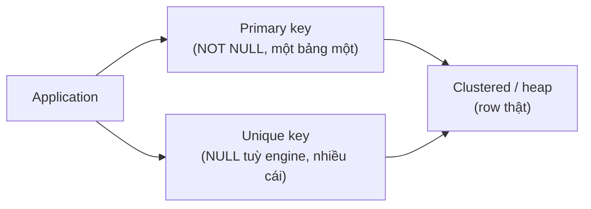
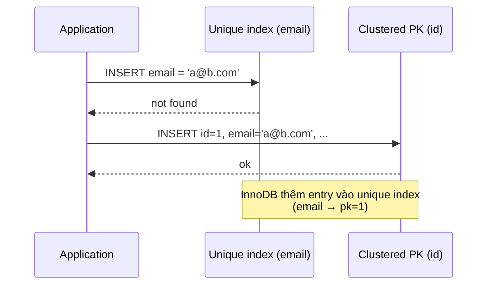

# What is the difference between a primary key and a unique key?

> Bài này phân biệt primary key và unique key: vai trò, số lượng, NULL, clustered index, dùng làm FK, các implementation khác nhau giữa MySQL InnoDB, PostgreSQL, SQL Server. Cơ chế duplicate check khi INSERT, khi nào nên dùng cái nào, đánh đổi khi update PK, và natural key vs surrogate key. Bài [b-plus-tree-index](b-plus-tree-index.md) giải thích B+ tree; bài [clustered-vs-non-clustered-index](clustered-vs-non-clustered-index.md) phân biệt clustered và non-clustered.

Chủ đề: Database · Ngày: 2026-10-16

## 1. Là gì

Primary key (PK) là một hoặc nhiều cột định danh duy nhất mỗi row trong bảng, không được NULL, và mỗi bảng chỉ có một. Unique key (unique constraint) cũng đảm bảo giá trị không trùng nhau giữa các row, nhưng cho phép NULL (tuỳ engine), và một bảng có thể có nhiều unique key.

Cả hai đều được engine thực thi bằng một B+ tree index đi kèm. Sự khác biệt cốt lõi là PK là định danh chính, mọi thứ khác (FK, JOIN, clustered index trong InnoDB) đều tham chiếu tới PK. Unique key là ràng buộc phụ, dùng cho các cột có giá trị duy nhất về mặt nghiệp vụ nhưng không phải định danh chính.

Trong MySQL InnoDB, PK mặc định là clustered index, mọi secondary index trỏ qua PK. Unique key là secondary index thông thường. Trong PostgreSQL, cả PK và unique đều là non-clustered (heap), đều dùng để enforce constraint. SQL Server cho phép chọn PK là clustered hoặc non-clustered; unique mặc định non-clustered.



*Sơ đồ vị trí: PK và unique key đều là B+ tree index trỏ tới row. Trong InnoDB, PK thường là clustered, unique là secondary. Trong PostgreSQL, cả hai đều non-clustered.*

### Trả lời 30 giây

"PK là định danh chính của row, không NULL, mỗi bảng chỉ một. Unique key là ràng buộc duy nhất, cho phép NULL tuỳ engine, mỗi bảng có thể nhiều. Cả hai đều dùng B+ tree index để enforce. Trong MySQL InnoDB, PK mặc định là clustered index, secondary index (kể cả unique) trỏ qua PK. Trong PostgreSQL và SQL Server non-clustered, cả PK và unique đều là non-clustered. Khi thiết kế, chọn surrogate key (BIGINT auto-increment) làm PK để tránh update, dùng unique constraint cho natural key (email, số CMND)."

## 2. Cơ chế cốt lõi

### Bước 1. Cú pháp khai báo

```sql
-- PostgreSQL / SQL Server
CREATE TABLE users (
  id BIGSERIAL PRIMARY KEY,             -- PK tự tăng
  email TEXT UNIQUE NOT NULL,           -- unique, không NULL
  username TEXT UNIQUE,                  -- unique, cho phép NULL
  ssn TEXT UNIQUE                        -- unique, cho phép NULL
);

-- MySQL InnoDB
CREATE TABLE users (
  id BIGINT AUTO_INCREMENT PRIMARY KEY,
  email VARCHAR(255) UNIQUE NOT NULL,
  username VARCHAR(64) UNIQUE,
  ssn VARCHAR(32) UNIQUE
);
```

SQL chuẩn: `PRIMARY KEY (col1, col2, ...)` cho composite PK, `UNIQUE (col1, col2, ...)` cho composite unique. Composite có thể có nhiều cột.

### Bước 2. Cơ chế enforce khi INSERT/UPDATE

Engine tạo B+ tree index cho mỗi PK và unique constraint. Khi INSERT/UPDATE:

1. Tính key mới từ giá trị cột.
2. Tìm key trong B+ tree index. Nếu tồn tại (không tính NULL) → vi phạm constraint → reject.
3. Nếu không tồn tại, insert key mới, ghi lại page, ghi WAL.

Với unique constraint cho phép nhiều NULL (PostgreSQL, MySQL), hai row cùng NULL là hợp lệ vì NULL không bằng NULL theo SQL chuẩn. Với SQL Server và Oracle, NULL bị coi là bằng nhau trong unique, chỉ cho phép một NULL — không chắc cho mọi phiên bản.

### Bước 3. InnoDB: PK là clustered, unique là secondary

Trong MySQL InnoDB, nếu bảng có PRIMARY KEY, InnoDB dùng nó làm clustered index (xem [clustered-vs-non-clustered-index](clustered-vs-non-clustered-index.md)). Row thật nằm trong leaf của B+ tree PK.

Mọi unique constraint cũng là unique index, nhưng là secondary index. Secondary index trỏ qua PK, không trỏ thẳng tới row. Khi UPDATE cột unique, InnoDB phải cập nhật unique index; nếu unique tham chiếu cột trong PK (composite PK), thay đổi PK dẫn tới cập nhật toàn bộ secondary index.



*INSERT với unique constraint: InnoDB kiểm tra unique index trước (find email), nếu chưa có mới insert vào clustered PK, đồng thời thêm entry vào unique index.*

### Bước 4. PostgreSQL: cả PK và unique đều non-clustered

PostgreSQL lưu row trong heap. Mọi index (PK, unique, thường) đều trỏ tới ROWID (ctid). Không có sự khác biệt cấu trúc giữa PK và unique, chỉ khác ở ràng buộc (PK NOT NULL, unique cho phép NULL).

Khi INSERT, PostgreSQL kiểm tra từng unique constraint. Nếu vi phạm, engine trả lỗi `duplicate key value violates unique constraint`. Sau khi insert thành công, mọi index (kể cả PK và unique) đều có entry mới.

### Bước 5. SQL Server: tuỳ chọn clustered

SQL Server cho phép:

```sql
CREATE TABLE users (
  id BIGINT PRIMARY KEY CLUSTERED,    -- clustered
  email VARCHAR(255) UNIQUE            -- non-clustered unique
);

CREATE TABLE logs (
  id BIGINT PRIMARY KEY NONCLUSTERED, -- non-clustered, bảng thành heap
  log_id BIGINT UNIQUE CLUSTERED       -- có thể tạo clustered unique (hiếm)
);
```

Clustered unique index có nghĩa: bảng sắp xếp theo unique key đó, không phải PK. Hiếm khi dùng vì PK thường đã đủ.

### Bước 6. Số lượng PK và unique

- Mỗi bảng: một PK, nhiều unique.
- PK thường là cột surrogate (id tự tăng), unique là cột natural (email, username).
- Composite PK có thể thay thế unique riêng lẻ: PK `(tenant_id, user_id)` đảm bảo unique, không cần thêm unique constraint.
- Composite unique có thể gồm nhiều cột: `UNIQUE (first_name, last_name, dob)`.

### Bước 7. Update PK và unique

Update cột PK tốn hơn update cột unique vì:

- InnoDB clustered PK: phải xoá row cũ trong leaf, insert ở leaf mới, cập nhật mọi secondary index (vì trỏ qua PK).
- PostgreSQL: cập nhật entry trong index, có thể thay đổi ROWID, leaf di chuyển.

Update cột unique cũng tốn nhưng ít hơn: chỉ cập nhật unique index và row trong heap/clustered.

Vì vậy quy tắc: PK nên là cột không bao giờ thay đổi (BIGINT auto-increment), unique có thể là cột có thể thay đổi (email, username — có thể đổi nhưng unique constraint vẫn enforce).

### Quan sát

```sql
-- MySQL: kiểm tra PK và unique index
SHOW INDEX FROM users;
-- Key_name: PRIMARY (Seq_in_index: 1), unique_email, unique_username, ...

-- PostgreSQL: xem constraint
SELECT conname, contype, pg_get_constraintdef(oid)
FROM pg_constraint
WHERE conrelid = 'users'::regclass;
-- contype: p (primary key), u (unique), f (foreign key)

-- SQL Server
EXEC sp_helpconstraint 'users';
-- constraint_type: PRIMARY KEY, UNIQUE

-- Test duplicate
INSERT INTO users (id, email) VALUES (1, 'a@b.com');
INSERT INTO users (id, email) VALUES (2, 'a@b.com');
-- ERROR: duplicate key value violates unique constraint "users_email_key"
```

### Ví dụ chạy từng bước

Kịch bản: bảng `users(id BIGINT PK, email TEXT UNIQUE NOT NULL, username TEXT UNIQUE, ssn TEXT UNIQUE)`. Sáu bước theo thời gian trace cơ chế enforce duplicate khi INSERT.

Bước 1. T0: chạy `INSERT INTO users VALUES (1, 'a@b.com', 'alice', '123-45-6789')`. Engine phải enforce 3 constraint: PK(id), UNIQUE(email), UNIQUE(username), UNIQUE(ssn). Với mỗi constraint, engine tìm key mới trong B+ tree index tương ứng.

Bước 2. T1: với PK index, tìm key `id=1`. Không có → OK. Insert `(1) → rowid` vào PK index. Trong InnoDB, row thật chèn vào leaf của clustered PK. Trong PostgreSQL, row chèn vào heap, PK index có entry `(1) → ctid`.

Bước 3. T2: với UNIQUE(email) index, tìm key `email='a@b.com'`. Không có → OK. Insert `(email → pk=1)` vào unique index.

Bước 4. T3: tương tự UNIQUE(username) và UNIQUE(ssn). Tất cả insert thành công. Cuối bước 3, row tồn tại ở clustered PK (InnoDB) hoặc heap (PG), 3 unique index có entry mới.

Trạng thái:

| Cột | Constraint | Index type | Sau INSERT (id=1) |
|---|---|---|---|
| id | PRIMARY KEY | clustered (InnoDB) / non-clustered (PG) | có entry `(1) → row` |
| email | UNIQUE NOT NULL | secondary | có entry `(a@b.com) → 1` |
| username | UNIQUE | secondary | có entry `(alice) → 1` |
| ssn | UNIQUE | secondary | có entry `(123-45-6789) → 1` |

Bước 5. T4: thử INSERT thứ hai `INSERT INTO users VALUES (2, 'a@b.com', 'bob', '999-99-9999')`. Engine lại traverse 3 index. Với PK, tìm `id=2` → không có, OK. Với UNIQUE(email), tìm `'a@b.com'` → ĐÃ CÓ (entry từ bước 3) → vi phạm constraint. Engine trả lỗi `ERROR: duplicate key value violates unique constraint "users_email_key"` và rollback câu INSERT này. PK `id=2` đã được insert tạm nhưng constraint fail → engine huỷ entry đó.

Bước 6. T5: kiểm tra với NULL. Trong PostgreSQL, INSERT hai row có `ssn=NULL` cùng lúc: vì NULL không bằng NULL theo SQL chuẩn, cả hai pass constraint. Trong SQL Server, chỉ một row có `ssn=NULL` được phép; INSERT thứ hai fail. Trong MySQL InnoDB, nhiều NULL được phép (giống PG).

Biến thể "nếu FK tham chiếu unique bị xoá": tạo FK `orders(user_id) REFERENCES users(id)`. Cột target là PK, an toàn. Nếu thay vì PK mà FK tham chiếu `users(email)` (cũng UNIQUE NOT NULL), rồi ai đó chạy `ALTER TABLE users DROP CONSTRAINT users_email_key` → FK mất hiệu lực, INSERT vào `orders` có thể vi phạm mà không bị catch. Bài học: tham chiếu PK ổn định hơn unique vì PK khó bị xoá nhầm.

Điều rút ra: cả PK và unique đều dùng B+ tree index, chỉ khác ở NOT NULL, số lượng, và clustered role (InnoDB); đây là lý do câu hỏi 3A-1 ("Primary key khác unique key ở những điểm cốt lõi nào") đáp án "PK NOT NULL, một bảng một; unique nhiều, cho phép NULL tuỳ engine".


## 3. Câu hỏi phỏng vấn

### 3A. Câu hỏi đào sâu

<details class="qa">
<summary>Câu 1. Primary key khác unique key ở những điểm cốt lõi nào?</summary>

**Trả lời:** PK là định danh chính, không NULL, mỗi bảng chỉ một. Unique key là ràng buộc duy nhất, cho phép NULL tuỳ engine, mỗi bảng có nhiều. Cả hai dùng B+ tree index để enforce. PK thường được tham chiếu bởi FK và quyết định clustered index (InnoDB).

**Đào sâu:**
- PK NOT NULL là bắt buộc trong mọi engine, vì PK dùng để tham chiếu, NULL không thể định danh.
- Unique key: SQL chuẩn cho phép nhiều NULL (NULL không bằng NULL). SQL Server coi NULL là bằng nhau trong unique (chỉ cho phép một NULL). MySQL InnoDB cũ nhiều NULL, không chắc mọi phiên bản.
- InnoDB: PK mặc định là clustered, unique là secondary. PostgreSQL: cả hai non-clustered. SQL Server: chọn được.
- Số lượng: một PK, nhiều unique. Một số DB cũ cho phép nhiều PK null trong một bảng (MyISAM), nhưng chuẩn SQL không.

**Bẫy:** Nói "PK và unique key giống nhau, chỉ khác tên". Sai — PK có thêm ràng buộc NOT NULL, dùng làm FK target, và thường là clustered. Một unique cũng có thể NOT NULL nhưng không có vai trò định danh chính.

**Follow-up:** Bảng chỉ có unique constraint, không có PK thì sao? Vẫn hợp lệ về mặt cú pháp (PostgreSQL, MySQL), nhưng FK không tham chiếu được và InnoDB tạo rowid ẩn. Best practice luôn khai báo PK.
</details>

<details class="qa">
<summary>Câu 2. Trong MySQL InnoDB, PK mặc định là clustered index, vậy unique constraint thì sao?</summary>

**Trả lời:** Unique constraint trong InnoDB là secondary index, trỏ qua PK. InnoDB không tạo clustered cho unique (trừ khi bảng không có PK, InnoDB chọn cột unique NOT NULL đầu tiên làm clustered, nếu không có thì tạo rowid ẩn).

**Đào sâu:**
- Lookup theo unique: tìm trong unique index, lấy PK, tìm trong clustered PK, đọc row. 2 lần traversal.
- Nếu covering index (UNIQUE + INCLUDE), planner không cần đọc row.
- Update cột unique: cập nhật unique index và row, không ảnh hưởng clustered PK.
- Khi bảng không có PK nhưng có unique constraint NOT NULL, InnoDB dùng unique đó làm clustered. Nếu có nhiều unique NOT NULL, InnoDB chọn cái đầu tiên theo thứ tự khai báo.
- Bảng không có cả PK lẫn unique NOT NULL: InnoDB tạo `GEN_CLUST_INDEX` (rowid 6 byte, tăng đều) làm clustered ẩn.

**Bẫy:** Nghĩ unique constraint cũng clustered trong InnoDB. Sai — chỉ PK mới clustered, hoặc unique NOT NULL đầu tiên nếu không có PK.

**Follow-up:** Tại sao InnoDB không cho phép tạo clustered unique riêng biệt? Vì mỗi bảng chỉ có một clustered, và PK đã là clustered. Clustered unique thêm chỉ phức tạp hoá, không có lợi.
</details>

<details class="qa">
<summary>Câu 3. NULL và unique constraint: PostgreSQL, MySQL, SQL Server xử lý khác nhau thế nào?</summary>

**Trả lời:** PostgreSQL và MySQL (hầu hết phiên bản) cho phép nhiều NULL trong unique constraint, vì NULL không bằng NULL theo SQL chuẩn. SQL Server và Oracle coi NULL là bằng nhau, chỉ cho phép một NULL trong unique. Một số phiên bản MySQL cũ cho phép nhiều NULL nhưng ANSI SQL không quy định rõ.

**Đào sâu:**
- PostgreSQL `UNIQUE (col)`: hai row `col=NULL` đều hợp lệ. Index không lưu NULL, nên không có xung đột khi so sánh.
- SQL Server `UNIQUE (col)`: chỉ cho phép một NULL. Dùng `WHERE col IS NOT NULL` để có nhiều NULL.
- Oracle tương tự SQL Server, có option `UNIQUE ... NULLS NOT DISTINCT` (12c+) để thay đổi hành vi.
- MySQL InnoDB: cho phép nhiều NULL, không chắc mọi phiên bản MyISAM.
- Để tránh ambiguity, dùng `NOT NULL UNIQUE` thay vì chỉ `UNIQUE`.

**Bẫy:** Dùng `UNIQUE (email)` rồi user đăng ký mà không nhập email, NULL được phép → hai user cùng NULL. Nếu muốn email là unique thực sự, dùng `NOT NULL UNIQUE`.

**Follow-up:** Tại sao SQL chuẩn cho phép nhiều NULL? Vì NULL nghĩa là "không biết", hai giá trị "không biết" không thể so sánh. Đây là logic ba giá trị (three-valued logic) của SQL.
</details>

<details class="qa">
<summary>Câu 4. Surrogate key vs natural key: khi nào dùng cái nào?</summary>

**Trả lời:** Surrogate key là cột nhân tạo (BIGINT auto-increment, UUID), dùng làm PK, không có ý nghĩa nghiệp vụ. Natural key là cột có ý nghĩa nghiệp vụ (email, số CMND), dùng làm unique constraint. Best practice: surrogate key làm PK, natural key làm unique.

**Đào sâu:**
- Surrogate key ưu điểm: không thay đổi, nhỏ (BIGINT 8 byte), đơn giản cho FK. Nhược: thêm cột "vô nghĩa" vào schema.
- Natural key ưu điểm: không cần cột thêm, dễ hiểu. Nhược: có thể thay đổi (email, số CMND), thay đổi PK clustered cực kỳ tốn.
- Composite natural key: `(tenant_id, user_id)` làm PK cũng ổn, vì gắn với nghiệp vụ và thường không đổi.
- Best practice thường thấy: PK = BIGINT auto-increment, unique = email/username. Cho phép đổi email mà không phá clustered PK.
- UUID làm PK: vẫn ổn nếu cần globally unique (distributed system), nhưng dùng UUID 7 hoặc ULID để tránh phá clustered.

**Bẫy:** Dùng email làm PK vì "có sẵn, không cần thêm cột". Quên rằng user đổi email → update PK clustered → tốn. Cũng dễ lộ thông tin nhạy cảm qua API.

**Follow-up:** Khi nào nên dùng UUID làm PK? Khi cần globally unique ID cho distributed system, hoặc khi ID cần được tạo trước khi insert (offline client, mobile app). Tránh UUID v4 (random) làm PK clustered.
</details>

<details class="qa">
<summary>Câu 5. Foreign key tham chiếu PK hay unique key?</summary>

**Trả lời:** FK tham chiếu được cả PK và unique key, miễn cột được tham chiếu là NOT NULL và UNIQUE (PK tự đảm bảo, unique cần khai báo rõ). Best practice tham chiếu PK vì PK ổn định hơn, unique có thể thay đổi hoặc bị xoá constraint.

**Đào sâu:**
- Cú pháp: `FOREIGN KEY (col) REFERENCES other_table(pk_col)`.
- Tham chiếu unique: `FOREIGN KEY (col) REFERENCES other_table(unique_col)` cũng hợp lệ, nhưng engine phải đảm bảo cột unique NOT NULL.
- Tham chiếu composite: cả hai bên cùng số cột, cùng thứ tự.
- ON DELETE / ON UPDATE: cascade, set null, restrict. InnoDB hỗ trợ, PostgreSQL hỗ trợ đầy đủ hơn.
- Khi tham chiếu unique constraint, nếu constraint bị xoá, FK cũng mất hiệu lực. Vì vậy PK an toàn hơn.

**Bẫy:** Tạo FK tham chiếu cột không phải PK cũng không phải unique. Một số engine chấp nhận (MySQL cũ), nhưng chuẩn SQL yêu cầu target là PK hoặc unique.

**Follow-up:** Composite FK `(a, b) REFERENCES other(a, b)`: nếu `other.a` không unique, FK có tạo được không? Không. Target phải có unique/PK trên `(a, b)`, không phải chỉ `a` hoặc chỉ `b`.
</details>

<details class="qa">
<summary>Câu 6 (Debug). Ứng dụng báo lỗi `duplicate key value violates unique constraint` khi insert, dù dữ liệu nhìn không trùng. Bạn kiểm tra gì theo thứ tự nào?</summary>

**Trả lời ngắn:** 1) Xem constraint cụ thể bị vi phạm (constraint name trong error). 2) Kiểm cột đó có ký tự ẩn, hoặc khác collation. 3) Có trigger/function tự động thay đổi giá trị không. 4) Có transaction khác chưa commit. 5) Có race condition giữa hai INSERT song song.

**Đào sâu:**
- Bước 1: Error PostgreSQL `duplicate key value violates unique constraint "users_email_key"` cho biết constraint `users_email_key`. Đọc column list.
- Bước 2: Trim, lowercase, kiểm tra ký tự ẩn. Email `a@b.com ` (có space) khác `a@b.com`. Có thể là do user nhập hoặc copy-paste.
- Bước 3: Trigger `BEFORE INSERT` có thể set `email = lower(email)`. Giá trị insert khác với giá trị lưu.
- Bước 4: `SELECT * FROM users WHERE email = ?` trong cùng transaction thấy chưa có, nhưng transaction khác vừa commit. Race condition.
- Bước 5: Hai request song song cùng insert với cùng `email`. Cần kiểm tra logic app có xử lý race không (lock, upsert).

**Bẫy:** Tin rằng dữ liệu không trùng vì app kiểm tra trước khi insert. Giữa lúc kiểm tra và insert, request khác có thể insert cùng giá trị. Phải dùng `INSERT ... ON CONFLICT` hoặc khóa.

**Follow-up:** Có nên thay unique constraint bằng logic app kiểm tra? Không. Logic app không atomic, race condition vẫn xảy ra. Engine enforce constraint là cách duy nhất đảm bảo.
</details>

<details class="qa">
<summary>Câu 7 (Thiết kế). Thiết kế PK và unique cho bảng `users(id, email, username, phone, ssn)`. Yêu cầu: email và username không trùng, có thể đổi. phone, ssn có thể trùng hoặc NULL.</summary>

**Trả lời:** PK là `id BIGINT AUTO_INCREMENT` (surrogate). `email` và `username` khai báo `NOT NULL UNIQUE`. `phone` và `ssn` khai báo `UNIQUE` cho phép NULL (nếu engine cho phép) hoặc dùng partial unique index (PostgreSQL).

**Đào sâu:**
- PK surrogate vì id không thay đổi, clustered ổn định. Foreign key từ bảng khác tham chiếu `id` không bị ảnh hưởng khi user đổi email.
- `email NOT NULL UNIQUE`: mỗi user phải có email duy nhất. Update email chỉ cập nhật unique index và row, không ảnh hưởng PK.
- `username NOT NULL UNIQUE`: tương tự email. Nếu muốn cho phép user không có username, bỏ `NOT NULL`.
- `phone UNIQUE`: nếu cho phép NULL, hai row cùng NULL hợp lệ. Có thể thêm `WHERE phone IS NOT NULL` (partial index, PostgreSQL) để constraint chỉ áp dụng cho non-NULL.
- `ssn UNIQUE`: tương tự phone. Nếu muốn chỉ một user có ssn, thêm `NOT NULL`.

**Bẫy:** Dùng email làm PK. Khi user đổi email, PK clustered bị update, tất cả FK tham chiếu phải cập nhật. Surrogate key tránh điều này.

**Follow-up:** Nếu cần thay đổi username mà vẫn đảm bảo URL cũ hoạt động? Dùng bảng `user_aliases(user_id, alias, type)` riêng, FK tới `users.id`. Hoặc dùng slug tĩnh không bao giờ đổi.
</details>

### 3B. Câu hỏi phỏng vấn liên quan

<details class="qa">
<summary>Câu 8. Composite primary key `(tenant_id, user_id)` khác composite unique ở điểm nào?</summary>

**Trả lời:** Composite PK đảm bảo (tenant_id, user_id) duy nhất và mỗi cột NOT NULL. Composite unique cũng đảm bảo duy nhất nhưng cho phép NULL tuỳ engine. PK có thể dùng làm FK target; unique cũng được nhưng ít phổ biến.
</details>

<details class="qa">
<summary>Câu 9. UNIQUE INDEX và UNIQUE CONSTRAINT khác nhau thế nào trong PostgreSQL?</summary>

**Trả lời:** UNIQUE CONSTRAINT tạo index ẩn để enforce. UNIQUE INDEX cũng enforce unique nhưng có thể tự đặt tên và thêm option (ví dụ `WHERE` cho partial). Về mặt hiệu năng và semantics gần như giống nhau, chỉ khác ở cách khai báo. Một số ORM yêu cầu constraint.
</details>

<details class="qa">
<summary>Câu 10. Khi nào nên thêm unique constraint vào cột đã có index?</summary>

**Trả lời:** Khi muốn enforce uniqueness mà index chỉ phục vụ lookup. Nếu đã có B+ tree index trên cột, engine có thể dùng index đó để enforce unique (PostgreSQL, MySQL InnoDB). Không cần tạo index mới. Cú pháp: `ALTER TABLE ... ADD CONSTRAINT ... UNIQUE USING INDEX index_name`.
</details>

<details class="qa">
<summary>Câu 11. ON CONFLICT / ON DUPLICATE KEY khác INSERT thường như thế nào?</summary>

**Trả lời:** ON CONFLICT (PostgreSQL) / ON DUPLICATE KEY UPDATE (MySQL) cho phép upsert: insert nếu chưa có, update nếu đã có. Tránh lỗi duplicate và tránh race condition giữa SELECT kiểm tra và INSERT. InnoDB còn hỗ trợ REPLACE INTO, nhưng REPLACE xoá row cũ rồi insert mới, có thể trigger FK cascade.
</details>

<details class="qa">
<summary>Câu 12. Tại sao bảng thường có nhiều unique constraint hơn PK?</summary>

**Trả lời:** Vì nhiều cột natural cần unique (email, username, số điện thoại, số CMND) nhưng chỉ một cột chọn làm định danh chính (surrogate key). PK là một, unique có thể nhiều. Mỗi unique có B+ tree index riêng, tốn disk nhưng cần thiết cho nghiệp vụ.
</details>

<details class="qa">
<summary>Câu 13. Update PK có ảnh hưởng tới FK từ bảng khác không?</summary>

**Trả lời:** Có, nếu FK không có `ON UPDATE CASCADE`. Mặc định FK từ chối update. ON UPDATE CASCADE tự cập nhật FK nhưng chậm, dễ vòng lặp. Best practice: PK không bao giờ update (surrogate key).
</details>

<details class="qa">
<summary>Câu 14. UUID có thể dùng làm unique constraint thay vì PK không?</summary>

**Trả lời:** Được. UUID là giá trị duy nhất globally, có thể là unique constraint. Nhưng nếu dùng UUID làm PK clustered (InnoDB), mỗi insert split leaf. Cách tốt hơn: PK là BIGINT auto-increment, unique constraint trên UUID.
</details>

<details class="qa">
<summary>Câu 15. Tại sao cần thêm unique constraint khi đã có unique index?</summary>

**Trả lời:** Về mặt kỹ thuật, unique index đã enforce unique. Unique constraint thêm metadata rõ ràng cho schema (PG, SQL Server) giúp tool sinh migration, ORM hiểu quan hệ. Một số hệ thống cũ phân biệt, một số coi chúng là một.
</details>

<details class="qa">
<summary>Câu 16. Bảng heap (PostgreSQL, SQL Server không clustered) có thể có PK không?</summary>

**Trả lời:** Được. PK chỉ là ràng buộc unique + NOT NULL, không nhất thiết phải clustered. PostgreSQL mặc định bảng là heap, PK vẫn có nhưng là index non-clustered trỏ tới ROWID.
</details>

<details class="qa">
<summary>Câu 17. True or false: "Unique constraint luôn tạo clustered index".</summary>

**Trả lời:** Sai. Unique constraint tạo unique index, thường là non-clustered. Chỉ InnoDB đặc biệt: nếu bảng không có PRIMARY KEY, InnoDB chọn cột unique NOT NULL đầu tiên làm clustered. Ngoài trường hợp đó, unique là secondary index.
</details>

## 4. Đánh đổi và sự cố production

### So sánh các implementation phổ biến

| Tiêu chí | MySQL InnoDB | PostgreSQL | SQL Server | Oracle |
|---|---|---|---|---|
| PK mặc định clustered | Có | Không (heap) | Có (nếu `CLUSTERED`) | Heap mặc định |
| Unique clustered | Hiếm, dùng PK thay | Không | Có thể chọn | IOT unique |
| NULL trong unique | Nhiều NULL được | Nhiều NULL được | Một NULL duy nhất | Một NULL (trừ option) |
| Composite key | Có | Có | Có | Có |
| Auto-increment | `AUTO_INCREMENT` | `SERIAL` / `BIGSERIAL` | `IDENTITY` | `SEQUENCE` + trigger |
| FK tham chiếu | PK hoặc unique | PK hoặc unique | PK hoặc unique | PK hoặc unique |
| Update PK clustered | Cực tốn (split, secondary update) | Cập nhật index | Lock và rebuild | Tuỳ kiểu |

### Năm failure mode

| Triệu chứng | Nguyên nhân gốc | Cách kiểm tra | Cách sửa |
|---|---|---|---|
| Lỗi `duplicate key` khi insert dữ liệu trông không trùng | Ký tự ẩn, trigger thay đổi giá trị, race condition | `SELECT ... WHERE col = ?` thấy có, đọc error message cụ thể | Trim, kiểm trigger, dùng `INSERT ... ON CONFLICT` |
| Update email user chậm nhiều giây | Email là PK clustered, update phải cập nhật clustered + secondary | `SHOW ENGINE INNODB STATUS`, slow query log | Đổi PK sang surrogate, dùng unique riêng cho email |
| FK tham chiếu unique bị mất hiệu lực sau khi xoá constraint | Constraint bị xoá nhưng FK không cập nhật | `SELECT conname FROM pg_constraint` | Đổi FK tham chiếu PK, hoặc thêm lại constraint |
| Insert chậm, tăng latency từng đợt | UUID random làm PK clustered, split liên tục | Page split metric, `innodb_fill_factor` | Đổi PK sang BIGINT auto-increment |
| Không thể tạo FK tham chiếu unique | Cột unique cho phép NULL, FK yêu cầu NOT NULL | `NOT NULL` constraint trên cột target | Thêm `NOT NULL` hoặc đổi sang cột khác |

Tham khảo: [b-plus-tree-index](b-plus-tree-index.md) — cấu trúc B+ tree và cách enforce; [clustered-vs-non-clustered-index](clustered-vs-non-clustered-index.md) — InnoDB PK clustered và ảnh hưởng khi update; [indexing-for-get-requests](indexing-for-get-requests.md) — composite index có thể thay thế nhiều unique riêng lẻ.

Tóm tắt đánh đổi: PK là định danh chính, không thay đổi, dùng cho FK và clustered (InnoDB). Unique là ràng buộc nghiệp vụ, có thể thay đổi. Best practice: PK surrogate (BIGINT auto-increment) + unique constraint cho natural key. Khi cần globally unique ID (distributed system), thêm UUID column unique, giữ PK surrogate.

Trong production, luôn xác nhận PK không bị update. Có thể trigger ngăn update PK. InnoDB hỗ trợ `ON UPDATE RESTRICT` cho FK, ngăn cascade tốn kém. Khi thiết kế schema mới, đừng dùng email/username làm PK vì sẽ phải đau đầu khi user đổi. Đầu tư thêm một cột id tốn vài byte disk nhưng tiết kiệm vô số giờ debug.

Khi migrate hệ thống cũ dùng natural key làm PK, lập kế hoạch thay đổi: thêm cột id surrogate, backfill, chuyển FK, xoá natural key khỏi PK. Đây là migration nhiều bước, cần chạy trong maintenance window hoặc dùng pattern expand-contract. Test trên staging với dữ liệu thật trước, vì update clustered PK trên bảng lớn có thể lock nhiều giờ.

Khi thiết kế unique constraint, đừng quên xử lý race condition: hai request insert cùng lúc với cùng giá trị sẽ có một thắng, một thua. App phải xử lý lỗi duplicate, hoặc dùng `INSERT ... ON CONFLICT` (PostgreSQL) / `ON DUPLICATE KEY UPDATE` (MySQL). Không nên SELECT kiểm tra rồi INSERT trong hai câu riêng.

## 5. Cheat sheet

| Chủ đề | Con số / quy tắc cần nhớ |
|---|---|
| PK | Một/bảng, NOT NULL, dùng cho FK, clustered (InnoDB) |
| Unique | Nhiều/bảng, cho phép NULL tuỳ engine |
| NULL trong unique | PostgreSQL/MySQL: nhiều NULL; SQL Server/Oracle: một NULL |
| Composite key | Có thể dùng cho cả PK và unique |
| Surrogate key | BIGINT auto-increment, không đổi, an toàn cho FK |
| Natural key | Email, username, có thể đổi → unique constraint, không phải PK |
| FK target | PK hoặc unique (NOT NULL) |
| Update PK InnoDB | Tốn: clustered split + update mọi secondary |
| ON CONFLICT / ON DUPLICATE KEY | Upsert, tránh race condition |
| UUID làm PK clustered | Tránh, dùng BIGINT auto-increment, UUID làm unique |
| Bảng không PK | InnoDB tạo GEN_CLUST_INDEX, best practice luôn khai báo PK |
| CASCADE khi update | Tránh nếu không cần, PK không đổi thì không cần |
| Constraint name | `users_email_key`, `users_pkey` (PostgreSQL convention) |
| Auto-increment | InnoDB `AUTO_INCREMENT`, PG `SERIAL/BIGSERIAL`, SQL Server `IDENTITY` |
| Composite key | Có thể dùng cho cả PK và unique, thứ tự cột quan trọng |
| Trigger cản update PK | Dùng để đảm bảo PK không đổi sau khi insert |

**Học tiếp:**
- [b-plus-tree-index](b-plus-tree-index.md) — cấu trúc B+ tree, page split
- [clustered-vs-non-clustered-index](clustered-vs-non-clustered-index.md) — clustered PK InnoDB
- [indexing-for-get-requests](indexing-for-get-requests.md) — composite, covering cho GET
- [database-transaction](database-transaction.md) — FK enforcement trong transaction

Trước khi vào phòng, nhớ: PK = định danh chính, NOT NULL, một bảng một. Unique = ràng buộc unique, nhiều cái, cho phép NULL tuỳ engine. InnoDB PK mặc định clustered, unique là secondary. PostgreSQL cả hai non-clustered. Surrogate key (BIGINT auto-increment) là best practice cho PK, natural key (email, username) là unique constraint.
