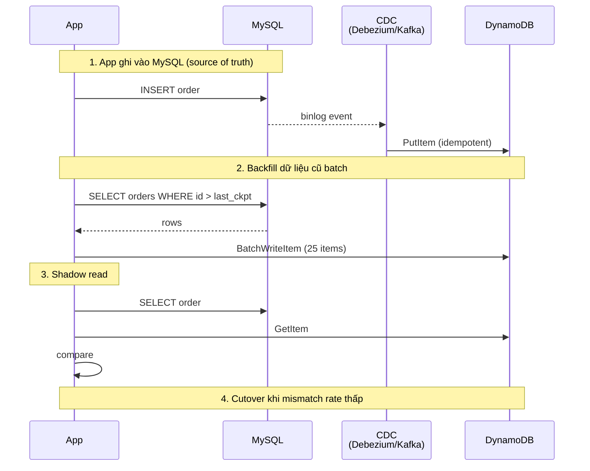

# How will you migrate data from RDBMS to NoSQL while maintaining availability and consistency?

> Bài này giải thích dual-write pitfalls, CDC-based migration với backfill, shadow read/verification, cutover và rollback, chọn consistency model, data modeling cho target NoSQL. Ví dụ chính: bảng `orders` từ MySQL/PostgreSQL sang DynamoDB. Liên quan: [database-sharding](database-sharding.md), [database-replication](database-replication.md), [acid-properties](acid-properties.md).

Chủ đề: Database · Ngày: 2026-10-16

## 0. Nền tảng trước khi đọc

**Bối cảnh:** Nơi ứng dụng lưu dữ liệu và đọc lại dữ liệu. Khó ở chỗ dữ liệu phải đúng khi nhiều người cùng đọc, ghi, hoặc khi máy bị lỗi.

**Nói đơn giản:** Chuyển từ RDBMS sang NoSQL cần vừa sao chép dữ liệu vừa giữ dịch vụ chạy, rồi kiểm chứng trước khi chuyển traffic.

**Từ khóa cần biết:** row = một dòng dữ liệu; query = câu hỏi gửi database; transaction = một nhóm thay đổi được xử lý cùng nhau.

**Ví dụ dễ hình dung:** Hệ thống cũ vẫn nhận order trong lúc backfill sang store mới; CDC giúp chuyển tiếp các thay đổi mới.

Khi đọc, luôn hỏi ba câu: nó giải quyết vấn đề gì, nó làm việc theo những bước nào, và khi nào không nên dùng?

**Cách học bài này:** Đọc phần này trước để nắm từ khóa; đọc phần 1 để lấy câu trả lời 30 giây; đọc phần 2 để hiểu cơ chế; cuối cùng mở từng câu hỏi ở phần 3 để luyện nói. Các con số và lệnh trong bài là bằng chứng cho câu trả lời, không cần học thuộc nếu chưa hiểu cơ chế.

## 1. Là gì

### Đọc nhanh trước khi đi sâu

**Ý chính:** Chuyển từ RDBMS sang NoSQL cần vừa sao chép dữ liệu vừa giữ dịch vụ chạy, rồi kiểm chứng trước khi chuyển traffic.

**Ví dụ interview:** Hệ thống cũ vẫn nhận order trong lúc backfill sang store mới; CDC giúp chuyển tiếp các thay đổi mới.

**Luồng 4 bước:**

1. Ứng dụng gửi query qua driver hoặc connection pool.
2. Database engine tìm dữ liệu, kiểm tra constraint và xử lý transaction.
3. Engine dùng index, lock/MVCC và log tùy loại thao tác.
4. Kết quả được trả về; thay đổi chỉ bền vững sau COMMIT.

**Nói như trong interview:** Chuyển từ RDBMS sang NoSQL cần vừa sao chép dữ liệu vừa giữ dịch vụ chạy, rồi kiểm chứng trước khi chuyển traffic. Hãy nói theo bốn bước trên trước; nếu interviewer hỏi sâu, chuyển sang cơ chế **Bước 1. Dual-write pitfalls**, rồi nêu trade-off và failure mode ở các phần sau.

## 2. Cơ chế cốt lõi

### Bước 1. Dual-write pitfalls

Một cách tự nhiên là cho application ghi vào cả RDBMS và NoSQL trong cùng một transaction. **Không nên**, vì:

- **Atomicity vượt hệ thống**: không có distributed transaction rẻ giữa MySQL và DynamoDB. 2PC chậm, XA ít hỗ trợ.
- **Failure modes**: nếu RDBMS COMMIT thành công nhưng DynamoDB fail → dữ liệu chỉ ở RDBMS, hai hệ lệch. Retry có thể tạo duplicate ở NoSQL nếu không idempotent.
- **Latency**: hai write tuần tự tăng latency. Song song có race condition.
- **Schema change**: thay đổi schema phải đồng bộ cả hai bên.

Thay vào đó, để RDBMS là source of truth và dùng CDC để replicate vào NoSQL.

### Bước 2. CDC (Change Data Capture)

CDC đọc thay đổi từ log database của RDBMS (binlog cho MySQL, WAL cho PostgreSQL) và phát ra các event thay đổi. Tool phổ biến:

- **Debezium**: open source, đọc MySQL binlog và PostgreSQL WAL, phát ra JSON event.
- **AWS DMS**: managed service, hỗ trợ MySQL/PostgreSQL → DynamoDB.
- **Striim, Oracle GoldenGate**: commercial, nhiều connector.

CDC pipeline: Debezium → Kafka → consumer service → DynamoDB API. Consumer phải idempotent (dùng order_id làm partition key, hoặc dùng DynamoDB conditional write để chống duplicate).

### Bước 3. Backfill dữ liệu cũ

CDC chỉ stream thay đổi mới từ thời điểm bắt đầu. Dữ liệu cũ phải backfill bằng batch job:

- Snapshot toàn bộ bảng `orders` tại T0 (vd `mysqldump` hoặc replication snapshot).
- Batch write vào DynamoDB, batch size 25 (DynamoDB limit).
- Track checkpoint (last primary key processed).
- Chạy song song với CDC — overlap không sao, idempotent.
- Catchup: dừng CDC tạm, đảm bảo backfill đuổi kịp, rồi bật lại. Hoặc đơn giản hơn: backfill độc lập, dựa vào idempotent.



*Migration timeline: CDC chạy liên tục, backfill song song, shadow read verify, cutover khi ready. Mỗi bước có thể rollback.*

### Bước 4. Shadow read và verification

Shadow read: app gửi request đọc tới cả RDBMS và NoSQL, so sánh kết quả, không trả kết quả NoSQL cho user (chỉ log).

- **Sampling**: chỉ 1-10% request shadow để tránh tăng tải gấp đôi.
- **Mismatches**: log các order_id lệch. Phân loại: missing ở NoSQL (CDC chưa kịp), extra ở NoSQL (CDC replay duplicate?), value khác (schema conversion sai, type coercion).
- **SLA**: mismatch rate mục tiêu <0.1%, hoặc mismatches không bao gồm data integrity (chỉ timing).
- **Duration**: shadow read ít nhất vài ngày để bắt edge case (giờ thấp điểm, batch jobs, manual SQL).

### Bước 5. Cutover

Cutover là đổi read path từ RDBMS sang NoSQL. Không cut cứng (big bang) — cắt traffic dần:

1. **10% read traffic** sang NoSQL (qua feature flag hoặc DNS weight).
2. **50% read** sau vài giờ nếu error rate không tăng.
3. **100% read** sau 1-3 ngày.
4. **Write cutover**: khó hơn. Có thể chuyển write theo region, theo user segment, hoặc giữ RDBMS source of truth thêm vài tuần.

Sau cutover, RDBMS trở thành "warm standby" — CDC tiếp tục replicate NoSQL về RDBMS cho backup. Sau vài tuần, retire RDBMS (hoặc giữ cho reporting).

### Bước 6. Rollback

Mọi bước đều phải rollback được:

- **Pre-cutover**: chỉ cần tắt CDC, RDBMS vẫn nguyên. Zero risk.
- **Sau cutover read**: revert feature flag, traffic quay RDBMS. App đã ghi RDBMS suốt nên RDBMS có data mới nhất. DynamoDB có thể stale nhưng CDC tiếp tục sync.
- **Sau cutover write**: cần giữ cả hai. RDBMS là source of truth; CDC replicate NoSQL → RDBMS. Nếu cần rollback, app đổi lại ghi RDBMS. Phức tạp và tốn resource, nên tránh nếu có thể.

Quan điểm: thiết kế sao cho rollback không phải di chuyển data mà chỉ đổi traffic. CDC đảm bảo hai bên luôn sync trong thời gian transition.

### Bước 7. Consistency model choice

NoSQL thường có consistency yếu hơn RDBMS:

- **DynamoDB**: default eventually consistent read (~1s), strongly consistent read 2× cost. `TransactWriteItems` cho atomicity multi-item.
- **MongoDB**: `writeConcern majority` + `readConcern majority` cho linearizability (cần replica set).
- **Cassandra**: tunable consistency (ONE, QUORUM, ALL); default ONE.

Khi migrate:

- **Strong consistency cũ**: gần giữ nguyên → DynamoDB strongly consistent read + TransactWrite. Latency cao hơn.
- **Eventually consistent OK**: dùng default read, latency thấp, chấp nhận read-after-write có thể trả data cũ ~1s.
- **Idempotent writes**: dùng `order_id` làm partition key, conditional write (`attribute_not_exists` hoặc `ConditionExpression`) để chống duplicate.

### Bước 8. Data modeling cho target NoSQL

Source RDBMS là relational, target NoSQL không phải. Phải redesign schema. Ví dụ `orders`:

- RDBMS: bảng `orders` (id, user_id, total, status, created_at), bảng `order_items` (order_id, product_id, qty, price), bảng `addresses` (id, order_id, ...).
- DynamoDB: thiết kế single-table hoặc multi-table:
  - **PK = `ORDER#<order_id>`**, sort key `META`. Item chứa order info + denormalized items + address.
  - GSI cho truy vấn theo `user_id`: PK = `USER#<user_id>`, SK = `ORDER#<created_at>#<order_id>`.
- Trade-off: truy vấn theo user cần GSI; truy vấn order detail 1 item get. Items và address lưu cùng order → không join.

Quan điểm: data modeling là phần tốn thời gian nhất của migration. Không thể map 1-1 từ RDBMS sang NoSQL — phải thiết kế theo access pattern của target NoSQL.

### Quan sát

```bash
# Debezium: kiểm tra CDC stream có chạy không
curl http://debezium:8083/connectors/mysql-orders/status
# (output minh họa, chưa chạy)
# {
#   "name": "mysql-orders",
#   "connector": {"state": "RUNNING"},
#   "tasks": [{"state": "RUNNING"}]
# }

# Kiểm tra lag của CDC consumer (DynamoDB stream position vs MySQL binlog)
kafka-consumer-groups.sh --describe --group dynamodb-writer --bootstrap-server kafka:9092
# CURRENT-OFFSET, LOG-END-OFFSET, LAG
# LAG > 1000 → consumer chậm, kiểm tra DynamoDB throttle

# Backfill progress: so sánh row count MySQL vs DynamoDB
mysql -e "SELECT count(*) FROM orders WHERE id > 0"
aws dynamodb describe-table --table-name orders --query 'Table.ItemCount'
# output minh hoạ, chưa chạy
# Hai số này nên xấp xỉ bằng nhau khi backfill xong
```

### Ví dụ chạy từng bước

**Kịch bản:** Bảng `orders` có 100.000 row, ghi mới ~100 order/phút. Migration từ MySQL sang DynamoDB bằng Debezium CDC + batch backfill + shadow read. Mỗi bước ghi trạng thái sau khi hoàn tất.

**Bước 1 (T₀ - T₀+5min): Bật CDC, backfill bắt đầu**

- App tiếp tục ghi vào MySQL bình thường.
- Debezium connector được bật, đọc binlog từ position hiện tại (LSN A). CDC consumer bắt đầu subscribe Kafka topic `orders-changes`.
- Backfill job chạy: `SELECT * FROM orders WHERE id > 0 ORDER BY id LIMIT 10000`. MySQL trả 10.000 row.
- Backfill batch-write vào DynamoDB: mỗi lần 25 item qua `BatchWriteItem`. Dùng `ConditionExpression: attribute_not_exists(order_id)` — nếu CDC đã ghi rồi, DynamoDB trả `ConditionalCheckFailed`, backfill bỏ qua.
- Backfill checkpoint sau bước này: `last_id = 10000`.

| Thành phần | Trạng thái |
|---|---|
| MySQL `orders` | 100.000 row, ghi mới 500 order (T₀+5min) |
| DynamoDB | ~10.000 row (backfill batch 1) |
| CDC offset | Đang đọc binlog LSN A, chưa kịp stream đến DynamoDB |
| Backfill checkpoint | last_id = 10000 |

**Bước 2 (T₀+5min - T₀+30min): Backfill tiếp, CDC stream đuổi kịp**

- Backfill batch 2: `WHERE id > 10000 LIMIT 10000` → 10.000 row tiếp theo. Checkpoint: `last_id = 20000`.
- Batch 3: `WHERE id > 20000 LIMIT 10000`. Checkpoint: `last_id = 30000`.
- CDC consumer nhận event từ Kafka: 500 order mới (T₀+5min) được `PutItem` vào DynamoDB. LSN hiện tại: A → B.
- CDC lag: 500 order đang ở Kafka, DynamoDB ghi chậm hơn MySQL ~2 phút.

| Thành phần | Trạng thái |
|---|---|
| MySQL | 100.000 row + ~2.500 order mới |
| DynamoDB | 30.000 row (backfill) + 500 row (CDC stream) |
| CDC lag | ~2 phút (LSN A → B, 2.500 event pending) |
| Backfill checkpoint | last_id = 30000 |

**Bước 3 (T₀+30min - T₁): Backfill xong, shadow read bắt đầu**

- Backfill batch 4-10: 70.000 row còn lại. Idempotent, CDC overlap không gây duplicate.
- Checkpoint cuối: `last_id = 100000`. Backfill done.
- App bật shadow read 5% traffic: mỗi 20 request read, gửi đồng thời `SELECT` MySQL và `GetItem` DynamoDB, so sánh, log mismatch.
- Sample đầu tiên: order_id = 50001. MySQL trả `{id:50001, total:149000, status:"shipped"}`. DynamoDB trả cùng giá trị → **khớp**.

| Thành phần | Trạng thái |
|---|---|
| MySQL | 100.000 row + ~3.000 order mới |
| DynamoDB | ~103.000 row (backfill xong + CDC stream) |
| CDC lag | ~1 phút |
| Shadow read | 5% sampling, sample 1 khớp |

**Bước 4 (T₁ - T₁+3 ngày): Shadow read tiếp tục, bắt mismatch**

- Mỗi ngày: ~144.000 order mới (100/min × 1440 min).
- Sample order_id = 75003: MySQL trả `{status:"delivered"}`, DynamoDB trả `{status:"shipped"}` → **mismatch**. App log mismatch.
- Nguyên nhân: CDC lag ~90 giây, user đọc ngay sau khi MySQL cập nhật status nhưng DynamoDB chưa kịp stream.
- Mismatch rate sau 3 ngày: 3 mismatch / ~50.000 sample = 0.006% < 0.1% → đủ điều kiện cutover.

| Thành phần | Trạng thái |
|---|---|
| MySQL | 100.000 + ~432.000 order mới |
| DynamoDB | 100.000 + ~431.970 order (CDC lag ~30 order) |
| Mismatch rate | 0.006% (chỉ timing, không data integrity) |
| CDC lag | ~30 giây |

**Bước 5 (T₁+3 ngày): Cutover 10% read sang DynamoDB**

- Feature flag `READ_FROM_DYNAMO=true` cho 10% user.
- Sample đọc: order_id = 80001. DynamoDB `GetItem` trả đầy đủ, latency 5ms vs MySQL 20ms → **OK**.
- App trả kết quả DynamoDB cho 10% user. CDC tiếp tục replicate.

| Thành phần | Trạng thái |
|---|---|
| Read traffic | 10% DynamoDB, 90% MySQL |
| Write | MySQL (source of truth) |
| CDC | Running, lag ~30 giây |

**Biến thể: CDC lag tăng đột ngột lên 10 phút**

- `kafka-consumer-groups.sh` cho thấy LAG = 6.000 event, metric `ThrottledRequests` DynamoDB > 0.
- Nguyên nhân: DynamoDB write capacity exceeded do backfill còn chạy độc lập.
- Xử lý: tạm dừng backfill, tăng DynamoDB capacity, resume CDC consumer. Shadow read tiếp tục nhưng mismatch rate sẽ tăng → **pause cutover** cho đến khi lag về <1 phút.

Điều rút ra: CDC lag là metric sống còn trước cutover — nếu lag vượt ngưỡng mà vẫn cutover, user sẽ đọc data cũ hơn 10 phút, vi phạm read-after-write consistency mà phỏng vấn thường hỏi ở câu "Shadow read verify thế nào?".

## 3. Câu hỏi phỏng vấn

### 3A. Câu hỏi đào sâu

<details class="qa">
<summary>Câu 1. Tại sao không nên dual-write ở app (ghi cả RDBMS và NoSQL trong một transaction)?</summary>

**Trả lời ngắn:** Không có distributed transaction rẻ giữa MySQL và DynamoDB. Một bên COMMIT thành công, bên kia fail → hai hệ lệch, retry có thể duplicate. 2PC chậm. Tốt hơn: để RDBMS là source of truth và dùng CDC để replicate.

**Đào sâu:**
- Atomicity cross-system: 2PC (XA) giữa MySQL và DynamoDB không khả thi vì DynamoDB không hỗ trợ XA protocol.
- Failure mode điển hình: COMMIT MySQL OK, network fail trước khi ghi DynamoDB → row chỉ có ở MySQL. Retry: PutItem DynamoDB có thể trả success nhưng response mất, app retry → 2 row ở DynamoDB nếu không idempotent.
- Latency: hai write tuần tự tăng P50 của request.
- CDC giải quyết: RDBMS ghi trước (transactional với ACID), CDC đọc binlog async. App chỉ cần quan tâm RDBMS.
- Trade-off: latency từ CDC ~giây. Không phù hợp nếu cần read-after-write mạnh ngay sau write.

**Bẫy:** "Dùng Saga pattern cho dual-write". Saga giải quyết được eventual consistency nhưng phức tạp (compensating action cho mỗi step). Với migration tạm thời, CDC đơn giản hơn nhiều.

**Follow-up:** Nếu phải strict read-after-write (vd order vừa tạo phải đọc được ngay), cách nào? Đọc từ RDBMS trong vài giây sau write (sticky read), hoặc dùng DynamoDB strongly consistent read.
</details>

<details class="qa">
<summary>Câu 2. CDC hoạt động thế nào? Debezium đọc binlog như thế nào?</summary>

**Trả lời ngắn:** CDC đọc transaction log của RDBMS (MySQL binlog, PostgreSQL WAL) và phát ra event thay đổi. Debezium kết nối MySQL như một replica, đọc binlog từ position hiện tại, phát ra JSON event qua Kafka. Consumer service subscribe Kafka và ghi vào NoSQL.

**Đào sâu:**
- MySQL binlog có 3 format: STATEMENT, ROW, MIXED. Debezium cần ROW để đọc được từng row thay đổi (cấu hình `binlog_format=ROW`).
- Debezium đăng ký làm MySQL replica, đọc binlog events (`WriteRowsEvent`, `UpdateRowsEvent`, `DeleteRowsEvent`). Mỗi event chứa before/after row.
- Cấu hình: `database.server.id` (unique), `database.history.kafka.topic` (lưu DDL history), `snapshot.mode` (initial hoặc when_needed).
- CDC đọc async, không ảnh hưởng RDBMS write path. Latency từ write đến Kafka: ~giây.
- Cần giữ binlog retention đủ lâu (vd 7 ngày) để consumer có thể catchup khi downtime.

**Bẫy:** "Binlog format STATEMENT là đủ". Không — STATEMENT chỉ chứa SQL, không phải row changes. CDC cần ROW.

**Follow-up:** Nếu Debezium crash, catchup thế nào? Lưu last binlog position; khi restart, đọc từ position đó. Kafka offset cũng lưu last committed message.
</details>

<details class="qa">
<summary>Câu 3. Backfill dữ liệu cũ chạy như thế nào, idempotent quan trọng vì sao?</summary>

**Trả lời ngắn:** Snapshot bảng, batch write vào NoSQL (batch size 25 cho DynamoDB), track checkpoint (last primary key). Chạy song song với CDC. Idempotent quan trọng vì backfill và CDC overlap có thể ghi cùng row hai lần.

**Đào sâu:**
- Snapshot: `mysqldump --single-transaction --where="id > last_ckpt" orders`. Tránh lock dài.
- Batch write DynamoDB: 25 items per `BatchWriteItem`. Retry với exponential backoff cho unprocessed items.
- Idempotent: PutItem với `ConditionExpression: attribute_not_exists(order_id)` chống overwrite. Nhưng cẩn thận: nếu backfill ghi row mới hơn CDC sau, sẽ không ghi đè. Cách khác: sort backfill theo timestamp, CDC xử lý sau.
- Checkpoint: lưu last processed `id` ở metadata table. Resume sau crash.
- Catchup với CDC: nếu backfill chậm hơn CDC, có gap. Cách đơn giản: backfill chạy độc lập, dùng idempotent; CDC là source of truth cuối cùng cho row mới.

**Bẫy:** Backfill chạy xong rồi mới bật CDC. Sai — CDC nên bật ngay từ đầu để giảm lag. Backfill và CDC overlap.

**Follow-up:** Backfill xử lý soft-delete như thế nào? CDC phát delete event, backfill phải skip deleted rows (`WHERE deleted_at IS NULL`).
</details>

<details class="qa">
<summary>Câu 4. Shadow read verify thế nào? Khi nào đủ tự tin để cutover?</summary>

**Trả lời ngắn:** App gửi 1-10% request đọc tới cả RDBMS và NoSQL, so sánh kết quả, log mismatches. Cutover khi mismatch rate <0.1%, mismatches chỉ là timing (không phải data integrity), và đã chạy đủ lâu (vài ngày) để cover edge case.

**Đào sâu:**
- Triển khai: SDK hoặc middleware tự động gọi cả hai, so sánh, log. Không trả kết quả NoSQL cho user.
- Phân loại mismatch:
  - **Missing in NoSQL**: CDC lag hoặc fail. Kiểm tra consumer health.
  - **Extra in NoSQL**: CDC replay, idempotent không đúng.
  - **Value diff**: schema conversion sai (timestamp timezone, numeric precision, null handling).
- Cutover criteria: rate <0.1% trong rolling 24h, không có mismatch về data integrity (chỉ timing), monitoring alerts sạch.
- Duration: ít nhất 3-7 ngày shadow read. Peak hours, batch jobs, manual scripts, off-hours đều phải cover.

**Bẫy:** Chỉ verify schema mapping rồi cutover. Sai — production traffic có edge case (concurrent update, partial commit, special characters) không thấy ở dev.

**Follow-up:** Mismatch rate cao đột ngột trước cutover — làm gì? Pause cutover, debug, fix, chạy shadow thêm vài ngày.
</details>

<details class="qa">
<summary>Câu 5. Cutover như thế nào để rollback được?</summary>

**Trả lời ngắn:** Cut dần: 10% read traffic sang NoSQL, 50%, 100%. Mỗi bước chờ vài giờ quan sát. Write cutover khó hơn, có thể giữ RDBMS source of truth vài tuần. Rollback chỉ cần đổi traffic (feature flag), CDC đảm bảo hai bên sync.

**Đào sâu:**
- **Read cutover**: feature flag (`READ_FROM_DYNAMO=true` cho 10% user). Quan sát latency, error rate, missing data. Tăng dần.
- **Write cutover**: hai lựa chọn: (a) app ghi DynamoDB, CDC replicate về RDBMS cho backup; (b) giữ RDBMS, CDC DynamoDB → RDBMS cho backup. Cách (b) rollback đơn giản hơn.
- **RDBMS sau cutover**: warm standby, CDC tiếp tục replicate. Sau vài tuần nếu ổn, retire.
- **Rollback**: feature flag revert traffic. Không cần di chuyển data. RDBMS vẫn có data mới nhất.
- **Big bang cutover** (cut 100% một lúc) rủi ro cao, chỉ dùng khi không có traffic (maintenance window). Không khuyến nghị.

**Bẫy:** Cut cứng 100% rồi mới verify. Sai — lỗi ở NoSQL không phát hiện được cho đến khi traffic đã chuyển, rollback phức tạp.

**Follow-up:** Cutover ở production scale, monitoring cần gì? Latency p95/p99 NoSQL vs RDBMS, error rate, DynamoDB throttling, CDC lag, mismatch rate real-time.
</details>

<details class="qa">
<summary>Câu 6 (Debug). CDC lag tăng dần từ 5s lên 60s trong 2 giờ. App vẫn chạy bình thường. Bạn kiểm tra gì?</summary>

**Trả lời ngắn:** 1) Xem DynamoDB throttling (ProvisionedThroughputExceededException). 3) Xem consumer service health (OOM, restart loop). 4) Xem Kafka lag. 5) Xem RDBMS binlog position tăng đều hay spike.

**Đào sâu:**
- Bước 1: CloudWatch metric `ThrottledRequests` cho DynamoDB. Nếu >0 → tăng capacity hoặc dùng on-demand.
- Bước 2: `kafka-consumer-groups.sh --describe` xem LAG. LAG tăng → consumer chậm. Có thể do PutItem latency cao.
- Bước 3: consumer service logs. Có exception? OOM? Restart loop? Nếu yes, tăng memory hoặc fix code.
- Bước 4: so sánh RDBMS write rate với CDC consume rate. RDBMS write 5K/s, CDC consume 1K/s → không kịp.
- Bước 5: nếu CDC lag tăng do workload (rdBMS write tăng), cần scale consumer (horizontal scale). Nếu do throttling, capacity.

**Bẫy:** Chỉ restart consumer và đợi. Restart không giải quyết nếu root cause là DynamoDB throttling.

**Follow-up:** Lag tăng do DynamoDB write capacity exceeded. Cách giải quyết dài hạn? On-demand thay vì provisioned, hoặc batch writes hiệu quả hơn (gộp nhiều PutItem thành BatchWriteItem).
</details>

<details class="qa">
<summary>Câu 7 (Thiết kế). Migration bảng `orders` (500M row, 100GB) từ MySQL sang DynamoDB, traffic 2K write/s, 50K read/s. Thiết kế quy trình.</summary>

**Trả lời ngắn:** 1) Modeling: single-table DynamoDB, PK=ORDER#id, denormalized items. 2) Bật Debezium CDC. 3) Backfill batch từ snapshot, batch 25, track checkpoint. 4) Shadow read 5% trong 1 tuần. 5) Cutover read 10% → 50% → 100% trong 3 ngày. 6) Giữ RDBMS standby 2 tuần, retire.

**Đào sâu:**
- **Modeling**: PK=`ORDER#<order_id>`, SK=`META`. Item chứa `user_id, total, status, created_at, items[], address`. GSI: PK=`USER#<user_id>`, SK=`ORDER#<created_at>#<order_id>`.
- **CDC**: Debezium MySQL connector, binlog_format=ROW, server_id unique, binlog retention 7 ngày. Consumer viết DynamoDB với `ConditionExpression: attribute_not_exists(order_id)` để idempotent.
- **Backfill**: snapshot 100GB dump, batch 25 items, ~5M batch (4h/5M row). Throughput ~1.4K row/s, xong trong vài ngày. Cần tăng DynamoDB write capacity cho backfill.
- **Shadow read**: 5% traffic, log mismatch, alerting rate >0.1%. Quan sát 7 ngày.
- **Cutover read**: feature flag, 10% trong 6h, 50% trong 12h, 100% sau 24h. Monitoring p95/p99 latency, error rate.
- **Cutover write** (optional): chuyển write path sau cutover read ổn định. Hoặc giữ RDBMS source of truth cho reporting và backup.
- **Cost**: DynamoDB on-demand cho backfill (burst), provisioned cho steady state.

**Bẫy:** Không test với production data, chỉ test với synthetic data. Sai — production có data bẩn, edge case.

**Follow-up:** Nếu schema RDBMS thay đổi giữa migration (vd thêm cột)? CDC phát DDL event, cần update consumer code trước khi DDL chạy. Hoặc pause migration trong khi áp dụng DDL.
</details>

### 3B. Câu hỏi phỏng vấn liên quan

<details class="qa">
<summary>Câu 8. AWS DMS có phải là CDC không?</summary>

**Trả lời:** DMS (Database Migration Service) có hai mode: full load (snapshot) và CDC (ongoing replication). Trong migration production, thường dùng full load + CDC để migrate mà không downtime. DMS hỗ trợ nhiều source (MySQL, PostgreSQL, Oracle) và target (DynamoDB, Aurora, S3). So với Debezium: DMS managed, dễ cài đặt; Debezium open source, control nhiều hơn. Không chắc cho mọi workload.
</details>

<details class="qa">
<summary>Câu 9. Có thể dùng database trigger để làm CDC không?</summary>

**Trả lời:** Được nhưng ít được khuyến nghị. Trigger chạy trong transaction của RDBMS, làm chậm write. CDC đọc binlog async, không ảnh hưởng write path. Trigger cũng khó đảm bảo không miss event khi fail. CDC qua binlog là cách industry chuẩn.
</details>

<details class="qa">
<summary>Câu 10. Idempotent write trong DynamoDB làm thế nào?</summary>

**Trả lời:** PutItem với `ConditionExpression: attribute_not_exists(PK)` chống overwrite. Hoặc dùng `order_id` làm partition key và chỉ PutItem nếu chưa có. Với update: dùng `UpdateItem` thay vì `PutItem` để không ghi đè field cũ. CDC consumer phải retry-safe: nếu PutItem trả `ConditionalCheckFailedException`, bỏ qua (row đã có).
</details>

<details class="qa">
<summary>Câu 11. Đảm bảo tính nhất quán cuối cùng giữa hai hệ thống như thế nào?</summary>

**Trả lời:** CDC đảm bảo mọi thay đổi ở RDBMS cuối cùng sẽ được ghi vào NoSQL. Backfill + CDC overlap (idempotent) đảm bảo dữ liệu cũ + mới đều có ở NoSQL. Shadow read verify trước cutover. Sau cutover, hai hệ vẫn sync (CDC tiếp tục chạy). Cuối migration, retire RDBMS khi chắc chắn.
</details>

<details class="qa">
<summary>Câu 12. Single-table design trong DynamoDB là gì? Tại sao?</summary>

**Trả lời:** Một bảng DynamoDB chứa nhiều loại entity (orders, users, items) phân biệt bằng partition key prefix. Ví dụ `ORDER#123`, `USER#456`, `ITEM#789`. Lợi: ít request (prefetch related items), transaction multi-entity. Đánh đổi: phức tạp hơn multi-table, khó debug. Phù hợp khi access pattern đa dạng và cần latency thấp.
</details>

<details class="qa">
<summary>Câu 13. Migration sang MongoDB hay Cassandra khác gì với DynamoDB?</summary>

**Trả lời:** MongoDB: document model, dễ map từ relational (mỗi order là một document với embedded items). CDC: MongoDB change streams (replica set), Debezium có connector. Cassandra: column-family, partition key + clustering key. CDC: Debezium có connector. Cả ba đều cần CDC-based migration. DynamoDB thêm ràng buộc về partition size (10 GB), nên modeling khác nhau.
</details>

<details class="qa">
<summary>Câu 14. True or false: "CDC đảm bảo zero data loss."</summary>

**Trả lời:** Sai trong trường hợp consumer fail và Kafka retention quá ngắn. Nếu consumer crash 3 ngày, Kafka retention 1 ngày, 2 ngày event mất. Cần: retention đủ dài (7 ngày), monitoring lag, alerting khi lag vượt ngưỡng. Với config đúng, CDC gần zero loss nhưng không tuyệt đối.
</details>

<details class="qa">
<summary>Câu 15. Có cần tắt RDBMS sau cutover không?</summary>

**Trả lời:** Không ngay. Giữ RDBMS làm warm standby (CDC replicate NoSQL → RDBMS hoặc RDBMS chỉ read-only) ít nhất vài tuần. Lý do: rollback cần source of truth, reporting có thể cần SQL, audit. Sau khi chắc chắn NoSQL ổn định, retire hoặc archive RDBMS (snapshot cuối cùng).
</details>

<details class="qa">
<summary>Câu 16. Cân nhắc security trong migration?</summary>

**Trả lời:** CDC pipeline chứa data nhạy (pe bao gồm password hash, PII). Encrypt Kafka cluster, IAM authentication, không log full row. Backfill chứa full data, cần encrypted snapshot. Test rollback không leak data ở NoSQL khi RDBMS đã xoá. Audit log mọi write ở cả hai hệ.
</details>

## 4. Đánh đổi và sự cố production

### So sánh ba cách migration

| Tiêu chí | Dual-write (app) | CDC-based | ETL batch một lần |
|---|---|---|---|
| Availability trong migration | App phải xử lý inconsistency | RDBMS là source of truth, app không biết NoSQL | Downtime bắt buộc |
| Consistency cuối | Yếu (race condition) | Cuối cùng (eventual) | Tại thời điểm snapshot |
| Phức tạp | Cao (xử lý partial fail) | Trung bình (CDC pipeline) | Thấp (script) |
| Backfill | Cần riêng | Cần riêng (overlap CDC) | Là bản thân nó |
| Khi nào dùng | Không khuyến nghị | Production migration, downtime không được | Dev/test, data dump |

### Năm failure mode

| Triệu chứng | Nguyên nhân gốc | Cách kiểm tra | Cách sửa |
|---|---|---|---|
| CDC lag tăng dần | DynamoDB throttle, consumer OOM | CloudWatch ThrottledRequests, consumer logs | Tăng capacity, scale consumer, batch writes |
| Shadow read mismatch cao (≥1%) | Schema conversion sai, CDC drop event | Phân loại mismatch (missing, value diff) | Fix consumer code, replay binlog từ position |
| Backfill stuck ở checkpoint | Consumer crash loop, idempotent fail | Logs consumer, checkpoint table | Kill consumer, fix bug, resume |
| Cutover read xong nhưng latency tăng | DynamoDB partition hot, RCU thấp | CloudWatch `ConsumedReadCapacityUnits`, `ThrottledRequests` | Tăng capacity, redesign partition key |
| Migration xong nhưng RDBMS vẫn được dùng | App chưa đổi config hoặc có code path khác | Code search, traffic logs | Remove fallback code, deprecate RDBMS |

## 5. Cheat sheet

| Chủ đề | Con số / quy tắc cần nhớ |
|---|---|
| Không nên | Dual-write ở app. Không có 2PC rẻ giữa RDBMS và NoSQL. |
| CDC tool | Debezium (MySQL binlog, PG WAL), AWS DMS, Striim |
| Backfill | Snapshot + batch write 25 (DynamoDB), idempotent qua condition expression |
| Shadow read | Data + compare, sampling 1-10%, log mismatches. Mục tiêu <0.1%. |
| Cutover read | Feature flag, 10% → 50% → 100%, từng bước 6-12h. |
| Cutover write | Khó hơn, thường giữ RDBMS source of truth vài tuần |
| Rollback | Đổi traffic (feature flag), không di chuyển data |
| Consistency | DynamoDB default eventually consistent ~1s, strong read 2× cost |
| DynamoDB partition size | 10 GB per partition. Modeling phải tránh hot partition. |
| DynamoDB BatchWriteItem | 25 items per batch. Retry unprocessed. |

**Học tiếp:**
- [database-sharding](database-sharding.md) — nếu sau migration vẫn scale, shard NoSQL
- [database-replication](database-replication.md) — CDC dùng replication cùng pattern
- [acid-properties](acid-properties.md) — phải biết ACID để chọn consistency model
