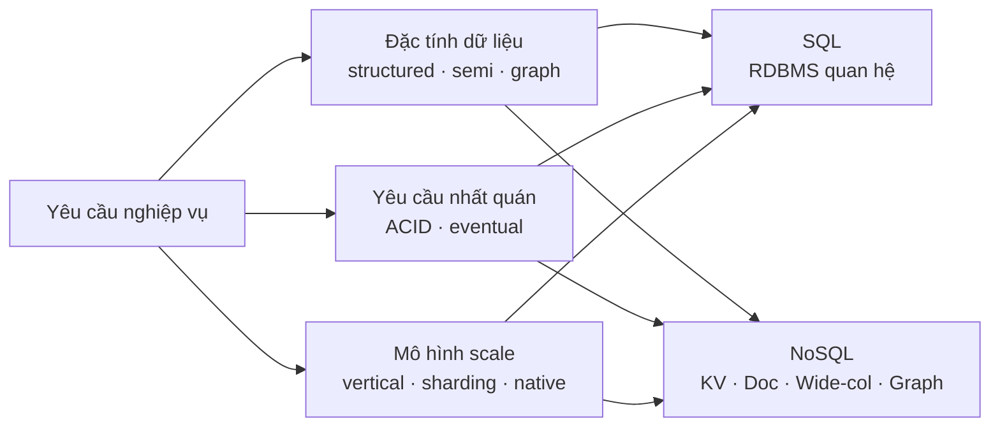
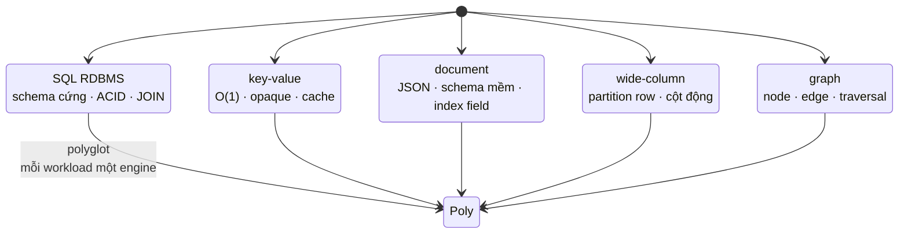

# What is the difference between SQL and NoSQL?

> Bài này so sánh SQL (RDBMS quan hệ) và NoSQL (key-value, document, wide-column, graph) qua mô hình dữ liệu, schema, giao dịch, mô hình scale, và framework quyết định chọn cái nào cho bài toán cụ thể. Nền tảng liên quan: [database-normalization](database-normalization.md), [database-replication](database-replication.md), [database-sharding](database-sharding.md).

Chủ đề: Database · Ngày: 2026-10-16

## 1. Là gì

SQL là hệ quản trị CSDL quan hệ dùng schema cố định (bảng, cột, kiểu dữ liệu), ngôn ngữ truy vấn SQL chuẩn ISO, và đảm bảo ACID cho transaction. NoSQL là tập hợp nhiều mô hình dữ liệu khác quan hệ (key-value, document, wide-column, graph), mỗi mô hình ưu một chiều (latency, scale, schema linh hoạt) đổi lại giảm chiều khác (transaction chéo bản ghi, query phức tạp). So sánh không phải "cái này thay cái kia" mà là "mô hình nào vừa workload nào". Trong thực tế, hệ thống lớn dùng cả hai: SQL cho core OLTP có ACID, NoSQL cho phụ trợ có throughput cao, dữ liệu semi-structured, hoặc quan hệ phi truyền thống.

Giả định: so sánh ở mức lựa chọn kỹ thuật; không đi sâu benchmark từng engine, không bàn licensing.



*Sơ đồ vị trí: yêu cầu nghiệp vụ dẫn tới ba trụ quyết định: cấu trúc dữ liệu, nhất quán, mô hình scale. Mỗi trụ nghiêng về SQL hay NoSQL tuỳ trường hợp. Bài này đi từng trụ.*

### Trả lời 30 giây

"SQL là CSDL quan hệ schema cố định, dùng SQL chuẩn, hỗ trợ ACID và JOIN phức tạp; scale chủ yếu bằng read replica và sharding thủ công. NoSQL là tập bốn họ chính: key-value (Redis, DynamoDB), document (MongoDB, Couchbase), wide-column (Cassandra, HBase), graph (Neo4j, Neptune) — mỗi họ ưu một chiều: độ trễ thấp, schema linh hoạt, scale ngang dễ, hoặc truy vấn quan hệ phức tạp. Chọn SQL khi cần ACID chéo bản ghi và schema ổn định (thanh toán, kế toán); chọn NoSQL khi workload ưu đọc/ghi đơn giản với throughput cực cao (cache, analytics, recommendation), hoặc dữ liệu phi cấu trúc. Quan điểm: không có cái nào thay cái nào, dùng theo workload."

## 2. Cơ chế cốt lõi

### Bước 1. Bốn họ NoSQL và ví dụ thật

1. **Key-value**: lưu cặp `key → opaque value`. Tra cứu O(1) qua hash table. *Ví dụ*: Redis (cache), DynamoDB (Amazon), Memcached. Use case: cache phiên, giỏ hàng tạm, leaderboard.
2. **Document**: lưu document JSON/BSON, mỗi document có thể khác cấu trúc. Truy vấn theo field, index trên field. *Ví dụ*: MongoDB, Couchbase, Firestore. Use case: catalog sản phẩm, user profile với thuộc tính động.
3. **Wide-column**: dữ liệu tổ chức theo row key + cột thay đổi theo row, partition theo row key. *Ví dụ*: Cassandra, HBase, ScyllaDB. Use case: time-series, write-heavy IoT, dữ liệu vài TB/PB.
4. **Graph**: lưu node và edge có thuộc tính, truy vấn bằng traversal. *Ví dụ*: Neo4j, Amazon Neptune, JanusGraph. Use case: mạng xã hội, fraud detection, knowledge graph.

### Bước 2. Schema: cứng vs mềm

1. SQL: schema cứng, mỗi cột có kiểu và constraint. Thêm cột cần ALTER TABLE, lock bảng có thể ảnh hưởng đọc. NULL/NOT NULL, CHECK, FK đảm bảo toàn vẹn.
2. Document (MongoDB): schema mềm, mỗi document tự do. Nhưng ứng dụng vẫn cần validate; `JSON Schema validation` (MongoDB 3.6+) hoặc code app đảm bảo. Mất FK chéo document.
3. Wide-column: schema cột có thể khác từng row, thêm cột khi cần mà không cần ALTER TABLE toàn cục. Linh hoạt nhưng khó truy vấn nhiều cột cùng lúc.
4. Key-value: không schema (value opaque), validation do ứng dụng.



*State machine: 5 lựa chọn kỹ thuật, polyglot persistence phổ biến nhất trong hệ thống lớn.*

### Bước 3. ACID vs BASE và consistency model

1. SQL hiện đại: ACID đầy đủ — transaction nguyên tử, consistency qua ràng buộc, isolation tuỳ level (RC, RR, Serializable), durability qua WAL + replica. Postgres và MySQL (InnoDB) đều ACID.
2. NoSQL lớn (Cassandra, MongoDB cũ, DynamoDB): eventual consistency — ghi thành công tại primary, replica cập nhật trong vài trăm ms. Một số (MongoDB 4.0+) bắt đầu hỗ trợ multi-document ACID với điều kiện, nhưng vẫn chậm hơn RDBMS cho transaction phức tạp.
3. CAP: một hệ phân tán chỉ giữ hai trong ba (Consistency, Availability, Partition tolerance). NoSQL thường chọn AP, SQL cluster thường chọn CP. Partition tolerance là bắt buộc vì mạng lỗi.
4. NoSQL cho phép tune consistency per-query: Cassandra có `CONSISTENCY ONE/QUORUM/ALL`; DynamoDB có `ConsistentRead`. RDBMS mặc định strong trong cluster.

### Bước 4. Mô hình scale

1. SQL: scale up (một máy lớn) là giới hạn thực tế. Scale out qua read replica (nhiều bản sao chỉ-đọc) hoặc sharding (chia bảng lớn theo hash key). Sharding khó, dev phải route query đúng shard, cross-shard JOIN rất tốn.
2. NoSQL: scale out là bản thiết kế gốc (Cassandra partition, MongoDB sharding cluster, DynamoDB tự quản lý). Mỗi node thêm vào tăng throughput, không cần router riêng.
3. Đánh đổi: SQL dễ vận hành (single source of truth) nhưng capacity giới hạn. NoSQL scale vô hạn nhưng phải design partition key và cuối cùng vẫn cần vận hành cluster.

### Bước 5. Khi nào SQL thắng, khi nào NoSQL thắng

1. **SQL thắng**: cần ACID chéo bản ghi (thanh toán, đặt phòng); workload BI có JOIN, GROUP BY phức tạp; schema ổn định; team thạo SQL.
2. **Key-value thắng**: cache, session, leaderboard, rate limit, real-time ranking.
3. **Document thắng**: catalog với schema động, content management, user profile với attributes tuỳ biến.
4. **Wide-column thắng**: write-heavy time-series, IoT, message queue persist, write throughput > 100k TPS.
5. **Graph thắng**: truy vấn quan hệ nhiều bước (3+ hops), fraud detection, social network.

### Quan sát

```sql
-- Cùng dữ liệu trong SQL (Postgres)
CREATE TABLE users (
  id BIGSERIAL PRIMARY KEY,
  email TEXT UNIQUE,
  attrs JSONB
);
CREATE INDEX attrs_gin ON users USING gin(attrs);
-- SQL chuẩn: đảm bảo unique, FK, query JSON qua GIN index.
```

```javascript
// Cùng dữ liệu trong MongoDB
db.users.createIndex({ email: 1 }, { unique: true });
db.users.createIndex({ "attrs.country": 1 }); // index field trong document
db.users.insertOne({
  email: "a@example.com",
  attrs: { country: "VN", age: 30 },
});
// MongoDB: mỗi document có thể khác cấu trúc; index trên field cụ thể.
```

```text
// Wide-column (Cassandra CQL)
CREATE TABLE events_by_user (
  user_id bigint,
  event_time timestamp,
  event_type text,
  payload blob,
  PRIMARY KEY (user_id, event_time)
) WITH CLUSTERING ORDER BY (event_time DESC);
// Partition theo user_id, sort theo event_time.
// Truy vấn: SELECT * FROM events_by_user WHERE user_id = ? AND event_time > ?;
// Chỉ truy vấn theo partition key + clustering range.
```

### Ví dụ chạy từng bước

**Kịch bản:** Đặt phòng khách sạn có 2 phần: (a) bảng `bookings` 10.000 row cần ACID chéo bản ghi (booking + payment), (b) cache session/giỏ hàng 50.000 key mỗi giờ. Thiết kế chọn engine cho từng workload và trace một transaction đặt phòng đi qua cả hai hệ.

**Bước 1 (T₀): Khởi tạo booking + cache**

- User gửi request `POST /bookings {user_id: 42, room_id: 305, total: 1.500.000đ}`.
- App kiểm tra session trong Redis: `GET session:42` → cache hit, ~1ms.
- App kiểm tra rate-limit: `INCR rate:42:book` → trả `1`. Dưới ngưỡng 5/phút.

| Tầng | Engine | Trạng thái |
|---|---|---|
| Session | Redis | session:42 hit |
| Rate limit | Redis | rate:42:book = 1 |
| Booking | PostgreSQL | Chuẩn bị INSERT, chưa commit |

**Bước 2 (T₀+5ms): PostgreSQL ACID transaction**

- App mở transaction: `BEGIN; INSERT INTO bookings ...; UPDATE rooms SET available=false WHERE id=305; INSERT INTO payments ...; COMMIT;`.
- PostgreSQL ghi WAL: LSN `0/1A2B3C4D`. 3 row sẽ ghi, lock `rooms.id=305` được giữ.
- COMMIT → WAL fsync (~2ms SSD). Cả 3 row hoặc 0 row.

| Tầng | Engine | Trạng thái |
|---|---|---|
| Booking | PostgreSQL | bookings: 1 row mới, rooms: 305 updated |
| WAL | PostgreSQL | LSN `0/1A2B3C4D`, fsync xong |

**Bước 3 (T₀+10ms): Payment gateway, không dùng 2PC**

- App gọi payment gateway (3rd party HTTP API). KHÔNG dùng 2PC — gateway không hỗ trợ XA.
- Dùng saga + outbox: ghi event vào outbox table. Worker poll outbox, gửi tới gateway.
- Gateway trả 200 OK → worker cập nhật `bookings.status='confirmed'`, `payments.status='paid'`. Không SPOF coordinator.

| Tầng | Engine | Trạng thái |
|---|---|---|
| Booking | PostgreSQL | status = confirmed, payments.status = paid |
| Saga step | Worker | Eventual consistency ~2s |

**Bước 4 (T₀+15ms): Cache kết quả vào Redis**

- App ghi booking vừa confirm vào Redis: `SETEX booking:42 3600 '{...}'`. TTL 1 giờ.
- Lần đọc sau (`GET booking:42`) → cache hit ~1ms, không cần query PostgreSQL.

| Tầng | Engine | Trạng thái |
|---|---|---|
| Booking cache | Redis | booking:42 → JSON, TTL 3600s |
| PostgreSQL | Source of truth | bookings: vẫn còn |

**Bước 5 (T₀+1h): Cache miss, đọc lại PostgreSQL**

- TTL hết, `GET booking:42` → nil.
- App query PostgreSQL: `SELECT * FROM bookings WHERE id=42` → latency ~20ms.
- App ghi lại cache: `SETEX booking:42 3600 ...`. Lần sau cache hit lại.

| Tầng | Engine | Trạng thái |
|---|---:|---|
| Booking cache | Redis | nil (TTL hết) |
| PostgreSQL | Source of truth | query ~20ms |

**Biến thể: PostgreSQL primary chết, Redis vẫn chạy**

- Primary fail, replica chưa promote (mất 30s). Trong 30s này:
  - Read PostgreSQL: lỗi, app retry hoặc trả 503.
  - Read cache (session, rate-limit): vẫn hoạt động, Redis cluster độc lập.
- Bài học: SQL là SPOF cho write, NoSQL (Redis) độc lập → có thể phục vụ một phần traffic khi SQL down.

Điều rút ra: SQL chọn vì ACID chéo bản ghi (booking + payment + room lock nguyên tử), key-value chọn vì latency — cùng một transaction đi qua cả hai mà không cần 2PC, như câu "Khi nào SQL thắng, khi nào NoSQL thắng" ở phần 3A nhấn mạnh.

## 3. Câu hỏi phỏng vấn

### 3A. Câu hỏi đào sâu

<details class="qa">
<summary>Câu 1. Phân biệt SQL, key-value, document, wide-column, graph. Ví dụ thật và use case.</summary>

**Trả lời ngắn:** SQL (Postgres, MySQL): schema cứng, ACID, JOIN, dùng cho core OLTP và BI. Key-value (Redis, DynamoDB): lưu cặp key-value qua hash, sub-ms latency, dùng cho cache, session. Document (MongoDB, Couchbase): JSON document, schema linh hoạt, dùng cho catalog và content. Wide-column (Cassandra, HBase): partition theo row key, mỗi row có cột khác nhau, dùng cho write-heavy time-series. Graph (Neo4j, Neptune): node và edge, traversal ngắn, dùng cho quan hệ nhiều bước.

**Đào sâu:**
- Key-value tra O(1), Redis chạy in-memory với persistence tuỳ chọn. DynamoDB là key-value + document với partition tự động.
- Document: cùng collection có thể có cấu trúc khác nhau, tiện cho schema động nhưng khó enforce constraint. MongoDB hỗ trợ aggregation pipeline thay JOIN đơn giản.
- Wide-column: mỗi row có thể có cột riêng, partition key quyết định locality. Query ngoài partition key phải full-scan hoặc có secondary index đặc biệt (Cassandra 2.0+ SSTable-attached index).
- Graph: quan hệ là first-class, traversal qua edge rất nhanh. SQL JOIN nhiều bước vẫn phải scan, graph traversal precompute hướng.

**Bẫy:** Tưởng NoSQL là một loại. Sai, bốn họ rất khác nhau về indexing, query pattern, và limit.

**Follow-up:** Khi nào nên dùng cả SQL lẫn NoSQL? Polyglot: SQL cho thanh toán, Redis cho session, Cassandra cho time-series, Neo4j cho fraud detection. Mỗi engine một việc.
</details>

<details class="qa">
<summary>Câu 2. ACID so với BASE — đánh đổi thực tế là gì?</summary>

**Trả lời ngắn:** ACID: nguyên tử, nhất quán, cô lập, bền vững — RDBMS chuẩn. BASE: Basically Available, Soft state, Eventual consistency — NoSQL thường theo. ACID khiến transaction đúng trong mọi node; BASE chấp nhận cửa sổ lệch vài giây để đổi lấy latency thấp và khả năng partition cao.

**Đào sâu:**
- ACID đầy đủ trong Postgres/MySQL dù đã cluster với synchronous replication. Ảnh hưởng: latency ghi cộng thêm network RTT giữa các node.
- BASE: cửa sổ lệch có thể vài trăm ms tới vài giây tuỳ engine. Cassandra cho phép chọn consistency level per-query.
- Trade-off: thanh toán cần ACID vì sai 1 cent có thể khiếu nại. Analytics dashboard chịu được eventual 1 phút.
- MongoDB 4.0+ bắt đầu hỗ trợ multi-doc ACID (không chắc nhanh bằng RDBMS). Cosmos DB, FaunaDB có ACID riêng.

**Bẫy:** "NoSQL bỏ ACID". Sai, một số NoSQL (FoundationDB, Cosmos DB) vẫn ACID. Phổ biến NoSQL BASE nhưng không phải định nghĩa.

**Follow-up:** Có hệ nào vừa ACID vừa scale ngang không? FoundationDB, Spanner (Google), CockroachDB — tốn kỹ thuật, đắt, nhưng có.
</details>

<details class="qa">
<summary>Câu 3. CAP áp dụng thế nào cho SQL và NoSQL cluster?</summary>

**Trả lời ngắn:** CAP nói một hệ phân tán có thể chỉ chọn hai trong ba: Consistency, Availability, Partition tolerance. Partition tolerance là bắt buộc trong mạng lỗi, nên thực tế chỉ còn chọn C hay A. SQL cluster (Postgres synchronous) chọn CP — khi partition, không nhận ghi; NoSQL cluster (Cassandra) chọn AP — khi partition, vẫn nhận ghi nhưng đọc có thể lệch.

**Đào sâu:**
- AP hoạt động được khi partition vì nhiều node độc lập. CP thì khi partition phải chọn một bên là primary, bên kia read-only hoặc off.
- Quan điểm: CAP là dưới điều kiện partition; bình thường hệ có thể vừa C vừa A. CAP không phải lựa chọn toàn cục.
- NoSQL có thể tune per-query (Cassandra ONE vs ALL). SQL có thể tắt synchronous replication để tăng A, mất strict C.

**Bẫy:** "CAP chọn 2/3 toàn cục". Sai, CAP mô tả hành vi trong khi xảy ra partition, không phải luôn chọn 2/3.

**Follow-up:** Khi partition kéo dài (cùng DC mất, cross-DC) thì sao? Multi-region: SQL thường chọn một region làm primary, NoSQL cho phép multi-master. Không có đáp án chung.
</details>

<details class="qa">
<summary>Câu 4. Mô hình scale của SQL vs NoSQL: scale up, read replica, sharding, native scale-out.</summary>

**Trả lời ngắn:** SQL scale theo ba hướng: scale up một node lớn, thêm read replica (chỉ đọc), hoặc sharding thủ công (chia bảng theo hash key, app route đúng shard). NoSQL scale out native: thêm node thì throughput tăng, không cần router riêng (Cassandra consistent hashing, MongoDB sharded cluster, DynamoDB auto).

**Đào sâu:**
- Read replica: mọi SQL cluster support, đọc nhất quán thường eventual, ghi vẫn vào primary. Đơn giản nhất nhưng chỉ giải quyết tải đọc.
- Sharding thủ công: Postgres Citus, MySQL Group Replication, MongoDB Sharded Cluster. Cross-shard JOIN phức tạp, cần denormalize.
- Cassandra/MongoDB/DynamoDB: scale out ngầm định, partition key quyết định locality. Đổi lại: query cross-partition đắt.
- NoSQL scale được vì kỹ thuật đẩy complex query sang application code, partition routing giản lược hoá. SQL phải giữ nhiều tính năng hơn nên scale khó hơn.

**Bẫy:** Tưởng scale out của NoSQL là miễn phí. Không, cần partition key tốt, rebalance khi thêm node, vẫn tốn vận hành.

**Follow-up:** Khi nào sharding vẫn cần ở SQL ngay cả khi đã có read replica? Khi tải ghi quá lớn (ghi > 10k TPS), replica chỉ giải đọc, không giải ghi. Sharding giảm ghi trên mỗi node.
</details>

<details class="qa">
<summary>Câu 5. Schema linh hoạt của NoSQL có phải luôn tốt không? Khi nào gây rắc rối?</summary>

**Trả lời ngắn:** Schema linh hoạt giúp thêm trường mà không migration, phù hợp khi domain đang thay đổi nhanh. Nhưng nếu không có validate, dữ liệu trở nên "bẩn" — mỗi document khác nhau, query trở nên rối. Postgres JSONB, MySQL JSON, MongoDB đều có validation (JSON Schema), nhưng team phải tự quyết định dùng.

**Đào sâu:**
- MongoDB: mỗi document không ép cấu trúc. Validation rule qua `$jsonSchema` (3.6+) hoặc document schema trong collection.
- Postgres JSONB: cột JSON trong bảng quan hệ, còn FK, constraint ở cột khác. Best of both: quan hệ vẫn enforce cho cột chính, JSON cho thuộc tính phụ.
- Mất tính "hợp đồng" giữa producer và consumer: client A viết field `name`, client B đọc field `username`. Cần convention team.
- Quan điểm: schema linh hoạt không thay thế thiết kế schema, chỉ giảm ceremony khi schema thay đổi.

**Bẫy:** Quăng mọi thứ vào JSON vì "tiện". Sau đó phát hiện cần query, aggregate mà không thể index hiệu quả — phải dùng Postgres JSON+GIN thay vì rời sang MongoDB.

**Follow-up:** Khi nào Postgres JSONB tốt hơn MongoDB? Khi cần ACID cùng JSON. Khi nào MongoDB tốt hơn Postgres JSONB? Khi workload read-heavy, cần horizontal scaling native.
</details>

<details class="qa">
<summary>Câu 6 (Debug). Triệu chứng: hệ NoSQL (giả sử MongoDB) ngẫu nhiên trả về dữ liệu cũ trong vài giây, sau đó mới cập nhật. Bạn kiểm tra gì?</summary>

**Trả lời ngắn:** Eventual consistency của secondary read. Kiểm tra: (1) readPreference là `secondaryPreferred` hay `nearest`? (2) replication lag bao nhiêu (`db.adminCommand({ replSetGetStatus: 1 })`)? (3) writeConcern của client đang ghi là gì? (4) `mongostat` xem queue replication.

**Đào sâu:**
- Bước 1: `db.getMongo().getReadPrefMode()` xem read preference.
- Bước 2: `rs.status()` xem replica lag. Nếu secondary lag > 5 giây, có thể đọc chậm hơn.
- Bước 3: `db.runCommand({ getDefaultRWConcern: 1 })` xem writeConcern mặc định (`majority` thì tốt, `1` thì nhanh nhưng rủi ro).
- Bước 4: kiểm tra network giữa primary và secondary (`mongotop`, `mongooplog`).
- Nếu muốn strong consistency: dùng `readConcern: "majority"` + `writeConcern: "majority"`. Đổi latency.

**Bẫy:** Nghĩ là lỗi ứng dụng. Thực ra là replica chưa apply op log; kiểm tra mongodb log xem replication thread còn chạy không.

**Follow-up:** Nếu cần strict consistent trên MongoDB mà vẫn chấp nhận latency cao? Dùng transactions đa document (4.0+) với `writeConcern: "majority"`.
</details>

<details class="qa">
<summary>Câu 7 (Thiết kế). Hệ thống e-commerce cần lưu user, product catalog, order, và recommendation graph (user → item → similar item). Anh/chị chọn cơ sở dữ liệu nào cho mỗi workload?</summary>

**Trả lời ngắn:** Polyglot. SQL (Postgres) cho user, order, product vì cần ACID. Redis cho session, cart tạm, rate limit. Elasticsearch (search engine nhưng gần NoSQL) cho catalog search. Neo4j hoặc Amazon Neptune cho recommendation graph (3-5 hops).

**Đào sâu:**
- **Order (SQL)**: cần ACID — tạo đơn, trừ tồn kho, ghi thanh toán phải nguyên tử. Postgres + sharding theo `user_id`.
- **User (SQL)**: account, profile, lịch sử cập nhật cần nhất quán và join với order, address.
- **Product catalog (Document/MongoDB hoặc SQL)**: schema thay đổi theo mặt hàng (điện tử có specs khác thời trang). MongoDB hoặc Postgres `jsonb` đều được.
- **Session/cart (Redis)**: TTL, latency thấp, không cần persistence strict.
- **Recommendation graph (Neo4j/Neptune)**: truy vấn `user X like Y, Y similar Z, Z bought by W` 4-5 hops, SQL JOIN nhiều tầng chậm.
- **Search (Elasticsearch)**: full-text, faceted search cần inverted index, SQL không phù hợp.

**Bẫy:** Dồn hết vào SQL rồi Join tất cả. Recommendation 5-hop với 10 triệu user × 10 triệu item là cubic, SQL chịu không nổi.

**Follow-up:** Khi dữ liệu graph quá lớn cần scale? Dùng CosmosDB Gremlin API (managed, scale hơn Neo4j). Hoặc Spark GraphFrames cho batch (không online).
</details>

### 3B. Câu hỏi phỏng vấn liên quan

<details class="qa">
<summary>Câu 8. Is NoSQL "no SQL"?</summary>

**Trả lời:** Không hẳn. "NoSQL" là "Not Only SQL" — bổ sung cho SQL, không thay thế. Nhiều NoSQL đời mới có SQL-like query (CQL Cassandra gần SQL, MongoDB aggregation pipeline, Cosmos DB có SQL API). Nhiều team vẫn dùng SQL cho analytics trên data lake.
</details>

<details class="qa">
<summary>Câu 9. Why has MongoDB grown so popular if SQL is mature?</summary>

**Trả lời:** Đơn giản hoá khởi đầu: schema linh hoạt, JSON quen thuộc với developer web, scale out native. Phù hợp giai đoạn MVP khi schema còn mơ hồ. Lớn lên, nhiều team migrate sang Postgres + JSONB khi cần ACID, hoặc giữ MongoDB và bổ sung transactions. Đánh đổi: performance write tốt, nhưng JOIN nhiều tầng hoặc aggregation lớn kém SQL.
</details>

<details class="qa">
<summary>Câu 10. What is the difference between Cassandra and HBase?</summary>

**Trả lời:** Cả hai wide-column. Cassandra: peer-to-peer, masterless, AP (CAP), eventual consistency mặc định, dễ vận hành. HBase: trên HDFS, có master, CP-ish, consistency strict hơn, nhưng cần ZooKeeper và toàn bộ Hadoop stack. Cassandra phù hợp đơn giản, multi-DC; HBase phù hợp khi đã có Hadoop.
</details>

<details class="qa">
<summary>Câu 11. How does DynamoDB guarantee single-digit millisecond latency?</summary>

**Trả lời:** DynamoDB dùng SSD-backed partition, mỗi partition là 10GB, lookup qua partition key trỏ thẳng vào partition. Không có query planner như SQL, chỉ có `GetItem` (1 partition) hoặc `Query` (range trong partition). DynamoDB cũng có DAX in-memory cache cho microsecond. Đánh đổi: cấu trúc query ít, secondary index qua đường khác, transaction trả latency cao hơn (~30-100 ms).
</details>

<details class="qa">
<summary>Câu 12. When should you prefer a graph database?</summary>

**Trả lời:** Khi truy vấn quan hệ nhiều bước (>3 hops) và cần latency thấp. Ví dụ: tìm "bạn của bạn của bạn mua cùng sản phẩm", fraud detection phát hiện chuỗi giao dịch đáng ngờ, knowledge graph với rất nhiều quan hệ kiểu. SQL với nhiều self-join chậm dần với độ sâu; graph traversal precompute hướng.
</details>

<details class="qa">
<summary>Câu 13. True or false: "NoSQL does not support transactions."</summary>

**Trả lời:** Sai. MongoDB 4.0+ hỗ trợ multi-document transactions. Cassandra có LWT (lightweight transactions) cho single-row condition. Cosmos DB có ACID qua mode đặc biệt. DynamoDB có TransactWriteItems (batch với all-or-nothing). Đánh đổi: latency cao hơn, giới hạn nhỏ hơn RDBMS, và transaction phức tạp (multi-shard, multi-region) vẫn hạn chế.
</details>

<details class="qa">
<summary>Câu 14. True or false: "NoSQL automatically scales infinitely."</summary>

**Trả lời:** Sai. NoSQL scale theo thiết kế nhưng partition key tệ → hot partition khiến một node phải gánh. Thêm node mới vẫn phải rebalance (Cassandra tự động một phần, MongoDB thủ công). Hot partition là vấn đề chính của hệ NoSQL production.
</details>

<details class="qa">
<summary>Câu 15. What is polyglot persistence?</summary>

**Trả lời:** Là kiến trúc dùng nhiều engine cùng lúc, mỗi engine cho workload phù hợp. Ví dụ: SQL cho core OLTP, Redis cho cache, Elasticsearch cho search, Cassandra cho time-series, Neo4j cho graph. Đổi: phức tạp vận hành, cần data pipeline đồng bộ giữa các store (Kafka, CDC).
</details>

<details class="qa">
<summary>Câu 16. What is NewSQL, and how does it differ from NoSQL and SQL?</summary>

**Trả lời:** NewSQL là CSDL vừa có ACID truyền thống, vừa scale out native (đặc tính NoSQL). Ví dụ: CockroachDB, TiDB, YugabyteDB, Google Spanner. Đạt được bằng consensus (Raft, Paxos) ở layer lưu trữ, SQL planner ở layer trên. Phù hợp khi cần ACID và scale cùng lúc. Đổi: latency ghi cao hơn single-node SQL vì consensus; giá thành vận hành cao.
</details>

## 4. Đánh đổi và sự cố production

Bốn họ NoSQL có ưu nhược khác nhau rõ rệt, ngay cả giữa các sản phẩm cùng họ. Bảng dưới so sánh SQL và bốn họ NoSQL theo năm tiêu chí đo được, sau đó liệt kê năm failure mode hay gặp. Quan trọng nhất: không có "best", chỉ có "phù hợp".

### So sánh SQL vs bốn họ NoSQL

| Tiêu chí | SQL | Key-value | Document | Wide-column | Graph |
|---|---|---|---|---|---|
| Schema | Cứng (bảng, cột) | Không (opaque) | Linh hoạt (JSON) | Linh hoạt (cột động) | Linh hoạt (node/edge) |
| ACID | Đầy đủ | Tuỳ engine | Tuỳ engine, multi-doc 4.0+ | Tuỳ engine, LWT single-row | Tuỳ engine |
| Scale out | Qua replica + sharding thủ công | Native, hash table | Native, sharded cluster | Native, partition tự động | Hạn chế, hard partition |
| Query | SQL, JOIN, GROUP BY | Get/Put key | Query field, aggregation | Query partition key + range | Traversal qua edge |
| Latency điển hình | Vài ms tới vài chục ms | sub-ms | Vài ms | Vài ms | ms tới vài chục ms |
| Use case điển hình | Thanh toán, BI | Cache, session | Catalog, content | IoT, time-series | Social, fraud |
| Đánh đổi chính | Scale khó | Không query phức tạp | JOIN chậm | Query ngoài partition đắt | Ở quy mô cực lớn tốn |

### Năm failure mode

| Triệu chứng | Nguyên nhân gốc | Cách kiểm tra | Cách sửa |
|---|---|---|---|
| Đọc NoSQL thấy dữ liệu cũ | Eventual consistency, replica lag | `replSetGetStatus`, `nodetool status` | Tăng `writeConcern` lên `majority`, kiểm tra lag |
| Hot partition trên Cassandra/MongoDB | Partition key có skew (user_id chỉ một nhóm) | `nodetool tpstats`, `db.collection.stats()` | Đổi partition key (compound), thêm bucket trước user_id |
| Document MongoDB chứa dữ liệu lộn xộn | Không validate JSON Schema, dev đổi shape linh tinh | Đếm document theo shape `db.collection.aggregate([{$group: {_id: {$objectToArray: "$..."}}}])` | Thêm JSON Schema validation, convention team |
| SQL cluster: ghi thất bại khi partition | CAP chọn CP, primary off | Xem `pg_is_in_recovery`, `mysql_ro` | Bật async failover, hoặc chuyển chế độ sang eventual |
| Query NoSQL thực hiện full-scan chậm | Query không theo partition key/index | Xem plan/CQL trace, secondary index | Thêm index theo pattern query, hoặc denormalize |

## 5. Cheat sheet

Bảng dưới — gợi ý nhớ nhanh trước buổi phỏng vấn.

| Chủ đề | Con số / quy tắc cần nhớ |
|---|---|
| SQL thắng | ACID chéo bản ghi, schema ổn định, BI phức tạp |
| Key-value thắng | Cache, session, rate limit, leaderboard |
| Document thắng | Schema động, catalog, content, user profile |
| Wide-column thắng | Write-heavy time-series, IoT, > 100k TPS |
| Graph thắng | Quan hệ nhiều bước (3+ hops), fraud, knowledge |
| ACID vs BASE | ACID strict; BASE chấp nhận lệch tạm thời |
| CAP | SQL chọn CP; NoSQL AP, partition là bắt buộc |
| Schema linh hoạt | Tiện giai đoạn đầu, phải validate khi lớn |
| Scale out | NoSQL native; SQL qua replica + sharding |
| Quan điểm | Polyglot: mỗi workload một engine |

**Học tiếp:**
- [database-normalization](database-normalization.md) — nền tảng RDBMS trước khi chọn NoSQL
- [database-replication](database-replication.md) — kiến trúc replica SQL vs native replication NoSQL
- [database-sharding](database-sharding.md) — khi dữ liệu vượt node, dù SQL hay NoSQL
- [rdbms-to-nosql-migration](rdbms-to-nosql-migration.md) — bài khi cần di chuyển giữa hai thế giới


