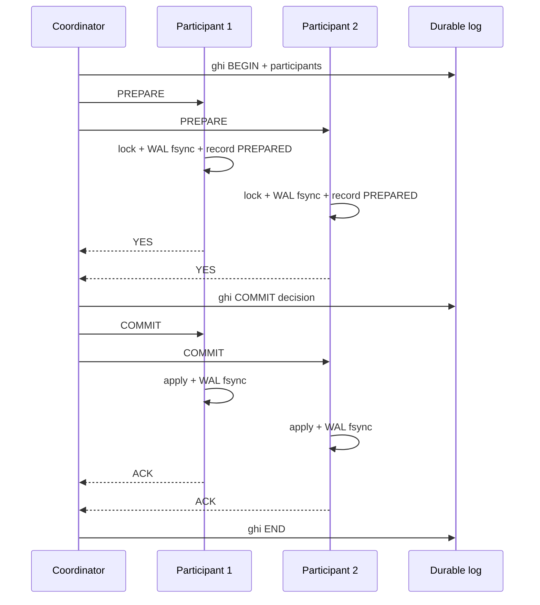
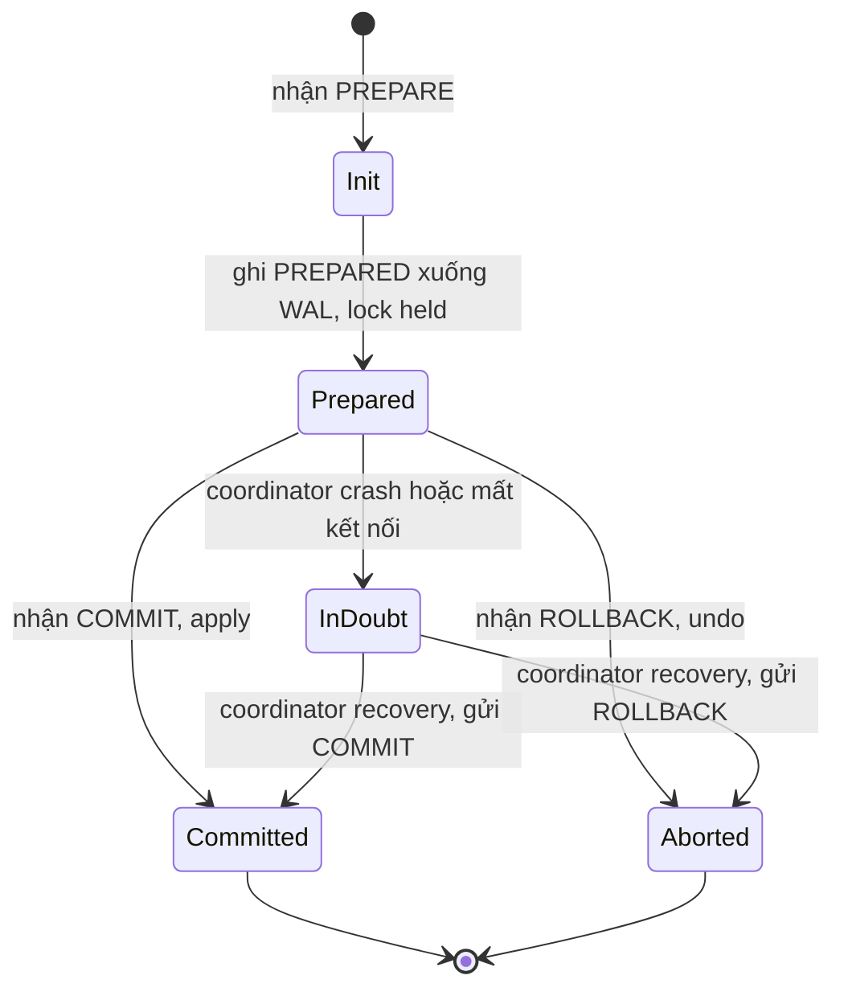

# What is two-phase commit (2PC)?

> Bài này giải thích 2PC: coordinator + participants, hai phase Prepare và Commit, cách XA và `PREPARE TRANSACTION` hiện thực, các failure mode (coordinator crash, network partition), đánh đổi với latency và SPOF. Bài [database-transaction](database-transaction.md) nền tảng transaction; bài [acid-properties](acid-properties.md) giải thích C trong ACID; bài [acid-properties](acid-properties.md) bàn về D.

Chủ đề: Database · Ngày: 2026-10-16

## 0. Nền tảng trước khi đọc

**Bối cảnh:** Nơi ứng dụng lưu dữ liệu và đọc lại dữ liệu. Khó ở chỗ dữ liệu phải đúng khi nhiều người cùng đọc, ghi, hoặc khi máy bị lỗi.

**Nói đơn giản:** 2PC giúp nhiều database cùng commit một giao dịch, nhưng coordinator hỏng có thể làm các bên chờ lâu.

**Từ khóa cần biết:** row = một dòng dữ liệu; query = câu hỏi gửi database; transaction = một nhóm thay đổi được xử lý cùng nhau.

**Ví dụ dễ hình dung:** Một order cần ghi cả database order và database payment; coordinator phải biết cả hai đã prepare trước khi commit.

Khi đọc, luôn hỏi ba câu: nó giải quyết vấn đề gì, nó làm việc theo những bước nào, và khi nào không nên dùng?

**Cách học bài này:** Đọc phần này trước để nắm từ khóa; đọc phần 1 để lấy câu trả lời 30 giây; đọc phần 2 để hiểu cơ chế; cuối cùng mở từng câu hỏi ở phần 3 để luyện nói. Các con số và lệnh trong bài là bằng chứng cho câu trả lời, không cần học thuộc nếu chưa hiểu cơ chế.

## 1. Là gì

### Đọc nhanh trước khi đi sâu

**Ý chính:** 2PC giúp nhiều database cùng commit một giao dịch, nhưng coordinator hỏng có thể làm các bên chờ lâu.

**Ví dụ interview:** Một order cần ghi cả database order và database payment; coordinator phải biết cả hai đã prepare trước khi commit.

**Luồng 4 bước:**

1. Ứng dụng gửi query qua driver hoặc connection pool.
2. Database engine tìm dữ liệu, kiểm tra constraint và xử lý transaction.
3. Engine dùng index, lock/MVCC và log tùy loại thao tác.
4. Kết quả được trả về; thay đổi chỉ bền vững sau COMMIT.

**Nói như trong interview:** 2PC giúp nhiều database cùng commit một giao dịch, nhưng coordinator hỏng có thể làm các bên chờ lâu. Hãy nói theo bốn bước trên trước; nếu interviewer hỏi sâu, chuyển sang cơ chế **Bước 1. Phase 1: Prepare**, rồi nêu trade-off và failure mode ở các phần sau.

## 2. Cơ chế cốt lõi

### Bước 1. Phase 1: Prepare

1. Coordinator ghi log "BEGIN" + danh sách participant (durable, fsync).
2. Coordinator gửi PREPARE cho từng participant qua mạng. Participant:
     - Khóa các row liên quan (như transaction bình thường).
     - Ghi redo log + undo log, ghi record "PREPARED" vào WAL (hoặc tương đương).
     - Trả YES nếu thành công; NO nếu vi phạm constraint, deadlock, hoặc timeout.
3. Coordinator đợi tất cả reply. Có ≥1 NO → chuyển sang phase 2 với ABORT. Tất cả YES → chuyển sang COMMIT.

### Bước 2. Phase 2: Commit hoặc Rollback

1. Coordinator ghi log quyết định (COMMIT/ROLLBACK) xuống disk (durable).
2. Coordinator gửi COMMIT hoặc ROLLBACK cho từng participant. Participant áp dụng hoặc revert, ghi record tương ứng, fsync, gửi ACK.
3. Coordinator đợi ACK từ tất cả participant rồi quên transaction (ghi log END).

### Bước 3. Sequence diagram 2PC



*Happy path 2PC: 1 RTT Prepare (đi), 1 RTT Commit (đi), mỗi participant fsync WAL ít nhất 2 lần (PREPARED + COMMIT). Tổng ~2-3 RTT + 2-3 fsync.*

### Bước 4. State machine của participant



*State machine: participant chuyển Init → Prepared sau khi ghi record bền; sau đó chỉ lệnh từ coordinator. Nếu coordinator crash ở giữa, participant ở Prepared (in-doubt) và lock vẫn bị giữ cho đến khi coordinator recovery.*

### Bước 5. Hiện thực trong PostgreSQL

```sql
-- Application tự làm coordinator
BEGIN;
UPDATE accounts SET balance = balance - 100 WHERE id = 1;
PREPARE TRANSACTION 'txn-12345';  -- ghi PREPARED xuống WAL, fsync
-- Lúc này transaction "treo" ở trạng thái prepared, lock vẫn held

-- Sau khi các DB khác cũng PREPARE xong, commit:
COMMIT PREPARED 'txn-12345';

-- Hoặc rollback nếu có DB NO:
ROLLBACK PREPARED 'txn-12345';

-- Xem các transaction prepared chưa quyết định
SELECT * FROM pg_prepared_xacts;
-- Nếu > 0 và lâu → coordinator hoặc participant crash
```

PostgreSQL giữ transaction prepared trong WAL cho đến khi COMMIT/ROLLBACK PREPARED. Có thể cấu hình `max_prepared_transactions` (mặc định 0, phải tăng nếu dùng 2PC).

### Bước 6. Hiện thực trong MySQL InnoDB

InnoDB hỗ trợ XA SQL chuẩn:

```sql
-- Application/transaction manager là coordinator
XA START 'txn-12345';
UPDATE accounts SET balance = balance - 100 WHERE id = 1;
XA END 'txn-12345';
XA PREPARE 'txn-12345';
-- Nếu có nhiều DB, chờ PREPARE từ các DB khác
XA COMMIT 'txn-12345';
-- hoặc XA ROLLBACK 'txn-12345';

-- Xem prepared transactions
SELECT * FROM information_schema.innodb_xa_trx;
SELECT * FROM information_schema.innodb_xa_prepared;
```

### Bước 7. Hiện thực qua JTA (Java)

Java Transaction API (JTA) cho phép application dùng transaction manager (Narayana, Atomikos) làm coordinator. Ví dụ với Spring:

```java
// Spring JTA + Atomikos
@Bean public AtomikosDataSourceBean ds1() { /* DB 1 */ }
@Bean public AtomikosDataSourceBean ds2() { /* DB 2 */ }

@Transactional(rollbackFor = Exception.class)
public void transferMoney(long fromAccount, long toAccount, BigDecimal amount) {
    jdbcTemplate1.update("UPDATE accounts SET balance = balance - ? WHERE id = ?", amount, fromAccount);
    jdbcTemplate2.update("UPDATE accounts SET balance = balance + ? WHERE id = ?", amount, toAccount);
}
// Spring + Atomikos lo coordinator: PREPARE 2 DB, COMMIT cả hai hoặc rollback nếu exception
```

### Bước 8. Các failure mode

| Failure | Triệu chứng | Cách phát hiện | Cách xử lý |
|---|---|---|---|
| Coordinator crash sau Prepare | Participant ở "in-doubt", lock held | `pg_prepared_xacts`, `innodb_xa_prepared` | Coordinator recovery đọc log, quyết định COMMIT/ROLLBACK, retry đến participant |
| Participant crash trước Prepare | Coordinator đợi timeout | Coordinator timeout config | Coordinator rollback |
| Participant crash sau Prepare, restart | Participant khôi phục, thấy PREPARED trong log | Engine startup recovery | Khi coordinator gửi COMMIT/ROLLBACK, participant xử lý |
| Network partition | Coordinator không liên lạc được participant | Timeout | Coordinator rollback sau khi hết timeout; participant rollback khi thấy timeout |

### Bước 9. So với alternatives

- **Saga + outbox**: mỗi service có transaction riêng + compensating action; không có coordinator SPOF. Trade-off: eventual consistency, cần idempotency.
- **Replication sync**: nếu chỉ cần replicate một DB sang DB khác, dùng replication đồng bộ (PostgreSQL `synchronous_standby_names`) thay vì 2PC. Đơn giản hơn.
- **Single DB**: nếu có thể, đưa tất cả dữ liệu vào một DB. Transaction một DB rẻ hơn nhiều.

### Quan sát

```sql
-- PostgreSQL: xem prepared transactions đang treo
SELECT gid, prepared, owner, database FROM pg_prepared_xacts ORDER BY prepared;
-- Nếu > 0 và prepared > 5 phút → coordinator chết hoặc quên COMMIT/ROLLBACK

-- Kill một prepared transaction treo
ROLLBACK PREPARED 'txn-12345';
-- Chỉ làm khi biết chắc coordinator đã quyết định rollback

-- MySQL InnoDB: xem prepared transactions
SELECT trx_id, trx_state, trx_prepared_xid, trx_started
FROM information_schema.innodb_trx
WHERE trx_state = 'PREPARED';
```

```bash
# PostgreSQL: log ghi PREPARED/COMMIT (nếu bật log_statement = 'all')
grep -E 'PREPARED TRANSACTION|COMMIT PREPARED' /var/log/postgresql/*.log
```

### Ví dụ chạy từng bước

**Kịch bản:** Chuyển tiền nội bộ ngân hàng, trừ `account A` ở DB PostgreSQL (DB1) và cộng `account B` ở DB PostgreSQL khác (DB2). Coordinator là Java app. Một participant (DB2) fail sau prepare.

**Bước 1 (T₀): Coordinator ghi BEGIN log**

- App nhận request `transfer(accountA=1001, accountB=2002, amount=500.000đ)`.
- Coordinator ghi log bền (durable, fsync): `BEGIN txn-7f3a participants=[DB1, DB2]`. Coordinator log file: `/var/log/coordinator/txn-7f3a.log`.
- Coordinator mở socket tới DB1 và DB2.

| Thành phần | Trạng thái |
|---|---|
| Coordinator | log: BEGIN txn-7f3a [DB1, DB2], fsync OK |
| DB1 | Chờ PREPARE |
| DB2 | Chờ PREPARE |

**Bước 2 (T₀+2ms): Phase 1 — PREPARE gửi đi**

- Coordinator gửi `PREPARE 'txn-7f3a'` tới DB1. DB1 thực hiện:
  - `BEGIN; UPDATE accounts SET balance = balance - 500000 WHERE id = 1001;` → lock row 1001.
  - Ghi WAL: `PREPARED txn-7f3a` (transaction id `txn-7f3a`, prepared=true), fsync.
  - Trả YES.
- Coordinator gửi `PREPARE 'txn-7f3a'` tới DB2. DB2 thực hiện:
  - `BEGIN; UPDATE accounts SET balance = balance + 500000 WHERE id = 2002;` → lock row 2002.
  - Ghi WAL: `PREPARED txn-7f3a`, fsync.
  - **Nhưng ngay sau khi fsync xong, DB2 process crash** (OOM do spike memory). Trả lời YES chưa kịp gửi → coordinator timeout.

| Thành phần | Trạng thái |
|---|---|
| Coordinator | Đã nhận YES từ DB1, đợi DB2 (timeout 5s) |
| DB1 | PREPARED txn-7f3a, lock row 1001, fsync OK |
| DB2 | PREPARED txn-7f3a, lock row 2002, fsync OK, **process crashed trước khi gửi YES** |

**Bước 3 (T₀+5s): Coordinator timeout, quyết định**

- Coordinator không nhận YES từ DB2 trong 5s. Theo policy, coordinator quyết định ABORT.
- Coordinator ghi log: `DECISION=ABORT txn-7f3a`, fsync.
- Coordinator gửi `ROLLBACK PREPARED 'txn-7f3a'` tới DB1 → DB1 apply rollback, lock row 1001 được giải phóng. Trả ACK.
- Coordinator không thể gửi tới DB2 (DB2 process chết).

| Thành phần | Trạng thái |
|---|---|
| Coordinator | log: DECISION=ABORT, đã gửi ROLLBACK tới DB1, DB2 không liên lạc được |
| DB1 | ROLLBACK xong, lock giải phóng, account A.balance = giá trị cũ |
| DB2 | Process chết, khi restart sẽ thấy PREPARED txn-7f3a trong WAL, lock row 2002 vẫn giữ |

**Bước 4 (T₀+10s): DB2 restart, recovery**

- DB2 process restart. PostgreSQL startup recovery đọc WAL, thấy transaction `txn-7f3a` ở trạng thái PREPARED, không có commit record.
- DB2 KHÔNG tự ý rollback hay commit — nó chờ coordinator gửi `COMMIT/ROLLBACK PREPARED`.
- DB2 giữ transaction PREPARED trong `pg_prepared_xacts`, lock row 2002 vẫn held.

| Thành phần | Trạng thái |
|---|---|
| DB2 (restarted) | pg_prepared_xacts: txn-7f3a, lock row 2002 vẫn held |
| Coordinator | Đã log ABORT, retry gửi tới DB2 (DB2 chưa online) |
| Account B.balance | Chưa cộng 500k (đúng — atomic fail) |

**Bước 5 (T₀+30s): Coordinator retry, DB2 xử lý**

- Coordinator thử lại `ROLLBACK PREPARED 'txn-7f3a'` tới DB2. DB2 online, apply rollback, lock row 2002 giải phóng.
- Coordinator ghi log: `END txn-7f3a`, fsync.

| Thành phần | Trạng thái |
|---|---|
| Coordinator | log: END txn-7f3a, giao dịch hoàn tất (đã ABORT) |
| DB1 | ROLLBACK xong từ lâu |
| DB2 | ROLLBACK xong, lock giải phóng |

**Biến thể: Coordinator crash sau khi nhận cả 2 YES, trước khi gửi COMMIT**

- Coordinator ghi `DECISION=COMMIT`, fsync. Ngay sau đó coordinator crash trước khi gửi COMMIT tới DB1/DB2.
- DB1 và DB2 vẫn ở PREPARED. Khi coordinator restart, đọc log, thấy DECISION=COMMIT → retry gửi COMMIT. Cả hai apply, lock giải phóng.
- Nếu coordinator log mất (không replicate), DB1/DB2 ở in-doubt vĩnh viễn. Operator phải can thiệp.

Điều rút ra: một participant lỗi sau prepare nhưng trước khi gửi YES là scenario 2PC hay gặp nhất — coordinator phải có timeout + retry, và recovery của participant phải biết chờ coordinator chứ không tự quyết định, như câu "Nếu coordinator crash sau Prepare" ở phần 3A nhấn mạnh.

## 3. Câu hỏi phỏng vấn

### 3A. Câu hỏi đào sâu

<details class="qa">
<summary>Câu 1. Mô tả chính xác hai phase của 2PC và vai trò của coordinator.</summary>

**Trả lời ngắn:** Phase 1 Prepare: coordinator gửi PREPARE cho từng participant; participant khóa row, ghi record PREPARED xuống WAL (fsync), trả YES/NO. Phase 2 Commit/Rollback: coordinator ghi quyết định xuống log (durable); gửi COMMIT hoặc ROLLBACK cho participant. Coordinator điều phối, là điểm SPOF cho quyết định cuối.

**Đào sâu:**
- Coordinator ghi log BEGIN (danh sách participant) trước khi gửi PREPARE để recovery biết cần tiếp tục.
- Coordinator ghi quyết định (COMMIT/ROLLBACK) trước khi gửi để đảm bảo khi restart biết phải gửi gì.
- Participant ở state "prepared" lock row đến khi nhận COMMIT/ROLLBACK; lock kéo dài có thể gây contention.
- Tổng message: 1 round trip Prepare (đi), 1 round trip Commit (đi) → 2 RTT + log fsync ở coordinator và participant.

**Bẫy:** "2PC chỉ tốn 1 RTT". Sai — cần ≥2 RTT, có thể 3-4 RTT nếu có retry.

**Follow-up:** Coordinator ghi log trước khi gửi có tốn thêm fsync không? Có — coordinator cũng cần D. fsync log tốn ~1-10 ms, latency tổng cộng tăng.
</details>

<details class="qa">
<summary>Câu 2. Nếu coordinator crash sau Prepare nhưng trước Commit, participant ở state nào và xử lý ra sao?</summary>

**Trả lời ngắn:** Participant ở trạng thái "in-doubt" (PREPARED trong WAL, lock held). Khi coordinator restart, đọc log BEGIN → biết có transaction prepared, đọc quyết định COMMIT/ROLLBACK (nếu đã ghi), retry gửi cho participant. Nếu coordinator mất hoàn toàn (không recovery), participant khoá mãi.

**Đào sâu:**
- Lock giữ trong WAL: PostgreSQL `pg_prepared_xacts`, InnoDB `innodb_xa_prepared`. Row lock vẫn giữ cho đến khi COMMIT/ROLLBACK PREPARED.
- Khi coordinator recovery: chạy `recovery` procedure, đọc log xác định quyết định, retry gửi. Coordinator có thể dùng heuristic: timeout cấu hình → quyết định rollback.
- Nếu coordinator mất hoàn toàn (không restart được), operator phải can thiệp tay: rollback hoặc commit prepared transactions dựa trên business logic.
- Bài học: 2PC chuyển rủi ro từ DB sang coordinator; coordinator cần HA và log bền vững.

**Bẫy:** "Coordinator crash thì 2PC rollback tự động". Sai — participant không biết rollback hay commit; chờ coordinator. Nếu coordinator không recovery, lock treo vĩnh viễn.

**Follow-up:** Operator thủ công `ROLLBACK PREPARED` an toàn không? An toàn nếu chắc coordinator chưa commit; rủi ro nếu coordinator thật ra đã commit (gây mất dữ liệu ở participant). Cần kiểm tra log coordinator.
</details>

<details class="qa">
<summary>Câu 3. 2PC khác gì với transaction một DB về chi phí và đảm bảo?</summary>

**Trả lời ngắn:** Transaction một DB: 1-2 fsync, latency thấp, không có coordinator SPOF. 2PC: coordinator là SPOF, 2-3 RTT giữa coordinator và mỗi participant, mỗi participant fsync ≥2 lần (PREPARED + COMMIT/ROLLBACK). Đổi lại: atomic xuyên DB.

**Đào sâu:**
- Chi phí 2PC: latency tăng vì round trip. Với 3 participant cùng DC ~0.5ms RTT mỗi cái, tổng thêm ~2-5 ms.
- Throughput: lock held ở participant từ lúc PREPARE đến COMMIT; nếu 1 participant chậm, tất cả chậm.
- Một số engine có "presumed abort" tối ưu: nếu coordinator không thấy log BEGIN, mặc định rollback. Giảm work cho recovery.
- 2PC cần log coordinator bền vững — coordinator cũng cần WAL/replication để HA.

**Bẫy:** "2PC chỉ chậm hơn transaction thường 1 chút". Sai — 2PC có thể chậm 5-10x vì lock held kéo dài, network, fsync.

**Follow-up:** Có cần fsync log ở coordinator không? Có — nếu không ghi log, coordinator restart có thể quên đã commit hay rollback, participant khoá mãi.
</details>

<details class="qa">
<summary>Câu 4. 2PC đảm bảo gì về atomicity, và không đảm bảo gì?</summary>

**Trả lời ngắn:** 2PC đảm bảo atomic ở trạng thái bình thường: tất cả participant commit hoặc tất cả rollback. Không đảm bảo khi coordinator crash kéo dài hoặc partition — participant có thể khoá ở prepared vĩnh viễn. Không đảm bảo isolation nếu các transaction khác đọc dữ liệu đang trong prepared.

**Đào sâu:**
- 2PC đảm bảo: nếu coordinator quyết định COMMIT, mọi participant sẽ commit (giả sử log coordinator bền và recovery thành công). Nếu ABORT, mọi participant rollback.
- Không đảm bảo: liveness — coordinator chết → participant khoá; không ai gửi COMMIT/ROLLBACK.
- Không đảm bảo isolation: row đã prepared có thể bị transaction khác đọc? Không, lock vẫn giữ → không đọc được. Nhưng nếu participant dùng snapshot isolation (PostgreSQL/InnoDB), READ COMMITTED ở session khác vẫn thấy dữ liệu cũ; prepared không hiển thị cho đến khi COMMIT.
- Không đảm bảo về consistency xuyên DB: nếu logic nghiệp vụ sai, 2PC vẫn commit "nguyên tử" nhưng dữ liệu vẫn sai.

**Bẫy:** "2PC đảm bảo consistency". Sai — 2PC đảm bảo atomicity, không đảm bảo consistency nếu logic app sai.

**Follow-up:** 2PC có thay thế được ACID không? Không — 2PC chỉ A trong ACID; C do app, I do isolation level, D do fsync.
</details>

<details class="qa">
<summary>Câu 5. Khi nào nên dùng 2PC, khi nào nên tránh?</summary>

**Trả lời ngắn:** Dùng 2PC khi: cần atomic xuyên DB mà không thể gộp vào một DB; business chấp nhận latency cao và downtime nếu coordinator crash; không thể dùng saga. Tránh 2PC khi: microservice scale lớn, latency quan trọng, có thể gộp vào một DB, hoặc business chấp nhận eventual consistency.

**Đào sâu:**
- **Nên dùng**: chuyển tiền liên ngân hàng (inter-bank) cần atomic; hệ thống booking inventory từ nhiều DB legacy; workload thấp (<100 TPS) chấp nhận latency.
- **Tránh**: microservice scale > 1K TPS; business cho phép eventual consistency (cart, notification, feed); có thể gộp data vào một DB.
- **Alternatives**:
   - Saga + outbox: mỗi service có transaction + compensating action. Phổ biến nhất.
   - Replication sync: nếu chỉ replicate, dùng synchronous replication (PostgreSQL `synchronous_standby_names`) thay.
   - Single DB: nếu có thể, một DB là đơn giản nhất.
- Quy tắc ngón tay cái: 2PC là lựa chọn cuối cùng.

**Bẫy:** "Mọi multi-DB transaction cần 2PC". Sai — hầu hết dùng saga + outbox; 2PC đắt và có SPOF.

**Follow-up:** Nếu cần atomic giữa PostgreSQL và Kafka (event publish)? Không dùng 2PC truyền thống; dùng transactional outbox trong PostgreSQL + Kafka consumer xử lý idempotent.
</details>

<details class="qa">
<summary>Câu 6 (Debug). `pg_prepared_xacts` có nhiều transaction > 5 phút. Bạn xử lý thế nào?</summary>

**Trả lời ngắn:** 1) Tìm coordinator đang ở đâu và có đang chạy không. 2) Nếu coordinator chạy nhưng treo, kiểm log. 3) Nếu coordinator chết hoàn toàn, xác định quyết định dựa trên business logic và rollback/commit từng transaction. 4) Kill từng prepared transaction để giải phóng lock.

**Đào sâu:**
- Bước 1: `SELECT gid, prepared, owner FROM pg_prepared_xacts;` — xem `owner` (user) và `prepared` (timestamp).
- Bước 2: Application logs tìm coordinator process; kiểm tra có đang chạy, có exception, có timeout.
- Bước 3: Nếu coordinator chạy: tăng `max_prepared_transactions` nếu đầy, hoặc fix root cause (timeout config, deadlock).
- Bước 4: Nếu coordinator chết: kiểm log coordinator xem đã commit/rollback prepared nào chưa. Nếu mơ hồ, rollback từng cái (`ROLLBACK PREPARED 'gid';`) — mất dữ liệu ở prepared nhưng giải phóng lock.
- Bước 5: Sau khi xử lý, monitor lại để tránh lặp lại. Alert khi `pg_prepared_xacts` > 0 và `prepared > 5 phút`.
- Nguyên nhân phổ biến: coordinator crash, network partition, timeout config sai, bug trong code coordinator.

**Bẫy:** Kill tất cả prepared transactions mà không kiểm business — có thể mất giao dịch đã thật sự commit ở DB khác.

**Follow-up:** Làm sao cảnh báo sớm? Cron query `pg_prepared_xacts` mỗi phút, alert khi count > 0 hoặc oldest > N giây.
</details>

<details class="qa">
<summary>Câu 7 (Thiết kế). Thiết kế hệ thống đặt vé máy bay cần atomic giữa 3 hãng hàng không (3 DB). Bạn chọn 2PC hay saga? Vì sao?</summary>

**Trả lời ngắn:** Saga + outbox cho flow chính (search → book → pay → ticket); 2PC chỉ dùng cho bước trừ tiền liên ngân hàng nếu cần atomic tuyệt đối. Lý do: 2PC đắt, coordinator SPOF, lock kéo dài — không phù hợp với flow có nhiều bước và chấp nhận được eventual.

**Đào sâu:**
- **Flow chính** (search → book → pay):
   - Saga: mỗi hãng là một step có transaction riêng + compensating (cancel booking, refund). Dùng outbox queue để đảm bảo step không bị mất.
   - Eventual: customer thấy "đã book" ngay sau khi DB hãng confirm; nếu fail thì cancel.
- **Thanh toán** (3rd party gateway):
   - Saga + idempotency key: thử charge → nếu fail → reverse.
   - 2PC chỉ khi cần atomic tuyệt đối (giả sử 2 ngân hàng cùng chuyển tiền nguyên tử) — vẫn có thể dùng saga nếu business cho phép reversal.
- **2PC trade-off**: nếu bắt buộc 2PC, cần HA coordinator (active-passive), log replication, và recovery procedure tốt.
- **Chọn**: saga cho flow chính vì lock kéo dài gây timeout; 2PC cho riêng ngân hàng nếu không thể dùng reversal.
- **Idempotency**: mỗi saga step có idempotency key để retry không double-book.

**Bẫy:** Dùng 2PC cho cả flow 3 hãng — coordinator crash giữa chừng → 3 hãng khoá inventory, mất tiền do cancel hàng loạt.

**Follow-up:** Nếu business không cho phép eventual consistency cho inventory (khách không chấp nhận "đã book mà sau lại mất"), giải pháp gì? Dùng reservation timeout ngắn (5-15 phút) + saga. Vẫn không cần 2PC.
</details>

### 3B. Câu hỏi phỏng vấn liên quan

<details class="qa">
<summary>Câu 8. Sự khác biệt giữa XA transaction và `PREPARE TRANSACTION`?</summary>

**Trả lời:** XA là chuẩn X/Open DTP cho phép coordinator (thường là transaction manager bên ngoài) điều phối nhiều resource qua `XA START/END/PREPARE/COMMIT/ROLLBACK`. `PREPARE TRANSACTION` là câu SQL của PostgreSQL cho phép application tự làm coordinator với các DB PostgreSQL khác nhau. Cả hai dùng cùng ý tưởng 2PC; XA phổ biến hơn trong Java EE.
</details>

<details class="qa">
<summary>Câu 9. Coordinator có cần replicate log không?</summary>

**Trả lời:** Có — nếu coordinator mất log, restart không biết đã quyết định gì, participant ở prepared mãi. Replication đồng bộ log coordinator cần thiết để HA. Nếu không, mất coordinator = mất transaction (lock giữ vĩnh viễn).
</details>

<details class="qa">
<summary>Câu 10. "Heuristic commit" trong 2PC là gì?</summary>

**Trả lời:** Khi coordinator không liên lạc được participant và hết timeout, một số transaction manager cho phép operator quyết định thủ công commit hoặc rollback một participant. Đây là "heuristic decision" — vi phạm nguyên tắc 2PC nhưng là cách giải phóng lock khi coordinator chết thật. Nguy cơ: nếu coordinator thật ra đã commit participant khác, dữ liệu lệch. Operator phải xử lý inconsistency sau.
</details>

<details class="qa">
<summary>Câu 11. 2PC có chống deadlock không?</summary>

**Trả lời:** Không. 2PC dùng lock để chống conflict, lock có thể gây deadlock giữa các participant. Khi phát hiện deadlock, một participant rollback, trả NO cho coordinator, toàn bộ 2PC rollback. Tốn message nhưng giải phóng.
</details>

<details class="qa">
<summary>Câu 12. Saga khác gì với 2PC về lý thuyết?</summary>

**Trả lời:** 2PC đảm bảo atomic (tất cả hoặc không) bằng lock + coordinator; đổi lại SPOF và lock kéo dài. Saga đảm bảo eventual consistency: mỗi step có compensating action, không lock xuyên step, không SPOF. Saga chấp nhận được trạng thái "đã book một phần" tạm thời; 2PC không. Saga dùng khi business chấp nhận reversal; 2PC dùng khi không thể.
</details>

<details class="qa">
<summary>Câu 13. True or false: "2PC đảm bảo atomicity ngay cả khi coordinator crash."</summary>

**Trả lời:** Sai. 2PC đảm bảo atomicity khi coordinator chạy bình thường. Nếu coordinator crash giữa chừng, participant ở trạng thái in-doubt (prepared) và lock vẫn giữ. Coordinator phải recovery và gửi COMMIT/ROLLBACK; nếu coordinator mất vĩnh viễn, lock giữ mãi mãi. 2PC chuyển lỗi từ "không atomic" sang "treo vĩnh viễn" — đổi vấn đề chứ không giải.
</details>

<details class="qa">
<summary>Câu 14. Khi nào `max_prepared_transactions` trong PostgreSQL gây lỗi?</summary>

**Trả lời:** `max_prepared_transactions` mặc định 0 → mọi `PREPARE TRANSACTION` thất bại. Phải tăng (ví dụ 10) để dùng 2PC. Nếu tăng không đủ và vượt quá, `PREPARE TRANSACTION` trả lỗi `53400` (`too_many_prepared_xacts`). Operator phải COMMIT/ROLLBACK prepared cũ.
</details>

<details class="qa">
<summary>Câu 15. 2PC có throughput cao không? Cho con số bậc độ lớn.</summary>

**Trả lời:** Không. Mỗi 2PC tốn 2-3 fsync ở mỗi participant + coordinator + 2-3 RTT mạng. Với 3 participant cùng DC ~0.5 ms RTT, latency thêm ~3-5 ms so với transaction một DB. Throughput thường < 1K TPS cho workload 2PC multi-DB. Microservice scale > 10K TPS thường không dùng 2PC.
</details>

## 4. Đánh đổi và sự cố production

### So sánh ba cách đảm bảo atomic xuyên DB

| Tiêu chí | 2PC (XA / PREPARE) | Saga + outbox | Single DB + replica sync |
|---|---|---|---|
| Atomicity | Mạnh (nếu coordinator HA) | Eventual consistency | Không (chỉ replicate) |
| Latency | 2-3 RTT + 2-3 fsync | 1 RTT mỗi step | Rất thấp |
| Throughput | Thấp (< 1K TPS) | Trung-cao | Cao |
| Coordinator SPOF | Có (cần HA) | Không | Không |
| Lock held | Lâu (PREPARED → COMMIT) | Ngắn (mỗi step) | Không |
| Khi crash | Lock khoá mãi nếu coordinator mất | Compensating action | WAL replay |
| Phù hợp khi | Inter-bank, atomic bắt buộc | Microservice scale | Một DB, chỉ replicate |

### Năm failure mode

| Triệu chứng | Nguyên nhân gốc | Cách kiểm tra | Cách sửa |
|---|---|---|---|
| `pg_prepared_xacts` hoặc `innodb_xa_prepared` tăng dần, lock contention tăng | Coordinator chết hoặc mất kết nối participant | `SELECT * FROM pg_prepared_xacts;` | Coordinator HA (active-passive + log replication), monitoring alert |
| 2PC latency tăng từ 5ms lên 50ms | Network giữa coordinator và participant chậm, hoặc disk fsync chậm | iostat, ping, network metric | Network upgrade, SSD riêng cho log, batch 2PC |
| Một số transaction COMMIT, một số ROLLBACK trong 2PC | Coordinator đã quyết định nhưng mất message gửi đến participant | Coordinator log + participant log | Coordinator retry gửi, idempotent ở participant |
| `ER_LOCK_WAIT_TIMEOUT` ở InnoDB trong 2PC | Lock held lâu bởi prepared transaction | `SHOW ENGINE INNODB STATUS` | Tăng timeout config, commit/rollback prepared cũ |
| Heuristic commit/rollback inconsistency | Operator can thiệp tay khi coordinator chết, quyết định sai | Audit log, kiểm tra DB từng bên | Reconciliation script so sánh tổng số; phát hiện drift, manual fix |

## 5. Cheat sheet

| Chủ đề | Con số / quy tắc cần nhớ |
|---|---|
| Hai phase | Prepare (ghi PREPARED + fsync, trả YES/NO) → Commit/Rollback (ghi quyết định + apply) |
| Coordinator | Là SPOF cho quyết định; cần log bền + HA (active-passive) |
| Participant state | Init → Prepared → Committed/Aborted (hoặc In-Doubt nếu coordinator crash) |
| RTT tổng | 2-3 RTT (Prepare đi, Commit đi; có thể retry thêm) |
| Lock held | Từ lúc Prepare đến khi Commit/Rollback; lock row |
| Hiện thực SQL | XA START/END/PREPARE/COMMIT; PostgreSQL `PREPARE TRANSACTION` |
| Hiện thực Java | JTA + Atomikos/Narayana |
| Xem prepared | PG `pg_prepared_xacts`, InnoDB `innodb_xa_prepared` |
| Lựa chọn cuối | 2PC là lựa chọn cuối; ưu tiên saga + outbox |
| Không cần 2PC | Nếu single DB, hoặc chỉ replicate → dùng sync replication |

**Học tiếp:**
- [database-transaction](database-transaction.md) — ranh giới BEGIN/COMMIT
- [acid-properties](acid-properties.md) — A trong ACID và đánh đổi với D
- [database-deadlock](database-deadlock.md) — khi lock khoá xuyên transaction
- [write-ahead-log](write-ahead-log.md) — WAL đảm bảo PREPARED bền
