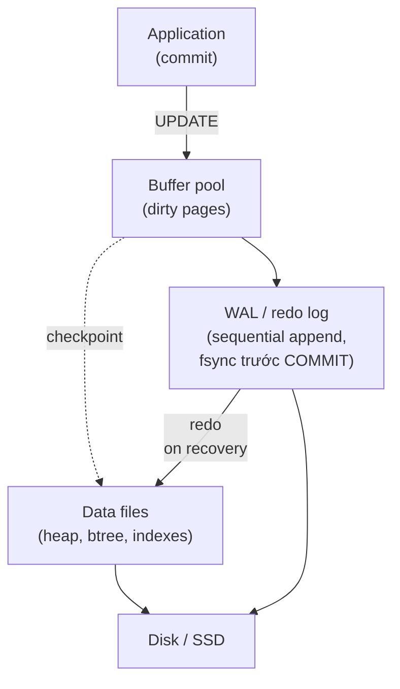
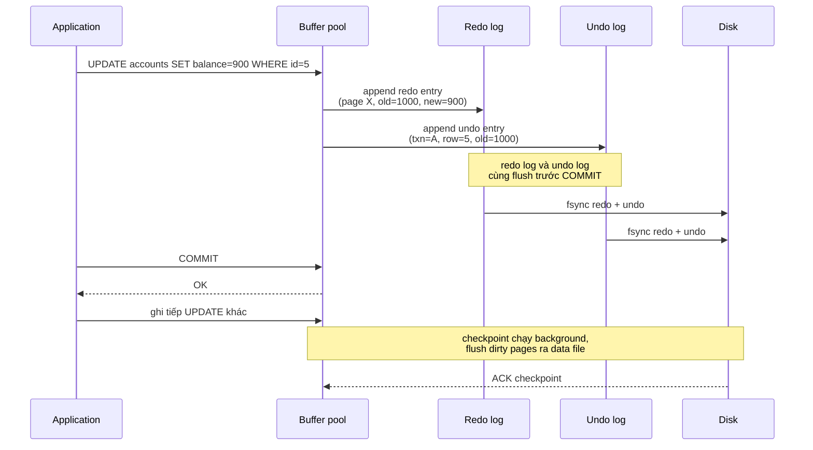

# What is a write-ahead log (WAL)?

> Bài này giải thích write-ahead log (WAL) — quy tắc "ghi log trước, ghi data sau" — đảm bảo engine không bao giờ để data file trong trạng thái không khôi phục được. Bài đi vào redo log, undo log, checkpoint, recovery sau crash và vai trò của WAL với replication. Bài liên quan: [database-transaction](database-transaction.md) (ACID), [acid-properties](acid-properties.md), [database-replication](database-replication.md).

Chủ đề: Database · Ngày: 2026-10-16

## 1. Là gì

Write-ahead log (WAL) là quy tắc storage engine ghi mọi thay đổi vào một file log **trước** khi thay đổi được áp dụng vào data file chính. Khi commit, chỉ cần đảm bảo log đã flush xuống disk; data file có thể cập nhật sau. Nếu crash giữa chừng, recovery dùng log để tái hiện thay đổi chưa được flush (redo) và hủy thay đổi của transaction chưa commit (undo).

WAL là nền tảng để đảm bảo thuộc tính **D** (Durability) và **A** (Atomicity) của ACID trong PostgreSQL, MySQL InnoDB, Oracle, SQL Server (gọi là transaction log). Mỗi engine gọi tên khác — InnoDB gọi redo log, PostgreSQL dùng WAL files trong `pg_wal/`, Oracle gọi redo log — nhưng nguyên tắc giống nhau.



*Sơ đồ vị trí: UPDATE sửa buffer pool (in-memory); engine ghi WAL ngay (sequential append + fsync) để đảm bảo durability. Checkpoint sau đó flush dirty pages từ buffer pool ra data files. Recovery: nếu crash, đọc WAL, replay phần chưa flush.*

### Trả lời 30 giây

"WAL là quy tắc bắt buộc ghi thay đổi vào log trước khi áp dụng vào data file. Khi commit, engine chỉ cần fsync log xuống disk; không cần flush data file. Nếu crash, recovery dùng log để redo các thay đổi đã commit nhưng chưa flush, và undo các thay đổi của transaction chưa commit. InnoDB dùng redo log + undo log + checkpoint; PostgreSQL dùng WAL files (mặc định 16 MB, lưu tại `pg_wal/`) cho cả crash recovery và replication streaming. Lợi ích chính: ghi log tuần tự (sequential) nhanh hơn ghi data file ngẫu nhiên (random) — đổi cái nào fsync nhiều thành ít, cải thiện throughput. WAL cũng là nguồn cho point-in-time recovery và replication streaming."

## 2. Cơ chế cốt lõi

### Bước 1. Tại sao cần WAL: fsync data file quá đắt

- Một random write vào data file (4 KB page) thường đi tới vị trí bất kỳ trên đĩa, tốn vài ms (HDD) hoặc ~100 µs (SSD). Ngẫu nhiên, mỗi UPDATE có thể phải update index A, index B, heap, undo slot → nhiều random write. Commit mà fsync mỗi thứ thì tốn 5-20 ms mỗi transaction.
- Sequential write vào log: chỉ append vào cuối file, tốn ~100 µs (SSD) hoặc vài ms (HDD). Một transaction ghi vài entry log đủ.
- WAL không thay thế data file — vẫn phải flush dirty pages lên đĩa, nhưng có thể trì hoãn, gom batch, chạy ngầm. Commit không phải đợi flush data file.

### Bước 2. Quy tắc WAL: ghi log trước data

1. Client `BEGIN; UPDATE accounts SET balance = 900 WHERE id = 5;`.
2. InnoDB: vào buffer pool, đánh dấu page `accounts/5` là dirty. Ghi entry vào redo log buffer (in-memory) ghi lại "page X, offset Y, giá trị cũ, giá trị mới". Đồng thời ghi undo log entry để rollback nếu cần.
3. Client `COMMIT;`. InnoDB fsync redo log xuống disk. Sau khi fsync thành công, COMMIT trả OK. Data file vẫn dirty trong buffer pool, chưa flush.
4. Checkpoint sau (background) flush dirty pages từ buffer pool ra data file.

Nếu crash trước bước 3: redo log chưa fsync → khi recovery, transaction đó coi như chưa commit, undo. Nếu crash sau bước 3 nhưng trước checkpoint: redo log đã fsync nhưng data file chưa → recovery redo entry đó.

### Bước 3. Redo log và undo log — hai nửa của WAL



*Hai nửa của WAL: redo log ghi "giá trị mới" để tái hiện sau crash (commit nhưng chưa flush); undo log ghi "giá trị cũ" để rollback transaction chưa commit. Cả hai flush xuống disk trước COMMIT.*

- **Redo log**: physical hoặc logical log ghi lại cách biến đổi 1 page. InnoDB ghi physical redo (diff ở mức byte). PostgreSQL ghi logical (xlog record ghi lại "tuple X trở thành Y cho txn T"). Cả hai đều đủ để replay.
- **Undo log**: ghi giá trị trước khi sửa, dùng để ROLLBACK và để MVCC cung cấp phiên bản cũ cho transaction khác đọc. InnoDB lưu undo trong system tablespace (hoặc undo tablespace riêng từ MySQL 8.0).
- Redo + undo flush **nguyên tử** trước COMMIT. Nếu redo flush xong nhưng undo flush xong, recovery vẫn undo được (redo có tham chiếu tới undo).

### Bước 4. Checkpoint: cắt bớt WAL, tăng tốc recovery

- Sau khi checkpoint flush một batch dirty pages xong, engine ghi checkpoint marker vào redo log. Tới thời điểm đó, mọi page có thể cần redo từ checkpoint trở đi.
- Lần recovery sau chỉ cần đọc redo log từ checkpoint gần nhất, không phải từ đầu. WAL files trước đó có thể xoá (archive hoặc recycle).
- PostgreSQL checkpoint: `CHECKPOINT` SQL hoặc tự động khi `checkpoint_timeout` (mặc định 5 phút) hoặc khi số WAL files tới `max_wal_size`. InnoDB checkpoint ngầm định, có thể ép qua `innodb_checkpoint_flushes`.
- Checkpoint quá thường → I/O nặng. Quá hiếm → recovery chậm (phải replay nhiều WAL). Là điểm cân bằng.

### Bước 5. Recovery sau crash

1. Khi engine khởi động lại sau crash, nó đọc redo log từ checkpoint gần nhất.
2. Replay (redo) mọi entry thuộc transaction đã commit (ghi nhận commit LSN ở cuối transaction) → data file được cập nhật đúng.
3. Mọi entry thuộc transaction chưa commit (không có commit record) → undo dùng undo log để quay về giá trị cũ.
4. Engine sẵn sàng phục vụ; consistency lại nguyên vẹn.

PostgreSQL chi tiết hơn: vì dùng MVCC + logical log, recovery chia hai pass — REDO và UNDO. InnoDB kết hợp trong một pass vì undo log persistent trong system tablespace.

### Bước 6. fsync và cấu hình đánh đổi

- `fsync`: gọi hệ điều hành để đảm bảo dữ liệu đã xuống đĩa vật lý. Không fsync thì dữ liệu có thể ở page cache OS, mất khi mất điện.
- MySQL: `innodb_flush_log_at_trx_commit` = 1 (fsync mỗi commit, an toàn nhất), 2 (fsync mỗi giây), 0 (không fsync). Tương tự `sync_binlog`.
- PostgreSQL: `synchronous_commit = on` (mặc định); `off` cho phép commit trả OK trước khi WAL flush (rủi ro mất vài transaction cuối).
- Đánh đổi: fsync nhiều → chậm hơn (~1-10 ms mỗi commit); fsync ít → nhanh hơn nhưng mất dữ liệu khi crash.

### Bước 7. WAL trong replication


*Streaming replication: replica nhận WAL từ primary và replay. Primary commit nhanh (chỉ fsync log); replica tốc độ riêng.*

- MySQL: replica đọc binlog (không phải redo log). PostgreSQL: replica đọc WAL qua `wal_receiver`, replay thành data file. Cả hai cho phép lag ~ms.
- WAL còn cho phép PITR (xem bước 9 và cheat sheet) và logical replication (PostgreSQL `wal2json`, `pgoutput`).

### Bước 8. Quan sát thực tế

```sql
-- PostgreSQL: LSN hiện tại
SELECT pg_current_wal_lsn(), pg_current_wal_insert_lsn();

-- PostgreSQL: checkpoint stats
SELECT * FROM pg_stat_checkpointer;

-- PostgreSQL: PITR cần archive_command hoạt động
-- archive_command = '/usr/bin/rsync %p /backup/wal/%f'

-- MySQL: redo log stats
SHOW ENGINE INNODB STATUS\G
-- Log sequence number, flushed, checkpoint, dirty pages
```

### Bước 9. Khi nào WAL không đủ

- WAL bảo vệ **single-node crash** (mất điện, process chết), không bảo vệ **multi-node**, application bug, hay xoá nhầm. Cần backup định kỳ + PITR cho những trường hợp còn lại.
- WAL corrupt (bad disk block): không đọc được. PostgreSQL ghi CRC ở cuối mỗi WAL record; Oracle có block checksum. Có thể điều tra block bad qua disk health check.

### Ví dụ chạy từng bước

**Kịch bản:** PostgreSQL, 2 transaction chạy song song. T1 commit rồi crash. T2 chưa commit. Trace LSN và xem recovery redo/undo.

**Bước 1 (T₀): Checkpoint, data file ở LSN 0/1A000000**

- PostgreSQL vừa chạy checkpoint xong. Checkpoint ghi vào WAL: marker `0/1A000000`. Dirty pages < LSN này đã flush.
- `pg_current_wal_insert_lsn()` = `0/1A000000`.

| Thành phần | Trạng thái |
|---|---|
| Checkpoint LSN | `0/1A000000` |
| WAL files | segment 16MB |
| Data file | Phản ánh < `0/1A000000` |

**Bước 2 (T₀+10ms): T1 UPDATE, ghi WAL, fsync**

- T1: `BEGIN; UPDATE accounts SET balance=900 WHERE id=5;`.
- WAL: `heap_update: txn=1001, page=accounts/5, old=1000, new=900`. LSN `0/1A000100`.
- T1: `UPDATE accounts SET balance=850 WHERE id=7;`. LSN `0/1A000200`.
- T1 `COMMIT;`. WAL ghi `commit: txn=1001`. LSN `0/1A000300`. fsync ~2ms.
- COMMIT trả OK. Data file vẫn dirty.

| Thành phần | Trạng thái |
|---|---|
| WAL | T1: heap_update × 2 + commit, LSN `0/1A000300`, fsync OK |
| Data file | Checkpoint `0/1A000000`, T1 chưa flush |

**Bước 3 (T₀+15ms): T2 UPDATE, ghi WAL, chưa commit**

- T2: `BEGIN; UPDATE accounts SET balance=500 WHERE id=12;`.
- WAL entry: `heap_update: txn=1002, page=accounts/12, old=600, new=500`. LSN `0/1A000400`.
- T2 chưa COMMIT. WAL chưa fsync commit record.

| Thành phần | Trạng thái |
|---|---|
| WAL | T2: heap_update, LSN `0/1A000400`, chưa fsync |

**Bước 4 (T₀+20ms): Crash — mất điện**

- Mất điện. PostgreSQL chết. WAL segment flush tới `0/1A000300` (T1 fsync). T2 entry `0/1A000400` có thể đã fsync hoặc chưa.
- Data file vẫn ở checkpoint `0/1A000000`. Buffer pool mất.

| Thành phần | Trạng thái |
|---|---|
| WAL trên disk | LSN `0/1A000300` chắc chắn, có thể tới `0/1A000400` |
| Data file | Checkpoint `0/1A000000` |

**Bước 5 (T₀+60s): PostgreSQL restart, recovery**

- PostgreSQL đọc control file, checkpoint gần nhất `0/1A000000`. Recovery từ đây.
- **REDO pass** đọc WAL từ `0/1A000100`:
  - `0/1A000100`: heap_update txn=1001, page accounts/5 → apply. balance 1000 → 900.
  - `0/1A000200`: heap_update txn=1001, page accounts/7 → apply. balance → 850.
  - `0/1A000300`: commit txn=1001 → đánh dấu đã commit. Redo xong.
  - `0/1A000400` (nếu có): heap_update txn=1002 → apply tạm.
- **UNDO pass**: txn=1002 không có commit record → undo. Page accounts/12 quay về balance=600.
- Recovery xong. T1 durable (900, 850). T2 rolled back (600).

| Thành phần | Trạng thái sau recovery |
|---|---|
| accounts id=5 | balance = 900 (T1 redo) |
| accounts id=7 | balance = 850 (T1 redo) |
| accounts id=12 | balance = 600 (T2 undo) |

**Biến thể: T2 đã COMMIT trước crash nhưng fsync chưa xong**

- Nếu `synchronous_commit = off`, COMMIT trả OK dù WAL chưa fsync. T2 commit có thể ở OS page cache.
- Mất điện: T2 commit không lên disk → recovery không thấy commit → undo T2. **Mất transaction đã "commit".**
- Bài học: `synchronous_commit = off` chấp nhận mất vài transaction cuối nếu mất điện.

Điều rút ra: checkpoint chỉ là điểm cắt — recovery redo mọi entry sau checkpoint cho transaction đã commit (T1), undo mọi entry chưa commit (T2), kể cả khi đã ghi vào WAL nhưng chưa commit. Cơ chế này giải thích vì sao COMMIT fsync log là bắt buộc cho D trong ACID, như câu "WAL là gì và vì sao nó là nền tảng của Durability" ở phần 3A đặt ra.

## 3. Câu hỏi phỏng vấn

### 3A. Câu hỏi đào sâu

<details class="qa">
<summary>Câu 1. WAL là gì, và vì sao nó là nền tảng của Durability trong ACID?</summary>

**Trả lời ngắn:** WAL là quy tắc mọi thay đổi phải được ghi vào log trước khi áp dụng vào data file. Khi commit, chỉ cần fsync log xuống disk; data file có thể cập nhật sau. Sau crash, recovery replay log để redo (transaction đã commit) và undo (transaction chưa commit). Đây là cách engine đảm bảo một transaction đã COMMIT thì không mất dữ liệu.

**Đào sâu:**
- ACID Durability nghĩa là: một khi COMMIT trả OK, dữ liệu sẽ tồn tại qua mọi sự cố (mất điện, OS crash, DB crash). WAL đảm bảo điều đó bằng cách fsync log trước khi COMMIT trả.
- Không có WAL, muốn durability phải fsync data file mỗi commit, tốn nhiều random I/O → throughput giảm 5-20×.
- WAL còn hỗ trợ Atomicity: undo log giúp ROLLBACK từng transaction (gồm undo cả những thay đổi đã ghi ở buffer pool).
- Phạm vi: WAL bảo vệ trong **một instance**. Không bảo vệ logic bug, người xóa nhầm, hay primary-replica mismatch.

**Bẫy:** "WAL là log cho transaction có thể rollback". Một nửa đúng — WAL gồm redo (commit) và undo (rollback). Hiểu sai thành "chỉ undo" sẽ không giải thích được tại sao COMMIT nhanh.

**Follow-up:** Nếu chỉ có undo log thì sao? Commit phải flush undo log + flush data file → vẫn tốn random I/O → throughput giảm.
</details>

<details class="qa">
<summary>Câu 2. Redo log và undo log khác nhau thế nào? Cả hai đều cần flush trước COMMIT không?</summary>

**Trả lời ngắn:** Redo log ghi "giá trị mới" để replay nếu commit nhưng data file chưa flush. Undo log ghi "giá trị cũ" để rollback transaction chưa commit và cung cấp phiên bản cũ cho MVCC. Cả hai flush xuống disk **trước COMMIT** để đảm bảo redo/undo khả thi sau crash.

**Đào sâu:**
- Khi transaction commit, redo buffer + undo buffer đều phải fsync. Nếu redo flush xong mà undo chưa, recovery vẫn undo được nhờ reference từ redo log. Nếu undo flush xong mà redo chưa, recovery có thể không redo được.
- InnoDB: undo log cũng nằm trong system tablespace (tablespace `innodb_undo`). MySQL 8.0+ có thể tách undo tablespace riêng.
- PostgreSQL: redo + undo gộp trong WAL record; WAL files chứa cả XLOG record và cờ commit. Cùng flush xuống disk.
- Tại sao cần cả hai: redo để recovery sau crash "transaction đã commit nhưng chưa flush"; undo để rollback transaction chưa commit + MVCC read consistent snapshot.

**Bẫy:** "Undo log chỉ dùng để rollback". Sai — undo log còn cung cấp phiên bản row cũ cho transaction khác đọc (MVCC). Xoá undo log sớm có thể phá read consistent.

**Follow-up:** Khi nào undo log được xoá? Khi transaction cũ đã hoàn tất và không còn transaction nào có thể nhìn thấy phiên bản cũ (purge/cleanup job).
</details>

<details class="qa">
<summary>Câu 3. Checkpoint là gì, tại sao phải checkpoint, tần suất bao nhiêu?</summary>

**Trả lời ngắn:** Checkpoint là thời điểm engine đã flush một batch dirty pages từ buffer pool ra data file và ghi checkpoint marker vào redo log. Sau checkpoint, recovery chỉ cần replay từ marker đó về sau, không từ đầu. Tần suất thường 5 phút (PostgreSQL `checkpoint_timeout`) hoặc khi đầy WAL files.

**Đào sâu:**
- Checkpoint ghi nhận "redo entry trước LSN X đã an toàn, có thể xoá/tái sửng WAL segment". InnoDB ghi checkpoint tuần tự (fuzzy checkpoint, không flush một lần để tránh stall).
- Tần suất ảnh hưởng recovery time: nếu checkpoint 5 phút → worst case crash mất ~5 phút redo. Nếu 1 giờ → worst case redo ~1 giờ redo. Đánh đổi với I/O overhead.
- PostgreSQL: còn có `checkpoint_completion_target` (mặc định 0.5) để trải đều I/O của checkpoint trong khoảng thời gian đó, tránh spike.
- InnoDB: `innodb_max_dirty_pages_pct` (mặc định 90%) — khi dirty pages đạt ngưỡng, flush mạnh hơn.

**Bẫy:** "Tăng checkpoint tần suất để WAL gọn hơn". Có thể tăng checkpoint nhưng I/O cost khi checkpoint có thể lớn — checkpoint là I/O-bound, có thể gây spike latency.

**Follow-up:** PostgreSQL có "checkpoint" gây IO spike. Cách giảm? Tăng `checkpoint_timeout`, `max_wal_size`, và dùng `checkpoint_completion_target` để trải đều.
</details>

<details class="qa">
<summary>Câu 4. PostgreSQL `synchronous_commit = off` đánh đổi thế nào?</summary>

**Trả lời ngắn:** Tắt sync commit cho phép COMMIT trả OK trước khi WAL flush xuống disk. WAL vẫn ghi, nhưc nằm trong OS page cache. Rủi ro: mất điện có thể làm mất vài transaction cuối (chưa flush). Lợi ích: giảm fsync, tăng throughput 2-4× ở tải commit-heavy.

**Đào sâu:**
- `synchronous_commit = on` (mặc định): WAL được fsync trước khi COMMIT trả OK.
- `synchronous_commit = off` còn được gọi là "async commit" — server vẫn báo COMMIT cho client nhưng WAL flush xảy ra ở background. Có thể mất tối đa 3 × `wal_writer_delay` (mặc định 200 ms) giây transaction gần nhất.
- Phù hợp: logging, analytics, IoT ingest — nơi mất vài phút dữ liệu cuối chấp nhận được. Không phù hợp: payment, order, ledger.
- `synchronous_commit = remote_write` (replica): replica fsync WAL trước khi COMMIT, đảm bảo RPO thấp hơn nếu cấu hình đúng.

**Bẫy:** "Tắt synchronous_commit để tăng tốc" mà không cân nhắc RPO. Phải chỉ rõ dữ liệu nào chịu được mất, dữ liệu nào không.

**Follow-up:** Làm sao fsync hiệu quả? SSD NVMe cho ~100 µs, hoặc dùng BBU/battery-backed write cache trên RAID controller để coalesce writes.
</details>

<details class="qa">
<summary>Câu 5. WAL ghi physical (InnoDB) hay logical (PostgreSQL)? Hệ quả?</summary>

**Trả lời ngắn:** InnoDB redo log chủ yếu **physical** (diff ở mức byte trong page), PostgreSQL WAL chủ yếu **logical/heap** (xlog record ghi "tuple nào thành tuple nào trong heap page id X"). Hệ quả: physical log nhỏ hơn và không phụ thuộc schema; logical log dễ cho logical replication hơn nhưng cần reparse page khi replay.

**Đào sâu:**
- InnoDB redo: ghi `nsdo: page_id=X offset=Y old=A new=B`. Replay chỉ cần apply byte-level diff vào page đã biết. Không phụ thuộc schema page trông thế nào.
- PostgreSQL: `xlog: heap_insert|heap_update|heap_delete|...` với thông tin tuple cụ thể (TransactionId, xmin, xmax...). Replay cần tái tạo tuple từ WAL.
- Hệ quả: với InnoDB, redo dễ debug hơn (dump page, so byte). PostgreSQL logical log khó debug hơn nhưng cho phép decode thành row-level changes cho logical replication (`wal2json`, `pgoutput`).
- MySQL binlog thì **statement-based** hoặc **row-based**, không physical — đó là khác biệt giữa binlog (cho replication) và redo log (cho crash recovery).

**Bẫy:** Cho rằng PostgreSQL redo "không phụ thuộc schema" như InnoDB. Thực tế, việc thay đổi schema (ALTER TABLE) có thể buộc recovery phải xử lý đặc biệt nếu WAL cũ có record tương ứng phiên bản cũ.

**Follow-up:** Logical decoding cho replication ở PostgreSQL dùng output plugin. WAL không phụ thuộc schema cho redo, nhưng cho output plugin phải có schema.
</details>

<details class="qa">
<summary>Câu 6. WAL và binlog khác nhau thế nào? Khi nào cần cả hai?</summary>

**Trả lời ngắn:** InnoDB ghi hai loại: WAL/redo log (dùng cho crash recovery, mỗi instance có) và binlog (ghi statement/row changes, dùng cho replication và PITR, có thể stream tới replica). WAL cần fsync trước COMMIT về durability; binlog cần đồng bộ với redo để replica có dữ liệu nhất quán.

**Đào sâu:**
- WAL là nội bộ, mỗi instance có WAL riêng. Binlog có thể off, dùng cho replication hoặc audit.
- Nguy cơ: nếu `sync_binlog=0` (binlog không fsync) và `innodb_flush_log_at_trx_commit=1`, vẫn có thể commit OK nhưng binlog mất entry → replica lệch primary. MySQL 5.7+ cảnh báo và có `binlog_group_commit`.
- Cấu hình đúng: cả hai flush cùng transaction, hoặc dùng semi-sync replication (replica xác nhận nhận binlog trước khi primary COMMIT).
- PostgreSQL không có "redo" và "binlog" riêng — chỉ có WAL, đủ cho cả crash recovery và replication.

**Bẫy:** "Bật WAL là đủ cho replication". Sai với MySQL — replication MySQL dùng binlog, không phải WAL.

**Follow-up:** Semi-sync MySQL đảm bảo gì? Đảm bảo ít nhất một replica đã nhận binlog entry trước khi COMMIT trả OK. Không đảm bao replica replay xong, nhưng giảm RPO.
</details>

<details class="qa">
<summary>Câu 7 (Debug). Service ghi dữ liệu xong, primary khởi động lại nhận thấy transaction "mất". Bạn kiểm tra gì?</summary>

**Trả lời ngắn:** 1) Xem WAL có entry không. 2) Kiểm `synchronous_commit`/`innodb_flush_log_at_trx_commit`. 3) Kiểm `last_wal_receive_lsn` replica. 4) Kiểm WAL disk full hoặc archive_command lỗi. 5) So log engine để xem có aborted transaction không.

**Đào sâu:**
- Bước 1: `pg_current_wal_lsn()` (PostgreSQL) hoặc `SHOW ENGINE INNODB STATUS` xem `Log sequence number`. So với trước restart.
- Bước 2: nếu `synchronous_commit = off`, COMMIT có thể đã trả OK nhưng WAL chưa flush → mất điện có thể làm mất transaction cuối.
- Bước 3: replica `pg_last_wal_receive_lsn()` cho biết replica đã nhận tới đâu. Nếu replica nhỉnh hơn primary, có thể do switchover sau khi commit.
- Bước 4: WAL disk full. PostgreSQL dừng nhận commit khi archive/promote lỗi. PostgreSQL cần `archive_command` hoạt động để đẩy WAL files cho PITR.
- Bước 5: aborted vs committed transaction, redo/undo. Nếu recovery log có "applied 0 redo records" → commit chưa đến WAL; "applied N undo records" → nhiều transaction chưa commit đã bị undo.

**Bẫy:** Nghĩ rằng "WAL đã commit nên không mất". Nếu `synchronous_commit = off` + mất điện thì WAL chưa flush, recovery không thấy transaction.

**Follow-up:** Làm sao ước lượng RPO hiện tại? Tổng thời gian giữa lần fsync cuối và crash; so log `last_fsync_time`, so `synchronous_commit` setting.
</details>

<details class="qa">
<summary>Câu 8 (Thiết kế). Thiết kế hệ thống ghi log audit 1 triệu entry/giây. Cấu hình WAL ra sao?</summary>

**Trả lời ngắn:** Tách thành hai phần: log nghiệp vụ (audit yêu cầu ACID, `synchronous_commit = on`, có thể chậm) và log gốc (raw event, append vào object storage). Cấu hình WAL: separate disk, fsync riêng, không ảnh hưởng main DB.

**Đào sâu:**
- Quyết định 1: Tách disk. WAL phải ở disk riêng (NVMe), không chung với data file; tránh flush data file chen vào flush log.
- Quyết định 2: `synchronous_commit = on` cho audit; dùng SSD có BBU hoặc NVMe (~100 µs fsync) để tăng throughput.
- Quyết định 3: Batching. Thay vì 1 commit / 1 row, ghi vào staging table và commit theo lô 100-1000 row trong một transaction; giảm số fsync.
- Quyết định 4: Partition theo thời gian. Bảng audit partition theo ngày; check point và WAL có thể chỉ trên partition mới. Index trên `id` và `created_at`, không index phức tạp.
- Quyết định 5: Tách DB. Nếu audit là use case phụ, đặt vào cluster riêng; primary không chịu tải audit.

**Bẫy:** Thêm audit vào cùng DB mà không batch → tải WAL tăng vọt, primary chậm.

**Follow-up:** WAL có thể chuyển sang async (`synchronous_commit = remote_write` cho replica) để đạt throughput cao. RPO lớn hơn (một vài giây) nhưng audit có thể chấp nhận.
</details>

### 3B. Câu hỏi phỏng vấn liên quan

<details class="qa">
<summary>Câu 9. WAL có giống database trigger log không?</summary>

**Trả lời:** Không. WAL là log mức storage engine, ghi mọi thay đổi ở mức byte, phục vụ crash recovery và replication. Trigger log (audit) là log nghiệp vụ ở mức SQL, do developer định nghĩa. Hai log có mục tiêu khác nhau: WAL cho engine, trigger log cho nghiệp vụ.
</details>

<details class="qa">
<summary>Câu 10. WAL ghi tuần tự (sequential) có nghĩa là nhanh hơn nhiều so với ghi data file ngẫu nhiên (random)?</summary>

**Trả lời:** Đúng. HDD: random ~5 ms (seek + rotation), sequential ~0.1 ms/byte append. SSD: random ~100 µs, sequential cũng ~100 µs nhưng vẫn rẻ hơn random vì giảm write amplification. WAL biến phần lớn commit từ n random I/O thành 1 sequential I/O, giảm tải I/O ~5-10× ở HDD và cải thiện 2-3× ở SSD.
</details>

<details class="qa">
<summary>Câu 11. WAL và write-back cache khác nhau thế nào?</summary>

**Trả lời:** WAL là cơ chế ghi log trước khi cập nhật data file, do database engine quản lý. Write-back cache là cơ chế OS/disk controller giữ data trong cache rồi flush sau; không an toàn khi mất điện nếu không có BBU. WAL là bắt buộc cho durability; write-back cache chỉ là tối ưu và chỉ an toàn với battery-backed RAID controller hoặc journaled file system.
</details>

<details class="qa">
<summary>Câu 12. Nếu WAL disk đầy, engine xử lý thế nào?</summary>

**Trả lời:** PostgreSQL: nếu archive_command lỗi và WAL không thể recycle, server bắt đầu reject commit (`xlog write request failed`). MySQL InnoDB: redo log có kích thước cố định (`innodb_log_file_size`); nếu checkpoint không theo kịp thì UPDATE/DML chờ flush log → stall. Bài học: monitor disk WAL, alert khi usage > 80%.
</details>

<details class="qa">
<summary>Câu 13. Có thể tắt WAL không?</summary>

**Trả lời:** Không — nó là bắt buộc cho ACID. Có thể giảm cường độ (MySQL `innodb_flush_log_at_trx_commit = 2`, PostgreSQL `synchronous_commit = off`) nhưng vẫn có WAL. Engine không có WAL chỉ tồn tại ở một số embedded DB chấp nhận mất dữ liệu (SQLite khi không bật journal mode WAL).
</details>

<details class="qa">
<summary>Câu 14. Group commit là gì? Vì sao nó tăng throughput commit?</summary>

**Trả lời:** Group commit cho phép nhiều transaction cùng commit chia sẻ một fsync log. Thay vì mỗi transaction fsync riêng (vài trăm µs đến vài ms), một fsync ghi entry cho nhiều transaction. Tăng throughput commit lên 5-10× khi tải cao. MySQL binlog_group_commit, PostgreSQL cũng có WAL fsync được implicit group commit nhờ OS reordering.
</details>

<details class="qa">
<summary>Câu 15. PITR (point-in-time recovery) dựa trên WAL như thế nào?</summary>

**Trả lời:** Engine archive mọi WAL file sau khi flush. Khi muốn recover tới thời điểm T, restore full backup cũ + replay WAL từ thời điểm backup tới T. PostgreSQL `archive_command` + `recovery.conf` `recovery_target_time = '2026-10-15 14:00:00'`. MySQL: binlog + `mysqlbinlog` để replay tới position/date cụ thể. PITR cho phép "undo" DBA xóa nhầm hoặc rollback schema migration.
</details>

<details class="qa">
<summary>Câu 16. WAL ghi "physical" hay "logical" cho replica — thực hành nào tốt hơn?</summary>

**Trả lời:** MySQL có 3 chế độ binlog: statement-based (SBR, ghi SQL), row-based (RBR, ghi row changes), mixed. SBR compact nhưng có hiện tượng không deterministic (UUID(), `NOW()`) gây lệch replica. RBR an toàn hơn nhưng binlog to. PostgreSQL: logical replication dùng plugin decode WAL thành row changes, phụ thuộc schema đầu ra nên cần cẩn thận khi ALTER TABLE.
</details>

<details class="qa">
<summary>Câu 17. True or false: "Một khi COMMIT trả OK, dữ liệu đã được ghi xuống data file."</summary>

**Trả lời:** Sai. COMMIT trả OK có nghĩa WAL đã được fsync xuống disk; data file có thể vẫn dirty trong buffer pool. Dữ liệu đã được ghi xuống đĩa "có thể khôi phục" (do WAL), nhưng không có nghĩa data file đã phản ánh thay đổi. Data file cập nhật ở checkpoint; trước checkpoint, recovery dùng WAL để replay.
</details>

## 4. Đánh đổi và sự cố production

### So sánh cấu hình durability

| Cấu chính | `fsync mỗi commit` | `fsync batch (per second)` | `tắt sync commit` |
|---|---|---|---|
| Throughput | Thấp (5-50 commit/s ổ HDD) | Trung bình | Cao (hàng nghìn commit/s) |
| Latency p99 | Cao (~5-10 ms WAL fsync) | Trung bình | Thấp (~100 µs) |
| RPO (mất bao nhiêu khi crash) | 0 (không mất transaction) | 0-1 giây | Tới 3× `wal_writer_delay` |
| Phù hợp | Payment, ledger, order | Logging ít quan trọng | Analytics, telemetry, ingest |
| Disk needed | SSD NVMe (~100 µs fsync) | SSD/HDD | Bất kỳ |
| Failure mode | Disk full → stall | Disk full → stall | WAL không flush → mất commit gần nhất |

### Năm failure mode

| Triệu chứng | Nguyên nhân gốc | Cách kiểm tra | Cách sửa |
|---|---|---|---|
| Sau crash, recovery chậm hàng giờ | WAL quá lớn do checkpoint bị trì hoãn | `pg_stat_checkpointer` / redo log size | `checkpoint_timeout` ngắn hơn, tăng checkpoint I/O |
| Commit latency tăng vọt khi tải cao | Mỗi commit fsync tuần tự | `pg_stat_wal`, disk I/O latency | Dùng group commit, NVMe, hoặc giảm commit bằng batching |
| Replica bị lag nhiều giây | Primary có tải cao, WAL stream không theo kịp | `pg_stat_replication` `replay_lag` | Tăng `wal_compression`, replica mạnh hơn, tách tải đọc |
| Transaction "mất" sau restart | `synchronous_commit = off` + mất điện | Log + so `pg_last_wal_receive_lsn` | Bật lại `synchronous_commit = on`, dùng replica đồng bộ |
| WAL disk full, server reject COMMIT | `archive_command` lỗi hoặc `max_wal_size` quá nhỏ | Disk usage, `pg_archive_status` | Sửa archive_command, tăng max_wal_size, thêm disk |

Tham khảo: [database-transaction](database-transaction.md) — ACID mà WAL đảm bảo; [acid-properties](acid-properties.md) — chi tiết từng chữ cái A-C-I-D; [database-replication](database-replication.md) — streaming replication dựa trên WAL; [database-deadlock](database-deadlock.md) — undo log phục vụ rollback.

## 5. Cheat sheet

| Chủ đề | Con số / quy tắc cần nhớ |
|---|---|
| Quy tắc WAL | Ghi log trước, flush data file sau |
| Redo log | Ghi "giá trị mới", replay sau crash |
| Undo log | Ghi "giá trị cũ", rollback + MVCC |
| COMMIT thành công | WAL đã fsync, data file có thể còn dirty |
| Checkpoint | Ghi nhận "đã flush tới LSN X", cắt WAL cũ |
| `innodb_flush_log_at_trx_commit` | 1 mỗi commit / 2 mỗi giây / 0 không |
| `synchronous_commit` PostgreSQL | on mỗi commit / off đợi WAL flush |
| Group commit | Một fsync cho nhiều commit, tăng throughput 5-10× |
| Streaming replication | Replica replay WAL từ primary, lag ~ms |
| PITR | Archive WAL + restore base backup + replay tới target time |
| RPO | 0 với fsync mỗi commit; tới vài giây với tắt sync commit |

**Học tiếp:**
- [database-transaction](database-transaction.md) — ACID, undo log, rollback
- [acid-properties](acid-properties.md) — chi tiết A, C, I, D
- [database-replication](database-replication.md) — primary/replica + WAL streaming
- [database-deadlock](database-deadlock.md) — undo log phục vụ rollback khi victim

