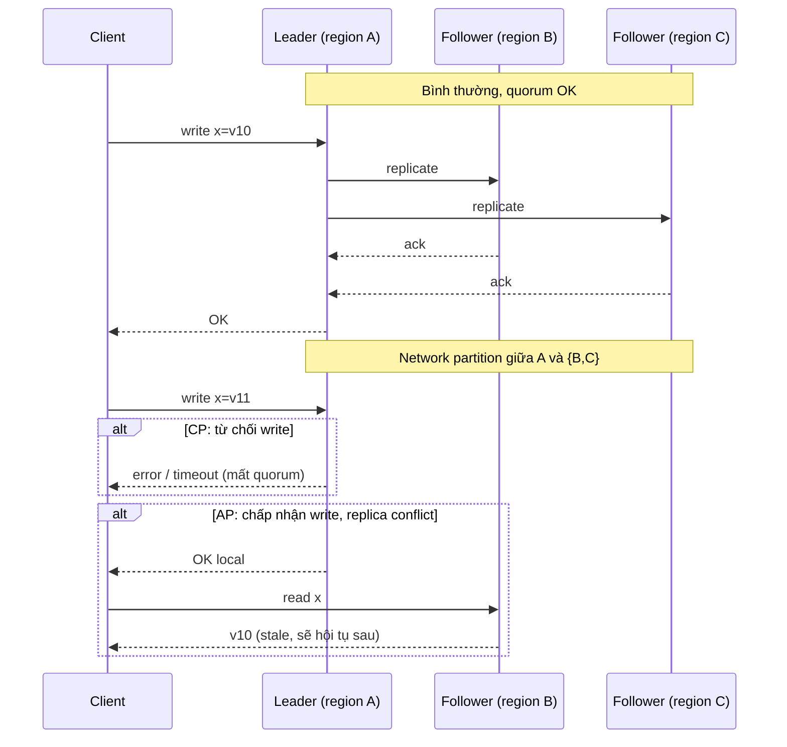

# Explain the CAP theorem.

> Bài này giải thích định lý CAP khi nào có hiệu lực (network partition), CP vs AP trên hệ thật, PACELC mở rộng, và cách hiểu đúng "trong CAP". Liên hệ bài [keeping-distributed-systems-consistent](keeping-distributed-systems-consistent.md) cho kỹ thuật và [eventual-vs-strong-consistency](eventual-vs-strong-consistency.md) cho mô hình nhất quán.

Chủ đề: Distributed Systems · Ngày: 2026-10-16

## 0. Nền tảng trước khi đọc

**Bối cảnh:** Nhiều máy cùng phục vụ một hệ thống. Khó ở chỗ mạng có thể chậm hoặc đứt, máy có thể hỏng, nhưng người dùng vẫn cần kết quả hợp lý.

**Nói đơn giản:** CAP nói rằng khi mạng bị chia cắt, hệ thống phải ưu tiên nhất quán hoặc sẵn sàng phục vụ; không thể đảm bảo cả hai tuyệt đối.

**Từ khóa cần biết:** node = một máy hoặc tiến trình; network failure = mạng chậm/đứt; consistency = các nơi nhìn dữ liệu giống nhau tới mức nào.

**Ví dụ dễ hình dung:** Khi hai datacenter mất liên lạc, hệ thống phải chọn trả lỗi để giữ dữ liệu đúng hoặc tiếp tục nhận ghi rồi hòa giải sau.

Khi đọc, luôn hỏi ba câu: nó giải quyết vấn đề gì, nó làm việc theo những bước nào, và khi nào không nên dùng?

**Cách học bài này:** Đọc phần này trước để nắm từ khóa; đọc phần 1 để lấy câu trả lời 30 giây; đọc phần 2 để hiểu cơ chế; cuối cùng mở từng câu hỏi ở phần 3 để luyện nói. Các con số và lệnh trong bài là bằng chứng cho câu trả lời, không cần học thuộc nếu chưa hiểu cơ chế.

## 1. Là gì

### Đọc nhanh trước khi đi sâu

**Ý chính:** CAP nói rằng khi mạng bị chia cắt, hệ thống phải ưu tiên nhất quán hoặc sẵn sàng phục vụ; không thể đảm bảo cả hai tuyệt đối.

**Ví dụ interview:** Khi hai datacenter mất liên lạc, hệ thống phải chọn trả lỗi để giữ dữ liệu đúng hoặc tiếp tục nhận ghi rồi hòa giải sau.

**Luồng 4 bước:**

1. Client gửi request tới một node hoặc gateway.
2. Node gọi các node khác qua mạng và có thể gặp timeout hoặc retry.
3. Hệ thống chọn cách giữ trạng thái đồng bộ và xử lý lỗi.
4. Client nhận kết quả hoặc lỗi có thể retry an toàn.

**Nói như trong interview:** CAP nói rằng khi mạng bị chia cắt, hệ thống phải ưu tiên nhất quán hoặc sẵn sàng phục vụ; không thể đảm bảo cả hai tuyệt đối. Hãy nói theo bốn bước trên trước; nếu interviewer hỏi sâu, chuyển sang cơ chế **Bước 1. Ba thuộc tính trong CAP**, rồi nêu trade-off và failure mode ở các phần sau.

## 2. Cơ chế cốt lõi

### Bước 1. Ba thuộc tính trong CAP

1. **Consistency (C) trong CAP**: linearizability — mọi đọc thấy write mới nhất, như chạy trên một máy. Khác với "consistency" chung chung hay "eventual consistency".
2. **Availability (A) trong CAP**: mọi request tới node không chết đều có response (với dữ liệu, không phải error). Khác với "availability" SRE (%) — phải 100% ở mọi node sống.
3. **Partition tolerance (P)**: hệ tiếp tục hoạt động khi mất mạng giữa node. Trong hệ phân tán thực sự, P là bắt buộc — mạng luôn có lúc lỗi. CAP phát biểu chính xác là: khi P xảy ra, chọn C hoặc A.

### Bước 2. Bằng chứng CAP và lý do phải chọn

1. Chứng minh (Gilbert-Lynch 2002): nếu mạng partition, một node có thể phản hồi read hoặc ghi; nếu phản hồi read với giá trị mới nhất thì node kia (chưa thấy write vì partition) phải fail hoặc trả cũ → không thể vừa C vừa A.
2. Cụ thể: client A ghi x → leader; mạng partition leader-replica; replica chưa thấy write; client B đọc từ replica → nếu trả x (đảm bảo C) thì replica phải thấy write → mâu thuẫn với partition. Nếu trả cũ → không C.
3. Không cách nào "vừa C vừa A" trong partition; chọn hoặc lấy partition làm "down" cho một số node (CP) hoặc chấp nhận read cũ (AP).
4. "CA" (không P) chỉ tồn tại trong lý thuyết khi partition không xảy ra; thực tế mạng lúc nào cũng có lỗi nên không có hệ phân tán thật sự là CA.

### Bước 3. CP và AP — cách hiện thực

1. **CP (Consistency khi partition)**: leader + majority quorum (Raft/Paxos). Partition → minority partition không có quorum → không chấp nhận ghi, có thể trả lỗi hoặc chỉ read-only. Ví dụ: etcd, Consul, Spanner, HDFS NameNode, ZooKeeper.
2. **AP (Availability khi partition)**: mọi node chấp nhận ghi; partition hội tụ sau khi mạng về. Có thể có conflict giải bằng vector clock, LWW, hoặc conflict-aware app. Ví dụ: Cassandra, DynamoDB, Riak, CouchDB, S3 (eventual list).
3. Một số hệ cho chọn per-query: Cosmos DB có 5 mức consistency, Cassandra có CONSISTENCY ONE/QUORUM/ALL cho mỗi câu. Spanner luôn strong.

### Bước 4. PACELC mở rộng

1. CAP chỉ phát biểu khi partition. Thời bình (E = Else), vẫn còn lựa chọn giữa Latency (L) và Consistency (C): ghi sync giữa node mất RTT, ghi async cho latency thấp.
2. Ví dụ: DynamoDB — khi partition, A; khi bình thường, L (write không đợi replicate hết). Spanner — khi partition, C; khi bình thường, C (commit đợi Paxos đa số, TrueTime commit timestamp).
3. PACELC taxonomy: PC/EC, PA/EL, PC/EL, PA/EC. Phổ biến PC/EL (Spanner — chọn C luôn); PA/EL (DynamoDB — A khi partition, L khi bình thường).
4. Giúp trả lời "tại sao latency cao" — có thể vì hệ chọn C ngay cả khi không có partition.

### Bước 5. Sequence diagram — partition và lựa chọn CP/AP



*Khi partition xảy ra, hệ CP không có quorum → từ chối write hoặc read. Hệ AP mọi node chấp nhận write local; client có thể đọc giá trị cũ. Sau khi partition hết, AP hội tụ bằng merge hoặc LWW.*

### Quan sát

```bash
# etcd: kiểm tra leader và quorum hiện tại
etcdctl endpoint status --endpoints=node1:2379,node2:2379,node3:2379 -w table
# Khi partition, cột "RAFT TERM" tăng (election retry),
# cột "RAFT INDEX" đứng yên nếu không ghi được.
# Output minh họa, chưa chạy.

# Cassandra: kiểm tra phiên eventual consistency
nodetool gossipinfo | head -50
# Xem node nào "DOWN"/"UNREACHABLE" khi partition — hệ vẫn
# phục vụ read với CONSISTENCY ONE từ node sống (AP).

# Spanner: theo dõi TrueTime skew giữa region
gcloud spanner instances describe <instance> --format="table(name, processingUnits)"
# Spanner ghi cross-region luôn đợi TrueTime commit → linearizable + latency.
```

### Ví dụ chạy từng bước

Kịch bản: **3-node cluster**, write x đã commit tại T=0 (N1 leader, N2 + N3 follower). Tại T=20ms, network partition cắt N1 khỏi {N2, N3}. So sánh hành vi CP (Raft/Paxos) vs AP (Cassandra) với cùng tình huống.

**Trạng thái ban đầu:** N1 leader, term=5, log `[x=v10]` đã commit. N2, N3 follower, log `[x=v10]`.

```text
| Bước | Thời gian | Actor | Hành động | Lý do |
|---|---|---|---|---|
| 1 | T=0 | Client A | PUT x=v10 → N1 | Write đi tới leader |
| 2 | T=2ms | N1 | Replicate log entry tới N2, N3. Nhận ack 2/2 | Quorum = 2/3 — đủ để commit |
| 3 | T=3ms | N1 | Commit entry. Trả 200 OK | Hệ đã đạt strong consistency — mọi node thấy x=v10 |
| 4 | T=20ms | Network | Switch giữa rack-1 (N1) và rack-2 (N2, N3) mất kết nối | Partition xảy ra — kịch bản CAP bắt đầu |
| 5 | T=22ms | Client A | PUT x=v11 → N1 | Write mới khi partition đã xảy ra |
```

**CP path (Raft/Paxos trên N1):**

```text
| Bước | Thời gian | Actor | Hành động | Lý do |
|---|---|---|---|---|
| 6 | T=23ms | N1 | Replicate log entry tới N2, N3 | N1 cố replicate — nhưng partition chặn |
| 7 | T=523ms | N1 | Timeout — chỉ có 0 ack (chỉ N1 tự persist) | Quorum cần 2/3, N1 chỉ có 1/3 = minority |
| 8 | T=524ms | N1 | Trả error cho Client A: "no quorum" | CP chọn C: không commit, không trả success |
| 9 | T=525ms | Client B | GET x → N1 | N1 vẫn là leader term=5, có thể trả read-only stale v10 |
| 10 | T=526ms | N1 | Trả x=v10 (stale, read-only mode) | Linearizable — chỉ trả giá trị đã commit |
| 11 | T=600ms | N2 | Heartbeat timeout — bầu election mới term=6 | N2, N3 thấy term=5 hết hạn, tự ứng cử |
| 12 | T=700ms | N2 | Được 2/2 vote (từ N2, N3) → trở thành leader term=6 | Majority trong partition {N2, N3} = 2/2 |
| 13 | T=702ms | N1 | Nhận AppendEntries term=6 từ N2 — downgrade thành follower | Step-down: leader minority phải nhường |
| 14 | T=800ms | Network | Partition phục hồi | Hệ phục hồi |
| 15 | T=801ms | N1 | Nhận log entry x=v11 từ N2 (giành từ election) hoặc bị overwrite | Hai leader term khác nhau — term=6 thắng |
```

**Trạng thái sau bước 15 (CP):** N2 leader term=6, x=v10 (entry x=v11 từ N1 không bao giờ commit). Client A mất write x=v11 → hệ từ chối.

**AP path (Cassandra):**

```text
| Bước | Thời gian | Actor | Hành động | Lý do |
|---|---|---|---|---|
| 6' | T=23ms | N1 | Ghi x=v11 local. Hinted handoff tới N4 (node khác không trong {N2,N3}) | Cassandra: mọi node chấp nhận ghi |
| 7' | T=24ms | N1 | Trả 200 OK cho Client A | AP chọn A: ghi thành công local |
| 8' | T=25ms | Client B | GET x → N2 (gần user nhất) | N2 vẫn ở partition majority |
| 9' | T=26ms | N2 | Trả x=v10 (stale!) | AP chấp nhận stale vì partition |
| 10' | T=30ms | Client C | GET x → N3 | Cùng partition, cùng stale |
| 11' | T=800ms | Network | Partition phục hồi | Hội tụ bắt đầu |
| 12' | T=850ms | N2, N3 | Nhận replicate từ N1: x=v11. Apply. | Read-repair hoặc anti-entropy |
| 13' | T=900ms | Client B | GET x → N2 | Bây giờ thấy x=v11 (mới nhất) |
```

**Trạng thái sau bước 13' (AP):** Cả 3 replica x=v11, hội tụ. Client B thấy stale v10 trong ~775ms.

**Biến thể — Nếu client B đọc từ N1 (CP-side) sau bước 7:** Client B vẫn được phục vụ vì N1 vẫn sống. CP: N1 trả x=v10 (không phải x=v11 vì entry không commit). AP: N1 trả x=v11 (giá trị mới vì N1 đã ghi local). Sự khác biệt này chính là lựa chọn C vs A của CAP.

**Biến thể — Nếu partition kéo dài > 5 phút:** CP cluster tiếp tục refuse write; AP cluster tiếp tục phục vụ. Khi partition hết, AP merge conflict bằng LWW (timestamp N1 có thể thắng hoặc thua tùy clock skew). Nếu clock skew N1 chậm hơn N2 → giá trị cũ thắng → mất update.

Điều rút ra: Network partition buộc hệ chọn C hoặc A. CP (Raft/Paxos) từ chối write khi mất quorum, đảm bảo linearizable; AP (Cassandra) chấp nhận write local, đọc từ node bất kỳ có thể thấy stale. Cùng một sự kiện partition, hai hành vi khác nhau hoàn toàn. Câu hỏi phỏng vấn từ bài này: "CAP phát biểu chính xác nội dung gì? 'CA' tồn tại không?" — CA không tồn tại vì partition là bắt buộc; chỉ có thể chọn C hoặc A khi P xảy ra.

## 3. Câu hỏi phỏng vấn

### 3A. Câu hỏi đào sâu

<details class="qa">
<summary>Câu 1. CAP phát biểu chính xác nội dung gì? "CA" tồn tại không?</summary>

**Trả lời ngắn:** Khi partition xảy ra, hệ phân tán phải chọn giữa Consistency (mọi đọc thấy write mới nhất, dù có thể fail) và Availability (mọi request có response, dù có thể stale). "CA" (không có P) chỉ lý thuyết — mạng phân tán luôn có partition lúc này lúc khác nên không có hệ phân tán thực sự là CA.

**Đào sâu:**
- Gilbert-Lynch 2002 chứng minh: nếu network partition, một node phải fail C hoặc A. Không thể vừa giữ C vừa giữ A.
- Trong CAP, C = linearizability (định nghĩa rất cụ thể), A = mọi node sống phản hồi.
- "CA" không có nghĩa là partition không xảy ra. Partition là bắt buộc với hệ phân tán thực.
- Một số hệ (ví dụ single-cluster in-memory như một node) thực ra không phải "distributed" nên không áp CAP.

**Bẫy:** "CA = chọn Consistency và Availability, bỏ partition". Sai — partition là không tránh; CAP phát biểu khi P xảy ra, không phải cố ý bỏ P.

**Follow-up:** CAP có dùng để thiết kế chi tiết? Không — chỉ là heuristic. PACELC chi tiết hơn.
</details>

<details class="qa">
<summary>Câu 2. CP và AP khác nhau thế nào? Hãy cho ví dụ hệ thật cho mỗi loại.</summary>

**Trả lời ngắn:** CP (Consistency khi partition): leader + majority quorum; partition mất quorum → từ chối write hoặc read; ví dụ etcd, Spanner, ZooKeeper. AP (Availability khi partition): mọi node chấp nhận write/read; merge conflict sau; ví dụ Cassandra, DynamoDB, Riak.

**Đào sâu:**
- etcd / Consul / ZooKeeper: Raft/Zab; 3-5 node; partition minority → fail.
- Spanner: Paxos + TrueTime; cross-region; partition minority → fail; TrueTime giữ external consistency.
- Cassandra: write ở mọi node; eventual qua hinted handoff + read-repair; không có leader.
- DynamoDB: write ở partition leader, read có strong flag; default eventual; partition leader minority → fail, partition khác phục vụ cuối cùng.
- Hệ chọn per-query (Cassandra CONSISTENCY, Cosmos) cho phép từng query đi theo CP hoặc AP.

**Bẫy:** "Cassandra có thể đạt strong consistency khi cần". Đúng — với CONSISTENCY QUORUM/ALL. Nhưng từng query mới quyết định.

**Follow-up:** Tại sao AWS S3 là AP? List object eventual (LIST/V2 có thể chưa thấy object mới upload); GET object strong. Mạng partition không thấy replicate? Bằng cách retry.
</details>

<details class="qa">
<summary>Câu 3. PACELC mở rộng CAP thế nào? Hệ thật rơi vào loại nào?</summary>

**Trả lời ngắn:** PACELC nói: khi Partition, chọn C hoặc A; khi không partition (E = Else), chọn Latency hay Consistency. Phổ biến: PA/EL (DynamoDB) — A khi partition, L khi bình thường. PC/EC (Spanner) — C luôn. PC/EL và PA/EC ít gặp.

**Đào sâu:**
- PAC là phần trùng CAP; EL/EC là phần thời bình.
- DynamoDB: write đi tới leader rồi replicate async; latency thấp. Khi partition, partition leader có thể không nhận write → conflict read-repair hoặc trả old (AP).
- Spanner: Paxos commit đợi đa số + TrueTime commit timestamp → write luôn đợi replicate. Latency cross-region cao.
- Cassandra: write QUORUM → đợi nửa số replica (latency cao hơn ONE). NOAH của mình có thể cấu hình per-query.
- DC không xảy ra partition nhưng latency quyết định → đây là lý do PACELC hữu ích.

**Bẫy:** "PACELC = 4 loại, mỗi hệ rơi 1 loại". Sai — hệ có thể cấu hình per-query; Spanner là PC/EC vì TrueTime.

**Follow-up:** Hệ nào chọn "C khi partition, L khi bình thường" (PC/EL)? Hệ hybrid ít gặp; đa số hệ theo mô hình PC/EC hoặc PA/EL.
</details>

<details class="qa">
<summary>Câu 4. CAP áp dụng cho từng hệ thật thế nào? Spanner, Cassandra, DynamoDB.</summary>

**Trả lời ngắn:** Spanner = CP (Paxos + TrueTime); Cassandra = AP (eventual mặc định); DynamoDB = AP theo nghĩa read default eventual. Per-query có thể đổi.

**Đào sâu:**
- Spanner: mỗi ghi đi qua Paxos group đa số. Partition minority fail → CP. TrueTime cho external consistency.
- Cassandra: ring topology, không leader. Write bất kỳ node. Read eventual. Tunable per-query.
- DynamoDB: leader partition, replicate 3 AZ. Write linearizable ở leader. Read eventual mặc định; Strongly Consistent Read = leader (CP per-call).
- MongoDB: replica set với primary; write primary → replication; partition primary fail → secondary fail election (CP) hoặc read-only secondary (AP, tùy config).
- Redis: single-node cluster hay cluster mode; cluster mode dùng master-replica; failover với Sentinel. Cluster mode có thể AP nếu không đợi quorum; nhiều hệ Redis thực tế CP.

**Bẫy:** "DynamoDB là CP hay AP". Tuỳ — write CP (leader), read mặc định AP. Toàn hệ thì mixed.

**Follow-up:** MongoDB ở chế độ "primary" thì CP hay AP? Primary từ chối write nếu mất quorum → CP. Nếu chấp nhận write "fire-and-forget" từ secondary → AP.
</details>

<details class="qa">
<summary>Câu 5. CAP có còn dùng trong thiết kế hệ phân tán hiện đại không?</summary>

**Trả lời ngắn:** Là heuristic ban đầu nhưng không còn đủ chi tiết. Hệ hiện đại dùng PACELC, mô hình consistency cụ thể (linearizability, causal, eventual), và trade-off latency/availability. CAP vẫn hữu ích để phân loại nhanh.

**Đào sâu:**
- CAP chỉ nhìn lúc partition. Thời bình latency vs consistency là phần lớn thiết kế.
- Mô hình consistency (xem [eventual-vs-strong-consistency](eventual-vs-strong-consistency.md)) chi tiết hơn CAP nhiều.
- Hệ thật cho chọn per-query (Cosmos, Cassandra) → không áp dụng "CP hoặc AP" một lần cho cả hệ.
- CAP giúp trả lời câu phỏng vấn nhanh nhưng thiết kế thật cần PACELC + consistency model + workload.

**Bẫy:** "CAP áp dụng cho cả hệ". Sai — hệ thật cho chọn per-query, per-region.

**Follow-up:** Có định lý nào thay thế CAP không? PACELC, mô hình consistency, FLP cho impossibility, Figma/CRDT cho merge.
</details>

<details class="qa">
<summary>Câu 6 (Debug). Khách hàng báo sản phẩm vừa tạo không thấy trong trang chủ. Ứng dụng dùng eventual. Kiểm tra gì?</summary>

**Trả lời ngắn:** Bước 1: xác nhận read endpoint dùng eventual (không strong flag). Bước 2: kiểm tra replication lag. Bước 3: xem có partition không. Bước 4: tăng read level hoặc đợi.

**Đào sâu:**
- Bước 1: kiểm tra code gọi API. DynamoDB `--consistent-read`. Cassandra `LOCAL_QUORUM`. Spanner mặc định strong. Cosmos `ConsistencyLevel = Session` cũng chỉ r-read-y-w.
- Bước 2: replication lag metric. PG `pg_last_xact_replay_timestamp`. Cassandra `nodetool status` → "UNREACHABLE" là partition.
- Bước 3: partition xử lý thế nào? CP → request fail; AP → read cũ.
- Bước 4: nếu AP, có thể đợi vài giây rồi retry (hội tụ). Nếu CP, có thể phải retry qua leader khác.
- Bước 5: nếu cần read strong ngay, đổi sang strong read flag. Tài nguyên (cost, latency) tăng.

**Bẫy:** Tắt eventual bằng cách set flag mọi nơi — dễ tăng tải leader, tụt performance toàn hệ.

**Follow-up:** Monitoring metric gì để biết consistency đang ổn? Read staleness P99, conflict rate, read repair calls.
</details>

<details class="qa">
<summary>Câu 7 (Thiết kế). Thiết kế shopping cart: thêm/xoá line, checkout. Chọn CP hay AP?</summary>

**Trả lời ngắn:** Cart lưu theo user, ít conflict cross-user. AP chấp nhận; checkout nơi trừ tiền thì cần strong (CP). Chia hai tier: cart session = AP (eventual), order/checkout = CP (consensus hoặc leader-based DB).

**Đào sâu:**
- Cart: ghi/đọc cao, ít user active cùng lúc vào cart của nhau. Eventual chấp nhận.
- Checkout: trừ inventory, trừ tiền — yêu cầu strong. Cần DB với linearizable giao dịch (PostgreSQL synchronous, Spanner, CockroachDB).
- Topologia: cart trong Redis/Cassandra gần user. Order/payment trong DB cluster leader-based.
- Chuyển cart → order khi checkout: outbox hoặc change-data-capture đẩy sang DB transactional.
- Phục hồi: nếu user đóng tab khi đang checkout → state bỏ nửa chừng, retry khi user vào lại.

**Bẫy:** Toàn hệ CP — tốn cost, latency cao, cart perf tụt.

**Follow-up:** Inventory check-out multi-store (mua sản phẩm ở nhiều kho)? Saga + outbox + inventory lock per-warehouse; strong kho, eventual xuyên kho.
</details>

### 3B. Câu hỏi phỏng vấn liên quan

<details class="qa">
<summary>Câu 8. CAP có áp dụng cho microservices không, hay chỉ cho data store?</summary>

**Trả lời:** Microservice giao tiếp qua network (mạng giữa service khác nhau), mỗi service có data store riêng; nguyên tắc CAP áp dụng cho **data store**. Microservice phối hợp (qua message, HTTP) có thêm khái niệm distributed transaction nhưng vẫn giới hạn bởi CAP ở mỗi service. Saga + outbox là cách kết hợp CAP per-service mà vẫn đảm bảo business flow.
</details>

<details class="qa">
<summary>Câu 9. AP có nghĩa là luôn trả về dữ liệu cũ?</summary>

**Trả lời:** AP có thể trả dữ liệu mới ở node mới — chỉ là không đảm bảo. AP chỉ đảm bảo "có response", không đảm bảo response là giá trị mới nhất. Trong bình thường AP cũng thấy giá trị mới sau khi replicate.
</details>

<details class="qa">
<summary>Câu 10. CP có thể vẫn fail latency không?</summary>

**Trả lời:** Đúng. CP trong partition minority → fail request; CP khi không partition → latency 1-2 RTT hoặc cao hơn cross-region. CP không có nghĩa là "tức thì"; chỉ đảm bảo linearizable.
</details>

<details class="qa">
<summary>Câu 11. Spanner đạt CA trong CAP không vì TrueTime?</summary>

**Trả lời:** Không — Spanner là CP. Partition minority → fail. TrueTime giúp Spanner duy trì C khi partition, không giúp "CA" (vì CAP nói P là bắt buộc). Một số người gọi Spanner "không thực sự CA" vì nó vẫn tuân CAP.
</details>

<details class="qa">
<summary>Câu 12. DynamoDB Global Tables conflict giải thế nào?</summary>

**Trả lời:** Global Tables multi-region, write ở region nào cũng nhân bản. Conflict cùng key bằng LWW theo server timestamp. Vài case cần application merge. Có thể dùng DynamoDB Streams + Lambda để giải quyết logic.
</details>

<details class="qa">
<summary>Câu 13. Redis Cluster là CP hay AP?</summary>

**Trả lời:** Redis Cluster cung cấp cả chế độ. Mặc định cluster master-replica, failover có thể chấp nhận vài giây mất ghi (asynchronous replication). Master down → replica promote, có thể mất một vài ghi chưa replicate. Thường gọi là AP với eventual fail-over.
</details>

<details class="qa">
<summary>Câu 14. FLP impossibility ảnh hưởng CAP thế nào?</summary>

**Trả lời:** FLP nói: không thể đảm bảo consensus deterministic trong mạng bất đồng bộ với chỉ 1 process fail. CAP dùng giả định đồng bộ (sync network với timeout) → dùng được. Raft/Paxos bypass FLP nhờ "eventually synchronous" (timeouts).
</details>

<details class="qa">
<summary>Câu 15. Đúng hay sai: "Hệ CAP-A tức là luôn nhanh".</summary>

**Trả lời:** Sai. AP có thể nhanh khi partition (vì local), nhưng cũng phải chịu cost của read-repair, hinted handoff, conflict resolve. AP không có nghĩa là latency thấp; latency còn phụ thuộc write back, replicate. CassANDRa có thể latency cao nếu dùng CONSISTENCY QUORUM.
</details>

<details class="qa">
<summary>Câu 16. Spanner đạt external consistency cần gì?</summary>

**Trả lời:** TrueTime API trả interval với epsilon; commit timestamp dùng upper bound; read nếu cần timestamp lớn hơn wall clock thì đợi đến khi apply. Linearizability đạt nhờ Paxos cross-region + TrueTime commit timestamp monotonic.
</details>

## 4. Đánh đổi và sự cố production

### So sánh CP và AP thực tế

| Tiêu chí | CP (Raft/Paxos) | AP (eventual) |
|---|---|---|
| Partition minority | Từ chối write/read, fail nhanh | Vẫn phục vụ; latency có thể tăng |
| Latency thời bình | 1-2 RTT cùng DC; 50-150ms cross-region | 1 RTT local; không đợi quorum |
| Consistency guarantee | Linearizable | Eventual hoặc causal (tùy cấu hình) |
| Conflict xử lý | Không có (write thất bại hoặc serialize) | Vector clock / LWW / app merge |
| Throughput leader | Bị bound bởi leader | Mọi node đều chịu ghi |
| Recovery | Election nhanh, có thể mất 100ms-2s | Hội tụ sau khi replicate, có thể vài giây |
| Use case điển hình | Payment, lock, leader election | Feed, view count, cart, recommendation |

### Năm failure mode

| Triệu chứng | Nguyên nhân gốc | Cách kiểm tra | Cách sửa |
|---|---|---|---|
| Raft liên tục election, term tăng đều | Partition hoặc mạng chập chờn | Ping node; log election | Tăng heartbeat interval; kiểm tra MTU, switch |
| Read trả cũ, dù tuyên bố strong | Read từ replica chưa apply (eventual) | Replication lag; read flag | Bật strong read; đọc leader |
| Write fail trong partition | Hệ CP, minority không có quorum | Network reachability giữa node | Đợi partition hết; routing client tới partition majority |
| Conflict write loss (giá trị "mới" mất) | LWW với server timestamp chậm hơn client | Audit log | CAS / vector clock; idempotent operations |
| Cross-region read latency tăng vọt khi không partition | Spanner / CockroachDB chờ Paxos đa số | P99 latency per region | Cấu hình stale read bound nếu chấp nhận |

## 5. Cheat sheet

| Chủ đề | Con số / quy tắc cần nhớ |
|---|---|
| CAP | Phát biểu khi network partition, chọn C hoặc A |
| CA | Không tồn tại cho hệ phân tán thực |
| CP ví dụ | Raft/Paxos, Spanner, etcd, ZooKeeper |
| AP ví dụ | Cassandra, DynamoDB, Riak, CouchDB |
| PACELC | Khi partition, C hoặc A. Khi bình thường, L hoặc C |
| DynamoDB mặc định | AP (eventual read); strong read flag = leader |
| Spanner | CP (Paxos + TrueTime); luôn đợi commit |
| Cross-region RTT | 50-150ms |
| Raft election | 100-500ms; vài giây nếu split vote |
| TrueTime epsilon | 1-7ms (Google datacenters); quyết định đợi |

**Học tiếp:**
- [keeping-distributed-systems-consistent](keeping-distributed-systems-consistent.md) — kỹ thuật quorum, consensus, saga, outbox
- [eventual-vs-strong-consistency](eventual-vs-strong-consistency.md) — sáu mô hình nhất quán
- [database-replication](../Database/database-replication.md) — replication mode và consistency


