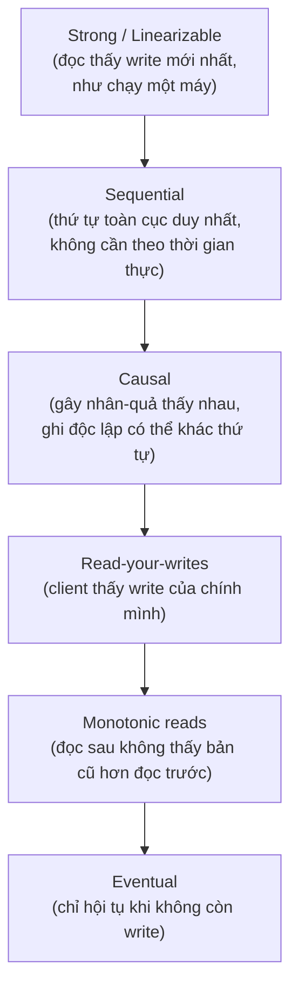
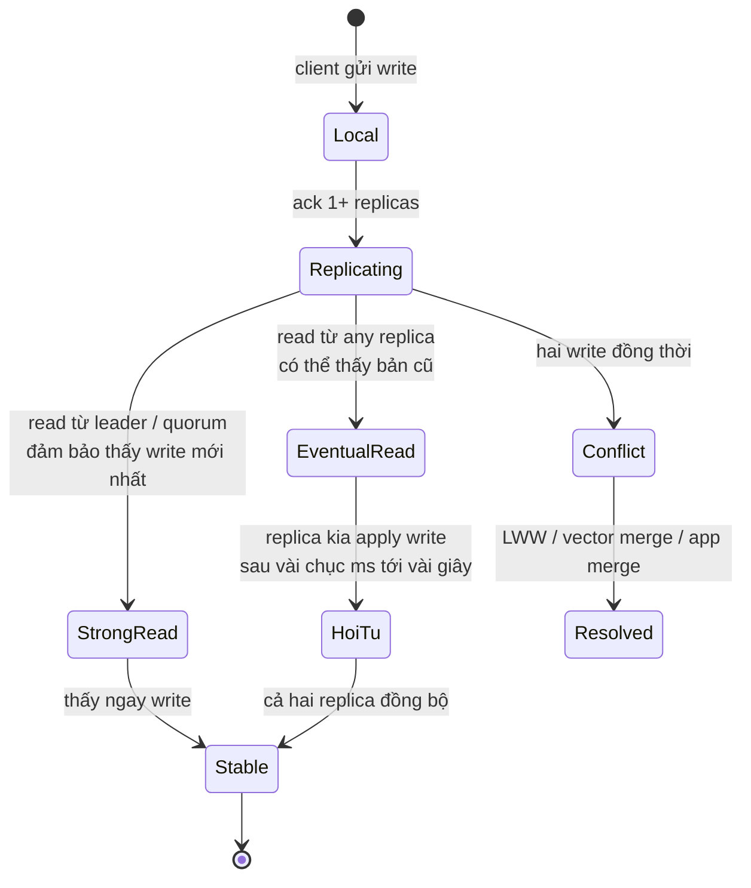

# What is eventual consistency vs strong consistency?

> So sánh các mô hình nhất quán mà client thấy ở hệ phân tán: strong (linearizability), sequential, causal, read-your-writes, eventual. Khi nào chọn cái nào, hệ thật dùng mô hình nào. Phân biệt với kỹ thuật đảm bảo nhất quán ở bài [keeping-distributed-systems-consistent](keeping-distributed-systems-consistent.md) và với định lý CAP ở bài [cap-theorem](cap-theorem.md). Bài [database-isolation-levels](../Database/database-isolation-levels.md) nói về nhất quán trong một DB; [database-replication](../Database/database-replication.md) nền tảng replication.

Chủ đề: Distributed Systems · Ngày: 2026-10-16

## 1. Là gì

Mô hình nhất quán (consistency model) là hợp đồng giữa hệ thống và client về việc một thao tác ghi-thì-đọc thấy gì. Có nhiều mô hình xếp từ mạnh đến yếu: strong / linearizability mạnh nhất — đọc luôn thấy write mới nhất, như chạy trên một máy; eventual yếu nhất — chỉ đảm bảo "không có write mới thì mọi replica sẽ hội tụ". Giữa có sequential, causal, read-your-writes, monotonic reads.

Hệ phân tán thường chọn mô hình yếu hơn để đổi lấy availability và latency thấp. DynamoDB, Cassandra, Riak chọn eventual mặc định. Spanner, CockroachDB, etcd chọn linearizability. Một số hệ cho phép cấu hình: Cosmos DB có 5 mức, Riak có R/W quorum, Aerospike có read consistency level.



*Sơ đồ vị trí: sáu mô hình xếp từ mạnh (top) đến yếu (bottom). Hệ thực tế thường cung cấp tập con trong chuỗi này. Linearizable cho phép mọi thao tác; eventual cho phép nhiều replica tự do.*

### Trả lời 30 giây

"Mô hình nhất quán trả lời 'sau khi tôi ghi, đọc sẽ thấy gì'. Mạnh nhất là strong / linearizable — đọc luôn thấy write mới nhất theo thứ tự thời gian thực. Yếu nhất là eventual — chỉ đảm bảo không có write mới thì mọi replica hội tụ. Giữa có sequential (một thứ tự toàn cục), causal (gây nhân quả thấy nhau), read-your-writes (client thấy write của mình). DynamoDB, Cassandra mặc định eventual; Spanner, etcd, CockroachDB linearizable; Cosmos DB 5 mức tuỳ chọn. Yếu hơn khi workload chịu staleness (feed, view count); mạnh khi correctness quan trọng (payment, inventory)."

## 2. Cơ chế cốt lõi

### Bước 1. Linearizability (strong) — đọc thấy write mới nhất

1. Định nghĩa: mọi thao tác có thời điểm xảy ra trên một dòng thời gian thực, đọc thấy write mới nhất xảy ra trước nó. Tương đương "như chạy trên một máy".
2. Cơ chế: leader duy nhất + quorum write (Raft/Paxos) hoặc TrueTime API + Paxos (Spanner). Mọi đọc/ghi đi qua leader hoặc quorum đa số.
3. Latency: ~1-2 RTT cùng DC với leader ổn. Cross-region 50-150ms RTT. Throughput giảm vì mọi ghi qua một node.
4. Khi nào cần: payment, inventory, leader election, distributed lock.

### Bước 2. Sequential consistency — một thứ tự toàn cục, không cần thời gian thực

1. Định nghĩa: tồn tại một thứ tự toàn cục duy nhất các thao tác, thứ tự của mỗi client được bảo toàn, nhưng thứ tự đó không nhất thiết trùng với wall-clock.
2. Cơ chế: logical clock (Lamport timestamp) hoặc TrueTime. Spanner đạt linearizable bằng TrueTime nên cũng đạt sequential; hệ dùng MVCC global có thể cung cấp sequential.
3. Yếu hơn linearizable: cho phép reordering giữa các client không gây nhân quả.
4. Ít gặp như một standalone API — thường hệ tuyên bố linearizable hoặc eventual, ít hệ tuyên bố sequential.

### Bước 3. Causal consistency — ghi gây nhân quả thấy nhau

1. Định nghĩa: nếu write B phụ thuộc write A (B đọc A rồi viết), ai đọc B thì cũng đọc thấy A. Hai ghi độc lập (không gây nhân quả) có thể thấy thứ tự khác nhau ở replica khác nhau.
2. Cơ chế: vector clock hoặc dependency graph. Hệ cài đặt: COPS (research), some Cassandra cấu hình, AntidoteDB.
3. Mạnh hơn eventual nhưng yếu hơn linearizable: cho phép concurrent writes thấy khác thứ tự ở các node khác nhau.
4. Khi nào cần: trả lời bài (xem bài → comment → trả lời comment). Tương tác giữa người dùng cần thread rõ ràng.

### Bước 4. Read-your-writes và monotonic — đảm bảo cho một client

1. Read-your-writes: nếu client ghi x thành công, lần đọc tiếp theo của cùng client sẽ thấy x. Có thể đạt bằng sticky session đọc từ node đã ghi, hoặc session token.
2. Monotonic reads: nếu client đã thấy giá trị x, các lần đọc sau không thấy giá trị cũ hơn x (tránh "time travel"). Cài đặt bằng token chỉ tới snapshot mới nhất mà client đã thấy.
3. Cả hai yếu hơn causal nhưng mạnh hơn eventual; cài đặt ở application layer dễ.
4. DynamoDB consistent read và Cassandra read-your-writes consistency (LOCAL_QUORUM + last-write timestamp) đạt được read-your-writes.

### Bước 5. Eventual consistency — chỉ hội tụ khi ngưng ghi

1. Định nghĩa: nếu không có write mới và tất cả message được phân phối, mọi replica hội tụ về cùng giá trị. Không đảm bảo thứ tự, không đảm bảo thời điểm.
2. Cơ chế: write bất kỳ số replica, read bất kỳ số replica, conflict resolve sau (last-write-wins, vector clock merge, application merge).
3. Latency: write 1 RTT local. Read 1 RTT. Không phải đợi quorum.
4. Failure mode: conflict write đồng thời — LWW mất update; vector clock bù bằng cách đẩy conflict lên app.

### Bước 6. State diagram các mô hình và yêu cầu đồng bộ



*Vòng đời một write từ client tới ổn định. Strong read thấy ngay; eventual read có thể thấy bản cũ cho tới khi replica hội tụ. Conflict giữa hai write đồng thời được resolve bằng cơ chế hợp đồng.*

### Quan sát

```sql
-- DynamoDB: chọn strong read vs eventual
-- Mặc định eventual. Strong dùng ConsistentRead=true:
aws dynamodb get-item \
  --table-name Orders --key '{"OrderId":{"S":"o-123"}}' \
  --consistent-read

-- Cassandra: chọn consistency level per-query
SELECT * FROM orders WHERE order_id = 'o-123'
  USING CONSISTENCY LOCAL_QUORUM;
-- hoặc để eventual: USING CONSISTENCY ONE;

-- Spanner: read theo timestamp (strong by default)
-- SELECT * FROM Orders WHERE OrderId = 'o-123';  -- strong read
```

### Ví dụ chạy từng bước

Kịch bản: **profile page** với 3 replica, mỗi replica lưu `user.profile.bio`. Mặc định đọc eventual (CONSISTENCY ONE). Trace từng thao tác ghi/đọc để thấy stale read.

**Trạng thái ban đầu:** N1, N2, N3 đều có `bio="engineer"`, vector clock `[(N1,1),(N2,1),(N3,1)]`.

```text
| Bước | Thời gian | Actor | Hành động | Lý do |
|---|---|---|---|---|
| 1 | T=0 | User A | Sửa bio thành "engineer at X" qua N1 | Write đi tới N1; replicate async |
| 2 | T=5ms | N1 | Persist `bio="engineer at X"`, vector clock = `[(N1,2),(N2,1),(N3,1)]`. Gửi async replicate tới N2, N3 | N1 đã ghi — không đợi quorum |
| 3 | T=8ms | N2 | Persist `bio="engineer at X"`, vclock = `[(N1,2),(N2,2),(N3,1)]` | N2 đã apply |
| 4 | T=20ms | User B | GET profile của A — gửi read tới N3 (gần user nhất) | CONSISTENCY ONE: chỉ đọc 1 replica — N3 |
| 5 | T=22ms | N3 | Trả `bio="engineer"` (vclock cũ) | N3 chưa apply write từ N1 (chưa tới T=22ms) |
| 6 | T=25ms | N3 | Apply write từ N1: `bio="engineer at X"`, vclock = `[(N1,2),(N2,2),(N3,2)]` | Replication cuối cùng hoàn tất |
```

**Trạng thái sau bước 6:** N1 v=2 ✅, N2 v=2 ✅, N3 v=2 ✅. User B nhận stale `bio="engineer"` tại T=22ms, sai lệch 17ms.

```text
| Bước | Thời gian | Actor | Hành động | Lý do |
|---|---|---|---|---|
| 7 | T=30ms | User A | GET profile của chính mình (read-your-writes check) — gửi tới N1 | N1 vừa ghi — đảm bảo thấy write của mình |
| 8 | T=32ms | N1 | Trả `bio="engineer at X"` (vclock mới nhất) | N1 luôn thấy write local |
| 9 | T=40ms | User B | Refresh lại trang — gửi read tới N2 | Sticky session chưa bật — request đi tới node khác |
| 10 | T=42ms | N2 | Trả `bio="engineer at X"` (vclock mới nhất) | N2 đã apply ở T=8ms — thấy mới nhất |
```

**Trạng thái sau bước 10:** Cả 3 replica converged. User B thấy giá trị đúng từ N2.

**Biến thể — Nếu User B dùng strong read (CONSISTENCY QUORUM):** Bước 4-5 thay đổi: User B gửi read tới N1, N2, N3. Cả 3 đều trả về vclock và value. So sánh: N1 (v=2), N2 (v=2), N3 (v=1) → lấy giá trị của vclock cao nhất = `bio="engineer at X"`. User B thấy giá trị mới tại T=22ms, không stale. Đánh đổi: latency p99 tăng (3 RTT), cost tăng (CONSISTENCY QUORUM tính phí cao hơn ONE), leader bị tải.

**Biến thể — Nếu User A sửa bio hai lần liên tiếp (ghi đồng thời từ hai client):** Client X sửa thành "engineer at Y" tại T=15ms qua N2. Client Y sửa thành "engineer at Z" tại T=17ms qua N3. Cả hai cùng vector clock `[(N1,2),(N2,1),(N3,1)]` vì cùng nhìn từ version cũ. Khi N1 nhận cả hai: N1 tăng vclock N2 lên 2 và N3 lên 2, nhưng value conflict → Cassandra lưu cả hai, app resolve (LWW theo timestamp hoặc merge). Nếu dùng LWW theo timestamp: value cuối cùng = "engineer at Z". Câu trả lời phỏng vấn này cho thấy tại sao eventual cần CAS/CRDT cho workload concurrent write.

Điều rút ra: Eventual consistency cho phép đọc thấy giá trị cũ trong khoảng replication lag (bước 4-5). Cơ chế bảo vệ là read-your-writes qua sticky session (bước 7-8) hoặc strong read flag (biến thể 1). Nếu không có cơ chế bảo vệ, client luôn có thể thấy giá trị cũ trong vài chục ms. Câu hỏi phỏng vấn từ bài này: "Eventual có thể convert sang strong không?" — câu trả lời là có nhưng tốn latency và cost.

## 3. Câu hỏi phỏng vấn

### 3A. Câu hỏi đào sâu

<details class="qa">
<summary>Câu 1. Linearizability chính xác nghĩa là gì? Khác eventual ở điểm nào?</summary>

**Trả lời ngắn:** Linearizable: mọi thao tác có thời điểm thực, đọc thấy write mới nhất xảy ra trước nó. Equivalent như chạy trên một máy với duy nhất global clock. Eventual: chỉ đảm bảo "không có write mới" thì replica hội tụ; trong lúc đang có write, hai replica có thể thấy giá trị khác nhau.

**Đào sâu:**
- Định nghĩa hình thức: hàm xử lý thao tác trên real-time order ≤ thứ tự thực quan sát được. Tức là mọi read đều phản ánh "write mới nhất đã hoàn thành" trước read đó.
- Linearizable kéo theo real-time order — không thể reorder giữa các operation độc lập. Sequential cũng cho phép total order nhưng không nhất thiết khớp wall-clock; linearizable khắt khe hơn.
- Eventual: write có thể tới replica sau với thứ tự tùy ý. Read từ replica chậm thấy bản cũ.
- Cài đặt linearizable: Raft/Paxos (etcd, Consul, CockroachDB, TiKV), Spanner (Paxos + TrueTime), ZooKeeper Zab. Cài eventual: Cassandra, Riak, DynamoDB default.

**Bẫy:** "Sequential = linearizable". Sai — sequential không gắn với wall-clock; hai client A, B có thể thấy thứ tự đảo ngược so với thời gian thực.

**Follow-up:** Linearizable + sequential + causal quan hệ thế nào? Linearizable ⊂ Sequential ⊂ Causal ⊂ Eventual (linearizable mạnh nhất).
</details>

<details class="qa">
<summary>Câu 2. Causal consistency khác read-your-writes ở điểm nào? Khi nào cần causal?</summary>

**Trả lời ngắn:** Causal bảo toàn quan hệ nhân quả giữa mọi client: B đọc A rồi viết → ai đọc B cũng thấy A. Read-your-writes chỉ bảo toàn cho MỘT client — client X viết X1, lần đọc sau của X thấy X1; không nói về client khác.

**Đào sâu:**
- Causal đảm bảo cả "ghi đọc nguyên nhân" (happens-before) giữa nhiều client. Read-your-writes chỉ đảm bảo "tôi ghi, tôi đọc lại".
- Cài đặt causal: vector clock; COPS research prototype; AntidoteDB production-ish. Phức tạp hơn read-your-writes.
- Use case causal: thread trả lời (người A đăng, người B trả lời dựa trên post của A; người C trả lời thread phải thấy cả hai).
- Read-your-writes dễ hơn nhiều: sticky session, session token, last-write-timestamp. DynamoDB Strongly Consistent Read + Cassandra LOCAL_QUORUM + read-your-writes consistency có thể đủ.

**Bẫy:** "Causal chỉ là read-your-writes cho nhiều client". Sai — causal yêu cầu nhiều hơn: hai client khác nhau có write gây nhân quả phải thấy đúng thứ tự.

**Follow-up:** Facebook dùng causal cho comment thread không? Các hệ messaging (Cassandra + TWCS) gần causal nhưng không đảm bảo 100%.
</details>

<details class="qa">
<summary>Câu 3. DynamoDB default có linearizable không? Mặc định mạnh tới đâu?</summary>

**Trả lời ngắn:** Mặc định DynamoDB read là eventual. Write đi tới leader partition, replicated async tới 3 AZ; read eventual có thể thấy bản cũ trong vài trăm ms. Dùng `--consistent-read` để đọc với strong read từ leader (giảm throughput, tăng cost).

**Đào sâu:**
- The Amazon DynamoDB paper (2007) mô tả R+W quorum + vector clock = eventual. Trong DynamoDB hiện đại, write đi qua leader, read từ leader với consistent=true = linearizable. Read mặc định (eventually consistent) đọc từ replica bất kỳ.
- Read-your-writes: nếu client vừa write, dùng Strongly Consistent Read cho lần tiếp theo.
- Trade-off: Strongly Consistent Read ~2x cost so với eventual.
- Per-item transaction (DynamoDB `TransactGetItems`) cung cấp ACID + linearizable per-item.

**Bẫy:** "DynamoDB default là strong". Sai — eventual, phải opt-in.

**Follow-up:** Khi nào eventual đủ cho production app? Chat, view count, feed (chấp nhận stale vài giây). Khi nào cần strong? Tài khoản, thanh toán, inventory khóa — một số dùng `TransactWriteItems`.
</details>

<details class="qa">
<summary>Câu 4. CASS, RMW, set-then-check race trong eventual consistency xử lý thế nào?</summary>

**Trả lời ngắn:** Vấn đề: client A đọc thấy x, client B đọc thấy x, A viết x+1, B viết x+1 dựa trên snapshot cũ → mất update. Cách xử lý: (1) dùng conditional write (CAS / version); (2) đẩy tính toán xuống DB có strong semantics; (3) cho application merge conflict (vector clock + read-repair).

**Đào sâu:**
- CAS pattern: client gửi write kèm version/if-match. Server check version còn đúng → áp dụng. Không → trả lỗi, client re-read.
- AWS DynamoDB `ConditionExpression`, Cassandra `IF NOT EXISTS`, `IF version = X`.
- Conflict-aware data type (CRDT): counter, set, register cho phép merge không cần CAS. Cài đặt ở app level.
- Read-repair: khi client đọc 2-3 replica mà thấy khác → gửi bản mới về replica cũ. Cassandra có logic này built-in.

**Bẫy:** "LWW luôn an toàn". Sai — LWW có thể mất update hữu ích. Cần cân nhắc semantics business.

**Follow-up:** Khi nào dùng CRDT thay CAS? Khi nhiều client phải ghi đồng thời (collaborative editing) và không muốn central authority.
</details>

<details class="qa">
<summary>Câu 5. Spanner đạt linearizable cross-region bằng cách nào? TrueTime là gì?</summary>

**Trả lời ngắn:** Spanner dùng Paxos cho replication + TrueTime API (Google GPS + atomic clock) cho timestamp. Mỗi transaction commit lấy timestamp từ TrueTime (đảm bảo có sai số < epsilon). Đọc chờ đến khi tất cả write có timestamp nhỏ hơn đã apply → linearizable cross-region.

**Đào sâu:**
- TrueTime trả về một interval `[earliest, latest]`, không phải một điểm. Epsilon thường 1-7ms; Google datacenters đạt nhờ GPS receiver + atomic clock.
- Mỗi write có timestamp = TrueTime.now().latest. Paxos replicate write. Read nếu timestamp > now() phải đợi đến khi apply đủ.
- Cross-region: có thể chọn consistency level — strong (đợi đủ) hoặc stale read (timestamp trong quá khứ, không đợi). Không phải linearizable nhưng "consistent prefix".
- Ưu: cross-region strong mà vẫn dùng Paxos; latency cross-region có thể ~50-150ms RTT, đợi apply thêm.

**Bẫy:** "TrueTime cho chính xác đến milisecond". Sai — nó cho interval với epsilon; commit dùng latest, read cần chờ.

**Follow-up:** CockroachDB đạt linearizable cross-region thế nào không có TrueTime? CockroachDB dùng HLC (Hybrid Logical Clock) + phụ thuộc retries; không cross-region trong commit path.
</details>

<details class="qa">
<summary>Câu 6 (Debug). Báo cáo doanh thu hai lần chạy ra số khác nhau. Nghi eventual consistency ở replica. Kiểm tra gì theo thứ tự?</summary>

**Trả lời ngắn:** Bước 1 xác nhận read là eventual. Bước 2 đọc từ leader / replica đồng bộ. Bước 3 tính logic chịu snapshot hay không. Bước 4 nếu vẫn lệch, có thể transaction ghi đang chưa commit hoặc read gặp phải uncommitted write.

**Đào sâu:**
- Bước 1: kiểm tra call API có flag strong không. `aws dynamodb get-item` không flag = eventual. `select USING CONSISTENCY ONE` cũng eventual.
- Bước 2: đổi sang strong read. DynamoDB `--consistent-read`. Cassandra `LOCAL_QUORUM` hoặc `ALL`. PG replica `pg_read_only` + set synchronous replication.
- Bước 3: query có `NOW()` trong `WHERE` không? Nếu có, snapshot có thể khác. Dùng timestamp cố định.
- Bước 4: latency P99 read ổn? Nếu > 200ms ở same-DC, có thể leader không ổn → failover đang xảy ra.
- Bước 5: kiểm tra `EXPLAIN ANALYZE` để xem số row scan. Có thể query chỉ chạm partial replica.

**Bẫy:** Cho query read strong liên tục → tải tập trung leader, throughput tụt.

**Follow-up:** Làm sao báo cáo tài chính "consistent" mà không đè tải lên OLTP? Materialized view + cron job chạy off-peak; hoặc snapshot ra S3 rồi phân tích.
</details>

<details class="qa">
<summary>Câu 7 (Thiết kế). Thiết kế hệ chat: gửi tin nhắn A→B, đảm bảo B thấy tin A. Chọn mô hình gì?</summary>

**Trả lời ngắn:** Causal hoặc read-your-writes. Causal cho thread nhiều người; read-your-writes cho chat 1-1. Write trực tiếp vào message store, replicate async; client subscribe theo causal order.

**Đào sâu:**
- 1-1 chat: read-your-writes đủ. A gửi message, A reload thấy message của mình. B thấy có thể sau 100-500ms (latency network + replica sync).
- Group chat nhiều người: causal. Người A và B trao đổi trong thread, người C vào sau thấy thread từ đầu theo đúng thứ tự.
- Implementation: Cassandra + TWCS (Time Window Compaction Strategy) cho chat data, vector clock per thread, merge ở client.
- Lưu trữ: tin nhắn lưu per-room; index theo room_id + timestamp.
- Read for B: query message store theo room_id + `> last_seen_seq`. Eventual OK nếu B chấp nhận staleness ~vài trăm ms.

**Bẫy:** Strong (linearizable) cho mọi message → throughput tụt, latency tăng. Không cần thiết cho UX chat.

**Follow-up:** Khi nào chat cần strict ordering (group call, turn-based game)? Strict ordering không phải nhất quán mô hình mà là application logic — server xử lý turn-based logic.
</details>

### 3B. Câu hỏi phỏng vấn liên quan

<details class="qa">
<summary>Câu 8. CRDT là gì và khi nào dùng thay eventual consistency thuần?</summary>

**Trả lời:** CRDT (Conflict-free Replicated Data Type) là cấu trúc dữ liệu đảm bảo merge idempotent: counter (chỉ tăng), set (add/remove theo timestamp), register (LWW mỗi replica riêng). Dùng cho collaborative editing (Yjs, Automerge), counter view count, shopping cart chia session. Mạnh hơn eventual vì merge semantic rõ ràng.
</details>

<details class="qa">
<summary>Câu 9. Cosmos DB có mấy consistency level? Mặc định là gì?</summary>

**Trả lời:** 5 mức: Strong, Bounded Staleness, Session, Consistent Prefix, Eventual. Mặc định Session — đảm bảo read-your-writes và monotonic reads trong session. Strong tương đương linearizable, Eventual yếu nhất.
</details>

<details class="qa">
<summary>Câu 10. Khi nào nên dùng strong vì eventual không đủ?</summary>

**Trả lời:** Khi write tác động tới nhiều key yêu cầu atomic (transfer tiền trừ A cộng B), distributed lock (chỉ một client leader), leader election (chỉ một leader). Workload: payment, inventory check-out, leader cho kafka consumer group.
</details>

<details class="qa">
<summary>Câu 11. Real-time order trong linearizable nghĩa là gì?</summary>

**Trả lời:** Mọi operation phải có timestamp thực (wall clock hoặc TrueTime interval). Hai operation không thể bị reorder để "vi phạm thời gian thực". Sequential cho phép reordering vì chỉ cần total order ổn định. Linearizable khắt khe hơn.
</details>

<details class="qa">
<summary>Câu 12. Read-your-writes có đảm bảo gì nếu client dùng nhiều node?</summary>

**Trả lời:** Không đảm bảo xuyên node. Nếu client A ghi vào node X nhưng lần đọc sau đi tới node Y chưa replicate → không thấy. Phải sticky session hoặc session token chỉ tới node đã thấy write.
</details>

<details class="qa">
<summary>Câu 13. Spanner dùng TrueTime thay wall clock thường vì sao?</summary>

**Trả lời:** TrueTime cho interval với epsilon nhỏ, dùng để chờ đồng bộ. Wall clock có thể nhảy (NTP slew), gây vi phạm thứ tự thực. TrueTime chỉ cho phép ràng buộc "không sớm hơn earliest", đảm bảo commit timestamp ≥ any read.
</details>

<details class="qa">
<summary>Câu 14. Eventual consistency có thể convert sang strong không?</summary>

**Trả lời:** Không miễn phí. Phải thêm quorum write + read (R+W>N) hoặc leader-only. Trade-off latency và giảm availability trong partition. Một số hệ (Cosmos DB, Cassandra) cho phép đổi consistency level per query.
</details>

<details class="qa">
<summary>Câu 15. Đúng hay sai: "DynamoDB default write là linearizable".</summary>

**Trả lời:** Đúng rằng write vào leader partition và replicate 3 AZ. Nhưng read default (eventually consistent) KHÔNG đảm bảo thấy write đó ngay nếu gặp replica chưa apply. Linearizable đầy đủ = cả write lẫn read strong. Theo nghĩa rộng, write linearizable; read mặc định chưa. Nên nói "partial" hoặc "depends on read mode".
</details>

<details class="qa">
<summary>Câu 16. Khi nào causal phù hợp cho microservice messaging?</summary>

**Trả lời:** Khi event causation quan trọng: order created → payment → inventory → shipment. Mỗi consumer phải thấy event trước. Kafka với single-partition per aggregate_id thường cung cấp ordering per partition (gần causal per key). Multi-partition phức tạp hơn, cần idempotent consumer + replay.
</details>

## 4. Đánh đổi và sự cố production

### So sánh sáu mô hình

| Mô hình | Latency p99 đọc | Throughput ghi | Đảm bảo cho client | Use case điển hình |
|---|---|---|---|---|
| Linearizable | 1-2 RTT (leader) | Leader-bound | Mọi client thấy thứ tự thực | Payment, inventory, lock |
| Sequential | 1 RTT (logical clock) | Leader/logical-bound | Total order theo sequence | Hệ có global sequence |
| Causal | 1-2 RTT (vector clock) | Quorum hoặc fanout | Quan hệ nhân quả | Comment thread, doc edit |
| Read-your-writes | 1 RTT (sticky session) | Fanout | Một client thấy write mình | Chat, account settings |
| Monotonic reads | 1 RTT (token) | Fanout | Không time-travel | Feed, profile page |
| Eventual | 1 RTT (closest replica) | Fanout | Hội tụ khi ngưng ghi | View count, recommendation |

### Năm failure mode

| Triệu chứng | Nguyên nhân gốc | Cách kiểm tra | Cách sửa |
|---|---|---|---|
| Read trả về giá trị cũ ngay sau ghi | Eventual read ở replica chưa apply | Read-your-writes test (write + immediate read) | Sticky session hoặc strong read flag |
| Conflict hai write đồng thời mất update | LWW không phù hợp logic | So sánh giá trị kỳ vọng vs thực tế | CAS / version column, hoặc CRDT |
| Reorder gây trải nghiệm xấu | Multi-partition đọc các replica khác thứ tự | Trace event order trên các consumer | Single-partition per key, hoặc sequence number |
| Linearizable leader chết, request timeout | Leader election đang chạy | Log election, heartbeat | Đợi election hoàn thành (Raft 100ms-2s) |
| Cross-region read latency >500ms | Strong read phải đợi cross-region apply | P99 latency per region | Dùng bounded staleness hoặc read local region |

## 5. Cheat sheet

| Chủ đề | Con số / quy tắc cần nhớ |
|---|---|
| Linearizable | Đọc thấy write mới nhất theo thời gian thực |
| Sequential | Total order, không gắn wall-clock |
| Causal | Happens-before; B đọc A rồi viết → đọc B phải thấy A |
| Read-your-writes | Client thấy write của mình |
| Monotonic reads | Đọc sau không cũ hơn đọc trước |
| Eventual | Hội tụ khi không còn write |
| CAP | Partition chọn C (linearizable) hoặc A (eventual); xem [cap-theorem](cap-theorem.md) |
| DynamoDB default | Eventual read; opt-in strong read |
| Cosmos DB default | Session |
| Spanner | Linearizable global qua TrueTime |
| Raft/Paxos | Cho linearizable; leader + quorum |
| R+R ≠ strong | Phải dùng strong read flag / quorum |

**Học tiếp:**
- [keeping-distributed-systems-consistent](keeping-distributed-systems-consistent.md) — kỹ thuật đảm bảo nhất quán
- [cap-theorem](cap-theorem.md) — định lý CAP và PACELC
- [database-isolation-levels](../Database/database-isolation-levels.md) — nhất quán trong một DB
- [database-replication](../Database/database-replication.md) — replication mode và mô hình


