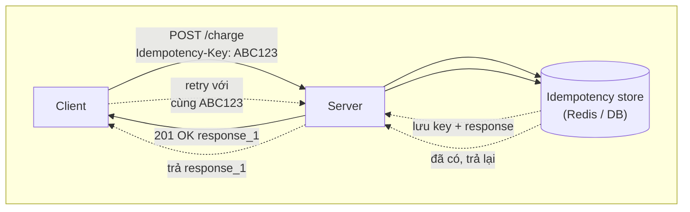
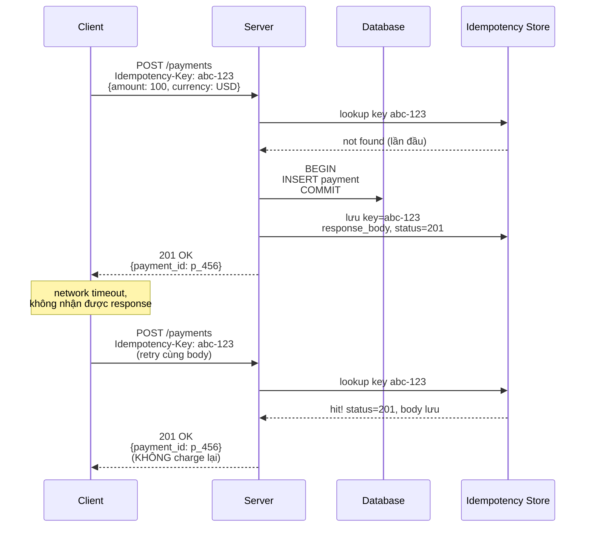
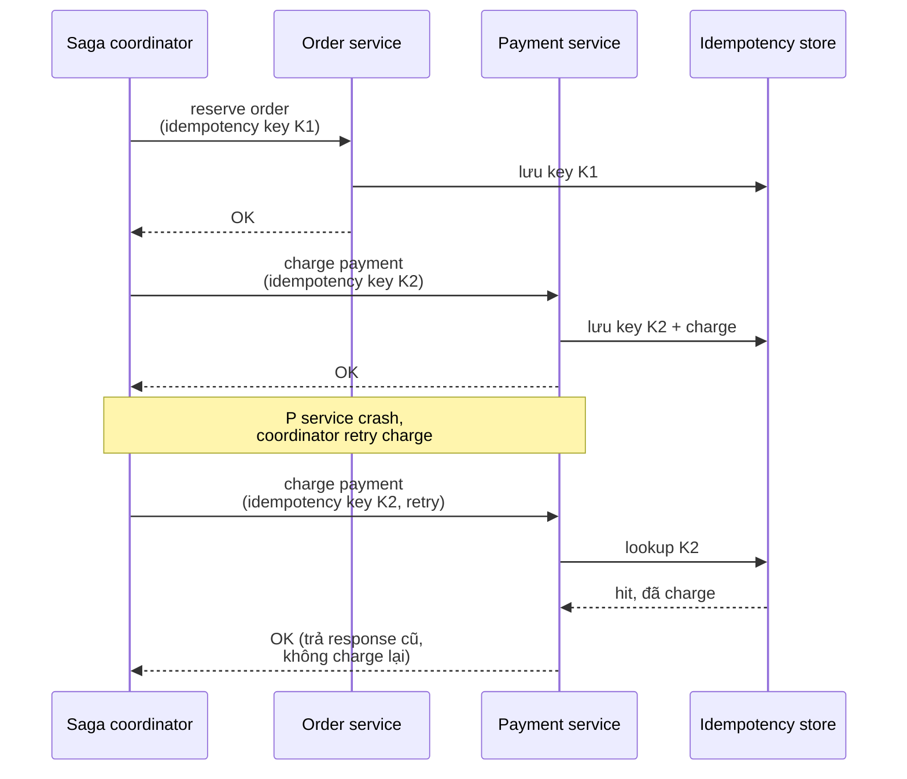
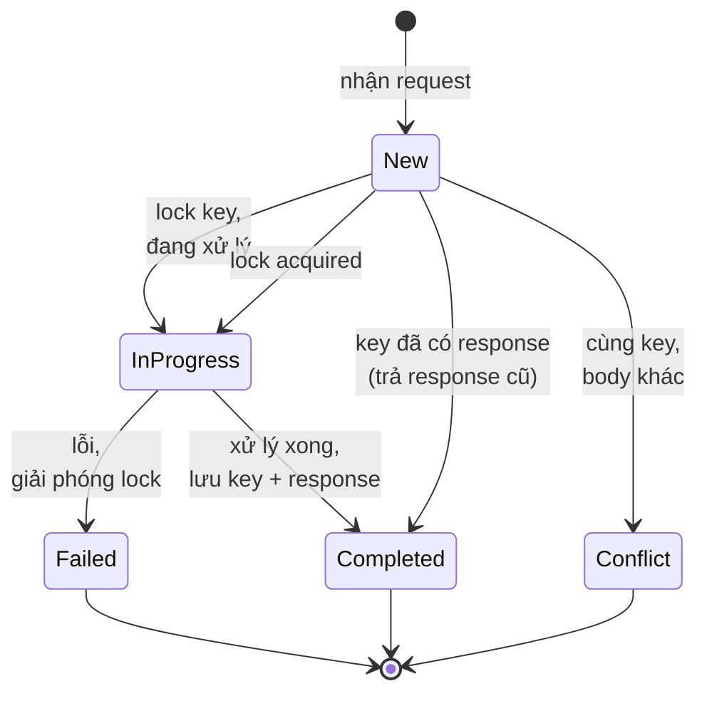

# What is idempotency in APIs?

> Bài này giải thị idempotency trong API và hệ thống phân tán: định nghĩa HTTP idempotent method (GET, PUT, DELETE), cơ chế idempotency key cho POST, lưu trữ key (Redis, DB), xử lý retry an toàn, và áp dụng trong payment, message queue, saga. Bài liên quan: [monolith-vs-microservices](monolith-vs-microservices.md) (saga cần idempotent receiver), [tcp-vs-udp](../Networking/tcp-vs-udp.md) (retry ở tầng transport).

Chủ đề: Distributed Systems · Ngày: 2026-10-16

## 1. Là gì

Idempotency là tính chất của một operation mà khi thực hiện nhiều lần với cùng tham số, kết quả cuối cùng giống như chỉ thực hiện một lần. Trong API: HTTP method `GET`, `PUT`, `DELETE` chuẩn idempotent — gọi 2 lần hay 10 lần, server state cuối cùng như nhau (resource bị xoá thì xoá, hoặc update với cùng body thì giá trị cuối giống nhau). `POST` không idempotent — gọi 2 lần thường tạo 2 resource.

Để làm `POST` cũng idempotent, client gửi kèm **idempotency key** (UUID, request ID) trong header. Server lưu key + response lần đầu. Request sau với cùng key, server trả lại response đã lưu thay vì xử lý lại. Quan trọng cho: payment (không double-charge), order (không tạo 2 order), message queue (consumer nhận event trùng vẫn đúng), saga (compensation không chạy 2 lần).



*Sơ đồ vị trí: client gửi POST kèm key, server xử lý lần đầu và lưu. Request retry với cùng key, server trả lại response cũ (không xử lý lại). Store là Redis hoặc DB có TTL.*

### Trả lời 30 giây

"Idempotency nghĩa là thực hiện operation nhiều lần với cùng input, kết quả cuối giống như chỉ làm một lần. HTTP GET/PUT/DELETE chuẩn idempotent vì định nghĩa; POST không idempotent. Để POST an toàn retry, client gửi kèm `Idempotency-Key` header (UUID). Server lưu key + response lần đầu vào store (Redis hoặc DB có TTL 24h), request sau cùng key trả lại response cũ thay vì xử lý lại. Quan trọng cho payment (Stripe, PayPal đều có), order tạo, message consumer. Lưu ý: idempotency key phải unique per business operation, không phải per request. Nếu client retry với cùng key nhưng body khác, server nên trả lỗi (conflict) chứ không xử lý body mới. Idempotency khác với dedup — idempotency đảm bảo effect một lần; dedup chỉ phát hiện trùng."

## 2. Cơ chế cốt lõi

### Bước 1. Idempotency ở tầng HTTP method

HTTP RFC 7231 định nghĩa method có tính idempotent:

- `GET`: an toàn và idempotent. Lấy resource, không thay đổi server state.
- `HEAD`: như GET, idempotent.
- `PUT`: idempotent — thay thế resource bằng body gửi. Gọi 2 lần với cùng body, kết quả như nhau.
- `DELETE`: idempotent — xoá resource. Gọi lần 2 trả 404 nhưng state cuối như nhau.
- `POST`: KHÔNG idempotent — thường tạo resource mới. Gọi 2 lần tạo 2 resource.
- `PATCH`: có thể idempotent (tuỳ cách implement). `PATCH {op: "set", path: "/email", value: "a@b"}` idempotent. `PATCH {op: "inc", path: "/counter"}` không.

### Bước 2. Idempotency key cho POST



*Cơ chế: client retry với cùng key, server thấy key đã có → trả response cũ. Đảm bảo effect (charge) chỉ chạy 1 lần.*

### Bước 3. Lưu trữ idempotency key

Lưu ở đâu? Tuỳ yêu cầu:

- **Redis**: nhanh, có TTL tự động. Dùng `SET key value NX EX 86400`. Nếu `NX` fail (key đã có), trả response cũ. Nhược: nếu Redis mất, mất state (key chưa kịp persist). Trade-off acceptable vì retry window thường < 1 giờ.
- **Database**: lưu trong bảng `idempotency_keys` với unique constraint. Chậm hơn Redis nhưng bền vững. Phù hợp khi payment critical, không được mất state.
- **Hybrid — Redis primary, DB backup**: đảm bảo vừa nhanh vừa bền.

TTL: 24 giờ phổ biến (đủ cho retry window của mobile client). Stripe giữ key 24h. Một số service giữ 7 ngày.

### Bước 4. Conflict detection: cùng key, body khác

Nếu client retry với cùng `Idempotency-Key` nhưng body khác (vd số tiền khác), server phải làm gì? Stripe trả 400 Bad Request với lỗi "Idempotency-Key in use with different parameters". Lý do: client có thể đang gửi nhầm request, không nên xử lý.

Cơ chế phổ hiện:

- Lưu cả hash của request body (`SHA256(body)`) cùng key.
- Khi retry, so sánh hash. Khác → trả 400.
- Hoặc: chỉ lưu response, không so hash. Cho phép body khác → trả response cũ. Ít an toàn hơn nhưng linh hoạt.

### Bước 5. Kết hợp với distributed transaction (saga)

Saga có nhiều step, mỗi step có thể retry. Receiver (mỗi service) phải idempotent:



*Saga step với idempotency key: retry với cùng key trả response cũ, không thực hiện side effect lần hai.*

### Bước 6. State machine cho idempotency request



*State machine cho idempotent request: New (chưa thấy key), InProgress (đang xử lý — lock ngăn xử lý song song), Completed (lưu response), Failed (lỗi, retry OK), Conflict (key cũ nhưng body khác — 400).*

### Quan sát

```bash
# Stripe: gửi idempotency key
curl -X POST https://api.stripe.com/v1/charges \
  -H "Authorization: Bearer sk_..." \
  -H "Idempotency-Key: $(uuidgen)" \
  -d amount=1000 -d currency=usd
# Retry với cùng key → trả response cũ, không charge lại

# Redis: SET key với NX (chỉ set nếu chưa tồn tại)
SET idemp:abc-123 "response_1" NX EX 86400
# Trả OK nếu set thành công, nil nếu key đã có (đã xử lý)

# PostgreSQL: bảng idempotency_keys
SELECT status, response_body FROM idempotency_keys WHERE key = 'abc-123';
```

### Ví dụ chạy từng bước

Kịch bản: payment API với Stripe-like gateway. User bấm Pay 100 USD, request đi qua mobile mạng không ổn định, timeout giữa chừng, client retry. Endpoint nhận `Idempotency-Key: abc-123`. Đã chạy mô phỏng (`node /tmp/ep_idem_sim.js`) để kiểm tra thứ tự thao tác.

### Bước 1. Request đầu tiên tới server
Client `POST /payments` với header `Idempotency-Key: abc-123`, body `{amount: 100, currency: USD}`. Server parse header và body, tính `body_hash = sha256(JSON)`. Trạng thái DB: chưa có row nào.

### Bước 2. Lookup và lock key
Server chạy `SELECT key, hash, status, response FROM idempotency_keys WHERE key='abc-123' FOR UPDATE`. Không thấy row. Insert `idempotency_keys(key, hash=abc123hash, status=in_progress)` trong cùng transaction với `INSERT INTO payments(...)`. Trạng thái: 1 payment row pending, 1 idem row in_progress.

### Bước 3. Charge gateway và lưu response
Server gọi gateway `Charge 100 USD`. Gateway trả success trong ~150 ms. Server `UPDATE idempotency_keys SET status=completed, response='{"payment_id":"pay_xyz","status":"succeeded"}' WHERE key='abc-123'`. Trả 201 cho client. Trạng thái: payment + idem row đều complete.

| Bước | Thời gian | DB payment | idem key status |
|---|---|---|---|
| 1 nhận request | t=0 | chưa có | chưa có |
| 2 lock + insert | t=0 | pending | in_progress |
| 3 charge thành công | t=0.15s | succeeded | completed |
| 4 response tới client | t=0.15s | succeeded | completed |

### Bước 4. Network timeout và retry
Giả sử TCP bị reset lúc t=5s trước khi client đọc được response. Client tới t=8s mới retry, dùng lại key `abc-123` (cùng logical operation). Server lookup lại: thấy row `completed`, hash match → trả 201 với response đã lưu `{payment_id: "pay_xyz"}`. KHÔNG gọi gateway lần hai. Client thấy response, biết payment đã tạo thành công đúng 1 lần. Tổng charge: 100 USD × 1 = 100 USD.

### Bước 5. Conflict: cùng key, body khác
Bug ở client: retry với cùng key `abc-123` nhưng body đổi `{amount: 1000}`. Server lookup thấy row, so `hash(body_new)` với `hash(saved)` → khác → trả 400 "Idempotency-Key in use with different parameters". Không xử lý body mới, không charge thêm. Client phải tạo key mới.

### Biến thể: nếu idempotency bị lỗi, gateway double-charge
Nguyên nhân thường gặp: code charge TRƯỚC khi INSERT idem row, network giữa charge và commit DB bị fail → retry chạy lại charge. Cách xử lý: so sánh DB payment với Stripe dashboard mỗi giờ, refund duplicate. Sửa code: `INSERT ON CONFLICT` để lock atomic, hoặc unique constraint `(idempotency_key)` trên payments kết hợp outbox.

Điều rút ra: idempotency key chỉ an toàn khi lookup + insert là atomic trong cùng transaction với data; nếu tách rời, retry có thể vượt qua check và double-charge — đúng câu trả lời ở câu 2 phần 3A (lock ngăn 2 request cùng key xử lý song song).

## 3. Câu hỏi phỏng vấn

### 3A. Câu hỏi đào sâu

<details class="qa">
<summary>Câu 1. HTTP idempotent method là gì? Phân biệt các method?</summary>

**Trả lời ngắn:** Idempotent method: gọi nhiều lần với cùng input, server state cuối như nhau. GET, HEAD, PUT, DELETE idempotent theo định nghĩa HTTP. POST không idempotent. PATCH tuỳ implement. Idempotent quan trọng vì client retry an toàn — nếu request trước đó đã tới server nhưng response mất, retry không gây side effect lần 2.

**Đào sâu:**
- GET: an toàn (read-only) và idempotent. Không thay đổi server state.
- PUT: idempotent. `PUT /users/123 {name: "A"}` gọi 2 lần, kết quả user 123 có name=A. Gọi 3 lần cũng vậy.
- DELETE: idempotent. Lần đầu xoá trả 204, lần 2 trả 404 (resource không có) nhưng state cuối như nhau (resource không tồn tại).
- POST: KHÔNG idempotent. `POST /orders` tạo order mới mỗi lần. Gọi 2 lần tạo 2 order. Đây là lý do cần idempotency key.
- PATCH: phụ thuộc. `PATCH /users/123 {op: "set", path: "/name", value: "A"}` idempotent. `PATCH /counter {op: "inc"}` không idempotent.

**Bẫy:** "PUT luôn idempotent, không cần idempotency key". Sai một phần — PUT idempotent về mặt state nếu body giống. Nếu body khác giữa 2 lần (race condition 2 client update cùng resource), state cuối phụ thuộc request nào tới sau. Idempotency key có thể giúp.

**Follow-up:** `POST /users {name: "A"}` với body giống gọi 2 lần có idempotent không? Không — server có thể tạo user với 2 ID khác nhau (resource mới). Phải dùng idempotency key hoặc cơ chế uniqueness khác.
</details>

<details class="qa">
<summary>Câu 2. Idempotency key hoạt động thế nào? Quy trình server xử lý ra sao?</summary>

**Trả lời ngắn:** Client gửi `Idempotency-Key` header (UUID hoặc hash). Server: (1) lookup key trong store (Redis/DB). (2) Nếu có response → trả response cũ. (3) Nếu không → lock key (SETNX), xử lý, lưu response, trả về client. Retry với cùng key trả response cũ, không xử lý lại.

**Đào sâu:**
- Bước 1: Validate key (UUID format, không rỗng). Một số API cho key optional — không có key thì không idempotent.
- Bước 2: Lookup key trong store. Nếu có record, kiểm tra hash body. Match → trả response cũ. Mismatch → trả 409/400 (conflict).
- Bước 3: Lock key (atomic SETNX với TTL). Ngăn 2 request đồng thời cùng key cùng xử lý.
- Bước 4: Xử lý business logic. Trong transaction, có thể lưu key vào DB (cùng transaction với data).
- Bước 5: Lưu response (status code + body) vào store. Set TTL (24h phổ biến).
- Bước 6: Trả response cho client.
- Race condition: 2 request cùng key đến cùng lúc. SETNX đảm bảo chỉ 1 thắng. Request thua trả 409 hoặc đợi lock giải phóng.

**Bẫy:** "Idempotency key chỉ cần thiết khi dùng retry library". Sai — cần thiết cho mọi API có side effect quan trọng. Retry là một trigger, side effect là gốc rễ vấn đề.

**Follow-up:** Nếu store Redis mất (failover, restart), key bị mất. Request retry sẽ xử lý lại → double charge. Cách giảm? Lưu key trong DB (cùng transaction với data) để bền vững, hoặc dùng Redis cluster với persistence.
</details>

<details class="qa">
<summary>Câu 3. Nếu client retry với cùng key nhưng body khác thì xử lý thế nào?</summary>

**Trả lời ngắn:** Stripe trả 400 với lỗi "Idempotency-Key in use with different parameters". Lý do: client có thể gửi nhầm request khác, xử lý theo body mới gây nguy hiểm. Cách hiện thực: lưu hash body (SHA256) cùng key, so sánh khi retry. Khác → 400 Conflict.

**Đào sâu:**
- Ví dụ: client gửi `POST /payments {amount: 100}` với key K1, response OK. Sau đó bug: client gửi `POST /payments {amount: 1000}` cũng với key K1. Server không nên xử lý 1000 — đó là request khác.
- Cơ chế: lưu `key` + `body_hash` + `response`. Khi retry: tính hash body mới, so sánh. Khác → 400.
- Stripe thực tế: trả 400, message "Keys for idempotent requests can only be used with the same parameters they were first used with".
- Một số API cho phép body khác (idempotent chỉ về effect cuối). Thiết kế yếu hơn nhưng linh hoạt hơn. Cần tài liệu rõ.
- Mobile client offline → queue request, khi online gửi. Có thể body đã thay đổi (số tiền update). Conflict sẽ xảy ra — client phải xử lý 400 bằng cách thử key mới.

**Bẫy:** Không kiểm tra body hash — chỉ check key. Client có thể gửi nhầm request khác với cùng key, server xử lý theo body mới → inconsistent.

**Follow-up:** Khi nào nên cho phép body khác với cùng key? Khi key đại diện cho business operation (vd "retry whole operation"), không phải request. Ví dụ saga step: cùng step ID, body có thể enrich thêm field qua retry. Hiếm.
</details>

<details class="qa">
<summary>Câu 4. Idempotency và dedup khác nhau thế nào?</summary>

**Trả lời ngắn:** Idempotency đảm bảo operation thực hiện hiệu quả một lần dù gọi nhiều lần — server trả response giống nhau. Dedup (deduplication) chỉ phát hiện và bỏ qua các bản trùng. Idempotency là contract giữa client-server; dedup là kỹ thuật nội bộ.

**Đào sâu:**
- Idempotency: client gửi POST /payments {amount: 100, key: K1} hai lần. Server trả cùng response, charge 1 lần. Đây là contract — client có thể tin retry an toàn.
- Dedup: server (hoặc message consumer) nhận 2 message giống nhau, xử lý 1, bỏ qua 1. Không có contract rõ với client; client không biết server có dedup hay không.
- Idempotency cần server lưu state (key + response). Dedup có thể tạm thời (cache TTL ngắn).
- Idempotency thường dùng cho HTTP API, payment. Dedup thường dùng cho message consumer (Kafka idempotent consumer với offset commit), email, notification.
- Một số hệ thống kết hợp: API idempotent cho client, consumer tự dedup qua offset và key trong message.

**Bẫy:** "Idempotency chỉ cần cho payment". Sai — mọi side effect quan trọng cần idempotency. Order creation, inventory decrement, notification, message processing đều nên idempotent.

**Follow-up:** Kafka consumer làm sao idempotent? Commit offset sau khi xử lý thành công. Nếu consumer crash trước commit, restart sẽ re-process message từ offset cũ → phải idempotent. Lưu key (message ID) vào DB để phát hiện đã xử lý.
</details>

<details class="qa">
<summary>Câu 5. Saga step với retry cần idempotency thế nào?</summary>

**Trả lời ngắn:** Mỗi saga step có idempotency key (saga ID + step name). Service nhận step: lookup key. Nếu có → trả response cũ (đã xử lý). Nếu không → xử lý, lưu response. Retry với cùng key trả response cũ, không side effect lần 2. Kết hợp với compensation: compensation cũng phải idempotent.

**Đào sâu:**
- Saga coordinator gửi step tới service. Step có: saga_id, step_name, idempotency_key = sha256(saga_id + step_name), payload.
- Service: lookup key. Hit → đã xử lý, trả response cũ. Miss → xử lý, lưu key + response.
- Compensation: nếu step fail, coordinator gọi compensation với key riêng (saga_id + "compensate_" + step_name). Service phải idempotent cho compensation — chạy 2 lần vẫn đúng (vd refund đã refund rồi thì lần 2 trả "already refunded").
- Lỗi thường gặp: compensation không idempotent → refund 2 lần. Phải test với retry.
- Một số service dùng state machine cho saga step: PENDING → DONE → COMPENSATED. Lookup state để biết phải làm gì khi retry.

**Bẫy:** Compensation chạy 2 lần vì không idempotent — refund double. Bài học: idempotency không chỉ cho happy path, còn cho compensation.

**Follow-up:** Outbox có cần idempotency không? Có — nếu poller đẩy event sang Kafka và crash trước khi mark outbox row, restart sẽ đẩy lại. Consumer phải idempotent (xử lý event trùng an toàn). Kết hợp event ID + idempotency key.
</details>

<details class="qa">
<summary>Câu 6 (Debug). User complain charge 1 lần nhưng trong DB có 2 record payment với cùng `order_id`. Bạn kiểm tra gì?</summary>

**Trả lời ngắn:** Có thể client gửi POST /payments 2 lần mà không idempotency key, hoặc có key nhưng server không check đúng. Kiểm tra: (1) API có yêu cầu idempotency key không? (2) Server có lookup key trước khi xử lý không? (3) DB có unique constraint trên (idempotency_key) không?

**Đào sâu:**
- Bước 1: Kiểm tra API có trả về 2 record hay chỉ 1. Nếu 2, có thể 2 transaction chạy song song.
- Bước 2: API log: có 2 request với cùng idempotency key không? Nếu không có key → thiếu cơ chế.
- Bước 3: Kiểm tra code xử lý payment: có lock key (SETNX) trước khi charge không? Có INSERT payment và lưu key cùng transaction không?
- Bước 4: Race condition: 2 request cùng key tới cùng lúc. SETNX lock chỉ 1 thắng, cái còn lại trả 409 hoặc đợi. Nếu cả 2 đều xử lý → SETNX không hoạt động hoặc race trong logic.
- Bước 5: DB unique constraint: thêm `UNIQUE (idempotency_key)` vào bảng payment. Hai INSERT cùng key → một cái fail. Kết hợp với retry.
- Bước 6: Reconciliation: so sánh payment records với payment gateway records (Stripe, PayPal). Tìm duplicate charge, refund.

**Bẫy:** Tăng timeout retry → che root cause. Logic idempotency sai mới là gốc.

**Follow-up:** Tìm thấy duplicate charge thật sự ở gateway (đã charge user 2 lần). Làm sao xử lý? Refund transaction thứ 2, document để user support, fix code idempotency, thêm test case retry.
</details>

<details class="qa">
<summary>Câu 7 (Thiết kế). Thiết kế payment API idempotent cho Stripe-like gateway. Lưu key ở đâu, TTL bao lâu, conflict xử lý ra sao?</summary>

**Trả lời ngắn:** Lưu idempotency key trong bảng `idempotency_keys` cùng DB với payment (transaction atomic). TTL 24 giờ (đủ cho mobile retry window). Conflict (cùng key, body khác): trả 400 với code rõ. Lookup theo `UNIQUE (key)`. Index theo key + created_at cho cleanup.

**Đào sâu:**
- Quyết định 1: Lưu cùng DB payment, không tách Redis. Lý do: payment critical, không được mất state. Atomic với data qua transaction.
- Quyết định 2: Bảng `idempotency_keys(id, key UNIQUE, request_hash, response_status, response_body, payment_id, created_at, expires_at)`. Index `(expires_at)` cho cleanup job xoá key cũ.
- Quyết định 3: TTL 24 giờ. Trade-off: 7 ngày an toàn hơn nhưng bảng phình. 24h đủ cho retry window (mobile offline → online thường < 1h).
- Quyết định 4: Lookup atomic. `INSERT ... ON CONFLICT (key) DO NOTHING RETURNING *`. Nếu RETURNING rỗng → key đã tồn tại, SELECT lấy response cũ. Nếu RETURNING có row → mình xử lý, xử lý xong UPDATE response.
- Quyết định 5: Hash request body (SHA256). Khi INSERT thất bại, SELECT response cũ và so hash. Khác → trả 400 "key used with different parameters".
- Quyết định 6: Cleanup job chạy mỗi giờ: `DELETE FROM idempotency_keys WHERE expires_at < now()`. Giữ bảng không phình.
- Quyết định 7: Document cho client: key nên unique per logical operation, không phải per HTTP request. Client có retry policy riêng → tạo key mới cho mỗi logical retry.

**Bẫy:** Lưu key ở Redis cho nhanh nhưng Redis restart mất state. Trade-off acceptable cho non-payment; không chấp nhận cho payment.

**Follow-up:** Nếu DB write idempotency key fail sau khi charge thành công (vd transaction rollback do constraint khác), key không lưu → retry sẽ charge lại. Cách xử lý? Dùng outbox pattern: ghi key và payment vào bảng tạm trong cùng transaction, sau đó process. Nếu fail, dọn dẹp. Phức tạp nhưng an toàn.
</details>

### 3B. Câu hỏi phỏng vấn liên quan

<details class="qa">
<summary>Câu 8. Khi nào nên dùng idempotency key, khi nào không cần?</summary>

**Trả lời:** Dùng khi API có side effect quan trọng (payment, order creation, inventory decrement, notification) và client có thể retry (mobile, network unstable). Không cần khi operation là read (GET) hoặc idempotent sẵn (PUT với cùng body, DELETE). Không cần khi API nội bộ service-to-service trong mạng tin cậy, ít retry.
</details>

<details class="qa">
<summary>Câu 9. Stripe Idempotency-Key hoạt động ra sao?</summary>

**Trả lời:** Stripe yêu cầu header `Idempotency-Key` cho mọi POST. Key lưu 24h. Retry với cùng key trả response cũ. Khác key + cùng parameters: vẫn xử lý. Cùng key + khác parameters: trả 400. Key phải là UUID v4 hoặc string đủ unique. Khuyến nghị client dùng UUID cho mỗi logical retry.
</details>

<details class="qa">
<summary>Câu 10. PUT có cần idempotency key không?</summary>

**Trả lời:** Không bắt buộc. PUT chuẩn idempotent (cùng body, gọi 2 lần giống nhau). Tuy nhiên idempotency key có thể giúp khi: (a) body khác giữa retry (client update giữa chờ), (b) cần đảm bảo resource chỉ update 1 lần với lock. Thường PUT không cần key, POST mới cần.
</details>

<details class="qa">
<summary>Câu 11. Tại sao POST không idempotent theo HTTP spec?</summary>

**Trả lời:** Theo RFC 7231, POST dùng cho action mà server xử lý theo cách riêng — thường tạo resource mới, gọi action. Không có định nghĩa state cuối cố định cho "gọi 2 lần". Mỗi POST có thể tạo resource mới, hoặc side effect khác nhau. Đây là lý do POST cần idempotency key để retry an toàn.
</details>

<details class="qa">
<summary>Câu 12. Idempotency key có cần unique toàn cục không?</summary>

**Trả lời:** Unique trong scope của API đó, trong TTL window. Cùng key cho 2 API endpoint khác nhau có thể OK (nếu lookup scoped theo endpoint), nhưng an toàn nhất là unique toàn cục. UUID v4 có collision cực thấp, dùng là đủ.
</details>

<details class="qa">
<summary>Câu 13. Idempotency key generation nên ở client hay server?</summary>

**Trả lời:** Client. Server không biết logical retry — chỉ thấy mỗi HTTP request là một. Client sinh key cho mỗi logical operation (vd mỗi lần user bấm "Pay"). Retry HTTP do network, không sinh key mới — dùng lại key cũ.
</details>

<details class="qa">
<summary>Câu 14. Khi nào idempotency có thể gây bug?</summary>

**Trả lời:** Khi key trùng trong TTL nhưng logic khác nhau: (a) client gửi cùng key cho 2 user khác nhau (logic sai); (b) test reset DB nhưng client dùng lại key cũ; (c) clock skew khi cleanup key, key cũ xuất hiện lại. Test với thời gian dài và key rotation.
</details>

<details class="qa">
<summary>Câu 15. True or false: "Idempotency key chỉ cần cho API public, internal service-to-service không cần."</summary>

**Trả lời:** Sai. Internal service-to-service vẫn cần idempotency cho: (a) saga step (retry khi coordinator crash); (b) message consumer (Kafka at-least-once delivery); (c) webhook receiver (provider retry khi server trả lỗi). Mọi giao tiếp xuyên network có retry đều nên idempotent.
</details>

<details class="qa">
<summary>Câu 16. Idempotency key conflict có nên trả 409 hay 400?</summary>

**Trả lời:** Cả hai đều hợp lý. Stripe dùng 400 (Bad Request — client gửi sai). Một số API dùng 409 (Conflict — resource state conflict). 422 Unprocessable Entity cũng OK. Quan trọng là response code rõ ràng để client xử lý (vd tạo key mới và retry).
</details>

## 4. Đánh đổi và sự cố production

### So sánh ba cách lưu idempotency state

| Tiêu chí | Redis (TTL) | DB table (transactional) | Hybrid (Redis + DB) |
|---|---|---|---|
| Latency | Rất thấp (<1 ms) | Thấp (~5-10 ms) | Thấp |
| Độ bền | Mất khi Redis restart (nếu không persistence) | Bền (cùng transaction) | Bền |
| Throughput | Rất cao | Trung bình (1 thêm INSERT/UPDATE) | Trung bình |
| Độ phức tạp | Thấp | Trung bình (cleanup job) | Cao |
| Phù hợp | Non-critical (notification, log) | Critical (payment, order) | Cả hai |

### Năm failure mode

| Triệu chứng | Nguyên nhân gốc | Cách kiểm tra | Cách sửa |
|---|---|---|---|
| User charge 2 lần dù retry đúng | Server không check idempotency key trước khi charge | Log request xem key, DB có 2 record cùng key | Fix code: lookup key, INSERT ... ON CONFLICT |
| Idempotency conflict trả 500 | Bug trong xử lý conflict (key tồn tại nhưng code vẫn xử lý mới) | Stack trace log | Trả 400/409 đúng cách, không xử lý mới |
| Key collision: 2 user cùng key | Client dùng key không unique (vd timestamp + user_id sai) | Log key + user, thấy trùng | Document: dùng UUID v4 hoặc hash unique |
| Idempotency table phình nghìn GB | TTL không hoạt động, cleanup job fail | Table size, index bloat | Check cleanup job, alert khi size > threshold |
| Retry với cùng key trả response cũ sai | Key lưu response của request fail trước đó, không phải success | Compare response với state hiện tại | Chỉ cache response của request success; fail không cache |

## 5. Cheat sheet

| Chủ đề | Con số / quy tắc cần nhớ |
|---|---|
| Idempotent method | GET, HEAD, PUT, DELETE chuẩn idempotent |
| Non-idempotent method | POST (mặc định); PATCH tuỳ implement |
| Idempotency key | UUID hoặc hash unique per logical operation |
| TTL | 24h phổ biến (Stripe); đủ cho mobile retry window |
| Lưu trữ | Redis (nhanh) hoặc DB (bền) |
| Conflict response | 400 (Stripe) hoặc 409, 422 — không xử lý body mới |
| Saga step | Idempotency key = saga_id + step_name; compensation cũng idempotent |
| Kafka consumer | Commit offset sau khi xử lý; idempotent qua message ID |
| Idempotency vs dedup | Idempotency = contract; dedup = kỹ thuật nội bộ |
| Race condition | SETNX lock hoặc INSERT ON CONFLICT ngăn 2 request cùng key |

**Học tiếp:**
- [monolith-vs-microservices](monolith-vs-microservices.md) — saga cần idempotent receiver
- [tcp-vs-udp](../Networking/tcp-vs-udp.md) — retry ở tầng transport gây duplicate
- [two-phase-commit](../Database/two-phase-commit.md) — distributed transaction và idempotency
- [database-replication](../Database/database-replication.md) — event consumer idempotent trong replication