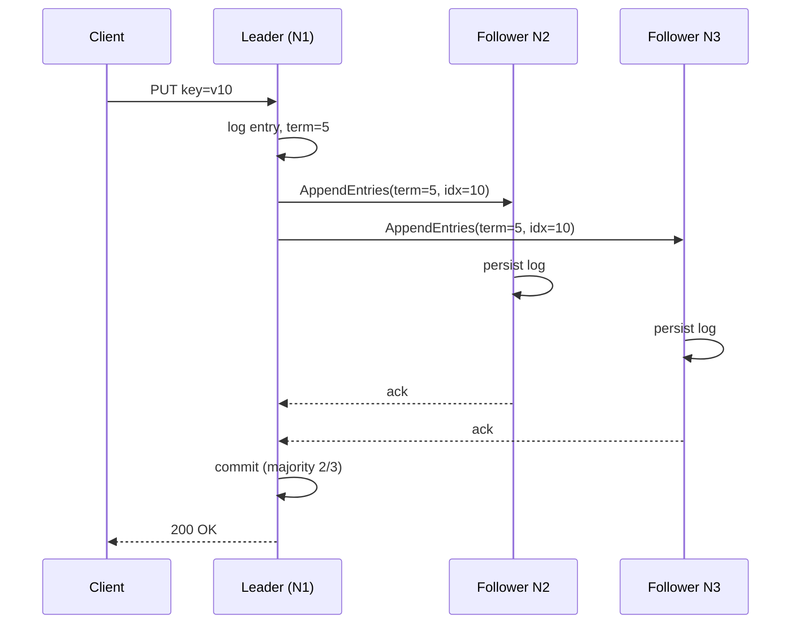

# How to keep a distributed system consistent?

> Bài này tập trung kỹ thuật để giữ nhất quán trong hệ phân tán: quorum (R/W), consensus (Raft/Paxos), saga, outbox, idempotency. Phân biệt với mô hình nhất quán (strong/eventual/causal) ở bài [eventual-vs-strong-consistency](eventual-vs-strong-consistency.md) và với định lý CAP ở bài [cap-theorem](cap-theorem.md). Bài [two-phase-commit](../Database/two-phase-commit.md), [database-replication](../Database/database-replication.md), [idempotency](idempotency.md) bàn các công cụ nền.

Chủ đề: Distributed Systems · Ngày: 2026-10-16

## 0. Nền tảng trước khi đọc

**Bối cảnh:** Nhiều máy cùng phục vụ một hệ thống. Khó ở chỗ mạng có thể chậm hoặc đứt, máy có thể hỏng, nhưng người dùng vẫn cần kết quả hợp lý.

**Nói đơn giản:** Giữ nhiều service nhất quán cần chọn đúng công cụ: transaction cục bộ, outbox, saga, quorum hoặc consensus.

**Từ khóa cần biết:** node = một máy hoặc tiến trình; network failure = mạng chậm/đứt; consistency = các nơi nhìn dữ liệu giống nhau tới mức nào.

**Ví dụ dễ hình dung:** Order service commit thành công nhưng message gửi kho thất bại; outbox giữ message để worker gửi lại.

Khi đọc, luôn hỏi ba câu: nó giải quyết vấn đề gì, nó làm việc theo những bước nào, và khi nào không nên dùng?

**Cách học bài này:** Đọc phần này trước để nắm từ khóa; đọc phần 1 để lấy câu trả lời 30 giây; đọc phần 2 để hiểu cơ chế; cuối cùng mở từng câu hỏi ở phần 3 để luyện nói. Các con số và lệnh trong bài là bằng chứng cho câu trả lời, không cần học thuộc nếu chưa hiểu cơ chế.

## 1. Là gì

### Đọc nhanh trước khi đi sâu

**Ý chính:** Giữ nhiều service nhất quán cần chọn đúng công cụ: transaction cục bộ, outbox, saga, quorum hoặc consensus.

**Ví dụ interview:** Order service commit thành công nhưng message gửi kho thất bại; outbox giữ message để worker gửi lại.

**Luồng 4 bước:**

1. Client gửi request tới một node hoặc gateway.
2. Node gọi các node khác qua mạng và có thể gặp timeout hoặc retry.
3. Hệ thống chọn cách giữ trạng thái đồng bộ và xử lý lỗi.
4. Client nhận kết quả hoặc lỗi có thể retry an toàn.

**Nói như trong interview:** Giữ nhiều service nhất quán cần chọn đúng công cụ: transaction cục bộ, outbox, saga, quorum hoặc consensus. Hãy nói theo bốn bước trên trước; nếu interviewer hỏi sâu, chuyển sang cơ chế **Bước 1. Quorum — đảm bảo overlap giữa tập đọc và tập ghi**, rồi nêu trade-off và failure mode ở các phần sau.

## 2. Cơ chế cốt lõi

### Bước 1. Quorum — đảm bảo overlap giữa tập đọc và tập ghi

1. Cluster có N bản sao (N=3, 5 thường gặp). Mỗi ghi phải được W bản sao ack. Mỗi đọc phải đọc từ ≥R bản sao, lấy bản mới nhất.
2. Quy tắc R+W > N đảm bảo tập đọc và tập ghi chồng nhau ít nhất 1 node, nên luôn thấy write mới nhất. Ví dụ N=3, R=2, W=2 → overlap 1 node, đọc luôn thấy write gần nhất. R=1, W=3 → đọc có thể thấy bản cũ.
3. Hệ quorum phổ biến: DynamoDB (configurable R/W), Cassandra (R+W>N, One/Quorum/All), Riak. DynamoDB mặc định "read-your-writes" qua consistent read; eventual là mặc định ban đầu của consistent-read-off.
4. Cài đặt: dùng vector clock hoặc timestamp (Lamport) để so sánh version; ghi thắng nếu timestamp mới hơn. Conflict khi hai node ghi đồng thời cùng key với version không gối → lưu cả hai và reconcile.
5. Failure mode: nếu W-1 node chết, ghi chỉ cần 1 ack nữa; nếu đủ W node chết đồng thời, ghi fail. Đánh đổi: R=W=N/2 + 1 cho N lẻ là phổ biến.

### Bước 2. Consensus — chọn một leader duy nhất

1. Raft/Paxos dùng majority quorum (N/2 + 1) cho cả election lẫn log replication. Một thời điểm chỉ có một leader được công nhận.
2. Luồng: leader nhận request, ghi entry vào log, replicate sang follower. Commit khi đa số follower ghi log entry đó. Follower có log khác leader bị từ chối (an toàn).
3. Leader election: nếu heartbeat timeout, follower đợi random rồi tự ứng cử với term tăng. Hai node cùng ứng cử → split vote, tăng term, thử lại. Thường vài trăm ms tới vài giây.
4. Đánh đổi so với quorum thuần: latency thấp hơn khi leader ổn (1 RTT để replicate đa số), nhưng election lại làm pause. Throughput giảm vì mọi ghi đi qua một node.
5. Hệ dùng Raft: etcd, Consul, CockroachDB, TiKV. Hệ dùng Paxos hoặc biến thể: Spanner (Paxos với TrueTime), ZooKeeper Zab (gần Raft), Kafka KRaft.

### Bước 3. Saga — transaction đa service qua compensating action

1. Một transaction đa service (đặt vé = trừ tiền + đặt chỗ + gửi email) không dùng được 2PC trong microservice vì khóa chéo, latency, SPOF. Saga thay bằng: bước T1, T2, T3,... mỗi T_i là local transaction; nếu bước nào fail → chạy compensating C_i cho các bước trước.
2. Hai kiểu điều phối: choreography (mỗi service publish event, service sau subscribe) hoặc orchestration (một orchestrator gọi lần lượt từng service). Orchestration dễ debug hơn; choreography ít coupling hơn nhưng khó theo dõi toàn flow.
3. Saga không đảm bảo atomic, chỉ "eventually consistent". Vài điểm cần xử lý:
- Compensating action không phải lúc nào cũng tự nhiên (gửi email đã gửi → "send recall" rất khó, thường chấp nhận người dùng nhận).
- Phải có retry với backoff, deadline, và circuit breaker.
4. Observable: cần distributed tracing (OpenTelemetry, Jaeger) để biết saga đang ở bước nào; cần state machine persisted (DB hoặc orchestrator) để crash-safe.

### Bước 4. Outbox pattern — ghi sự kiện cùng business transaction

1. Vấn đề: business logic cập nhật order; cùng lúc cần gửi message "OrderCreated" sang service khác. Nếu commit DB xong rồi Kafka fail, mất message. Nếu gửi Kafka trước rồi commit DB, consumer đọc sớm thấy dữ liệu chưa có.
2. Outbox: trong cùng local transaction, insert cả row `orders` lẫn row `outbox(event_type, payload, status)`. Commit 1 lần. Worker riêng poll bảng outbox (status='pending'), publish Kafka, update status='sent'. Nếu worker crash giữa publish và update → row vẫn 'pending', job khác retry. At-least-once.
3. Tối ưu: CDC (Debezium đọc binlog) thay vì poll, hoặc transactional outbox qua Kafka Connect (ít phổ biến hơn trong stack tự code).
4. Đảm bảo thứ tự: partition key của Kafka giống primary key bảng outbox (vd order_id) để mọi event của cùng order vào cùng partition, xử lý tuần tự.

### Bước 5. Idempotency — chống trùng khi retry

1. Retry là nguồn sinh trùng số 1: timeout client, fail-over load balancer, double-tap trên di động. Server phải xử lý: cùng request hai lần → một kết quả.
2. Idempotency key: client sinh UUID gắn vào header. Server lưu key + response vào bảng (key UNIQUE). Thấy key cũ → trả lại response cũ, không xử lý lại.
3. Ví dụ API POST /payments: header `Idempotency-Key: <uuid>`. Hai lần submit → chỉ một lần trừ tiền.
4. Idempotency key phải scope theo account hoặc endpoint, không global. TTL: 24h-7 ngày thường đủ.
5. Khác với "idempotent operation" (PUT /resource/id với cùng body luôn cho cùng kết quả) — idempotency key cho phép POST cũng an toàn.

### Bước 6. Sequence diagram — quorum write qua leader



*Ghi theo consensus: client gửi tới leader, leader replicate log tới đa số follower, commit khi đa số persist, trả client. Crash giữa chừng → leader mới được bầu theo term cao hơn, log có thể chưa commit nhưng vẫn replicate để an toàn.*

### Quan sát

```bash
# etcd: xem leader và term hiện tại (cluster 3 node)
etcdctl endpoint status --endpoints=node1:2379,node2:2379,node3:2379 -w table
# Cột "LEADER" = ID node leader. "RAFT TERM" tăng mỗi lần election.
# "RAFT INDEX" tăng mỗi ghi commit. Output minh họa, chưa chạy.

# Kafka: xem offset consumer đã đọc (kiểm tra retry/at-least-once)
kafka-consumer-groups.sh --bootstrap-server localhost:9092 \
  --describe --group payments --state
# Trạng thái "Stable" và offset bằng high-water mark = không còn message treo.

# PostgreSQL: xem replication lag giữa primary và replica
SELECT now() - pg_last_xact_replay_timestamp() AS replication_lag;
```

### Ví dụ chạy từng bước

Kịch bản: **payment wallet** với 3 replica, quorum N=3, W=2, R=2. Mỗi wallet record có `balance` và `version`. Quy tắc R+W=4 > N=3 → overlap 1 node → đọc luôn thấy ghi mới nhất.

**Trạng thái ban đầu:** N1 (leader) balance=100, version=5; N2 balance=100, version=5; N3 balance=100, version=5.

```text
| Bước | Thời gian | Actor | Hành động | Lý do |
|---|---|---|---|---|
| 1 | T=0 | Client | POST /wallets/w1/debit amount=30 → N1 | Debit trừ 30 |
| 2 | T=0 | N1 | Xác nhận version=5, balance=100. Tính balance_after=70. Ghi log entry với (v=6, balance=70). Gửi AppendEntries(v=6, bal=70) tới N2 và N3 | Đây là bước replicate — đảm bảo log entry đến đa số trước khi commit |
| 3 | T=5ms | N2 | Persist log entry (v=6, bal=70). Gửi ack tới N1 | N2 đã persist — một trong 2 ack cần để đạt majority |
| 4 | T=6ms | N3 | Persist log entry (v=6, bal=70). Gửi ack tới N1 | N3 đã persist — đủ majority (N1+N2+N3 = 3/3) |
| 5 | T=7ms | N1 | Nhận đủ 2 ack (N2, N3). Commit entry v=6. Update local state balance=70, version=6. Trả 200 OK cho Client | Quorum đạt — W=2 ack đủ. N1 commit vì N1, N2, N3 đều đã persist |
```

**Trạng thái sau bước 5:** N1: balance=70/v=6 ✅; N2: balance=70/v=6 ✅; N3: balance=70/v=6 ✅. Client nhận 200 OK.

```
text
| Bước | Thời gian | Actor | Hành động | Lý do |
|---|---|---|---|---|
| 6 | T=20ms | Client | GET /wallets/w1 — đọc R=2 replica | Đọc từ 2 node để so sánh version |
| 7 | T=21ms | N1, N2 | Trả balance=70, version=6 | Cả hai đều mới nhất — overlap đảm bảo thấy write mới nhất |
```

Client nhận balance=70 đúng.

**Biến thể — Nếu N3 chậm (persist chưa xong tại T=7ms):**

- Nhận 1 ack từ N2 tại T=5ms. Tại T=15ms (timeout chưa đủ ack), N1 gửi lại AppendEntries tới N3 → N3 persist → ack → commit → commit trễ hơn 8-10ms.
- Nếu N2 và N3 đều không ack kịp → N1 không commit, trả error/timeout cho Client → ghi không thành công, wallet giữ nguyên balance=100.
- Nếu dùng sloppy quorum (Cassandra): khi N3 chết, N1 ghi vào N1 và N2, ghi thay thế vào N1 (hoặc node khác) → không tính vào strict R+W>N, **có thể đọc thấy bản cũ**.

**Biến thể — Nếu client retry khi timeout (double debit):**

- Client gửi debit=30 tại T=0, timeout ở T=500ms (chưa nhận OK), retry cùng request tại T=500ms.
- Nếu idempotency-key thiếu: N1 có thể nhận hai lần debit cùng version=5 → balance=40 (trừ 2 lần). Giải pháp: `Idempotency-Key` header, server check key đã xử lý → trả response cũ.

Điều rút ra: R+W>N đảm bảo tập đọc và tập ghi giao nhau ít nhất 1 node → đọc luôn thấy ghi mới nhất. Bước 6-7 chứng minh: đọc R=2 replica (N1, N2) đều thấy version=6 vì overlap với tập ghi W=2 (N1, N2, N3) là N1 và N2. Câu hỏi phỏng vấn từ bài này: "R+W>N đảm bảo điều gì và khi nào không giữ được?" — stale read vẫn xảy ra nếu có sloppy quorum hoặc conflict write đồng thời.

## 3. Câu hỏi phỏng vấn

### 3A. Câu hỏi đào sâu

<details class="qa">
<summary>Câu 1. Quorum R+W>N đảm bảo điều gì và khi nào không giữ được?</summary>

**Trả lời ngắn:** R+W>N đảm bảo tập node đọc và tập node ghi luôn giao nhau ít nhất 1 node, nên đọc luôn thấy ghi mới nhất. Không giữ được khi hinted handoff không tính vào R/W, hoặc khi conflict write đồng thời cùng key với version đều "mới" → app phải resolve.

**Đào sâu:**
- Hinted handoff: node B chết, A ghi thất bại nhưng A giữ bản copy gửi sau. Bản copy này KHÔNG tính vào quorum.
- Conflict write đồng thời: last-write-wins dễ mất update. Vector clock hoặc LWW với server timestamp tùy hệ.
- Sloppy quorum: cho ghi vào node khác khi node đích chết → có thể R+W=N không strict.
- N=3, R=W=2 phổ biến; N=5, R=W=3 an toàn hơn nhưng chậm.

**Bẫy:** "Quorum = strong consistency". Sai — chỉ đảm bảo khi R+W>N VÀ không có write conflict.

**Follow-up:** Hệ nào cho phép sloppy quorum kèm read-repair? Cassandra kết hợp read-repair + hinted handoff.
</details>

<details class="qa">
<summary>Câu 2. Raft và Paxos khác nhau ở đâu? Raft đơn giản hơn vì sao?</summary>

**Trả lời ngắn:** Paxos gốc khó hiểu vì tách prepare/accept, không leader rõ; Raft chọn leader rõ ràng, mọi ghi qua leader, term thay round number. Safety tương đương; Raft dễ implement hơn. Multi-Paxos có leader, gần Raft.

**Đào sâu:**
- Raft: term đơn điệu, leader replicate log, follower chỉ ack. Commit index theo majority. Election timeout + random delay chống split vote.
- Paxos: hai phase Prepare/Promise và Accept/Accepted. Multi-Paxos chọn stable leader skip Prepare round sau.
- Raft có log matching: cùng index + cùng term → nội dung giống. Paxos không guarantee cụ thể thế.
- Spanner dùng Paxos + TrueTime external consistency; etcd/Consul dùng Raft.

**Bẫy:** "Raft và Paxos khác về safety dưới minority failure". Sai — cả hai tương đương.

**Follow-up:** Vì sao Raft cần random election timeout mà Multi-Paxos không cần? Multi-Paxos giữ leader ổn định qua lease; Raft cần random chống split vote đồng thời.
</details>

<details class="qa">
<summary>Câu 3. Saga khác 2PC ở điểm nào? Khi nào nên dùng saga?</summary>

**Trả lời ngắn:** 2PC blocking resource holder đến khi coordinator quyết; saga non-blocking, mỗi bước commit ngay, nếu fail thì compensating. Dùng saga khi đã chấp nhận eventual consistency, các bước ở hệ khác nhau không hỗ trợ 2PC.

**Đào sâu:**
- 2PC: lock hold đến khi coordinator quyết. Coordinator crash → participant khoá prepared. Recovery qua log. Microservice tránh vì SPOF.
- Saga: mỗi service local commit. Compensation có thể rollback hoặc forward retry.
- Dùng saga: business trải qua nhiều service, chấp nhận trạng thái trung gian nhìn thấy, latency quan trọng. Ví dụ đặt vé, payment, order fulfillment.
- Orchestration (Camunda, Temporal) dễ debug; choreography (event bus) nhẹ hơn nhưng quan sát khó.
- Tránh saga khi cần atomic thật: rút tiền liên ngân hàng, booking inventory đồng thời nhiều kho. Xem [two-phase-commit](../Database/two-phase-commit.md).

**Bẫy:** "Saga đảm bảo consistency". Sai — saga chỉ eventual. App chịu được trạng thái trung gian.

**Follow-up:** Compensation fail thì sao? Retry + alerting; "saga of sagas" hoặc human-in-the-loop cho bước cuối.
</details>

<details class="qa">
<summary>Câu 4. Outbox pattern giải quyết vấn đề gì, có những cách cài đặt nào?</summary>

**Trả lời ngắn:** Outbox giải quyết dual-write: ghi DB xong gửi message có thể fail, gửi message trước ghi DB thì consumer sớm thấy dữ liệu chưa có. Cùng local transaction commit cả business và outbox row, worker đọc outbox publish sang broker.

**Đào sâu:**
- Schema: `outbox(id, aggregate_id, event_type, payload, status, created_at)`. Index trên `(status, id)`.
- Worker: poll `status='pending'`, publish, update `status='sent'`. Lock row tránh 2 worker cùng publish, hoặc `FOR UPDATE SKIP LOCKED` (PostgreSQL, MySQL 8+).
- CDC thay poll: Debezium đọc binlog PostgreSQL/MySQL, đẩy Kafka. Lower latency, ít tải DB.
- Đảm bảo ordering: partition key Kafka = aggregate_id.
- Failure: commit DB lỗi → không có outbox, không publish. Commit DB xong worker crash → row pending, worker khác retry.

**Bẫy:** "Outbox đảm bảo exactly-once". Sai — outbox at-least-once, consumer phải idempotent.

**Follow-up:** Outbox poll so với Debezium CDC: poll đơn giản chậm (vài giây), CDC gần real-time nhưng thêm dependency (Kafka Connect, schema registry).
</details>

<details class="qa">
<summary>Câu 5. Idempotency key khác "idempotent operation" thế nào? Cache response cũ bao lâu?</summary>

**Trả lời ngắn:** Idempotent operation (PUT /resource/123) luôn cho cùng kết quả — không cần key. Idempotency key cho phép POST (non-idempotent về mặt kỹ thuật) an toàn khi retry. Cache response thường 24h-7 ngày, đủ SLA, không giữ quá lâu.

**Đào sâu:**
- Header `Idempotency-Key` (chuẩn de-facto từ Stripe API). Key unique cho mỗi ý định.
- Lưu bảng `idempotency_keys(key UNIQUE, request_hash, response_body, status_code, expires_at)`.
- Khi nhận key: có rồi + hash khớp → trả response cũ. Hash khác → 422. Chưa có → xử lý rồi lưu.
- TTL: Stripe 24h. Một số hệ giữ 7 ngày.
- Race cùng key: `INSERT ... ON CONFLICT` (PostgreSQL) hoặc row lock, tránh xử lý hai lần.

**Bẫy:** "Key global là đủ". Sai — key phải scope theo user_id + endpoint.

**Follow-up:** Nếu response cũ là 500, retry lại được không? Tách "in-flight" và "completed"; nếu in-flight, đợi hoặc trả 409.
</details>

<details class="qa">
<summary>Câu 6 (Debug). Service A ghi order xong, message Kafka gửi sang service B mất. Không có log error. Kiểm tra gì theo thứ tự?</summary>

**Trả lời ngắn:** (1) commit DB có row outbox chưa; (2) worker outbox có pick row đó không; (3) Kafka producer ack chưa; (4) consumer B có poll topic chưa; (5) deserialization error. Mất im lặng thường do worker crash hoặc network Kafka xuống ngay sau publish.

**Đào sâu:**
- Bước 1: `SELECT * FROM outbox WHERE aggregate_id='order-123' ORDER BY created_at DESC LIMIT 5`. Nhiều row pending → worker chưa xử lý.
- Bước 2: worker process còn chạy không. PID. Liveness probe.
- Bước 3: outbox đã `status='sent'`, consumer B không thấy → kiểm tra topic tồn tại, retention, partition, consumer group subscription.
- Bước 4: `kafka-consumer-groups.sh --describe` xem lag. Lag tăng liên tục → consumer chậm hoặc chết.
- Bước 5: consumer không thấy message → deserialization error trong log (poison message). Header `Content-Type` payload.

**Bẫy:** Sửa producer gửi lại thủ công dễ duplicate. Dùng outbox-replay: set `status='pending'`, worker tự publish.

**Follow-up:** Producer ack timeout nhưng thực ra đã publish? Consumer idempotent + transactional producer (Kafka transactional API); hoặc outbox at-least-once + idempotent consumer.
</details>

<details class="qa">
<summary>Câu 7 (Thiết kế). Thiết kế payment service 10k TPS: update balance + ghi transaction log + gửi webhook. Chọn pattern gì?</summary>

**Trả lời ngắn:** Atomic trong một DB (transaction đơn), consensus (CockroachDB / Spanner style) hoặc PostgreSQL synchronous replication. Ghi log cùng bảng balance (append-only). Webhook qua outbox + worker; idempotency key từ client.

**Đào sâu:**
- DB: PostgreSQL synchronous replication + Patroni, hoặc CockroachDB / Spanner. Per-payment latency ~5-15ms trong cùng DC.
- Schema: `accounts(id, balance, version)`, `transactions(id, account_id, amount, balance_after, created_at)`. `UPDATE accounts SET balance=?, version=version+1 WHERE id=? AND version=?` — optimistic lock.
- Webhook: outbox table `webhooks(id, url, payload, status)`. Worker poll, retry + backoff + idempotency_key ở receiver.
- Idempotency ở API: `Idempotency-Key` header. Server check key (UNIQUE).
- Điểm nghẽn: hot account (account lớn ghi nhiều). Mitigation: sharding theo account_id, row-level lock retry.

**Bẫy:** Cache write-through — dễ mất log nếu cache flush chậm hơn DB. DB phải source of truth.

**Follow-up:** Cross-currency (USD → VND) 1:1 với rate snapshot? Saga chấp nhận chênh nhỏ; two-phase commit nếu cần chính xác tuyệt đối.
</details>

### 3B. Câu hỏi phỏng vấn liên quan

<details class="qa">
<summary>Câu 8. Read-repair là gì, dùng khi nào?</summary>

**Trả lời:** Khi client đọc nhiều bản sao phát hiện version lệch, background thread gửi write "mới nhất" tới bản sao cũ để hội tụ. Cassandra, Riak, Dynamo dùng khi quorum read. Không mạnh ngay nhưng sau vài round đồng bộ.
</details>

<details class="qa">
<summary>Câu 9. Leader election trong Raft tốn bao lâu?</summary>

**Trả lời:** Phụ thuộc heartbeat interval (50-150ms) và election timeout (150-300ms). Một election bình thường 100-500ms. Split vote có thể vài giây. etcd mặc định 1 giây timeout. Tunable qua flag.
</details>

<details class="qa">
<summary>Câu 10. Tại sao không dùng 2PC cho microservice?</summary>

**Trả lời:** Coordinator SPOF, lock held dài gây contention (mọi participant chờ quorum), latency thêm 2-3 RTT, khó recovery khi coordinator crash. Microservice khác DB vendor không hỗ trợ XA chung. Thay bằng saga + outbox + idempotency.
</details>

<details class="qa">
<summary>Câu 11. Linearizability khác eventual consistency ở điểm nào?</summary>

**Trả lời:** Linearizability: mọi thao tác đọc thấy write mới nhất theo thứ tự thời gian thực, như chạy trên một máy. Đạt bằng quorum + leader (Raft, Paxos, Spanner TrueTime). Eventual: chỉ đảm bảo không có write mới thì mọi replica hội tụ. Xem [eventual-vs-strong-consistency](eventual-vs-strong-consistency.md).
</details>

<details class="qa">
<summary>Câu 12. Outbox và Change Data Capture (CDC) khác gì?</summary>

**Trả lời:** Outbox do app ghi vào bảng riêng; CDC do hệ đọc binlog/WAL rồi phát ra (Debezium, Maxwell). CDC ít sửa app, đọc toàn bộ thay đổi; outbox gọn hơn nhưng phải sửa business code.
</details>

<details class="qa">
<summary>Câu 13. Idempotency key có cần cho GET không?</summary>

**Trả lời:** Không — GET idempotent by HTTP semantics. Chỉ cần cho thao tác có side-effect: POST, một số PATCH/DELETE. Một số hệ cho idempotency key vào GET để cache lookup.
</details>

<details class="qa">
<summary>Câu 14. CAP ảnh hưởng thế nào đến chọn consensus hay quorum thuần?</summary>

**Trả lời:** CAP nói khi partition chọn consistency (CP) hay availability (AP). Consensus như Raft = CP (mất quorum = không ghi). Quorum R+W=N (không strict) availability cao hơn. PACELC mở rộng: partition chọn C/A; không partition chọn latency vs consistency. Xem [cap-theorem](cap-theorem.md).
</details>

<details class="qa">
<summary>Câu 15. Đúng hay sai: "Outbox đảm bảo exactly-once delivery".</summary>

**Trả lời:** Sai — outbox at-least-once. Worker có thể crash sau publish Kafka nhưng trước khi update `status='sent'` → publish lại. Exactly-once cần transactional DB + transactional Kafka producer + idempotent consumer. Stripe-style idempotency key ở consumer giải quyết trùng; outbox giảm khả năng trùng về gần 0 nhưng không đảm bảo tuyệt đối.
</details>

<details class="qa">
<summary>Câu 16. Khi nào nên leader-based write thay vì quorum?</summary>

**Trả lời:** Hot key (ghi nhiều vào cùng key) tránh write conflict. Latency thấp ổn định (leader gần). RPO=0 (no data loss), leader đồng bộ sync. Nhược: leader chết, vài giây tới vài chục giây bầu leader mới — unavailability.
</details>

## 4. Đánh đổi và sự cố production

### So sánh các kỹ thuật

| Kỹ thuật | Latency p99 (cùng DC) | Failure mode chính | Chi phí vận hành | Mức nhất quán đạt được |
|---|---|---|---|---|
| Quorum R+W=N+1 | ~1-2 RTT | Hinted handoff làm gãy overlap | Thấp | Strong cho read mới nhất |
| Consensus (Raft/Paxos) | ~1-2 RTT, leader ổn | Leader chết, election 100ms-2s | Trung bình (operator theo dõi) | Linearizable |
| Saga | ~N×local latency | Compensation fail, edge case orphan | Cao (tracing + retry) | Eventual |
| Outbox + worker | +vài giây poll lag | Worker kẹt; poison message loop | Trung bình | At-least-once |
| Idempotency key | +1 SELECT cho cache hit | Storage key cũ expire | Thấp | Exactly-once (nếu dùng đúng) |

### Năm failure mode

| Triệu chứng | Nguyên nhân gốc | Cách kiểm tra | Cách sửa |
|---|---|---|---|
| Message Kafka bị mất im lặng | Worker outbox crash giữa publish và update status | Log worker; `SELECT FROM outbox WHERE status='pending' LIMIT 10` | Khởi động lại worker; idempotent consumer để xử lý duplicate |
| Đọc trả về dữ liệu cũ ngay sau ghi | Read dùng replica chưa apply | Replication lag metric; so sánh với leader | Đổi read sang leader (sticky session) hoặc sync replication |
| Leader election liên tục (term tăng đều) | Mạng giữa cluster chập chờn, heartbeat timeout | Network ping giữa node; log election | Tăng heartbeat, kiểm tra switch/MTU |
| Saga stuck không tiến | Compensation bước trước fail lặp | Distributed tracing (Jaeger, Zipkin); saga state DB | Retry với backoff; alerting khi > N phút |
| Ghi trùng sau retry | Idempotency key thiếu hoặc TTL quá ngắn | Audit log duplicate; check key trong request | Bắt buộc `Idempotency-Key` ở API; TTL 24h+ |

## 5. Cheat sheet

| Chủ đề | Con số / quy tắc cần nhớ |
|---|---|
| Quorum rule | R + W > N |
| Raft majority | N/2 + 1 |
| Raft election | 100-500ms bình thường; vài giây nếu split vote |
| Heartbeat interval Raft | 50-150ms thường gặp |
| Saga | Compensation ≠ rollback phổ biến — có thể forward retry |
| Outbox | At-least-once; consumer phải idempotent |
| Idempotency key TTL | 24h (Stripe) - 7 ngày |
| 2PC so vs saga | 2PC: blocking + SPOF; saga: non-blocking + eventual |
| CDC vs poll | CDC real-time, thêm dependency; poll đơn giản, lag vài giây |
| CAP partition | Chọn C (CP) hoặc A (AP); xem [cap-theorem](cap-theorem.md) |

**Học tiếp:**
- [eventual-vs-strong-consistency](eventual-vs-strong-consistency.md) — các mô hình nhất quán
- [cap-theorem](cap-theorem.md) — định lý CAP và PACELC
- [two-phase-commit](../Database/two-phase-commit.md) — atomic xuyên DB và lý do microservice tránh
- [database-replication](../Database/database-replication.md) — primary-replica, multi-leader
- [idempotency](idempotency.md) — pattern idempotency key cụ thể


