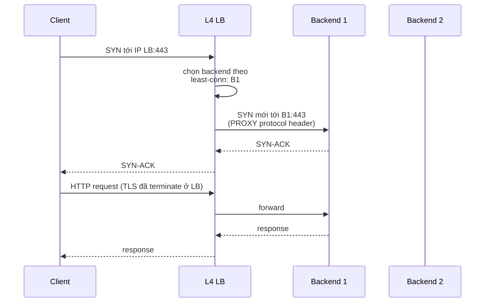
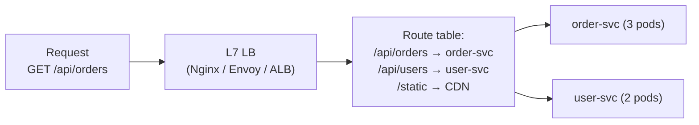
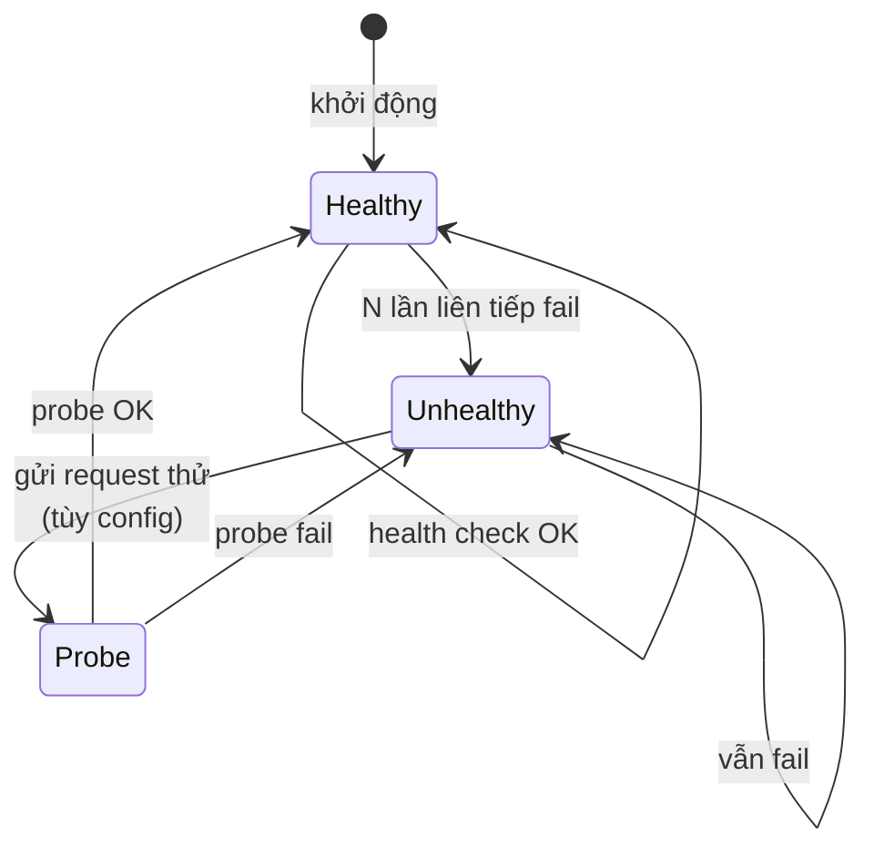

# How does a load balancer work?

> Bài này giải thích load balancer (LB) trong hệ thống phân tán: vì sao cần, các kiểu L4 vs L7, thuật toán phân tải (round-robin, least-conn, consistent hash), health check, sticky session, và các cấu hình production phổ biến (HAProxy, Nginx, AWS ALB, Envoy). Bài liên quan: [tcp-vs-udp](../Networking/tcp-vs-udp.md) (L4 LB hoạt động ở tầng nào), [http1-vs-http2](../Networking/http1-vs-http2.md) (L7 LB routing theo HTTP path).

Chủ đề: Distributed Systems · Ngày: 2026-10-16

## 0. Nền tảng trước khi đọc

**Bối cảnh:** Nhiều máy cùng phục vụ một hệ thống. Khó ở chỗ mạng có thể chậm hoặc đứt, máy có thể hỏng, nhưng người dùng vẫn cần kết quả hợp lý.

**Nói đơn giản:** Load balancer nhận request rồi chọn một server khỏe để xử lý, nhờ đó tránh dồn tất cả traffic vào một máy.

**Từ khóa cần biết:** node = một máy hoặc tiến trình; network failure = mạng chậm/đứt; consistency = các nơi nhìn dữ liệu giống nhau tới mức nào.

**Ví dụ dễ hình dung:** Một server lỗi health check sẽ bị loại khỏi pool, request mới chuyển sang server khỏe.

Khi đọc, luôn hỏi ba câu: nó giải quyết vấn đề gì, nó làm việc theo những bước nào, và khi nào không nên dùng?

**Cách học bài này:** Đọc phần này trước để nắm từ khóa; đọc phần 1 để lấy câu trả lời 30 giây; đọc phần 2 để hiểu cơ chế; cuối cùng mở từng câu hỏi ở phần 3 để luyện nói. Các con số và lệnh trong bài là bằng chứng cho câu trả lời, không cần học thuộc nếu chưa hiểu cơ chế.

## 1. Là gì

### Đọc nhanh trước khi đi sâu

**Ý chính:** Load balancer nhận request rồi chọn một server khỏe để xử lý, nhờ đó tránh dồn tất cả traffic vào một máy.

**Ví dụ interview:** Một server lỗi health check sẽ bị loại khỏi pool, request mới chuyển sang server khỏe.

**Luồng 4 bước:**

1. Client gửi request tới một node hoặc gateway.
2. Node gọi các node khác qua mạng và có thể gặp timeout hoặc retry.
3. Hệ thống chọn cách giữ trạng thái đồng bộ và xử lý lỗi.
4. Client nhận kết quả hoặc lỗi có thể retry an toàn.

**Nói như trong interview:** Load balancer nhận request rồi chọn một server khỏe để xử lý, nhờ đó tránh dồn tất cả traffic vào một máy. Hãy nói theo bốn bước trên trước; nếu interviewer hỏi sâu, chuyển sang cơ chế **Bước 1. L4 LB — route dựa trên IP/port**, rồi nêu trade-off và failure mode ở các phần sau.

## 2. Cơ chế cốt lõi

### Bước 1. L4 LB — route dựa trên IP/port

1. Client mở TCP tới IP LB. LB accept, đọc IP/port nguồn-đích.
2. LB chọn backend theo thuật toán (round-robin, least-conn).
3. LB mở TCP mới tới backend, forward byte stream hai chiều. Backend không thấy client IP thật (trừ khi bật PROXY protocol).
4. LB không parse HTTP — chỉ copy bytes. Tốn rất ít CPU, throughput hàng chục Gbps trên phần cứng tốt.



*L4 mode: hai kết nối TCP riêng biệt (client↔LB, LB↔backend). LB có thể terminate TLS (nếu cấu hình) hoặc pass-through.*

### Bước 2. L7 LB — route dựa trên HTTP path/header

1. Client mở TCP tới LB, gửi HTTP request (có thể qua TLS).
2. LB parse HTTP: đọc Host, path, headers, cookies. Route dựa trên rule: path `/api/orders` → backend order, `/api/users` → backend user.
3. LB chọn backend theo thuật toán, forward request. Có thể thêm/sửa header (X-Forwarded-For, X-Real-IP).
4. LB đợi response từ backend, gửi về client.



*L7 routing: route table map path prefix hoặc host tới backend pool. Cho phép A/B test, canary release (% traffic tới phiên bản mới), blue/green.*

### Bước 3. Thuật toán phân tải

| Thuật toán | Mô tả | Khi nào dùng |
|---|---|---|
| Round-robin | Lần lượt từng backend | Backend đồng đều, stateless |
| Weighted round-robin | RR với trọng số | Backend cấu hình khác nhau (1 big, 2 small) |
| Least-connection | Chọn backend ít connection nhất | Connection lâu (WebSocket, long poll) |
| Least response time | Chọn backend có response time thấp nhất | Heterogeneous, có metric từ health check |
| Random | Random một backend | Đơn giản, cũng khá cân bằng |
| Consistent hash | Hash key (IP, URL, header) → chọn backend | Cache (cùng key tới cùng node), session |
| IP hash | Hash source IP → backend | Sticky session không cần cookie |

### Bước 4. Health check



*Health check state machine: backend được health check mỗi vài giây. Fail N lần liên tiếp → mark Unhealthy, không nhận traffic. Khi lại pass → quay lại Healthy. Một số LB có "drain" — Unhealthy từ từ giảm tải trước khi gỡ hẳn.*

- HTTP health check: `GET /health` trả 200 nếu ready. Check cả DB connection, downstream, in-flight queue.
- TCP check: mở TCP, đóng. Nhanh nhưng chỉ biết process còn sống.
- Interval: 5-10 giây. Threshold fail: 3 lần (≈ 30-60 giây để mark unhealthy).
- Active vs passive: active = LB tự gửi check; passive = LB quan sát traffic thật, nếu lỗi nhiều → gỡ. Active phổ biến hơn.

### Bước 5. Sticky session

Một số app cần cùng user tới cùng backend (session trong RAM, cache local). LB hỗ trợ:

- Cookie-based: LB set cookie `SERVERID=A`, request sau client gửi lại cookie → route tới A.
- IP hash: route theo source IP. Rẻ nhưng IP thay đổi (mobile) thì sticky mất.

Nhược điểm: mất cân bằng tải nếu user phân bố không đều. Ưu tiên: shared session (Redis), database session, hoặc stateless app với JWT.

### Bước 6. HA cho chính LB

LB là SPOF nếu chỉ có 1. Cách HA:

- **Active-passive**: hai LB, một active một standby. VRRP/keepalived chia sẻ virtual IP (VIP). Failover ~vài giây.
- **Active-active**: hai LB cùng active, DNS round-robin hoặc anycast IP phân phối. Failover tức thì, nhưng phức tạp hơn.
- **DNS-based**: nhiều IP trong DNS record. Mất LB nào, client retry với IP khác. Caching DNS làm chậm failover.
- **Cloud-managed**: AWS ALB/NLB, GCP LB — cloud provider lo HA. Không phải lo SPOF.

### Bước 7. Connection draining và graceful shutdown

Khi backend cần restart (deploy), LB nên:

1. Gỡ backend khỏi pool (không nhận connection mới).
2. Đợi connection hiện tại hoàn thành hoặc hết timeout (drain timeout).
3. Cho phép deploy restart backend.
4. Sau khi backend ready, thêm lại vào pool.

Tránh tình trạng: LB vẫn gửi request tới backend đang restart → request fail.

### Quan sát

```bash
# HAProxy: xem trạng thái backend (stats page)
echo "show stat" | socat - unix-connect:/var/run/haproxy.sock | head
# Hoặc bật stats HTTP: stats enable / stats uri /haproxy?stats

# Nginx: xem upstream status (cần module hoặc exporter)
curl -s http://localhost:8080/upstream_status
# Hoặc Prometheus nginx_exporter

# AWS ALB: xem metric qua CloudWatch
aws cloudwatch get-metric-statistics --metric-name RequestCount --namespace AWS/ELB ...

# Kubernetes: Service/Ingress
kubectl get svc,ingress
kubectl describe svc my-svc | grep Endpoints
```

### Ví dụ chạy từng bước

Kịch bản: 3 backend B1, B2, B3 phục vụ 10 request từ 10 user khác nhau, mỗi request có thời gian xử lý khác nhau (1-4 đơn vị thời gian). Thuật toán RR và LC dùng cho request ngắn; CH dùng cho session sticky với user có session state.

### Round-robin (RR) — phân phối đều theo thứ tự
LB giữ con trỏ tới backend tiếp theo, mỗi request tăng con trỏ 1 bước (mod 3). 10 request đi vào lần lượt: req₁→B1, req₂→B2, req₃→B3, req₄→B1, req₅→B2, req₆→B3, req₇→B1, req₈→B2, req₉→B3, req₁₀→B1. Kết quả: B1=4, B2=3, B3=3. Mỗi request đều có backend, không cần biết request nào nặng. Đã tính lại: `node /tmp/ep_lb_sim.js` confirm B1=4 B2=3 B3=3.

### Least-connections (LC) — ưu tiên backend ít active connection nhất
LC đếm số request đang xử lý (chưa finish) tại dispatch. Với hold duration khác nhau:

| Request | hold | Active lúc dispatch | Chọn |
|---|---|---|---|
| req₁ | 3 | B1=B2=B3=0 | B1 |
| req₂ | 1 | B1=1, B2=B3=0 | B2 |
| req₃ | 2 | B1=1, B2=0(vừa xong), B3=0 | B3 |
| req₅ | 1 | B1=B2=B3=1 | B1 |
| req₆ | 4 | B1=B2=B3=1 | B1 |
| req₁₀ | 3 | B1=3, B2=B3=2 | B2 |

Kết quả cuối: B1=4, B2=5, B3=1. LC tệ hơn RR ở ví dụ này vì các req ngắn (hold=1) finish sớm, liên tục giải phóng conn ở B2. Đã tính lại: `node /tmp/ep_lb_sim.js` cho B2=5 chiếm nhiều nhất.

### Consistent hash (CH) — cùng user tới cùng backend
Mỗi backend có 100 virtual node trên vòng tròn hash (ketama). Hash key `user_X` → vị trí trên vòng → backend gần nhất theo chiều kim đồng hồ. Kết quả:

| user | Backend |
|---|---|
| user₁, user₄, user₅, user₁₀ | B1 |
| user₆, user₇, user₉ | B2 |
| user₂, user₃, user₈ | B3 |

B1=4, B2=3, B3=3. Chạy lại cùng input: mapping giống hệt — ổn định. Xoá B2 khỏi ring: 7/10 user remap sang B1 hoặc B3 (chỉ 30% cache miss, không phải 100% nếu dùng modulo). Đã tính lại: `node /tmp/ep_lb_sim.js` với md5 32-bit.

### Biến thể: B2 chết khi đang xử lý req₆ (hold=4)
LC: req₆ đang hold ở B2. LB phát hiện B2 unhealthy qua 3 health check fail (~30s), gỡ B2 khỏi pool. Các request tiếp theo (req₇₋₁₀) chỉ còn B1 và B3. B1 nhận 3, B3 nhận 1 — tải lệch. Nếu dùng CH: vòng hash chỉ còn B1 và B3, tất cả key của B2 (user₆, user₇, user₉) remap sang B1 hoặc B3. Cache của B2 (nếu là memcached) mất hết → 30% miss rate tăng vọt tới khi warm-up. Health check ngăn B2 nhận request mới, nhưng req₆ đang in-flight sẽ timeout hoặc fail → client retry.

Điều rút ra: round-robin cân bằng số request, không cân bằng tải thực (LC cần biết request duration mới đúng); CH ổn định session nhưng mất 1 backend gây ~1/N cache miss chứ không phải toàn bộ — đúng câu trả lời ở câu 2 phần 3A (CH dùng cho cache locality).

## 3. Câu hỏi phỏng vấn

### 3A. Câu hỏi đào sâu

<details class="qa">
<summary>Câu 1. L4 LB và L7 LB khác nhau thế nào? Chọn cái nào khi nào?</summary>

**Trả lời ngắn:** L4 route theo IP/port, không parse HTTP, rất nhanh (~µs overhead). L7 parse HTTP header/path/cookie, route thông minh hơn nhưng tốn CPU. L4 cho TCP/UDP/mTLS termination, traffic khổng lồ cần throughput cao. L7 cho HTTP routing phức tạp, A/B test, canary, gRPC, WebSocket termination.

**Đào sâu:**
- L4 throughput: HAProxy TCP mode hoặc kernel IPVS đạt 10-40 Gbps trên phần cứng tốt. Không cần mở payload, chỉ forward byte.
- L7 overhead: parse HTTP, đọc header, lookup route table, sửa header. Nginx HTTP có thể đạt vài chục nghìn RPS mỗi core.
- L7 routing: route theo path `/api/v1/orders` tới order-svc, `/api/v1/users` tới user-svc. Cho phép microservice tách backend theo domain.
- L7 features: thêm X-Forwarded-For, X-Real-IP; rate limiting per IP/path; WebSocket upgrade; gRPC body-based routing.
- L4 features: pass-through TLS (end-to-end encryption, backend terminate); mTLS với client cert; TCP load balancing cho database, Redis.

**Bẫy:** "L7 luôn tốt hơn L4". Sai — L7 tốn CPU hơn, không cần thiết cho TCP traffic. Database, Redis thường dùng L4.

**Follow-up:** Có thể kết hợp L4 và L7 không? Có — L4 ở ngoài (NLB/HAProxy TCP) terminate TLS, pass-through tới L7 (Nginx/Envoy) cho routing. Hoặc L7 ở biên, L4 cho internal microservice-to-microservice TCP.
</details>

<details class="qa">
<summary>Câu 2. Thuật toán phân tải nào phổ biến? Consistent hash dùng khi nào?</summary>

**Trả lời ngắn:** Round-robin (đều, đơn giản), least-connection (ưu tiên backend ít conn), least-response-time (kết hợp health), random, IP hash (sticky theo IP), consistent hash (route theo key). Consistent hash dùng khi cần cache locality (memcached/Redis) hoặc session sticky — cùng key tới cùng backend.

**Đào sâu:**
- Round-robin: cứ mỗi request chọn backend kế tiếp. Đơn giản, đều nếu backend đồng nhất. Không xét tải hiện tại.
- Least-connection: chọn backend có số connection đang mở ít nhất. Tốt cho connection lâu (WebSocket, streaming). RR tốt cho request ngắn đồng đều.
- Weighted: backend mạnh hơn nhận nhiều hơn. Dùng khi hardware khác nhau.
- Consistent hash: hash key (URL, IP, custom) thành số, ánh xạ lên vòng tròn các backend. Cùng key → cùng backend. Khi thêm/bớt backend, chỉ một phần key bị remap (≈ 1/N). Quan trọng cho cache: mất một node, chỉ cache của node đó cần warm-up lại.
- IP hash: source IP → backend. Sticky session không cần cookie. Nhược: thay đổi IP (mobile) làm mất sticky.

**Bẫy:** "Round-robin đảm bảo cân bằng tải". Sai — RR cân bằng số request, không cân bằng tải (resource). Một request nặng có thể làm backend đó quá tải dù các backend khác rảnh.

**Follow-up:** Cache hit ratio ảnh hưởng thế nào khi thêm backend? Consistent hash giữ ratio cao (chỉ 1/N key remap). Random/RR sẽ remap toàn bộ key → cache miss tăng vọt tới khi warm-up.
</details>

<details class="qa">
<summary>Câu 3. Health check hoạt động ra sao? Phân biệt active và passive?</summary>

**Trả lời ngắn:** Active: LB tự gửi request kiểm tra mỗi vài giây (HTTP `/health`, TCP open). Passive: LB quan sát traffic thật từ client tới backend; nếu nhiều request fail → gỡ backend. Cả hai bổ sung cho nhau. Threshold fail (3-5 lần liên tiếp) tránh false positive.

**Đào sâu:**
- Active HTTP: `GET /health` trả 200 nếu ready. `/health` nên check cả DB, dependency downstream, queue depth. Nếu chỉ trả 200 nếu process sống, không phát hiện app treo.
- Active TCP: mở socket, đóng. Rẻ, nhanh, nhưng chỉ biết process sống. MySQL process chạy không có nghĩa query chạy được.
- Interval: 5-10 giây. Fail threshold: 3 lần (~30-60 giây để mark unhealthy).
- Passive: đếm số connection lỗi hoặc response 5xx từ backend. Nếu vượt ngưỡng → gỡ. Phản ứng nhanh với backend thật sự hỏng, nhưng cần traffic đủ lớn mới phát hiện.
- Recovery: khi backend pass check lại, đưa vào pool. Một số LB có "slow start" — tăng dần traffic, tránh backend vừa recover đã bị quá tải.

**Bẫy:** Health check endpoint trả 200 nhưng query chậm 10 giây. LB tưởng healthy, route traffic, user nhận timeout. Cần health check phản ánh "ready" thật.

**Follow-up:** Slow start backend mới thêm vào pool có cần thiết không? Có — backend mới cache lạnh (cache miss, JIT chưa warm), CPU load tăng đột. Slow start giảm dần shock.
</details>

<details class="qa">
<summary>Câu 4. Sticky session qua cookie hoạt động thế nào? Tại sao nên tránh?</summary>

**Trả lời ngắn:** LB set cookie `SERVERID=A` ở response đầu, request sau client gửi lại → route tới A. Tránh vì: mất cân bằng tải (user tập trung có thể đẩy một backend quá tải), failover khó (A chết, user thấy session mất), LB phải parse cookie (không phải L4 nữa). Tốt hơn: shared session (Redis), JWT, hoặc app stateless.

**Đào sâu:**
- Cookie sticky: LB set cookie ngay response đầu (chưa có cookie thì chọn backend, set cookie). Request sau: client gửi cookie, LB route tới backend tương ứng.
- LB terminate TLS, parse HTTP, đọc cookie. Không thể ở L4 — phải L7.
- Failover: backend A chết, cookie trỏ A. LB gặp cookie A nhưng A không healthy → re-route sang B khác, session ở A mất.
- Alternative: shared session trong Redis. Mọi backend đọc session từ Redis, stateless. Đỡ sticky, dễ scale.
- JWT (token-based): client giữ session state trong token, server không lưu. Stateless nhất, nhưng không thu hồi được (cần blacklist hoặc refresh ngắn).

**Bẫy:** Sticky session cho cart/shop là cần thiết. Sai — Redis hoặc database session giải quyết tốt hơn. Sticky chỉ dùng khi thật sự phải (legacy app không refactor được).

**Follow-up:** Sticky session + autoscaling xung đột thế nào? Thêm backend mới (autoscale), LB phân phối user mới tới backend mới. User cũ có cookie backend cũ vẫn tới đó. Sau khi deploy lại, cần session migration hoặc TTL.
</details>

<details class="qa">
<summary>Câu 5. HA cho LB làm sao? Active-passive vs active-active vs DNS-based?</summary>

**Trả lời ngắn:** Active-passive: VIP chia sẻ qua VRRP/keepalived, failover ~vài giây. Active-active: hai LB cùng active, DNS round-robin hoặc anycast, failover tức thì. DNS-based: nhiều IP trong DNS, client retry khi fail, caching DNS làm chậm. Cloud-managed (AWS ALB/NLB): cloud provider lo HA.

**Đào sâu:**
- VRRP/keepalived: hai LB cùng virtual IP (VIP). LB active gửi heartbeat VRRP mỗi ~1s. Nếu standby không thấy heartbeat 3 lần → assume master down, lấy VIP. Failover ~3-5s. VRRP có multicast, cần mạng hỗ trợ.
- Active-active: cả hai LB đều có IP riêng, DNS trỏ tới cả hai (round-robin hoặc weighted). Mỗi LB xử lý traffic của nó. Failover: một LB chết, DNS cache hết hạn hoặc health check DNS phát hiện → gỡ IP. Nhanh hơn active-passive, nhưng phức tạp hơn.
- Anycast: cùng IP quảng bá từ nhiều vị trí địa lý. Routing đưa user tới LB gần nhất. Cloud provider dùng nhiều (Cloudflare, AWS Global Accelerator).
- Cloud-managed: AWS ALB/NLB có HA tích hợp, multi-AZ. Không cần lo SPOF. Trade-off: vendor lock-in, giá.

**Bẫy:** Single LB không có HA là SPOF. Triển khai production luôn cần ≥ 2 LB.

**Follow-up:** LB bản thân là SPOF. L4 LB phía trước để load balance cho L7 LB? Có thể (L4 NLB phân phối tới nhiều L7 Envoy, mỗi L7 route chi tiết). Hoặc DNS round-robin tới nhiều L7.
</details>

<details class="qa">
<summary>Câu 6 (Debug). Backend tốt nhưng thỉnh thoảng user thấy 502 Bad Gateway. Bạn kiểm tra gì theo thứ tự?</summary>

**Trả lời ngắn:** 502 nghĩa là LB không nhận response hợp lệ từ backend. Kiểm tra: (1) backend có đang chạy không; (2) LB có kết nối được backend không (network, firewall); (3) backend có response chậm quá LB timeout không; (4) backend trả response không hợp lệ.

**Đào sâu:**
- Bước 1: LB log / metric xem backend nào trả 502. Có thể 1 backend cụ thể, có thể tất cả.
- Bước 2: Health check LB cho backend. Backend có đang pass? Nếu fail, LB nên gỡ — tại sao vẫn route? Có thể fail mới xảy ra, LB chưa kịp gỡ.
- Bước 3: Network giữa LB và backend. `ping`, `telnet backend:port`. Firewall, security group có thể đổi.
- Bước 4: Timeout config. LB timeout 30s, backend xử lý 60s → LB timeout trả 502. Tăng timeout hoặc tối ưu backend.
- Bước 5: Backend log. Có exception? DB deadlock? Downstream timeout? Backend có đang restart không (deploy)?
- Bước 6: Kết nối max. Backend mở quá nhiều connection (file descriptor exhausted, DB pool full), không nhận connection mới.
- Bước 7: Response header lớn, body không hợp lệ. Backend trả HTML trong khi client expect JSON. LB hay proxy kiểm tra content-type.

**Bẫy:** Tăng LB timeout vô tội vạ — che root cause (backend thật sự chậm). Tối ưu backend hoặc timeout hợp lý.

**Follow-up:** 504 Gateway Timeout khác 502 thế nào? 502 = LB nhận response không hợp lệ/rỗng từ backend (backend đóng connection đột ngột). 504 = LB timeout đợi response (backend xử lý quá lâu).
</details>

<details class="qa">
<summary>Câu 7 (Thiết kế). Thiết kế LB cho 50K RPS HTTPS, 100 backend, cần canary release và rate limiting.</summary>

**Trả lời ngắn:** L7 LB (Envoy hoặc Nginx) cluster 2-3 node (active-active qua DNS), TLS terminate ở LB, route theo path, canary qua weighted routing (5% traffic tới phiên bản mới), rate limiting per IP/path. Backend 100 instance phân 3 AZ. Health check active + passive. Slow start cho backend mới.

**Đào sâu:**
- Quyết định 1: L7 LB (Envoy/Nginx). Cần parse HTTP cho routing, canary, rate limit. L4 NLB trước cửa chỉ để HA và TLS handshake offload.
- Quyết định 2: TLS terminate ở LB. Cert rotation ở LB (cập nhật trước). Backend dùng HTTP plain trong cluster (tin tưởng mạng nội bộ).
- Quyết định 3: Thuật toán least-connection hoặc least-response-time. Backend đồng đều nhưng request dài ngắn khác nhau.
- Quyết định 4: Canary 5% traffic tới canary backend pool. Monitor metric (latency, error rate) ở canary. Tăng dần 5% → 25% → 50% → 100% nếu tốt.
- Quyết định 5: Rate limit per IP (100 RPS) và per path (`/api/login`: 10 RPS per IP để chống brute force).
- Quyết định 6: Health check active mỗi 5s, fail threshold 3. Passive: đếm 5xx, nếu > 1% trong 30s → gỡ backend tạm.
- Quyết định 7: HA LB — 2-3 node, DNS round-robin hoặc AWS NLB trước. Nếu self-host, keepalived với VRRP.

**Bẫy:** Canary 5% đủ thấp để rollback dễ, nhưng đủ cao để có dữ liệu nghĩa. Dưới 1% thì sample quá ít để quyết định.

**Follow-up:** Rate limit lưu state ở đâu khi có nhiều LB node? Shared store (Redis) với sliding window. Mỗi LB node update counter; tradeoff thêm network call. Hoặc rate limit ước lượng local (chấp nhận 2x-3x overshoot).
</details>

### 3B. Câu hỏi phỏng vấn liên quan

<details class="qa">
<summary>Câu 8. PROXY protocol là gì và khi nào cần?</summary>

**Trả lời:** PROXY protocol là header gửi từ LB tới backend khi mở TCP, chứa IP/port gốc của client (vì LB đứng giữa nên backend không thấy). Backend đọc header để log IP thật, rate-limit theo IP. Cần khi L4 LB pass-through TCP và backend cần IP client thật.
</details>

<details class="qa">
<summary>Câu 9. SSL termination và SSL pass-through khác nhau thế nào?</summary>

**Trả lời:** SSL termination: LB giải mã TLS, forward HTTP plain tới backend. Backend không cần cert. SSL pass-through: LB forward byte stream (TLS), backend terminate TLS. Backend cần cert. Termination tiện cho L7 (cần parse HTTP); pass-through bảo mật hơn nhưng backend phức tạp.
</details>

<details class="qa">
<summary>Câu 10. Connection draining là gì và khi nào cần?</summary>

**Trả lời:** Khi backend sắp restart, LB ngưng gửi request mới (gỡ khỏi pool), đợi request hiện tại hoàn thành. Tránh 502 do backend restart giữa chừng. Cần cho rolling deploy không downtime.
</details>

<details class="qa">
<summary>Câu 11. Global Server Load Balancing (GSLB) là gì?</summary>

**Trả lời:** GSLB phân phối traffic giữa nhiều DC ở nhiều region. DNS-based: trả IP DC gần user (geo DNS), hoặc anycast routing. Ví dụ AWS Route 53 latency-based, Cloudflare. Khác LB nội bộ: GSLB ở tầng toàn cục, LB nội bộ trong từng DC.
</details>

<details class="qa">
<summary>Câu 12. Anycast IP hoạt động ra sao? Lợi ích gì?</summary>

**Trả lời:** Anycast: cùng IP quảng bá từ nhiều vị trí địa lý qua BGP. Routing đưa user tới vị trí gần nhất (theo BGP route). Lợi ích: failover tự động (nếu một site down, BGP rút route, traffic tới site khác), latency thấp (route gần). Cloudflare, AWS Global Accelerator dùng anycast.
</details>

<details class="qa">
<summary>Câu 13. Rate limiting ở LB triển khai thế nào?</summary>

**Trả lời:** LB đếm số request per IP/path trong time window (sliding window, token bucket). Vượt ngưỡng → trả 429 Too Many Requests. State có thể local (LB node, scale theo số node) hoặc shared (Redis cluster, chính xác hơn nhưng thêm latency). Nginx `limit_req_zone`, Envoy `local_rate_limit`.
</details>

<details class="qa">
<summary>Câu 14. Blue/green và canary deploy qua LB triển khai ra sao?</summary>

**Trả lời:** Blue/green: 2 backend pool (blue = ổn định, green = mới), LB trỏ 100% sang blue hoặc green tại một thời điểm. Canary: 2 pool, LB weighted routing (95% blue, 5% green) tăng dần. LB cần hỗ trợ weighted routing hoặc header-based routing.
</details>

<details class="qa">
<summary>Câu 15. True or false: "L4 LB không bao giờ tốn CPU đáng kể."</summary>

**Trả lời:** Sai. L4 LB tốn CPU cho: (a) connection tracking, (b) NAT/packet rewrite, (c) keepalive, (d) logging. Dù không parse HTTP, traffic cao vẫn tốn CPU. Kernel IPVS tận dụng kernel space, hiệu quả hơn userspace. Nhưng L7 vẫn tốn hơn L4 nhiều lần.
</details>

<details class="qa">
<summary>Câu 16. Mutual TLS (mTLS) triển khai qua LB thế nào?</summary>

**Trả lời:** LB (L4 hoặc L7) giữ CA cert, yêu cầu client cert. Client gửi cert khi TLS handshake. LB verify cert với CA. Nếu OK, route tới backend. Backend không cần biết mTLS. Phổ biến cho service-to-service (zero-trust), API B2B.
</details>

## 4. Đánh đổi và sự cố production

### So sánh L4 vs L7 LB

| Tiêu chí | L4 (HAProxy TCP, NLB, IPVS) | L7 (Nginx, Envoy, ALB) |
|---|---|---|
| Throughput | Rất cao (10-40 Gbps phần cứng tốt) | Thấp hơn (vài chục nghìn RPS/core) |
| Latency overhead | ~µs (không parse payload) | ~100 µs đến 1 ms (parse HTTP) |
| Routing | IP/port | Host, path, header, cookie, body |
| TLS termination | Có thể | Có thể (phổ biến) |
| Pass-through TLS | Có | Có |
| Rate limiting | Hạn chế (per IP, port) | Linh hoạt (per path, header, body) |
| Logging | Khó giàu (không parse HTTP) | Giàu (HTTP status, path, latency) |
| Phù hợp | TCP, UDP, DB proxy, mTLS | HTTP, REST, gRPC, WebSocket |

### Năm failure mode

| Triệu chứng | Nguyên nhân gốc | Cách kiểm tra | Cách sửa |
|---|---|---|---|
| 502 Bad Gateway tăng | Backend chết, network LB↔backend lỗi, backend quá tải không accept | LB log, health check status | Restart backend, kiểm network, tăng backend |
| Backend healthy nhưng response rất chậm | Health check chỉ kiểm "process sống", không kiểm "ready" | `/health` thật sự check dependency | Health check sâu hơn (DB, queue), timeout health check ngắn |
| LB CPU 100% | Traffic tăng đột, slow client (large request, slow network) | LB metric, p99 connection time | Scale LB, tăng CPU, fix slow client |
| Sticky session mất khi backend deploy | Backend mới không có session cũ | User log thấy "session expired" | Shared session (Redis), cookie TTL, fallback route |
| Failover LB chậm (>30s) | VRRP/keepalived miss heartbeat do network blip | LB log, network metric | Tăng health check interval, giảm false positive |

## 5. Cheat sheet

| Chủ đề | Con số / quy tắc cần nhớ |
|---|---|
| L4 LB | Route theo IP/port, throughput cao, không parse HTTP |
| L7 LB | Route theo HTTP path/header/cookie, thông minh, tốn CPU |
| L4 throughput | 10-40 Gbps trên phần cứng tốt (IPVS, HAProxy) |
| L7 throughput | Vài chục nghìn RPS mỗi core (Nginx/Envoy) |
| Thuật toán | RR, weighted RR, least-conn, least-response-time, IP hash, consistent hash |
| Consistent hash | Cùng key → cùng backend; cache locality, session |
| Active health check | LB tự gửi, mỗi 5-10s, fail threshold 3 |
| Passive health check | Quan sát traffic thật, gỡ khi error rate cao |
| HA LB | VRRP/keepalived, DNS-based, anycast, cloud-managed |
| Sticky session | Cookie hoặc IP hash; nên tránh, dùng Redis session |
| Slow start | Backend mới vào pool tăng traffic dần |
| Drain | Gỡ backend, đợi in-flight xong, rồi restart |

**Học tiếp:**
- [tcp-vs-udp](../Networking/tcp-vs-udp.md) — L4 LB hoạt động ở tầng transport
- [http1-vs-http2](../Networking/http1-vs-http2.md) — L7 LB tận dụng HTTP/2 multiplexing
- [monolith-vs-microservices](monolith-vs-microservices.md) — LB trong kiến trúc microservice
- [database-replication](../Database/database-replication.md) — LB và health check cho DB replica
