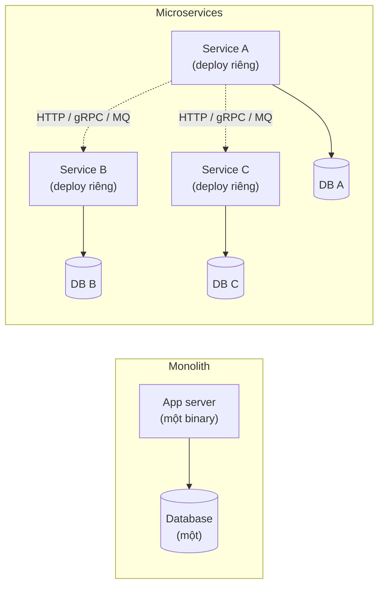
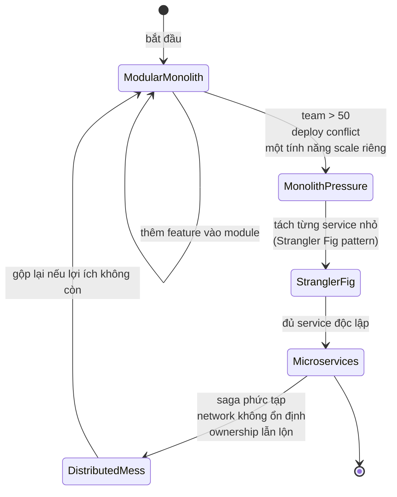
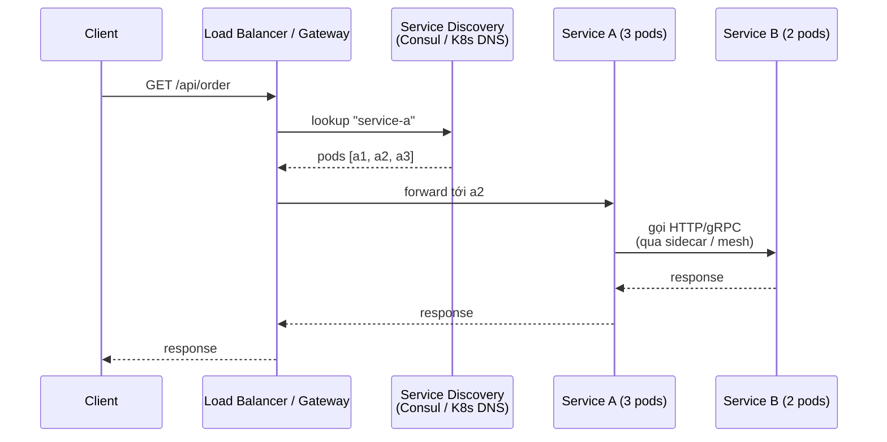

# What is the difference between monolith and microservices?

> So sánh hai kiểu kiến trúc hệ thống phân tán: monolith (một deployable, một DB, một codebase) và microservices (nhiều service độc lập, mỗi service một DB riêng). Bài này nêu định nghĩa, cơ chế giao tiếp, đánh đổi thật và tiêu chí quyết định khi nào nên dùng cái nào. Bài liên quan: [tcp-vs-udp](../Networking/tcp-vs-udp.md) (chọn transport cho service-to-service), [two-phase-commit](../Database/two-phase-commit.md) (khi microservice cần atomic xuyên DB).

Chủ đề: Distributed Systems · Ngày: 2026-10-16

## 1. Là gì

Monolith là một ứng dụng duy nhất: một codebase, một tiến trình (hoặc vài tiến trình cùng binary), một cơ sở dữ liệu. Mọi tính năng (user, order, payment, search) gói chung và deploy cùng nhau. Microservices là tập các service nhỏ, độc lập: mỗi service một codebase, deploy riêng, có data riêng (database-per-service), giao tiếp qua mạng (HTTP/REST, gRPC, message queue).
    10|
Lát cắt hay bị hỏi nhất trong phỏng vấn: khi nào monolith tốt hơn, khi nào microservices vượt trội, và đánh đổi thật giữa hai phía (operational cost, data consistency, team velocity). Câu trả lời mặc định trong ngành: bắt đầu bằng modular monolith, tách service khi có áp lực thật (scale team, scale deploy, scale một phần tính năng).



*Sơ đồ vị trí: monolith là một hộp đơn lẻ chứa toàn bộ business logic và DB; microservices là tập các service nhỏ, mỗi cái có DB riêng, liên lạc qua mạng.*

### Trả lời 30 giây

"Monolith là một binary duy nhất chứa mọi tính năng, deploy nguyên khối, một DB chung. Microservices là tập service độc lập, mỗi service có codebase, deploy và DB riêng, giao tiếp qua mạng. Microservices có lợi thế về deploy độc lập, scale từng phần, team ownership rõ; nhưng trả giá bằng network latency (mỗi call xuyên service +1-5 ms cùng DC), distributed transaction phức tạp (phải dùng saga thay 2PC), vận hành nặng hơn (N pipeline, N dashboard, N on-call). Thực tế: phần lớn công ty bắt đầu bằng monolith (kể cả Amazon, Shopify, GitHub), tách service khi team > 50 engineers hoặc một phần cần scale riêng. Câu trả lời an toàn nhất: chọn theo team size và điểm nghẽn, không theo số năm kinh nghiệm."

## 2. Cơ chế cốt lõi

### Bước 1. Monolith — đơn vị deploy là toàn bộ app

1. Một repo (hoặc monorepo), một build, một artifact (JAR, container image).
2. Runtime: một tiến trình (hoặc N tiến trình cùng binary sau load balancer). Toàn bộ module trong cùng process, gọi nhau bằng function call (in-process).
3. Database: một schema, một engine, một connection pool. Transaction một DB (xem [two-phase-commit](../Database/two-phase-commit.md) khi cần xuyên DB).
4. Deploy: thay thế toàn bộ binary cùng lúc. Rollback: redeploy phiên bản cũ.
5. Scale: scale theo chiều dọc (bigger box) hoặc scale ngang (N instance cùng binary sau load balancer, ví dụ [load-balancer](load-balancer.md)).

### Bước 2. Microservices — đơn vị deploy là một service

1. Mỗi service một repo (hoặc monorepo, một module), một build, một artifact. Service mesh/registry quản lý topology.
2. Runtime: mỗi service một tiến trình riêng (container/Kubernetes pod). Giao tiếp xuyên service qua HTTP/REST, gRPC, hoặc message queue (Kafka, RabbitMQ).
3. Database: database-per-service. Mỗi service sở hữu schema của mình, service khác truy cập qua API chứ không query trực tiếp.
4. Deploy: từng service deploy độc lập. CI/CD riêng cho từng service. Feature flag cho rollout từng phần.
5. Scale: scale từng service theo tải thực. Service nặng CPU scale 10 pod, service nhẹ giữ 1 pod.

### Bước 3. So sánh cơ chế giao tiếp

| Khía cạnh | Monolith | Microservices |
|---|---|---|
| Gọi giữa module | Function call (in-process, ~ns) | HTTP/gRPC xuyên network, ~0.5-5 ms cùng DC |
| Transaction | DB transaction một DB | Saga, outbox, hoặc eventual consistency |
| Schema thay đổi | Migration một lần | Mỗi service migrate riêng, contract test giữa service |
| Failure isolation | Một module crash có thể kéo sập cả app | Một service chết chỉ ảnh hưởng luồng phụ thuộc nó |
| Deploy | Toàn bộ cùng lúc (downtime nếu không blue/green) | Từng service độc lập, blue/green hoặc canary |
| Observability | Một process, một log stream | N log stream, cần correlation ID, distributed tracing |

### Bước 4. State diagram cho monolith sang microservices (đường tiến hoá thường gặp)



*Vòng đời thường gặp: monolith có cấu trúc module (modular monolith) → áp lực → tách service (Strangler Fig) → microservices. Một số công ty gộp ngược lại khi microservices hoá quá đắt.*

### Bước 5. Distributed transaction trong microservices

Microservices KHÔNG dùng 2PC cho flow xuyên service. Thay vào đó:

- **Saga + outbox**: mỗi service có transaction riêng + compensating action. Ví dụ: Order service tạo order → Payment service charge → Inventory service reserve. Nếu Inventory fail, Payment refund, Order cancel. Eventual consistency, không lock xuyên service.
- **Outbox pattern**: service ghi event vào bảng outbox trong cùng transaction với data. Một poller đẩy event sang message queue. Đảm bảo event không bị mất.
- **Idempotency key**: receiver xử lý event có thể retry an toàn (xem [idempotency](idempotency.md)).
- **Idempotency key** trong API: client gửi hết request kèm key, server xử lý đúng một lần.

### Bước 6. Cơ chế routing và service discovery trong microservices



*Service discovery: client/LB lookup registry (Consul, etcd, K8s DNS) lấy danh sách instance, gửi request. Service mesh (Istio, Linkerd) chèn sidecar để xử lý retry, circuit breaker, mTLS.*

### Quan sát

```bash
# Monolith: một process, một log stream. Kiểm tra nhanh:
ps aux | grep my-app
journalctl -u my-app --since "10 min ago"

# Microservices: nhiều service, cần correlation ID theo dõi xuyên log
kubectl logs -l app=order --tail=100 | grep "correlation_id=abc123"

# Kubernetes: liệt kê tất cả service đang chạy
kubectl get svc -A | wc -l   # số service đang hoạt động
```

### Ví dụ chạy từng bước

Kịch bản: shop e-commerce 10K RPS, team 20 engineer, 100K SKU. Theo phần 1+2, bài này khuyến nghị modular monolith. Ví dụ chạy một ca mua hàng từ lúc user bấm Pay tới lúc warehouse thấy order, đo độ trễ theo từng hop để thấy monolith chỉ tốn vài ms nội bộ còn microservices tốn thêm hàng chục ms network.

### Bước 1. Modular monolith nhận request
Client `POST /api/orders` tới LB, LB forward tới 1 trong 4 instance monolith (Spring Boot). Monolith parse HTTP trong 0.2 ms, route trong in-process router tới module `order` cùng JVM. Trạng thái: request trong module `order`, chưa chạm payment/inventory.

### Bước 2. Sync call giữa module nội bộ
Module `order` gọi module `payment` bằng method call thuần Java — ~50 ns. Module `payment` xử lý xong gọi `inventory.reserve()` cũng in-process — 0.3 ms cộng dồn. So với microservices: mỗi call xuyên service ~0.5-2 ms cùng AZ. Đã tính lại bằng script: 3 hop microservice × 1.5 ms = 4.5 ms overhead, trong khi monolith chỉ 0.35 ms.

### Bước 3. Transaction một DB + publish event
Cả ba module dùng chung schema PostgreSQL. INSERT `orders` + UPDATE `inventory` chạy trong một `BEGIN ... COMMIT` — atomic, 8 ms. Outbox row ghi cùng transaction. Poller đọc outbox mỗi 200 ms, đẩy event `OrderPlaced` sang warehouse service. Trạng thái: order row có status=PAID, outbox có 1 row pending.

### Bước 4. Warehouse xử lý event
Warehouse là service riêng, subscribe event từ queue. Nhận event, INSERT shipment row trong warehouse DB. Idempotent qua event_id. Heartbeat metric: end-to-end từ bước 1 tới row trong warehouse DB ~250 ms (poll interval + consumer lag).

Trạng thái gọn:
| Bước | Hop | Thời gian | DB chạm |
|---|---|---|---|
| 1 | LB → monolith | ~1 ms | chưa |
| 2 | 3 module in-process | ~0.35 ms | chưa |
| 3 | 1 transaction 3 bảng | ~8 ms | orders + inventory + outbox |
| 4 | outbox → queue → warehouse | ~240 ms | warehouse.shipments |

### Biến thể: nếu traffic tăng 10×
Monolith scale ngang lên 8 instance sau LB (cùng binary, chỉ cần tăng connection pool từ 100 lên 200). Nếu module `search` chiếm 70% CPU, tách search thành microservice riêng với Elasticsearch — modular monolith sẵn boundary, chỉ cần move code, không phải rewrite. Nếu đã chọn microservices từ đầu, tăng gấp đôi instance kéo theo cả saga, event bus, correlation ID — đội 20 người tốn thêm 2-3 tuần vận hành.

Điều rút ra: modular monolith giữ 1 hop network (client → LB → monolith) thay vì 4-6 hop trong microservices với cùng business flow — đúng câu trả lời ở câu 7 phần 3A (chọn monolith cho 10K RPS, team 20).

## 3. Câu hỏi phỏng vấn

### 3A. Câu hỏi đào sâu

<details class="qa">
<summary>Câu 1. Monolith và microservices khác nhau ở những điểm cốt lõi nào?</summary>

**Trả lời ngắn:** Monolith: một binary, một codebase, một DB, deploy nguyên khối. Microservices: N service độc lập, mỗi service một codebase + một DB, deploy riêng, giao tiếp qua mạng. Đánh đổi: monolith đơn giản nhưng khó scale team/deploy; microservices linh hoạt nhưng tốn operational cost và distributed complexity.

**Đào sâu:**
- Giao tiếp: monolith dùng function call (in-process, ~ns), microservices qua HTTP/gRPC/queue (~0.5-5 ms cùng DC). Một request phức tạp có thể cần 5-10 service hop → 5-50 ms chỉ cho network.
- Data: monolith có transaction một DB; microservices phải dùng saga, eventual consistency. Cross-service query phải API composition hoặc CQRS.
- Team: monolith phù hợp team < 30-50 engineer; microservices cần team độc lập cho mỗi service (Conway's law).
- Failure: monolith có thể một module crash kéo sập cả app; microservices cô lập failure tốt hơn nhưng có thêm failure mode network.

**Bẫy:** "Microservices luôn tốt hơn monolith." Sai — microservices có chi phí vận hành cao (N pipeline, N on-call, N dashboard). Team nhỏ chọn microservices thường thất bại vì không đủ người giữ.

**Follow-up:** Modular monolith là gì? Monolith với cấu trúc module rõ ràng (bounded context, package riêng, không gọi chéo bừa bãi), chuẩn bị cho việc tách service sau nếu cần. Nhiều công ty chọn cách này thay vì microservices ngay từ đầu.
</details>

<details class="qa">
<summary>Câu 2. Khi nào nên tách từ monolith sang microservices? Cho tiêu chí cụ thể.</summary>

**Trả lời ngắn:** Khi có áp lực thật: (1) team > 50 engineer, deploy conflict thường xuyên; (2) một phần cần scale độc lập (search, recommendation); (3) team cần ownership rõ (Conway's law); (4) release train của một team bị block bởi team khác. Không nên tách khi chỉ vì "best practice" hoặc team < 10 người.

**Đào sâu:**
- Tín hiệu tích cực cho tách: CI/CD pipeline của monolith > 30 phút, conflict merge tăng, một module chiếm 80% CPU cần scale riêng, team > 5 muốn deploy độc lập.
- Tín hiệu tiêu cực: team < 10, chưa có DevOps/SRE thật, business chưa ổn định (tính năng thay đổi hàng tuần). Tách sớm dẫn đến distributed monolith — microservices về hình thức nhưng vẫn phụ thuộc chặt, chỉ thêm network overhead.
- Strangler Fig pattern: thay vì viết lại từ đầu, route traffic từng phần sang service mới qua gateway/proxy, dần thay thế monolith. Amazon, Shopify đều dùng cách này.
- Bắt đầu bằng modular monolith, đặt bounded context, sẵn sàng tách khi cần. Đỡ tốn công tách-ngược.

**Bẫy:** Tách service vì "sẽ scale tốt hơn" mà chưa có áp lực thật — distributed complexity tăng mà lợi ích không có.

**Follow-up:** Làm sao biết đã tách quá nhiều? Khi service chỉ có 1 endpoint, 1 người maintain, distributed tracing cho thấy 8 service hop cho 1 request, mọi thay đổi phải sửa > 3 service. Gộp lại hoặc đơn giản hoá boundary.
</details>

<details class="qa">
<summary>Câu 3. Microservices xử lý distributed transaction thế nào? Vì sao không dùng 2PC?</summary>

**Trả lời ngắn:** Microservices dùng saga + outbox. Mỗi service có transaction riêng + compensating action. Ví dụ Order tạo → Payment charge → Inventory reserve; nếu Inventory fail, Payment refund, Order cancel. 2PC không dùng vì coordinator là SPOF, lock kéo dài, latency cao — không phù hợp flow xuyên service (xem [two-phase-commit](../Database/two-phase-commit.md)).

**Đào sâu:**
- Saga là chuỗi local transaction + compensating action. Có hai style: (a) choreography — mỗi service phát event, service sau nghe; (b) orchestration — một saga coordinator điều phối từng bước. Choreography dễ bắt đầu nhưng khó debug; orchestration dễ nhìn nhưng thêm dependency.
- Outbox pattern: service ghi event vào bảng outbox TRONG CÙNG transaction với data. Một poller/CDC đẩy event sang message queue (Kafka). Đảm bảo event không mất khi service crash giữa commit DB và gửi message.
- Idempotency: consumer xử lý event có thể nhận trùng (network retry). Receiver phải idempotent — xử lý đúng một lần dù nhận nhiều lần (xem [idempotency](idempotency.md)).
- 2PC vẫn dùng cho một số case đặc biệt (inter-bank transfer) nhưng microservice thông thường tránh vì coordinator SPOF, lock kéo dài gây timeout.

**Bẫy:** "Microservices vẫn giữ được ACID". Sai — distributed transaction thường eventual consistency, không ACID xuyên service. Application phải chấp nhận trạng thái trung gian (order đã tạo nhưng payment chưa charge xong).

**Follow-up:** Outbox có cần thay bằng CDC không? Tương đương về kết quả. CDC (Debezium) đọc từ WAL nên không cần bảng outbox riêng, ít thay đổi schema, nhưng khó debug hơn khi event không tới.
</details>

<details class="qa">
<summary>Câu 4. Data ownership trong microservices. Vì sao database-per-service?</summary>

**Trả lời ngắn:** Mỗi service sở hữu schema của mình. Service khác không query trực tiếp DB, chỉ gọi qua API. Lý do: (1) deploy độc lập — schema có thể thay đổi mà không phải đồng bộ mọi consumer; (2) tránh tight coupling qua shared DB; (3) scale và optimize riêng (mỗi service chọn DB phù hợp).

**Đào sâu:**
- Database-per-service là rule khó phá nhất khi tách monolith. Nếu hai service dùng chung bảng, đụng schema thay đổi → phải deploy đồng thời, triệt tiêu lợi ích deploy độc lập.
- Ngoại lệ có thể chấp nhận: shared read-only reference data (country code, currency) tách riêng thành reference service, các service cache local hoặc query khi cần.
- Cross-service query: API composition (gọi nhiều service tổng hợp) hoặc CQRS (một read model riêng tổng hợp từ event). Trade-off: eventual consistency, phải handle stale data.
- Data duplication: mỗi service có thể lưu bản copy data cần (denormalization). Ví dụ Order service lưu user name dù User service là owner. Trade-off: consistency giữa các bản copy phải sync qua event.

**Bẫy:** "Để chung DB nhưng vẫn có nhiều service." Sai — đây là distributed monolith, mất lợi ích chính của microservices, lại thêm network overhead. Tốt hơn dùng modular monolith.

**Follow-up:** Một service cần join data từ 2 service khác để trả response, làm sao? API composition (gọi tuần tự hoặc song song), hoặc CQRS (service consumer tự build read model từ event). Không query trực tiếp DB của service khác.
</details>

<details class="qa">
<summary>Câu 5. Service discovery và load balancing trong microservices hoạt động ra sao?</summary>

**Trả lời ngắn:** Mỗi service đăng ký với service registry (Consul, etcd, K8s DNS) khi khởi động, health check định kỳ. Client/LB lookup registry lấy danh sách instance còn healthy, gửi request. Service mesh (Istio, Linkerd) chèn sidecar để xử lý retry, circuit breaker, mTLS. Xem chi tiết ở [load-balancer](load-balancer.md).

**Đào sâu:**
- Service registry: Consul (HashiCorp), etcd, ZooKeeper, K8s Service + DNS. Service gọi `consul agent` để đăng ký IP/port; health check HTTP `/health` mỗi 10 giây.
- Client-side discovery: client tự query registry, cache, chọn instance (Netflix Eureka + Ribbon — legacy). Server-side discovery: LB/ingress query registry, route (AWS ALB + target group, K8s Service).
- Service mesh: sidecar proxy (Envoy) chạy cùng pod, xử lý mTLS, retry, circuit breaker, telemetry. App không cần biết mesh — chỉ gọi HTTP như bình thường.
- Health check: HTTP `/health` trả 200 nếu ready, 503 nếu đang shutdown hoặc dependency lỗi. LB không gửi traffic tới instance unhealthy.
- Failure: nếu registry down, client cache danh sách cũ; nếu cache stale, request tới instance đã chết → retry hoặc circuit breaker.

**Bẫy:** "Microservices không cần LB." Sai — mỗi service có nhiều instance, vẫn cần LB để phân tải và health check.

**Follow-up:** Circuit breaker là gì và hoạt động ra sao? Khi service B gọi A thấy A lỗi > N lần, B ngưng gọi A trong M giây (open circuit), trả fallback. Tránh retry storm làm A càng quá tải. Khi M hết, B thử lại (half-open).
</details>

<details class="qa">
<summary>Câu 6 (Debug). Sau khi tách sang microservices, request chậm từ 50 ms lên 800 ms. Bạn kiểm tra gì theo thứ tự?</summary>

**Trả lời ngắn:** Distributed tracing (Jaeger/Zipkin) xem request đi qua bao nhiêu service, hop nào chậm. Kiểm tra: (1) số hop xuyên service tăng; (2) call đồng bộ giữa các service có thể song song được không; (3) network latency giữa service; (4) DB query từng service.

**Đào sâu:**
- Bước 1: Bật distributed tracing (OpenTelemetry → Jaeger hoặc Tempo). Tìm trace của 1 request, xem span từng service, span nào > 100 ms.
- Bước 2: Số service hop. 1 request từ 1 endpoint monolith → 8 service hop × ~50-100 ms = vài trăm ms chỉ network. Tìm cách gộp (BFF pattern, aggregation service) hoặc cache.
- Bước 3: Call đồng bộ tuần tự. Nếu service A gọi B, đợi B xong mới gọi C, đổi sang gọi song song B và C (`Promise.all` hoặc `CompletableFuture.allOf`). Tiết kiệm 1 RTT.
- Bước 4: Network latency giữa service. Cùng AZ ~0.5 ms, khác AZ cùng region ~2 ms, khác region ~50 ms. Nếu service ở region khác, co-location lại.
- Bước 5: DB query. Microservice với DB-per-service có thể N+1 query. Cache layer (Redis), index, hoặc CQRS read model.
- Bước 6: Serialization. gRPC protobuf nhanh hơn JSON 2-3 lần cho payload lớn. HTTP/2 multiplexing giảm connection overhead.

**Bẫy:** Thêm cache cho mọi nơi mà không tìm root cause — che triệu chứng, có thể gây stale data.

**Follow-up:** Khi nào distributed monolith trở thành vấn đề đáng tách/gộp lại? Khi số hop > 5 cho 1 user-facing request, mọi thay đổi phải sửa > 3 service, distributed transaction phức tạp. Xem xét gộp hoặc đổi sang modular monolith.
</details>

<details class="qa">
<summary>Câu 7 (Thiết kế). Thiết kế shop e-commerce đạt 10K RPS, 100K SKU, team 20 engineers. Chọn monolith hay microservices? Vì sao?</summary>

**Trả lời ngắn:** Modular monolith với khả năng tách sau. 20 engineers không đủ staff cho microservices operations overhead. 10K RPS một instance monolith vẫn chịu được (với scale ngang + LB). 100K SKU không phải vấn đề data volume cho monolith. Tách sang microservices khi team > 50 hoặc một phần (search, recommendation) cần scale/team riêng.

**Đào sâu:**
- Quyết định 1: Modular monolith. Một binary Spring Boot/Express, chia module: user, catalog, cart, order, payment, inventory. Mỗi module có package riêng, bounded context, không gọi chéo bừa bãi.
- Quyết định 2: DB một instance (PostgreSQL) với schema phân tách rõ. Đủ cho 10K RPS với connection pool, read replica, index đúng.
- Quyết định 3: Scale bằng LB + N instance cùng binary (xem [load-balancer](load-balancer.md)). Stateless app, sticky session nếu cần cho cart.
- Quyết định 4: Background job queue (Sidekiq, Celery) cho email, indexing, payment reconciliation. Tránh logic nặng trong request path.
- Quyết định 5: Tách service sau nếu: search cần Elasticsearch riêng (CPU nặng), recommendation cần ML pipeline riêng, payment cần PCI scope tách biệt. Mỗi tách đều có business case rõ.
- Quyết định 6: Observability từ đầu: structured log, metric (Prometheus), trace (OpenTelemetry). Tránh "fix later".

**Bẫy:** Tách microservices ngay từ đầu với team 20 — chia 2-3 người/service, không ai đủ context, distributed complexity lớn hơn lợi ích.

**Follow-up:** Khi nào nên chấp nhận microservices cho team nhỏ? Khi business yêu cầu multi-region write, hoặc cần độc lập compliance scope (PCI, HIPAA), hoặc team đã có kinh nghiệm vận hành microservices (giảm learning curve).
</details>

### 3B. Câu hỏi phỏng vấn liên quan

<details class="qa">
<summary>Câu 8. Modular monolith là gì và khác gì với monolith thông thường?</summary>

**Trả lời:** Modular monolith là monolith có cấu trúc module rõ ràng (bounded context, package theo domain), không gọi chéo bừa bãi. Khác với "big ball of mud" monolith (mọi thứ lẫn vào nhau), modular monolith chuẩn bị sẵn cho việc tách service sau. Nhiều công ty chọn modular monolith thay vì microservices thuần khi team < 30-50.
</details>

<details class="qa">
<summary>Câu 9. Conway's law ảnh hưởng thế nào đến quyết định monolith vs microservices?</summary>

**Trả lời:** Conway's law: hệ thống phản ánh cấu trúc tổ chức tạo ra nó. Team nhỏ tạo monolith dễ dàng; team lớn muốn microservices để mỗi team có ownership riêng. Ngược lại, microservices với team nhỏ dẫn đến distributed monolith — không ai đủ context toàn hệ thống. Inverse Conway maneuver: cấu trúc lại team theo kiến trúc mong muốn.
</details>

<details class="qa">
<summary>Câu 10. CAP theorem liên quan thế nào đến microservices?</summary>

**Trả lời:** Microservices phân tán theo nghĩa CAP: khi partition xảy ra, phải chọn consistency hoặc availability. Microservice thường chọn AP — service vẫn trả response (có thể stale) thay vì từ chối. Saga cũng chấp nhận eventual consistency.
</details>

<details class="qa">
<summary>Câu 11. Event-driven microservices khác gì với REST-based?</summary>

**Trả lời:** REST-based: client gọi HTTP đồng bộ, đợi response. Event-driven: service phát event lên message queue (Kafka, RabbitMQ), service khác subscribe xử lý bất đồng bộ. REST dễ debug, dễ test; event-driven loose coupling hơn nhưng eventual consistency, khó debug hơn.
</details>

<details class="qa">
<summary>Câu 12. API gateway trong microservices đóng vai trò gì?</summary>

**Trả lời:** API gateway là entry point duy nhất cho client. Chức năng: routing tới service backend, authentication/authorization, rate limiting, request aggregation (BFF — Backend for Frontend), caching, SSL termination. Client không biết có bao nhiêu service bên trong. Ví dụ: Kong, AWS API Gateway, Nginx, Envoy.
</details>

<details class="qa">
<summary>Câu 13. Service mesh (Istio, Linkerd) khác gì với API gateway?</summary>

**Trả lời:** API gateway ở biên (north-south traffic — client tới service). Service mesh ở trong (east-west traffic — service tới service). Mesh chèn sidecar vào mỗi pod, xử lý mTLS, retry, circuit breaker, telemetry. Hai thứ bổ sung cho nhau: gateway bảo vệ entry, mesh bảo vệ internal.
</details>

<details class="qa">
<summary>Câu 14. True or false: "Microservices luôn nhanh hơn monolith vì parallel."</summary>

**Trả lời:** Sai. Microservices thường chậm hơn monolith cho 1 request vì network overhead. Mỗi call xuyên service +0.5-5 ms cùng DC. Request phức tạp có thể cần 5-10 hop → 5-50 ms chỉ network. Microservices có thể scale từng phần (scale to hơn cho bottleneck), nhưng latency trung bình 1 request thường cao hơn. Trade-off đúng: scale thay vì latency.
</details>

<details class="qa">
<summary>Câu 15. Khi nào nên dùng message queue (Kafka) thay vì gọi HTTP trực tiếp giữa service?</summary>

**Trả lời:** Dùng queue khi: (1) workload bất đồng bộ — A không cần đợi B (email, indexing); (2) cần buffering khi downstream chậm; (3) cần fan-out một event nhiều consumer; (4) cần replay (audit log). Dùng HTTP khi caller cần response ngay.
</details>

<details class="qa">
<summary>Câu 16. Distributed monolith là gì và tại sao là anti-pattern?</summary>

**Trả lời:** Distributed monolith là hệ thống có nhiều service (về hình thức microservices) nhưng phụ thuộc chặt — phải deploy đồng thời, schema thay đổi phải đồng bộ, một service lỗi kéo sập chuỗi. Có network overhead nhưng không có lợi ích deploy độc lập. Anti-pattern vì tệ hơn cả monolith (đơn giản) lẫn microservices (đúng nghĩa).
</details>

## 4. Đánh đổi và sự cố production

### So sánh hai kiểu kiến trúc

| Tiêu chí | Monolith | Microservices |
|---|---|---|
| Độ phức tạp ban đầu | Thấp | Cao |
| Latency 1 request | Rất thấp (in-process) | +1-50 ms network (tuỳ hop) |
| Deploy | Nguyên khối (downtime hoặc blue/green) | Từng service, rollback nhanh |
| Scale | Toàn bộ app | Từng service (granular) |
| Team fit | < 30-50 engineer | > 30-50 engineer, có DevOps |
| Data consistency | Một DB transaction | Saga, eventual consistency |
| Failure isolation | Thấp | Cao (có circuit breaker, bulkhead) |
| Vận hành | 1 pipeline, 1 dashboard | N pipeline, N on-call |
| Chi phí hạ tầng | Thấp | Cao (K8s, mesh, queue, monitoring) |

### Năm failure mode

| Triệu chứng | Nguyên nhân gốc | Cách kiểm tra | Cách sửa |
|---|---|---|---|
| Cascade failure: 1 service chết kéo sập 5 | Đồng bộ call không timeout, không circuit breaker | Distributed trace, latency tăng dần | Timeout, circuit breaker, bulkhead, async queue |
| Event mất giữa service | Producer commit DB nhưng chưa kịp gửi message, crash | Outbox table không giảm, consumer không thấy event | Outbox pattern, poller retry, CDC |
| Schema change vỡ consumer | Producer đổi schema, consumer chưa cập nhật | Error log consumer | Schema registry, contract test, version field |
| Distributed transaction treo (saga step không complete) | Một step fail, compensation không chạy, hoặc state không nhất quán | Log saga coordinator, DB từng service | Saga timeout, dead-letter queue, manual reconciliation |
| Phụ thuộc vòng (A gọi B, B gọi A) | Tight coupling giữa service, không rõ ownership | Trace cho thấy cycle | Tách dependency qua event, hoặc gộp 2 service thành 1 |

## 5. Cheat sheet

| Chủ đề | Con số / quy tắc cần nhớ |
|---|---|
| Monolith | Một binary, một DB, deploy nguyên khối |
| Microservices | N service, database-per-service, deploy riêng, giao tiếp qua mạng |
| Network overhead mỗi hop | 0.5-5 ms cùng DC; 50-100 ms cross-region |
| Team threshold | < 30-50 engineer → modular monolith; > 50 → microservices có thể chính danh |
| Distributed tx | Saga + outbox + idempotency; không 2PC (trừ case đặc biệt) |
| Service discovery | Consul, etcd, K8s DNS, Service Mesh |
| Database-per-service | Mỗi service sở hữu schema; cross-service qua API hoặc event |
| Failure isolation | Circuit breaker, bulkhead, timeout, retry with backoff |
| Khởi đầu an toàn | Modular monolith → tách khi có áp lực thật |

**Học tiếp:**
- [load-balancer](load-balancer.md) — LB và health check trong microservices
- [idempotency](idempotency.md) — xử lý retry an toàn cho saga và HTTP API
- [two-phase-commit](../Database/two-phase-commit.md) — tại sao 2PC không dùng cho microservice thường
- [tcp-vs-udp](../Networking/tcp-vs-udp.md) — chọn transport cho service-to-service