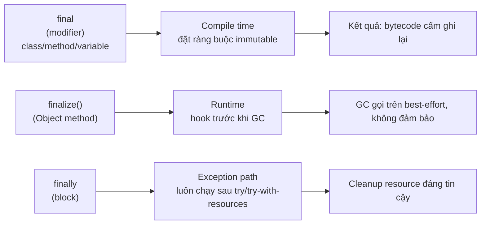
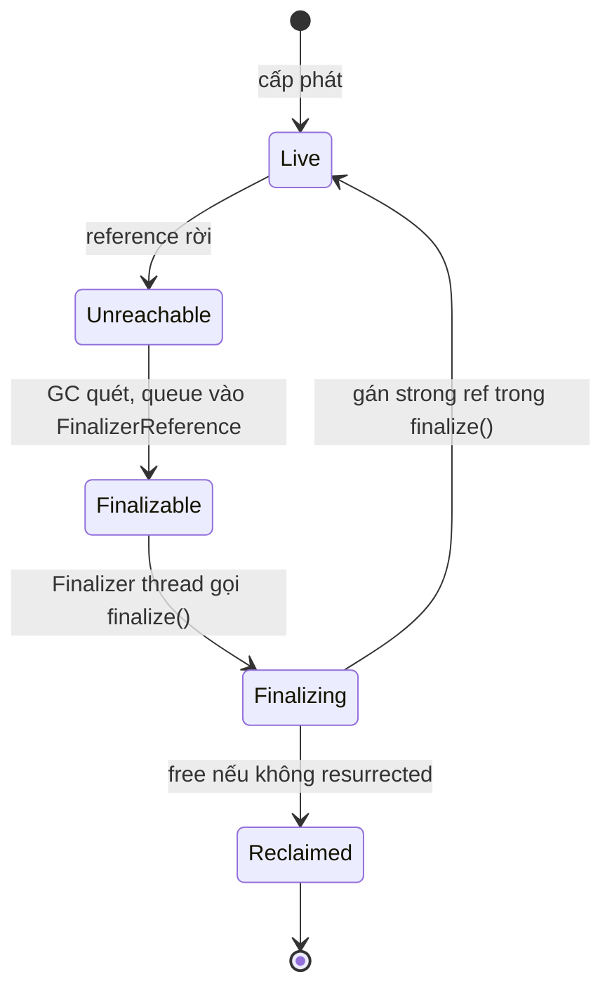

# Explain the difference between final, finalize, and finally in Java.

> Bài này phân biệt ba từ khoá/identifier `final` (modifier), `finalize()` (Object method legacy) và `finally` (block) trong Java. Trọng tâm: tại sao cả ba đều có chữ "final" nhưng thuộc ba lớp khác nhau — biến/lớp/phương thức immutable, hook GC, và khối xử lý ngoại lệ. Bài liên kết tới [garbage-collection](garbage-collection.md) và [memory-leak](memory-leak.md) để biết khi nào `finalize()` rơi vào rắc rối.

Chủ đề: Memory - Runtime · Ngày: 2026-10-16

## 1. Là gì

- `final` là một modifier áp dụng cho biến, method hoặc class. Biến `final` chỉ gán được một lần (hằng), method `final` không thể override, class `final` không thể extend.
- `finalize()` là một method legacy khai báo trong `java.lang.Object` với signature `protected void finalize() throws Throwable`. JVM gọi nó trước khi object được GC thu dọn. Java 9 đánh dấu `@Deprecated(forRemoval=true)`.
- `finally` là một block đi kèm `try` (hoặc `try-with-resources`). Nội dung trong block luôn chạy sau `try` dù có exception hay không.

Cả ba chỉ liên quan tới "cleanup theo nghĩa rộng" nhưng thuộc ba cơ chế khác nhau: biên dịch (final), runtime GC (finalize), exception path (finally). Trong phỏng vấn, nhầm lẫn chúng là lỗi phổ biến vì tên gần giống nhau.



*Sơ đồ vị trí: `final` ảnh hưởng compile time; `finalize()` thuộc runtime GC; `finally` thuộc exception handling. Ba cơ chế độc lập, chỉ chung chữ "final".*

### Trả lời 30 giây

"`final` là modifier gắn lên biến, method hoặc class để cấm ghi lại (biến), cấm override (method), cấm kế thừa (class). `finalize()` là method legacy của `java.lang.Object`, JVM gọi trước khi object bị GC; nó không đáng tin (có thể không bao giờ chạy hoặc chạy trên thread khác), hiện đã deprecated. `finally` là block đi kèm `try` để cleanup tài nguyên — luôn chạy dù có hay không exception. Trong Java hiện đại: thay `finalize()` bằng `try-with-resources` (AutoCloseable) hoặc `Cleaner` (Java 9+) để cleanup an toàn. Nhầm ba thứ này là lỗi rất phổ biến trong phỏng vấn; bạn nên giải thích thuộc tính 'deterministic vs best-effort' rõ ràng."

## 2. Cơ chế cốt lõi

### Bước 1. `final` ở ba vị trí

1. **Biến final**:
   - Biến thường: bắt buộc gán đúng một lần trước khi đọc. Với field non-static, có thể gán trong constructor hoặc initializer block (blank final field).
   - Biến tham chiếu: tên là hằng, nhưng đối tượng nó trỏ tới vẫn có thể thay đổi nội dung (object vẫn mutable). Ví dụ `final List<String> list = new ArrayList<>(); list.add("x")` hợp lệ.
2. **Method final**: subclass không thể override. Class con có thể gọi (cùng signature) nhưng không thể thay thế impl. Cho phép JVM inline gọi direct mà không qua vtable.
3. **Class final**: không thể extend. Tất cả method trở nên final effective (không thể override). Quan trọng cho bất biến toàn cục như `String`, các lớp tiện ích (`Math`, `java.util.Collections`).

### Bước 2. `final` trong concurrency

- Field `final` thấy đầy đủ sau khi constructor trả về — đảm bảo memory visibility theo JMM § 17.5, không cần volatile/synchronized.
- Ví dụ: publish một immutable object `class A { final int x; A() { x = 42; } }` từ một thread là thread-safe; tất cả thread khác đọc `x` thấy 42.

### Bước 3. `finalize()` legacy

1. **Khai báo**: `protected void finalize() throws Throwable` (Object) — `protected` có nghĩa subclass có thể override. Trước Java 9 bạn có thể giảm visibility xuống (không tăng). Từ Java 9, mặc định được dán `@Deprecated(forRemoval=true)`.
2. **Cơ chế JVM**: Khi object đủ điều kiện GC (không còn strong reference), JVM có thể thêm vào `Finalizer` queue. Sau đó một thread riêng (`Finalizer` thread hoặc `Reference Handler` thread tuỳ phiên bản) lấy object ra và gọi `finalize()` trước khi free. Sau khi `finalize()` chạy, object có thể "resurrect" nếu gán một strong reference ngay trong đó (giữ object sống thêm một vòng GC), nhưng `finalize()` chỉ chạy **một lần duy nhất** trong đời object.
3. **Vấn đề**:
   - Không có đảm bảo khi nào (hoặc nếu bao giờ) `finalize()` chạy. JVM có thể từ bỏ object mà không gọi.
   - Có thể chạy trên một thread không phù hợp với workload cleanup (file I/O native, JNI).
   - Ném exception trong `finalize()` bị nuốt và ghi log — không tới application.
   - Tạo thành "finalizer queue" bottleneck nếu nhiều object pending.



*Vòng đời một object có `finalize()` override: qua thêm một trạng thái Finalizing trước khi reclaimed, chạy bởi thread riêng. Một lần chạy duy nhất.*

### Bước 4. `finally` block

1. Cú pháp: `try { ... } finally { ... }` hoặc `try { ... } catch (...) { ... } finally { ... }`.
2. Nội dung block `finally` luôn chạy sau khi `try` (hoặc `catch`) kết thúc, kể cả khi `return`, `break`, `continue`, exception, hoặc thread crash.
3. Ngoại lệ `System.exit()` hoặc `Runtime.getRuntime().halt()` không chạy `finally`. Thread `stop()` cũ bỏ qua.
4. `try-with-resources` cú pháp `try (var a = new X()) { ... }` là đường ngắn: `close()` của từng resource được gọi theo thứ tự ngược lại khai báo trong block `finally` ngầm.

### Bước 5. Thay thế `finalize()` trong Java hiện đại

1. **AutoCloseable + try-with-resources**: tài nguyên implement `AutoCloseable`, `close()` chạy deterministic khi ra scope.
2. **`Cleaner`** (Java 9+): lấy cảm hứng từ `PhantomReference`. Đăng ký cleanup action qua `Cleaner.create().register(obj, () -> {...})`. Chạy khi object trở thành phantom-reachable, trên thread quản lý riêng (`Cleaner thread`), không block thread của caller.
3. **PhantomReference + ReferenceQueue** (low-level): dùng khi cần kiểm soát chính xác thời điểm cleanup, thường cho native memory.

### Bước 6. So sánh tổng quan ba thứ

| Khía cạnh | `final` | `finalize()` | `finally` |
|---|---|---|---|
| Loại | Modifier từ khoá | Method (Object) | Block keyword |
| Áp dụng cho | Biến, method, class | Object | Câu lệnh try |
| Tác động compile/runtime | Compile + class load | GC thread | Exception path |
| Có đảm bảo không | Compile error nếu vi phạm | Best-effort (có thể không bao giờ chạy) | Luôn chạy (trừ halt) |
| Trạng thái Java hiện đại | Vẫn dùng rộng rãi | Deprecated, xoá scheduled | Vẫn dùng rộng rãi |

### Quan sát

```bash
# JVM cờ để theo dõi finalizer hoạt động
-XX:+TraceClassLoading -Xlog:gc+finalizer=debug
# Xem số object pending finalizer trong heap dump
jcmd <pid> GC.heap_dump
# Bật cảnh báo finalize
```

```java
// Mở JDK source: java.lang.ref.Finalizer và java.lang.Object#finalize
// chỉ ra nội dung mặc định rỗng, GC gọi qua Finalizer reference
```

### Ví dụ chạy từng bước

Một service Java mở HTTP listener với `maxConnections=3` (final), `idleTimeoutMs=30_000` (final), và một `ConnectionWrapper` legacy còn override `finalize()` (close file native). Tại request thứ 4, hệ thống thử mở thêm 1 connection — kịch bản đi qua cả 3 cơ chế: `final` ở compile time, `finalize()` ở runtime, `finally` ở exception path.

**Bước 1.** Khai báo lớp: `final class HttpServerConfig { final int maxConnections = 3; final long idleTimeoutMs = 30_000L; }`. Tại sao `final` field: đảm bảo 2 giá trị config không bị thay đổi sau constructor. Theo JMM § 17.5, một khi constructor trả, mọi thread khác đọc field thấy giá trị cuối — không cần volatile. Class `final` ngăn subclass override behavior của config.
Trạng thái config: `maxConnections=3` (immutable), `idleTimeoutMs=30000` (immutable).

**Bước 2.** Mở 3 connection đầu bằng `for (int i = 0; i < 3; i++) try (var c = new ConnectionWrapper()) { pool.add(c); }`. Mỗi `try-with-resources` đẩy `c` vào slot stack; khi ra khỏi block JVM gọi `c.close()` deterministic trên caller thread, đúng thứ tự ngược với khai báo. `finally` ngầm chạy kể cả khi `add()` throw. Quy tắc: mỗi lần `pool.add(c)` lưu tham chiếu, JVM tăng refcount wrapper (INCREF); mỗi `close()` giảm refcount (DECREF) — cùng cơ chế như CPython.

| Conn | Đang dùng | Đã close (finally) | Owner |
|---|---|---|---|
| 0 | true | false | pool |
| 1 | true | false | pool |
| 2 | true | false | pool |

**Bước 3.** Request thứ 4 gọi `pool.acquire()`. Pool đầy, throw `PoolFullException`. Callee `catch (PoolFullException e) { metrics.incRejected(); }`. Trước khi catch, JVM chạy `finally` của `try` (nếu có) cho caller — không có ở đây, caller không giữ connection. Quy tắc: `finally` luôn chạy khi `try` kết thúc, kể cả khi exception, return, break, continue; chỉ trừ `System.exit()` hoặc JVM crash. Trong trường hợp này exception vẫn được catch xử lý tại callee nên flow tiếp tục bình thường; metric `rejected` tăng 1.
Trạng thái: stack frame sạch, 3 connection vẫn ở pool.

**Bước 4.** Shutdown: gọi `server.stop()`. Method này chạy `for (var c : pool) c.close(); pool.clear();` bọc trong `try { ... } finally { shutdownHook.run(); }`. Khi JVM thoát bình thường, `finally` chạy chắc chắn — đó là lý do production code cleanup phải đặt trong `finally`, không phải chỉ sau khối try. Mỗi `ConnectionWrapper.close()` đẩy wrapper ra khỏi pool; khi wrapper không còn ai giữ, JVM đánh dấu đủ điều kiện GC. Vì sao quan trọng: wrapper có `finalize()` override nên chuyển sang Finalizer queue, không reclaimed ngay.
Trạng thái: pool.clear(), các wrapper treo vào Finalizer queue (chờ).

**Bước 5.** GC chạy (không đảm bảo ngay, có thể vài trăm ms hoặc lâu hơn tuỳ workload). JVM thấy wrapper có FinalizerReference, đẩy vào Finalizer queue; `Finalizer` thread lấy ra và gọi `wrapper.finalize()` chạy `nativeClose(fd)` để giải phóng native handle. Sau đó wrapper reclaimed và bộ nhớ heap được trả lại allocator. Quy tắc: `finalize()` chạy tối đa một lần trong đời object; nếu object "resurrect" (gán strong ref trong `finalize()`) thì lần sau không gọi lại. Nếu nhiều wrapper pending, Finalizer queue dài — một dấu hiệu cần refactor.

Biến thể lỗi: nếu dev quên `try-with-resources` ở Bước 2 (dùng `c = new ConnectionWrapper(); pool.add(c);`) và `add()` throw vì pool full, connection rò rỉ — refcount wrapper vẫn > 0 vì `c` stack local vẫn giữ cho tới khi method thoát. Lúc đó `finalize()` không cứu vì wrapper vẫn reachable, không bao giờ vào Finalizer queue. `finally`/`try-with-resources` là cơ chế duy nhất đảm bảo close khi exception.

Điều rút ra: cùng một resource nhưng 3 cơ chế khác nhau — `final` chống reassign (compile time + JMM visibility cho field), `finally` đảm bảo cleanup trên caller thread (runtime, deterministic), `finalize()` chỉ là hook best-effort chạy trên Finalizer thread riêng — vì sao production phải log cảnh báo "Finalizer thread blocked" nếu lạm dụng, liên quan trực tiếp tới Câu 3A.6 (debug finalizer chậm).

## 3. Câu hỏi phỏng vấn

### 3A. Câu hỏi đào sâu

<details class="qa">
<summary>Câu 1. `final`, `finalize()`, `finally` khác nhau thế nào, khi nào nên dùng từng cái?</summary>

**Trả lời ngắn:** `final` là modifier cho biến/method/class — giá trị hằng, không override, không kế thừa. `finalize()` là method legacy của Object, JVM gọi trước khi GC (deprecated Java 9). `finally` là block cleanup sau try, chạy kể cả khi exception. Trong Java hiện đại: cần hằng số/ngăn override dùng `final`; cần cleanup resource dùng `finally` (hoặc tốt hơn: try-with-resources); không dùng `finalize()`.

**Đào sâu:**
- `final` còn có vai trò trong concurrency: `final` field đảm bảo visibility theo JLS § 17.5 — sau khi constructor hoàn thành, mọi thread đọc field thấy giá trị cuối cùng. Đây là nền tảng của immutable object pattern.
- `finalize()` đã deprecated-for-removal. Lý do: nó không phải destructor deterministic, có thể không bao giờ chạy, lạm dụng dẫn tới finalizer queue chậm, OOM khi phân bổ từ Finalizer thread.
- `finally` chạy ngay cả khi `try` trả về sớm, kết hợp với `try-with-resources` cho code gọn.
- Câu hỏi hay hỏi kèm: "`final` method có thể bị overload không?" Có — overload khác signature, không phải override.

**Bẫy:** "`final` làm biến thành const". Sai — `final` chỉ ngăn reassign, không ngăn mutate nội dung object (nếu là reference).

**Follow-up:** Khi nào dùng `Cleaner` thay `finalize()`? Khi có resource native đắt (direct ByteBuffer, JNI handle). `Cleaner` chạy trên thread riêng, không chặn caller, không bị finalizer queue bottleneck.
</details>

<details class="qa">
<summary>Câu 2. Tại sao `finalize()` không đảm bảo chạy, có trường hợp nào chạy hai lần không?</summary>

**Trả lời ngắn:** JVM chỉ gọi `finalize()` nếu object thực sự được GC quét và có FinalizerReference; object có thể không bao giờ GC (escape analysis, immortal pool), hoặc JVM từ bỏ trước khi xử lý. Mỗi object chỉ được JVM gọi `finalize()` nhiều nhất một lần — đời thứ hai (sau resurrection) sẽ không chạy lại, kể cả khi `finalize()` thực hiện gán tham chiếu để "sống lại".

**Đào sâu:**
- `Finalizer` (java.lang.ref) gắn vào object; khi object chỉ còn "finalizer-reachable", queue vào Finalizer queue; Finalizer thread gọi `runFinalizer()` rồi `finalize()`.
- Sau khi `finalize()` chạy, Finalizer thread clear FinalizerReference; object chính thức thuộc "unreachable" và reclaimed ở chu kỳ sau (trừ khi resurrected).
- Nếu `finalize()` gán reference vào static, object trở lại live; nếu lần sau object lại bị unreachable, `finalize()` không chạy lần hai — Finalizer đã clear.
- Nhược điểm: thứ tự chạy giữa nhiều object không xác định. Nếu `finalize()` A truy cập object B mà B đã finalize, có thể null/garbage.
- Ngoại lệ trong `finalize()` bị nuốt, chỉ ghi log; developer không thấy qua code path.

**Bẫy:** "`System.gc()` đảm bảo `finalize()` chạy". Sai — `System.gc()` chỉ gợi ý JVM khởi động GC; JVM có thể bỏ qua.

**Follow-up:** Làm sao buộc cleanup chạy trước khi mất reference? Dùng `try-with-resources` cho resource; `Cleaner.register()` cho object có tài nguyên native.
</details>

<details class="qa">
<summary>Câu 3. `final` field có vai trò gì trong Java Memory Model?</summary>

**Trả lời ngắn:** `final` field đảm bảo visibility theo JMM 17.5. Sau khi constructor hoàn tất, mọi thread khác đọc `final` field (kể cả không qua đồng bộ hoá) sẽ thấy giá trị cuối cùng mà constructor đã gán. Đây là cách an toàn nhất để "đóng băng" bất biến và publish qua nhiều thread.

**Đào sâu:**
- Nếu field `final`, JVM cấm ghi đè ngoài constructor (blank final) — tạo ra mối quan hệ happens-before cứng với "construction < any read by other thread đủ đồng bộ".
- Điều này cho phép construct record/POJO immutable mà không cần `volatile`. Ví dụ: `record Point(int x, int y) {}` tương đương class với field final an toàn.
- Trường hợp ngoại lệ: final field của object được publish qua data race (không an toàn) vẫn có rủi ro reordering, nhưng một khi đối tượng được đồng bộ hoá (ví dụ lưu vào volatile field, lock, hoặc ConcurrentHashMap), final field trở nên visible.
- `static final` constant (compile-time constant) còn được inline tại call site lúc javac — không phải runtime.

**Bẫy:** "`final` array là immutable". Sai — array là mutable; chỉ gán tham chiếu là final. Để array bất biến cần `Collections.unmodifiableList(Arrays.asList(arr))` hoặc `List.copyOf`.

**Follow-up:** Constructor có thể thoát `this` trước khi hoàn tất được không? Không an toàn cho final field — JMM bảo vệ chỉ khi `this` không thoát trước khi constructor hoàn tất.
</details>

<details class="qa">
<summary>Câu 4. Tại sao Java 9+ đánh dấu `finalize()` deprecated for removal? Có cơ chế nào thay thế?</summary>

**Trả lời ngắn:** Đánh dấu deprecated-for-removal vì finalize() không có thời điểm chạy xác định, dễ gây bottleneck, exception bị nuốt, không thread-safe. Thay thế: `try-with-resources` cho resource (AutoCloseable), `Cleaner` cho cleanup có thể chậm, `PhantomReference` cho kiểm soát chính xác (trường hợp đặc biệt).

**Đào sâu:**
- Ba giải pháp chính:
  1. `AutoCloseable` + `try-with-resources`: `close()` chạy deterministic khi ra scope. Đây là lựa chọn mặc định cho JDBC, I/O, locks.
  2. `Cleaner` (java.lang.ref, Java 9+): API nhỏ — `Cleaner cleaner = Cleaner.create(); cleaner.register(target, action);` Action chạy một lần khi target trở thành phantom-reachable. Trên thread riêng (`Cleaner thread`).
  3. `PhantomReference` + `ReferenceQueue`: low-level. Tạo subclass extends `PhantomReference<T>`, poll queue để biết khi nào nên cleanup.
- `Cleaner` có thể dùng cho direct ByteBuffer, JNI handle. JDK dùng chính `Cleaner` cho `DirectByteBuffer` — vốn gắn native memory.
- Trong JEP 421 vẫn giữ `Object.finalize()` cho binary compatibility (deprecated from Java 9). Không có JEP nào cam kết ngày xoá.

**Bẫy:** "`finalize()` thay được bằng setter trong destructor của C++". Sai — `finalize()` không chạy trên destructor ngữ nghĩa RAII; nó chạy trên GC thread, thời điểm không đoán được.

**Follow-up:** `Cleaner` có thể dùng cho resource đồng thời (socket, lock) không? Không an toàn — Cleaner chạy trên thread riêng của nó. Dùng `try-with-resources` cho resource cần xác định thread cleanup.
</details>

<details class="qa">
<summary>Câu 5. `finally` block có chạy khi `try` gọi `System.exit()` không? Còn trường hợp nào nữa?</summary>

**Trả lời ngắn:** `System.exit()` gọi `Runtime.exit()` rồi `Shutdown.exit()`; quá trình này chạy các shutdown hooks (do `Runtime.addShutdownHook`), đóng JVM mà **không chạy `finally` chưa invoke**, ngay cả khi `finally` chưa vào. Tương tự cho `Runtime.getRuntime().halt()` (force exit, không qua hooks), và thread `stop()` cũ cũng bỏ qua. `try-with-resources` cũng không chạy `close()` trong những trường hợp đó.

**Đào sâu:**
- Các trường hợp `finally` KHÔNG chạy:
  1. JVM crash do native (SIGSEGV) — không còn thread nào chạy.
  2. `System.exit(int)` qua `Runtime.exit()` thường xuyên — JVM gọi shutdown hooks rồi thoát; in-flight `finally` không đảm bảo.
  3. `Runtime.getRuntime().halt()` — force exit không qua hooks, `finally` chắc chắn không chạy.
  4. `Thread.stop()` (deprecated) — ném `ThreadDeath`, JVM không mặc định chạy `finally` của target.
- Các trường hợp `finally` CHẠY: `return`, `break`, `continue`, exception (kể cả `Error` như OOM chưa chết JVM), ngoại lệ gây ra `Exception` đã được catch.
- `try-with-resources` có ngữ nghĩa tương đương `try` + `finally` auto-close; cũng không chạy khi các trường hợp trên xảy ra.
- Lưu ý: nếu `finally` cũng ném exception, nó sẽ nuốt exception đầu (ghi đè kết quả). Kể từ Java 7, `try-with-resources` giữ exception gốc và "suppressed" thêm exception từ close.

**Bẫy:** "`finally` luôn chạy để đóng file". Trong đa số trường hợp đúng, nhưng nếu file được mở qua JNI ở native code, JVM crash thì vẫn mất.

**Follow-up:** Làm sao đảm bảo cleanup native resource khi JVM thoát? `Runtime.addShutdownHook` chạy khi JVM exit bình thường; còn crash/halt thì OS giải phóng khi process chết.
</details>

<details class="qa">
<summary>Câu 6 (Debug). Production phát hiện log "Finalizer thread blocked for long time", ứng dụng chậm dần. Nghi gì và xử lý ra sao?</summary>

**Trả lời ngắn:** Nghi nhiều object có `finalize()` override, Finalizer thread đang chờ (gọi resource nặng như close socket, native call chậm, I/O chặn). Ứng dụng garbage quá nhiều object chết, Finalizer queue dài. Bước đầu: chạy `-Xlog:gc+finalizer=debug` để xem, heap dump quan sát tỷ lệ object có Finalizer reference, refactor `finalize()` thành `try-with-resources` hoặc `Cleaner`.

**Đào sâu:**
- Bước 1: chạy với `java -Xlog:gc+finalizer=debug -jar app.jar` → bật log cho finalizer. Đếm số Finalizer reference trong heap dump bằng `jhat` hoặc Memory Analyzer (MAT) tìm class "java.lang.ref.Finalizer".
- Bước 2: phân loại class nào có `finalize()` (text search trong codebase). Từng class: nếu cleanup nhẹ → có thể tối ưu, nếu cleanup chặn (I/O, native lock) → refactor ngay.
- Bước 3: refactor sang `try-with-resources`. Resource AutoCloseable được quản lý deterministic, không qua Finalizer.
- Bước 4: cho resource native (direct ByteBuffer), dùng `Cleaner` thay `finalize()`.
- Bước 5: thêm metric số object đang chờ Finalizer (`finalizer queue length`) — alert khi vượt ngưỡng (~10.000).
- Bước 6: tăng tốc độ khôi phục bằng `Runtime.getRuntime().gc()` nếu đang debug; production không nên gọi.

**Bẫy:** "Tăng -Xmx sẽ khắc phục". Sai — vấn đề là Finalizer queue, không phải heap thiếu.

**Follow-up:** Làm sao giám sát số finalizer pending trong Prometheus? JMX bean `java.lang:type=MemoryPool,name=CodeHeap`. Hoặc dùng `JFR` (`com.oracle.jvm.finalizerStatistics`) nếu bật JFR.
</details>

<details class="qa">
<summary>Câu 7 (Thiết kế). Thiết kế một resource `Connection` cho JDBC pool mà cleanup đảm bảo khi GC. Chọn cơ chế nào?</summary>

**Trả lời ngắn:** Dùng `try-with-resources` cho caller chính thống; class pool implement `AutoCloseable`. Không dùng `finalize()` để trả connection về pool. Nếu caller quên close, dùng `Cleaner` hoặc `WeakReference` + background poller thu về pool; tuy vậy, đây là phương án cuối cùng vì cleanup không trên caller thread.

**Đào sâu:**
- **Phương án 1 (khuyến nghị): Connection pool (HikariCP) đóng gói Connection, trả về caller dưới dạng Proxy. Caller dùng `try-with-resources`; khi `close()`, proxy trả Connection thật về pool thay vì đóng. Kể cả khi exception, `try` đảm bảo trả về pool.
- **Phương án 2 (phòng thủ): Background sweeper theo dõi Connection thật; nếu quá timeout, ép trả pool. Đây là cơ chế chính của HikariCP (`maxLifetime`), không phụ thuộc vào caller close.
- **Phương án 3 (ít dùng, cuối cùng): `Cleaner` đăng ký `cleanable = Cleaner.register(connProxy, () -> pool.return(this))`. Khi proxy thành phantom-reachable, cleaner trả về. Lưu ý cleaner chạy trên thread riêng, có thể conflict với logic timeout.
- **Tại sao không `finalize()`**: `finalize()` không deterministic, không biết caller thread, có thể chạy lúc pool đã invalidate.
- **Quan trọng**: cảnh báo khi `close()` không được gọi từ caller — log cảnh báo, metric. Pool như HikariCP có thể cảnh báo.

**Bẫy:** "Finalize gọi close là đủ". Sai — pool cần biết caller thread để đảm bảo transaction context; `finalize()` chạy trên thread lạ có thể gây chập chờn transaction.

**Follow-up:** Khi nào thêm background sweep cho connection? Khi caller không đảm bảo luôn try-with-resources hoặc lỗi application rò rỉ connection. Có thể kết hợp để giảm rủi ro.
</details>

### 3B. Câu hỏi phỏng vấn liên quan

<details class="qa">
<summary>Câu 8. Method `final` có thể bị overload không? Có thể bị shadow không?</summary>

**Trả lời:** Overload được (khác signature); shadow (static method cùng tên trong subclass) xảy ra nhưng không phải override nên không bị chặn bởi `final`. Override thì không được.
</details>

<details class="qa">
<summary>Câu 9. Class `final` cải thiện performance thế nào?</summary>

**Trả lời:** JVM có thể skip vtable lookup cho method final, inlining trực tiếp call site. Với class final, mọi method coi như final effective — JIT thường inlining mạnh hơn. `String`, `Integer` (wrapper) đều final để bảo đảm bất biến và tăng tốc.
</details>

<details class="qa">
<summary>Câu 10. `try` không có `finally` có hợp lệ không?</summary>

**Trả lời:** Hợp lệ nếu có `catch`. Cú pháp hợp lệ: `try { ... } catch (X e) { ... }`, hoặc `try { ... } catch (X e) { ... } finally { ... }`, hoặc `try-with-resources` (đã bao hàm `finally` ngầm). `try { ... } finally { ... }` cũng hợp lệ mà không có catch.
</details>

<details class="qa">
<summary>Câu 11. Khi nào nên dùng `Cleaner` thay vì `try-with-resources`?</summary>

**Trả lời:** Khi object (không phải resource dòng chảy) có tài nguyên native phải dọn ngay khi không còn ai dùng, ví dụ `DirectByteBuffer`, JNI handles, custom off-heap memory. `Cleaner` chạy trên thread riêng, không chặn caller; phù hợp cleanup không cần xảy ra trên caller thread. Tránh dùng cho I/O, lock — những thứ đó cần xác định thread cleanup.
</details>

<details class="qa">
<summary>Câu 12. `final` cùng với `try-with-resources` cho lợi ích gì?</summary>

**Trả lời:** Resource `final` trong khai báo `try (var resource = new X())` đảm bảo không bị gán lại; ngăn chặn một lỗi phổ biến — dev thay thế resource giữa chừng khiến close không gọi trên resource ban đầu. Compiler javac không bắt buộc nhưng style convention khuyến khích `final` cho resource.
</details>

<details class="qa">
<summary>Câu 13. True or false: "Có nên override `finalize()` để log khi object bị GC."</summary>

**Trả lời:** Không nên. `finalize()` đã deprecated-for-removal từ Java 9. Thứ nhất, không đảm bảo bao giờ chạy; nếu bạn cần quan sát object lifecycle, dùng JFR hoặc thêm hook chủ động. Thứ hai, có thể gây finalizer queue chậm. Trong production: dùng `-Xlog:gc+finalizer=debug` thay vì override finalize().
</details>

<details class="qa">
<summary>Câu 14. Phân biệt `Runtime.getRuntime().runFinalization()` với `System.runFinalization()`?</summary>

**Trả lời:** `System.runFinalization()` chỉ là wrapper `Runtime.runFinalization()`. Cả hai gợi ý JVM chạy finalize() cho các object đang chờ; vẫn không đảm bảo tất cả đều chạy ngay. Trong 99% trường hợp, không cần gọi. Nếu bạn đang cần nó, rất có thể đang thiết kế sai ở tầng cleanup.
</details>

<details class="qa">
<summary>Câu 15. `final` instance field gán giá trị ngoài constructor được không?</summary>

**Trả lời:** Không, trừ khi nó là blank final field — tức khai báo `final int x;` không gán, sau đó gán trong tất cả constructor. Sau khi constructor hoàn tất thì không gán được nữa. Đây là ràng buộc compile time, JVM class file có ACC_FINAL flag để hỗ trợ JIT.
</details>

## 4. Đánh đổi và sự cố production

### So sánh `final` / `finalize()` / `finally`

| Khía cạnh | `final` | `finalize()` | `finally` |
|---|---|---|---|
| Phạm vi ảnh hưởng | Compile + runtime visibility | GC hook, best-effort | Exception path, deterministic |
| Đảm bảo chạy đúng | Rất cao (compile-time) | Không | Cao (trừ crash/halt) |
| Chi phí runtime | Không (JVM sẽ inline) | Heap penalty, Finalizer thread overhead | Gần như 0 (JIT inlined) |
| Code ngữ nghĩa | Rõ ràng, dễ đọc | Khó debug, exception nuốt | Rõ ràng, code dễ đọc |
| Sử dụng hiện đại | Vẫn dùng rộng rãi | Tránh dùng | `try-with-resources` thay cho hầu hết use case |

### Năm failure mode

| Triệu chứng | Nguyên nhân gốc | Cách kiểm tra | Cách sửa |
|---|---|---|---|
| `OutOfMemoryError: Map failed` khi gọi `finalize()` | Finalizer thread đang chặn tài nguyên gì đó (file, native) | Heap dump + `-Xlog:gc+finalizer=debug` | Refactor `finalize()` thành `try-with-resources` hoặc `Cleaner` |
| Code "đặt hằng" mà vẫn thay đổi được | Tưởng `final array` là immutable — chỉ là tham chiếu hằng | Review: `final List/array` | Dùng `List.copyOf` / `ImmutableList` / `Collections.unmodifiableList` |
| Subclass override bất ngờ thay đổi logic method | Method không được đánh `final` | Code review / linter | Đánh `final` cho method thiết kế không muốn override |
| `finally` nuốt exception gốc | Trong `finally` có ném exception riêng | Log stack trace | Javac 7+ với try-with-resources suppressed; hoặc không ném trong finally |
| Resource không đóng khi GC vì `finalize()` không bao giờ chạy | Object escape analysis làm nó chưa bao giờ GC | Heap dump, log | Tránh finalize; dùng cleaner hoặc explicit close |

## 5. Cheat sheet

| Chủ đề | Quy tắc cần nhớ |
|---|---|
| `final` variable | Gán đúng một lần; reference thì tham chiếu hằng, object vẫn mutable |
| `final` method | Không override; JIT inlining |
| `final` class | Không kế thừa; tất cả method final effective |
| `final` + JMM | Field final đảm bảo visibility sau khi constructor trả |
| `finalize()` | Legacy Object method; deprecated-for-removal Java 9+; không đảm bảo |
| Thay `finalize()` | `AutoCloseable` + `try-with-resources`, hoặc `Cleaner.register` |
| `finally` | Luôn chạy (trừ halt/exit/crash); cùng `try-with-resources` auto-close |
| `System.exit()` | Không chạy `finally` chưa invoke |
| Field final + Constructor | Không để `this` rò rỉ trước khi constructor hoàn tất |

**Học tiếp:**
- [garbage-collection](garbage-collection.md) — vì sao `finalize()` rủi ro khi kết hợp với GC
- [memory-leak](memory-leak.md) — nơi finalize thường "trông sạch" nhưng thực ra vẫn leak
- [stack-vs-heap](stack-vs-heap.md) — `final` local trên stack có nghĩa gì
