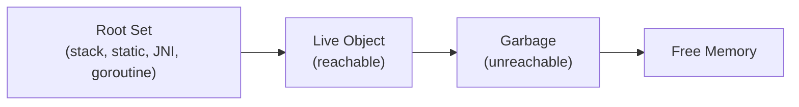
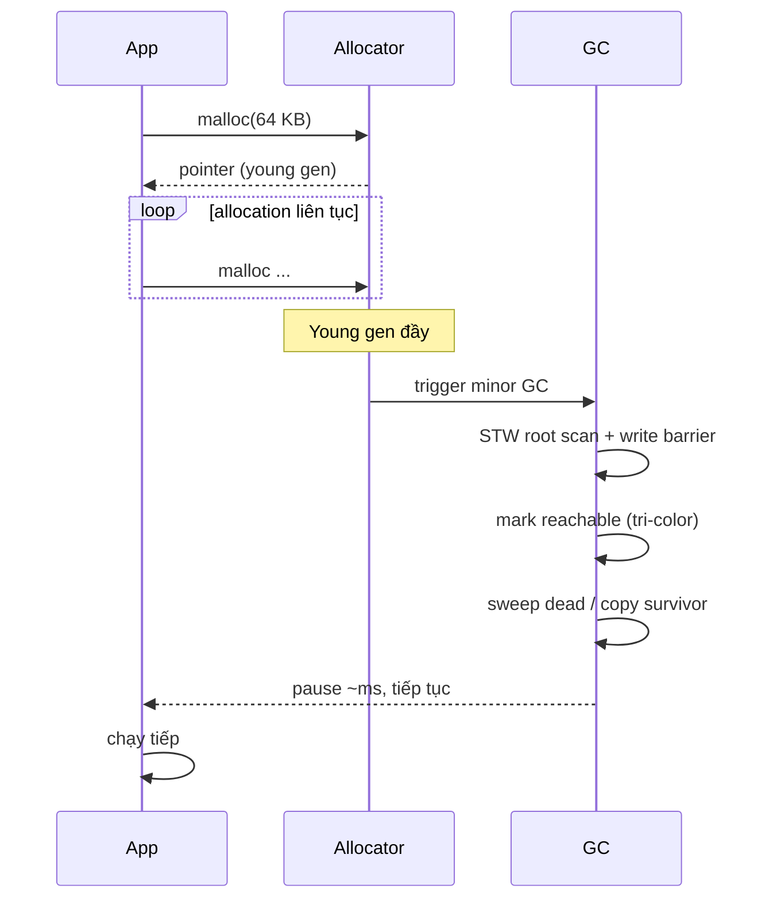

# How does garbage collection work?

> Giải thích cơ chế GC tracing (mark-sweep, mark-compact, copying), GC trong JVM (Serial/Parallel/G1/ZGC/Shenandoah), Go (tri-color concurrent mark-sweep), V8 (generational, Scavenger, Major GC), CPython (reference counting + cycle GC). So sánh với manual management, khi nào GC pause ảnh hưởng latency, stop-the-world. Bài [mark-sweep-vs-generational-gc](mark-sweep-vs-generational-gc.md) đi sâu vào chiến lược; bài [memory-leak](memory-leak.md) giải thích vì sao GC không chống leak.

Chủ đề: Memory - Runtime · Ngày: 2026-10-16

## 1. Là gì

Garbage collection (GC) là cơ chế runtime tự động thu hồi bộ nhớ của object không còn được chương trình tham chiếu. Khác với manual `malloc`/`free` (C/C++), GC giúp developer tránh raw leak, double-free, use-after-free. Đánh đổi: chi phí CPU cho tracing, GC pause (stop-the-world), khó đoán thời điểm thu hồi.



*Sơ đồ vị trí: GC bắt đầu từ root, đánh dấu (mark) object reachable, coi phần còn lại là garbage và thu hồi (sweep hoặc compact).*

### Trả lời 30 giây

"GC là cơ chế runtime tự động tìm và thu hồi object không còn được tham chiếu, giúp developer không phải gọi free/delete. Hai chiến lược chính: tracing GC (JVM, Go, V8) đánh dấu từ root, sweep object unreachable; reference counting (CPython, Swift ARC) đếm số tham chiếu, giảm về 0 là thu hồi. JVM có Serial/Parallel/G1 (mặc định Java 9+)/ZGC/Shenandoah. Go dùng tri-color concurrent mark-sweep, target pause < 1 ms. V8 chia thành young generation (Scavenger copying) và old generation (mark-sweep/compact). GC pause gây latency spike trong service yêu cầu tail latency thấp — giảm bằng concurrent GC (ZGC, Go) hoặc giảm allocation."

## 2. Cơ chế cốt lõi

### Bước 1. Root set và reachability

Mọi GC đều bắt đầu từ root set — tập tham chiếu "chắc chắn còn sống":
- **JVM**: thread call stack (local variable), static field, JNI global ref, class loaded, monitor locked, thread đang chạy.
- **Go**: package-level var, goroutine stack (tất cả biến còn trong scope), finalizer queue, runtime type info.
- **V8**: global object (window/global), call stack hiện tại, đóng cửa đang chạy, module exports.
- **CPython**: module globals, call stack hiện tại.

Mọi object reachable từ root (transitively) = live. Phần còn lại = garbage.

### Bước 2. Ba thuật toán tracing cơ bản

**Mark-sweep**:
1. Mark: từ root, duyệt đồ thị object, đánh dấu reachable.
2. Sweep: duyệt toàn bộ heap, giải phóng block của object không đánh dấu.
3. Nhược: external fragmentation (block rải rác), không compact → không có contiguity lớn.

**Mark-compact**:
1. Mark như trên.
2. Compact: di chuyển object còn sống về một đầu heap, loại bỏ dead. Có contiguity lớn, nhưng tốn CPU copy object.

**Copying (semi-space)**:
1. Chia heap thành 2 nửa (from-space, to-space).
2. Allocation vào from-space. Khi đầy: copy live object từ from sang to, đổi vai trò. Sweep chính là bỏ from-space cũ.
3. Nhanh, không fragmentation. Nhược: chỉ dùng được 50% heap.

### Bước 3. Generational hypothesis và generational GC

Quan sát thực nghiệm (generational hypothesis): phần lớn object chết trẻ (die young), object sống lâu thường sống rất lâu. Vì vậy heap chia thành generation:
- **Young generation**: object mới. Minor GC (Scavenger, Parallel New) chạy thường xuyên, nhanh vì chỉ quét vài MB.
- **Old generation**: object sống sót qua vài minor GC. Major GC (Full GC) chạy ít hơn, lâu hơn.
- JVM G1 mặc định Java 9+: chia thành region (~vài MB mỗi region), region nào cùng generation gom lại.
- V8: New Space (1-8 MB, semi-space) và Old Space.

### Bước 4. Tri-color marking (dùng trong Go, V8, JVM G1/ZGC)

Ba màu:
- **Trắng**: chưa được visit (candidate cho garbage).
- **Xám**: đã visit, có con trỏ tới trắng.
- **Đen**: đã visit, mọi con trỏ tới trắng đã xử lý.

Quy trình: tất cả bắt đầu trắng; root tối xám; xử lý xám → đen, đánh dấu con trắng thành xám. Khi không còn xám → done. Trắng còn lại = unreachable.
- **Write barrier**: khi goroutine/app ghi con trỏ mới tới trắng (sau khi đã mark), phải đánh dấu lại trắng đó thành xám (incremental update hoặc snapshot-at-beginning). Đảm bảo không miss reachable object.
- **Tri-color invariant**: không có cạnh đen → trắng trực tiếp. Vi phạm invariant = lost object (live mà bị sweep).

### Bước 5. JVM GC chi tiết

| GC | Thuật toán | Pause | Dùng khi |
|---|---|---|---|
| Serial | Mark-compact, single thread | Stop-the-world dài | JVM nhỏ, batch job |
| Parallel | Mark-compact, multi thread | Stop-the-world vẫn dài nhưng throughput cao | Throughput quan trọng |
| G1 (mặc định Java 9+) | Generational + region + concurrent mark | Mixed, target pause có thể cấu hình (`-XX:MaxGCPauseMillis=200`) | Đa dụng |
| ZGC | Concurrent mark + load barrier + colored pointer | Pause < 1 ms bất chấp heap size | Latency critical, heap tới TB |
| Shenandoah | Concurrent mark + Brooks pointer | Pause < 10 ms | Tương tự ZGC |
| Epsilon | No-op | Không GC | Test, lifecycle ngắn |

### Bước 6. Go GC chi tiết

1. **Trigger**: khi `HeapAlloc` vượt ngưỡng (`GOGC=100` nghĩa là khi heap mới gấp đôi heap alive thì GC).
2. **Mark phase**: concurrent tri-color marking, tất cả goroutine dùng write barrier (`runtime.markwrite`).
3. **Sweep phase**: concurrent, lazy — object free được đưa vào free list khi allocation tiếp theo.
4. **STW**: chỉ ở đầu (turn on write barrier) và cuối (off barrier + drain). Mỗi lần ~10-100 µs.
5. **Target**: Go 1.20+ đạt ~0.5-1 ms pause với heap vài GB, throughput ~25-50% so với no-GC.

### Bước 7. V8 GC chi tiết

1. **Scavenger (minor GC)**: New Space chia 2 semi-space (1-8 MB). Allocation vào "from", khi đầy → copy live sang "to", đổi vai trò. Pause ~1-3 ms.
2. **Major GC (mark-sweep/compact)**: Old Space (vài trăm MB). Incremental marking chia thành nhiều step xen kẽ với JavaScript execution. Compact nếu fragmentation cao. Pause có thể tới 50-100 ms với heap lớn.
3. **Orinoco**: tên dự án V8 GC, thêm parallel marking, concurrent sweeping, compaction incremental.

### Bước 8. Reference counting (CPython)

1. Mỗi object có `ob_refcnt`. Khi ref tăng (gán biến, push list) → +1; khi ref giảm → -1. Về 0 → giải phóng ngay.
2. Ưu: deterministic, không STW.
3. Nhược: cycle (A ref B, B ref A) → cả hai không bao giờ về 0. CPython có cycle GC chạy định kỳ tìm cycle unreachable từ root.
4. CPython 3.x: cycle GC chạy mỗi khi allocation vượt ngưỡng (`gc.get_threshold()` mặc định `(700, 10, 10)`).

### Bước 9. Sequence diagram - một chu kỳ GC



*Chu trình GC: allocation liên tục đến khi young gen đầy → STW ngắn → mark reachable → sweep/copy → trả heap cho app.*

### Quan sát

```bash
# JVM: xem GC hiện tại
java -XX:+PrintCommandLineFlags -version 2>&1 | grep Use

# JVM: log GC
java -Xlog:gc* -jar app.jar
# Output minh họa, chưa chạy:
# [0.123s][info] GC(0) Pause Young (Normal) 24M->8M(256M) 12.345ms

# JVM: chuyển GC
java -XX:+UseZGC -jar app.jar     # ZGC, pause < 1ms
java -XX:+UseG1GC -jar app.jar    # G1 (mặc định Java 9+)
java -XX:+UseParallelGC -jar app.jar  # throughput

# Go: xem GC stats
GODEBUG=gctrace=1 ./app
# Output minh họa, chưa chạy:
# gc 1 @0.012s 2%: 0.011+0.42+0.003 ms clock, 0.089+0/0.42/0.83+0.027 ms cpu, ...

# Node.js: xem GC heap
node --expose-gc -e "global.gc(); console.log(process.memoryUsage())"

# CPython: tắt cycle GC nếu biết code không có cycle
python -X no_cycle_gc app.py
```

### Ví dụ chạy từng bước

**Kịch bản:** Service Java xử lý 5.000 request/giây, mỗi request tạo một `byte[]` 64 KB để buffer gói tin, dùng xong buffer đó đủ điều kiện GC. Heap 256 MB, GC mặc định Java 17 = G1.

**Theo dõi một request qua các giai đoạn GC:**

| Bước | T/gian | Hành động + Heap state | GC event |
|---|---|---|---|
| 1 | 0 ms | `byte[65536] buffer = new byte[65536]`; Eden +64 KB | bump pointer tăng |
| 2 | 0.8 s | Eden 256 MB đầy (320 MB/s allocation) | Trigger minor GC |
| 3 | 0.8 s | Young GC: copy survivor ~50 MB; Eden 256→72 MB | Pause 18 ms, ~95% buffer chết |
| 4 | 1 s | Allocation tiếp, Eden đầy lại | Minor GC lặp lại |
| 5 | 8 s | Buffer sống qua 10 minor GC (tenuring = 15) | Promote lên Old |
| 6 | 60 s | Old đầy 95%, concurrent mark bắt đầu | Mixed GC, pause < MaxGCPauseMillis |

```text
# Trạng thái GC log tại bước 3 (illustrative, chưa chạy):
[0.812s][info] GC(7) Pause Young (Normal) 256M->72M(512M) 18.234ms
[1.625s][info] GC(8) Pause Young (Normal) 256M->84M(512M) 17.892ms
[8.123s][info] GC(45) Pause Young (Normal) 256M->96M(512M) 19.012ms
```
Pause ~18 ms với heap 256 MB, copy survivor từ Eden sang Survivor. ~95% allocation là short-lived, bị thu hồi trong minor GC.

**State machine một object qua generation:**
```text
new byte[65536]
  -> Eden (bump pointer)
  -> alive qua minor GC -> copy sang Survivor
  -> alive N lần (tenuring = 15) -> promote lên Old
  -> Old đầy -> concurrent mark -> mixed GC -> sweep dead
```

Trắng → xám → đen cho tri-color marking. Mỗi object đi qua state này trong một chu kỳ mark. Trắng còn lại sau mark = unreachable. Go dùng cùng tri-color với write barrier hybrid để concurrent an toàn.

**Biến thể A — đổi sang ZGC:** Cùng workload nhưng dùng `java -XX:+UseZGC -Xmx4g`. Pause giảm từ 18 ms xuống < 1 ms bất chấp heap. Nhưng throughput giảm ~10-20% và yêu cầu Java 11+. Trade-off: latency vs CPU.

**Biến thể B — goroutine leak trong Go:** Thay vì G1, xét Go service với 5.000 goroutine/giây tạo nhưng không bao giờ exit (chan never close). Heap cứ tăng 320 KB/goroutine × 5.000 = 1.6 GB/s. Tri-color mark vẫn chạy concurrent nhưng không sweep được vì goroutine giữ stack frame. Đây là leak tương tự Câu 6 debug trong phần 3A, GC không phải là đũa thần.

**Biến thể C — cycle trong CPython:** Hai object A ref B, B ref A, không ai ref cả. Reference counting không thu hồi (`ob_refcnt` không bao giờ về 0). Cycle GC quét định kỳ (`gc.get_threshold()` mặc định `(700, 10, 10)`), tốn thêm CPU. Nếu có 1M node trong cycle, cycle GC phải trace qua từng node → pause vài trăm ms.

Điều rút ra: G1/JVM sử dụng generational hypothesis — minor GC nhanh vì ~95% allocation ngắn hạn, chỉ pause vài ms. Old gen chiếm phần lớn heap và được mark concurrent. Go dùng tri-color concurrent nhưng không generational, nên object ngắn hạn vẫn chạy qua mark. Đây là cơ sở cho Câu 2 (mark-sweep vs mark-compact vs copying) và Câu 5 (Go GC overhead cần hiểu allocation).

## 3. Câu hỏi phỏng vấn

### 3A. Câu hỏi đào sâu

<details class="qa">
<summary>Câu 1. Garbage collection là gì? Phân biệt tracing GC và reference counting?</summary>

**Trả lời ngắn:** GC là cơ chế runtime tự động thu hồi bộ nhớ của object không còn được tham chiếu. Tracing GC (JVM, Go, V8) duyệt đồ thị từ root, đánh dấu (mark) reachable, sweep dead. Reference counting (CPython, Swift ARC) đếm số tham chiếu mỗi object, giảm về 0 thì thu hồi ngay. Tracing có thể thu hồi cycle; reference counting phải có cycle GC phụ.

**Đào sâu:**
- Tracing GC: ưu — phát hiện cycle tự nhiên, throughput cao với generational, không thay đổi code. Nhược — GC pause (stop-the-world), chi phí CPU.
- Reference counting: ưu — deterministic, thu hồi ngay, không STW. Nhược — overhead mỗi assignment (~10-30% slowdown), cycle không tự phát hiện.
- CPython kết hợp cả hai: reference counting cho thu hồi ngay, cycle GC định kỳ quét unreachable cycle.
- Tracing không biết chính xác khi nào object "không dùng nữa" — nó chỉ biết "không còn reachable". Có thể vẫn giữ object app không cần (dead reachability).
- C++ không có GC chuẩn — dùng smart pointer (unique_ptr, shared_ptr với refcount) để RAII, hoặc thư viện Boehm GC.

**Bẫy:** "Reference counting không có memory leak." Sai — cycle (A ref B, B ref A, không ai ref cả) không bao giờ giảm refcount về 0. CPython giải quyết bằng cycle GC định kỳ.

**Follow-up:** Tracing GC có xử lý được finalizer không? Có — finalizer chạy trước khi sweep, nhưng object có finalizer cần 2 chu kỳ GC để thu hồi (lần 1 finalize, lần 2 reclaim).
</details>

<details class="qa">
<summary>Câu 2. Mark-sweep, mark-compact và copying khác nhau thế nào? Khi nào dùng?</summary>

**Trả lời ngắn:** Mark-sweep đánh dấu reachable rồi sweep dead — đơn giản, nhưng có external fragmentation. Mark-compact thêm bước di chuyển live object về một đầu heap, loại bỏ fragmentation nhưng tốn CPU copy. Copying (semi-space) chia heap 2 nửa, copy live từ from-space sang to-space khi from đầy — nhanh, không fragmentation, nhưng chỉ dùng 50% heap.

**Đào sâu:**
- Mark-sweep: O(heap size) cho cả mark và sweep. Sweep duyệt toàn bộ page. Phù hợp old generation nhiều dead.
- Mark-compact: thêm compaction step di chuyển object. Pause lâu hơn mark-sweep nhưng có contiguity lớn (good for allocation lớn tiếp theo).
- Copying: pause ngắn vì chỉ copy live (thường nhỏ), nhưng lãng phí 50% heap. Phù hợp young generation (vì hầu hết object chết trẻ, chỉ copy số ít survivor).
- V8 Scavenger: copying cho New Space (1-8 MB), nhanh vì survivor thường chỉ vài trăm KB.
- JVM Parallel collector dùng mark-compact cho old gen; G1 dùng mark-sweep + incremental compact cho region.

**Bẫy:** "Mark-compact luôn tốt hơn mark-sweep." Sai — tốn CPU copy, pause dài hơn. Chỉ cần khi fragmentation cao cản trở allocation lớn.

**Follow-up:** Generation nào dùng copying, generation nào dùng mark-sweep? Young dùng copying (vì survivor nhỏ, pause ngắn), old dùng mark-sweep/compact (vì live nhiều, copy expensive).
</details>

<details class="qa">
<summary>Câu 3. Tri-color marking hoạt động thế nào? Write barrier quan trọng ra sao?</summary>

**Trả lời ngắn:** Tri-color chia object thành 3 nhóm: trắng (chưa visit, candidate dead), xám (visit nhưng con chưa xử lý), đen (visit xong, con đã xử lý). GC đẩy root sang xám, xử lý xám thành đen và đánh dấu trắng thành xám. Hết xám = done. Write barrier đảm bảo khi app ghi con trỏ mới tới trắng, trắng đó phải được đánh dấu lại xám — bảo vệ invariant "không có cạnh đen → trắng trực tiếp".

**Đào sâu:**
- Nếu không có write barrier: app ghi `obj.field = newPtr` (newPtr trắng) khi `obj` đã đen → newPtr bị sweep dù reachable từ obj (lost object problem).
- Snapshot-at-beginning (SATB): write barrier ghi lại giá trị cũ của field, đảm bảo mọi thứ trắng tại start-of-mark đều được giữ lại (đánh dấu xám). Dùng trong G1, ZGC.
- Incremental update: write barrier đánh dấu field vừa ghi thành xám (giữ invariant trực tiếp). Dùng trong Go, V8.
- Dijkstra's invariant (không có cạnh đen → trắng) cần write barrier mới giữ được khi GC concurrent với app.
- Floating garbage: object được allocated giữa mark cycles → có thể trắng dù reachable → bị sweep. An toàn vì chỉ làm vài % overhead, không sai.

**Bẫy:** "Tri-color marking không cần write barrier." Sai — cần thiết để concurrent GC không miss reachable object.

**Follow-up:** Go GC dùng incremental update hay SATB? Incremental update, kết hợp với hybrid write barrier (Go 1.8+) cho cả stack và heap pre-marking.
</details>

<details class="qa">
<summary>Câu 4. Generational hypothesis là gì và GC generational khai thác nó ra sao?</summary>

**Trả lời ngắn:** Generational hypothesis quan sát rằng phần lớn object chết trẻ (allocated xong không bao lâu thì unreachable), và object sống sót qua vài GC thì thường sống rất lâu. GC generational chia heap thành young (object mới) và old (object sống lâu), chạy minor GC thường xuyên trên young, major GC ít hơn trên old. Vì young thường có nhiều dead → pause ngắn, throughput cao.

**Đào sâu:**
- Weak generational hypothesis: ~70-90% object chết trong minor GC đầu tiên.
- Young generation thường 1/10 hoặc 1/4 heap size. Minor GC quét toàn bộ young (vài MB) nhanh hơn nhiều so với full heap.
- Promotion: object sống sót qua N minor GC (N = 15 với JVM mặc định) được promote lên old gen.
- Tenuring threshold: JVM tune bằng `-XX:MaxTenuringThreshold`. Quá cao → old gen đầy, major GC lâu. Quá thấp → object ngắn hạn bị promote.
- Card table: JVM dùng cấu trúc bit (card) để track old-to-young pointer. Khi minor GC, chỉ scan các card dirty. Rẻ hơn nhiều so với quét toàn bộ old gen.
- G1 / ZGC không có "young gen" cố định mà chia thành region, region nào được đánh dấu thuộc generation nào.

**Bẫy:** "Young GC nhanh vì heap nhỏ." Đúng một phần — quan trọng hơn là số lượng live object nhỏ, chỉ copy survivor (vài % của young size).

**Follow-up:** G1 khác classical generational GC thế nào? G1 chia heap thành region đều (~vài MB), không cố định young/old region. Region nào đầy thì GC vùng đó. Cho phép tận dụng heap linh hoạt hơn.
</details>

<details class="qa">
<summary>Câu 5. Tại sao Go có GC mà vẫn cần hiểu về memory allocation?</summary>

**Trả lời ngắn:** Vì GC overhead ảnh hưởng throughput và latency. Allocation nhiều → GC chạy thường xuyên → chiếm CPU (Go GC ~25-50% throughput), pause tăng (mặc dù < 1 ms). Hiểu allocation để viết code ít cấp phát, dùng object pool, sync.Pool, struct thay vì pointer khi có thể.

**Đào sâu:**
- Go `GOGC=100` (mặc định): khi heap mới gấp đôi heap alive → GC. Nếu mỗi request tạo nhiều object, GC trigger liên tục, chiếm CPU.
- `GOGC=off`: tắt GC (cho batch job ngắn).
- `GOMEMLIMIT=2GiB`: giới hạn heap, GC chạy sớm hơn để tránh OOM.
- `sync.Pool`: reuse object giữa goroutine, giảm allocation. Phù hợp cho buffer, request-scoped object.
- `make([]T, 0, n)` với capacity hint: tránh grow, copy nhiều lần.
- Stack-allocated escape: nếu object không escape (chỉ dùng trong function), Go compiler đặt trên stack → không GC. Có thể kiểm tra bằng `go build -gcflags="-m"`.
- Benchmark: `testing.B` đo `b.ReportAllocs()` để biết số allocation mỗi op.

**Bẫy:** "Go GC concurrent nên không cần quan tâm allocation." Sai — concurrent nhưng vẫn chiếm CPU và có thể trigger frequent khi allocation nhiều.

**Follow-up:** `sync.Pool` có rò rỉ memory không? Có — Pool không GC, nhưng sau 2 chu kỳ GC pool được dọn. Đừng giữ reference lâu dài trong pool.
</details>

<details class="qa">
<summary>Câu 6 (Debug). Service Java báo GC pause tăng từ 50 ms lên 500 ms sau deploy. Nguyên nhân và cách xử lý?</summary>

**Trả lời ngắn:** Nguyên nhân thường gặp: allocation tăng (object lớn trong hot path), old gen đầy (Full GC thường xuyên), G1 mixed GC không kịp. Cách xử lý: xem GC log, tìm allocation site lớn, tối ưu code hoặc tăng heap/đổi GC.

**Đào sâu:**
- Bước 1: bật GC log chi tiết: `-Xlog:gc*,safepoint:file=gc.log:time,uptime,details`. Phân tích tần suất Full GC, mixed GC, young GC.
- Bước 2: heap dump trước và sau peak traffic. Xem class nào chiếm nhiều retained size. Thường là cache, static collection, hoặc session store.
- Bước 3: JFR (JDK Flight Recorder) hoặc async-profiler allocation flame graph. Tìm call site allocate nhiều nhất.
- Bước 4: xem old gen occupancy. Nếu thường xuyên > 80%, tăng heap (`-Xmx`) hoặc fix leak (xem [memory-leak](memory-leak.md)).
- Bước 5: đổi GC. ZGC cho pause cực thấp (vài ms bất chấp heap size), yêu cầu Java 11+. G1 cho đa dụng.
- Bước 6: tối ưu code: dùng primitive thay boxed, streaming thay load-all, cache với TTL bounded.

**Bẫy:** Tăng `-Xmx` mà không fix root cause. Chỉ trì hoãn Full GC.

**Follow-up:** Làm sao biết GC đang chiếm bao nhiêu % CPU? Metric `jvm.gc.time` và `jvm.gc.count` qua JMX, hoặc `GCT` trong `jstat -gcutil <pid>`. Nếu > 10% CPU → vấn đề.
</details>

<details class="qa">
<summary>Câu 7 (Thiết kế). Thiết kế in-memory cache cho session store 10M user, yêu cầu p99 latency < 10 ms, downtime tối thiểu. Chọn JVM GC nào?</summary>

**Trả lời ngắn:** Dùng ZGC hoặc Shenandoah (concurrent, pause < 1 ms bất chấp heap size). Heap 32-64 GB chứa 10M session (~3-6 KB mỗi session). Hoặc off-heap (MapDB, Chronicle Map) để GC không scan.

**Đào sâu:**
- 10M session × 3 KB = 30 GB heap. G1 với heap này có thể có mixed GC pause ~200 ms, không đạt p99 < 10 ms.
- ZGC pause target < 1 ms, scales tới multi-TB. Dùng colored pointer + concurrent mark.
- Shenandoah tương tự ZGC, dùng Brooks pointer. Đôi khi overhead CPU cao hơn ZGC.
- Off-heap: MapDB (Java) lưu map trong memory mapped file, GC không thấy. Trade-off: serialization overhead, không query được bằng reflection.
- Cấu hình ZGC: `-XX:+UseZGC -Xmx64g -XX:SoftRefLRUPolicyMSPerMB=50`.
- Cache eviction: LRU bounded với Caffeine size-based. Không bao giờ để unbounded.
- Session invalidation: TTL, hoặc explicit remove khi logout.

**Bẫy:** Chọn G1 với heap 30 GB — pause có thể vượt yêu cầu. Đo bằng GC log thực tế.

**Follow-up:** Off-heap có tránh được leak không? Có — off-heap memory không chịu ảnh hưởng của GC, nhưng vẫn leak nếu quên giải phóng. Cần `Cleaner` (JDK 9+) hoặc reference queue.
</details>

### 3B. Câu hỏi phỏng vấn liên quan

<details class="qa">
<summary>Câu 8. Tại sao GC pause (stop-the-world) lại quan trọng trong latency-critical service?</summary>

**Trả lời:** Vì trong lúc STW, tất cả thread app phải dừng đợi GC xong — request đang xử lý bị pause, không response. Với STW 200 ms, p99 latency tăng 200 ms. Service tài chính, gaming, ad bidding yêu cầu p99 < 50 ms không chịu nổi. Concurrent GC (ZGC, Go) chạy phần lớn song song với app, pause chỉ còn vài ms → phù hợp.
</details>

<details class="qa">
<summary>Câu 9. C++ không có GC, làm sao quản lý memory an toàn?</summary>

**Trả lời:** Dùng smart pointer: `unique_ptr` (ownership rõ ràng, auto delete), `shared_ptr` (refcount), `weak_ptr` (tránh cycle). RAII đảm bảo giải phóng khi scope kết thúc. Tránh raw `new`/`delete`. Nếu cần cycle detection, dùng `weak_ptr` thay vì `shared_ptr` qua lại. Container STL giải phóng tự động.
</details>

<details class="qa">
<summary>Câu 10. Finalize trong Java có vấn đề gì? Tại sao Deprecated?</summary>

**Trả lời:** Finalize cần 2 chu kỳ GC để reclaim: lần 1 đánh dấu, lần 2 chạy finalize rồi reclaim. Object có finalizer giữ lâu hơn trong heap. Nếu finalize chậm (I/O, lock), finalizer queue bị backup. Object có thể "resurrect" bằng cách gán `this` vào static field, gây leak. Best practice thay bằng `AutoCloseable` + try-with-resources.
</details>

<details class="qa">
<summary>Câu 11. Tại sao Go không dùng generational GC?</summary>

**Trả lời:** Go team giải thích: Go program thường có object sống ngắn do escape analysis (đưa lên stack), heap chỉ chứa object dài hạn. Generational hypothesis yếu hơn trong Go workload, nên overhead của card table + write barrier không tương xứng với lợi ích. Go GC concurrent với tri-color marking đã đạt pause < 1 ms với heap vài GB. Trade-off acceptable.
</details>

<details class="qa">
<summary>Câu 12. "GC tốt = GC không cần dừng app." Đúng hay sai?</summary>

**Trả lời:** Sai. Mọi GC đều có pause, dù rất ngắn. ZGC target < 1 ms nhưng vẫn có STW ngắn (turn on/off barrier). V8 có minor GC pause ~1-3 ms. Java HotSpot concurrent collector vẫn có STW root scan. Pause không triệt tiêu — giảm thôi. Service với yêu cầu zero pause thực sự (RTOS, embedded) phải dùng manual memory (C/C++/Rust) hoặc allocator không GC (jemalloc cho từng thread).
</details>

<details class="qa">
<summary>Câu 13. Reference counting (CPython) có ưu điểm gì so với tracing?</summary>

**Trả lời:** Deterministic — object được giải phóng ngay khi không còn ai dùng, có thể đoán được thời điểm. Không có STW pause. Phù hợp ứng dụng interactive (GUI, REPL) nơi latency quan trọng. Nhược: cycle leak, overhead mỗi assignment. CPython bù trừ bằng cycle GC định kỳ.
</details>

<details class="qa">
<summary>Câu 14. Khi nào nên tắt cycle GC trong CPython?</summary>

**Trả lời:** Khi chương trình chắc chắn không có cycle trong object graph (chỉ dùng primitive, list, dict đơn giản). Tắt bằng `python -X no_cycle_gc` hoặc `gc.disable()`. Cẩn thận: nếu code có cycle (DOM tree, parent/child graph), tắt cycle GC = leak. Có thể dùng `gc.collect()` thủ công định kỳ nếu biết workload.
</details>

<details class="qa">
<summary>Câu 15. Escape analysis trong Go hoạt động thế nào và làm sao kiểm tra?</summary>

**Trả lời:** Compiler phân tích biến có escape ra ngoài function không (qua return, gán vào pointer truyền đi, lưu global). Nếu không escape → đặt trên stack thay vì heap. Stack allocation không tốn GC. Kiểm tra bằng `go build -gcflags="-m"`. Output in escape analysis decision: `moved to heap: ...` (đã escape) hoặc `does not escape` (giữ stack).
</details>

## 4. Đánh đổi và sự cố production

### So sánh chiến lược GC

| Tiêu chí | Reference Counting | Mark-Sweep | Mark-Compact | Copying | Tri-color Concurrent |
|---|---|---|---|---|---|
| Pause | Không | Stop-the-world | Stop-the-world dài | Stop-the-world ngắn | Rất ngắn (concurrent) |
| Throughput | Trung bình (refcount overhead) | Tốt | Thấp hơn (copy) | Tốt cho young gen | Trung bình |
| Fragmentation | Không | Có | Không | Không | Tuỳ thuật toán |
| Cycle handling | Cần cycle GC phụ | Tự nhiên | Tự nhiên | Tự nhiên | Tự nhiên |
| Runtime dùng | CPython, Swift ARC | V8 old gen, Go heap | JVM old gen | V8 new gen, JVM young | Go, ZGC, Shenandoah |
| Pause điển hình | 0 | 50-500 ms | 100-1000 ms | 1-10 ms | 0.5-5 ms |

### Năm failure mode

| Triệu chứng | Nguyên nhân gốc | Cách kiểm tra | Cách sửa |
|---|---|---|---|
| GC pause > 500 ms trong JVM | Old gen đầy, Full GC kích hoạt | GC log, jstat | Tăng heap, ZGC, fix leak |
| Go service pause > 10 ms | Heap lớn, GC chưa concurrent hết | `GODEBUG=gctrace=1` | `GOMEMLIMIT`, giảm allocation |
| OutOfMemoryError không GC | Native memory, off-heap | NativeMemoryTracking | `-XX:MaxDirectMemorySize` |
| RSS tăng dần dù GC chạy | Memory leak — GC không thu hồi | Heap dump + retained size | Xem [memory-leak](memory-leak.md) |
| Reference cycle trong CPython | Cycle không phát hiện refcount = 0 | `gc.collect()`, `gc.get_objects()` | Dùng weakref, refactor cycle |

## 5. Cheat sheet

| Chủ đề | Con số / quy tắc cần nhớ |
|---|---|
| Reference counting (CPython) | Thu hồi ngay khi refcount = 0, có cycle GC định kỳ |
| Tracing GC | Mark từ root, sweep/compact dead |
| Mark-sweep | Đơn giản, có external fragmentation |
| Mark-compact | Thêm compact, có contiguity, tốn CPU |
| Copying (semi-space) | Nhanh, dùng 50% heap, cho young gen |
| Generational hypothesis | ~70-90% object chết trong minor GC đầu |
| ZGC pause target | < 1 ms bất chấp heap size |
| Go GC target pause | < 1 ms với heap vài GB |
| G1 (JVM mặc định Java 9+) | Generational + region, pause mix |
| Tri-color invariant | Không cạnh đen → trắng, cần write barrier |

**Học tiếp:**
- [mark-sweep-vs-generational-gc](mark-sweep-vs-generational-gc.md) — chiến lược generational chi tiết
- [memory-leak](memory-leak.md) — vì sao GC không chống leak
- [stack-vs-heap](stack-vs-heap.md) — vùng nhớ GC quản lý