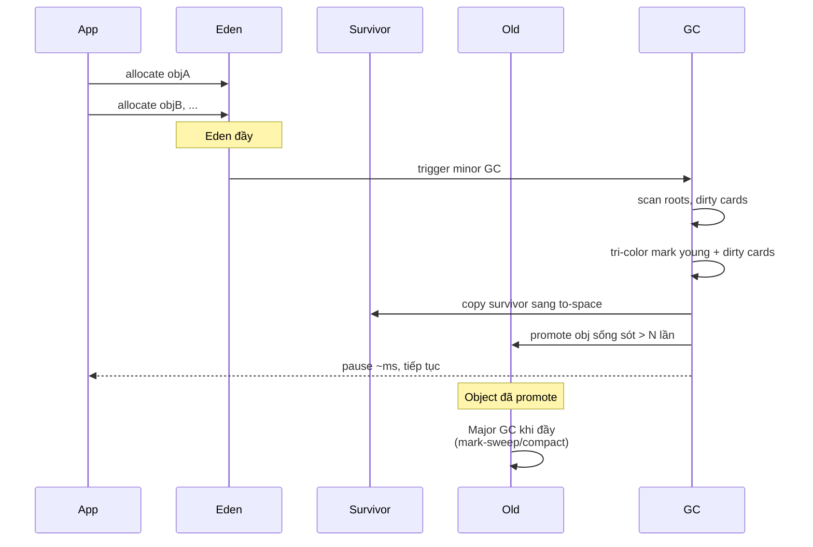
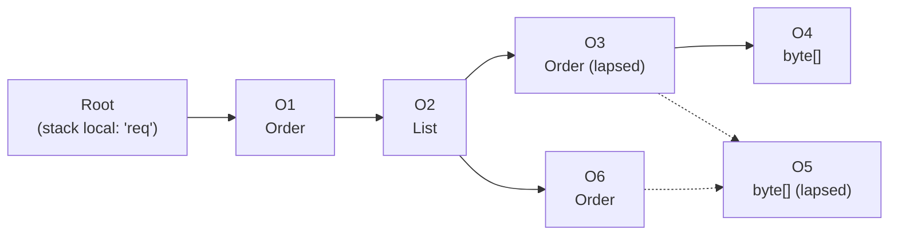

# Explain mark-and-sweep vs generational garbage collection.

> So sánh mark-and-sweep (đơn giản, một thế hệ) với generational GC (chia young/old generation), generational hypothesis, cách hoạt động của minor/major GC, trade-off pause vs throughput, khi nào dùng G1, ZGC, Parallel collector. Bài [garbage-collection](garbage-collection.md) tổng quan; bài [mark-sweep-vs-generational-gc](mark-sweep-vs-generational-gc.md) đi sâu chiến lược generational.

Chủ đề: Memory - Runtime · Ngày: 2026-10-16

## 0. Nền tảng trước khi đọc

**Bối cảnh:** Cách chương trình dùng và thu hồi bộ nhớ khi đang chạy. Hiểu phần này giúp giải thích chậm, treo, crash và out-of-memory.

**Nói đơn giản:** Mark-and-sweep quét một vùng nhớ; generational GC chia object theo tuổi để xử lý nhanh nhóm object mới thường chết sớm.

**Từ khóa cần biết:** object = dữ liệu đang sống; reference = đường trỏ tới object; runtime = phần thực thi chương trình.

**Ví dụ dễ hình dung:** Object của request thường chết nhanh nên minor GC chỉ cần quét young generation thay vì quét toàn heap.

Khi đọc, luôn hỏi ba câu: nó giải quyết vấn đề gì, nó làm việc theo những bước nào, và khi nào không nên dùng?

**Cách học bài này:** Đọc phần này trước để nắm từ khóa; đọc phần 1 để lấy câu trả lời 30 giây; đọc phần 2 để hiểu cơ chế; cuối cùng mở từng câu hỏi ở phần 3 để luyện nói. Các con số và lệnh trong bài là bằng chứng cho câu trả lời, không cần học thuộc nếu chưa hiểu cơ chế.

## 1. Là gì

### Đọc nhanh trước khi đi sâu

**Ý chính:** Mark-and-sweep quét một vùng nhớ; generational GC chia object theo tuổi để xử lý nhanh nhóm object mới thường chết sớm.

**Ví dụ interview:** Object của request thường chết nhanh nên minor GC chỉ cần quét young generation thay vì quét toàn heap.

**Luồng 4 bước:**

1. Code tạo object hoặc vùng nhớ.
2. Runtime giữ object còn được dùng và cung cấp reference cho code.
3. Object không còn reachable sẽ được free hoặc garbage collector thu hồi.
4. Nếu giữ nhầm, vùng nhớ phình lên và chương trình chậm hoặc hết RAM.

**Nói như trong interview:** Mark-and-sweep quét một vùng nhớ; generational GC chia object theo tuổi để xử lý nhanh nhóm object mới thường chết sớm. Hãy nói theo bốn bước trên trước; nếu interviewer hỏi sâu, chuyển sang cơ chế **Bước 1. Mark-and-sweep chi tiết**, rồi nêu trade-off và failure mode ở các phần sau.

## 2. Cơ chế cốt lõi

### Bước 1. Mark-and-sweep chi tiết

**Phase 1 — Mark**:
1. Bắt đầu từ root set (stack, static, JNI).
2. Duyệt BFS/DFS qua object graph, set bit "marked" trong header mỗi object visited.
3. Khi không còn reachable chưa visit → kết thúc mark.

**Phase 2 — Sweep**:
1. Duyệt toàn bộ heap (page/block).
2. Object unmarked → trả block cho free list, đánh dấu unmarked để lần sau dùng lại.
3. Sweep có thể theo bit per object (overhead ~1 bit/object) hoặc lazy sweep (chỉ sweep khi allocation cần block).

**Đặc tính**:
- Đơn giản, dễ hiện thực.
- Stop-the-world toàn bộ (parallel collector có thể parallel mark/sweep nhưng vẫn STW).
- External fragmentation: block dead rải rác, allocation lớn có thể fail dù tổng free đủ.
- Không tốn thêm bộ nhớ cho tham chiếu (chỉ mark bit).

### Bước 2. Generational hypothesis và evidence

Quan sát của Peter Appel (Apple) và David Ungar (Xerox, 1984) trên Smalltalk: ~95% object chết trong vòng vài triệu câu lệnh sau khi được tạo. Object sống sót qua GC đầu tiên thường sống rất lâu.

Hai hệ quả:
1. **Weak generational hypothesis**: phần lớn object chết trẻ → minor GC nhanh vì quét vài MB young, sweep nhiều dead.
2. **Strong generational hypothesis**: object sống lâu chiếm tỉ lệ nhỏ nhưng giữ tài nguyên lâu → cần GC riêng cho chúng (major GC).

### Bước 3. Generational GC hoạt động thế nào

**Young generation (Eden + Survivor)**:
- Chia thành Eden (mới allocate) và 2 Survivor space (From/To).
- Allocation vào Eden. Khi Eden đầy → minor GC.
- Minor GC: copy live object từ Eden + From Survivor sang To Survivor, đổi vai trò.
- Object sống sót qua N lần (tenuring threshold, mặc định 15 với JVM) → promote lên old gen.

**Old generation**:
- Lưu object sống lâu.
- Major GC (Full GC) chạy khi old gen gần đầy, dùng mark-sweep hoặc mark-compact.
- Đắt vì quét toàn bộ old gen (GB).

**Card table**:
- JVM dùng cấu trúc 1 byte per ~512 byte heap để track old-to-young pointer (remembered set).
- Khi old gen ghi con trỏ sang young, đánh dấu card dirty.
- Minor GC chỉ scan các card dirty, không cần scan toàn bộ old gen → rẻ hơn nhiều.

### Bước 4. So sánh các thế hệ GC trong JVM

| Collector | Young gen thuật toán | Old gen thuật toán | Pause | Throughput |
|---|---|---|---|---|
| Serial | Copying (PSYoungGen) | Mark-compact | STW dài | Thấp |
| Parallel | Copying parallel | Mark-compact parallel | STW dài nhưng nhanh hơn Serial | Cao nhất |
| G1 | Copying parallel + remembered set | Mark-sweep + incremental compact | Mixed, configurable (`-XX:MaxGCPauseMillis=200`) | Tốt |
| ZGC | Concurrent mark + load barrier | Concurrent mark + concurrent compact | < 1 ms | Tốt (hơi thấp hơn Parallel) |
| Shenandoah | Concurrent mark + Brooks pointer | Concurrent mark + concurrent compact | < 10 ms | Tốt |
| Epsilon | Không GC | Không GC | Không | N/A (test only) |

### Bước 5. V8 Generational GC chi tiết

V8 chia heap thành:
- **New Space**: 1-8 MB, chia 2 semi-space (from/to). Allocation vào from. Khi đầy → Scavenger (copying) copy live sang to, đổi vai trò. Pause ~1-3 ms.
- **Old Space**: vài trăm MB. Mark-sweep/compact tăng dần qua các bước nhỏ xen kẽ với JavaScript execution (incremental marking). Compact nếu fragmentation > ngưỡng.
- **Code Space**: chứa JIT-compiled code.
- **Map Space**: object shape metadata.

Trade-off: New Space nhỏ nên Scavenger nhanh, old space lớn nhưng Major GC incremental nên không gây pause lớn đơn lẻ.

### Bước 6. Sequence diagram - Minor GC trong generational



*Minor GC: trigger khi Eden đầy → STW ngắn → copy survivor sang Survivor → promote obj già lên Old → trả Eden. Major GC chạy khi Old đầy.*

### Bước 7. Tại sao generational tốt hơn single-space mark-sweep

1. **Minor GC nhanh**: young gen thường chỉ 10-25% heap size, copy survivor (vài %) nhanh hơn nhiều so với sweep toàn heap.
2. **Memory locality**: object allocate cùng lúc (cùng allocation burst) nằm cùng vùng, cache locality tốt.
3. **Allocation nhanh**: bump pointer trong Eden (chỉ tăng con trỏ), không cần tìm free block như mark-sweep heap.
4. **Phù hợp workload thực**: web request tạo nhiều object ngắn hạn (JSON parse, SQL result), chết ngay sau khi response gửi xong.
5. **Giảm full heap scan**: chỉ minor GC scan young + dirty cards, không cần scan toàn bộ old gen.

### Quan sát

```bash
# JVM: in GC log để thấy minor vs major
java -Xlog:gc -jar app.jar
# Output minh họa, chưa chạy:
# [0.123s][info] GC(0) Pause Young (Normal) 24M->8M(256M) 12.345ms
# [0.456s][info] GC(1) Pause Young (Normal) 32M->12M(256M) 14.012ms
# [5.678s][info] GC(2) Pause Full (System.gc()) 256M->128M(512M) 89.234ms

# JVM: xem chi tiết generation sizes
jstat -gc <pid>
# S0C  S1C  S0U  S1U  EC   EU   OC   OU   MC   MU
# 1024 1024 0    0    8192 4096 20480 10240 2048 1024 columns

# JVM: cấu hình generation sizes
java -Xmn256m -jar app.jar  # young = 256 MB
java -XX:NewRatio=2 -jar app.jar  # old:young = 2:1

# Node.js: xem heap breakdown
node --expose-gc -e "global.gc(); const m=process.memoryUsage(); console.log(m)"
# { rss, heapTotal, heapUsed, external, ... }
# heapTotal bao gồm New Space + Old Space
```

### Ví dụ chạy từng bước

**Kịch bản:** Heap Java sau minor GC, chỉ còn 7 object trong Old generation. Ta trace một minor GC cho young + một mixed GC cho old để xem object nào sống, object nào chết.

**Đồ thị object trước GC (Old gen):**



Root R (stack local) trỏ tới O1. O1 chứa list O2. O2 chứa O3 và O6. O3 và O6 tham chiếu O4 và O5 (qua field payload).

| Bước | Thao tác | Worklist | Trạng thái O1-O6 sau bước |
|---|---|---|---|
| 1 | Init: tất cả trắng, root R push vào worklist | [R] | O1 O2 O3 O4 O5 O6 đều trắng |
| 2 | Visit R: push O1 vào worklist, R xong | [O1] | O1 xám, các object khác trắng |
| 3 | Visit O1: scan, O2 vào worklist, O1 đen | [O2] | O1 đen, O2 xám |
| 4 | Visit O2: scan con, O3 O6 vào worklist, O2 đen | [O3, O6] | O1 O2 đen; O3 O6 xám; O4 O5 trắng |
| 5 | Visit O3: scan, O4 vào worklist, O3 đen | [O6, O4] | O1 O2 O3 đen; O6 O4 xám; O5 trắng |
| 6 | Visit O6: scan stale ref tới O5 (không enqueue), O6 đen; visit O4 đen; worklist rỗng → mark end | [] | O5 trắng, các object khác đen |

**Trạng thái sau GC:**
```text
Mark set (đen):    {O1, O2, O3, O4, O6}  -> sống
Sweep set (trắng): {O5}                  -> reclaimed 64 KB về free list
Pause (STW):       12 ms cho Old 256 MB
```

O5 bị sweep dù O3 và O6 từng ref tới nó — vì O3/O6 đã được đánh dấu đen trước khi O5 được push vào worklist. Đây chính là lý do cần **write barrier** khi app concurrent: nếu O6 ghi con trỏ mới tới O5 sau khi O6 đã đen, write barrier phải đánh dấu lại O5 thành xám, tránh "lost object".

**Biến thể A — generational thay vì mark-sweep đơn thế hệ:**

Nếu dùng G1 (generational), ta chia làm hai giai đoạn:
1. **Minor GC (young):** Eden trống sau copy, chỉ vài byte[] ngắn hạn được sweep. Young survivor promote O1-O6 nếu sống qua 15 minor GC (tenuring threshold).
2. **Mixed GC (old):** Sau khi old đầy 95%, G1 chọn region có nhiều dead (region chứa O5) để compact. Region chứa O5 được reclaimed, O5 sweep. Pause mixed GC thường 50-200 ms.

```text
# Sau minor GC (chỉ áp dụng cho young):
Eden: 0 (cleared)
Survivor: chứa short-lived buffer (không phải O1-O6)
Old: 6 object (O1-O6, O5 chưa bị reclaim)

# Sau mixed GC (region chứa O5):
Old: 5 object (O1, O2, O3, O4, O6); O5 sweep
Pause: 80 ms (mixed, không phải full heap mark)
```

So với mark-sweep đơn thế hệ (quét 256 MB một lần), generational chỉ quét vài MB young + region chọn lọc — pause ngắn hơn nhiều khi old lớn.

**Biến thể B — mark-sweep đơn thế hệ cùng heap:** Cùng 7 object nhưng không chia young/old. G1 thành Parallel collector với mark-sweep đơn trên toàn heap 256 MB. Mỗi full GC scan toàn bộ 256 MB → pause 800 ms thay vì 80 ms. Generational hypothesis giúp minor GC pause vài ms.

**Biến thể C — lỗi mất O5 do thiếu write barrier:** Go trước 1.8 thiếu hybrid write barrier có thể mất O5 trong concurrent mark. O6 (đen) ghi `O5.ref = newObj` mà không có barrier. Sau sweep, O5 mới unreachable dù reachable từ O6. Tri-color invariant bị vi phạm.

Điều rút ra: Mark-sweep quét đồ thị reachable từ root qua BFS/DFS với worklist. Object reachable = sống, còn lại sweep. Generational GC tận dụng hypothesis rằng đa số object chết trẻ → minor GC pause ngắn, chỉ full GC (mark-compact region chọn lọc) mới dài. Đây là cơ sở cho Câu 1, Câu 3 và Câu 4 trong phần 3A nói về mark-sweep đơn thế hệ vs minor/major GC.

## 3. Câu hỏi phỏng vấn

### 3A. Câu hỏi đào sâu

<details class="qa">
<summary>Câu 1. Mark-and-sweep hoạt động thế nào, có nhược điểm gì?</summary>

**Trả lời ngắn:** Hai pha: mark duyệt từ root, đánh dấu live object; sweep duyệt toàn heap, giải phóng object unmarked. Đơn giản nhưng stop-the-world (parallel collector chỉ parallel chứ vẫn STW), external fragmentation (dead block rải rác), và không tận dụng generational hypothesis.

**Đào sâu:**
- Mark: BFS/DFS từ root, set bit trong header mỗi object. Mark có thể dùng worklist stack/queue cho concurrent mark.
- Sweep: duyệt page/block, object unmarked → free list, đánh dấu unmarked để lần sau dùng lại.
- Mark bit thường dùng 1 bit/object overhead thấp. Một số hiện thực dùng word-aligned bitmap.
- External fragmentation: 10 MB free nhưng rải thành 1000 block 10 KB → không cấp được một block 10 MB liên tục. Phải dùng compactor.
- Không tận dụng generational hypothesis: quét toàn bộ heap mỗi lần, không phân biệt object ngắn hạn và dài hạn.

**Bẫy:** "Mark-and-sweep concurrent là không có STW." Sai — dù mark-sweep concurrent (CMS trong JVM, deprecated Java 9+), vẫn có STW ở đầu (initial mark) và cuối (remark). Full pause-free không thể đạt được với mark-sweep thuần.

**Follow-up:** Tại sao CMS bị deprecated? Phụ thuộc vào floating garbage (allocated sau concurrent mark), không compact → fragmentation, và remark STW có thể rất dài với heap lớn.
</details>

<details class="qa">
<summary>Câu 2. Generational hypothesis là gì và generational GC khai thác nó ra sao?</summary>

**Trả lời ngắn:** Generational hypothesis quan sát rằng phần lớn object chết trẻ (allocated xong không bao lâu thì unreachable), và object sống lâu thường sống rất lâu. Generational GC chia heap thành young generation (object mới) và old generation (object sống lâu). Minor GC chạy thường xuyên trên young (nhanh, vì survivor ít), major GC chạy ít hơn trên old (đắt hơn, nhưng tần suất thấp).

**Đào sâu:**
- Weak generational hypothesis: ~70-90% object chết trong minor GC đầu tiên. Vì vậy quét young (vài MB) nhanh hơn quét toàn heap (GB).
- Strong generational hypothesis: object sống qua N minor GC (tenuring threshold, JVM mặc định 15) thường sống rất lâu, nên promote lên old.
- Card table (JVM): 1 byte per ~512 byte heap để track old-to-young pointer. Khi old ghi con trỏ sang young, đánh dấu card dirty. Minor GC chỉ scan dirty cards, không scan toàn bộ old.
- Promotion: obj sống sót N lần được copy từ Survivor lên Old. Quá sớm promote → old đầy, major GC thường xuyên. Quá muộn → Survivor đầy, allocation chậm.
- Allocation tốc độ cao: bump pointer trong Eden, chỉ tăng con trỏ (1-5 ns).

**Bẫy:** "Generational GC không có full heap scan." Sai — major GC vẫn scan toàn old gen, chỉ minor GC là nhanh. Khi old đầy → major GC có thể dài hàng trăm ms.

**Follow-up:** Go không dùng generational GC, vì sao? Go workload escape analysis đẩy nhiều object lên stack, heap chỉ giữ object dài hạn → generational hypothesis yếu. Concurrent tri-color đủ đạt pause < 1 ms.
</details>

<details class="qa">
<summary>Câu 3. Minor GC (young generation) dùng thuật toán gì và vì sao nhanh?</summary>

**Trả lời ngắn:** Minor GC dùng copying algorithm trong Survivor space. Allocation vào Eden; khi Eden đầy → copy live object từ Eden + From Survivor sang To Survivor, đổi vai trò hai Survivor. Nhanh vì survivor thường chỉ chiếm vài % young gen size, copy ít, sweep bằng cách bỏ Eden + From cũ (không cần duyệt từng object).

**Đào sâu:**
- Survivor ratio: JVM mặc định Eden:From:To = 8:1:1. Survivor nhỏ vì object chết nhiều, chỉ vài % sống sót.
- Allocation: bump pointer trong Eden, ~1-5 ns, gần như stack allocation.
- Promotion: object sống sót qua N minor GC (tenuring threshold, mặc định 15) → promote lên old gen. Một số object lớn (> half Survivor size) được promote sớm để tránh tốn copy.
- Card table: minor GC chỉ scan dirty cards để tìm old-to-young reference. Tiết kiệm so với quét toàn old.
- JVM G1 dùng region: mỗi region ~vài MB, region nào đầy thì GC. Survivor region được chọn từ pool region. Vẫn theo nguyên lý generational.

**Bẫy:** "Minor GC không STW." Sai — JVM minor GC đều có STW, chỉ là STW ngắn (vài ms) vì young size nhỏ.

**Follow-up:** Tại sao Eden chiếm phần lớn young (8/10) chứ không phải 1/2? Vì object chết trẻ → tỉ lệ sống sót nhỏ, chỉ cần Survivor nhỏ để chứa survivor tạm thời trước khi promote.
</details>

<details class="qa">
<summary>Câu 4. Major GC (old generation) dùng thuật toán gì, vì sao lâu hơn?</summary>

**Trả lời ngắn:** Major GC dùng mark-sweep hoặc mark-compact trên toàn bộ old gen. Lâu hơn vì old gen lớn (GB), live object nhiều (hầu hết sống sót qua minor GC), phải quét toàn bộ để xác định dead (chỉ một phần nhỏ chết). Mark-compact thêm bước di chuyển live object → pause rất dài với heap lớn.

**Đào sâu:**
- Mark: duyệt toàn bộ old gen từ root + dirty card. Với heap vài GB, có thể tìm thấy hàng triệu object live.
- Sweep: giải phóng dead. Dead thường ít (object đã sống qua minor GC nên tỉ lệ chết thấp), nhưng phải scan hết để tìm.
- Compact: di chuyển live object về một đầu heap, loại bỏ fragmentation. Tốn CPU copy hàng triệu object, pause có thể vài giây với heap 10 GB.
- G1 cải tiến: chia heap thành region, compact incremental — chỉ compact region có nhiều dead, không compact toàn bộ cùng lúc.
- ZGC / Shenandoah: mark + compact concurrent, pause < 1 ms bất chấp heap size.
- Trigger: thường khi old gen đạt ngưỡng (mặc định 92% với G1, 100% với Parallel) hoặc allocation failure đều.

**Bẫy:** "Parallel collector chỉ dành cho batch job." Sai — Parallel throughput cao, pause dài nhưng predictable. Phù hợp service chấp nhận pause ~1s nhưng cần throughput tối đa.

**Follow-up:** Làm sao giảm tần suất major GC? Giảm allocation rate (object nhỏ, ngắn hạn), tăng heap size, tối ưu tenuring threshold, hoặc chuyển sang ZGC.
</details>

<details class="qa">
<summary>Câu 5. Card table trong JVM là gì, vai trò gì trong generational GC?</summary>

**Trả lời ngắn:** Card table là một mảng byte, mỗi byte đại diện cho một vùng heap ~512 byte (card). Khi code ghi một con trỏ từ old gen sang young gen (object trẻ), JVM đánh dấu byte tương ứng là dirty. Minor GC chỉ scan các dirty card để tìm old-to-young pointer, không cần quét toàn bộ old gen → tiết kiệm thời gian.

**Đào sâu:**
- Write barrier: mỗi khi JVM ghi reference vào field của object, kiểm tra xem có phải old-to-young không. Nếu có, đánh dấu card dirty. Overhead rất nhỏ (1-2% benchmark).
- Kích thước card: JVM mặc định 512 byte (`-XX:G1CardRegionSize` cho G1). Nhỏ hơn = scan chính xác hơn nhưng table lớn. Lớn hơn = table nhỏ nhưng scan nhiều hơn.
- Minor GC: chỉ scan dirty cards để tìm root trong young gen. Không cần scan toàn bộ old gen (có thể GB).
- Không có card table: minor GC phải scan toàn bộ old gen (GB) mỗi lần → STW rất dài, generational mất lợi thế.
- Lưu ý: dirty card không cho biết chính xác object nào là young reference, chỉ biết vùng 512 byte đó có thể có. Minor GC scan vùng đó tìm chính xác.

**Bẫy:** "Card table tiêu tốn nhiều memory." Sai — overhead rất nhỏ. Heap 10 GB chỉ tốn 20 MB card table (10 GB / 512 byte = 20 MB).

**Follow-up:** SATB (Snapshot-At-The-Beginning) trong G1/ZGC có khác gì card table? SATB là cách ghi nhận write barrier khác: ghi lại giá trị cũ của field, đảm bảo mọi thứ được mark tại start-of-mark đều được giữ. Kết hợp với card table cho old-to-young tracking.
</details>

<details class="qa">
<summary>Câu 6 (Debug). Java service báo Full GC chạy mỗi 5 phút, pause 2 giây. Heap 8 GB. Bạn debug thế nào?</summary>

**Trả lời ngắn:** Full GC thường xuyên + pause dài = old gen gần đầy, GC không giải phóng được → leak hoặc workload thay đổi. Debug: GC log, heap dump, tìm retained size lớn, xem allocation rate.

**Đào sâu:**
- Bước 1: bật GC log chi tiết: `-Xlog:gc*,heap:file=gc.log:time,uptime,details`. Xác nhận tần suất Full GC, nguyên nhân trigger (allocation failure, old gen full).
- Bước 2: heap dump trước Full GC: `jcmd <pid> GC.heap_dump filename=heap.hprof`. Phân tích retained size bằng MAT hoặc VisualVM.
- Bước 3: tìm class chiếm nhiều nhất. Thường gặp: cache unbounded, static collection, session store, message buffer.
- Bước 4: xem allocation rate: `-XX:+PrintGCDetails` hoặc JFR. Nếu allocation > vài GB/s → cần tối ưu code (dùng primitive, streaming).
- Bước 5: thử đổi collector. ZGC cho pause thấp. Nếu vẫn Full GC nhiều → fix leak trước.
- Bước 6: kiểm tra `-XX:MaxTenuringThreshold`. Quá thấp → object ngắn hạn bị promote → old đầy. Quá cao → survivor đầy.
- Bước 7: nếu workload tăng thật sự → tăng heap size (`-Xmx16g`), hoặc scale horizontal.

**Bẫy:** Chỉ tăng heap size. Nếu leak, heap lớn chỉ trì hoãn OOM.

**Follow-up:** Khi nào nên đổi từ G1 sang ZGC? Khi pause > yêu cầu latency (VD: p99 < 50 ms) và heap đủ lớn để ZGC phát huy lợi thế (≥ 8 GB).
</details>

<details class="qa">
<summary>Câu 7 (Thiết kế). Thiết kế batch job xử lý 100M record, đọc từ DB, transform, ghi lại. Yêu cầu không OOM. Bạn chọn GC chiến lược nào?</summary>

**Trả lời ngắn:** Dùng streaming + generational GC (G1 hoặc Parallel). Không load toàn bộ vào heap; xử lý theo batch (1000-10000 record). Heap 2-4 GB, G1 hoặc Parallel collector. Nếu batch job ngắn có thể cân nhắc Epsilon (no GC) cho predictable.

**Đào sâu:**
- Streaming: dùng JDBC `fetchSize=1000`, `Statement.setFetchSize` để MySQL/PostgreSQL trả về theo chunk. Tránh `SELECT * FROM huge_table` load hết vào RAM.
- Allocation: dùng primitive thay boxed Integer/Long; tránh tạo object lớn trong loop.
- Heap 2-4 GB đủ cho batch 1000-10000 record (mỗi record ~vài KB sau transform).
- Parallel collector: throughput cao, không cần pause thấp vì batch job không có user chờ. GC overhead ít CPU.
- G1: an toàn hơn nếu batch chạy lâu, có thể bị OOM nếu allocation spike.
- Epsilon (no GC): cho batch ngắn, predictable, không bị GC pause giữa chừng. Yêu cầu tính toán memory kỹ.
- Cân nhắc off-heap: MapDB, Apache Arrow để xử lý data lớn không qua JVM heap.
- Monitoring: GC log, heap usage, exit code OOM. Nếu OOM → giảm batch size, tăng heap, hoặc off-heap.

**Bẫy:** Dùng ZGC cho batch job — overhead CPU cao không cần thiết, throughput thấp hơn Parallel.

**Follow-up:** Epsilon có phù hợp production service không? Không — chỉ dành cho test, batch job lifecycle ngắn mà memory footprint đã tính trước.
</details>

### 3B. Câu hỏi phỏng vấn liên quan

<details class="qa">
<summary>Câu 8. Tại sao G1 dùng region thay vì generation cố định?</summary>

**Trả lời:** Region cho G1 linh hoạt hơn — region nào đầy thì GC region đó. Có thể tận dụng vùng nhớ hiệu quả, không phải cam kết trước tỉ lệ young/old. Vẫn theo generational hypothesis (region được đánh dấu thuộc young hoặc old), nhưng ranh giới động. Heap chia ~2048 region ~4 MB mỗi region (với heap 8 GB). Cho phép incremental compaction (chỉ compact region có nhiều dead), giảm pause.
</details>

<details class="qa">
<summary>Câu 9. V8 New Space chỉ 1-8 MB, có quá nhỏ không?</summary>

**Trả lời:** Không — New Space nhỏ là thiết kế. Object JavaScript thường chết trẻ (function scope, intermediate value), chỉ vài % sống sót qua Scavenger. New Space 8 MB chứa hàng triệu object nhỏ. Khi New Space đầy → Scavenger copy survivor (vài trăm KB) sang Old Space, đổi vai trò semi-space. Pause ~1-3 ms, nhanh vì survivor nhỏ.
</details>

<details class="qa">
<summary>Câu 10. Tenuring threshold nên đặt bao nhiêu?</summary>

**Trả lời:** JVM mặc định 15. Cao quá → object sống ngắn hạn (chỉ vài minor GC) bị giữ trong Survivor lâu, chiếm chỗ Survivor space, có thể gây allocation failure. Thấp quá → object dài hạn bị promote lên old gen sớm, old đầy nhanh. Tối ưu bằng `-XX:MaxTenuringThreshold`. Bật `-XX:+PrintTenuringDistribution` để xem tuổi object khi promote. Tuỳ workload, thường 4-8 cho service, 15 cho batch.
</details>

<details class="qa">
<summary>Câu 11. JVM G1 có nhược điểm gì so với ZGC?</summary>

**Trả lời:** G1 mixed GC có thể có pause ~50-200 ms với heap lớn, không đạt yêu cầu latency cực thấp. ZGC concurrent nên pause < 1 ms bất chấp heap size. Nhưng ZGC throughput thấp hơn G1 ~10-20%, và yêu cầu Java 11+. G1 phù hợp hầu hết workload latency vừa (p99 < 100 ms), ZGC cho latency critical (p99 < 10 ms).
</details>

<details class="qa">
<summary>Câu 12. "Generational GC không bao giờ cần full heap scan." Đúng hay sai?</summary>

**Trả lời:** Sai. Minor GC chỉ scan young + dirty cards, nhưng major GC (Full GC) scan toàn bộ heap khi old gen đầy. Full GC thường trigger bởi allocation failure hoặc `System.gc()`. Trong G1, mixed GC compact một phần old gen trong nhiều bước, nhưng vẫn có thể rơi vào Full GC nếu evacuation thất bại. Giảm tần suất Full GC bằng cách tăng heap, fix leak, tối ưu allocation.
</details>

<details class="qa">
<summary>Câu 13. Mark-compact có luôn tốt hơn mark-sweep không?</summary>

**Trả lời:** Không. Mark-compact thêm bước di chuyển object → pause dài hơn, CPU cao hơn. Lợi ích chỉ thấy khi fragmentation cao gây allocation failure. G1 incremental compact chỉ region có nhiều dead; ZGC concurrent compact gần như không có pause. Chọn mark-compact khi throughput chấp nhận được nhưng cần contiguity lớn cho allocation kích thước lớn.
</details>

<details class="qa">
<summary>Câu 14. CMS (Concurrent Mark Sweep) đã deprecated từ Java 9. Tại sao?</summary>

**Trả lời:** CMS concurrent mark + sweep nhưng không compact → fragmentation cao sau nhiều chu kỳ. Floating garbage (allocated giữa mark cycles) không thu hồi. Remark STW có thể dài với heap lớn. Degraded mode: khi CMS không kịp sweep → fallback sang Serial Full GC, pause rất dài. G1 thay thế: generational + incremental compact, predictable pause.
</details>

<details class="qa">
<summary>Câu 15. Làm sao chọn kích thước heap cho batch job xử lý N record?</summary>

**Trả lời:** Tính peak memory: `(số record trong batch) × (kích thước trung bình mỗi record sau transform) × overhead (2-3x cho Java object header, padding)`. Cộng thêm young gen (50% heap hoặc `-Xmn`). Đặt `-Xms = -Xmx` để tránh resize. Test với data thật, đo peak heap bằng JFR. Ví dụ: 10K record × 5 KB = 50 MB heap, `-Xmx256m` an toàn.
</details>

## 4. Đánh đổi và sự cố production

### So sánh hai chiến lược GC

| Tiêu chí | Mark-and-Sweep (đơn thế hệ) | Generational (Young + Old) |
|---|---|---|
| Thuật toán | Mark + Sweep (single space) | Minor: copying, Major: mark-sweep/compact |
| Tối ưu generational hypothesis | Không | Có |
| Allocation tốc độ | Tìm free block (~50-200 ns) | Bump pointer trong Eden (~1-5 ns) |
| Pause | STW toàn heap | STW chỉ young (vài ms) hoặc major (lâu) |
| Fragmentation | External cao | Young ít (copying), Old có thể compact |
| Phù hợp workload | Heap nhỏ, allocation ít | Web service, batch job, OLTP |
| Runtime dùng | Một số Lua VM, game engine | JVM G1, V8, .NET, HotSpot |
| Card table | Không cần | Cần cho old-to-young tracking |

### Năm failure mode

| Triệu chứng | Nguyên nhân gốc | Cách kiểm tra | Cách sửa |
|---|---|---|---|
| Full GC mỗi 5 phút, pause 2s | Old gen đầy, không thu hồi được | Heap dump, GC log | Tăng heap, fix leak, ZGC |
| Survivor overflow liên tục | Object quá lớn hoặc survivor quá nhỏ | `-XX:+PrintTenuringDistribution` | Tăng survivor, giảm tenuring threshold |
| Promotion failure | Old không đủ chỗ cho survivor lớn | GC log "promotion failed" | Tăng heap, tối ưu allocation |
| G1 Mixed GC pause vượt MaxGCPauseMillis | Old region có nhiều live phức tạp | GC log, JFR | Tăng MaxGCPauseMillis, đổi ZGC |
| Concurrent mode failure (CMS, deprecated) | CMS không kịp sweep, fallback Serial | GC log "concurrent mode failure" | Đổi G1 hoặc ZGC |

## 5. Cheat sheet

| Chủ đề | Con số / quy tắc cần nhớ |
|---|---|
| Mark-and-sweep | Mark từ root, sweep dead. Đơn giản, STW dài |
| Generational hypothesis | ~70-90% object chết trong minor GC đầu |
| Young gen tỉ lệ | Eden:Survivor = 8:1:1 (JVM mặc định) |
| Tenuring threshold mặc định | 15 (JVM) |
| Card table | 1 byte / 512 byte heap |
| G1 region size | 1-32 MB tuỳ heap (mặc định ~4 MB với heap 8 GB) |
| ZGC pause target | < 1 ms bất chấp heap size |
| V8 New Space | 1-8 MB, Scavenger copying |
| Parallel collector | Throughput cao nhất, pause dài |
| Epsilon collector | Không GC, chỉ cho test/lifecycle ngắn |

**Học tiếp:**
- [garbage-collection](garbage-collection.md) — tổng quan các chiến lược GC
- [memory-leak](memory-leak.md) — vì sao GC không chống leak
- [stack-vs-heap](stack-vs-heap.md) — vùng nhớ GC quản lý
