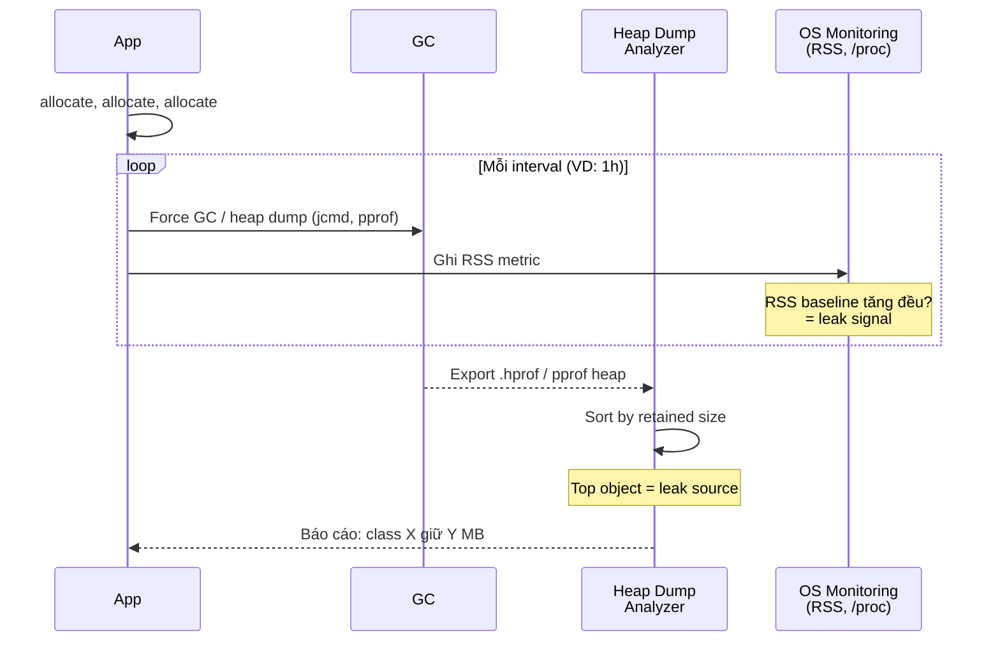

# What is a memory leak and how do you detect one?

> Định nghĩa memory leak theo nghĩa runtime (giữ tham chiếu không giải phóng được, hoặc cấp phát không thu hồi), cách phát hiện bằng profiler/heap dump/RSS trong JVM, Go, CPython, JavaScript và native C/C++. Bài [stack-vs-heap](stack-vs-heap.md) giải thích vùng nhớ liên quan; bài [garbage-collection](garbage-collection.md) giải thích vì sao managed runtime vẫn leak.

Chủ đề: Memory - Runtime · Ngày: 2026-10-16

## 0. Nền tảng trước khi đọc

**Bối cảnh:** Cách chương trình dùng và thu hồi bộ nhớ khi đang chạy. Hiểu phần này giúp giải thích chậm, treo, crash và out-of-memory.

**Nói đơn giản:** Memory leak là bộ nhớ vẫn bị giữ dù chương trình không còn cần. Chương trình có thể tăng RAM dần rồi bị hệ điều hành kill.

**Từ khóa cần biết:** object = dữ liệu đang sống; reference = đường trỏ tới object; runtime = phần thực thi chương trình.

**Ví dụ dễ hình dung:** Cache giữ mãi key của user cũ dù không request nào dùng; RSS tăng dần qua nhiều giờ.

Khi đọc, luôn hỏi ba câu: nó giải quyết vấn đề gì, nó làm việc theo những bước nào, và khi nào không nên dùng?

**Cách học bài này:** Đọc phần này trước để nắm từ khóa; đọc phần 1 để lấy câu trả lời 30 giây; đọc phần 2 để hiểu cơ chế; cuối cùng mở từng câu hỏi ở phần 3 để luyện nói. Các con số và lệnh trong bài là bằng chứng cho câu trả lời, không cần học thuộc nếu chưa hiểu cơ chế.

## 1. Là gì

### Đọc nhanh trước khi đi sâu

**Ý chính:** Memory leak là bộ nhớ vẫn bị giữ dù chương trình không còn cần. Chương trình có thể tăng RAM dần rồi bị hệ điều hành kill.

**Ví dụ interview:** Cache giữ mãi key của user cũ dù không request nào dùng; RSS tăng dần qua nhiều giờ.

**Luồng 4 bước:**

1. Code tạo object hoặc vùng nhớ.
2. Runtime giữ object còn được dùng và cung cấp reference cho code.
3. Object không còn reachable sẽ được free hoặc garbage collector thu hồi.
4. Nếu giữ nhầm, vùng nhớ phình lên và chương trình chậm hoặc hết RAM.

**Nói như trong interview:** Memory leak là bộ nhớ vẫn bị giữ dù chương trình không còn cần. Chương trình có thể tăng RAM dần rồi bị hệ điều hành kill. Hãy nói theo bốn bước trên trước; nếu interviewer hỏi sâu, chuyển sang cơ chế **Bước 1. Phân biệt hai loại memory leak**, rồi nêu trade-off và failure mode ở các phần sau.

## 2. Cơ chế cốt lõi

### Bước 1. Phân biệt hai loại memory leak

**Raw leak (C/C++, Rust):** `malloc`/`new` không có `free`/`delete` tương ứng, hoặc pointer bị ghi đè trước khi giải phóng. OS chỉ thu hồi khi process kết thúc. Công cụ: `valgrind --leak-check=full`, AddressSanitizer (`-fsanitize=address`), MSAN, LeakSanitizer.

**Logical leak (managed runtime):** GC không thể thu hồi vì object vẫn reachable từ root. Root gồm: global/static variable, stack frame (thread đang chạy), registry, finalizer queue, JNI global ref (JVM), goroutine local variable (Go). Có thể lớn lên vô hạn nếu leak tạo thêm object mới.

### Bước 2. Cơ chế GC xác định thu hồi thế nào

1. **Tracing GC (JVM G1/ZGC/Shenandoah, V8, Go's tri-color):** GC bắt đầu từ root, đánh dấu (mark) mọi object reachable. Unreachable = leak candidate.
2. **Reference counting (CPython, ARC Swift):** Mỗi object đếm số tham chiếu. 0 = thu hồi ngay. Không phát hiện cycle leak (A ref B, B ref A, không ai ref A/B cả).
3. **Arena allocator (jemalloc, tcmalloc):** Memory chia thành arena; khi arena không còn used mà không free được → leak nằm ở tầng application.

### Bước 3. Sáu pattern leak phổ biến nhất

| Pattern | Nguyên nhân | Runtime hay gặp |
|---|---|---|
| Unbounded cache / map | Cache không eviction policy, key cứ tích luỹ | JVM, Go, Node.js |
| Listener/subscriber không huỷ | Event listener đăng ký nhưng không huỷ khi object bị huỷ | JVM, V8 (JS), .NET |
| Static field giữ collection | Collection gán vào static, tăng mãi không giảm | JVM, .NET |
| Closure capture binding lớn | Closure giữ nguyên stack frame chứa object lớn (không dùng) | V8 (JS), Go |
| ThreadLocal không xoá | ThreadLocal trong thread pool không được remove | JVM, .NET |
| Finalizer reference cycle | Object có finalizer, tạo cycle, finalizer queue không xử lý kịp | JVM |

### Bước 4. Retained size vs shallow size

- **Shallow size**: kích thước object + reference pointer bản thân nó.
- **Retained size**: shallow size + kích thước tất cả object chỉ reachable qua object này. Leak nghiêm trọng khi retained size lớn.
- Heap dump analyzer (MAT, VisualVM, pprof, Chrome DevTools) sắp xếp object theo retained size → leak source ở đỉnh.

### Bước 5. Sequence diagram - phát hiện leak



*Cycle phát hiện leak: theo dõi RSS baseline tăng → chụp heap dump → phân tích retained size → xác định root cause.*

### Bước 6. Reachability graph và root set

GC xác định object sống hay chết qua reachability từ root. Root set khác nhau giữa các runtime:
- **JVM**: JNI global ref, JNI local ref (frame hiện tại), thread (call stack, ThreadLocal), class loaded, monitor locked, reflection root. Static field đến từ class loaded.
- **Go**: package-level var, goroutine stack (tất cả biến còn trong scope của goroutine đang chạy), finalizer queue, runtime type info. Goroutine leak kéo theo biến trong scope không bao giờ được reclaim.
- **V8 (Node.js)**: global object (window/global), call stack hiện tại, đóng cửa đang chạy, module exports. DOM node reachable từ JS root.
- **CPython**: module globals, call stack hiện tại, các frame đang chạy. Reference counting phát hiện tham chiếu = 0 ngay, nhưng cycle (A ref B, B ref A) chỉ được phát hiện bởi cycle GC chạy định kỳ.

### Bước 7. Leak vs fragmentation

Memory footprint tăng có thể do:
- **Leak thật**: object không bao giờ được thu hồi.
- **Fragmentation**: allocator không tìm được vùng liên tục đủ lớn dù tổng free đủ. Jemalloc/glibc fragmentation có thể chiếm 20-30% RSS.
- **Resident set tăng theo workload hợp lệ**: cache được sử dụng, không bounded.

Heap dump + retained size phân biệt leak với fragmentation. Leak = nhiều object unreachable; fragmentation = vùng free rải rác trong cùng một page.

### Quan sát

```bash
# JVM: chụp heap dump rồi phân tích
jcmd <pid> GC.heap_dump filename=heap.hprof
# Hoặc jmap (đã deprecated trong Java 17+)
jmap -dump:format=b,file=heap.hprof <pid>

# Go: pprof heap
curl http://localhost:PORT/debug/pprof/heap > heap.prof
go tool pprof -http=:8080 heap.prof
# Trong pprof: top --cum | head -20

# Node.js: v8.getHeapSnapshot()
node --inspect server.js
# Chrome DevTools -> Memory -> Heap Snapshot

# Native C: valgrind
valgrind --leak-check=full --show-leak-kinds=all ./program
# Output minh họa, chưa chạy:
# ==12345== LEAK SUMMARY:
# ==12345==    definitely lost: 1,024 bytes in 8 blocks
# ==12345==    indirectly lost: 256 bytes in 2 blocks
```

### Ví dụ chạy từng bước

**Kịch bản:** API Gateway xử lý 3.000 request mỗi giây, dùng `static ConcurrentHashMap<String, byte[]>` làm response cache. Mỗi request tạo một UUID key mới và lưu response (~2 KB). Không có eviction policy, không TTL. Heap `-Xmx256m`.

**Quá trình leak:**

| Bước | Thời gian | Hành động | Vì sao |
|---|---|---|---|
| 1 | t = 0 s | `static Map<String, byte[]> cache = new ConcurrentHashMap<>()` | Root = static field, always reachable from class loader |
| 2 | t = 1 s | Request #1: `cache.put("uuid-1", bytes1)` | Entry thêm vào map. GC không thu hồi vì root giữ |
| 3 | t = 5 s | 15.000 request: 15.000 entry × 2 KB ≈ 30 MB | Map tăng tuyến tính. Heap sau full GC = 30 MB baseline |
| 4 | t = 30 s | 90.000 entry ≈ 180 MB. Old gen đầy 70% | Baseline tăng đều — leak pattern rõ qua `jstat -gcutil` |
| 5 | t = 4 min | 720.000 entry ≈ 1.4 GB vượt `-Xmx256m` | OOM: `OutOfMemoryError: Java heap space` |

**Trạng thái heap tại bước 3** sau full GC (mỗi full GC đều in ra):
```text
S0 S1 E  O   M CCS YGC YGCT FGC FGCT CGC CGCT
0  0  99 70  92  -   20 0.05  0  0.00  8  0.12
# O = 70% old gen chứa cached entry từ static map
# YGC = 20 lần nhưng minor GC không thu hồi entry từ static
```

Cột `YGC` tăng đều, cột `O` (old gen occupancy) tăng đều — đây là dấu hiệu leak rõ nhất qua `jstat`. Nếu workload tăng rồi giảm mà `O` vẫn tăng → logical leak. Nếu `O` dao động theo traffic thì là footprint hợp lệ.

**Biến thể A — thêm bounded cache:** Thay bằng `Caffeine.newBuilder().maximumSize(10_000).expireAfterWrite(Duration.ofMinutes(5)).build()`. Sau 5 phút, entry cũ tự đẩy ra. Heap baseline plateau ở khoảng 20 MB. Bounded cache không phải leak: root vẫn giữ, nhưng kích thước có giới hạn và entry hết hạn thì reference bị xoá nên trở thành unreachable rồi GC thu hồi. Điểm khác biệt cốt lõi với static map không phải pattern bounded, mà là reachability thay đổi theo thời gian.

**Biến thể B — chỉ tăng heap:** Tăng `-Xmx` lên 2 GB chỉ trì hoãn OOM. Entry vẫn leak không thu hồi. Vài giờ sau cũng OOM với heap lớn hơn. Tăng `-Xmx` không phải cách debug leak, chỉ làm chậm triệu chứng.

**Biến thể C — ThreadLocal không remove:** Nếu mỗi request dùng `ThreadLocal<Session>` trong thread pool Tomcat, session tích luỹ trong thread map — cùng pattern logic, khác root (ThreadLocal thay vì static field). Thread pool giữ thread sống lâu, ThreadLocalMap giữ value, value giữ session — session không bao giờ được reclaim cho đến khi thread chết hoặc key bị GC khiến stale entry.

Điều rút ra: Trong managed runtime, GC chỉ thu hồi object khi không còn reachable từ root. Static field, listener registry, ThreadLocal đều là root. Pattern unbounded cache đi kèm một trong các root này chính là leak. Đây là lý do Câu 1 và Câu 7 trong phần 3A dùng retained size và bounded cache làm công cụ chẩn đoán và sửa lỗi chính.

Điều rút ra: Trong managed runtime, GC chỉ thu hồi object khi không còn reachable từ root. Static field, listener registry, ThreadLocal đều là root. Pattern unbounded cache đi kèm một trong các root này chính là leak. Đây là lý do Câu 1 và Câu 7 trong phần 3A dùng retained size và bounded cache làm diagnostic và fix.

## 3. Câu hỏi phỏng vấn

### 3A. Câu hỏi đào sâu

<details class="qa">
<summary>Câu 1. Memory leak là gì, phân biệt với "memory bị giữ do cache"?</summary>

**Trả lời ngắn:** Memory leak là bộ nhớ được cấp phát nhưng không bao giờ được trả lại cho hệ thống (C/C++) hoặc không bao giờ trở nên unreachable (managed runtime), khiến tổng memory tiêu thụ tăng đơn điều theo thời gian với workload không đổi. Cache bị bounded (LRU, TTL) là footprint hợp lệ; cache không có eviction policy và tăng mãi là leak.

**Đào sâu:**
- Raw leak: `malloc` không `free`, `new` không `delete`, pointer bị ghi đè → OS chỉ thu hồi khi process chết.
- Logical leak: object vẫn reachable từ root (static, stack, listener registry) → GC không thu hồi.
- Bounded cache (Caffeine size-based, Guava Cache, BigCache với TTL) là footprint, không leak. Bất kỳ cấu trúc nào tăng đơn điều theo traffic mà không bao giờ giảm là leak.
- Đo bằng RSS/heap sau GC theo thời gian: nếu baseline tăng tuyến tính với số request thì leak; nếu plateau thì không.

**Bẫy:** "Unbounded cache là bình thường vì GC sẽ thu hồi khi hết tài nguyên." Sai — GC chỉ thu hồi khi unreachable. Cache đang dùng vẫn reachable.

**Follow-up:** LRU cache có bao giờ leak không? Không nếu maxSize đặt đúng. Nhưng nếu key là request-scoped (UUID mỗi request), 1000 request tạo 1000 entry, LRU evict entry cũ — bounded.
</details>

<details class="qa">
<summary>Câu 2. Làm sao phân biệt memory leak với memory pressure tạm thời (spike)?</summary>

**Trả lời ngắn:** Leak = baseline (heap sau full GC, hoặc RSS) tăng đơn điều theo thời gian và không bao giờ giảm. Spike = heap tăng theo workload nhưng trở về baseline sau khi workload giảm và full GC chạy.

**Đào sâu:**
- Lấy heap dump hoặc RSS metric sau mỗi full GC. Vẽ biểu đồ theo thời gian: leak là đường dốc đi lên tuyến tính; spike là răng cưa.
- JVM: dùng `jcmd <pid> GC.run` để ép full GC trước khi đo. G1 mặc định là mixed GC, không phải full GC — cần explicit full GC để có baseline.
- Go: `runtime.GC()` + đọc `runtime.MemStats.HeapAlloc` sau khi GC. Hoặc `GODEBUG=gctrace=1` xem số byte sau mỗi chu kỳ.
- Node.js: `global.gc()` (khi chạy với `--expose-gc`) + `process.memoryUsage().heapUsed`.
- Native C: RSS thay đổi theo allocator. Dùng `mallinfo()` (glibc) hoặc `jemalloc.stats.print` để phân biệt fragmentation vs leak.

**Bẫy:** "Heap dump sau khi GC cho thấy leak." Sai — heap dump phải lấy khi app đang idle và sau full GC; dump lúc load cao cho thấy working set, không phải leak.

**Follow-up:** Heap dump có chính xác 100% không? Không — nó là snapshot tại một thời điểm. Leak nhỏ theo thời gian có thể thấy rõ trong 3 dump cách nhau 30 phút.
</details>

<details class="qa">
<summary>Câu 3. Listener không huỷ (event listener leak) gây leak thế nào? Cho ví dụ cụ thể.</summary>

**Trả lời ngắn:** Mỗi lần đăng ký listener mà không huỷ, đối tượng listener (và toàn bộ closure/state của nó) vẫn giữ trong registry của event source. Listener giữ tham chiếu đến object mà nó được tạo ra (thường là request-scoped hoặc UI component), giữ cả graph reachable.

**Đào sâu:**
- JVM Swing/AWT: `button.addActionListener(...)` mà component tạo đi tạo lại nhiều lần → listener cũ vẫn trong button. Pattern: WeakListener hoặc remove khi dispose component.
- Spring: bean singleton đăng ký ApplicationListener không remove khi context destroy → singleton cũng không bị GC.
- JavaScript DOM: `document.addEventListener('click', handler)` mà element bị remove khỏi DOM nhưng không `removeEventListener` → handler giữ closure → DOM tree cũ không GC.
- .NET WPF: INotifyPropertyChanged subscribe không huỷ → memory tăng theo số view show.
- Fix: tự quản lý subscribe/unsubscribe theo lifecycle, hoặc dùng WeakReference (JVM `WeakReference`, JS WeakRef chuẩn ES2021).

**Bẫy:** "JavaScript DOM tự garbage collect khi element bị remove." Sai — listener chỉ ngừng gọi, không tự động remove listener khỏi document/event target.

**Follow-up:** WeakListener có nhược điểm gì? Listener có thể bị GC trước khi event phát sinh nếu không có tham chiếu mạnh khác → mất event. Cần đảm bảo có root mạnh nắm listener trong lúc cần xử lý.
</details>

<details class="qa">
<summary>Câu 4. Retained size là gì, vì sao quan trọng khi debug leak?</summary>

**Trả lời ngắn:** Retained size của object A là tổng memory của A + mọi object chỉ reachable qua A (không có root nào khác giữ chúng). Heap dump analyzer (MAT, VisualVM, pprof) sắp xếp object theo retained size giảm dần → top retained là leak source.

**Đào sâu:**
- Shallow size: chỉ header + field của object đó. Ví dụ một `HashMap` shallow ~80 bytes nhưng có thể chứa 1 GB entry.
- Retained size: nếu xoá A, bao nhiêu memory được giải phóng. Đây là "leak footprint" của A.
- Trong MAT: click phải object → "List objects → retained set" → xem chain giữ. Trong pprof: `list <funcname>` hoặc `peek <funcname>` xem allocation.
- Quan trọng vì leak không chỉ là "object nào" mà là "object nào giữ graph nào". Một static `Map<String, byte[]>` có thể có shallow 80 bytes nhưng retained hàng GB.

**Bẫy:** "Object có shallow size lớn là leak lớn." Sai — object có thể shallow lớn nhưng retained nhỏ (nếu các object nó tham chiếu còn được giữ bởi root khác).

**Follow-up:** Dominator tree trong heap analyzer giúp gì? Cho biết đỉnh (top) giữ nhiều nhất, dễ thấy root cause hơn retained size thuần.
</details>

<details class="qa">
<summary>Câu 5. JVM `ThreadLocal` không remove gây leak thế nào khi dùng thread pool?</summary>

**Trả lời ngắn:** ThreadLocal lưu value vào map của riêng thread đó. Thread pool giữ thread sống rất lâu (Tomcat, Netty executor). ThreadLocal không được remove → value (và mọi object nó tham chiếu) bị giữ mãi trong thread đó, không bao giờ GC dù request kết thúc.

**Đào sâu:**
- Tomcat request thread pool: mỗi request chạy trên thread từ pool. Nếu set `ThreadLocal<BigSession>`, value cộng dồn vào thread map. Thread không chết → value không GC.
- Web app phổ biến: `ThreadLocal<UserContext>` cho security context. Quên `tl.remove()` trong `finally` → context leak theo thread.
- JVM giữ ThreadLocal entry trong `ThreadLocal.ThreadLocalMap.Entry`; nếu key (ThreadLocal instance) bị GC, entry trở thành stale reference (weak key + strong value) → value bị leak đến khi thread chết hoặc key được overwrite.
- Spring: dùng `RequestContextHolder` tự xoá khi request kết thúc. Servlet filter tự xoá. Vẫn nên `tl.remove()` thủ công.

**Bẫy:** "ThreadLocal trong thread pool tự GC khi request xong." Sai — thread sống, ThreadLocalMap sống, value sống.

**Follow-up:** Có cách nào an toàn hơn ThreadLocal không? Dùng scoped bean (Spring `@RequestScope`), hoặc truyền context qua method param (`request.getAttribute` thay vì ThreadLocal).
</details>

<details class="qa">
<summary>Câu 6 (Debug). Service Java báo OOM sau 6 giờ chạy ổn định. Heap tăng đều theo log. Bạn debug thế nào?</summary>

**Trả lời ngắn:** Bước 1: xác nhận leak (đo heap sau full GC theo thời gian). Bước 2: chụp heap dump. Bước 3: phân tích retained size. Bước 4: truy ngược root → leak source. Bước 5: fix và verify.

**Đào sâu:**
- Bước 1: bật JMX exporter (Micrometer + Prometheus), vẽ `jvm_memory_used_bytes` (area=heap). Hoặc dùng `jcmd <pid> GC.run` định kỳ, log `HeapMemoryUsage.used` sau GC.
- Bước 2: `jcmd <pid> GC.heap_dump filename=heap-$(date +%s).hprof`. Cẩn thận: dump gây "stop-the-world" ngắn (~1-5 giây với heap 4 GB).
- Bước 3: mở bằng Eclipse MAT hoặc VisualVM. Chạy "Leak Suspects" report. Sắp xếp theo retained size.
- Bước 4: leak thường là một trong: static Map/Set, ThreadLocal không quen, listener không huỷ, cached singleton, ClassLoader tự định nghĩa. Trong MAT, click vào top retained → "Path to GC Roots" → xem chain từ root.
- Bước 5: fix theo root cause. Ví dụ: thay static Map bằng Caffeine cache với maxSize. Verify bằng load test + đo lại baseline.
- Công cụ kèm theo: `jfr` (JDK Flight Recorder) cho low-overhead profiling; async-profiler cho sampling allocation.

**Bẫy:** Tăng `-Xmx` để có thêm thời gian. Chỉ trì hoãn OOM, không giải quyết leak.

**Follow-up:** Heap dump bao nhiêu là "đủ"? 2-3 dump cách nhau 15-30 phút, mỗi dump ~vài GB với heap lớn. So sánh xem object nào tăng.
</details>

<details class="qa">
<summary>Câu 7 (Thiết kế). Thiết kế hệ thống cache cho product detail service: yêu cầu bounded memory, có thể tăng entry khi traffic tăng. Tránh leak.</summary>

**Trả lời ngắn:** Dùng LRU/TLD bounded cache (Caffeine, Guava), giới hạn size bằng entry count hoặc weight (bytes); thiết lập eviction chính xác; monitor metric `cache_size` + `evictions`; cảnh báo khi size chạm 90% maxSize.

**Đào sâu:**
- Caffeine `CacheBuilder.maximumSize(100_000).expireAfterWrite(Duration.ofMinutes(10))`. Với object lớn dùng `maximumWeight` + `weigher()` để đo bytes thay vì count.
- Không dùng `ConcurrentHashMap` thuần làm cache — không eviction, tăng mãi.
- Không dùng static field trỏ đến map lớn — giữ tham chiếu mãi, dù entry đã expire.
- Monitor: cache hit ratio, eviction count, weighted size. Alert khi weighted size > 80% maxWeight → sắp tới giới hạn.
- Cold start: warm-up cache từ DB hoặc preloader khi restart.
- Failure mode: nếu cache backend (Redis) down, fallback về DB có thể tạo cache miss storm → request latency tăng.

**Bẫy:** Caffeine `maximumSize` đếm entry, không đếm bytes. 100k entry × 10 KB = 1 GB RAM — không bounded theo memory.

**Follow-up:** Distributed cache (Redis) có tránh được leak không? Có — process restart reset memory. Nhưng có thể leak key trên Redis (nếu TTL quá dài hoặc không set TTL).
</details>

### 3B. Câu hỏi phỏng vấn liên quan

<details class="qa">
<summary>Câu 8. Native C/C++ có thể có "leak" nhưng không bao giờ OOM vì OS swap. Đúng hay sai?</summary>

**Trả lời:** Sai. Swap không phải memory thật; swap đẩy page ra disk, khi đọc lại gây page fault chậm. RSS cao + swap nặng = thrashing, latency tăng hàng trăm ms, không phải "không sao". Process có thể bị OOM-killed bất cứ lúc nào bởi Linux OOM killer khi RAM hết (cgroup hoặc system-wide).
</details>

<details class="qa">
<summary>Câu 9. Tại sao Go có GC nhưng vẫn có memory leak?</summary>

**Trả lời:** Go dùng tracing GC (tri-color concurrent). GC chỉ thu hồi object không còn reachable. Leak xảy ra khi goroutine hoặc package-level variable giữ reference đến map/slice lớn không bao giờ được xoá. Ví dụ kinh điển: `var cache = map[string][]byte{}` không eviction, key cứ tích luỹ. Hoặc `time.Ticker` không `Stop()` → giữ channel forever.
</details>

<details class="qa">
<summary>Câu 10. Finalizer trong JVM có thể gây leak thế nào?</summary>

**Trả lời:** Object có `finalize()` phải được GC xử lý hai lần: lần đầu đánh dấu cần finalize, lần hai chạy finalize rồi mới reclaim. Object còn reachable qua finalizer queue (chính GC giữ) trong lúc chờ finalize → memory giải phóng chậm. Nếu finalize tạo tham chiếu ngược (resurrect), object sống lại. Cộng với finalize queue chạy trên thread riêng có thể bị backlog, memory đỉnh cao hơn mong đợi. Best practice: dùng `AutoCloseable` + try-with-resources, không dùng `finalize`.
</details>

<details class="qa">
<summary>Câu 11. Memory leak trong closure JavaScript / goroutine Go khác JVM thế nào?</summary>

**Trả lời:** Đều là logical leak, nhưng cơ chế giữ khác nhau. JVM: static field, listener registry, ThreadLocal. V8 (JavaScript): closure capture giữ outer scope; DOM event listener giữ DOM subtree. Go: goroutine stack frame giữ local variable; package-level var giữ slice/map; channel không close. Tất cả đều cần root cause analysis dựa trên reachability graph từ root.
</details>

<details class="qa">
<summary>Câu 12. True or false: "GC giải quyết triệt để memory leak."</summary>

**Trả lời:** Sai. GC giải quyết raw leak cho managed runtime (developer không cần `free`), nhưng không giải quyết logical leak — object vẫn reachable thì GC không thu hồi. Leak trong Java/Go/JS vẫn cần debug retained size, listener lifecycle, static state.
</details>

<details class="qa">
<summary>Câu 13. Đo RSS từ `/proc/<pid>/status` có đủ để phát hiện leak trong JVM không?</summary>

**Trả lời:** Không đủ vì RSS bao gồm cả JVM metaspace, code cache, thread stack, off-heap (direct buffer), native malloc. JVM heap chiếm một phần RSS. Cần theo dõi riêng `jvm_memory_used_bytes{area="heap"}` và `jvm_memory_used_bytes{area="nonheap"}` qua JMX. Native memory tracking (`-XX:NativeMemoryTracking=summary`) chi tiết hơn cho off-heap.
</details>

<details class="qa">
<summary>Câu 14. Tại sao heap dump file thường lớn hơn heap thật?</summary>

**Trả lời:** Heap dump lưu toàn bộ object graph dạng serialized, bao gồm header, field, class metadata, root set. Heap 4 GB có thể dump ra file 6-8 GB. Vì dump gây stop-the-world ngắn, dump trong giờ thấp điểm. Sau dump, nén bằng `jhat` hoặc MAT để giữ cấu trúc nhưng giảm I/O khi load.
</details>

<details class="qa">
<summary>Câu 15. Async-profiler khác JVM Flight Recorder (JFR) thế nào khi profile memory?</summary>

**Trả lời:** Async-profiler (open-source, attach vào JVM qua `/proc/<pid>/root`): sampling allocation, overhead thấp (~1-2%), dễ tích hợp CI. JFR (built-in JDK 11+): event-based, có sẵn trong JDK (`-XX:+UnlockDiagnosticVMOptions -XX:+DebugNonSafepoints`), overhead thấp hơn cho production long-running. Cả hai đều cho flame graph allocation theo call site. Heap dump (so sán) khác: dump toàn bộ graph, dùng để xem retained size, không phải allocation rate.
</details>

## 4. Đánh đổi và sự cố production

### So sánh công cụ phát hiện leak

| Công cụ | Runtime | Overhead | Khi nào dùng | Nhược |
|---|---|---|---|---|
| RSS monitoring | Mọi | Rất thấp | Production long-running | Không phân biệt on-heap/off-heap |
| jcmd GC.heap_dump | JVM | Stop-the-world ~vài giây | Debug chuyên sâu | Dump lớn, cần pause |
| pprof heap | Go | Thấp | Production sampling | Cần expose endpoint |
| Chrome DevTools | Node.js / V8 | Dump ~vài giây | Debug local | Không cho production |
| valgrind | Native C/C++ | Chậm 10-50x | Local/CI test | Không dùng production |
| AddressSanitizer | Native C/C++ | ~2x slowdown | Local/CI | Có thể miss leak |
| async-profiler / JFR | JVM | ~1-2% | Production sampling | Cần attach GPRS/RQ |

### Năm failure mode

| Triệu chứng | Nguyên nhân gốc | Cách kiểm tra | Cách sửa |
|---|---|---|---|
| Heap tăng đều, OOM sau vài giờ | Static Map/Set không eviction | Heap dump + retained size | Dùng Caffeine cache bounded |
| Heap tăng theo /workscheduler | ThreadLocal không remove | Heap dump, xem ThreadLocalMap | `tl.remove()` trong finally |
| UI/SSR memory tăng theo navigation | DOM/event listener không huỷ | Chrome DevTools heap snapshot | removeEventListener khi unmount |
| Native OOM trong C/C++ | malloc không free | valgrind / ASAN | Pair malloc/free, dùng smart pointer |
| Heap dump > 8 GB | Heap quá lớn do leak + fragmentation | Dump ngoài giờ cao điểm, nén | Giảm footprint, fix leak |
| Goroutine leak | channel không close / select không return | `runtime.NumGoroutine()` theo thời gian | Close channel, dùng context cancel |

## 5. Cheat sheet

| Chủ đề | Con số / quy tắc cần nhớ |
|---|---|
| Phân biệt leak | Baseline tăng đều theo thời gian, không plateau |
| Logical leak root | Static, stack, listener registry, ThreadLocal, JNI global, goroutine local |
| Raw leak | C/C++ malloc không free, dùng ASAN để phát hiện |
| Heap dump công cụ JVM | `jcmd <pid> GC.heap_dump filename=heap.hprof` |
| Heap dump analyzer | Eclipse MAT, JProfiler, VisualVM |
| Go pprof | `curl /debug/pprof/heap` rồi `go tool pprof` |
| Node heap snapshot | Chrome DevTools Memory tab, 3 snapshot pattern |
| Native leak | valgrind `--leak-check=full` hoặc `-fsanitize=address` |
| Tránh cache unbounded | Caffeine `maximumSize`/`maximumWeight` + expireAfterWrite |
| Tránh ThreadLocal leak | `try { ... } finally { tl.remove(); }` |

**Học tiếp:**
- [stack-vs-heap](stack-vs-heap.md) — vùng nhớ mà leak phát sinh
- [garbage-collection](garbage-collection.md) — vì sao managed runtime vẫn leak
- [mark-sweep-vs-generational-gc](mark-sweep-vs-generational-gc.md) — chiến lược GC ảnh hưởng leak detection
