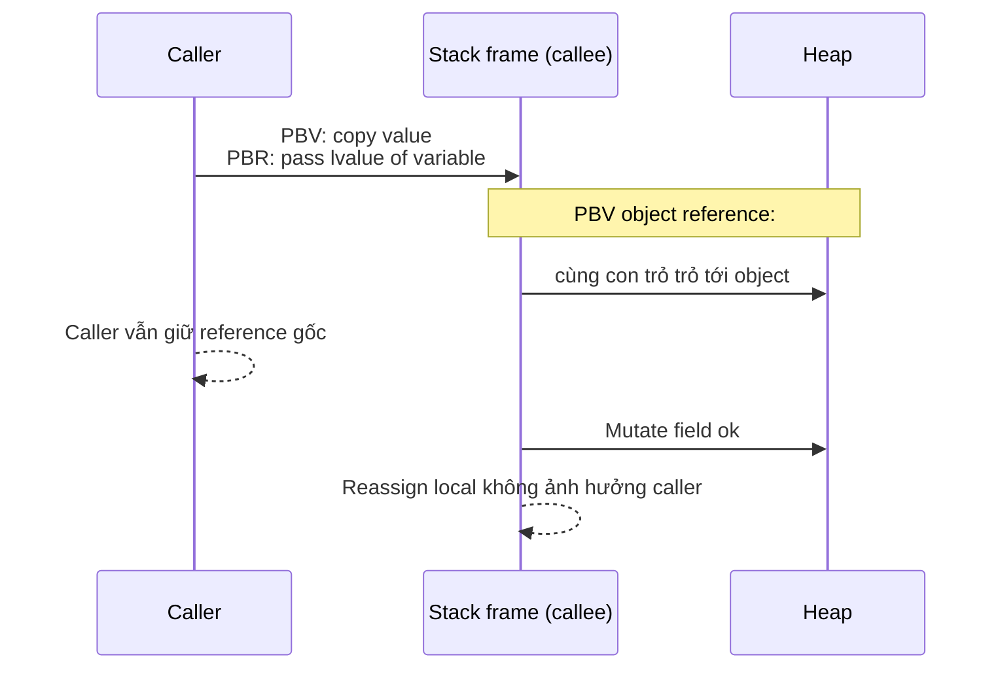

# What is the difference between pass-by-value and pass-by-reference?

> Bài này phân biệt pass-by-value (copy giá trị) và pass-by-reference (truyền tham chiếu tới biến gốc), kèm sự thật thường gây nhầm: Java luôn pass-by-value; giá trị của biến tham chiếu được copy. C# mặc định pass-by-value, có thêm `ref`/`in`/`out`. C++ có cả hai. Python là assignment to new name, không thuộc về hai cơ chế này. Bài liên kết tới [stack-vs-heap](stack-vs-heap.md) và [reference-counting-gc](reference-counting-gc.md).

Chủ đề: Memory - Runtime · Ngày: 2026-10-16

## 0. Nền tảng trước khi đọc

**Bối cảnh:** Cách chương trình dùng và thu hồi bộ nhớ khi đang chạy. Hiểu phần này giúp giải thích chậm, treo, crash và out-of-memory.

**Nói đơn giản:** Pass-by-value truyền một bản sao của giá trị; với Java và Python, biến có thể chứa reference nhưng reference đó vẫn được truyền by value.

**Từ khóa cần biết:** object = dữ liệu đang sống; reference = đường trỏ tới object; runtime = phần thực thi chương trình.

**Ví dụ dễ hình dung:** Hàm nhận một List và thêm phần tử có thể làm list gốc đổi, nhưng gán biến parameter sang list mới không đổi biến caller.

Khi đọc, luôn hỏi ba câu: nó giải quyết vấn đề gì, nó làm việc theo những bước nào, và khi nào không nên dùng?

**Cách học bài này:** Đọc phần này trước để nắm từ khóa; đọc phần 1 để lấy câu trả lời 30 giây; đọc phần 2 để hiểu cơ chế; cuối cùng mở từng câu hỏi ở phần 3 để luyện nói. Các con số và lệnh trong bài là bằng chứng cho câu trả lời, không cần học thuộc nếu chưa hiểu cơ chế.

## 1. Là gì

### Đọc nhanh trước khi đi sâu

**Ý chính:** Pass-by-value truyền một bản sao của giá trị; với Java và Python, biến có thể chứa reference nhưng reference đó vẫn được truyền by value.

**Ví dụ interview:** Hàm nhận một List và thêm phần tử có thể làm list gốc đổi, nhưng gán biến parameter sang list mới không đổi biến caller.

**Luồng 4 bước:**

1. Code tạo object hoặc vùng nhớ.
2. Runtime giữ object còn được dùng và cung cấp reference cho code.
3. Object không còn reachable sẽ được free hoặc garbage collector thu hồi.
4. Nếu giữ nhầm, vùng nhớ phình lên và chương trình chậm hoặc hết RAM.

**Nói như trong interview:** Pass-by-value truyền một bản sao của giá trị; với Java và Python, biến có thể chứa reference nhưng reference đó vẫn được truyền by value. Hãy nói theo bốn bước trên trước; nếu interviewer hỏi sâu, chuyển sang cơ chế **Bước 1. C++ pass-by-value và pass-by-reference**, rồi nêu trade-off và failure mode ở các phần sau.

## 2. Cơ chế cốt lõi

### Bước 1. C++ pass-by-value và pass-by-reference

```cpp
void f(int x) { x = 99; }       // PBV — sửa x không tác động biến ngoài
void g(int& x) { x = 99; }      // PBR — sửa x là sửa biến ngoài

int a = 1;
f(a);  // a vẫn = 1
g(a);  // a = 99
```

Trong C++, "biến" là một vùng nhớ có tên (lvalue) hoặc giá trị rvalue. PBV copy giá trị vào stack frame. PBR đẩy địa chỉ vùng nhớ của biến gốc — nên sửa `x` trong callee là sửa `a`. C++ thêm `const` để cấm sửa.

### Bước 2. Java luôn pass-by-value

```java
class Box { int v; Box(int v){this.v=v;} }

void mutate(Box b) { b.v = 99; }      // sửa field của object — caller thấy 99
void replace(Box b) { b = new Box(7); } // reassign parameter — caller KHÔNG thấy 7

Box x = new Box(1);
mutate(x);   // x.v = 99
replace(x);  // x.v vẫn = 99
```

Java quy ước: biến reference type chứa địa chỉ heap, copy của địa chỉ được đẩy vào stack frame. Nhờ đó `b.v` truy cập được cùng object; reassign `b` chỉ thay con trỏ cục bộ, không ảnh hưởng `x` ở ngoài.

### Bước 3. C# mặc định PBV

```csharp
class Box { public int V; public Box(int v){V=v;} }

static void Mutate(Box b) { b.V = 99; }   // caller thấy 99
static void Replace(Box b) { b = new Box(7); } // caller KHÔNG thấy 7

static void ReplaceRef(ref Box b) { b = new Box(7); } // caller thấy 7

Box x = new Box(1);
Mutate(x);   // x.V = 99
Replace(x);  // x.V = 99
ReplaceRef(ref x); // x trỏ sang Box(7)
```

C# thêm `ref`, `in` (read-only ref), `out` (out-only ref) cho phép PBR. CLR runtime dùng con trỏ managed cho reference type; các từ khóa chỉ định nghĩa cách đẩy tham số.

### Bướt 4. Go pass-by-value

```go
type Box struct{ V int }

func Mutate(b Box)   { b.V = 99 }  // caller's Box không đổi vì copy struct
func Replace(b *Box) { b.V = 99 }  // mutate được, không reassign được

x := Box{1}
Mutate(x)        // x.V = 1
Mutate2(&x)      // x.V = 99
*y := Box{7}     // *y cho phép reassign qua pointer
```

Go mặc định PBV. Pointer là "PBV of address" — giống Java. Sự khác biệt chính: Go cung cấp struct nhỏ, có thể sống trên stack (escape analysis); truyền struct nhỏ thì PBV rẻ. Reassign thông qua `*b` cần dereference; vẫn không thể reassign `b` cho caller.

### Bước 5. Python assignment-to-name

```python
def mutate(x): x.append(1)  # mutate được list
def replace(x): x = []     # rebinding local — caller không thấy

a = []
mutate(a)   # a = [1]
replace(a)  # a = [1]
```

Python gọi là "pass-by-assignment" hoặc "pass-by-object-reference": giá trị truyền là tham chiếu tới object, mutate được nhưng rebinding không ảnh hưởng caller. Đây là lý do Mutable/Immutable (list vs str/int/tuple) trở thành chủ đề quan trọng trong Python.

### Bước 6. JavaScript luôn PBV

```javascript
function mutate(o) { o.x = 99 }       // mutate được
function replace(o) { o = {x:7} }     // rebinding local — caller không đổi
```

Tương tự Java. Các primitive (number, string, boolean) PBV. Object là PBV-of-reference. Không có cú pháp PBR trong JavaScript.

### Bước 7. State diagram cách binding diễn ra



*Binding giữa tham số và biến: PBV copy giá trị vào stack, PBR truyền lvalue. Với reference type, giá trị là địa chỉ — mutate được object nhưng không reassign được biến ngoài.*

### Bước 8. Layout stack frame và chi phí

1. **PBV primitive** (C `int`, Java `int`, Go `int`): 4-8 byte được copy từ caller register/stack vào callee slot. Compiler có thể inlining hoặc dùng register, chi phí gần bằng 0.
2. **PBV struct lớn** (C++ `std::array<char, 1024>`): copy toàn bộ vào callee slot. Với struct > vài chục byte, compiler có thể chọn pointer-passing với restrict qualifier hoặc "đẩy" qua hidden first pointer (C-style "by value nhưng caller chuẩn bị").
3. **PBV of pointer** (Java reference, Go pointer, C++ raw pointer, JS object): chỉ copy pointer (8 byte trên 64-bit). Callee đọc/ghi qua dereference.
4. **PBR** (C++ `T&`, C# `ref`): callee giữ lvalue địa chỉ biến caller; mọi gán là alias. JIT/C++ thường inlining gọi hơn vì nhờ khả năng chứng minh aliasing.
5. **Chi phí benchmark thường gặp**: copy struct 64 byte qua PBV ~5-15 ns; dereference + mutate ~2-10 ns (tuỳ cache). Trên hot path, chuyển sang pointer/reference giúp giảm allocation/stack pressure.

### Quan sát

```bash
# Xem stack frame trong JVM
-XX:+TraceClassLoading -Xlog:gc+metaspace=debug

# Lệnh printf debug ID object
java -verbose:gc ...
```

```java
// Java: in ra để thử
public static void main(String[] args) {
    StringBuilder s = new StringBuilder("a");
    mutate(s);
    System.out.println(s); // "ab" - mutate field được
    replace(s);
    System.out.println(s); // "ab" - replace local không ảnh hưởng
}
static void mutate(StringBuilder b) { b.append("b"); }
static void replace(StringBuilder b) { b = new StringBuilder("c"); }
```

### Ví dụ chạy từng bước

Một API gateway C# xử lý 3 request liên tiếp. Mỗi request tạo một `Box { V }` trên heap, truyền vào 2 helper: `Mutate(Box b)` (mặc định) và `ReplaceRef(ref Box b)` (dùng `ref`). Trace stack/heap qua từng bước.

**Bước 1.** Request 1: `Box x = new Box(1)`. CLR cấp 16 byte heap, ghi `V=1`. Biến `x` ở stack frame của caller lưu địa chỉ heap, 8 byte (x64). Đây là "PBV of reference".
Trạng thái: stack `x → heap:Box{V=1}`.

**Bước 2.** Gọi `Mutate(x)`. Compiler đẩy giá trị của `x` (địa chỉ heap) vào slot `b` ở stack frame `Mutate`. Trong `Mutate`, `b.V = 99` dereference tới cùng object, sửa field trên heap.
Trạng thái: cả `x` và `b` trỏ tới `Box{V=99}` (cùng object).

| Frame | Biến | Trỏ tới |
|---|---|---|
| Caller | x | Box{V=99} |
| Mutate | b | Box{V=99} |

**Bước 3.** Gọi `Replace(x)` (không `ref`). Compiler copy địa chỉ vào slot `b` của callee. Trong `Replace`, `b = new Box(7)`: cấp object mới ở heap, slot `b` trỏ sang object mới — chỉ slot local, biến `x` ngoài caller không đổi.
Trạng thái: `x → Box{V=99}`; object `Box{V=7}` rơi vào Gen 0, sẽ bị GC.

**Bước 4.** Gọi `ReplaceRef(ref x)`. Compiler đẩy lvalue (địa chỉ slot `x`) vào slot `b` của callee. `b` giờ là alias của slot `x`. Trong `ReplaceRef`, `b = new Box(7)`: gán vào slot mà `b` alias, tức slot `x` ở caller được cập nhật.
Trạng thái: `x → Box{V=7}`.

**Bước 5.** Request 2 và 3 lặp lại pattern: mỗi lần tạo object mới (`Box{V=2}`, `Box{V=3}`), heap đầy dần. GC chạy khi Gen 0 đầy (threshold mặc định vài trăm KB trên .NET 8), sweep các object không còn ai trỏ tới (như `Box{V=99}` ở bước 3). Compiler không cho phép gọi `ReplaceRef(ref x)` nếu `x` không phải field/biến writable.

| Request | x trước | Sau Mutate | Sau Replace | Sau ReplaceRef |
|---|---|---|---|---|
| 1 | V=1 | V=99 | V=99 | V=7 |
| 2 | V=2 | V=99 | V=99 | V=7 |
| 3 | V=3 | V=99 | V=99 | V=7 |

Biến thể lỗi: nếu dev quên `ref` ở phía callee (viết `void ReplaceRef(Box b)`) trong khi caller gọi `ReplaceRef(ref x)`, compiler C# báo lỗi ngay — đó là lý do cú pháp PBR trong C# an toàn hơn Java. Ngược lại trong Java, swap 2 biến chỉ swap local, caller không thấy đổi.

Điều rút ra: "giá trị truyền vào" quyết định mọi thứ — PBV luôn copy giá trị, PBR copy lvalue; cùng cú pháp `b.field = 99` cho kết quả khác tuỳ cơ chế binding, liên quan tới Câu 3A.1 và Câu 3A.2 (phân biệt Java vs C#).

## 3. Câu hỏi phỏng vấn

### 3A. Câu hỏi đào sâu

<details class="qa">
<summary>Câu 1. Java pass-by-value hay pass-by-reference? Tại sao nhiều người hiểu sai?</summary>

**Trả lời ngắn:** Java luôn pass-by-value. Với reference type, giá trị copy là địa chỉ heap (còn gọi "reference"). Hàm có thể mutate object (vì cùng con trỏ) nhưng không thể reassign biến gốc. Nhiều người nhầm vì gọi "reference type" → "pass-by-reference"; đây là nhầm lẫn giữa "thuật ngữ biến" và "cơ chế truyền".

**Đào sâu:**
- Quy tắc đơn giản: mỗi phương thức Java nhận bản sao của tất cả primitive và reference. Bản sao nằm trên stack frame hoặc register.
- Hệ quả:
  1. `void f(int x) { x = 7; }` — x bên trong là 7, biến caller không đổi.
  2. `void f(Object o) { o = new Object(); }` — o bên trong là reference tới object mới, biến caller không đổi.
  3. `void f(Object o) { o.field = 7; }` — field mutate được, caller thấy.
- `final` parameter không thay đổi semantics: vẫn PBV, chỉ cấm reassign trong scope thân hàm.
- Code nổi tiếng minh hoạ: `swap(a, b)` với int hoặc Integer không swap được ở caller.

**Bẫy:** "`String` immutable nên không sửa được parameter". Sai — String là immutable object, dù hàm gọi trên parameter vẫn không sửa được nội dung. Nhưng StringBuilder thì sửa được.

**Follow-up:** "Java có pointer không?" Có — reference trong Java là con trỏ được an toàn hoá, không thể truy cập trực tiếp arithmetic. Khác với C++ raw pointer.
</details>

<details class="qa">
<summary>Câu 2. Trong C# khác Java chỗ nào? Từ khoá `ref`/`in`/`out` có vai trò gì?</summary>

**Trả lời ngắn:** C# mặc định pass-by-value cho mọi kiểu — giống Java. `ref` (và `in`, `out`) truyền tham chiếu tới biến gốc; `ref` cho phép đọc/ghi; `in` chỉ đọc; `out` chỉ ghi mà caller bắt buộc gán. Trong hàm sửa tham số là sửa biến ngoài.

**Đào sâu:**
- Cú pháp C# bắt buộc `ref` cả ở caller lẫn callee (hai bên) — giảm nhầm lẫn với Java.
- `in`: tối ưu cho struct lớn — truyền ref, không copy toàn bộ. Cho phép đọc không cho ghi.
- `out`: thường dùng khi hàm có nhiều giá trị trả (Try-Parse pattern: `bool.TryParse(s, out int n)`).
- Với reference type (class): dù `ref` truyền con trỏ tới con trỏ, callee vẫn có thể reassign. Đây là PBR thực sự cho cả object reference.
- C# 7+ cho phép `ref` locals, `ref` returns; readonly struct kết hợp `in` cho performance.

**Bẫy:** "Class trong C# luôn pass-by-reference". Sai — class (reference type) mặc định PBV where value is pointer. `ref` thì mới đẩy reference tới biến.

**Follow-up:** `ref struct` (Span<T>) có ý nghĩa gì? Garbage collector không thể move, giúp zero-allocation trong hot path.
</details>

<details class="qa">
<summary>Câu 3. C++ truyền con trỏ `int* p` là pass-by-value hay pass-by-reference?</summary>

**Trả lời ngắn:** Là PBV — con trỏ được copy. Tuy nhiên, vì "giá trị copy" là địa chỉ, mutate `*p` vẫn ảnh hưởng object được trỏ. `int& r` mới là PBR thật sự — sửa `r` là sửa chính biến ngoài.

**Đào sâu:**
- `void f(int* p) { *p = 7; }` — caller thấy 7. `void f(int* p) { p = nullptr; }` — caller không thấy null.
- `void f(int& r) { r = 7; }` — caller thấy 7. `void f(int& r) { }` — không cho gán null vì r là reference (không null được sau khi bind).
- Kết hợp với const: `const int& r` chỉ đọc. `int* const p` — p không đổi tham chiếu được nhưng *p đổi được. `const int* p` — *p không đổi được nhưng p đổi tham chiếu được.
- Reference trong C++ thường dùng cho tham số giao diện overload operator (`operator<<`), tham số lớn cần tránh copy (`void f(const std::string& s)`).

**Bẫy:** "Dùng reference là đủ an toàn". Sai — nếu đối tượng được truyền vào "rò rỉ" ra ngoài callback với lifetime phụ thuộc caller, dùng `T*` hoặc smart pointer rõ ràng hơn về ownership.

**Follow-up:** Khi nào dùng `std::move` với reference? Khi muốn chuyển ownership resource (move constructor) — dùng rvalue reference `T&&`.
</details>

<details class="qa">
<summary>Câu 4. Python gán `a = b` có phải copy không? Vì sao Python không nằm trong pass-by-value vs pass-by-reference?</summary>

**Trả lời ngắn:** Python truyền object reference (cùng object cho cả caller và callee); gán `a = b` tạo một tên (binding) trỏ tới cùng object. Rebinding trong callee chỉ thay tên local, không ảnh hưởng caller. Python không thuộc phân loại truyền thống vì không có "biến" theo nghĩa C — tất cả chỉ là tên trỏ tới object.

**Đào sâu:**
- `a = []` — a trỏ tới list object mới. `b = a` — b trỏ tới cùng list. `b.append(1)` mutate list, cả a và b thấy `[1]`.
- `b = []` (không phải `[:]`) — b rebind sang list mới, a vẫn trỏ tới list cũ.
- Python phân biệt mutable (list, dict, set) và immutable (int, str, tuple, frozenset). Với immutable, mutate bằng cách rebinding — không đổi object.
- Cách copy: `b = a[:]` (shallow copy), `b = copy.deepcopy(a)` (deep copy). Sau đó mutate `b` không ảnh hưởng `a`.
- Một số tài liệu gọi mô hình này "pass-by-object-reference", hoặc "pass-by-assignment"; quan trọng: bạn hiểu mutate vs rebind.

**Bẫy:** "`a = a + 1` mutate a". Sai — int là immutable, `a + 1` tạo số mới, rebind a tới số đó. `a += 1` cho list thì mutate (in-place), nhưng cho int là rebind.

**Follow-up:** Khi nào dùng `mutable default argument`? Cảnh báo — `def f(x=[])` giữ list qua các lần gọi. Dùng `None` rồi khởi tạo trong hàm.
</details>

<details class="qa">
<summary>Câu 5. JavaScript có pass-by-reference không? Mutate object qua function có được không?</summary>

**Trả lời ngắn:** JavaScript luôn pass-by-value. Với object, "giá trị" là reference của object — cùng cơ chế Java. Mutate được field qua `obj.x = 7`, nhưng reassign `obj = {}` chỉ thay local. Không có cú pháp PBR như C# `ref`.

**Đào sâu:**
- Primitive (number, string, boolean, null, undefined, symbol, bigint): copy trực tiếp, không có reference. `function f(x) { x = 7 }` — caller không đổi.
- Object: copy "pointer". `function f(o) { o.x = 7 }` — caller thấy 7. `function f(o) { o = {} }` — caller không đổi.
- So sánh: `===` trên object so sánh identity, không phải nội dung; hai `{}` không bao giờ `===` trừ khi cùng instance.
- `Object.freeze(obj)` ngăn mutate field; `Object.defineProperty` control chi tiết.

**Bẫy:** "Object là reference nên `o1 === o2` so sánh nội dung". Sai — `===` trên object so sánh identity.

**Follow-up:** `structuredClone()` là gì? Bản sao đệ quy của object, đưa từ HTML spec để copy sâu giữa realms.
</details>

<details class="qa">
<summary>Câu 6 (Debug). Service Java kết quả từ DAO trả về `null` nhưng log ghi "value changed". Nguyên nhân và xử lý?</summary>

**Trả lời ngắn:** Có thể là do callee reassign parameter tới null trong khi caller vẫn thấy object cũ — đúng Java semantics. Hoặc callee đã mutate field trên cùng object, caller đọc ra giá trị khác sau khi serialize. Debug bằng identity check (`System.identityHashCode`) và log mutation entry/exit.

**Đào sâu:**
- Bước 1: xác nhận ID object — `System.identityHashCode(obj)` ở cả caller lẫn callee. Nếu khác nhau → caller và callee nhìn 2 object khác nhau (reassign xảy ra).
- Bước 2: nếu identity giống nhau, kiểm tra field — có thể callee đã mutate sau khi caller đọc. Thêm log entry/exit cho mỗi mutation.
- Bước 3: nếu DB cho null, kiểm tra DAO caching. Service có thể cache object sau query, mutation sau đó lan truyền.
- Bước 4: nếu dùng mutable object làm key trong Map, mutate key dẫn tới lookup fail — đây là root cause khác.
- Bước 5: với concurrency, race khi hai thread mutate cùng object. Snapshot bằng `synchronized` hoặc `CopyOnWriteArrayList`.
- Bước 6: thiết kế phòng ngừa: `record`/DTO immutable, builder, copy-on-write nếu cần.

**Bẫy:** "DB trả về null thì object là null". Không — DAO có thể tạo object rỗng (no-arg constructor rồi set field). Khi đó object reference không null nhưng field trống.

**Follow-up:** Làm sao bảo vệ mutable object khỏi mutation phía ngoài? Trả defensive copy hoặc dùng immutable wrapper (Collections.unmodifiableMap).
</details>

<details class="qa">
<summary>Câu 7 (Thiết kế). Thiết kế API thư viện async logging (Java), cần truyền context từ caller (trace ID, request ID) vào callee mà không đổi biến gốc. Chọn cơ chế binding nào?</summary>

**Trả lời ngắn:** Truyền immutable `TraceContext` object (record hoặc class final với field final) bằng PBV. Callee nhận reference, đọc field để lấy trace ID; không reassign, không mutate. Nếu cần đổi context, tạo bản mới với `withX(...)` method (Builder pattern), callee nhận bản mới không ảnh hưởng caller.

**Đào sâu:**
- Yêu cầu: caller đẩy context xuống callee; callee đọc context để log; callee không có khả năng đổi context của caller (vd khi retry qua thread pool).
- Java: `record TraceContext(String traceId, String requestId) {}` là lựa chọn tốt — immutable tự động, dùng PBV.
- Go: tương tự dùng struct + pointer, hoặc value tùy trường hợp.
- Cho async/suspend (Kotlin coroutine, Java StructuredTaskScope): context lưu trong `CoroutineContext` hoặc `Scope` — callee đọc qua API ngữ cảnh, không qua parameter truyền thẳng.
- Nếu cần thread-local: `ThreadLocal<TraceContext>` — caller set trước khi gọi, callee đọc tự động. Tuy nhiên khó dùng khi async context switch — chuyển sang `InheritableThreadLocal` hoặc coroutine context.
- Anti-pattern: truyền `Map<String, Object>` mutable — callee có thể mutate, side-effect lan truyền khó trace.

**Bẫy:** Dùng `String traceId` PBV là đủ. Sai nếu cần truyền nhiều field — record/object giúp mở rộng không breaking.

**Follow-up:** Khi nào truyền `String` không đủ? Khi có nhiều hơn 2-3 trường cần đồng hành. Khi cần thêm validation hoặc method (vd `ctx.withSpan(...)`) thì dùng class.
</details>

### 3B. Câu hỏi phỏng vấn liên quan

<details class="qa">
<summary>Câu 8. Mutate parameter `StringBuilder` trong Java có được không?</summary>

**Trả lời:** Có — `append()` mutate object trên heap. Caller thấy. Tuy nhiên reassign `b = new StringBuilder()` chỉ thay local. Lưu ý `String` (immutable) không mutate được nội dung — chỉ rebind; thay đổi "trong hàm" tạo đối tượng mới.
</details>

<details class="qa">
<summary>Câu 9. Tại sao `swap(a, b)` không hoạt động trong Java?</summary>

**Trả lời:** Java PBV — `void swap(int x, int y)` chỉ swap hai biến local. Không có cú pháp PBR để swap biến ngoài. Workaround: dùng `int[] arr = new int[]{a, b}; swap(arr); a = arr[0]; b = arr[1];` vì array cho phép mutate field.
</details>

<details class="qa">
<summary>Câu 10. C# `out` khác `ref` thế nào?</summary>

**Trả lời:** `ref` cho phép đọc/ghi; `out` chỉ ghi (không cần khởi tạo trước khi vào hàm). Compiler bắt buộc hàm `out` gán giá trị trước khi trả. `in` cho phép đọc không ghi (read-only ref).
</details>

<details class="qa">
<summary>Câu 11. `pass-by-sharing` nghĩa là gì?</summary>

**Trả lời:** Là biến thể của PBV trong đó "giá trị" là reference; callee và caller chia sẻ cùng object nhưng không thể reassign biến của nhau. Đây là mô hình của Java, Python, Ruby, JavaScript. Một số tài liệu xếp nó vào "PBV-of-reference".
</details>

<details class="qa">
<summary>Câu 12. Hàm trong C++ nhận `const T&` là PBV hay PBR?</summary>

**Trả lời:** Là PBR — bind tới lvalue, không copy. Nhưng `const` cấm mutate; hiệu quả cho tham số lớn tránh copy. Đây là cách truyền tham số phổ biến nhất trong C++ hiện đại với type lớn (`std::string`, `std::vector`).
</details>

<details class="qa">
<summary>Câu 13. True or false: "Java pass-by-reference vì Object truyền vào thay đổi field được."</summary>

**Trả lời:** Sai. Java pass-by-value. Mutate field được vì giá trị copy là địa chỉ heap (reference). Để phân biệt, xét trường hợp reassign parameter `b = new Object();` — caller không thấy. Nếu Java PBR, caller sẽ thấy reference mới.
</details>

<details class="qa">
<summary>Câu 14. Rust có pass-by-reference không?</summary>

**Trả lời:** Rust không thuộc hệ truyền tham số C-style. Mặc định là "move ownership" cho non-Copy type; `&T` là borrow bất biến, `&mut T` là borrow độc quyền cho phép mutate. Borrow kiểm tra tại compile time qua borrow checker; không có cú pháp PBR tự do như C# `ref`.
</details>

<details class="qa">
<summary>Câu 15. Go escape analysis ảnh hưởng gì đến pass-by-value?</summary>

**Trả lời:** Compiler phân tích nếu struct nhỏ được truyền như PBV và thoát scope (escape sang heap), nó vẫn allocate trên heap hoặc stack tuỳ logic. Với struct nhỏ (<= 3-5 field), PBV rẻ vì có thể đẩy qua register. Pointer thường dùng cho struct lớn hoặc khi cần mutate/giữ qua goroutine.
</details>

## 4. Đánh đổi và sự cố production

### So sánh cơ chế binding

| Tiêu chí | PBV | PBR | PBV-of-reference |
|---|---|---|---|
| Chi phí copy | Copy toàn bộ giá trị | Không copy | Copy 1 pointer |
| Reassign parameter caller-side | Không | Có (thật sự alias) | Không |
| Mutate object qua parameter | Tuỳ type (PBV of pointer: có) | Có | Có |
| Rủi ro side effect | Thấp | Cao (hàm callee đổi biến caller) | Trung bình |
| Ngôn ngữ điển hình | Java primitive, C int, default C# | C++ `T&`, C# `ref`, PHP `&$x` | Java, JS, Python, Go, Ruby |
| Khả năng debug aliasing | Dễ | Khó | Trung bình |

### Năm failure mode

| Triệu chứng | Nguyên nhân gốc | Cách kiểm tra | Cách sửa |
|---|---|---|---|
| Caller thấy giá trị khác sau khi gọi hàm | PBV-of-pointer nhưng callee mutate field | Trace identity, log field sau/before | Dùng immutable object hoặc defensive copy trước khi truyền |
| Caller không thấy đổi dù callee gán | Dev tưởng PBR nhưng code là PBV | Identity check (object ID) | Dùng `ref`/`out` (C#) hoặc reference holder (container `int[]`) |
| Swap không đổi | Java/Python/JS PBV ngầm | In giá trị trước/sau | Trả tuple mới hoặc dùng `ref`/`out` |
| Thread-safe issue với mutable object | Hai thread cùng mutate cùng reference | Concurrency test | Snapshot copy, hoặc `synchronized`/`ReentrantLock` |
| Performance kém khi truyền struct lớn PBV | Copy toàn bộ struct mỗi lời gọi | Benchmark, profiler | Dùng reference, pointer, hoặc move semantics (C++ `std::move`) |

## 5. Cheat sheet

| Chủ đề | Quy tắc cần nhớ |
|---|---|
| Định nghĩa PBV | Callee nhận bản sao giá trị; reassign local không ảnh hưởng caller |
| Định nghĩa PBR | Callee nhận tham chiếu tới biến gốc; reassign là alias |
| Java | Luôn PBV; reference type cho phép mutate field nhưng không reassign |
| C# mặc định | PBV; cần `ref`/`in`/`out` cho PBR |
| C++ | Cả hai; `T* p` là PBV of pointer; `T& r` là PBR |
| Python, JS, Go | PBV-of-reference (pass-by-sharing) |
| `swap` không đổi | Không có cơ chế swap qua function trong Java/JS/Python |
| Truyền `String` immutable | Mutate "không được" vì object immutable, không phải vì PBV đặc biệt |
| Output debug | Dùng `System.identityHashCode` xác nhận ID trước/sau lời gọi |

**Học tiếp:**
- [stack-vs-heap](stack-vs-heap.md) — PBV/PBR ảnh hưởng tới vị trí giá trị trên stack/heap
- [reference-counting-gc](reference-counting-gc.md) — Java giữ reference qua refcount khi object còn được trỏ tới
- [garbage-collection](garbage-collection.md) — vì sao Java không tự do PBR mà vẫn quản lý bộ nhớ được
