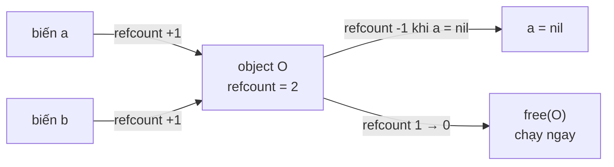
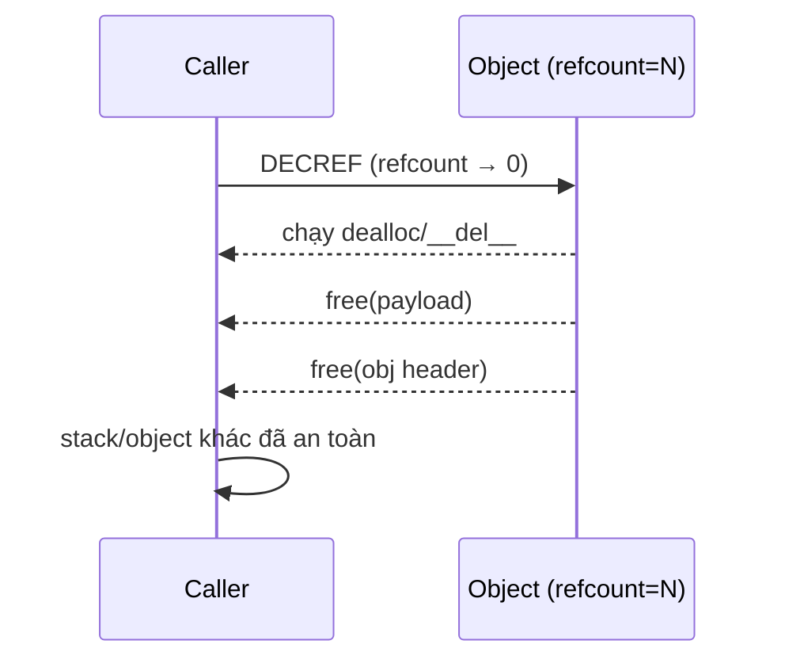

# What is reference counting in garbage collection?

> Reference counting là kỹ thuật GC đếm số tham chiếu trỏ tới mỗi object, khi đếm về 0 thì giải phóng ngay. Bài này giải thích cơ chế, hệ quả giải phóng tức thì, nhược điểm chu kỳ tham chiếu, các biến thể (deferred refcount, COW) và so sánh với mark-sweep. Liên kết tới [garbage-collection](garbage-collection.md) nền tảng GC và [mark-sweep-vs-generational-gc](mark-sweep-vs-generational-gc.md) để đối chiếu.

Chủ đề: Memory - Runtime · Ngày: 2026-10-16

## 1. Là gì

Reference counting (refcount) là chiến lược GC trong đó mỗi object gắn một bộ đếm refcount, mỗi tham chiếu (reference) tăng hoặc giảm bộ đếm đó. Khi refcount về 0 nghĩa là không còn cách nào truy cập được, object được giải phóng tức thì trên chính thread đang drop reference. Quy tắc:

- Tạo object: refcount = 1 (nếu gán cho biến đầu tiên).
- Gán `a = b`: refcount của b tăng 1; refcount của a cũ giảm 1; nếu a cũ về 0 thì giải phóng.
- Hàm trả object: tăng refcount trước khi trả, caller giảm khi xong.

Một số engine dùng refcount làm chiến lược chính: CPython (chính), Objective-C/Swift thông qua ARC (Automatic Reference Counting), C++ `std::shared_ptr`, Rust `Rc<T>`. Thực tế phổ biến là refcount được kết hợp với một bộ phận khác (cycle collector, mark-sweep, generational) để xử lý chu kỳ.



*Sơ đồ vị trí: refcount nằm trong header object; ngôn ngữ/runtime tăng giảm khi gán; khi về 0 thì free ngay tại thread hiện tại.*

### Trả lời 30 giây

"Refcount là chiến lược GC đếm số tham chiếu trỏ tới mỗi object. Khi đếm về 0, object giải phóng ngay trên thread đang thực hiện, không cần dừng chương trình. Ưu: deterministic, overhead thấy được, free ngay khi không dùng, tốt cho resource (file, socket) cần close tức thì. Nhược: phải tăng/giảm ở mọi nơi (chi phí CPU + bộ nhớ cho counter), không thu dọn được chu kỳ A→B→A, không di dời object dẫn tới phân mảnh heap. CPython dùng refcount + cycle collector; Swift ARC chỉ refcount; C++ `shared_ptr` chỉ refcount nhưng tránh chu kỳ bằng `weak_ptr`. Trong phỏng vấn hiếm khi ai thiết kế VM refcount từ đầu, nhưng hiểu nó giúp trả lời câu hỏi về overhead allocator hay deterministic teardown."

## 2. Cơ chế cốt lõi

### Bước 1. Cấu trúc object và refcount

- Mỗi object có header chứa `refcount` (kiểu `size_t`), `type` (cho CPython là `PyTypeObject*`) và con trỏ tới payload.
- Tạo object: `obj->refcount = 1`. Runtime hoặc compiler chèn `obj_ref(obj)` ngay sau hàm tạo.
- `Py_INCREF(obj)` và `Py_DECREF(obj)` là hai macro thao tác trực tiếp `refcount`. CPython tách riêng hai hàm để giảm branch trong release build.

### Bước 2. Quy tắc tăng giảm

1. Tạo mới: `refcount = 1`.
2. Lưu vào container (`list.append(obj)`): container gọi `Py_INCREF(obj)`, refcount tăng.
3. Lấy ra khỏi container (`obj = mylist.pop()`): container gọi `Py_DECREF`. Nếu trước đó là item duy nhất, refcount về 0 → destructor `__del__` (CPython) hoặc `deinit` chạy, sau đó free bộ nhớ ngay trong lời gọi `Py_DECREF`.
4. Gán lại biến: `a = b` thực ra là `Py_DECREF(old_a); Py_INCREF(b); a = b` theo thứ tự tránh lỗi tạm thời.

### Bước 3. Tại sao free ngay được



*Chuỗi DECREF khi refcount về 0: mọi thao tác diễn ra trong cùng thread của caller, không có background sweep thread, không có "stop-the-world". Đây là lý do refcount phù hợp resource cần close tức thì (file, socket, lock).*

### Bước 4. Chu kỳ tham chiếu và cycle collector

- Nhược điểm lớn nhất: chu kỳ A→B→A. Cả hai refcount đều ≥ 2, không bao giờ về 0.
- CPython giải quyết bằng cycle collector chạy định kỳ. Nó:
  1. Quét container (`list`, `dict`, `class`, …) để tìm object không truy cập được từ root qua đồ thị "đánh dấu tạm".
  2. Giảm refcount của những object trong chu kỳ "thử" và xem cái nào về 0.
  3. Giải phóng chu kỳ đó, gọi `__del__` theo thứ tự an toàn.
  4. Trigger: đạt ngưỡng `gc.get_threshold()` (mặc định 700 allocations) hoặc gọi thủ công `gc.collect()`.
- Objective-C không có cycle collector tự động; dev phải dùng `weak` proxy.
- Rust `Rc<T>` không có cycle collector; dùng `Weak<T>` để phá chu kỳ.

### Bước 5. Deferred reference counting và COW

Hai biến thể tối ưu cho ngôn ngữ nhiều luồng:

- **Deferred refcount (Perlin, Baker)**: chỉ giảm refcount khi một thread yêu cầu "balance", tránh race trên biến đếm. Dùng trong một số implementation nghiên cứu và ngôn ngữ như IB (Inferno).
- **Copy-on-write refcount**: thread không sửa refcount; khi cần sửa, copy object. Kết hợp với atomic shared để giảm contention.
- Cả hai đều đánh đổi tính "free tức thì" và tăng độ phức tạp của cycle collector.

### Bước 6. Triển khai atomic refcount cho đa luồng

- CPython 3.10+ dùng `_Py_atomic_size_t` cho refcount, tăng giảm không khóa ở cập nhật đơn lẻ, nhưng vẫn cần atomic để tránh double-decrement trên multiprocessing fork và giảm race trên nhiều thread.
- Trong CPython thực tế, tăng/giảm không khóa (`_Py_INCREF`/`_Py_DECREF`) nhưng `Py_DECREF` khi về 0 vẫn có khóa nội bộ để ngăn hai thread cùng giải phóng. Swift ARC làm điều tương tự.
- Chi phí: mỗi phép gán tham chiếu là một số atomic op (tăng hoặc giảm), trên kiến trúc x86 là `LOCK INC/DEC`, khoảng 10-50 ns tuỳ workload.

### Bước 7. So sánh refcount với mark-sweep

| Tiêu chí | Refcount | Mark-sweep |
|---|---|---|
| Latency giải phóng | Tức thì khi refcount về 0 | Không đoán trước |
| CPU overhead | Mỗi phép gán | Hai lần duyệt graph, định kỳ |
| Thu chu kỳ | Không (cần cycle collector) | Có |
| Phân mảnh heap | Có (không di dời) | Có (không di dời) |
| Pause time | Không có stop-the-world | Có stop-the-world |

Xem chi tiết tại [mark-sweep-vs-generational-gc](mark-sweep-vs-generational-gc.md).

### Quan sát

```python
# CPython: kiểm tra refcount ngay
import sys
x = object()
print(sys.getrefcount(x))  # 2: một cho 'x', một cho đối số truyền vào getrefcount
del x

# Chu kỳ tham chiếu
class Node:
    def __init__(self):
        self.other = None

a = Node()
b = Node()
a.other = b
b.other = a
print(sys.getrefcount(a))  # 3: a, a.other, refcount của stack frame
del a
del b
# Hai Node vẫn còn trong heap (refcount > 0), cycle collector dọn khi đạt ngưỡng
import gc; gc.collect()
```

### Ví dụ chạy từng bước

Một service phân tích log giữ graph cache `Session → User → Plan`. Mỗi `Session` trỏ tới `User`, `User` trỏ tới `Plan`. Khi request kết thúc, worker nhả reference tới `Session`. Theo dõi refcount qua từng bước (giá trị khởi tạo = 1 khi tạo object).

**Bước 1.** Worker tạo 3 object: `s = Session()`, `u = User()`, `p = Plan()`. Sau khi tạo, mỗi object refcount = 1 (owner ban đầu trên stack).

**Bước 2.** Worker gán quan hệ: `s.user = u` (INCREF u vì `s.user` trỏ vào u, u: 1 → 2). Tương tự `u.plan = p` làm p: 1 → 2. Vì sao tăng: runtime phải đếm đủ số "ai đang giữ" trước khi gán.

**Bước 3.** Worker trả 2 biến cục bộ: `del u` (DECREF u: 2 → 1, còn `s.user`) và `del p` (DECREF p: 2 → 1, còn `u.plan`). Không có object nào về 0 vì còn owner khác.

| Bước | s | u | p |
|---|---|---|---|
| 1: tạo | 1 | 1 | 1 |
| 2: gán field | 1 | 2 | 2 |
| 3: del biến local | 1 | 1 | 1 |

**Bước 4.** Worker gán `s = None`. DECREF s: 1 → 0, `Session.dealloc` chạy ngay trong DECREF, free `s`. Bên trong dealloc thấy `s.user` còn giữ `u` nên DECREF u: 1 → 0, dealloc `u`; DECREF `u.plan` làm p: 1 → 0, dealloc `p`. Chuỗi free chạy đồng bộ trên caller thread.

**Bước 5.** Một worker khác tạo chu kỳ cố ý: `a = Node(); b = Node(); a.other = b; b.other = a`. Sau gán: `a=2 (stack + b.other)`, `b=2 (stack + a.other)`. Worker kết thúc, `del a`: 2 → 1, `del b`: 2 → 1. Không về 0 — mỗi node còn owner là trường `other` của node kia. Cycle collector của CPython chỉ giải phóng khi cả hai đồng thời không reachable từ root.

Biến thể lỗi: nếu dev lưu `a` vào `cache['sess'] = a` rồi `del a`, `a` không về 0 — root reachable, không phải chu kỳ. Cycle collector bỏ qua vì vẫn reachable. Bài học: refcount > 0 chưa chắc là chu kỳ, còn root thật.

Điều rút ra: refcount chỉ giải phóng khi mọi owner (field + stack) đều giải tương ứng — vì sao mỗi INCREF phải có DECREF tương xứng ở mọi path, liên quan tới Câu 3A.6 (debug RSS tăng dần).

## 3. Câu hỏi phỏng vấn

### 3A. Câu hỏi đào sâu

<details class="qa">
<summary>Câu 1. Reference counting hoạt động thế nào, đâu là điểm khác biệt so với mark-and-sweep?</summary>

**Trả lời ngắn:** Mỗi object có một counter; mỗi lần một tham chiếu trỏ tới object counter tăng 1, khi tham chiếu rời đi counter giảm 1; về 0 thì free ngay. Mark-and-sweep duyệt graph định kỳ, free tập không reachable. Refcount deterministic, free tức thì; mark-sweep batch, một lần giải phóng nhiều object.

**Đào sâu:**
- Refcount cho latency giải phóng tức thì → tốt cho resource (file, socket) cần close ngay, không phải chờ GC cycle.
- Phải tăng/giảm ở mọi phép gán, chi phí tỷ lệ thuận số pointer write.
- Không dọn được chu kỳ → cần cycle collector (CPython) hoặc API yếu (Swift `weak`, Rust `Weak`).
- Mark-sweep có thể "thiếu chu kỳ" nếu cài đặt đúng, không tốn tăng giảm mỗi phép gán, nhưng có pause time và không deterministic.

**Bẫy:** "Refcount không có pause time". Sai — DECREF chạy đồng bộ trên caller thread, gọi `__del__`/`deinit` của bạn. Nếu dealloc chậm (gọi logging, close file từ xa, lock contention), caller thread phải chờ.

**Follow-up:** Làm sao tránh chi phí atomic refcount trên multicore? Deferred refcount, immovable references, hoặc generational Immix/RefCount hybrid.
</details>

<details class="qa">
<summary>Câu 2. Chu kỳ tham chiếu là gì, giải quyết thế nào trong các engine thực tế?</summary>

**Trả lời ngắn:** A và B tham chiếu vòng qua nhau (A→B, B→A) khiến refcount cả hai không về 0. CPython thêm cycle collector quét định kỳ; Objective-C yêu cầu dev dùng `weak`; Rust dùng `Weak<T>`; Swift ARC cũng yêu cầu `weak`/`unowned` cho backreference.

**Đào sâu:**
- CPython 3.x: cycle collector chạy khi số allocation vượt `gc.get_threshold()` (mặc định 700 cho gen 0). Nó quét container (list, dict, instance), đánh dấu reachable từ root rồi đối chiếu. Chu kỳ chỉ được giải phóng khi container thực sự không truy cập được từ root.
- Phải đặt `__del__` thận trọng — CPython bỏ qua chu kỳ nếu `__del__` của object đã được chạy một lần để tránh crash.
- Trong C++, hai `shared_ptr` tham chiếu vòng nhau tạo leak. Cách phá: tách một thành `weak_ptr` (backpointer).
- Trong Swift, closure capture `[weak self]` thay vì `[self]` để phá chu kỳ.

**Bẫy:** "Đặt `__del__` cho mọi class là tốt". Sai — `__del__` của object trong chu kỳ không được đảm bảo chạy theo thứ tự, và cycle collector bỏ qua một số trường hợp có `__del__`, gây leak.

**Follow-up:** Cycle collector quét khi nào? Khi tổng số allocation - del allocation vượt threshold. Có thể trigger thủ công `gc.collect()`.
</details>

<details class="qa">
<summary>Câu 3. CPython dùng refcount làm GC chính hay phụ? Vì sao?</summary>

**Trả lời ngắn:** Làm chính. Mỗi object đều có `ob_refcnt` (atomic từ 3.10). Refcount giải phóng ~95% object sớm (trung bình trong chương trình Python, đa số object chết non). Cycle collector chỉ xử lý 5% còn lại, chạy không thường xuyên. Kết hợp cho CPython "free tức thì cho hot path, sweep batch cho rìa".

**Đào sâu:**
- Lý do CPython chọn refcount: code Python phần lớn object tồn tại ngắn (list tạm, dict cho từng request), refcount giải phóng ngay không cần chờ GC. Latency giải phóng quan trọng cho `with open(...) as f:` cần đóng file khi thoát block.
- Nhược: chi phí tăng/giảm cao, atomic op trên multicore. CPython đánh đổi chấp nhận chi phí này để có teardown deterministic.
- CPython 3.10+ làm `_Py_atomic_size_t` cho refcount, giảm lock nội bộ nhờ fast-path non-locked và một slow-path có khóa khi về 0.
- PyPy và HotPy khác: chỉ dùng mark-sweep/generational, không refcount (đổi chi phí lấy throughput).

**Bẫy:** "Refcount luôn chậm vì atomic". Không hẳn — CPython đã tối ưu để DECREF trên hot path gần như free. Chi phí ~1-5% throughput tuỳ workload, không phải bottleneck chính.

**Follow-up:** Tại sao PyPy không dùng refcount? PyPy đổi sang generational mark-sweep để throughput cao hơn, chấp nhận pause time và teardown không tức thì.
</details>

<details class="qa">
<summary>Câu 4. ARC trong Swift khác CPython refcount ở điểm nào?</summary>

**Trả lời ngắn:** Cả hai đều dùng refcount, nhưng Swift compiler chèn `retain`/`release` ở compile time, không phải runtime check từng macro. CPython làm thủ công qua `Py_INCREF`/`Py_DECREF`. Swift ARC chạy nhanh hơn, kết hợp với optimizer (copy elision, escape analysis) để bỏ luôn tăng giảm trong nhiều trường hợp.

**Đào sâu:**
- ARC chèn retain ở: tạo object, truyền vào hàm có qualifier `+1` (owning), lưu vào property.
- Release ở: ra khỏi scope (RAII), gán lại biến, kết thúc property observer.
- Compiler có thể chứng minh object chỉ dùng trong scope một hàm (escape analysis) → bỏ retain/release. Go xa hơn với escape analysis toàn phương trình; ARC chỉ cục bộ.
- Swift vẫn có vấn đề chu kỳ (closure giữ self) như CPython → cần `[weak self]` hoặc `unowned(unsafe)`.

**Bẫy:** "ARC không có overhead". Sai — overhead vẫn còn ở những nơi compiler không chứng minh được escape.

**Follow-up:** Escape analysis khử retain/release ở mức nào? Swift LLVM có StackPromotion cho object chỉ dùng local; Rust borrow checker khử hoàn toàn cho `T` không phải `Rc<T>`.
</details>

<details class="qa">
<summary>Câu 5. `shared_ptr` trong C++ có an toàn không? Khi nào leak?</summary>

**Trả lời ngắn:** Có — `shared_ptr` dùng refcount atomic. Khi hai `shared_ptr` tham chiếu vòng nhau (A giữ B, B giữ A) → leak. Cách phổ biến: tách một chiều thành `weak_ptr` (backpointer). Dev phải phát hiện chu kỳ bằng tay; công cụ như `clang-tidy` không tự phát hiện.

**Đào sâu:**
- `make_shared<T>()` allocate T và control block cùng lúc, một allocation duy nhất, hiệu quả hơn `new T()` + `shared_ptr` hai lần.
- `weak_ptr` không tăng refcount; chỉ truy cập qua `lock()` trả về `shared_ptr` tạm hoặc hết hạn. Pattern phổ biến: parent giữ `vector<shared_ptr<Child>>` (owning), child giữ `weak_ptr<Parent>` (back).
- `unique_ptr` không có refcount, không có cycle issue. Chuộng dùng khi chỉ một owner.
- Memory order: `shared_ptr` destroy object tại thread cuối cùng `release()` (atomic load-store), không nhất thiết thread tạo.

**Bẫy:** "Dùng `shared_ptr` cho mọi quan hệ". Sai — chuyển `unique_ptr` khi chỉ một owner giúp compiler optimize hơn.

**Follow-up:** Khi nào dùng `make_shared` thay vì `make_unique`? Khi cần nhiều owner (chia sẻ), dùng `make_shared`; một owner thì `make_unique`.
</details>

<details class="qa">
<summary>Câu 6 (Debug). Service CPython tăng dần RSS mỗi request, refcount kiểm tra một object sau khi xử lý xong luôn 1 chứ không về 0. Nghi gì và xử lý ra sao?</summary>

**Trả lời ngắn:** Nghi chu kỳ tham chiếu hoặc object được lưu ở một container global (cache, registry, `__module__` dict) vẫn còn root. Bước đầu: dump `gc.get_objects()` xem loại object nào tăng theo thời gian; kiểm tra module-level dict, logger, weakref.set; chạy `gc.collect()` và xem có object nào được giải phóng không.

**Đào sâu:**
- Bước 1: `import gc; gc.collect(); print(len(gc.get_objects()))` trước và sau request. Nếu tăng → có root giữ object.
- Bước 2: `gc.set_debug(gc.DEBUG_LEAK)` để in cảnh báo khi có unreachable object.
- Bước 3: So sánh `tracemalloc` snapshot giữa hai request để xem allocation nào tăng.
- Bước 4: Tìm `weakref.finalize` hoặc context manager có giữ state, hoặc `functools.lru_cache` với maxsize lớn.
- Bước 5: Bật `PYTHONDEVMODE=1` để có diagnostic chính xác hơn.
- Bước 6: Nếu thật sự là cycle, đặt `__del__` cẩn thận hoặc dùng `weakref`/`contextlib`.

**Bẫy:** "Refcount không hề về 0, vậy refcount sai". Không — object có thể được giữ bởi container/module, đó là reachable object không phải chu kỳ. Cần phân biệt "refcount > 0 vì owner thật" và "refcount > 0 vì cycle".

**Follow-up:** Làm sao phân biệt chu kỳ với owner thật? Dùng `gc.is_tracked(obj)` — object tracked bởi GC là ứng viên chu kỳ.
</details>

<details class="qa">
<summary>Câu 7 (Thiết kế). Thiết kế một mini-runtime cho DSL (đơn giản kiểu JSON path query), chọn GC thế nào giữa refcount, mark-sweep, generational?</summary>

**Trả lời ngắn:** Refcount cho DSL cần teardown deterministic (có thể release resource scoped cho mỗi query). Mark-sweep cho DSL chạy batch lâu dài, cần throughput cao, ít quan tâm latency giải phóng. Generational thường là mặc định an toàn nếu không chắc — CPython/JVM/CLR đều generational.

**Đào sâu:**
- Yêu cầu "free ngay khi ra scope, như stack" → refcount (Swift ARC, Rust `Rc<T>` trong single thread).
- Yêu cầu "không overhead tăng giảm trên hot path" → generational hoặc Immix.
- Yêu cầu "tránh pause > 1ms" → concurrent GC (Go tri-color concurrent, Java ZGC, Java Shenandoah).
- Yêu cầu "chạy một lần rồi thoát" (script ngắn) → refcount + cycle collector; chi phí overhead chấp nhận được.
- Triển khai: Lua dùng refcount + mark-sweep (incremental); Go dùng concurrent tri-color; CPython dùng refcount + generational cycle collector; Java dùng generational + G1 cho pause thấp.

**Bẫy:** "Refcount là tốt nhất vì deterministic". Sai — chi phí tăng giảm trên mỗi phép gán và chi phí cho cycle collector làm throughput tụt. Generational thường vượt ở workload dài.

**Follow-up:** Khi nào thêm cycle collector vào refcount? Khi API có thể tạo đồ thị object có khả năng chu kỳ (listener, parent-child, observer). Nếu DSL chỉ string/number, không cần cycle collector.
</details>

### 3B. Câu hỏi phỏng vấn liên quan

<details class="qa">
<summary>Câu 8. Refcount có giải phóng object ngay khi ra scope không? "Scope" nghĩa là gì?</summary>

**Trả lời:** Trong ngôn ngữ có RAII/scope-based lifetime (C++ `shared_ptr` trong scope, Rust `Rc<T>` qua drop guard) thì có. CPython chỉ giải phóng khi reference count về 0 — tức là khi tất cả tên chứa object đó được gán lại hoặc xóa. "Ra scope" chỉ là một cách phổ biến khiến refcount giảm chứ không phải quy tắc bắt buộc.
</details>

<details class="qa">
<summary>Câu 9. Tại sao CPython không chỉ dùng mark-sweep để bỏ refcount overhead?</summary>

**Trả lời:** Mark-sweep không cho giải phóng tức thì. Với code Python cần `with open(...)` đóng file đúng lúc, hoặc `try/finally`, refcount giúp teardown deterministic. PyPy và HotPy đã thử: tốc độ nhanh hơn nhưng đòi hỏi GC cycle rõ ràng và finalizer chạy không tức thì.
</details>

<details class="qa">
<summary>Câu 10. Cycle collector của CPython chạy khi nào, tốn bao nhiêu?</summary>

**Trả lời:** Khi số allocation vượt `gc.get_threshold()` (mặc định 700 cho gen 0). Chỉ quét container (list, dict, instance), dùng đồ thị "đánh dấu tạm" để phát hiện chu kỳ. Chi phí mỗi lần quét tỷ lệ số container đang tracked; thường vài chục ms với heap vài trăm MB. Có thể tắt bằng `gc.disable()` khi biết chắc không có chu kỳ, nhưng đề phòng `__del__`.
</details>

<details class="qa">
<summary>Câu 11. `__del__` có đảm bảo chạy khi object được giải phóng không?</summary>

**Trả lời:** Không đảm bảo cho chu kỳ. Nếu object ở trong chu kỳ, CPython 3 không gọi `__del__` (sẽ throw `RuntimeError: __del__` skipped). Cách an toàn: dùng `with` statement (`__enter__`/`__exit__`) hoặc `weakref.finalize(obj, callback, args)` chạy kể cả khi chu kỳ.
</details>

<details class="qa">
<summary>Câu 12. Rust `Rc<T>` khác `shared_ptr` C++ ở điểm nào? Khi nào dùng `Weak`?</summary>

**Trả lời:** Cả hai đều refcount atomic. `Rc<T>` không an toàn multithread — chia sẻ qua thread cần `Arc<T>`. `Weak<T>` trong Rust dùng để phá chu kỳ: tăng refcount control block nhưng không tăng strong count; truy cập qua `upgrade()` trả về `Option<Rc<T>>`. Khác với C++ `weak_ptr`: Rust borrow checker ép dùng `Weak` chính xác hơn vì kiểm tra ở compile time.
</details>

<details class="qa">
<summary>Câu 13. True or false: "Reference counting là GC thời gian thực nên không bao giờ tốn CPU khi chạy."</summary>

**Trả lời:** Sai — refcount là GC incremental nhưng vẫn tốn CPU trên mỗi phép gán. Mỗi pointer write cần INCREF/DECREF, với atomic op trên multicore chi phí ~10-50 ns mỗi phép. Cycle collector cũng chạy và tốn CPU khi vượt threshold. GC thời gian thực nói về deterministic latency, không nói về tổng CPU overhead.
</details>

<details class="qa">
<summary>Câu 14. Go có dùng refcount không?</summary>

**Trả lời:** Không — Go dùng concurrent mark-and-sweep + tri-color cùng write barrier, không refcount. Lý do chính: Go ưu tiên đơn giản và concurrent, không muốn chi phí atomic op trên mỗi pointer write khi throughput quan trọng hơn deterministic teardown.
</details>

<details class="qa">
<summary>Câu 15. Làm sao kiểm tra object có chu kỳ trong CPython?</summary>

**Trả lời:** `import gc; gc.is_tracked(obj)` trả về `True` nếu object được theo dõi bởi cycle collector (chỉ container). Để debug: `gc.set_debug(gc.DEBUG_COLLECTABLE | gc.DEBUG_UNCOLLECTABLE | gc.DEBUG_INSTANCES | gc.DEBUG_OBJECTS | gc.DEBUG_SAVEALL)`. Cũng có `objgraph` (3rd party) để vẽ đồ thị reference.
</details>

## 4. Đánh đổi và sự cố production

### So sánh refcount với các chiến lược GC khác

| Tiêu chí | Refcount | Mark-sweep | Generational |
|---|---|---|---|
| Latency giải phóng object | Tức thì trên caller thread | Không đoán trước | Không đoán trước |
| CPU trên mỗi pointer write | Cao (atomic op) | Thấp | Thấp |
| Chu kỳ | Không tự xử lý (cần collector) | Tự xử lý | Tự xử lý |
| Pause time | Không stop-the-world | Có stop-the-world | Có stop-the-world |
| Chi phí bộ nhớ | Header refcount (size_t) | Mark bitmap | Mark bitmap + remembered set |
| Throughput benchmark | Thấp hơn mark-sweep | Cao | Cao nhất |

### Năm failure mode

| Triệu chứng | Nguyên nhân gốc | Cách kiểm tra | Cách sửa |
|---|---|---|---|
| RSS tăng dần theo thời gian | Chu kỳ hoặc container global giữ object | `gc.get_objects()`, `tracemalloc` snapshot so sánh | `weakref` cho backpointer; clear global dict; `gc.collect()` định kỳ |
| Latency service tăng đột biết | Cycle collector chạy stop-the-world | `gc.set_debug(gc.DEBUG_STATS)`; metric thời gian collect | Tăng `gc.get_threshold()`; tắt `gc` nếu không cần; batched object |
| `__del__` không chạy | Object ở trong chu kỳ có `__del__` | Log + `gc.set_debug` | Dùng `weakref.finalize` hoặc `with` statement thay `__del__` |
| Throughput thấp hơn ngôn ngữ native | Overhead INCREF/DECREF atomic | `py-spy`, profile, câu lệnh nóng | Convert phần nóng sang C/Cython; dùng `__slots__` cho class nhiều instance |
| `shared_ptr` cycle gây leak | Hai `shared_ptr` tham chiếu vòng | `valgrind --tool=massif`, code review | Đổi một chiều sang `weak_ptr`; xét `unique_ptr` |

## 5. Cheat sheet

| Chủ đề | Con số / quy tắc cần nhớ |
|---|---|
| Tăng refcount | Ngay khi object được tạo, lưu vào container, truyền qua tham chiếu |
| DECREF về 0 | Chạy dealloc tức thì trên caller thread, không có background sweep |
| Chu kỳ A→B→A | Không bao giờ về 0; cần cycle collector (CPython), `Weak` (Rust), `[weak self]` (Swift) |
| CPython refcount | `_Py_atomic_size_t`, gần như không khóa tăng giảm, slow-path có khóa khi về 0 |
| Swift ARC | Compiler chèn retain/release; escape analysis khử overhead |
| C++ `shared_ptr` | Refcount atomic, hai pointer vòng nhau gây leak — dùng `weak_ptr` |
| Rust `Rc<T>` | Không an toàn thread; multithread cần `Arc<T>` |
| Cycle threshold | `gc.get_threshold()` mặc định 700 allocation cho gen 0 |
| `__del__` và chu kỳ | CPython 3 bỏ qua; dùng `weakref.finalize` thay thế |

**Học tiếp:**
- [garbage-collection](garbage-collection.md) — ba chiến lược GC chính và vì sao mỗi engine chọn một cách
- [mark-sweep-vs-generational-gc](mark-sweep-vs-generational-gc.md) — bổ sung refcount trong khung so sánh
- [memory-leak](memory-leak.md) — kiểm tra leak khi refcount tăng mà không giảm
