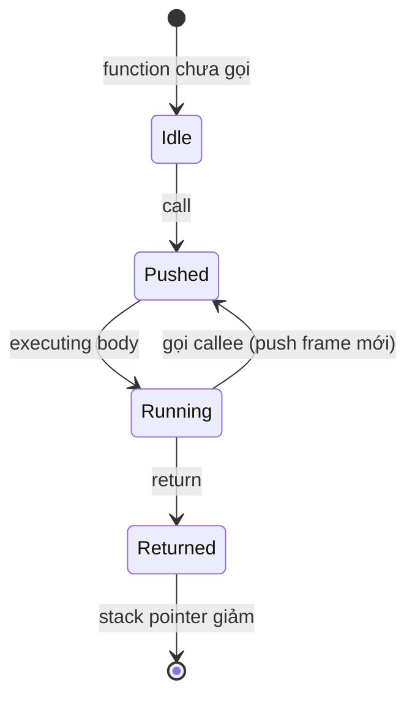

# Explain the difference between heap and stack memory.

> So sánh heap và stack theo vùng nhớ, cơ chế cấp phát/thu hồi, tốc độ, kích thước, nội dung lưu trữ, hiện thực trong C/C++/JVM/Go/V8, cách stack overflow và heap overflow khác nhau và cách debug. Bài [memory-leak](memory-leak.md) giải thích leak trong từng vùng; bài [garbage-collection](garbage-collection.md) giải thích thu hồi heap.

Chủ đề: Memory - Runtime · Ngày: 2026-10-16

## 0. Nền tảng trước khi đọc

**Bối cảnh:** Cách chương trình dùng và thu hồi bộ nhớ khi đang chạy. Hiểu phần này giúp giải thích chậm, treo, crash và out-of-memory.

**Nói đơn giản:** Stack giữ dữ liệu gắn với lời gọi hàm; heap giữ object sống lâu hoặc có kích thước động. Nhầm hai vùng thường gây stack overflow hoặc out-of-memory.

**Từ khóa cần biết:** object = dữ liệu đang sống; reference = đường trỏ tới object; runtime = phần thực thi chương trình.

**Ví dụ dễ hình dung:** Mỗi lần gọi hàm tạo frame trên stack; object đơn hàng cần sống sau khi hàm trả về thường nằm trên heap.

Khi đọc, luôn hỏi ba câu: nó giải quyết vấn đề gì, nó làm việc theo những bước nào, và khi nào không nên dùng?

**Cách học bài này:** Đọc phần này trước để nắm từ khóa; đọc phần 1 để lấy câu trả lời 30 giây; đọc phần 2 để hiểu cơ chế; cuối cùng mở từng câu hỏi ở phần 3 để luyện nói. Các con số và lệnh trong bài là bằng chứng cho câu trả lời, không cần học thuộc nếu chưa hiểu cơ chế.

## 1. Là gì

### Đọc nhanh trước khi đi sâu

**Ý chính:** Stack giữ dữ liệu gắn với lời gọi hàm; heap giữ object sống lâu hoặc có kích thước động. Nhầm hai vùng thường gây stack overflow hoặc out-of-memory.

**Ví dụ interview:** Mỗi lần gọi hàm tạo frame trên stack; object đơn hàng cần sống sau khi hàm trả về thường nằm trên heap.

**Luồng 4 bước:**

1. Code tạo object hoặc vùng nhớ.
2. Runtime giữ object còn được dùng và cung cấp reference cho code.
3. Object không còn reachable sẽ được free hoặc garbage collector thu hồi.
4. Nếu giữ nhầm, vùng nhớ phình lên và chương trình chậm hoặc hết RAM.

**Nói như trong interview:** Stack giữ dữ liệu gắn với lời gọi hàm; heap giữ object sống lâu hoặc có kích thước động. Nhầm hai vùng thường gây stack overflow hoặc out-of-memory. Hãy nói theo bốn bước trên trước; nếu interviewer hỏi sâu, chuyển sang cơ chế **Bước 1. Stack frame và cơ chế push/pop**, rồi nêu trade-off và failure mode ở các phần sau.

## 2. Cơ chế cốt lõi

### Bước 1. Stack frame và cơ chế push/pop

Mỗi khi function được gọi, CPU push một frame vào stack gồm:
- Return address (địa chỉ trả về).
- Saved frame pointer (base pointer).
- Local variables (primitive value hoặc pointer tới heap).
- Có thể có alignment padding và callee-saved register.

Khi function return, frame pop, stack pointer (SP) chỉ cần trừ frame size. Không cần GC, không cần free(). Thread có stack riêng; goroutine trong Go có stack bắt đầu nhỏ (2 KB) và grow theo nhu cầu.

### Bước 2. Heap allocator hoạt động thế nào

Heap cấp phát dynamic bằng allocator phức tạp hơn stack:
1. **glibc malloc**: dùng bin (small/large), arena, brk/mmap. Malloc nhỏ (≤256 KB) từ arena, malloc lớn từ mmap riêng. Free trả về bin, có thể `free` rồi `malloc` lại đúng size nhưng khác địa chỉ.
2. **jemalloc** (FreeBSD, Rust default, Redis): chia arena thành bin theo size class, giảm fragmentation, tối ưu concurrent.
3. **JVM heap**: chia thành young/old gen (G1) hoặc generation cố định (Parallel). Object được quản lý bởi GC tracing.
4. **Go heap**: chia thành span theo size class, GC mark/sweep concurrent.
5. **V8 heap**: chia new space (semi-space copying) + old space (mark-sweep/compact).

### Bước 3. Bốn đặc tính khác biệt

| Đặc tính | Stack | Heap |
|---|---|---|
| Quản lý | Tự động theo call frame | Allocator / GC |
| Tốc độ cấp phát | ~1-5 ns (chỉ tăng SP) | ~50-200 ns (malloc nhỏ), µs cho malloc lớn |
| Kích thước | Vài MB (Linux 8 MB default) | GB, giới hạn bởi RAM + swap |
| Thời gian sống | Function scope | Đến khi free/GC |
| Fragmentation | Không (LIFO liên tục) | Có (external, internal) |
| Thread-safe riêng | Mỗi thread có stack riêng | Chia sẻ, cần allocator thread-safe |
| Lưu trữ | Local var, return addr | Object, dynamic data, shared state |

### Bước 4. So sánh theo runtime

- **C/C++**: stack là user/system; heap qua malloc/free. Không có GC → raw leak như [memory-leak](memory-leak.md). Smart pointer (C++11) giúp quản lý heap ownership.
- **JVM**: mỗi thread có Java stack chứa stack frame riêng. Object luôn ở heap (escape analysis cho phép scalar replacement trên stack trong một số trường hợp). Primitive local có thể ở stack (int, long, double, reference).
- **Go**: goroutine stack bắt đầu 2 KB, grow theo nhu cầu (max 1 GB mặc định, có thể chỉnh qua `GOMAXSTACK` hoặc debug opts). Heap qua runtime allocator với GC concurrent.
- **V8 (Node.js)**: function frame ở stack; object/array/function ở heap. V8 tối ưu "escape analysis" để không escape sang heap nếu có thể.
- **CPython**: frame object nằm trên heap (mỗi call frame là object Python). Local variable thường là heap object. Stack thật của OS chỉ chứa C frame trong interpreter.

### Bước 5. State diagram stack frame



*Vòng đời stack frame: từ Idle đến Pushed khi function được gọi; nếu gọi tiếp thì push frame mới (lòng frame); khi return thì frame được pop tự động.*

### Bước 6. Stack overflow vs heap overflow (OOM)

**Stack overflow**:
- Triệu chứng: `Segmentation fault`, `StackOverflowError` (JVM), runtime panic Go.
- Nguyên nhân: đệ quy vô hạn, recursion quá sâu, mảng local quá lớn (VD: `int arr[1000000]` trong C chiếm ~4 MB stack).
- Debug: in stack trace. JVM in stack trace đầy đủ, Go panic in goroutine stack. Kiểm tra tail recursion đệ quy.
- Fix: chuyển dữ liệu lớn sang heap (`malloc`, `new`), chuyển đệ quy sâu sang iterative, tăng stack size (`ulimit -s 65532` Linux, `goroutine stack` Go, `-Xss` JVM).

**Heap overflow (OOM)**:
- Triệu chứng: `OutOfMemoryError` (JVM), `runtime: out of memory` (Go), `Cannot allocate memory` (Linux malloc), crash `std::bad_alloc` (C++).
- Nguyên nhân: cấp phát lớn hơn RAM + swap, fragmentation nặng, leak.
- Debug: heap dump, RSS metric, system logs (`dmesg` xem OOM killer).
- Fix: tăng RAM, fix leak, giảm allocation, dùng streaming thay vì load toàn bộ vào memory.

### Quan sát

```bash
# Linux: stack size mặc định
ulimit -s
# 8192 (KB) = 8 MB cho main thread

# Kiểm tra stack size thật của process
cat /proc/<pid>/limits | grep Stack

# Tăng stack size
ulimit -s 65536  # 64 MB

# JVM: stack size cho thread
java -Xss512k Main  # 512 KB stack cho mỗi thread (mặc định 1 MB)

# Go: in stack của goroutine
kill -SIGQUIT <pid>
# Output minh họa, chưa chạy:
# goroutine 1 [running]:
# main.main()
#   /app/main.go:10 +0x40

# Tăng stack size goroutine
GODEBUG=mr_autocheckstack=0 go run main.go  # tắt auto-check
# Hoặc runtime.SetMaxStack trong code

# Native: stack overflow với C
ulimit -c unlimited  # cho phép core dump
# Chạy chương trình đệ quy vô hạn
# Segmentation fault (core dumped)
```

### Ví dụ chạy từng bước

**Kịch bản:** Service Go xử lý request phân tích JSON cho `/api/orders/{id}`. Mỗi request tạo một `Order` struct (chứa 50 item, mỗi item một slice byte tên sản phẩm), xử lý, trả về response JSON. Stack mặc định goroutine 2 KB; một số hàm dùng buffer tạm 64 KB.

| Bước | T/gian | Hành động + Stack | Heap | Vì sao |
|---|---|---|---|---|
| 1 | 0 ns | Goroutine khởi tạo, stack 2 KB | 0 | Runtime cấp stack nhỏ, grow lazy |
| 2 | 1 µs | `parseOrder(id)` push frame: 2,5 KB | 4 KB | `Order` escape lên heap vì pass `*Order` |
| 3 | 5 µs | `make([]byte, 65536)`, stack 3 KB | 68 KB | Slice header 24 byte trên stack, payload heap |
| 4 | 50 µs | Xử lý 50 item, stack 4 KB | 200 KB | Mỗi `string` escape lên heap (pass to func) |
| 5 | 100 µs | Return response, stack 2,5 KB | 4 KB | Stack pop; `Order` GC-able vì hết reference |
| 6 | 200 µs | Runtime sweep lazy, stack 2,5 KB | 0 | Sweep trả 200 KB về free list khi cần |

**Trạng thái stack/heap tại bước 4:**
```text
Goroutine stack: 4 KB used, 2 KB free (grow từ 2 KB lên ~8 KB reserved)
Heap: +200 KB live, ~50 KB survivor
Bump pointer trong Eden: pointer tăng 200 KB trong microsecond
Mark assist: goroutine tham gia mark phase của GC
```

Stack goroutine chỉ vài KB vì chỉ chứa slice header, pointer, return address. Toàn bộ payload (`Order`, `[]byte`, strings) ở heap. Stack grow không cần copy dữ liệu heap — chỉ di chuyển stack frame sang vùng mới lớn hơn (Go runtime làm điều này khi gần tràn).

**Biến thể A — buffer 64 KB trên stack:** Nếu dev viết C/C++ tương đương `char buf[65536]` khai báo local trong function, mỗi frame chiếm 64 KB stack. Recursion sâu 10 frame = 640 KB, gần 8 MB Linux stack mặc định. Deeper recursion → SegFault. Heap allocation qua `malloc(65536)` an toàn hơn: chỉ 64 KB heap per call, không stack pressure.

**Biến thể B — escape lên heap không cần thiết:** Nếu struct `Order` không truyền qua pointer mà return bằng value, escape analysis có thể giữ trên stack trong caller frame. Build với `go build -gcflags="-m"` để kiểm: `moved to heap: ...` nghĩa là escape. Test: thay `*Order` bằng `Order` value → in ra `does not escape`, heap allocation giảm về 0 cho biến local đó.

**Biến thể C — goroutine stack overflow:** Nếu hàm đệ quy `func fact(n int) int { if n<=1 { return 1 }; return n*fact(n-1) }` gọi sâu 1.000.000 lần, Go runtime panics `goroutine stack exceeds 1000000000-byte limit`. Đây là runtime kiểm tra stack guard, không phải Linux segfault. Fix: chuyển sang iterative.

Điều rút ra: Stack cực nhanh (chỉ tăng SP), chỉ phù hợp dữ liệu nhỏ và tồn tại trong scope. Heap allocation qua `make`/`new` chậm hơn (~50-100 ns) nhưng flexible, dữ liệu lớn và cần chia sẻ giữa function. Escape analysis quyết định một object ở stack hay heap — kiểm tra bằng `-gcflags="-m"`. Đây là cơ chế cốt lõi giải thích lý do Câu 2 và Câu 3 trong phần 3A nói về object location và Câu 6 debug hiện tượng `bad_alloc`.

## 3. Câu hỏi phỏng vấn

### 3A. Câu hỏi đào sâu

<details class="qa">
<summary>Câu 1. Stack và heap khác nhau ở những điểm chính nào?</summary>

**Trả lời ngắn:** Stack là vùng LIFO quản lý call frame, cấp phát khi function gọi và thu hồi khi return; rất nhanh (~1-5 ns, chỉ tăng con trỏ), kích thước cố định vài MB. Heap là vùng dynamic, kích thước GB, được quản lý bởi malloc hoặc GC; chậm hơn (~50-200 ns malloc nhỏ) nhưng flexible. Stack lưu local variable + return address, heap lưu object, mảng dynamic, state chia sẻ giữa các function.

**Đào sâu:**
- Stack mỗi thread có vùng riêng, không cần đồng bộ; heap chia sẻ giữa thread, cần allocator thread-safe.
- Stack fragmentation không tồn tại (LIFO); heap dễ bị external fragmentation (free rải rác giữa các allocated block).
- Stack overflow là lỗi tức thì (SegFault, StackOverflowError); heap OOM có thể đến từ leak tích luỹ.
- Escape analysis (JVM C2, V8 TurboFan) có thể đưa object ngắn hạn từ heap lên stack hoặc register nếu chứng minh được không escape → tối ưu allocation.

**Bẫy:** "Stack và heap đều nằm trong RAM nên tốc độ như nhau." Sai — truy cập stack locality tốt hơn (cache line hit), nhưng quan trọng hơn là allocation cost: stack chỉ tăng con trỏ, heap phải tìm vùng free phù hợp.

**Follow-up:** Goroutine stack trong Go grow thế nào? Bắt đầu 2 KB, khi gần đầy thì runtime copy sang vùng mới lớn hơn (2x), cho phép goroutine stack rất nhỏ nhưng scale theo nhu cầu.
</details>

<details class="qa">
<summary>Câu 2. Một object Java được lưu ở đâu trong JVM? Local variable của primitive thì sao?</summary>

**Trả lời ngắn:** Object (kể cả `String`, array, autoboxed Integer) luôn ở JVM heap. Local variable trong method lưu primitive value (int, long, double) ngay trên stack frame của thread đó. Biến tham chiếu (Object o = new Object()) lưu pointer trên stack, object nằm ở heap.

**Đào sâu:**
- JVM stack chứa frame cho mỗi method đang chạy của thread. Frame có: local variable array, operand stack, constant pool reference.
- Local variable lưu: primitive (int, long, float, double, byte, char, short, boolean), reference (pointer tới heap object), returnAddress.
- Heap chia thành young gen (Eden + 2 Survivor) và old gen. Object mới vào Eden, sau vài lần sống sót được promote lên old gen qua minor GC.
- Escape analysis (JVM C2 compiler): nếu object không thoát khỏi method (chỉ dùng trong scope), có thể allocate trên stack hoặc scalar replace (tách field thành local variable riêng) → giảm GC pressure.
- Native method dùng native stack riêng (thường là C stack của OS).

**Bẫy:** "Local variable của String nằm trên stack." Sai — String là object, luôn trên heap. Local variable chỉ chứa reference (pointer) trỏ tới heap.

**Follow-up:** Escape analysis có luôn được áp dụng không? Không — chỉ khi C2 compiler xác định được và chi phí phân tích rẻ. Thường chỉ với object rất nhỏ trong hot path.
</details>

<details class="qa">
<summary>Câu 3. Cấp phát 1 MB trên stack so với heap có gì khác nhau về tốc độ và rủi ro?</summary>

**Trả lời ngắn:** Stack: cấp phát bằng cách giảm con trỏ SP, gần như miễn phí (~1-5 ns), nhưng rủi ro stack overflow nếu mỗi frame giữ 1 MB và recursion sâu. Heap: malloc 1 MB qua mmap (~µs), nhưng không giới hạn kích thước, chỉ giới hạn bởi RAM.

**Đào sâu:**
- Stack frame 1 MB + recursion 10 cấp = 10 MB, vượt 8 MB stack mặc định trên Linux → SegFault.
- Heap 1 MB dùng malloc — glibc dùng mmap cho block > MMAP_THRESHOLD (mặc định 128 KB), thu hồi bằng munmap. Chi phí ~µs.
- Bài học: large buffer nên ở heap (hoặc static/global) để tránh stack overflow. Mảng rất lớn khai báo trong C function là lỗi kinh điển (`int arr[1000000]` chiếm 4 MB).
- Debug: stack overflow cho SegFault tại địa chỉ gần guard page (stack cuối). Heap OOM cho `bad_alloc` hoặc trả về NULL.

**Bẫy:** "Stack allocation không bao giờ OOM." Sai — vẫn có stack overflow với kích thước vượt giới hạn, đặc biệt goroutine nhỏ trong Go (mặc định 1 GB max).

**Follow-up:** Tại sao goroutine trong Go bắt đầu stack 2 KB mà thread OS 1 MB? Vì runtime tự grow/shrink; thread OS không grow được stack (fixed size), nên phải cấp đủ cho worst-case.
</details>

<details class="qa">
<summary>Câu 4. Stack overflow xảy ra khi nào và cách debug?</summary>

**Trả lời ngắn:** Stack overflow xảy ra khi tổng kích thước stack frame vượt giới hạn stack của thread. Nguyên nhân thường gặp: đệ quy vô hạn (không có điều kiện dừng), recursion quá sâu với frame lớn, mảng local quá lớn. Debug: stack trace (SegFault, StackOverflowError, Go panic). Fix: chuyển sang iterative, tăng stack size, chuyển data lớn sang heap.

**Đào sâu:**
- JVM `StackOverflowError` in stack trace đầy đủ với frame bị lặp → dễ thấy đệ quy không dừng.
- C/C++ stack overflow cho SegFault tại địa chỉ cuối stack (guard page). Core dump cho backtrace.
- Go: runtime panic với goroutine stack. Có thể set `GOMAXSTACK` hoặc `runtime/debug.SetMaxStack`.
- Linux `ulimit -s` tăng stack size cho process, mặc định 8 MB cho main thread, 2 MB cho thread phụ (tùy glibc).
- Tail recursion không tối ưu ở C/Java/Go — mỗi recursive call vẫn push frame, không reuse. Ngôn ngữ functional (Scala với `@tailrec`, Haskell) mới tối ưu.
- Quy tắc: recursion an toàn khi độ sâu ≤ vài trăm. Quyết định dựa trên giá trị input, dùng iterative nếu có thể.

**Bẫy:** "Tăng stack size bằng `ulimit -s` giải quyết mọi stack overflow." Sai — chỉ trì hoãn; nếu đệ quy vô hạn, sớm hay muộn cũng overflow. Cần fix thuật toán.

**Follow-up:** Làm sao biết stack frame đang dùng bao nhiêu? In stack pointer trước và sau mỗi call (debug build), hoặc dùng profiler. Đo bằng cách gọi đệ quy với depth tăng dần cho tới khi crash.
</details>

<details class="qa">
<summary>Câu 5. Heap OOM (out of memory) khác stack overflow thế nào? Cách phòng và xử lý?</summary>

**Trả lời ngắn:** Heap OOM là khi allocator không tìm được vùng free đủ lớn cho request, dù tổng free có thể còn nhiều (do fragmentation) hoặc RAM hết thật. Triệu chứng: `OutOfMemoryError` (JVM), `std::bad_alloc` (C++), `Cannot allocate memory` (Linux). Phòng: tăng RAM, fix leak, streaming thay load-all, dùng allocator tốt (jemalloc).

**Đào sâu:**
- JVM `OutOfMemoryError: Java heap space` khác `OutOfMemoryError: GC overhead limit exceeded` (GC chạy mãi không giải phóng đủ). Cũng có `OutOfMemoryError: Metaspace`, `OutOfMemoryError: Direct buffer memory` (off-heap).
- Go: `runtime: out of memory: cannot allocate memory` khi runtime cần mmap mới mà không được.
- Linux OOM killer: process bị SIGKILL khi RAM hết toàn hệ thống (không phải process tự OOM). Xem `dmesg | grep -i oom`.
- Fragmentation: glibc malloc có thể giữ vùng rộng lớn đã free nhưng không dùng lại được (mmap 1 GB, free, malloc 1 GB khác có thể thành công hoặc không). Jemalloc giảm fragmentation bằng bin theo size class.
- Streaming: xử lý file lớn nên đọc theo chunk (64 KB - 1 MB) chứ không load toàn bộ vào memory.

**Bẫy:** "Heap OOM = leak." Sai — có thể do workload tăng đột biến (traffic spike), hoặc fragmentation, hoặc cấu hình heap size quá nhỏ so với workload.

**Follow-up:** Cấu hình heap size JVM thế nào? `-Xms` (initial) và `-Xmx` (max). Container nên set explicit: `-XX:MaxRAMPercentage=75.0` (Java 10+) để tự scale theo cgroup memory limit.
</details>

<details class="qa">
<summary>Câu 6 (Debug). Service C++ chạy trên Linux bị crash sau vài giờ với `std::bad_alloc`. Memory RSS dao động 2-3 GB. Bạn debug thế nào?</summary>

**Trả lời ngắn:** Bước 1: xác nhận có phải OOM thật hay fragmentation. Bước 2: kiểm tra RSS, cgroup limit, `dmesg`. Bước 3: bật malloc debug hoặc jemalloc stats. Bước 4: tìm call site cấp phát nhiều nhất. Bước 5: xử lý theo root cause.

**Đào sâu:**
- Bước 1: kiểm tra RSS (`ps -p <pid> -o rss`) vs cgroup memory limit (`cat /sys/fs/cgroup/memory/memory.limit_in_bytes`). Nếu RSS gần limit → OOM thật.
- Bước 2: xem `dmesg | grep -i 'killed process'` để biết có OOM killer không.
- Bước 3: nếu dùng glibc malloc, set `MALLOC_CHECK_=3` (debug) hoặc `MALLOC_PERTURB_=255` để bắt use-after-free / double-free. Cân nhắc chuyển sang jemalloc: `LD_PRELOAD=/usr/lib/libjemalloc.so` + bật `MALLOC_CONF="stats_print:true"`.
- Bước 4: jemalloc in stats khi nhận SIGUSR1 (`pkill -SIGUSR1 <process>`) → xem `Allocated` vs `Retained`. Retained cao bất thường = fragmentation hoặc leak. Bật profile: `MALLOC_CONF="prof:true,prof_prefix:jeprof.out"`, phân tích bằng `jeprof`.
- Bước 5: fix theo root cause. Cấu hình lại heap size container, fix leak (valgrind/ASAN), chuyển sang streaming.
- Công cụ kèm theo: heaptrack (Linux sampling allocator profiler), gperftools (Google), Massif (valgrind).

**Bẫy:** Tăng container memory limit mà không fix root cause. Chỉ trì hoãn crash.

**Follow-up:** Heaptrack overhead bao nhiêu? ~5-20x slowdown, không dùng production. Dùng sampling profile (1/100) để giảm overhead.
</details>

<details class="qa">
<summary>Câu 7 (Thiết kế). Thiết kế object pool cho game server: yêu cầu allocation nhanh, ít GC pressure. Bạn chọn stack, heap hay cả hai?</summary>

**Trả lời ngắn:** Dùng heap pool (pre-allocated array of object) cho entity/state có lifetime dài; tránh allocation trong hot path. Một số data frame tạm dùng stack (struct nhỏ, giải phóng khi return). Game thường dùng custom allocator + memory arena cho frame-level data.

**Đào sâu:**
- Object pool: pre-allocate N object lúc startup, reuse qua `acquire()`/`release()`. Tránh malloc/free trong game loop.
- Memory arena (frame allocator): cho mỗi frame game, cấp phát từ arena; cuối frame reset toàn bộ. Phù hợp cho data frame-scoped (particle, temp state).
- Stack: chỉ dùng cho struct rất nhỏ (vài trăm bytes), giải phóng khi return.
- ECS (Entity-Component-System) framework: data-oriented design, các component ở contiguous memory (heap chunk), cache-friendly.
- GC language: object pool có thể làm chậm GC vì object không được thu hồi → giảm allocation thay vì tăng pool (string builder, primitive array).
- Rust: dùng arena crate (`typed-arena`, `bumpalo`), zero-cost allocation.

**Bẫy:** Dùng object pool cho mọi thứ — pool size quá nhỏ gây contention, quá lớn tốn memory. Đo đạc workload trước khi chọn size.

**Follow-up:** ECS tối ưu cache locality thế nào? Component data nằm contiguous trong SoA (struct of arrays), CPU prefetch hiệu quả, cache miss giảm. Đây là Data-Oriented Design.
</details>

### 3B. Câu hỏi phỏng vấn liên quan

<details class="qa">
<summary>Câu 8. Stack có garbage collection không?</summary>

**Trả lời:** Không theo nghĩa truyền thống. Stack tự giải phóng khi function return — cơ chế này deterministic, không qua GC tracing. Ngôn ngữ runtime quản lý frame qua push/pop con trỏ. Tuy nhiên C2 compiler có escape analysis để đưa object ngắn hạn từ heap lên stack (scalar replacement), về bản chất là tối ưu allocation chứ không phải GC stack.
</details>

<details class="qa">
<summary>Câu 9. Escape analysis là gì và khi nào được áp dụng?</summary>

**Trả lời:** Escape analysis là compiler phân tích xem một object có "thoát" khỏi method/thread không. Nếu object chỉ dùng trong scope và không được truyền ra ngoài (return, lưu field, gọi method khác), compiler có thể cấp phát trên stack hoặc thậm chí không cấp phát (scalar replacement: tách các field thành local variable). JVM C2 và V8 TurboFan làm điều này. Lợi ích: giảm GC pressure, allocation nhanh hơn.
</details>

<details class="qa">
<summary>Câu 10. Heap fragmentation là gì, ảnh hưởng thế nào?</summary>

**Trả lời:** External fragmentation: tổng free đủ lớn nhưng rải rác thành nhiều vùng nhỏ, không có vùng liên tục đủ cho request mới. Internal fragmentation: allocator cấp phát nhiều hơn yêu cầu do bin size class. Glibc malloc có thể fragment khi workload xen kẽ size khác nhau. Jemalloc (Rust default, Redis) giảm fragmentation bằng cách chia bin theo size class cố định. Fragmentation cao làm RSS lớn hơn working set thật.
</details>

<details class="qa">
<summary>Câu 11. Vì sao mỗi thread có stack riêng nhưng share heap?</summary>

**Trả lời:** Stack chứa local variable, return address — thiết kế mỗi thread stack riêng giúp function gọi độc lập với thread khác, không cần đồng bộ. Heap chứa state chia sẻ (object, singleton, cache), nhiều thread cần truy cập cùng lúc → cần allocator thread-safe (lock, arena per-thread, hoặc lock-free). Trong Go, goroutine stack riêng nhưng heap share; goroutine dùng channel hoặc mutex để đồng bộ truy cập heap.
</details>

<details class="qa">
<summary>Câu 12. True or false: "Mảng khai báo trong hàm C luôn nằm trên stack."</summary>

**Trả lời:** Sai. Mảng trong C có thể nằm trên stack nếu là local variable với kích thước cố định (`int arr[100]`), nhưng nếu dùng `VLA` (variable-length array, GCC extension) hoặc mảng rất lớn có thể được compiler đặt trên heap. Mảng `static` nằm trong data segment. Mảng cấp phát qua `malloc` chắc chắn ở heap. Quan trọng: mảng local quá lớn gây stack overflow.
</details>

<details class="qa">
<summary>Câu 13. Tại sao đệ quy sâu trong Python dễ RecursionError?</summary>

**Trả lời:** Python giới hạn recursion depth mặc định 1000 (sys.getrecursionlimit()) để tránh stack overflow C của CPython interpreter. Stack thật của CPython là C stack, mỗi Python frame chiếm ~vài KB, 1000 frame = vài MB. Vượt quá sẽ RecursionError (chứ không phải SegFault như C). Tăng giới hạn bằng `sys.setrecursionlimit()`, nhưng vẫn có giới hạn cứng của C stack.
</details>

<details class="qa">
<summary>Câu 14. Khi nào nên dùng `placement new` trong C++?</summary>

**Trả lời:** Placement new (`new (ptr) T(args)`) xây dựng object tại vùng nhớ đã cấp phát sẵn (preallocated buffer, memory mapped I/O, shared memory). Dùng khi cần kiểm soát chính xác vị trí object (cache alignment, đặt object trong vùng nhớ đặc biệt) hoặc trong custom allocator / object pool. Cần gọi destructor thủ công và giải phóng buffer đúng cách.
</details>

<details class="qa">
<summary>Câu 15. "Stack allocation nhanh hơn heap allocation" có luôn đúng không?</summary>

**Trả lời:** Đúng trong trường hợp chung (push/pop con trỏ so với tìm vùng free trong allocator). Ngoại lệ: glibc malloc nhỏ (≤64 byte) cũng rất nhanh vì dùng cache bin trong thread arena. Và stack allocation có chi phí phụ nếu gây cache miss (stack lớn vượt L1 cache). Đo đạc bằng benchmark mới có ý nghĩa; quy tắc tổng quát vẫn đúng cho allocation lớn và thường xuyên.
</details>

## 4. Đánh đổi và sự cố production

### So sánh stack vs heap theo tiêu chí kỹ thuật

| Tiêu chí | Stack | Heap |
|---|---|---|
| Tốc độ cấp phát | ~1-5 ns (chỉ tăng SP) | ~50-200 ns (malloc nhỏ) - vài µs (mmap lớn) |
| Kích thước tối đa | Linux mặc định 8 MB (main thread) | GB, giới hạn RAM + swap |
| Quản lý | Compiler/CPU tự động | malloc / GC |
| Thread-safe | Mỗi thread có stack riêng | Cần allocator thread-safe |
| Chia sẻ giữa thread | Không (chỉ qua pointer truyền vào) | Có (object dùng chung) |
| Fragmentation | Không | Có (external + internal) |
| Quyết định nội dung | Local var, return address | Object, dynamic data, state |
| Failure mode | StackOverflow (đệ quy sâu, mảng lớn) | OOM (allocation > available) |

### Năm failure mode

| Triệu chứng | Nguyên nhân gốc | Cách kiểm tra | Cách sửa |
|---|---|---|---|
| Segmentation fault, recursion vô hạn | Stack overflow do đệ quy | In backtrace, gdb | Chuyển sang iterative, tăng stack size |
| `StackOverflowError` ở JVM | Recursion depth > 5000 (Xss mặc định 512 KB) | Stack trace | Tail recursion, iterative, `-Xss2m` |
| `OutOfMemoryError: Java heap space` | Heap usage vượt -Xmx, hoặc leak | Heap dump + retained size | Tăng Xmx, fix leak, streaming |
| `std::bad_alloc` ở C++ | malloc trả về nullptr (OOM/fragmentation) | valgrind, jemalloc stats | Tăng RAM, jemalloc, streaming |
| Linux OOM-kill (process bị SIGKILL) | Container/RAM hết toàn hệ thống | `dmesg \| grep -i oom` | Tăng memory limit, giảm RSS, fix leak |

## 5. Cheat sheet

| Chủ đề | Con số / quy tắc cần nhớ |
|---|---|
| Stack mặc định Linux | 8 MB (main thread) |
| Stack size JVM | `-Xss` (mặc định 512 KB-1 MB tuỳ platform) |
| Stack size goroutine Go | Bắt đầu 2 KB, grow theo nhu cầu, max 1 GB mặc định |
| Heap malloc nhỏ (≤64 byte) | ~50-100 ns (cache bin) |
| Heap malloc lớn (>128 KB) | Mmap riêng, ~1-5 µs |
| Stack overflow triệu chứng | SegFault, StackOverflowError, Go panic |
| Heap OOM triệu chứng | OutOfMemoryError, std::bad_alloc, runtime OOM |
| Fragmentation giảm | Dùng jemalloc, size class cố định |
| Escape analysis | JVM C2, V8 TurboFan — object ngắn hạn lên stack |
| Stack an toàn cho recursion | ≤ vài trăm frame tuỳ frame size |

**Học tiếp:**
- [memory-leak](memory-leak.md) — leak trong heap vs raw leak
- [garbage-collection](garbage-collection.md) — GC quản lý heap như thế nào
- [mark-sweep-vs-generational-gc](mark-sweep-vs-generational-gc.md) — chiến lược GC ảnh hưởng heap
