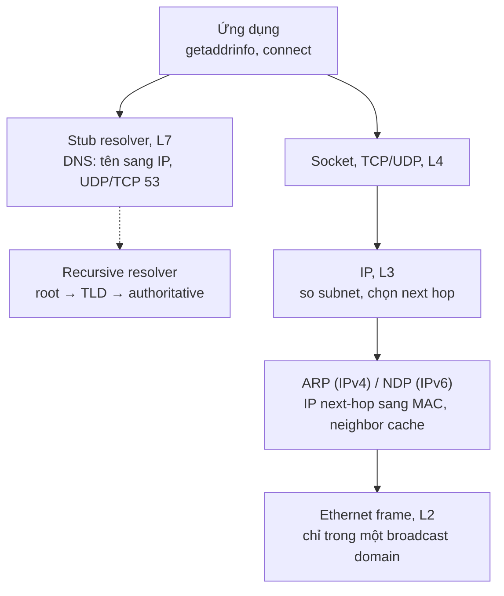
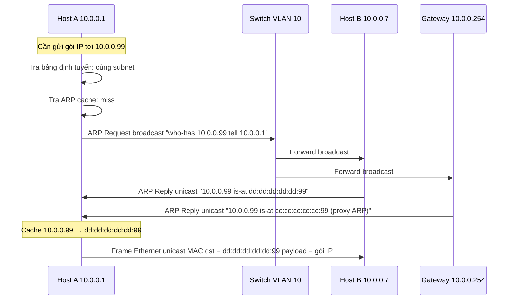
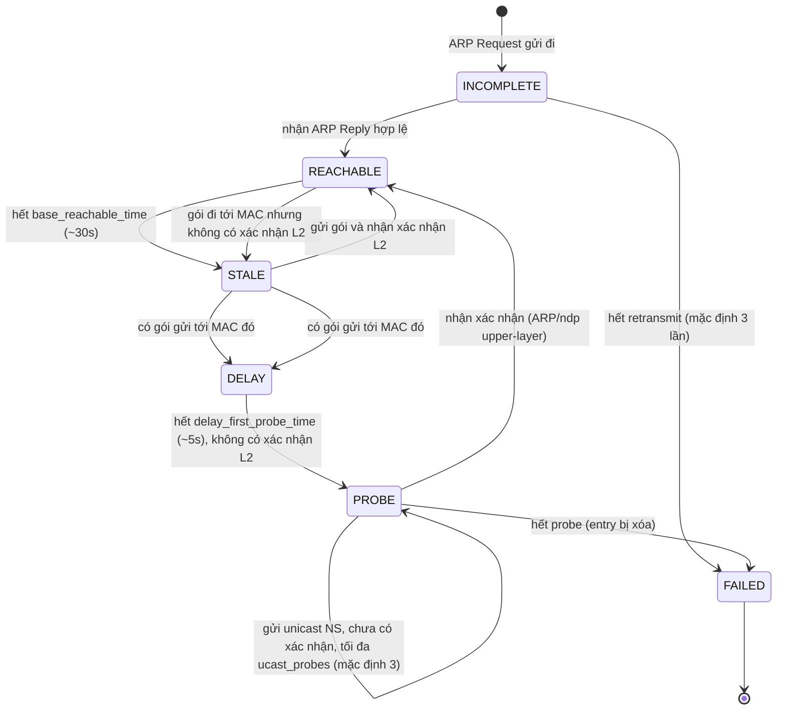
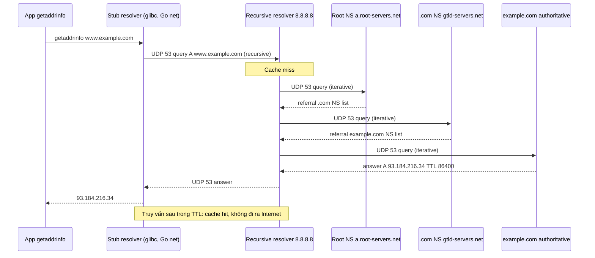

# What is the difference between ARP and DNS?

> ARP dịch IPv4 sang MAC trong một VLAN (L2); DNS dịch tên miền sang IP trên Internet (L7). Một request HTTP đi qua cả hai: DNS lấy IP server, ARP lấy MAC next-hop.

Chủ đề: Networking · Ngày: 2026-10-15

## 1. Là gì

ARP (Address Resolution Protocol, RFC 826) ánh xạ IPv4 (32-bit) sang MAC (48-bit) trong một broadcast domain — thường là một VLAN. Không vượt router, chỉ hoạt động trong L2.

DNS (Domain Name System, RFC 1034/1035) là cơ sở dữ liệu phân cấp toàn cầu, ánh xạ FQDN sang bản ghi (A, AAAA, MX, CNAME…) qua UDP/TCP cổng 53.

### Vị trí trong stack



*Sơ đồ: DNS chạy ở L7, xuyên Internet; ARP chạy ở L2, chỉ trong một VLAN.*

### Trả lời 30 giây

> ARP dịch IP sang MAC trong cùng một VLAN, dùng broadcast request + unicast reply, cache trong kernel ~30s REACHABLE rồi STALE. DNS dịch tên miền sang IP toàn cầu, dùng recursive query qua root/TLD/auth, cache theo TTL (60s–86400s). Một request HTTP cần cả hai: DNS lấy IP server, ARP lấy MAC của gateway hoặc đích trong subnet.

## 2. Cơ chế cốt lõi

### 2.1. ARP: IP → MAC trong một VLAN

Khi host A (`10.0.0.1`) gửi gói tới host B (`10.0.0.7`) trong cùng subnet:



1. A tra ARP cache. Cache miss → gửi ARP request broadcast (`who-has IP-X tell A`).
2. Switch forward tới mọi cổng trong VLAN.
3. Host có IP-X gửi ARP reply unicast kèm MAC của nó.
4. A cache entry với trạng thái REACHABLE, gửi frame Ethernet.

**Gratuitous ARP**: ARP request với sender IP = target IP, broadcast để thông báo IP-to-MAC của chính mình. Dùng phát hiện xung đột IP khi khởi động, và cập nhật cache mọi host khi failover VRRP.

**Cấu trúc gói ARP (RFC 826)**: 28 byte cho IPv4 trên Ethernet. EtherType 0x0806. Trường quan trọng: Hardware Type (1 = Ethernet), Protocol Type (0x0800 = IPv4), opcode (1 = request, 2 = reply), Sender Hardware Address (6 byte MAC), Sender Protocol Address (4 byte IP), Target Hardware Address, Target Protocol Address. Vì sao cần sender IP + sender MAC trong request: host được hỏi cần biết gửi reply unicast cho ai. Thiếu → host không trả lời.

**Proxy ARP**: router trả lời ARP cho IP không thuộc subnet của nó, giúp host không cần default gateway. Ngày nay ít dùng (DHCP thường cấp gateway), nhưng vẫn hữu ích cho mạng IoT cũ. Cảnh báo: bật proxy ARP tăng bề mặt ARP spoofing.

### 2.2. ARP cache (neighbor table) — máy trạng thái



*Linux sysctl: `gc_stale_time` (mặc định 60s) xóa entry STALE; `base_reachable_time_ms` (30s) duy trì REACHABLE.*

**Stub resolver vs recursive resolver**: Stub (glibc `getaddrinfo`, Go `net.Resolver`, Node `dns.lookup`) đọc `/etc/resolv.conf` rồi gửi truy vấn recursive tới recursive resolver; stub không cache nhiều (glibc cache vài giây qua `nscd`, Go có cache riêng). Recursive resolver (Unbound, BIND, Knot, systemd-resolved) nhận recursive query, tra cache, nếu miss thì tự chạy iterative từ root đến authoritative, cache kết quả và trả về stub. Phần lớn cache thật nằm ở recursive resolver, không phải stub.

**Recursive vs iterative query**: Recursive = client (stub) đợi câu trả lời cuối, không quan tâm trung gian. Iterative = resolver tự đi từng tầng, mỗi bước nhận referral rồi tự hỏi tầng kế tiếp. Stub gửi recursive (cờ RD bật); giữa các resolver/auth, traffic là iterative. Truy vấn root → nhận danh sách NS cho `.com` (referral) → truy vấn NS `.com` → nhận danh sách NS cho `example.com` → truy vấn NS đó → nhận A record.

### 2.3. DNS: tên miền → IP



1. Stub resolver (glibc, Go `net.Resolver`) đọc `/etc/resolv.conf`, gửi truy vấn recursive qua UDP 53 tới recursive resolver.
2. Recursive resolver tra cache. Miss → hỏi root (iterative), nhận referral tới TLD → hỏi TLD → nhận referral tới authoritative → hỏi authoritative, nhận bản ghi A kèm TTL.
3. Resolver cache kết quả, trả cho stub. Stub trả IP cho ứng dụng.

**Cấu trúc gói DNS (RFC 1035)**: header 12 byte + Question + Answer + Authority + Additional. Flags: QR (query/response), AA (authoritative), TC (truncated → chuyển TCP 53), RD (recursion desired), RA (recursion available). Type field: A (1, IPv4), AAAA (28, IPv6), NS (2), CNAME (5), MX (15), PTR (12, reverse), SRV (33), OPT (41, EDNS).

**DNS qua UDP vs TCP**: UDP 53 mặc định. Khi response vượt 512 byte (kể cả với EDNS) thì TC flag bật, client retry qua TCP 53. Zone transfer `AXFR`/`IXFR` cũng dùng TCP. Kể từ RFC 7766, DNS có thể dùng TCP cho mọi truy vấn, làm fallback khi UDP bị chặn. DoT (RFC 7858) mã hóa qua TLS cổng 853. DoH (RFC 8484) mã hóa qua HTTPS cổng 443, khó bị chặn vì trông giống web traffic.

### 2.4. Quan sát

```bash
# Xem ARP cache trên Linux
ip neigh show
# macOS
arp -an

# Gửi ARP request thủ công
sudo arping -I eth0 10.0.0.254

# Bắt gói ARP
sudo tcpdump -i eth0 -n -e arp

# Truy vấn DNS với trace
dig +trace www.example.com

# Xem TTL còn lại
dig +noall +answer +stats www.example.com
```

### Ví dụ chạy từng bước

Kịch bản: host A (`10.0.0.1`) gửi HTTP request tới `api.example.com`. Lần đầu, cache trống. Theo dõi từng thao tác ARP và DNS, thấy state thay đổi ở mỗi bước.

Bước 0. Trạng thái: ARP cache rỗng; DNS cache rỗng. URL = `http://api.example.com/health`, host A = `10.0.0.1`, gateway = `10.0.0.254`, server IP sau cùng = `203.0.113.10`.

Bước 1. App gọi `getaddrinfo("api.example.com")`. Stub resolver (glibc) đọc `/etc/resolv.conf` → `8.8.8.8`. Gửi UDP query tới `8.8.8.8:53` (RD=1). TTL=0 trong cache.

Bước 2. Recursive resolver nhận. Cache miss → gửi iterative tới root. RTT ~20 ms. Root trả referral `.com NS` + glue A.

Bước 3. Recursive gửi tới `a.gtld-servers.net`. RTT ~15 ms. Trả referral `example.com NS` + glue A.

Bước 4. Recursive gửi tới `ns1.example.com`. RTT ~30 ms. Trả A `203.0.113.10`, TTL=300, AA=1.

Trạng thái: Recursive cache A entry, TTL=300s. Stub trả IP về app.

Bước 5. App có IP `203.0.113.10`. So subnet `10.0.0.0/24`: khác → chọn next-hop = gateway `10.0.0.254`.

Bước 6. Kernel tra ARP cache cho gateway. Miss → broadcast ARP request `who-has 10.0.0.254 tell 10.0.0.1`. Switch flood tất cả cổng trong VLAN 10.

Bước 7. Gateway nhận, gửi unicast ARP reply `10.0.0.254 is-at aa:bb:cc:dd:ee:ff`. Kernel nhận, lưu entry trạng thái INCOMPLETE → REACHABLE.

Trạng thái: ARP cache có `10.0.0.254 → aa:bb:cc:dd:ee:ff (REACHABLE, ~30s)`.

Bước 8. TCP SYN tới `203.0.113.10:80`, handshake ~50 ms (cross-region), HTTP GET/200 OK. ARP entry gateway còn ~25s REACHABLE, DNS cache còn TTL.

| Bước | Thao tác | RTT thêm | State thay đổi |
|---|---|---|---|
| 1 | Stub → recursive UDP | LAN ~1 ms | Stub không cache |
| 2-4 | Iterative root→TLD→auth | ~65 ms | Recursive cache TTL=300 |
| 5 | So subnet, chọn gateway | 0 | next-hop = 10.0.0.254 |
| 6 | ARP request broadcast | LAN ~1 ms | INCOMPLETE |
| 7 | ARP reply unicast | LAN ~1 ms | REACHABLE ~30s |
| 8 | TCP handshake + HTTP GET | cross-region ~50 ms | connection established |

Nếu gateway cache bị xoá giữa chừng (cable replaced, switch reboot): entry ARP chuyển STALE → kernel vẫn gửi frame với MAC cũ → switch không biết MAC mới → drop hoặc flood. Kernel đợi ~5s DELAY rồi gửi unicast NS (PROBE); 3 probe fail → FAILED, xoá entry. Host gửi lại ARP request broadcast → REACHABLE. Tổng ~5–10s gián đoạn trước khi traffic khôi phục — đây là lý do VIP failover hay mất traffic vài giây đến vài chục giây.

Điều rút ra: một HTTP request cần đúng hai bảng cache — DNS ở recursive resolver, ARP ở kernel neighbor table; cả hai đều chuyển STALE/STALE khi entry hết hạn. Đây là gốc của Câu 6 (failover VRRP mất 30s) và Câu 12 (recursive resolver quá tải) trong phần phỏng vấn liên quan.

## 3. Câu hỏi phỏng vấn

### 3A. Câu hỏi đào sâu
<details class="qa">
<summary>Câu 1. Mô tả ARP hoạt động khi host A gửi gói cho host B trong cùng subnet. ARP có qua router không?</summary>

**Trả lời ngắn:** A tra ARP cache; miss thì gửi ARP request broadcast "who-has B". B trả ARP reply unicast. A cache MAC rồi gửi frame Ethernet. ARP không qua router vì broadcast bị giới hạn trong một VLAN.

**Đào sâu:**
- Khác subnet: A ARP cho gateway, không phải cho B. Router lại ARP ở subnet kế tiếp.
- ARP cache trạng thái: REACHABLE (~30s) → STALE → DELAY (~5s) → PROBE (3 lần) → FAILED (xóa).
- Gratuitous ARP (sender IP = target IP) dùng phát hiện xung đột IP và cập nhật cache khi failover VRRP.
- Cấu trúc gói ARP: 28 byte, EtherType 0x0806, opcode 1=request, 2=reply.

**Bẫy:** Nghĩ ARP qua Internet — sai. ARP là L2, không vượt router.

**Follow-up:** ARP cache hết hạn khi nào? ~30s REACHABLE → STALE; sau gói mà không xác nhận L2 trong ~5s → DELAY → PROBE → FAILED.
</details>

<details class="qa">
<summary>Câu 2. Mô tả DNS phân giải từ getaddrinfo đến khi ứng dụng có IP. Phân biệt recursive và iterative query.</summary>

**Trả lời ngắn:** Stub resolver gửi truy vấn recursive (RD flag) tới recursive resolver. Resolver hỏi root → TLD → authoritative (iterative). Authoritative trả bản ghi A kèm TTL. Resolver cache, trả cho stub.

**Đào sâu:**
- Stub resolver (glibc, Go `net.Resolver`) không cache nhiều, chỉ chuyển tiếp.
- Recursive resolver (Unbound, BIND) cache kết quả đến hết TTL. Cache ấm → phản hồi < 1ms.
- Iterative = resolver tự đi từng tầng, mỗi bước nhận referral. Recursive = client đợi câu trả lời cuối.
- DNS chuyển TCP 53 khi response vượt 512 byte (qua EDNS) hoặc khi UDP bị chặn (RFC 7766).
- DoH (RFC 8484, HTTPS 443) và DoT (RFC 7858, TLS 853) mã hóa truy vấn.

**Bẫy:** Nhầm stub resolver với recursive resolver. Stub chỉ gửi, không cache.

**Follow-up:** 13 root server? a–m.root-servers.net, có hàng trăm instance anycast trên toàn cầu qua BGP.
</details>

<details class="qa">
<summary>Câu 3. Vì sao một request HTTP tới www.example.com cần cả DNS lẫn ARP?</summary>

**Trả lời ngắn:** DNS trả IP server (L7). ARP trả MAC của next-hop trong subnet (L2). Đây là hai không gian địa chỉ ở hai tầng khác nhau, cả hai đều cần.

**Đào sâu:**
- `getaddrinfo("www.example.com")` → stub → recursive → authoritative → nhận IP `93.184.216.34`.
- So IP với subnet `10.0.0.0/24`: khác subnet → dùng gateway `10.0.0.254`.
- Tra ARP cache cho gateway. Miss → ARP request broadcast → ARP reply với MAC gateway.
- Ghép MAC gateway vào Ethernet frame, IP server vào gói IP. Frame gửi qua switch tới gateway.
- Router đọc IP, forward. Ở mỗi hop L2, router chạy ARP cho next-hop của link đó.

**Bẫy:** Nghĩ ARP tìm MAC server. Chỉ đúng khi cùng subnet; khác subnet thì ARP cho gateway.

**Follow-up:** Cùng subnet thì sao? A ARP trực tiếp cho B, không qua gateway. Frame gửi thẳng từ MAC-A đến MAC-B.
</details>

<details class="qa">
<summary>Câu 4. Khi nào TTL DNS nên thấp, khi nào cao? Phân tích đánh đổi.</summary>

**Trả lời ngắn:** TTL thấp (60–300s) cho dịch vụ cần failover nhanh (CDN, cloud instance). TTL cao (3600–86400s) cho dịch vụ ổn định (mail, nội bộ). Đánh đổi: thấp = failover nhanh + tải authoritative cao; cao = tải thấp + failover chậm.

**Đào sâu:**
- TTL quá cao (86400s) + failover = client cache IP cũ hàng giờ. Đổi IP → phải đợi TTL hết hoặc flush cache.
- TTL rất thấp (<30s): chỉ CDN lớn dùng, chấp nhận tải truy vấn cao để failover tức thì.
- Kỹ thuật: trước khi đổi IP, giảm TTL vài ngày trước. Sau khi ổn định, tăng TTL lại.
- CDN dùng anycast (BGP) để failover trong vài giây, không phụ thuộc TTL.

**Bẫy:** Đặt TTL 86400 everywhere vì "giảm tải". Khi failover mất traffic nhiều giờ.

**Follow-up:** Khi thay đổi IP, cần làm gì? Giảm TTL trước → đợi cache cũ hết (có thể 24–48h) → đổi IP → theo dõi.
</details>

<details class="qa">
<summary>Câu 5. Thiết kế hệ thống DNS cho công ty 5 region, 100 dịch vụ. Cần failover nhanh.</summary>

**Trả lời ngắn:** 2 authoritative server mỗi region (BIND/Knot), anycast qua BGP. Recursive resolver 2 server mỗi region (Unbound). GeoDNS qua EDNS Client Subnet, TTL 60–300s, health check 10s.

**Đào sâu:**
- Authoritative: 10 server (5 region × 2), zone transfer AXFR/IXFR từ master. Có DNSSEC.
- Recursive: Unbound với DNSSEC validation, cache, rate limit. Nhiều resolver backup (1.1.1.1, 8.8.8.8) ở client.
- GeoDNS: dựa EDNS Client Subnet (RFC 7871) trả IP PoP gần nhất. TTL thấp cho failover nhanh.
- Failover: monitor health check mỗi 10s. Region lỗi → cập nhật bản ghi. Mất tối đa 60s.
- Anycast ưu tiên: cùng IP quảng bá từ nhiều PoP, BGP rút route trong vài giây khi PoP lỗi, không đợi TTL.
- Monitoring: dns_queries_total, dns_cache_hit_ratio, dns_response_time p99, dns_servfail_total, dnssec_validation_failures.

**Bẫy:** TTL 86400 cho mọi dịch vụ. Failover mất hàng giờ.

**Follow-up:** Anycast có nhược điểm gì? Khi PoP lỗi, BGP rút route có thể mất vài giây; cần kết hợp DNS failover.
</details>

<details class="qa">
<summary>Câu 6. ARP cache bị stale sau failover VRRP, mất traffic 30 giây. Giải thích và cách giảm.</summary>

**Trả lời ngắn:** Sau khi master crash, backup chờ 3 × ADVERTISEMENT timeout (mặc định 3s) trước khi lên. Backup gửi gratuitous ARP, nhưng một số host không nhận được (CPU bận, locktime, switch filter). ARP cache ở những host đó vẫn trỏ MAC cũ, gói đi sai vài giây đến vài chục giây.

**Đào sâu:**
- VRRP failover: 3 × ADVERTISEMENT timeout (mặc định 1s/ADVERTISEMENT) = 3s chờ, không thể giảm nếu muốn tránh false positive.
- Sau khi lên, backup gửi gratuitous ARP. Một số host không cập nhật vì: entry đang trong `locktime` (mặc định ~1s Linux), CPU bận, switch chặn broadcast.
- Entry ở trạng thái REACHABLE/STALE không bị gratuitous ARP override nếu trong locktime.
- Cách giảm: gửi gratuitous ARP 2–3 lần cách nhau 200ms. Giảm `locktime`. Bật DAI để gratuitous ARP đi qua.
- Anycast cho VIP: cùng IP quảng bá từ master và backup, khi master lỗi BGP rút route trong vài giây, không cần gratuitous ARP.

**Bẫy:** Nghĩ gratuitous ARP đến ngay mọi host. Thực tế: host bận CPU, locktime, broadcast storm đều trì hoãn.

**Follow-up:** BOND/LACP có giúp khi master crash không? Không — BOND chỉ failover ở tầng link (cáp, switch port). Khi host chết, cả máy mất, BOND không cứu.
</details>

<details class="qa">
<summary>Câu 7. Triệu chứng: ARP request trong VLAN tăng 10x (100 → 1000/giây), mạng chậm. Điều tra thế nào?</summary>

**Trả lời ngắn:** Xác nhận đúng ARP (`tcpdump -c 1000 arp`), tìm MAC phát nhiều nhất, tra cổng switch, shutdown cổng đó, kiểm tra host bị nghi.

**Đào sâu:**
- Bước 1: `tcpdump -c 1000 arp` xác nhận đúng ARP. Đếm theo sender MAC: `tcpdump -r cap.pcap | awk '{print $3}' | sort | uniq -c | sort -rn`.
- Bước 2: tra MAC address table trên switch, tìm cổng tương ứng. Hoặc SNMP trap từ switch.
- Bước 3: nguyên nhân gốc có thể: card mạng lỗi flood ARP, ứng dụng quét subnet, ARP spoofing/flood, proxy ARP bật nhầm.
- Bước 4: shutdown cổng switch tạm thời. Bật storm control để giảm broadcast.
- Bước 5: sau khi ổn, kiểm tra host: log, cấu hình, phần cứng. Sửa hoặc thay card.
- Phòng ngừa: bật storm control trên mọi access port, bật DAI + DHCP snooping, có IDS như `arpwatch`.

**Bẫy:** Vội chặn tất cả broadcast hoặc reboot cả VLAN mà không tìm host gốc.

**Follow-up:** Storm control có ảnh hưởng traffic bình thường không? Có, ngưỡng quá thấp. Đặt 1000–2000 broadcast/giây cho VLAN 100 host, đo baseline trước.
</details>

<details class="qa">
<summary>Câu 8. Khách hàng báo "truy cập chậm" nhưng dig từ máy bạn nhanh. Điều tra ra sao?</summary>

**Trả lời ngắn:** Tách vấn đề: DNS hay network/server. Kiểm tra DNS từ máy khách, rồi TCP/HTTP từ máy khách, tìm hop nào chậm.

**Đào sâu:**
- Bước 1: hỏi khách hàng cụ thể — truy vấn DNS chậm hay tải trang chậm? Dùng `dig`, `traceroute` tách.
- Bước 2: kiểm tra DNS từ máy khách: `dig +short`, `dig +trace`, `dig @resolver_của_khách`. So sánh với nhiều resolver (8.8.8.8, 1.1.1.1).
- Bước 3: nếu DNS bình thường → kiểm tra TCP. `curl -v`, `traceroute`, `mtr` tìm hop nào mất gói hoặc RTT cao.
- Bước 4: nếu DNS trả IP nhưng IP không phản hồi → CDN fail hoặc IP cache cũ. Kiểm tra GeoDNS trả IP nào.
- Bước 5: nếu chỉ một khu vực chậm → network path giữa khu vực đó và server. Dùng Looking Glass hoặc RIPE Atlas.
- Bước 6: kiểm tra server-side: backend quá tải, database chậm, upstream lỗi. Xem log, metric p99.
- Bước 7: kiểm tra CDN cache hit ratio — miss → phải fetch từ origin.

**Bẫy:** Chỉ kiểm tra DNS vì "có vẻ liên quan". Bỏ qua network path hoặc server-side.

**Follow-up:** CDN cache miss thì sao? Truy vấn đi từ edge tới origin, thêm RTT, origin quá tải có thể gây timeout. CDN dùng "origin shield" và "request coalescing" để giảm.
</details>

### 3B. Câu hỏi phỏng vấn liên quan

<details class="qa">
<summary>Câu 9. What is the exact difference between ARP and NDP?</summary>

**Trả lời:** ARP (RFC 826) chạy trên Ethernet, EtherType 0x0806, ánh xạ IPv4 sang MAC trong một VLAN. NDP (RFC 4861) chạy trên ICMPv6, ánh xạ IPv6 sang MAC và gộp cả Router Discovery + Redirect. NDP không dùng broadcast mà dùng multicast solicited-node (ff02::1:ffXX:XXXX), switch lọc được theo MAC multicast thay vì flood.
</details>

<details class="qa">
<summary>Câu 10. ARP cache entry chuyển trạng thái INCOMPLETE → REACHABLE → STALE → DELAY → PROBE thế nào, hết timer thì sao?</summary>

**Trả lời:** INCOMPLETE: ARP request vừa gửi, đợi reply. REACHABLE (~30s, `base_reachable_time_ms`): entry tươi. STALE: hết `base_reachable_time` mà không có gói đi tới MAC. DELAY (~5s, `delay_first_probe_time`): có gói đi nhưng chưa xác nhận L2. PROBE: gửi unicast ARP tối đa `ucast_probes` lần (mặc định 3). Vẫn không xác nhận → FAILED → entry bị xóa. Sysctl `gc_stale_time` (60s) dọn STALE.
</details>

<details class="qa">
<summary>Câu 11. DNS cache poisoning là gì, tại sao 16-bit transaction ID không đủ chống?</summary>

**Trả lời:** Attacker giả mạo response DNS trước khi response thật về, "nhập" bản ghi giả vào cache recursive resolver. ID 16-bit cho 65.536 khả năng — attacker bắn nhiều response dễ trúng. BIND/Unbound thêm source port randomization nâng không gian đoán lên ~41 bit. Phòng thủ hiệu quả: DNSSEC ký RRsets, DNS Cookies (RFC 7873), DoH/DoT.
</details>

<details class="qa">
<summary>Câu 12. What happens when a DNS recursive resolver goes down or is overloaded?</summary>

**Trả lời:** Truy vấn phụ thuộc resolver tới khi hết timeout (Linux `RESOLV_TIMEOUT` mặc định ~5s, tổng ~3 retry cho ~15–30s) rồi trả SERVFAIL. Stub fallback sang resolver kế tiếp trong `/etc/resolv.conf`. Domain đã cache vẫn phục vụ; chỉ domain chưa cache bị chậm/fail. Mitigation: 2–3 resolver song song (8.8.8.8, 1.1.1.1, 9.9.9.9), hoặc chạy local forwarder cache dài hơn.
</details>

<details class="qa">
<summary>Câu 13. Proxy ARP có còn dùng không, rủi ro bảo mật là gì?</summary>

**Trả lời:** Còn nhưng ít, dùng trong mạng IoT/embedded không hỗ trợ default gateway. Router trả lời ARP cho IP không thuộc subnet của nó → tăng bề mặt spoofing vì nạn nhân tin tưởng dễ hơn. Mạng doanh nghiệp tắt theo mặc định (`net.ipv4.conf.all.proxy_arp=0`). Nếu bật thì kết hợp DAI + DHCP snooping.
</details>

<details class="qa">
<summary>Câu 14. UDP payload DNS mặc định, MTU Ethernet, RTT cold cache DNS — number worth remembering?</summary>

**Trả lời:** UDP DNS mặc định 512 byte (RFC 1035); EDNS0 (RFC 6891) advertise 1232–4096 byte, cloud DNS thường dùng 1232. Ethernet MTU phổ biến 1500 byte; jumbo 9000 trong data center. RTT cold cache DNS (root → TLD → authoritative) ~30–300ms tùy vị trí. Cùng subnet ARP miss chỉ ~1–2ms (1 RTT LAN).
</details>

<details class="qa">
<summary>Câu 15. Scenario (API gateway): gateway resolve www.api.example.com nhận IP cache cũ tới instance đã retire, request fail. Xử lý?</summary>

**Trả lời:** 1) `dig +ttlid www.api.example.com @1.1.1.1` xem TTL còn. 2) `dig @ns1.example.com www.api.example.com` hỏi authoritative xác nhận IP mới. 3) Recursive cache IP cũ TTL ~3600s → flush (`ipconfig /flushdns` Windows, `systemd-resolve --flush-caches` Linux) hoặc chuyển resolver qua DoH. 4) Bài học: trước khi retire, giảm TTL xuống 60–300s vài ngày trước. 5) GeoDNS + health check (Route 53, Cloudflare) tự rút record trong ~30s.
</details>

<details class="qa">
<summary>Câu 16. TTL = 0 có thực sự nghĩa là "không cache" không?</summary>

**Trả lời:** Không tuyệt đối. TTL = 0 authoritative nói "dùng nhưng đừng cache lâu". Nhiều recursive resolver (BIND, Unbound, Windows DNS Client) vẫn cache 5–60s theo chính sách nội bộ hoặc "min positive TTL". RFC 8767 khuyến nghị gửi TTL 5–30s thay vì 0 nếu muốn giảm cache. Đừng giả định "TTL 0 = no cache" — vẫn có thể hit trong vài giây.
</details>

<details class="qa">
<summary>Câu 17. True or false: "ARP cache miss làm gói IP bị drop vĩnh viễn nếu không có reply."</summary>

**Trả lời:** Sai. ARP miss chỉ chặn khi gửi: kernel queue gói IP vào waiting list cho entry INCOMPLETE, gửi ARP request rồi đợi. Reply hợp lệ về → kernel forward gói đã queue đi, không cần app gửi lại. Linux giữ ~3 gói IP cho mỗi entry INCOMPLETE (`net.ipv4.neigh.default.unres_qlen_bytes`, không chắc số chính xác cho mọi kernel); gói thứ 4 drop. Hết retransmit + host không tồn tại → kernel trả EHOSTUNREACH, lúc đó mới "mất vĩnh viễn".
</details>

## 4. Đánh đổi và sự cố production

### So sánh nhanh

| Tiêu chí | ARP (IPv4) | DNS |
|---|---|---|
| Ánh xạ | IPv4 → MAC | FQDN → IP (A, AAAA, MX…) |
| Phạm vi | Một VLAN (L2) | Toàn cầu (L7) |
| Giao thức | Ethernet frame, EtherType 0x0806 | UDP/TCP 53, DoT 853, DoH 443 |
| Cache | Kernel neighbor table, REACHABLE ~30s, vài trăm KB | Resolver cache, TTL 60s–86400s, vài GB |
| Cold latency | ~1–2 ms (1 RTT LAN) | ~30–300 ms (3 RTT root→TLD→auth) |
| Tin cậy mặc định | Không chữ ký, dễ spoof | Không chữ ký (nếu không DNSSEC) |
| Phòng thủ | DAI, 802.1X, static ARP | DNSSEC, source port ngẫu nhiên, DoH/DoT |
| IPv6 tương đương | NDP trên ICMPv6 | DNS vẫn dùng, có thêm AAAA |

### Failure mode

| Triệu chứng | Nguyên nhân gốc | Kiểm tra | Sửa |
|---|---|---|---|
| ARP request tăng vọt, mạng chậm | Card mạng lỗi hoặc ARP flood/ARP spoofing | `tcpdump -c 1000 arp`, đếm theo MAC | Shutdown cổng switch; bật storm control, DAI |
| Traffic bị chặn/sửa trong VLAN | ARP spoofing (MITM) | `arpwatch` cảnh báo MAC-IP thay đổi | DAI chặn ARP reply giả; static ARP cho server |
| Truy vấn tên miền trả IP lạ | DNS cache poisoning | So sánh nhiều resolver; kiểm tra log resolver | Flush cache; bật DNSSEC validation; source port ngẫu nhiên |
| IP đổi nhưng client vẫn dùng IP cũ | TTL DNS quá cao (86400s) | `dig` so nhiều resolver | Giảm TTL trước khi đổi IP; dùng anycast |
| Failover VRRP mất traffic 30s+ | Gratuitous ARP không đến host bận CPU hoặc locktime | `tcpdump arp` trên host bị ảnh hưởng | Gửi gratuitous ARP 2–3 lần; giảm locktime; dùng anycast |

## 5. Cheat sheet

| Chủ đề | Cần nhớ |
|---|---|
| ARP | IP → MAC trong VLAN; broadcast request + unicast reply; cache REACHABLE ~30s |
| DNS | Tên → IP toàn cầu; recursive + iterative query; cache theo TTL |
| ARP states | REACHABLE → STALE → DELAY → PROBE → FAILED |
| ARP cold | ~1–2 ms (1 RTT LAN) |
| DNS cold | ~30–300 ms (3 RTT root→TLD→auth, tùy RTT) |
| TTL DNS | 60–300s failover nhanh; 3600–86400s ổn định |
| ARP spoofing phòng | DAI, 802.1X, static ARP |
| DNS poisoning phòng | DNSSEC, source port ngẫu nhiên, DNS cookies |
| IPv6 | ARP → NDP (ICMPv6); DNS → thêm AAAA |
| DoH/DoT | DoT: TLS 853; DoH: HTTPS 443 |
| VRRP failover | 3s chờ ADVERTISEMENT + gratuitous ARP 1–3 lần |
| Công cụ | `ip neigh`, `arp -an`, `tcpdump arp`, `dig`, `dig +trace` |

**Học tiếp:**
- [OSI model](osi-model.md) — tầng L2/L3/L7 trong bối cảnh ARP và DNS
- [TCP vs UDP](tcp-vs-udp.md) — DNS chuyển TCP khi response lớn
- [Type google.com in browser](type-google-com-in-browser.md) — toàn bộ flow từ URL đến render
