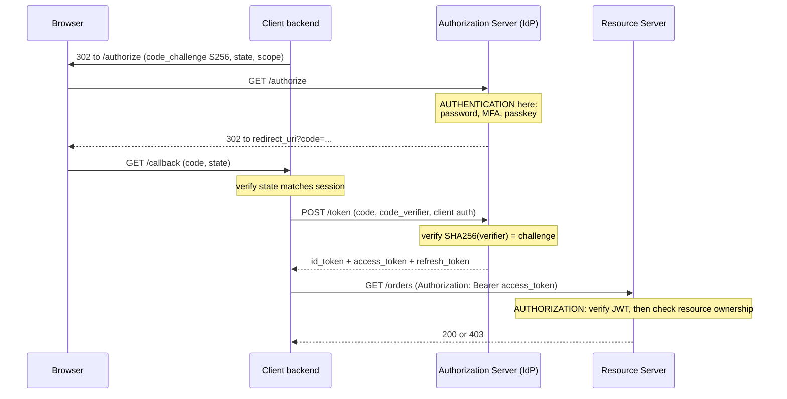
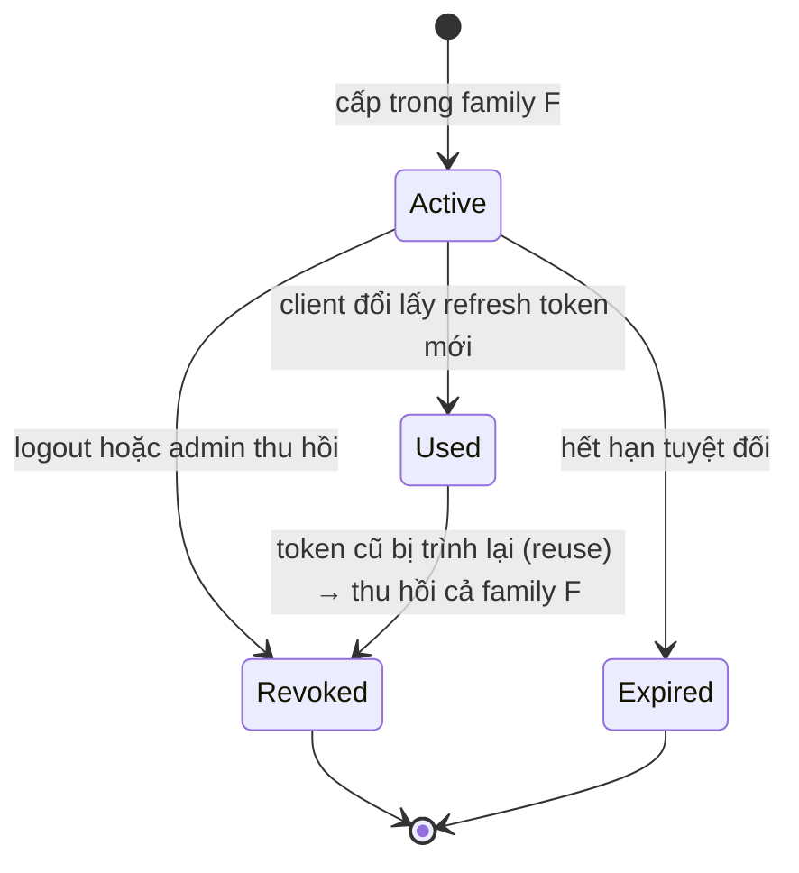

# What is the difference between authentication and authorization?

> Authentication trả lời "bạn là ai", authorization trả lời "bạn được làm gì". Bài này đi từ cơ chế (session, JWT, OAuth 2.0, OIDC, RBAC) đến các lỗi thật như BOLA và confused deputy.

Chủ đề: Networking · Ngày: 2026-10-15

## 0. Nền tảng trước khi đọc

**Bối cảnh:** Cách trình duyệt, ứng dụng và máy chủ gửi dữ liệu cho nhau. Mỗi bước có giao thức, độ trễ và kiểu lỗi riêng.

**Nói đơn giản:** Authentication trả lời 'bạn là ai'; authorization trả lời 'bạn được phép làm gì'. Đăng nhập thành công chưa có nghĩa là được đọc mọi dữ liệu.

**Từ khóa cần biết:** client = bên gửi request; server = bên phục vụ; packet = mảnh dữ liệu đi qua mạng.

**Ví dụ dễ hình dung:** Đăng nhập xác minh user là Alice; authorization mới quyết định Alice có được refund order của Bob hay không.

Khi đọc, luôn hỏi ba câu: nó giải quyết vấn đề gì, nó làm việc theo những bước nào, và khi nào không nên dùng?

**Cách học bài này:** Đọc phần này trước để nắm từ khóa; đọc phần 1 để lấy câu trả lời 30 giây; đọc phần 2 để hiểu cơ chế; cuối cùng mở từng câu hỏi ở phần 3 để luyện nói. Các con số và lệnh trong bài là bằng chứng cho câu trả lời, không cần học thuộc nếu chưa hiểu cơ chế.

## 1. Là gì

### Đọc nhanh trước khi đi sâu

**Ý chính:** Authentication trả lời 'bạn là ai'; authorization trả lời 'bạn được phép làm gì'. Đăng nhập thành công chưa có nghĩa là được đọc mọi dữ liệu.

**Ví dụ interview:** Đăng nhập xác minh user là Alice; authorization mới quyết định Alice có được refund order của Bob hay không.

**Luồng 4 bước:**

1. Ứng dụng tạo request với tên host, port và dữ liệu.
2. OS và các giao thức mạng tìm đường rồi chuyển packet tới server.
3. Server xử lý request và trả response qua kết nối phù hợp.
4. Client kiểm tra response, cache hoặc render dữ liệu cho người dùng.

**Nói như trong interview:** Authentication trả lời 'bạn là ai'; authorization trả lời 'bạn được phép làm gì'. Đăng nhập thành công chưa có nghĩa là được đọc mọi dữ liệu. Hãy nói theo bốn bước trên trước; nếu interviewer hỏi sâu, chuyển sang cơ chế **Bước 1. Đăng nhập — session cookie**, rồi nêu trade-off và failure mode ở các phần sau.

## 2. Cơ chế cốt lõi

### Bước 1. Đăng nhập — session cookie

1. Client gửi `POST /login` qua TLS với username và mật khẩu. Server tra bản ghi, so hash bằng hàm hằng số thời gian (tránh timing attack). Hàm băm phải có chủ đích: argon2id, scrypt hoặc bcrypt — tốn ~50 đến 500 ms CPU mỗi lần băm.
2. Đúng thì server sinh session ID bằng CSPRNG (tối thiểu 128 bit entropy theo OWASP), lưu vào store (Redis): `session_id -> {user_id, expires_at, ip, ua}`.
3. Server trả `Set-Cookie: sid=<id>; HttpOnly; Secure; SameSite=Lax`. `HttpOnly` chặn XSS đọc cookie. `Secure` chỉ gửi qua HTTPS. `SameSite` giảm CSRF.
4. Đổi session ID sau khi đăng nhập thành công (session fixation prevention).

Mỗi request sau: trình duyệt tự gửi `Cookie: sid=...`, server tra store, ~0.5 đến 1 ms qua mạng nội bộ. Thu hồi tức thì: xóa key.

### Bước 2. OAuth 2.0 authorization code + PKCE và OIDC



*OIDC (`id_token`) = authentication. OAuth 2.0 (`access_token` + scope) = delegated authorization.*

Các tham số và mục đích:

- `code_verifier` + `code_challenge = BASE64URL(SHA256(verifier))`: kẻ chặn `code` trên redirect không đổi được token vì thiếu verifier.
- `state`: chống login CSRF, client so với phiên trước khi đổi code.
- `nonce` (OIDC): nhúng vào `id_token`, chống replay `id_token` cũ.
- `id_token` dành cho client (`aud` = client_id). `access_token` dành cho API (`aud` = API). Không dùng `id_token` làm bearer.

### Bước 3. Xác minh JWT trên resource server

JWT gồm ba đoạn base64url: `header.payload.signature`. Payload **không** mã hóa, chỉ được ký — ai cũng đọc được bằng base64 decode.

1. Parse header, kiểm `alg` theo **allowlist cố định** (ví dụ chỉ `RS256`). Không bao giờ tin `alg` từ token. Hai lỗi kinh điển: `alg=none` (không chữ ký) và nhầm RS256 → HS256 (dùng khóa công khai làm khóa HMAC).
2. Tìm khóa theo `kid` trong cache JWKS (RAM, ~vài chục ns). Gặp `kid` lạ → refetch JWKS có giới hạn tần suất (ngăn DoS qua `kid` ngẫu nhiên).
3. Verify chữ ký. RS256 verify tốn ~vài chục đến ~100 µs CPU trên một lõi. Với 10.000 request/s riêng verify chiếm ~0.3 đến 1 lõi.
4. Kiểm claim: `iss` khớp IdP, `aud` chứa tên API này, `exp` chưa qua, `nbf` đã tới, leeway ~30 giây cho lệch đồng hồ.

Toàn bộ bước 3 không có I/O trên hot path (khi khóa đã cache), nên tốn CPU thuần. Không hỏi lại IdP → không thu hồi tức thì được.

### Bước 4. Authorization — kiểm quyền trên resource

Sau khi có principal (`sub`, `scope`, `roles`), authz chạy từ rẻ đến đắt để từ chối sớm nhất:

1. **Quyền thô theo scope** (CPU thuần, không I/O): token có `orders:read` không? Thiếu → 403 kèm `WWW-Authenticate: Bearer error="insufficient_scope"`.
2. **Quyền theo tài nguyên** (cần I/O): nạp resource từ DB rồi so `owner_id` với `sub`. Đây là lớp chặn BOLA/IDOR — lỗi đứng đầu OWASP API Security Top 10. Một lần đọc DB vừa nạp vừa kiểm nếu điều kiện nằm trong `WHERE`.
3. **Quyền phân cấp theo vai trò** (RBAC/ABAC): khi cần quyền theo tenant hoặc thuộc tính, gọi PDP (OPA, SpiceDB) hoặc kiểm trong code.

Lỗi 403 hay 404 khi bị từ chối: nếu lộ sự tồn tại của resource là nhạy cảm (đơn hàng, hồ sơ y tế) → trả 404 để kẻ tấn công không dò được ID. Nếu resource công khai về tồn tại → trả 403 cho rõ nghĩa.

### Bước 5. Làm mới token và thu hồi



*Máy trạng thái refresh token có rotation: token đã dùng mà bị trình lại là dấu hiệu bị đánh cắp → cả family bị thu hồi.*

Access token sống ngắn (5 đến 15 phút) giới hạn thiệt hại khi lộ. Refresh token sống dài hơn (ngày đến tuần), chỉ gửi tới authorization server. Rotation: đổi refresh token → server cấp token mới và vô hiệu token cũ trong cùng family.

Thu hồi cả family khi phát hiện reuse vì kẻ tấn công và client thật cùng trình token ở trạng thái `Used`. Server không biết ai là thật → ép cả hai đăng nhập lại.

### Quan sát

Các lệnh dùng công cụ thật. Thay host bằng môi trường của bạn.

```bash
# 401 vs 403: xem header WWW-Authenticate
curl -sS -D - -o /dev/null https://api.example.test/orders/1001
curl -sS -D - -o /dev/null -H "Authorization: Bearer $TOKEN" \
  https://api.example.test/orders/1001

# Đọc payload JWT (không cần khóa, vì chỉ được ký chứ không mã hóa)
echo "$TOKEN" | cut -d. -f2 | tr '_-' '/+' | base64 -d | jq .

# JWKS endpoint
curl -s https://idp.example.test/.well-known/openid-configuration | jq .jwks_uri
curl -s https://idp.example.test/.well-known/jwks.json | jq '.keys[] | {kid, alg}'

# Session trong Redis
redis-cli --scan --pattern 'sess:*' | head -5
redis-cli TTL sess:<id>
```

### Ví dụ chạy từng bước

Kịch bản: user Alice đăng nhập vào web app (bán hàng) bằng mật khẩu, sau đó truy cập endpoint `/orders/1001`. Backend là 5 instance Flask sau API gateway, IdP là Keycloak. Theo dõi từng bước authn và authz, xem state thay đổi ở mỗi tầng.

Bước 0. Trạng thái: Alice chưa đăng nhập. Session store Redis rỗng. Cookie store rỗng.

Bước 1. Alice POST `/login` với `username=alice, password=hunter2`. TLS 1.3 (1 RTT ~5 ms). Server tra user trong DB, hash bằng argon2id ~150 ms CPU. So constant-time. Đúng.

Bước 2. Server sinh session ID bằng `secrets.token_urlsafe(32)` → 43 ký tự, ~256 bit entropy. Set vào Redis: `SET sess:aZ1 <account_id, role=user, exp=now+3600> EX 3600`. Trả `Set-Cookie: sid=aZ1; HttpOnly; Secure; SameSite=Lax; Path=/; Max-Age=3600`.

Bước 3. Trình duyệt lưu cookie. Request tiếp theo tự gắn `Cookie: sid=aZ1`.

Bước 4. Alice GET `/orders/1001`. Gateway tra cookie → hit Redis `GET sess:aZ1` ~0.8 ms. State: `account_id=42, role=user`. Không có scope `admin`. Trả 403 nếu endpoint yêu cầu scope `admin`. Endpoint này chỉ cần `orders:read` → pass scope thô.

Bước 5. Backend nạp order từ DB: `SELECT * FROM orders WHERE id=1001 AND account_id=42`. Match → trả 200 kèm JSON.

Trạng thái cuối: Session aZ1 còn ~3595s trong Redis. Alice có thể gọi `/orders/<id của mình>` cho đến khi TTL hết.

| Bước | Thao tác | Thời gian | State thay đổi |
|---|---|---|---|
| 1 | TLS 1.3 + argon2id verify | ~155 ms | không có |
| 2 | Session ID 256 bit, SET Redis | ~1 ms | `sess:aZ1` TTL 3600 |
| 3 | Browser lưu Set-Cookie | 0 | cookie jar có `sid=aZ1` |
| 4 | GET cookie, scope check | ~1 ms | không có |
| 5 | `SELECT … AND account_id=42` | ~3 ms | response 200 |

Nếu Alice cố GET `/orders/9999` (đơn của Bob): bước 5 trả 0 row → service trả 404 (đúng pattern "không lộ tồn tại" của Câu 5). Nếu handler quên `AND account_id=42` (BOLA): query trả row của Bob, response 200 với data của Bob. Đây chính là Câu 6 (debug 200 trả cho mọi request hợp lệ) và Câu 16 (JWT stateless không scale miễn phí) ở phần phỏng vấn.

Nếu Redis sập giữa bước 4: gateway `GET sess:aZ1` timeout ~50 ms, fail closed → 503. Alice bị đăng xuất hàng loạt đúng failure mode thứ 4 của phần production.

Điều rút ra: một request HTTP đơn giản đi qua ba lớp kiểm tra — TLS (authn máy), session lookup (authn user), `WHERE owner_id=?` (authz resource). Bỏ một lớp là lỗ hổng. Đây là điểm mà Câu 3 (JWT verify) và Câu 8 (debug endpoint `/orders/{id}` trả 200) đào sâu.

## 3. Câu hỏi phỏng vấn

### 3A. Câu hỏi đào sâu
<details class="qa">
<summary>Câu 1. Authentication khác authorization ở đâu?</summary>

**Trả lời ngắn:** Authn tạo principal từ credential (mật khẩu, chữ ký, token). Authz nhận principal, action, resource rồi trả allow/deny. 401 nghĩa là chưa có danh tính hợp lệ. 403 nghĩa là biết bạn là ai nhưng không cho phép.

**Đào sâu:**
- Authn có thể hoàn toàn trên dữ liệu trong request (verify JWT chỉ cần CPU). Authz thường cần dữ liệu resource nên có I/O.
- 401 phải kèm header `WWW-Authenticate` để client biết cách xin/làm mới credential.
- 403 không kèm vì làm mới token không giúp — đây là lỗi quyền, không phải lỗi danh tính.
- Cache, gateway và retry logic ra quyết định khác nhau theo hai mã: 401 → refresh token, 403 → báo lỗi người dùng.
- Khi lộ sự tồn tại resource nhạy cảm → trả 404 thay 403 (không cho kẻ tấn công dò ID).

**Bẫy:** Nói "401 là chưa đăng nhập, 403 là không có quyền" rồi dừng. Tên `401 Unauthorized` là lỗi đặt tên lịch sử của RFC — nghĩa thật là "unauthenticated".

**Follow-up:** Token hợp lệ nhưng thiếu scope thì trả gì? 403 kèm `WWW-Authenticate: Bearer error="insufficient_scope"` (RFC 6750).
</details>

<details class="qa">
<summary>Câu 2. Mô tả OAuth 2.0 authorization code flow với PKCE. Mỗi tham số chống lại điều gì?</summary>

**Trả lời ngắn:** Client chuyển người dùng tới IdP, IdP xác thực rồi redirect về kèm `code`. Backend đổi `code` + `code_verifier` lấy token qua kênh trực tiếp. `code_verifier` chống kẻ chặn code đổi token. `state` chống login CSRF. `nonce` chống replay `id_token`.

**Đào sâu:**
- Client sinh `code_verifier` ngẫu nhiên 43-128 ký tự, tính `code_challenge = BASE64URL(SHA256(verifier))`. Verifier chỉ ở memory, không bao giờ qua trình duyệt.
- `state`: chuỗi ngẫu nhiên gắn vào phiên, so khi callback. Không so → kẻ tấn công ép trình duyệt nạn nhân hoàn tất luồng do hắn khởi tạo.
- `redirect_uri` phải khớp chính xác chuỗi đã đăng ký. Wildcard → chuyển hướng code sang miền kẻ tấn công.
- `id_token` là OIDC (dành cho client, `aud` = client_id). `access_token` là OAuth 2.0 (dành cho API, `aud` = API). Không gửi `id_token` cho API.

**Bẫy:** Nói "OAuth dùng để đăng nhập". OAuth 2.0 (RFC 6749) là giao thức ủy quyền truy cập, không phải giao thức đăng nhập. Đăng nhập là việc của OIDC.

**Follow-up:** SPA không có backend thì giữ secret ở đâu? Không giữ: dùng PKCE public client, hoặc dùng backend-for-frontend (BFF) để token không rời server.
</details>

<details class="qa">
<summary>Câu 3. Server xác minh JWT như thế nào, và những lỗi cấu hình nào khiến token giả được chấp nhận?</summary>

**Trả lời ngắn:** Parse header → kiểm `alg` theo allowlist → tra `kid` trong JWKS cache → verify chữ ký → kiểm `iss`, `aud`, `exp`. Hai lỗi phổ biến: `alg=none` và nhầm RS256 → HS256. Cả hai đều bị chặn bằng allowlist `alg` cố định ở server.

**Đào sâu:**
- `alg=none`: thư viện cũ chấp nhận token không chữ ký. Luôn cần allowlist, không dùng `alg` từ token.
- Nhầm thuật toán: kẻ tấn công đổi `RS256` thành `HS256` rồi dùng khóa công khai RSA của server làm khóa HMAC. Chặn bằng cách cố định thuật toán theo cặp khóa, không theo token.
- Bỏ kiểm `aud`: token cấp cho API khác vẫn qua (confused deputy).
- Bỏ kiểm `exp`: token sống vĩnh viễn.
- `kid` lạ: giới hạn tần suất refetch JWKS, không thì kẻ tấn công gửi `kid` ngẫu nhiên để gây DoS lên endpoint JWKS.
- RS256 verify ~vài chục đến ~100 µs CPU, không I/O khi khóa đã cache → hot path tốn CPU thuần.

**Bẫy:** Tin "chữ ký đúng = token an toàn". Chữ ký chỉ chứng minh token do IdP cấp, không chứng minh quyền. Payload JWT không mã hóa.

**Follow-up:** Làm sao thu hồi JWT? Không thu hồi tức thì được tại chỗ. Dùng TTL ngắn (5-15 phút), denylist theo `jti` trong Redis, hoặc opaque token với introspection.
</details>

<details class="qa">
<summary>Câu 4. Session cookie hay JWT cho ứng dụng web 20 microservice? Bảo vệ lựa chọn.</summary>

**Trả lời ngắn:** Phía trình duyệt dùng session cookie `HttpOnly; Secure; SameSite` tới BFF. BFF đổi thành JWT ngắn hạn (5-15 phút) hoặc dùng mTLS cho service-gọi-service. Verify cục bộ ~vài chục µs, không có store dùng chung trên hot path.

**Đào sâu:**
- Trình duyệt: cookie `HttpOnly` → XSS không đọc được token. BFF giữ refresh token trong session phía server.
- Nội bộ: JWT verify cục bộ, không cần tra store → ~vài chục µs mỗi request. Session cho cả 20 service thêm ~0.5-1 ms tra Redis mỗi request và là điểm lỗi dùng chung.
- Thu hồi: xóa session ở BFF chặn ngay cửa vào. JWT nội bộ còn sống đến `exp`, nhưng không rời khỏi mạng nội bộ.
- Cái giá: thêm BFF phải vận hành, hai loại credential phải quản lý.
- Chỉ một backend: session thuần đơn giản hơn, thu hồi tức thì.

**Bẫy:** Chọn JWT cho mọi thứ vì "stateless" mà quên thu hồi, hoặc nhét JWT dài hạn vào `localStorage`.

**Follow-up:** Người dùng đổi mật khẩu thì token đang chạy xử lý ra sao? Thu hồi session và refresh family ở BFF. JWT nội bộ chết trong tối đa TTL. Với hành động nhạy cảm (hoàn tiền, đổi địa chỉ) yêu cầu step-up (`auth_time` gần đây).
</details>

<details class="qa">
<summary>Câu 5. RBAC có đủ cho hệ thống chia sẻ tài liệu (thư mục, nhóm, chia sẻ qua link)?</summary>

**Trả lời ngắn:** RBAC trả lời "người này có vai trò gì", không trả lời "người này có quyền gì trên tài liệu D". Quyền theo từng đối tượng cụ thể → RBAC bùng nổ role. Dùng ReBAC (SpiceDB, OpenFGA) khi quyền suy ra từ quan hệ (thư mục cha → tài liệu con).

**Đào sâu:**
- RBAC: bảng `user_roles(user_id, role_id)` + `role_permissions(role_id, perm)`. Đủ cho vai trò cố định (admin, editor, viewer) trên toàn hệ thống.
- Bùng nổ role: cần quyền theo từng tài liệu → tạo role cho mỗi tài liệu, hàng nghìn role.
- ReBAC lưu bộ ba `object#relation@subject` (Zanzibar, 2019): `folder:finance#viewer@alice` → Alice xem mọi tài liệu con. Duyệt đồ thị để `Check`, cache theo revision (zookie).
- Phương án nhỏ: bảng `acl(resource_id, subject, perm)` + truy vấn đệ quy, đủ quy mô nhỏ.
- Thứ tự: kiểm RBAC trước (rẻ, không I/O), rồi ReBAC khi cần.

**Bẫy:** Kiểm quyền từng tài liệu trong vòng lặp (N+1 gọi PDP) khi hiển thị danh sách. Dùng `LookupResources` hoặc đẩy điều kiện xuống truy vấn.

**Follow-up:** Fail closed khi PDP chậm ở đây nghĩa là gì? Timeout vài chục ms → ẩn tài liệu, không hiện tài liệu chưa kiểm quyền.
</details>

<details class="qa">
<summary>Câu 6. Một người dùng hợp lệ gọi 30.000 ID đơn hàng khác nhau trong 10 phút, toàn 200. Bạn làm gì?</summary>

**Trả lời ngắn:** Đây là BOLA (Broken Object Level Authorization) — token hợp lệ nhưng API không kiểm owner. Ngăn chặn trước, xác nhận rồi vá.

**Đào sâu:**
- Ngăn chặn ngay: thu hồi session và refresh family của tài khoản, chặn `sub` ở gateway.
- Xác nhận: tái hiện bằng hai tài khoản thử (A gọi resource của B). Đối chiếu `owner_id` với `sub` để xác định phạm vi lộ.
- Vá: đưa `owner_id` hoặc `tenant_id` vào câu truy vấn (`WHERE id = ? AND owner_id = ?`), trả 404 khi không phải chủ.
- Phạm vi: rà log truy cập theo `sub` trong khoảng thời gian lỗi.
- Phòng ngừa có hệ thống: test chéo người dùng cho mọi endpoint trong CI, cảnh báo trên `distinct_resource_ids_per_sub`, audit log cho cả allow.

**Bẫy:** Vá code trước rồi mới chặn → kẻ tấn công kéo thêm dữ liệu lúc chờ deploy. Hoặc chỉ rate limit theo IP.

**Follow-up:** Dùng UUID thay ID tuần tự có đủ không? Không. UUID làm dò khó hơn nhưng ID lộ qua link, log, email vẫn dùng được. Đây là lớp phụ, không thay cho kiểm quyền.
</details>

<details class="qa">
<summary>Câu 7. Chiều thứ Hai 40% request trả 401 ngay sau khi IdP xoay khóa. Điều tra và xử lý thế nào?</summary>

**Trả lời ngắn:** Tách theo `reason` trong metric 401. `unknown_kid` chiếm phần lớn → xoay khóa, không phải tấn công. Kiểm JWKS, cache TTL và thời điểm xoay. Khắc phục bằng ép refetch JWKS, sửa quy trình xoay khóa có giai đoạn chồng lấn.

**Đào sâu:**
- Bước 1: tách theo `reason` trong metric 401 (`unknown_kid`, `expired`, `bad_sig`, `bad_aud`) để biết nguyên nhân.
- Bước 2: so thời điểm tăng với lịch xoay khóa. Kiểm JWKS: khóa cũ còn không, khóa mới có chưa.
- Bước 3: kiểm cache JWKS — TTL, refetch khi `kid` lạ, giới hạn tần suất.
- Nguyên nhân gốc phổ biến: gỡ khóa cũ trước khi token cũ hết hạn, hoặc ký bằng khóa mới trước khi mọi service nạp JWKS mới.
- Khắc phục tức thì: ép refetch JWKS, hoặc đưa khóa cũ vào JWKS nếu IdP cho phép.
- Phòng ngừa: quy trình chồng lấn (publish → ký → gỡ), refetch khi `kid` lạ có single-flight, cảnh báo trên `unknown_kid`, diễn tập ở môi trường thử.

**Bẫy:** Restart hàng loạt instance cùng lúc → thundering herd lên JWKS. Hoặc vội kết luận bị tấn công, chặn IP.

**Follow-up:** Nếu `reason` chủ yếu là `expired`? Nghi lệch đồng hồ giữa node và IdP. Kiểm NTP offset, leeway hiện tại, và node nào không đồng bộ.
</details>

<details class="qa">
<summary>Câu 8 (Debug). Endpoint `/orders/{id}` trả 200 cho mọi request hợp lệ. Bạn kiểm tra gì theo thứ tự nào?</summary>

**Trả lời ngắn:** 1) Kiểm handler — có so `owner_id` với `sub` không. 2) Kiểm middleware — có bỏ qua authz không. 3) Tái hiện bằng hai tài khoản thử. 4) Thêm test vào CI.

**Đào sâu:**
- Bước 1: đọc handler, tìm dòng so `owner_id` hoặc `tenant_id` với principal. Thiếu → BOLA.
- Bước 2: kiểm middleware có chỉ làm authn không (verify token) và handler có đọc principal từ context không. `Authenticate` đúng không có nghĩa là `GetOrder` đúng.
- Bước 3: tái hiện bằng hai tài khoản. User A gọi `GET /orders/<id của user B>` → nhận 200 = có lỗi.
- Bước 4: kiểm xem handler có timeout cho lần nạp resource không. Không có timeout → request giữ goroutine khi DB chậm.
- Bước 5: kiểm lỗi database có bị đổi thành 404 không. Có → lỗi hạ tầng bị ẩn, monitoring không thấy.
- Sửa: thêm kiểm scope trước khi nạp resource, thêm `owner_id` vào WHERE, thêm timeout, lỗi DB trả 503 kèm `Retry-After`.

**Bẫy:** Tất cả request 200 và log chỉ ghi `INFO` → không ai biết có lỗi đến khi dữ liệu xuất hiện ở nơi khác. Luôn log truy cập (cả deny) kèm `sub` + resource ID.
</details>

### 3B. Câu hỏi phỏng vấn liên quan
<details class="qa">
<summary>Câu 9. Confused deputy attack là gì, và nó khác BOLA ở điểm nào?</summary>

**Trả lời:** Confused deputy: bên thứ ba (API của bạn) bị lừa dùng quyền riêng để truy cập resource hộ kẻ tấn công — ví dụ storage service nhận URL ký sẵn rồi tải đúng đường dẫn nội bộ. BOLA là lỗi kiểm quyền trên resource của người khác; confused deputy là lỗi kiểm định danh của *bên gọi* API.
</details>

<details class="qa">
<summary>Câu 10. CSRF và login CSRF khác nhau thế nào?</summary>

**Trả lời:** CSRF cổ điển: trình duyệt đã có session cookie, kẻ tấn công ép gửi request mang cookie để đổi email, chuyển tiền. Login CSRF: ép nạn nhân đăng nhập vào *tài khoản của kẻ tấn công* trên trang khác. Phòng cả hai: `SameSite=Lax`/`Strict`, CSRF token, và `state` so với session trước trong OAuth.
</details>

<details class="qa">
<summary>Câu 11. Khóa ký JWT bị lộ thì blast radius và phản ứng ra sao?</summary>

**Trả lời:** Kẻ tấn công ký được mọi token cho `iss` đó — tương đương quyền của IdP. Phản ứng: xoay khóa, IdP phát khóa mới qua JWKS, service refetch (cache TTL ~5-15 phút), token cũ hết hiệu lực khi `exp`. Nếu không có rotation nhanh, dùng denylist `jti` hoặc introspection.
</details>

<details class="qa">
<summary>Câu 12. `SameSite=Lax`, `Strict`, `None` — khác nhau khi nào?</summary>

**Trả lời:** `Strict`: cookie không gửi theo cross-site, kể cả top-level navigation — link từ email vào trang thấy đăng xuất. `Lax` (mặc định nhiều trình duyệt): cho top-level GET, chặn hầu hết CSRF POST. `None; Secure`: bắt buộc cho iframe cross-site, không khuyến nghị cho session chính.
</details>

<details class="qa">
<summary>Câu 13. Authorization: Bearer token có cần CSRF token không?</summary>

**Trả lời:** Không cần vì trình duyệt không tự gắn `Authorization` header vào cross-site request — Bearer header tránh được CSRF cổ điển. Nhưng token có thể bị đánh cắp qua XSS (nếu lưu `localStorage`) hoặc log/Referer. Đặt Bearer trong cookie là sai pattern: mất lợi thế và vẫn cần CSRF.
</details>

<details class="qa">
<summary>Câu 14. Step-up authentication dùng khi nào và lưu gì trong token?</summary>

**Trả lời:** Khi hành động nhạy cảm (chuyển tiền, đổi email) yêu cầu xác thực *gần đây*, không chỉ hợp lệ. Token OIDC có claim `auth_time` (epoch giây); API check `now - auth_time < 300` chẳng hạn. Nếu quá cũ, trả 401 kèm `WWW-Authenticate: ... error="invalid_token"` để client chạy lại luồng với `prompt=login`/`max_age`.
</details>

<details class="qa">
<summary>Câu 15. Realistic scenario: API chuyển tiền cần step-up. Mã nào khi user authn 2 giờ trước?</summary>

**Trả lời:** API check `auth_time` trong `id_token`. Nếu `now - auth_time > 300`, trả 401 kèm `WWW-Authenticate: Bearer error="invalid_token", error_description="recent authentication required"`. Client chạy lại luồng OIDC với `prompt=login` và `max_age=0`, IdP yêu cầu MFA, cấp `id_token` mới, rồi retry.
</details>

<details class="qa">
<summary>Câu 16. ACL cache stale — khi nào xảy ra và sống được bao lâu?</summary>

**Trả lời:** Cache quyền theo `(user, resource, perm)` để tránh gọi PDP mỗi request. Khi admin thu hồi quyền, entry cũ vẫn cho phép đến khi TTL hết. Giảm rủi ro: TTL ngắn (30-60 giây), pub/sub invalidation, hoặc kiểm version cache key (zookie) qua PDP. Không cache cho hành động tài chính.
</details>

<details class="qa">
<summary>Câu 17. True or false: "JWT stateless nghĩa là không có store, nên không phải scale."</summary>

**Trả lời:** Sai. JWT vẫn cần store phụ: JWKS endpoint cho verify (cache ~5-15 phút), denylist `jti` cho thu hồi (Redis), session store cho refresh token family. "Stateless" chỉ nghĩa là không tra session mỗi request; vận hành vẫn có state ở IdP và cache. Scale giảm trên hot path nhưng tăng ở phụ thuộc.
</details>

## 4. Đánh đổi và sự cố production

### So sánh bốn cơ chế xác thực

| Tiêu chí | Session cookie (Redis) | JWT ngắn hạn | Opaque + introspection | mTLS / workload identity |
|---|---|---|---|---|
| Độ trễ thêm mỗi request | ~0.5-1 ms (tra store) | ~vài chục µs (verify CPU) | ~1-5 ms (introspect, không cache) | ở handshake, không phải mỗi request |
| Thu hồi | Tức thì (xóa key) | Chậm đến TTL (5-15 phút) | Tức thì hoặc theo cache TTL | Theo vòng đời cert (phút đến giờ) |
| Chi phí vận hành | Redis replication, failover | Xoay khóa, JWKS, đồng hồ | Introspection endpoint chịu tải | CA, phát hành và xoay cert |
| Lộ claim cho client | Không (chỉ ID) | Có (base64 decode là đọc được) | Không | Không |
| Failure mode | Redis sập → đăng xuất hàng loạt | Khóa bị lộ → giả mạo được | IdP sập → không verify được | CA lỗi → service không gọi nhau |
| Phù hợp khi | 1 backend, cần thu hồi tức thì | Nhiều service, chấp nhận TTL thu hồi | Cần thu hồi nhanh, không lộ claim | Service gọi service không người dùng |

### Các trục đánh đổi cốt lõi

| Trục | Chiều được chọn | Cái giá |
|---|---|---|
| Throughput so với thu hồi tức thì | JWT verify cục bộ | Token đã cấp còn dùng được đến `exp` |
| Consistency so với Availability (của authz) | Fail closed khi PDP lỗi | Sự cố PDP → 503, không phải lỗ hổng |
| Bảo mật so với tiện lợi | Rotation refresh token, step-up | Người dùng thỉnh thoảng bị đăng xuất oan |

### 5 failure mode

| Triệu chứng | Nguyên nhân gốc | Cách kiểm tra | Cách sửa |
|---|---|---|---|
| Một `sub` gọi hàng nghìn ID tuần tự, toàn 200 | Handler không so `owner_id` với `sub` (BOLA) | A gọi resource của B → nhận 200 | Đưa `owner_id` vào WHERE, test CI |
| Token do kẻ tấn công tự tạo được chấp nhận | `alg=none` hoặc nhầm RS256 → HS256 | Gửi token `alg=none` → nhận 200 | Allowlist `alg`, pin thư viện |
| 401 tăng vọt sau xoay khóa | Cache JWKS quá dài, giai đoạn chồng lấn sai | Kiểm `unknown_kid`, JWKS endpoint | Ép refetch, quy trình chồng lấn |
| Token cũ vẫn dùng được sau khi đổi mật khẩu | Thu hồi bằng TTL, không có denylist | Đổi mật khẩu, gọi API bằng token cũ | TTL ngắn, denylist, step-up cho hành động nhạy cảm |
| PDP lỗi → mọi request đều 200 (fail open) | Lỗi gọi PDP mặc định `allow = true` | Tắt PDP, gọi endpoint → nhận 200 | Fail closed: timeout → 503 + `Retry-After` |

## 5. Cheat sheet

| Chủ đề | Con số / quy tắc cần nhớ |
|---|---|
| Hai câu hỏi | Authn: bạn là ai. Authz: làm gì với resource. |
| 401 vs 403 | 401: chưa xác thực + `WWW-Authenticate`. 403: biết ai, cấm. Nhạy cảm → 404. |
| OAuth vs OIDC | OAuth: ủy quyền (`access_token`). OIDC: danh tính (`id_token`). |
| PKCE params | `state` chống CSRF, `nonce` chống replay, `verifier` chống chặn. |
| Verify JWT | Allowlist `alg` → tra `kid` → verify chữ ký → kiểm `iss`, `aud`, `exp`, leeway ~30s. |
| Chi phí | Session Redis ~0.5-1 ms. JWT verify ~vài chục µs. Argon2id ~50-500 ms. |
| TTL token | Access 5-15 phút. Refresh rotation + reuse. |
| Cửa sổ thu hồi JWT | Tối thiểu = TTL access, trừ khi thêm denylist hoặc introspection. |
| Cookie phiên | `HttpOnly; Secure; SameSite=Lax`. Đổi ID sau login. |
| BOLA / IDOR | `owner_id` trong WHERE. Test chéo user. OWASP #1. |
| Fail closed | PDP lỗi → 503 + `Retry-After`, không cho qua. |
| Allowlist `alg` | Không tin `alg` từ token. Chặn `alg=none`, RS256→HS256. |

**Học tiếp:**
- [HTTP status codes](http-status-codes.md) — 401, 403, 404, 429 ảnh hưởng thế nào lên cache, retry và load balancer
- [TLS và mTLS](type-google-com-in-browser.md) — nền tảng của authn máy và bảo vệ token trên dây
