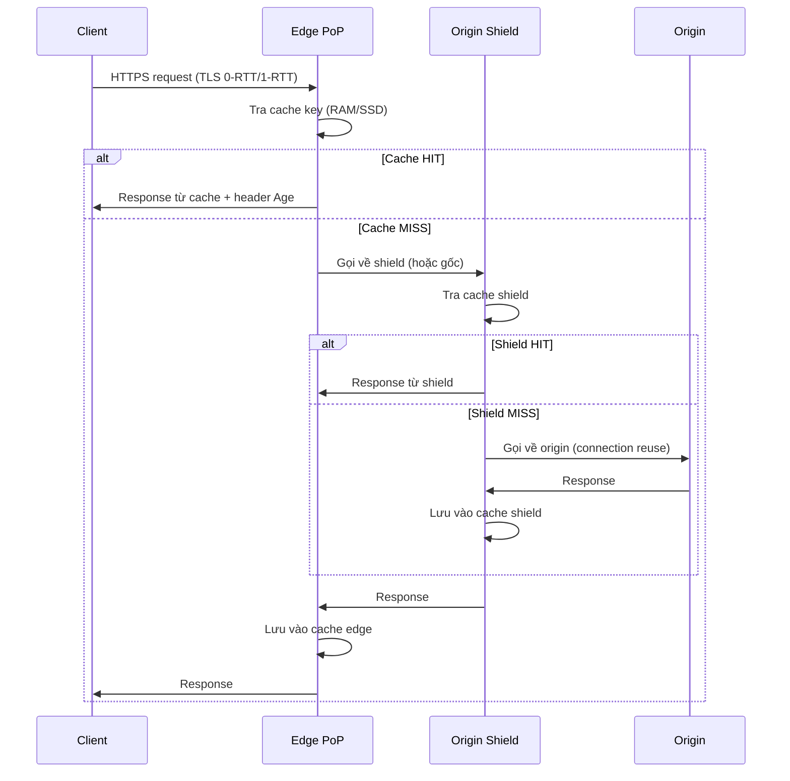

# How does a CDN improve performance?

> CDN (Content Delivery Network) cải thiện hiệu năng bằng cách đưa nội dung đến gần người dùng (rút ngắn RTT), cache ở edge để giảm tải origin, và tận dụng connection reuse cùng TCP/QUIC tuning để giảm chi phí khởi tạo kết nối.

Chủ đề: Networking · Ngày: 2026-10-15

## 0. Nền tảng trước khi đọc

**Bối cảnh:** Cách trình duyệt, ứng dụng và máy chủ gửi dữ liệu cho nhau. Mỗi bước có giao thức, độ trễ và kiểu lỗi riêng.

**Nói đơn giản:** CDN đặt bản sao nội dung ở nhiều điểm gần người dùng, giảm quãng đường mạng và giảm tải server gốc.

**Từ khóa cần biết:** client = bên gửi request; server = bên phục vụ; packet = mảnh dữ liệu đi qua mạng.

**Ví dụ dễ hình dung:** Ảnh sản phẩm được trả từ edge gần người mua thay vì đi xuyên về origin ở một khu vực khác.

Khi đọc, luôn hỏi ba câu: nó giải quyết vấn đề gì, nó làm việc theo những bước nào, và khi nào không nên dùng?

**Cách học bài này:** Đọc phần này trước để nắm từ khóa; đọc phần 1 để lấy câu trả lời 30 giây; đọc phần 2 để hiểu cơ chế; cuối cùng mở từng câu hỏi ở phần 3 để luyện nói. Các con số và lệnh trong bài là bằng chứng cho câu trả lời, không cần học thuộc nếu chưa hiểu cơ chế.

## 1. Là gì


## 2. Cơ chế cốt lõi
### Đọc nhanh trước khi đi sâu

**Ý chính:** CDN đặt bản sao nội dung ở nhiều điểm gần người dùng, giảm quãng đường mạng và giảm tải server gốc.

**Ví dụ interview:** Ảnh sản phẩm được trả từ edge gần người mua thay vì đi xuyên về origin ở một khu vực khác.

**Luồng 4 bước:**

1. Ứng dụng tạo request với tên host, port và dữ liệu.
2. OS và các giao thức mạng tìm đường rồi chuyển packet tới server.
3. Server xử lý request và trả response qua kết nối phù hợp.
4. Client kiểm tra response, cache hoặc render dữ liệu cho người dùng.

**Nói như trong interview:** CDN đặt bản sao nội dung ở nhiều điểm gần người dùng, giảm quãng đường mạng và giảm tải server gốc. Hãy nói theo bốn bước trên trước; nếu interviewer hỏi sâu, chuyển sang cơ chế **Đọc nhanh trước khi đi sâu**, rồi nêu trade-off và failure mode ở các phần sau.

### 2.1. DNS routing tới PoP gần nhất

Khi client truy vấn DNS cho `cdn.example.com`, CDN trả IP của edge gần nhất. Hai cách chính:

- **Anycast**: cùng một IP được quảng bá từ nhiều vị trí trong BGP. Router Internet định tuyến client tới PoP gần nhất. Cloudflare, Fastly dùng cách này. Failover tự động: nếu một PoP chết, BGP tự rút route, traffic đi tới PoP kế tiếp trong 10-60 giây.
- **Geo-DNS (unicast)**: DNS trả IP khác nhau tuỳ vị trí resolver. Akamai truyền thống dùng cách này. Có thể dùng EDNS Client Subnet (RFC 7871) để resolver gửi subnet của client, giúp CDN trả IP chính xác hơn. Failover phụ thuộc DNS TTL.

DNS lookup thường < 1 ms với warm cache ở resolver, nhưng cold cache có thể mất 50-300 ms.

### 2.2. TLS termination và connection reuse

Khi client kết nối tới edge:

- TLS handshake: TLS 1.3 cần 1 RTT, QUIC/HTTP3 có 0-RTT cho session resume (có rủi ro replay attack, nên chỉ dùng cho read-only request).
- Edge chấp nhận HTTPS từ client, dùng certificate của bạn (BYOC) hoặc shared SAN wildcard.
- Edge mở kết nối tới origin (qua mạng nội bộ CDN, thường có route tối ưu). Kết nối này được giữ mở (keep-alive) và tái sử dụng cho nhiều request.

**Connection reuse quan trọng**: một origin connection phục vụ hàng nghìn request. Nếu mỗi request phải mở kết nối mới, chi phí TCP+TLS (3+1 RTT tới origin) cộng vào TTFB. Reuse giảm chi phí này xuống gần 0.

### 2.3. Cache lookup, key, và hierarchy

**Cache key** mặc định: `(scheme, host, path)`. Tuỳ CDN mà query string được bao gồm hay bỏ qua. `Vary` header trong response ảnh hưởng cache key: response có `Vary: Accept-Encoding` thì cache key cho client `Accept-Encoding: gzip` và `Accept-Encoding: br` khác nhau. `Vary: *` (cứng âm) nghĩa là "mọi header ảnh hưởng response" — RFC 7234 cấm shared cache cache response này, CDN không cache → hit ratio 0%.

Cache được lưu ở nhiều tier trong edge:

- **L1: RAM** — tra trong < 1 µs, vài GB, chứa hot key.
- **L2: SSD/NVMe** — tra trong ~100 µs, vài trăm GB đến vài TB, chứa warm key.
- **L3: HDD/object storage** — tra trong ~5-10 ms, chứa cold key.

**Cache hierarchy trong mạng CDN**: edge (gần user) → origin shield / regional tier (gộp request cùng URL từ nhiều edge) → origin. Shield đặc biệt hữu ích khi 1.000 edge cùng miss một URL: shield chỉ gửi 1 request tới origin thay vì 1.000.

### 2.4. Luồng một request qua CDN



*Sơ đồ: client → edge → tra cache → miss → shield → origin; response lan ngược lại và được cache ở mỗi tier.*

### 2.5. Request coalescing (collapsed forwarding)

Khi nhiều request tới cùng một cache key cùng lúc và key chưa có trong cache, edge có hai lựa chọn:

1. **Không coalesce**: mỗi request gọi riêng về origin. Origin chịu N request thay vì 1. Nhanh nhưng tốn tải origin.
2. **Coalesce**: edge giữ request đầu tiên, các request sau "đợi" response của request đầu. Khi response về, phân phối cho tất cả request đang đợi và cache.

Coalesce quan trọng khi có thundering herd (sau purge), traffic spike (breaking news), hoặc miss từ cold cache (vùng CDN mới). Fastly mặc định bật coalesce. Cloudflare và CloudFront mặc định không bật.

### 2.6. Cache-Control và các directive quan trọng

`Cache-Control` ở response do origin hoặc CDN đặt:

- `max-age=N` — client cache trong N giây.
- `s-maxage=N` — chỉ áp dụng cho shared cache (CDN), ưu tiên cao hơn `max-age`. Nếu không set, CDN có thể dùng mặc định vendor (vài giây đến vài phút).
- `private` — chỉ cache ở client, không ở shared cache. Dùng cho response cá nhân hoá.
- `no-store` — không cache ở đâu cả. Dùng cho dữ liệu nhạy cảm (token, PII).
- `no-cache` — cache được, nhưng mỗi lần dùng phải revalidate.
- `stale-while-revalidate=N` — trả response cũ ngay, đồng thời fetch response mới ở background.
- `stale-if-error=N` — nếu origin lỗi (5xx, timeout), trả response cũ trong N giây thay vì 502/504.

**Ví dụ cho trang chủ thay đổi mỗi 5 phút:**

```
Cache-Control: public, max-age=60, s-maxage=300, stale-while-revalidate=60, stale-if-error=86400
```

- Browser cache 60 giây, CDN cache 300 giây.
- Trong 60 giây sau khi hết hạn, CDN trả response cũ và fetch mới ở background.
- Nếu origin lỗi trong 24 giờ, CDN trả response cũ thay vì 502.

### 2.7. Vary và cache key explosion

- `Vary: User-Agent` — mỗi user-agent là một cache key riêng, phân mảnh hàng nghìn giá trị → hit ratio giảm.
- `Vary: Accept-Language` — hợp lý cho i18n, vài key (en, vi, fr) chấp nhận được.
- `Vary: Accept-Encoding` — cần thiết cho Brotli và gzip cùng tồn tại.
- `Vary: *` — CDN từ chối cache → hit ratio 0%.
- `Vary: Cookie` — mỗi user là một cache key → hit ratio gần 0%. Pitfall: nhiều CMS set `Vary: Cookie` mặc định, khiến CDN vô tác dụng.
- `Set-Cookie` trong response: CDN mặc định không cache (vì cookie là user-specific).

### 2.8. TCP/QUIC tuning

CDN tinh chỉnh TCP cho kết nối tới origin:

- **Initial congestion window** (`initcwnd`): Linux mặc định 10 packet (RFC 6928), CDN thường tăng lên 32-50 packet để first flight lớn hơn. Cải thiện TTFB cho response lớn (>100 KB).
- **TCP Fast Open (TFO)**: gửi data trong SYN packet đầu tiên, tiết kiệm 1 RTT.
- **BBR congestion control**: thuật toán của Google, tận dụng bandwidth tốt hơn CUBIC trong điều kiện loss cao.
- **HTTP/2 multiplexing**: một TCP connection phục vụ nhiều request song song, giải quyết head-of-line blocking ở HTTP/1.1.
- **HTTP/3 (QUIC)**: stream độc lập, không bị head-of-line blocking ở tầng TCP. 0-RTT cho session resume.

### 2.9. Quan sát tận mắt

Xem header response và cache status:

```bash
# Lần đầu: thường MISS
curl -sS -D - -o /dev/null https://cdn.example.com/static/app.css

# Lần hai: HIT (hoặc REVALIDATED)
curl -sS -D - -o /dev/null https://cdn.example.com/static/app.css
```

Header quan trọng:
- `Age` — số giây response đã ở trong cache. Age = 0 → vừa cache hoặc MISS.
- `X-Cache` (CloudFront) / `CF-Cache-Status` (Cloudflare) / `X-Served-By` (Fastly) — trạng thái cache.
- `Cache-Control: max-age=...` và `s-maxage=...` — TTL.
- `Vary` — header dùng để tính cache key.

### Ví dụ chạy từng bước

Kịch bản: trang thương mại điện tử phục vụ 390.000 req/s qua CloudFront. Edge PoP ở Singapore phục vụ user Đông Nam Á. Origin ở `us-east-1`. Tám URL pattern có cache ratio và traffic khác nhau. Tính hit ratio trung bình và độ trễ có trọng số, đã tính lại bằng script.

Bước 0. Trạng thái: edge Singapore cold cache. Origin `us-east-1` đang phục vụ request thẳng, p50 ~400 ms (cross-region). Edge hit latency ~15 ms, miss latency ~80 ms (edge → origin qua mạng nội bộ CDN).

Bước 1. Cache warm tĩnh: `/static/app.css`, `/static/app.js`, `/img/logo.png` đạt hit ratio 95–99% sau vài phút deploy vì content hash + TTL 1 năm. URL `/`, `/static/*` cùng dùng asset.

Bước 2. Cache warm API: `/api/products` cache 20% (giá thay đổi mỗi 5 phút, `s-maxage=300`). `/api/cart`, `/api/user`, `/api/feed` cache 5–10% (cá nhân hoá, có `Cookie`).

Bước 3. Tính hit ratio trung bình theo request count: tổng 390.000 req/s, hit 76,03%, miss 23,97% (đã tính lại bằng script).

Bước 4. Tính độ trễ có trọng số: `avg = Σ req_i × (hit_ratio_i × 15 + miss_ratio_i × 80) / Σ req_i = 30,58 ms`. So với không CDN: mọi request đi thẳng origin ~400 ms → cải thiện ~13 lần.

Bước 5. Origin load: 93.500 req/s (23,97%). Trong đó `/api/cart` + `/api/user` + `/api/feed` = 56.000 req/s (chiếm 60% origin load) dù chỉ 5–10% cache ratio.

| URL pattern | req/s | hit% | eff latency | gánh origin |
|---|---|---|---|---|
| `/static/*` (3 file) | 190.000 | 97 | 16,5 ms | 4.500 |
| `/` | 100.000 | 99 | 15,7 ms | 1.000 |
| `/api/products` | 40.000 | 20 | 67,0 ms | 32.000 |
| `/api/cart` | 30.000 | 5 | 76,8 ms | 28.500 |
| `/api/user+feed` | 30.000 | 8 | 75,4 ms | 27.500 |
| **Tổng 8 URL** | **390.000** | **76,03** | **30,58 ms** | **93.500** |

Nếu chỉ nhìn hit ratio 76% nghe ổn nhưng origin vẫn chịu 93.500 req/s vì 60% rơi vào 4 URL API cá nhân hoá. Đây là điểm Câu 4 (hit ratio 95% nhưng origin quá tải) và Câu 16 (true/false hit ratio cao = origin rảnh) đào sâu. Cách xử lý: tách URL cá nhân hoá khỏi URL công khai (`/api/products` vs `/api/cart/user-X`), tăng `s-maxage` cho `/api/products` còn `private` cho `/api/cart`, bật origin shield để gộp request.

Nếu một URL hot bị purge (vd `/static/app.css`): 80.000 req/s rơi vào miss đồng thời → thundering herd. Bật request coalescing thì chỉ 1 request đi tới origin, các request khác đợi response → origin load thêm 1 req/s trong khoảng thời gian fetch.

Điều rút ra: cache hit ratio tổng có thể cao trong khi một nhóm URL nhỏ vẫn chiếm phần lớn origin load. Đây là lý do metric cache hit ratio phải tách theo URL pattern và bandwidth, không chỉ request count. Liên hệ Câu 4, Câu 7, Câu 15 trong phần phỏng vấn.

## 3. Câu hỏi phỏng vấn

### 3A. Câu hỏi đào sâu
<details class="qa">
<summary>Câu 1. CDN cải thiện hiệu năng bằng cách nào, và tại sao tốc độ ánh sáng là ràng buộc cứng?</summary>

**Trả lời ngắn:** CDN đặt edge PoP gần người dùng, rút RTT từ hàng trăm ms xuống hàng chục ms. Đồng thời, CDN cache response ở edge, giảm tải origin. Tốc độ ánh sáng trong sợi quang ~200.000 km/s là ràng buộc vật lý — không phần mềm nào sửa được.

**Đào sâu:**
- Tốc độ ánh sáng trong sợi quang ~200.000 km/s, tức ~5 ms mỗi 1.000 km. RTT xuyên đại dương tối thiểu ~150 ms. Thực tế qua nhiều hop: 250-400 ms.
- RTT từ user Tokyo tới origin Virginia: ~250-400 ms. CDN đặt edge Tokyo → RTT ~5-30 ms. Cải thiện 10-50 lần về TTFB.
- CDN còn giảm TLS handshake: client handshake với edge (1 RTT), edge handshake riêng với origin (1 RTT). Client không phải handshake trực tiếp với origin xa.
- Cache hit ratio >90% → origin chỉ phục vụ ~10% request. Origin có thể nhỏ hơn nhiều hoặc chịu được traffic spike lớn hơn nhiều.
- Caching là cải thiện **throughput**, không phải **latency**. User vẫn đợi byte truyền từ edge, nhưng edge gần hơn origin.

**Bẫy:** Nói "CDN tăng tốc độ website" mà không phân biệt latency (RTT) và throughput (bandwidth, RPS). Caching giảm throughput bottleneck, edge proximity giảm latency.

**Follow-up:** User ở vùng không có PoP thì sao? CDN định tuyến tới PoP kế tiếp (RTT cao hơn). Tính bằng `traceroute` tới IP CDN. Hoặc dùng CDN có PoP ít dày hơn ở vùng đó → chấp nhận RTT cao hơn.
</details>

<details class="qa">
<summary>Câu 2. Anycast khác gì với DNS-based geo-routing, và failover nhanh hơn cái nào?</summary>

**Trả lời ngắn:** Anycast dùng cùng một IP được quảng bá từ nhiều PoP, router BGP định tuyến client tới PoP gần nhất. Geo-DNS trả IP khác nhau tuỳ vị trí resolver. Anycast failover nhanh hơn (10-60 giây, tự động), Geo-DNS phụ thuộc DNS TTL.

**Đào sâu:**
- **Anycast**: cùng IP quảng bá từ nhiều vị trí. Nếu PoP chết, BGP tự rút route, traffic đi tới PoP kế tiếp. Failover 10-60 giây, tự động. Nhược điểm: khó kiểm soát "user nào tới PoP nào", debug phức tạp.
- **Geo-DNS**: DNS trả IP khác theo vị trí resolver. EDNS Client Subnet (RFC 7871) cải thiện độ chính xác. Failover phụ thuộc TTL — nếu TTL 24 giờ, recovery mất đến 24 giờ. Ưu điểm: kiểm soát chi tiết, dễ debug bằng `dig`.
- Cloudflare chủ yếu anycast. Akamai truyền thống chủ yếu Geo-DNS. Fastly kết hợp cả hai.
- Anycast có vấn đề với TCP: mỗi PoP có IP riêng về mặt vật lý nhưng cùng IP. TCP connection có thể bị re-route giữa các PoP khi BGP thay đổi, gây reset. CDN hiện đại dùng anycast cho SYN, sau đó sticky connection tới một edge.

**Bẫy:** Nghĩ anycast "lúc nào cũng tốt hơn". Anycast tốt cho failover nhưng khó cho advanced routing (ví dụ route user VIP tới PoP đặc biệt).

**Follow-up:** Làm sao kiểm tra CDN dùng anycast hay geo-DNS? `dig +short cdn.example.com` từ nhiều resolver ở các vùng khác nhau. Cùng IP → anycast. IP khác → geo-DNS. Kết hợp `traceroute` để xem path.
</details>

<details class="qa">
<summary>Câu 3. Cache key được tính thế nào, và Vary ảnh hưởng gì đến cache hit ratio?</summary>

**Trả lời ngắn:** Cache key mặc định: `(scheme, host, path)`. `Vary` header thêm header vào cache key. `Vary: *` cấm shared cache cache response đó, CDN không cache → hit ratio 0%.

**Đào sâu:**
- `Vary: Accept-Encoding` — response cho client gzip và Brotli được cache riêng. Cần thiết.
- `Vary: Accept-Language` — hợp lý cho i18n, vài key (en, vi, fr) chấp nhận được.
- `Vary: User-Agent` — mỗi user-agent (hàng nghìn) là một cache key riêng → memory đầy, hit ratio thấp. Không nên dùng trừ khi response thật sự phụ thuộc.
- `Vary: Cookie` — mỗi user là một cache key → hit ratio gần 0%. Pitfall: nhiều CMS set `Vary: Cookie` mặc định, khiến CDN vô dụng.
- `Vary: *` — theo RFC 7234, CDN từ chối cache → hit ratio 0%. Nhiều dev nghĩ "an toàn" mà đặt,结果是 CDN không cache được gì.
- `Set-Cookie` trong response: CDN mặc định không cache (vì cookie là user-specific).
- CDN cho phép custom cache key: thêm hoặc bỏ qua query string, normalize header, thêm `Vary: Host` cho multi-tenant.

**Bẫy:** Set `Vary: Cookie` cho response công khai (vì thấy cookie trong request) → CDN không cache được gì.

**Follow-up:** Làm sao cache được response có nội dung phụ thuộc user? Tách response thành 2 phần: phần công khai (cache được) và phần user-specific (fetch riêng qua JS, không cache). Hoặc dùng edge compute (Cloudflare Workers) để inject user-specific data vào response công khai.
</details>

<details class="qa">
<summary>Câu 4. Cache hit ratio 95% nhưng origin vẫn quá tải. Bạn điều tra thế nào?</summary>

**Trả lời ngắn:** Phân tích 5% miss đó là URL nào. Có thể 5% miss trên 100 URL hot (chiếm 80% traffic) rất khác với 5% miss trên 100.000 URL cold. Kiểm tra `Cache-Control`, `Vary`, `Set-Cookie` của URL hot bị miss.

**Đào sâu:**
- Bước 1: tách miss theo URL pattern. 5% miss trên 100 URL hot (chiếm 80% traffic) → origin phải phục vụ khối lượng lớn. 5% miss trên 100.000 URL cold → origin chịu nhẹ.
- Bước 2: kiểm tra `Cache-Control` cho URL hot bị miss. `no-store` hoặc `private` → không cache được. `max-age` quá ngắn (1-2 giây) → miss liên tục. `Set-Cookie` trong response → CDN không cache.
- Bước 3: kiểm tra `Vary`. `Vary: Cookie` hoặc `Vary: User-Agent` rộng làm cache key phình to, URL "giống nhau" vẫn miss.
- Bước 4: kiểm tra có URL hot mới không (breaking news, dashboard real-time). URL mới có cache hit ratio 0 cho tới khi warm.
- Bước 5: kiểm tra `stale-while-revalidate` có đang chạy không. Nếu không, mỗi lần TTL hết đều miss gọi origin.
- Khắc phục: tăng TTL cho URL hot (chấp nhận stale), bật `stale-while-revalidate`, bật origin shield, pre-warm cache cho URL hot mới, tách URL cá nhân hoá ra khỏi URL công khai.

**Bẫy:** Tăng TTL cho tất cả URL dẫn tới stale content. Hoặc chỉnh `Vary` mà không purge → cache cũ vẫn còn.

**Follow-up:** Cache hit ratio 99% nhưng một số PoP vẫn miss nhiều hơn, vì sao? Cold PoP (user mới ở vùng) chưa warm. CDN vừa deploy code mới, cache bị invalidate. Cần pre-warm hoặc accept cache miss tạm thời.
</details>

<details class="qa">
<summary>Câu 5. Thiết kế CDN cho platform live streaming 100.000 viewer đồng thời. Yếu tố nào cần quan tâm nhất?</summary>

**Trả lời ngắn:** Bandwidth lớn (100.000 × 5 Mbps = 500 Gbps), live latency (HLS ~10-30 giây), origin shield để gộp request, multi-CDN để dự phòng. Edge phải có SSD lớn để chứa segment hot, memory cache chỉ chứa manifest.

**Đào sâu:**
- **Bandwidth**: 100.000 viewer × 5 Mbps (HD) = 500 Gbps. Origin phải có egress ít nhất 25 Gbps (nếu CDN cache 95%). CDN phải có capacity aggregate vài Tbps.
- **Giao thức**: HLS hoặc DASH, manifest file (.m3u8, .mpd) được cache, segment (.ts, .m4s) được cache. Manifest phải invalidate liên tục (chứa danh sách segment mới). Segment có thể cache 1+ ngày.
- **Live latency**: HLS thường 10-30 giây (do segment length). Low-latency HLS ~2-5 giây. WebRTC sub-second nhưng không qua CDN dễ.
- **Edge**: phải có SSD lớn để chứa segment hot. Memory cache chỉ chứa manifest và segment đang hot.
- **Origin shield**: gộp request segment từ nhiều edge về một request tới origin. Một edge cần segment, shield kiểm đã có chưa, không thì mới gọi origin.
- **Multi-CDN**: dùng hai CDN (Cloudflare + Fastly) để dự phòng và chọn path tối ưu.

**Bẫy:** Cache segment quá lâu dẫn tới user xem content cũ (clip lặp). Hoặc cache manifest quá ngắn dẫn tới miss liên tục, origin quá tải.

**Follow-up:** Latency < 1 giây (chat live, gaming), CDN có làm được không? CDN truyền thống không phù hợp. Cần CDN hỗ trợ WebRTC hoặc low-latency HLS, hoặc edge compute với UDP relay.
</details>

<details class="qa">
<summary>Câu 6. Khi nào CDN KHÔNG cải thiện hiệu năng, và bạn nên làm gì thay?</summary>

**Trả lời ngắn:** CDN không cải thiện khi API backend 100% cá nhân hoá (không cache được), khi dữ liệu cần consistency tuyệt đối, khi user trong intranet (không qua Internet), hoặc khi traffic quá thấp (< 100 RPS) — chi phí CDN lớn hơn lợi ích.

**Đào sâu:**
- **API backend cá nhân hoá 100%**: mỗi request trả khác nhau theo user. CDN không cache được, hit ratio ~0%. Chỉ giảm RTT nhưng không đáng kể. Cân nhắc edge compute (Cloudflare Workers) để xử lý gần user, hoặc tối ưu origin (cache application, read replica gần user).
- **Intranet**: user trong công ty, không qua Internet. CDN thêm một hop không cần thiết, tăng latency. Dùng internal load balancer.
- **Traffic quá thấp (< 100 RPS)**: chi phí CDN có thể lớn hơn chi phí origin. Tính ROI.
- **Yêu cầu consistency tuyệt đối**: CDN cache có stale (vài giây). Nếu không chấp nhận stale, CDN không phù hợp. Có thể dùng CDN với `no-cache` + revalidate, nhưng lúc đó CDN chỉ làm proxy.
- **Application set `Vary: Cookie` mặc định**: CDN không cache. Sửa code trước.
- **WebSocket streaming lâu dài**: CDN hỗ trợ nhưng không phải use case chính, có thể có giới hạn timeout.

**Bẫy:** Bật CDN cho mọi thứ mà không phân tích. Tốn tiền mà không cải thiện hiệu năng.

**Follow-up:** CDN có thay thế việc tối ưu origin không? Không. CDN cache, origin vẫn phải trả response nhanh cho miss. CDN không tối ưu database, không tối ưu application logic.
</details>

<details class="qa">
<summary>Câu 7. Sáng thứ Hai cache hit ratio giảm từ 95% xuống 60%. Bạn điều tra thế nào?</summary>

**Trả lời ngắn:** Tách cache hit ratio theo URL pattern và trạng thái (HIT/MISS/BYPASS/DYNAMIC). So sánh với deploy gần nhất. Kiểm tra `Cache-Control`, `Vary`, `Set-Cookie` của response mới. Kiểm tra có purge gần đây hoặc URL hot mới không.

**Đào sâu:**
- Bước 1: tách theo URL pattern và trạng thái. Tăng ở `MISS` → cache không có. Tăng ở `BYPASS` → CDN không cache được (do `Vary`, `Set-Cookie`, `Authorization`).
- Bước 2: so sánh với deploy gần nhất. Deploy code mới 30 phút trước → kiểm tra `Cache-Control` hoặc `Vary` mới.
- Bước 3: kiểm tra có URL hot mới không. Breaking news, sản phẩm mới có cache hit ratio 0 cho tới khi warm.
- Bước 4: kiểm tra có purge hàng loạt không. Tìm trong audit log CDN.
- Bước 5: kiểm tra có lưu lượng cá nhân hoá mới không. User mới ở vùng CDN vừa mở, hoặc crawler/scraper không cache được.
- Bước 6: kiểm tra origin có thêm `Set-Cookie`, `Authorization` header không. Nếu origin thêm header mới, CDN có thể bỏ cache.
- Khắc phục: deploy hotfix `Cache-Control` đúng, purge URL bị ảnh hưởng, pre-warm cache cho URL hot mới, bật thêm tier cache.

**Bẫy:** Tăng TTL tạm thời mà không điều tra gốc → tốn tiền vô ích. Hoặc scale origin mà không fix cache issue.

**Follow-up:** Cache hit ratio ổn định nhưng p99 TTFB tăng, vì sao? Cache hit vẫn OK nhưng edge server bị quá tải (CPU, network). Kiểm tra metric edge server, không chỉ cache ratio.
</details>

<details class="qa">
<summary>Câu 8. Một số user báo thấy response lạ (chứa nội dung của user khác). Bạn nghi cache poisoning. Xử lý thế nào trong giờ đầu?</summary>

**Trả lời ngắn:** Kiểm tra `cf-cache-status`/`X-Cache` của response bị báo. Nếu `HIT` cho response chứa nội dung user khác → có khả năng. Kiểm tra `Vary` có đầy đủ không. Purge URL ngay, sửa `Vary`, audit log.

**Đào sâu:**
- Bước 1: xác nhận có phải cache poisoning không. Kiểm tra `cf-cache-status`/`X-Cache`. Nếu `HIT` cho response chứa nội dung user khác → có khả năng.
- Bước 2: kiểm tra `Vary` của response. Nếu `Vary` không đầy đủ (vd `Vary: Accept-Encoding` mà response phụ thuộc `Cookie`) → cache poisoning do `Vary` thiếu.
- Bước 3: kiểm tra `Host` header. Origin không validate `Host` và CDN không `Vary: Host` → user có thể cache response cho `evil.com` rồi user khác nhận.
- Bước 4: kiểm tra cache key. CDN có thể bỏ sót header quan trọng trong cache key (vd `Authorization`).
- Bước 5: audit log để tìm request bất thường. IP lạ, user-agent lạ, header crafted (`X-Forwarded-Host`, `X-Original-URL`).
- Khắc phục: purge URL ngay lập tức. Sửa `Vary` đầy đủ. Cấu hình CDN không cache response có `Authorization`. Thêm `Vary: Host`. Validate `Host` ở origin.
- Sau sự cố: review toàn bộ response có `Vary` để chắc chắn không thiếu. Thêm test "user A cache không bị user B nhận" cho mọi endpoint.

**Bẫy:** Chỉ purge mà không sửa `Vary` → cache poisoning lặp lại. Hoặc vội kết luận bị tấn công mà bỏ qua bug code (Vary thiếu).

**Follow-up:** Cache poisoning thường do nguyên nhân gì? Ba loại chính: (1) `Vary` thiếu header (cookie, authorization), (2) cache key không bao gồm `Host` (multi-tenant), (3) origin cho phép request crafted ghi vào cache (HTTP request smuggling).
</details>

### 3B. Câu hỏi phỏng vấn liên quan

<details class="qa">
<summary>Câu 9. Edge server khác gì origin shield khác gì origin, và request đi qua các tier này thế nào?</summary>

**Trả lời:** Edge là PoP gần client, terminate TLS và trả cache hit; miss đi về shield (tier trung gian) hoặc thẳng origin. Shield gộp nhiều edge cùng miss một URL thành một request tới origin, tránh thundering herd. Origin là server gốc chứa dữ liệu chuẩn.
</details>

<details class="qa">
<summary>Câu 10. Cache hit ratio 95% nghĩa là gì, và tại sao chỉ số này có thể đánh lừa?</summary>

**Trả lời:** Hit ratio = cache_hit / total_request, tỷ lệ request phục vụ từ cache không tới origin. 95% nghe tốt nhưng đánh lừa: 5% miss rơi vào vài URL hot chiếm 80% bandwidth là origin quá tải. Tách theo URL pattern và bandwidth, không chỉ request count.
</details>

<details class="qa">
<summary>Câu 11. Purging khác gì invalidation, và làm sao purge nhanh trên CDN multi-PoP?</summary>

**Trả lời:** Purge xóa một URL/object khỏi cache; invalidation đổi cache key khiến entry cũ không khớp. Multi-PoP purge mất vài giây đến vài chục giây vì phải lan truyền: Fastly ~150 ms (HTCP), Cloudflare ~30 s, CloudFront vài chục giây. Surrogate-Key (Fastly) cho phép purge theo tag thay vì từng URL.
</details>

<details class="qa">
<summary>Câu 12. Nếu origin trả 5xx, CDN xử lý thế nào để user không thấy lỗi?</summary>

**Trả lời:** CDN dùng `stale-if-error=N` trả response cũ trong N giây thay vì 502/504 khi origin lỗi (5xx, timeout, connection refused), cần bật trong `Cache-Control` hoặc CDN rule. CDN có thể failover sang secondary origin hoặc trả trang lỗi tĩnh cached sẵn. Không nên để origin lỗi mà không có stale fallback.
</details>

<details class="qa">
<summary>Câu 13. TTFB p99 tăng gấp đôi dù cache hit ratio không đổi. Nguyên nhân và cách điều tra?</summary>

**Trả lời:** Cache hit ratio ổn nhưng edge CPU/network bão hoà, hoặc TLS handshake chậm (DoS, cipher không tối ưu). Kiểm metric edge (CPU, NIC, active connection), không chỉ cache ratio. Có thể upstream (shield, origin) chậm; tách p99 theo PoP và upstream.
</details>

<details class="qa">
<summary>Câu 14. CDN có thay thế được load balancer hay tối ưu backend không?</summary>

**Trả lời:** Không. CDN chỉ là reverse proxy có cache phân tán. Backend vẫn cần LB phân phối giữa các instance, application cache (Redis), database tuning, vì CDN không giải quyết N+1 query, slow query hay connection pool exhaustion. CDN giảm traffic tới origin nhưng không tối ưu logic nghiệp vụ.
</details>

<details class="qa">
<summary>Câu 15. "Cache hit ratio 95% nghe rất tốt" trong khi origin vẫn quá tải. Có mâu thuẫn không?</summary>

**Trả lời:** Không mâu thuẫn. 5% miss có thể rơi vào vài URL hot chiếm phần lớn bandwidth (vd `GET /feed` trả 500 KB, miss 5% = rất nhiều GB). Tách miss theo URL pattern và bandwidth (không chỉ request count) để tìm URL hot bị miss; raise TTL cho vài chục URL hot có thể giải tải origin ngay.
</details>

<details class="qa">
<summary>Câu 16. True or false: "CDN có cache hit ratio càng cao thì origin càng rảnh."</summary>

**Trả lời:** Sai nếu chỉ nhìn tổng hit ratio. Cùng tỷ lệ hit, origin rảnh hoặc quá tải tuỳ 5% miss rơi vào URL nào. Tách miss theo URL hot/cold và bandwidth phục vụ, không phải chỉ count request. Vài URL hot bị miss có thể chiếm 80% bandwidth tới origin.
</details>

## 4. Đánh đổi và sự cố production

### 4.1. So sánh các phương án

| Tiêu chí | CDN anycast cao cấp (Cloudflare Pro, Fastly) | CDN tier trung (CloudFront, Akamai) | Không CDN, multi-region origin |
|---|---|---|---|
| Độ trễ thêm mỗi request | ~5-30 ms (edge gần) | ~10-50 ms (PoP ít dày hơn) | ~50-400 ms (RTT tới region gần nhất) |
| Throughput | Rất cao (10+ Tbps aggregate) | Cao (1-10 Tbps) | Phụ thuộc region (vài chục Gbps) |
| Cache hit ratio tiềm năng | 90-99% cho tĩnh | 80-95% | 0% (không có cache chia sẻ) |
| Chi phí egress | $0.01-0.20/GB | $0.02-0.08/GB | $0.02-0.09/GB (cloud egress) |
| Failure mode | PoP chết, anycast reroute; miss hàng loạt sau purge | Tương tự nhưng failover chậm hơn (DNS TTL) | Region chết, traffic đi về region khác (RTT cao) |
| Độ phức tạp code | Thấp (CDN là proxy) | Thấp | Cao (replication, multi-region DB) |

### 4.2. Failure mode

| Triệu chứng | Nguyên nhân gốc | Cách kiểm tra | Cách sửa |
|---|---|---|---|
| Cache hit ratio giảm mạnh | `Vary` mới rộng (`Vary: *`, `Vary: User-Agent`), `Set-Cookie` thêm vào response | `curl` kiểm tra `Vary` và `cf-cache-status` | Sửa `Vary`, purge URL, pre-warm cache |
| Origin quá tải dù hit ratio cao | 5% miss trên URL hot (chiếm 80% traffic) | Tách miss theo URL pattern | Tăng TTL, bật `stale-while-revalidate`, bật shield |
| User thấy nội dung cũ | TTL dài, purge không lan ra hết PoP | Gọi từ 3 vùng khác nhau sau purge | Purge lại, giảm TTL, dùng CDN có purge nhanh |
| User thấy response lạ (poisoning) | `Vary` thiếu, cache key không bao gồm `Host` | Kiểm tra `Vary`, `Host` header | Purge ngay, sửa `Vary`, validate `Host` ở origin |
| Origin egress bill tăng vọt | Hit ratio giảm do `Vary` mới, traffic spike, abuse | Monitor egress per URL | Deploy `Cache-Control` đúng, bật rate limit, audit log |

### 4.3. Khi nào nên dùng CDN

- Website có user phân tán toàn cầu, RTT tới một region không chấp nhận được cho 50% user.
- Nội dung tĩnh lớn (CSS, JS, ảnh, video): cache hit ratio >90% dễ đạt với TTL 1 năm và `immutable` cho file có hash.
- Cần giảm tải cho origin: origin là API backend nhỏ, không chịu nổi traffic lớn.
- Cần bảo vệ DDoS: CDN có dung lượng chống DDoS lớn hơn origin nhiều.
- Cần TLS termination tập trung, HTTP/3, Brotli, image optimization.

### 4.4. Khi nào không nên dùng

- API backend cá nhân hoá 100%: mỗi request trả khác nhau, hit ratio ~0%.
- Yêu cầu consistency tuyệt đối: mỗi request phải trả dữ liệu mới nhất.
- Intranet: user trong mạng nội bộ, không đi qua Internet.
- Traffic quá thấp (< 100 RPS): chi phí CDN lớn hơn lợi ích.
- Application set `Vary: Cookie` mặc định: CDN không cache. Sửa code trước.

## 5. Cheat sheet

| Chủ đề | Con số hoặc quy tắc cần nhớ |
|---|---|
| Ràng buộc vật lý | Tốc độ ánh sáng trong sợi quang ~200.000 km/s, ~5 ms mỗi 1.000 km. RTT xuyên đại dương tối thiểu ~150 ms. |
| Cải thiện CDN | Cache hit ratio >90% cho tĩnh. TTFB giảm 10-50 lần từ edge gần user. |
| TLS handshake | TLS 1.3 ~1 RTT, QUIC 0-RTT (có rủi ro replay). |
| Cache key & Vary | Mặc định `(scheme, host, path)`. `Vary: *` cấm cache. Tránh `Vary: Cookie`. |
| Cache tier | L1 RAM < 1 µs, L2 SSD ~100 µs, L3 HDD ~5-10 ms. |
| TTL đề xuất | Static có hash: 1 năm `immutable`. API cá nhân hoá: `private, no-store`. |
| Origin load | `origin_RPS = total_RPS × (1 - cache_hit_ratio)`. |
| Purge latency | Fastly ~150 ms, Cloudflare ~30 s, CloudFront ~vài chục giây. |
| Coalesce | Fastly bật mặc định, Cloudflare/CloudFront tắt mặc định. Quan trọng cho thundering herd. |
| Connection reuse | CDN giữ connection mở tới origin, tái sử dụng hàng nghìn request. |

Học tiếp: [TCP vs UDP](tcp-vs-udp.md), [DNS](dns-how-it-works.md), [HTTP vs HTTPS](http-vs-https.md).
