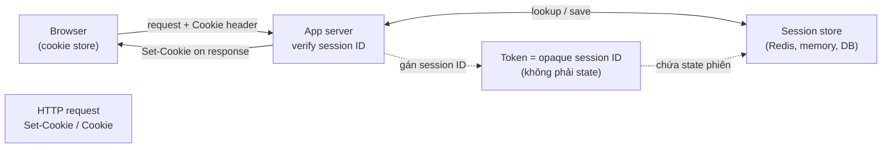
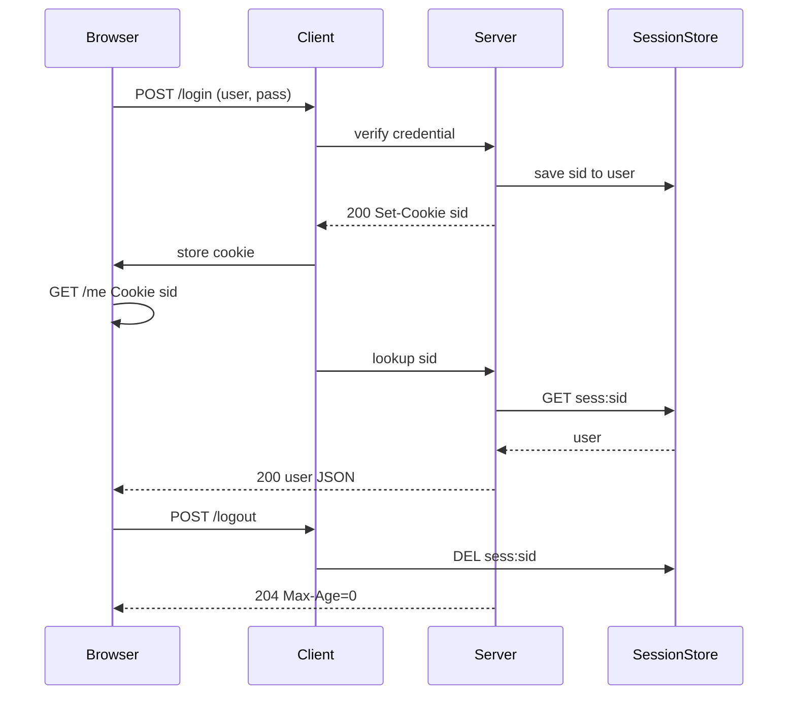
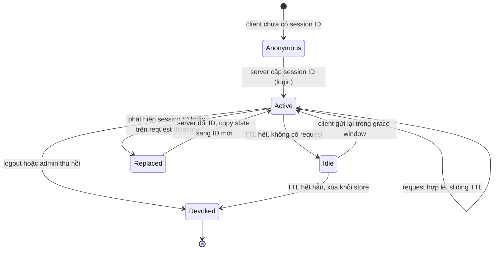

# What is the difference between cookies and sessions?

> Cookie là cơ chế lưu dữ liệu phía client và header HTTP `Set-Cookie` / `Cookie`. Session là trạng thái phiên phía server, thường được khóa bằng một session ID mang theo cookie. Hai khái niệm không cùng cấp — đây là điểm nhầm lẫn hay bị hỏi nhất.

Chủ đề: Networking · Ngày: 2026-10-15

## 1. Là gì

Cookie là một cặp `name=value` do server gửi qua header `Set-Cookie` trong response, trình duyệt lưu lại theo (domain, path) và tự đính kèm vào các request tiếp theo qua header `Cookie`. Cookie có các cờ `HttpOnly`, `Secure`, `SameSite`, `Domain`, `Path`, `Max-Age`/`Expires`; giới hạn ~4KB mỗi cookie (xấp xỉ, phụ thuộc trình duyệt).

Session là trạng thái của một lượt tương tác (đã đăng nhập, giỏ hàng) lưu phía server — in-memory, Redis, hoặc DB. Server sinh session ID ngẫu nhiên làm khóa tra trạng thái; ID thường được gửi qua cookie, nhưng cũng có thể qua URL hoặc hidden form.

Hai khái niệm không đối xứng. Cookie là phương tiện vận chuyển, session là trạng thái. Có thể có session mà không dùng cookie (URL rewriting); có cookie mà không có session (cookie tuỳ chọn giao diện).

Giả định: bài này nói về HTTP hiện đại (RFC 6265), focus session phía server có session ID mang bằng cookie. Không đi sâu Kerberos ticket, OAuth stateful, hay game networking.

### Vị trí trong hệ thống



*Cookie là header HTTP + nơi lưu phía client. Session là state phía server, được khoá bằng session ID mà cookie mang theo.*

### Trả lời 30 giây

"Cookie là một header HTTP và một vùng lưu phía trình duyệt: server trả `Set-Cookie`, trình duyệt tự gửi `Cookie` cho mọi request cùng (domain, path) trong thời hạn. Session là trạng thái phía server; server sinh session ID ngẫu nhiên, lưu vào store và dùng cookie mang ID qua lại. Session ID chỉ là khoá tra — trạng thái thật nằm ở server, không có trong cookie. Cookie là phương tiện, session là trạng thái; cookie có thể không có session, session có thể không dùng cookie."

## 2. Cơ chế cốt lõi

### 2.1. Cookie như header HTTP — wire format ngắn

Cookie được gửi qua hai header `Set-Cookie` (response, server gửi cho client) và `Cookie` (request, client tự đính kèm). RFC 6265 định nghĩa các thuộc tính hay bị hỏi nhất trong phỏng vấn:

| Thuộc tính | Ý nghĩa | Cần nhớ |
|---|---|---|
| `HttpOnly` | JavaScript không đọc được qua `document.cookie` | Chặn XSS đánh cắp cookie |
| `Secure` | Chỉ gửi qua HTTPS | Cần để cookie không bị sniff trên mạng |
| `SameSite=Lax/Strict/None` | Khi nào gửi cookie trong cross-site request | `Strict` chặn hầu hết, `None` cần `Secure` |
| `Domain` | Phạm vi áp dụng | Thiếu → chỉ current-host; có → kèm subdomain |
| `Path` | Phạm vi URL gửi kèm | Mặc định path của request tạo cookie |
| `Max-Age` / `Expires` | Tuổi thọ giây / ngày tuyệt đối | `Max-Age=0` xoá cookie |
| Tiền tố `__Host-` | Bắt buộc `Secure`, không `Domain`, `Path=/` | Chống subdomain độc hại đặt cookie |
| Tiền tố `__Secure-` | Bắt buộc `Secure` | Yếu hơn `__Host-` |

Kích thước tối đa mỗi cookie ~4KB, mỗi domain giới hạn ~20-50 cookie tuỳ trình duyệt — đây là lý do cookie không phù hợp để chứa state lớn (giỏ hàng, profile). Giá trị cũng nên URL-encode vì một số ký tự bị cấm trong wire (space, `;`, `,`).

### 2.2. Luồng login bằng session và cookie



*Luồng login bằng session ID mang qua cookie. Logout thực sự phải xoá state phía server, không chỉ xoá cookie client.*

Các bước và chi phí:

1. Client gửi `POST /login` qua TLS, server xác minh credential. Băm mật khẩu bằng argon2id/bcrypt tốn ~50-500 ms CPU có chủ đích (chống brute-force). Constant-time compare để chặn timing attack.
2. Server sinh session ID bằng CSPRNG (không phải `Math.random`), tối thiểu 128 bit entropy theo OWASP. Độ dài phổ biến: 128-256 bit, biểu diễn base64url ~22-43 ký tự.
3. Server lưu `sid -> {user_id, expires_at, ip, ua, ...}` vào store. In-memory nhanh nhưng mất khi restart; Redis là lựa chọn phổ biến vì replication và TTL tích hợp; DB thì thêm 1 query mỗi request.
4. Server trả `Set-Cookie: sid=...; HttpOnly; Secure; SameSite=Lax; Path=/; Max-Age=3600`. Mỗi request sau: trình duyệt tự gửi `Cookie: sid=...`, server tra store ~0.5-1 ms trong mạng nội bộ.
5. Logout: xoá key trong store (`DEL sess:sid`) và trả `Set-Cookie: sid=; Max-Age=0`. Xoá chỉ cookie client là sai — kẻ tấn công có thể gửi lại ID và server vẫn tra ra.
6. **Đổi session ID sau login** (session fixation prevention): nếu trước login client đã gửi một session ID do kẻ tấn công đặt sẵn, sau login phải sinh ID mới, copy state sang ID mới, xoá ID cũ.

### 2.3. Vòng đời session và sliding TTL



*Máy trạng thái session: từ cấp → dùng (sliding TTL) → idle/revoked. Replaced là nhánh session fixation: phát hiện ID cũ trên request sau login → đổi ID.*

Hai kiểu TTL:

- **Absolute expiration**: phiên hết hạn ở thời điểm cố định (ví dụ 24h sau login). Đơn giản, dễ đoán cho tester. Không phù hợp cho người dùng hoạt động liên tục.
- **Sliding expiration**: mỗi request hợp lệ, server kéo dài TTL (Redis `EXPIRE`). Rủi ro: thiết bị bị đánh cắp vẫn giữ phiên sống nếu kẻ tấn công gửi request trước khi TTL cũ hết. Thực tế thường kết hợp: absolute cap (≤ 7 ngày) + sliding idle window (30 phút).

Idle TTL khác revoke: idle TTL là hết hạn tự nhiên, state có thể được tái sử dụng cho session mới; revoke là chủ động xoá, state bị xoá và session ID nằm trong denylist một khoảng ngắn để chặn reuse.

### 2.4. Session phía server vs session stateless (signed/encrypted cookie)

Hai cách tổ chức "session" hiện nay:

| Khía cạnh | Server-side session (sid + store) | Stateless session (ký/mã hoá toàn bộ state trong cookie) |
|---|---|---|
| Dung lượng gửi trên dây | Chỉ session ID (~22-43 byte base64url) | Toàn bộ state, có thể vài KB |
| Thu hồi | Tức thì: xoá key trong store | Chờ TTL hết, hoặc kèm denylist theo `jti` |
| Scale ngang | Cần shared store (Redis) hoặc sticky session | Không cần shared store, mọi instance đều verify được |
| Yêu cầu | Store phải available cho hot path | Khoá phải rotate, đồng hồ phải đồng bộ |
| Ví dụ | PHP `$_SESSION`, Express session+Redis, Spring Session | JWT ngắn hạn, Flask itsdangerous, Laravel encrypter |

Sticky session (load balancer ghim session vào một instance) giảm độ phức tạp nhưng mất cân bằng tải khi một instance bị chết → session của người dùng đó mất. Shared store (Redis) là lựa chọn phổ biến hơn cho hệ nhiều instance.

### 2.5. Quan sát

Các lệnh thật để kiểm tra cookie và session.

```bash
# Xem cookie server trả về (Set-Cookie header)
curl -sS -D - -o /dev/null -c /tmp/jar.txt -X POST \
  -d 'username=alice&password=...' https://app.example.test/login

# Xem cookie trình duyệt gửi đi
curl -sS -D - -o /dev/null -b /tmp/jar.txt \
  https://app.example.test/me

# Trong Chrome DevTools: Application > Cookies, Network > Response Headers

# Session TTL trong Redis
redis-cli --scan --pattern 'sess:*' | head -5
redis-cli TTL sess:abc123

# Decode JWT (chỉ để quan sát, không dùng làm authn)
echo "$TOKEN" | cut -d. -f2 | tr '_-' '/+' | base64 -d | jq .
```

`Set-Cookie: sid=...; HttpOnly; Secure; SameSite=Lax` là output minh họa, chưa chạy. Cookie flag `HttpOnly` chỉ thấy trong response header, không thấy trong `document.cookie` từ JavaScript.

### Ví dụ chạy từng bước

Kịch bản: user Bob đăng nhập vào trang thương mại điện tử qua Chrome, mua hàng, đăng xuất. Server là Flask 2 instance sau nginx, dùng Redis làm session store. Theo dõi từng bước để thấy sự khác biệt giữa cookie (phương tiện) và session (trạng thái).

Bước 0. Trạng thái: Chrome không có cookie, Redis rỗng, instance A và B không có local session.

Bước 1. Bob POST `/login` (TLS 1.3 ~5 ms). Server nhận, hash mật khẩu argon2id ~200 ms, đúng. Sinh session ID: `openssl rand -hex 32` → 64 ký tự hex (~256 bit). Redis: `SET sess:3f9a... EX 3600 NX` (sliding TTL). Instance A ghi log: `sess:3f9a... → user_id=7 role=customer`.

Bước 2. Server trả `Set-Cookie: sid=3f9a...; HttpOnly; Secure; SameSite=Lax; Path=/; Max-Age=3600`. Trình duyệt lưu vào cookie jar. Session có 2 thuộc tính: `HttpOnly` (JS không đọc được), `Max-Age=3600` (3600 giây tuyệt đối từ lúc đặt, không phải sliding).

Trạng thái: Redis có `sess:3f9a...`, TTL 3600s. Cookie jar có `sid=3f9a...`.

Bước 3. Bob GET `/cart`. Request gửi kèm `Cookie: sid=3f9a...`. Nginx sticky route → instance B. Instance B lookup Redis `GET sess:3f9a...` ~0.8 ms → hit → `user_id=7`. Nếu không sticky: instance B không có session, Redis miss (network partition) → 401.

Bước 4. Bob click "Mua hàng". POST `/orders` cùng cookie. Instance A nạp order, kiểm `owner_id=7`. Pass → 200.

Bước 5. Bob đăng xuất POST `/logout`. Instance A gọi Redis `DEL sess:3f9a...`. Server trả `Set-Cookie: sid=; Max-Age=0`. Chrome xoá cookie.

Trạng thái: Redis entry đã xoá. Cookie đã xoá. Nếu Bob copy session ID trước khi logout, gửi lại → Redis lookup miss → 401.

| Bước | Thao tác | Thời gian | State thay đổi |
|---|---|---|---|
| 1 | TLS + argon2id + sinh session ID + Redis SET | ~205 ms | Redis có `sess:3f9a...` |
| 2 | Browser nhận và lưu Set-Cookie | 0 | Cookie jar có `sid=3f9a...` |
| 3 | GET /cart + Redis lookup + sticky route | ~1 ms | không có |
| 4 | POST /orders + ownership check | ~3 ms | response 200 |
| 5 | DEL Redis + Max-Age=0 cookie | ~1 ms | Redis rỗng, cookie đã xoá |

Nếu Bob đăng xuất mà server chỉ xoá cookie client, không xoá Redis: Bob có thể copy session ID trước khi logout, gửi lại sau → Redis vẫn tra ra → vẫn đăng nhập. Đây là failure mode thứ 4 trong phần production của bài.

Nếu sau login, server không đổi session ID mà giữ ID cũ do Bob đã có sẵn (attacker gửi link `https://shop.example.com/?sid=attackerID`): sau login server gắn Bob vào `attackerID` → attacker dùng cùng ID → đăng nhập được. Đây là session fixation attack. Phòng bằng cách sinh session ID mới ngay sau khi verify thành công.

Điều rút ra: `Set-Cookie` chỉ là phương tiện chuyển ID — bản thân nó không phải session. Session thật nằm ở Redis, có thể bị replay nếu không xoá khi logout. Đây là điểm Câu 1 (cookie ≠ session), Câu 4 (session fixation), Câu 15 (logout thế nào) đào sâu.

## 3. Câu hỏi phỏng vấn

### 3A. Câu hỏi đào sâu

<details class="qa"><summary>Câu 1. Cookie và session khác nhau ở đâu, và chúng có phải là hai lựa chọn thay thế nhau không?</summary><div>

**Trả lời ngắn:** Cookie là header HTTP + vùng lưu trình duyệt. Session là trạng thái phía server. Chúng không cùng cấp — cookie là phương tiện, session là dữ liệu. Phổ biến: session ID đi trong cookie, nhưng cũng có session không cần cookie và cookie không có session.

**Đào sâu:**
- Cookie có thể lưu mọi thứ (theme, locale, AB test) mà không cần trạng thái server.
- Session có thể đi qua URL rewriting hoặc hidden form khi trình duyệt chặn cookie (Safari ITP).
- "Session" hay bị lẫn với JWT/access token. JWT là token tự chứa (stateless), session là stateful với store phía server.
- Cookie được trình duyệt quản lý (SameSite, cookie jar); session được server quản lý (TTL, store).

**Bẫy:** Nói "cookie là session và session là cookie" hoặc "session an toàn hơn cookie". Cookie có thể là session ID; JWT signed cookie cũng là session. An toàn phụ thuộc flag (HttpOnly, Secure, SameSite) và cách quản lý state, không phải bản thân khái niệm.

**Follow-up:** Khi nào nên dùng cookie lưu toàn bộ state (stateless session) thay vì session phía server? Khi không cần thu hồi tức thì, đã có hạ tầng phân phối khoá, và muốn không phụ thuộc shared store.

</div></details>

<details class="qa"><summary>Câu 2. Khi nào trình duyệt từ chối `Set-Cookie`? Liệt kê các thuộc tính cookie hay bị hỏi.</summary><div>

**Trả lời ngắn:** Trình duyệt từ chối `Set-Cookie` khi: thiếu `Secure` trong HTTPS-only mode, `Domain` không hợp lệ (parent domain, IDN punycode sai), `SameSite=None` mà thiếu `Secure`, vượt giới hạn kích thước, cookie đã hết hạn, hoặc người dùng chặn qua browser setting. Cũng bị chặn trong third-party iframe (third-party cookie deprecation).

**Đào sâu:**
- `HttpOnly`: chặn `document.cookie` đọc. Không chặn request gửi cookie đi. Phòng XSS nhưng không phòng CSRF.
- `Secure`: chỉ gửi qua HTTPS. Bắt buộc với `SameSite=None` theo Chrome từ 2020.
- `SameSite=Strict`: không gửi khi user click link từ site khác (email link → không đăng nhập). An toàn nhất, UX kém nhất.
- `SameSite=Lax` (mặc định từ Chrome 80): gửi cho top-level GET navigation, không cho iframe/POST. Cân bằng UX và CSRF.
- `SameSite=None; Secure`: gửi mọi nơi. Cần cho OAuth callback, payment iframe, embed widget.
- `Domain`: nếu không set → chỉ exact host. Set = `example.com` → cả `api.example.com`. Phải là parent domain.
- `__Host-` prefix: bắt buộc `Secure`, không `Domain`, `Path=/`. Chống subdomain độc hại ghi đè.

**Bẫy:** Cho rằng `Secure` đã đủ chống sniff. `Secure` không chống XSS đọc cookie (cần `HttpOnly`), không chống CSRF (cần `SameSite`).

**Follow-up:** Cookie first-party vs third-party, tại sao Chrome đang chặn third-party cookie? Third-party cookie cho phép tracker theo dõi user xuyên site. Chrome đã chặn trong Incognito và hướng tới chặn mặc định từ 2024-2025. Auth flow cross-site phải dùng `SameSite=None; Secure` hoặc chuyển qua top-level redirect + first-party cookie.

</div></details>

<details class="qa"><summary>Câu 3. Session ID sinh như thế nào? Yêu cầu entropy và cách lưu.</summary><div>

**Trả lời ngắn:** Sinh bằng CSPRNG, tối thiểu 128 bit entropy (OWASP khuyến nghị). Không dùng `Math.random`, không dùng timestamp+random cộng dồn. Lưu ở server-side store (Redis phổ biến nhất), với TTL tuyệt đối và/hoặc idle, kèm IP/UA nếu muốn ràng buộc thiết bị.

**Đào sâu:**
- 128 bit entropy → 2^128 giá trị, không thể brute-force. 64 bit là tối thiểu khả thi, dưới đó có nguy cơ đoán được.
- CSPRNG: Node `crypto.randomBytes`, Python `secrets.token_urlsafe`, Go `crypto/rand`. Tất cả đều đọc từ `/dev/urandom`. `Math.random()` không phải CSPRNG.
- Biểu diễn: base64url 22-43 ký tự (128-256 bit). Không padding `=` vì một số parser cũ không thích dấu bằng.
- Store: Redis `SET sess:sid value EX 3600`. Replication: Redis Sentinel/Cluster cho HA.
- Nội dung lưu: tối thiểu `user_id, expires_at`. Thêm `ip, ua` nếu ràng buộc thiết bị (IP động gây logout oan).

**Bẫy:** Dùng `md5(time() + username)` làm session ID. Đoán được vì username + thời gian đều biết trước. Đã có nhiều attack thực tế khai thác session ID đoán được.

**Follow-up:** Session ID cố định IP thì xử lý mobile NAT thế nào? Mobile 4G ra IP ngẫu nhiên mỗi request, ràng buộc IP gây logout liên tục. UX đánh đổi bảo mật: chỉ bind IP khi truy cập từ thiết bị quen, không cho IP đổi trong 5 phút.

</div></details>

<details class="qa"><summary>Câu 4. Session fixation là gì? Cách phòng tránh?</summary><div>

**Trả lời ngắn:** Kẻ tấn công đặt sẵn một session ID cho nạn nhân (qua XSS, link phishing, hoặc đoán được). Nạn nhân đăng nhập → server gắn state của nạn nhân vào ID đó → kẻ tấn công dùng cùng ID, đã được xác thực. Cách phòng: đổi session ID ngay sau khi xác thực thành công (rotate), không bao giờ chấp nhận ID do client cung cấp trước login làm ID xác thực.

**Đào sâu:**
- Tấn công phổ biến: attacker gửi link chứa `?sessionid=attacker_ID`, nạn nhân click và đăng nhập. Nếu server không đổi ID sau login, ID đó giờ đã đăng nhập → attacker dùng.
- Phòng: trước login, nếu có cookie session, đánh dấu "unauthenticated"; ngay sau login thành công, sinh ID mới, copy state cần thiết, xoá ID cũ. Hành vi mặc định của Django, Rails, Spring Session.
- Kết hợp: regenerate CSRF token cùng lúc với session ID. Nếu chỉ đổi cookie mà giữ CSRF token cũ, CSRF vẫn attack được.
- `__Host-` cookie prefix cũng giúp: subdomain độc hại không ghi đè cookie session ID lên domain chính.

**Bẫy:** Chỉ rotate ID sau khi xác thực 2FA, bỏ qua lần đăng nhập đầu. Phải rotate ngay tại bước verify credential thành công, trước khi trả response.

**Follow-up:** Nếu rotate ID mà trình duyệt chưa kịp lưu cookie mới thì sao? Server có thể gặp race condition — request tiếp theo mang ID cũ. Giải pháp: maintain ID cũ trong store với TTL ngắn (5-10s) làm "transition token", hoặc yêu cầu client chỉ dùng ID trong Set-Cookie.

</div></details>

<details class="qa"><summary>Câu 5. CSRF, XSS, và vai trò của các thuộc tính cookie trong việc chống từng loại.</summary><div>

**Trả lời ngắn:** CSRF là trình duyệt tự gửi cookie kèm request do bên thứ ba ép. XSS là JavaScript đọc cookie qua `document.cookie`. Cookie không phòng CSRF một mình — cần CSRF token hoặc SameSite. `HttpOnly` chặn XSS đọc cookie. `Secure` chống sniff mạng. `Domain`/`Path` giới hạn phạm vi.

**Đào sâu:**
- CSRF: `evil.com` POST tới `bank.com/transfer`; trình duyệt đính kèm cookie bank.com → server nghĩ hợp lệ. Ba lớp phòng: SameSite=Lax/Strict (mặc định Chrome 80), CSRF token (HMAC của session ID), kiểm `Origin`/`Referer`.
- `SameSite=Lax`: chặn cookie cho cross-site POST, iframe. Vẫn cho top-level GET (click link). Mặc định → phần lớn trang web được bảo vệ mà không cấu hình thêm.
- `SameSite=Strict`: chặn cả top-level GET từ site khác. Email link → app không nhận cookie → "phiên hết hạn". UX kém.
- `SameSite=None; Secure`: cần cho OAuth callback, payment iframe, embed widget. Phải HTTPS.
- XSS đọc cookie: `HttpOnly` chặn. Không có `HttpOnly` → attacker đánh cắp session ID dùng ngay.
- `Secure` chống sniff nhưng không chống XSS và CSRF.

**Bẫy:** Tin rằng `HttpOnly` chống CSRF. Sai. `HttpOnly` chỉ chặn đọc từ JavaScript, vẫn gửi đi theo request — CSRF hoàn toàn dùng được.

**Follow-up:** Cookie first-party bị đánh cắp qua info-stealer thì SameSite không cứu được. Phòng: WebAuthn hoặc device-bound session gắn TPM/Keychain.

</div></details>

<details class="qa"><summary>Câu 6 (Debug). Login xong response trả 200, nhưng request ngay sau đó trả 401 vì cookie không được gửi. Kiểm tra theo thứ tự nào?</summary><div>

**Trả lời ngắn:** Kiểm tra DevTools Application/Network xem `Set-Cookie` có trong response không. Nếu có nhưng không persist → flag cookie sai (Secure, SameSite, Domain, Path, Max-Age, third-party context). Nếu persist nhưng không gửi → so sánh request URL với Domain/Path/Secure. Nếu gửi nhưng server 401 → load balancer chưa sticky, instance khác không có session, hoặc CORS credentials chưa bật.

**Đào sâu — theo thứ tự:**
1. DevTools > Network > response login → có `Set-Cookie` không? Application > Cookies có entry không? Không có → server không set hoặc proxy strip.
2. Nếu Set-Cookie có nhưng cookie bị từ chối: `Secure` trên HTTP, `SameSite=None` không `Secure`, `Domain` không hợp lệ, third-party iframe (Chrome chặn third-party cookie), người dùng chặn.
3. Cookie persist nhưng không gửi: so sánh Domain/Path/Secure với request URL; phải HTTPS nếu `Secure`; phải first-party nếu SameSite=Lax.
4. Cookie được gửi nhưng server 401: load balancer không sticky → instance khác không có session; session store (Redis) mất; TTL hết; CORS credentials chưa bật.
5. Reverse proxy (nginx, ALB) đôi khi strip `Set-Cookie` hoặc rewrite path.

Lệnh kiểm tra nhanh:
```bash
# Response login có Set-Cookie
curl -sS -D - -o /dev/null -c /tmp/jar.txt -X POST \
  -d 'username=alice&password=...' https://app.example.test/login
# Request tiếp theo có Cookie
curl -sS -D - -o /dev/null -b /tmp/jar.txt https://app.example.test/me
```

**Bẫy:** Chỉ nhìn Network > Cookies của request thứ hai mà không kiểm response login. Cookie không tồn tại vì response login bị proxy strip. Hoặc: chỉ chạy trên browser thật mà quên test mobile Safari ITP chặn cookie ITP khác domain.

</div></details>

<details class="qa"><summary>Câu 7 (Thiết kế). Thiết kế session cho API đa instance sau gateway: request, quyết định chính, điểm nghẽn.</summary><div>

**Yêu cầu:** 5 instance app sau một API gateway, session cho ~500K user đồng thời, latency thêm < 2 ms mỗi request, hỗ trợ thu hồi tức thì khi logout.

**Quyết định chính:**

1. **Session store = Redis Cluster**, sharding theo `user_id`. Session ID encode prefix `user_id` để router biết shard mà không cần tra.
2. **Session ID mang bằng cookie** `HttpOnly; Secure; SameSite=Lax`, payload ~32 byte. Mỗi request: instance gọi Redis `GET sess:sid` ~0.5-1 ms.
3. **Sliding TTL 30 phút + absolute cap 24 giờ**. Mỗi request hợp lệ: `EXPIRE sess:sid 1800`. Cap ngăn thiết bị bị đánh cắp giữ phiên mãi.
4. **Sticky session theo `user_id`**: gateway route cùng user vào cùng instance; instance có local LRU cache session hot (10K entry, TTL 60s, miss thì tra Redis). Giảm 50-70% lookup Redis.
5. **Logout/revoke**: instance gọi `DEL sess:sid` và publish vào Redis channel; mọi instance subscribe xoá cache local. Revoke lan trong ≤10s.
6. **Failure mode**: Redis Cluster chết → fail open (cho request qua) + cảnh báo, vì user đã authn trước đó là bình thường.

**Điểm nghẽn:**
- Redis 100% là single point of failure về độ trễ. 500K session × ~200 byte = ~100 GB.
- Revoke broadcast chậm >100ms khi cluster subscribe chậm. Thay bằng cache TTL ngắn (10s) đảm bảo revoke trong 10s.
- Sticky session + rolling deploy → instance mới không có cache. Warm-up trước khi route.

</div></details>

### 3B. Câu hỏi phỏng vấn liên quan

<details class="qa">
<summary>Câu 8. Session cookie vs persistent cookie?</summary>

**Trả lời:** Session cookie không có `Expires` hoặc `Max-Age`, trình duyệt giữ trong bộ nhớ và xóa khi đóng phiên trình duyệt (một số trình duyệt khôi phục phiên nên cookie có thể sống lâu hơn dự kiến). Persistent cookie có `Expires` hoặc `Max-Age`, được lưu xuống đĩa tới hạn. Tên "session cookie" không có nghĩa là cookie đó chứa session phía server.
</details>

<details class="qa">
<summary>Câu 9. What do SameSite=Strict, Lax and None do?</summary>

**Trả lời:** Strict: cookie chỉ được gửi trong ngữ cảnh same-site. Lax: thêm gửi khi người dùng điều hướng top-level bằng method an toàn (ví dụ bấm link), không gửi trong request nhúng cross-site như `fetch` hay `img`. None: gửi ở mọi ngữ cảnh, bắt buộc kèm `Secure`. Mặc định khi thiếu thuộc tính phụ thuộc trình duyệt; Chrome coi là Lax.
</details>

<details class="qa">
<summary>Câu 10. Does HttpOnly stop XSS?</summary>

**Trả lời:** Không. HttpOnly chỉ chặn JavaScript đọc `document.cookie`, nên không đánh cắp được cookie qua XSS. Nhưng script bị chèn vẫn gửi được request từ trình duyệt nạn nhân, và trình duyệt tự đính kèm cookie. Phòng XSS vẫn cần escape output và CSP.
</details>

<details class="qa">
<summary>Câu 11. Where should you store a JWT: localStorage or a cookie?</summary>

**Trả lời:** localStorage đọc được bằng JavaScript nên XSS lấy được token. Cookie `HttpOnly; Secure` thì JS không đọc được, nhưng gửi tự động nên cần chống CSRF bằng `SameSite` hoặc CSRF token. Quan điểm: với web app, cookie HttpOnly thường là lựa chọn an toàn hơn; không có phương án nào miễn phí rủi ro.
</details>

<details class="qa">
<summary>Câu 12. How does the Domain attribute affect which hosts receive the cookie?</summary>

**Trả lời:** Không đặt `Domain`: cookie chỉ gửi về đúng host đã đặt nó (host-only). Đặt `Domain=example.com`: gửi cả về mọi subdomain, kể cả subdomain có thể bị chiếm hoặc chạy mã kém tin cậy. Vì vậy cookie phiên nên để host-only.
</details>

<details class="qa">
<summary>Câu 13. What is the __Host- cookie prefix?</summary>

**Trả lời:** Cookie có tên bắt đầu bằng `__Host-` chỉ được trình duyệt chấp nhận khi có `Secure`, không có `Domain` và `Path=/`. Nhờ vậy subdomain khác không ghi đè được cookie này. Hỗ trợ phụ thuộc phiên bản trình duyệt hiện đại; trình duyệt cũ có thể bỏ qua quy tắc prefix.
</details>

<details class="qa">
<summary>Câu 14. How big can cookies be?</summary>

**Trả lời:** Trình duyệt thường giới hạn ~4 KB cho mỗi cookie và có giới hạn số cookie mỗi domain (khoảng vài chục, tùy trình duyệt, không có con số chuẩn trong RFC). Cookie đi kèm mọi request tới domain đó nên cookie lớn làm tăng băng thông upload và có thể vượt giới hạn header của server, dẫn tới lỗi 400 hoặc 431.
</details>

<details class="qa">
<summary>Câu 15. How do you log a user out of a server-side session?</summary>

**Trả lời:** Xóa session phía server (ví dụ `DEL` trong store), rồi gửi `Set-Cookie` cùng tên, cùng `Domain` và `Path`, với `Max-Age=0` để trình duyệt xóa cookie. Chỉ xóa cookie ở client là chưa đủ: ai giữ bản sao session ID vẫn dùng được cho tới khi session hết hạn.
</details>

<details class="qa">
<summary>Câu 16. True or false: "Cookies are encrypted, so storing sensitive data in them is safe."</summary>

**Trả lời:** Sai. Cookie mặc định là plaintext, người dùng đọc và sửa được trong DevTools. `Secure` chỉ bảo vệ khi truyền qua HTTPS, không bảo vệ nội dung trong trình duyệt. Dữ liệu nhạy cảm nên để phía server, cookie chỉ chứa session ID ngẫu nhiên. Nếu phải để state trong cookie thì ký hoặc mã hóa nó phía server.
</details>

## 4. Đánh đổi và sự cố production

### So sánh session phía server và session stateless

Session phía server: mỗi request tra Redis ~0.5-1 ms, thu hồi tức thì bằng `DEL`, cần shared store. Session stateless (signed/encrypted cookie): verify cục bộ ~vài chục µs, không cần store, thu hồi chờ TTL hoặc denylist.

Điểm quyết định thường gặp: một backend hoặc cần revoke tức thì → session phía server. Nhiều instance không dùng shared store, chấp nhận revoke chậm → stateless cookie. Hybrid: dùng session phía server cho auth flow, JWT nội bộ cho service-gọi-service. Sticky session thay shared store là anti-pattern vì instance chết → mất phiên. Luôn dùng shared store hoặc stateless.

| Tiêu chí | Session phía server (Redis) | Session stateless (signed/encrypted cookie) |
|---|---|---|
| Dung lượng trên dây | Chỉ session ID (~22-43 byte) | Toàn bộ state, có thể vài KB |
| Thu hồi | Tức thì: `DEL sess:sid` | Chờ TTL hết, hoặc kèm denylist theo `jti` |
| Scale ngang | Cần shared store (Redis) hoặc sticky session | Mọi instance verify được, không cần shared store |
| Yêu cầu | Store phải available cho hot path | Khoá phải rotate; đồng hồ đồng bộ |
| Chi phí vận hành | Redis replication, failover | Khoá và revocation infrastructure |

### Các trục đánh đổi cốt lõi

| Trục | Chiều được chọn | Cái giá |
|---|---|---|
| Độ trễ so với thu hồi | Session phía server: thu hồi tức thì | Thêm ~0.5-1 ms tra Redis |
| Bảo mật so với UX | SameSite=Strict: an toàn nhất | Email link không đăng nhập |
| Duy trì session so với rủi ro | Sliding TTL: người dùng không bị logout | Thiết bị bị đánh cắp giữ phiên |

Về sticky session: load balancer ghim request của cùng user vào cùng instance. Lợi: giảm lookup Redis. Hại: khi instance chết, toàn bộ session của user ghim vào nó mất. Đây là lý do sticky session không thay thế shared store, chỉ giảm tải cho nó.

Điểm nghẽn chính của session phía server là Redis: nếu Redis sập, mọi instance không tra được session → đăng xuất hàng loạt. Giải pháp: Redis Sentinel (1 master + N replica, automatic failover) hoặc Redis Cluster (sharding). Chi phí vận hành tăng đáng kể so với stateless cookie, đánh đổi để lấy khả năng thu hồi tức thì.

### 5 failure mode

| Triệu chứng | Nguyên nhân gốc | Cách kiểm tra | Cách sửa |
|---|---|---|---|
| Cookie không persist sau login | `Set-Cookie` bị proxy strip, `Secure` flag sai | DevTools Network | Sửa proxy config, flag |
| Login xong request tiếp theo 401 | Sticky session chưa bật, instance khác | Kiểm ALB sticky | Bật sticky hoặc dùng Redis |
| Session không hết hạn sau logout | Chỉ xoá cookie client, không xoá server | Dùng lại session ID | Xoá key trong store trước |
| Redis sập → đăng xuất hàng loạt | Store mất → không tra được | Kiểm Redis replica | Sentinel/Cluster HA; fail-open |
| Session fixation | Không rotate ID sau login | Đặt ID trước login, đăng nhập, dùng lại | Rotate ID ngay sau login |

## 5. Cheat sheet

| Chủ đề | Con số / quy tắc |
|---|---|
| Cookie | `Set-Cookie`/`Cookie` header; session = state phía server |
| Cookie phiên | `HttpOnly; Secure; SameSite=Lax`. Đổi ID sau login. |
| Session ID | CSPRNG, tối thiểu 128 bit. Không `Math.random()`. |
| Thu hồi | Xoá key trong store, không chỉ xoá cookie |
| HttpOnly | Chặn XSS đọc, không chặn CSRF |
| SameSite | `Strict` = tất cả cross-site; `Lax` = GET navigation; `None` = everywhere (cần `Secure`) |
| Cookie kích thước | ~4KB mỗi cookie. Không phù hợp chứa state lớn. |
| TTL session | Sliding 30 phút + absolute cap 24 giờ |
| SPoL | Redis shared store = điểm nghẽn; sticky session cần warm-up |
| Session fixation | Đổi ID sau login + rotate CSRF token cùng lúc |

**Học tiếp:**
- [What is the difference between authentication and authorization?](authn-vs-authz.md) — JWT vs session, OAuth/OIDC dùng cookie mang session hay token như thế nào
- [What is the difference between HTTP and HTTPS?](http-vs-https.md) — `Secure` cookie cần HTTPS; TLS handshake chi phí bao nhiêu RTT