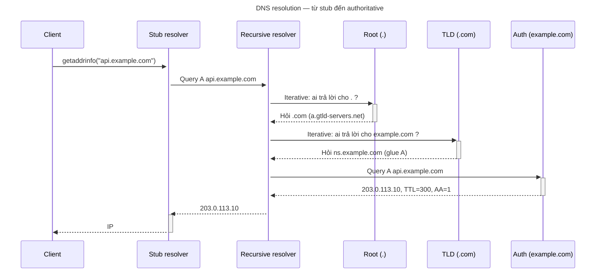
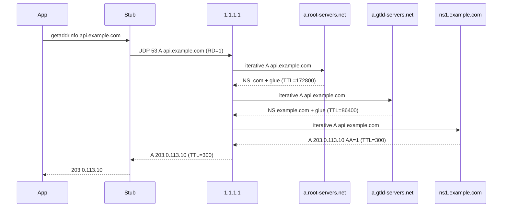

# How does DNS work?

> DNS là hệ thống cơ sở dữ liệu phân tán theo phân cấp tên miền, ánh xạ tên miền sang các loại bản ghi (A, AAAA, MX, NS...) và hoạt động chủ yếu trên UDP/TCP cổng 53. Cốt lõi là stub resolver hỏi recursive resolver, recursive resolver đi theo chuỗi root → TLD → authoritative rồi cache lại.

Chủ đề: Networking · Ngày: 2026-10-15

## 0. Nền tảng trước khi đọc

**Bối cảnh:** Cách trình duyệt, ứng dụng và máy chủ gửi dữ liệu cho nhau. Mỗi bước có giao thức, độ trễ và kiểu lỗi riêng.

**Nói đơn giản:** DNS đổi tên dễ nhớ như api.example.com thành địa chỉ IP để máy biết kết nối tới đâu, rồi cache kết quả theo TTL.

**Từ khóa cần biết:** client = bên gửi request; server = bên phục vụ; packet = mảnh dữ liệu đi qua mạng.

**Ví dụ dễ hình dung:** Browser hỏi recursive resolver, resolver tra cache hoặc hỏi root, TLD và authoritative để lấy IP.

Khi đọc, luôn hỏi ba câu: nó giải quyết vấn đề gì, nó làm việc theo những bước nào, và khi nào không nên dùng?

**Cách học bài này:** Đọc phần này trước để nắm từ khóa; đọc phần 1 để lấy câu trả lời 30 giây; đọc phần 2 để hiểu cơ chế; cuối cùng mở từng câu hỏi ở phần 3 để luyện nói. Các con số và lệnh trong bài là bằng chứng cho câu trả lời, không cần học thuộc nếu chưa hiểu cơ chế.

## 1. Là gì


## 2. Cơ chế cốt lõi
### Đọc nhanh trước khi đi sâu

**Ý chính:** DNS đổi tên dễ nhớ như api.example.com thành địa chỉ IP để máy biết kết nối tới đâu, rồi cache kết quả theo TTL.

**Ví dụ interview:** Browser hỏi recursive resolver, resolver tra cache hoặc hỏi root, TLD và authoritative để lấy IP.

**Luồng 4 bước:**

1. Ứng dụng tạo request với tên host, port và dữ liệu.
2. OS và các giao thức mạng tìm đường rồi chuyển packet tới server.
3. Server xử lý request và trả response qua kết nối phù hợp.
4. Client kiểm tra response, cache hoặc render dữ liệu cho người dùng.

**Nói như trong interview:** DNS đổi tên dễ nhớ như api.example.com thành địa chỉ IP để máy biết kết nối tới đâu, rồi cache kết quả theo TTL. Hãy nói theo bốn bước trên trước; nếu interviewer hỏi sâu, chuyển sang cơ chế **Đọc nhanh trước khi đi sâu**, rồi nêu trade-off và failure mode ở các phần sau.

### 2.1. Luồng phân giải từ đầu tới cuối

Bước 1–4 là truy vấn lần đầu, không có cache:

1. **Client → Stub resolver:** Ứng dụng gọi `getaddrinfo("api.example.com")`. Stub đọc `/etc/resolv.conf` hoặc tương đương (`127.0.0.53` của systemd-resolved) để biết recursive resolver, rồi gửi UDP query tới đó.

2. **Stub → Recursive resolver:** Recursive nhận truy vấn A record cho `api.example.com`. Check cache — miss. Gửi iterative query tới một root server (13 hệ thống logic, phân bố anycast).

3. **Recursive → Root server:** Root server không biết `api.example.com` nhưng biết NS cho `.com`. Trả referral: `a.gtld-servers.net` (192.5.6.30) kèm glue record A. RTT ~10–30ms tùc vị trí.

4. **Recursive → TLD server (`.com`):** TLD server biết NS cho `example.com`. Trả referral: `a.iana-servers.net` kèm glue A. RTT ~5–20ms.

5. **Recursive → Authoritative server (`example.com`):** Authoritative trả A record `203.0.113.10`. Phản hồi có cờ `AA=1`, TTL=300. RTT ~5–50ms.

6. **Recursive cache kết quả:** Cache lưu `api.example.com → 203.0.113.10` trong 300 giây.

7. **Recursive → Stub → Client:** Phản hồi về client cùng TTL. Client nhận IP, mở TCP tới `203.0.113.10`.

8. **Truy vấn lần sau (cache hit):** Stub hỏi recursive → recursive check cache → hit → trả ngay. Tiết kiệm 3 RTT, ~20–100ms.



### 2.2. Wire format — những field hay bị hỏi

DNS message gồm header 12 byte + 4 phần biến đổi (Question, Answer, Authority, Additional). Khi truy vấn, ID được random 16-bit; response phải khớp ID. Bốn cờ trong header đáng nhớ: QR (0=query, 1=response), RD/RA (recursive desired/available), AA (authoritative answer), TC (truncated). Recursive resolver set RD=1 khi gửi; authoritative trả AA=1 trong response; khi payload vượt giới hạn → TC=1.

| Phần | Field | Giá trị thường gặp | Ý nghĩa |
|---|---|---|---|
| Header | ID | Ngẫu nhiên 16 bit | Match query/response |
| Header | Flags: RD | 1 | Client muốn recursive |
| Header | Flags: AA | 1 trong response | Server là authoritative |
| Header | Flags: TC | 1 | Bị truncated, chuyển TCP |
| Header | RCODE | 0=NOERROR, 2=SERVFAIL, 3=NXDOMAIN | Kết quả |
| Question | QNAME | `api\.example\com\0` | Tên miền (label length prefixed) |
| Question | QTYPE | 1=A, 28=AAAA, 5=CNAME, 15=MX | Loại bản ghi |
| Answer | TTL | 0–86400 | Cache trong bao lâu (giây) |

UDP payload mặc định ≤ 512 byte. EDNS0 (RFC 6891) cho phép advertise kích thước lớn hơn (~1232–4096 byte) qua OPT pseudo-RR. Khi phản hồi vượt advertised size hoặc trên 512 byte cổ điển → TC=1 → client chuyển TCP. Negative response (NXDOMAIN, NODATA) cũng có TTL riêng — resolver dùng để negative cache: NXDOMAIN TTL = SOA minimum (thường 300–3600s); NODATA TTL = TTL thấp nhất trong SOA.

### 2.3. Quan sát

```sh
# Truy vấn A record, xem flags và timing
dig +noall +answer +comments api.example.com

# dig output minh họa, chưa chạy
# ;; ->>HEADER<<- opcode: QUERY, status: NOERROR, id: 12345
# flags: qr rd ra; QUERY: 1, ANSWER: 1, AUTHORITY: 0, ADDITIONAL: 1
# api.example.com.    300    IN    A    203.0.113.10

# Truy vấn từng bước: root → TLD → authoritative
dig +trace api.example.com

# Kiểm tra DNSSEC
dig +dnssec +short @1.1.1.1 cloudflare.com DNSKEY

# Xem cache TTL còn bao nhiêu
dig +noall +answer +ttlid api.example.com
```

### Ví dụ chạy từng bước

Kịch bản: user ở Hà Nội phân giải `api.example.com` lần đầu qua Cloudflare 1.1.1.1. Theo dõi từng truy vấn trong chuỗi đệ quy kèm TTL ở mỗi tầng.

Bước 0. Trạng thái: Chrome không có DNS cache, recursive 1.1.1.1 cache miss. Stub đọc `/etc/resolv.conf` → nameserver 1.1.1.1.

Bước 1. App gọi `getaddrinfo("api.example.com")`. Stub gửi UDP 53 tới 1.1.1.1, RD=1. RTT Hà Nội → Singapore POP ~25 ms.

Bước 2. Recursive 1.1.1.1 nhận, miss. Gửi iterative tới root `a.root-servers.net` (anycast gần nhất ~10 ms RTT).

Bước 3. Root trả referral: Authority = 13 NS cho `.com` kèm glue A. TTL của NS referral = 172800s (2 ngày).

Bước 4. Recursive gửi tới `a.gtld-servers.net`. RTT ~15 ms. Trả referral NS cho `example.com`: `ns1.example.com 192.0.2.10` (glue A). TTL=86400s.

Bước 5. Recursive gửi tới `ns1.example.com` (đã có glue). RTT ~80 ms (US). Trả answer: `api.example.com A 203.0.113.10`, TTL=300, AA=1.

Trạng thái: Recursive cache A `api.example.com → 203.0.113.10` TTL=300s.

Bước 6. Recursive trả về stub. Stub đưa IP cho app. Tổng cold cache: ~130 ms.

Bước 7. Sau 60s: truy vấn lại. Recursive cache TTL còn 240s → hit → trả IP, không gửi packet ra Internet. Latency ~1 ms LAN.

| Bước | Truy vấn | RTT | TTL cached |
|---|---|---|---|
| 1 | Stub → 1.1.1.1 | 25 ms | stub không cache |
| 2-3 | Recursive → root, referral `.com` | 10 ms | 172.800s |
| 4 | Recursive → `.com` TLD, referral `example.com` | 15 ms | 86.400s |
| 5 | Recursive → `ns1.example.com`, A record | 80 ms | 300s |
| 6 | Trả IP về app (tổng cold) | ~130 ms | n/a |
| 7 | Sau 60s, cache hit | 1 ms | còn 240s |



*Chuỗi truy vấn đệ quy kèm TTL ở mỗi tầng referral. TTL cuối (300s) là TTL thật của A record; TTL của NS referral ở tầng trên lâu hơn vì zone metadata thay đổi chậm.*

Nếu TTL=0 trong response: authoritative nói "đừng cache lâu" nhưng nhiều recursive (BIND, Windows DNS Client) vẫn cache theo "min positive TTL" nội bộ 30–300s. TTL=0 không nghĩa là "no cache" — vẫn có thể hit trong vài giây đến vài phút (cùng nguyên lý với Câu 16 của arp-vs-dns.md).

Nếu root trả NXDOMAIN ở Bước 3: recursive dùng negative cache TTL = SOA minimum (thường 3600s). Trong 1 giờ, mọi truy vấn `.com` đều nhận NXDOMAIN dù domain thật tồn tại — người dùng tưởng "DNS hỏng" trong khi recursive cache theo RFC 2308.

Điều rút ra: một truy vấn DNS đệ quy lần đầu tốn 3–4 RTT (~30–200 ms tùy vị trí), nhưng TTL ở mỗi tầng quyết định khi nào phải đi lại. TTL cuối của A record (300s) là ràng buộc quan trọng nhất — đây là điểm cho Câu 2 (TTL là gì), Câu 4 (TTL thấp/cao) và Câu 12 (recursive resolver quá tải).

## 3. Câu hỏi phỏng vấn

### 3A. Câu hỏi đào sâu
<details class="qa"><summary>DNS dùng UDP hay TCP? Khi nào chuyển TCP?</summary><div>

**Trả lời ngắn:** UDP cổng 53 là mặc định. TCP khi phản hồi bị truncated (TC=1, > 512 byte cổ điển hoặc > advertised EDNS0 size), hoặc khi zone transfer (AXFR/IXFR).

**Đào sâu:**
- UDP có overhead thấp, không cần handshake, phù hợp truy vấn nhanh. DNS message ngắn → phần lớn phản hồi < 512 byte.
- Khi bản ghi nhiều (nhiều A record round-robin, DNSSEC signature dài), phản hồi vượt giới hạn → resolver set TC=1 → client retry bằng TCP cổng 53.
- EDNS0 (RFC 6891) cho phép hai bên advertise buffer size (thường 1232 byte). Nếu trả lời > advertised size → TC=1 → TCP.
- DoT (DNS over TLS, port 853) và DoH (DNS over HTTPS, port 443) luôn dùng TCP. Người ta dùng TLS/HTTPS để mã hóa truy vấn, tránh bị nghe lén.
- TCP có latency thêm ~1 RTT cho handshake. Một số firewall chặn UDP 53 → fallback TCP cũng là lỗi hay gặp.

**Bẫy:** "TCP chỉ dùng cho zone transfer." Sai. TCP còn dùng khi response bị truncated, và ngày càng phổ biến với DoT/DoH.

**Follow-up:** DoT và DoH khác gì nhau? DoT chạy TLS thuần trên port 853, có thể bị firewall chặn. DoH mã hóa trong HTTPS request thông thường, trông như lưu lượng web, khó phân biệt với HTTP thường.

</div></details>

<details class="qa"><summary>DNS cache hoạt động thế nào? TTL có nghĩa gì chính xác?</summary><div>

**Trả lời ngắn:** Recursive resolver cache kết quả theo TTL (giây) trong response. Khi TTL về 0, cache entry bị xóa; lần truy vấn tiếp theo đi hỏi authoritative. Negative cache dùng TTL từ SOA minimum field.

**Đào sâu:**
- TTL là cận trên, không phải khoảng thời gian bắt buộc. Resolver có thể evict sớm hơn vì pressure bộ nhớ.
- Negative caching (NXDOMAIN): RFC 2308 cho phép cache "không tồn tại", TTL = MINIMUM field trong SOA record (thường 300–3600 giây). Không có SOA → không negative cache.
- Có stale-while-revalidate: resolver dùng stale cache trả ngay, refresh ở background (RFC 9016). Giảm latency nhưng có thể stale.
- CNAME chain: khi resolver follow CNAME, nó cache cả chain. TTL của từng record có thể khác nhau.
- Browser DNS cache (Chrome `chrome://net-internals/#dns`), OS-level cache (Windows DNS Client service, systemd-resolved) nằm ngoài recursive resolver → độ tươi thực tế có thể khác TTL gốc.

**Bẫy:** "TTL 30 giây nghĩa là resolver hỏi lại mỗi 30 giây." Không. TTL là max time cache được giữ. Lần truy vấn kế tiếp sau khi expired mới đi hỏi lại.

**Follow-up:** Nếu bạn đổi IP của service, DNS propogation mất bao lâu? Không có "propagation" vì không có centralized update. Thời gian = max(TTL cũ) + RTT. Nếu TTL cũ = 86400s → 24 giờ để tất cả resolver quên IP cũ.

</div></details>

<details class="qa"><summary>Phân biệt DNS record types: A, AAAA, CNAME, MX, NS, TXT</summary><div>

**Trả lời ngắn:** A map IPv4, AAAA map IPv6, CNAME là bí danh (phải follow tới khi ra A/AAAA), MX chỉ máy chủ mail với priority, NS chỉ nameserver của zone, TXT lưu metadata (SPF, DKIM, DMARC, xác minh domain).

**Đào sâu:**
- **A** (type 1): IPv4 address, ví dụ `api.example.com. 300 IN A 203.0.113.10`. Nhiều A record = round-robin load balancing.
- **AAAA** (type 28): IPv6 address, 128-bit, ví dụ `api.example.com. 300 IN AAAA 2001:db8::1`.
- **CNAME** (type 5): Canonical name. `www.example.com. 3600 IN CNAME example.com.` → phải truy hồi `example.com` để lấy A. Không cùng tồn tại với bản ghi khác cùng tên. Không được tại zone apex (naked domain) vì apex có NS và SOA.
- **MX** (type 15): priority + mail server. `example.com. 3600 IN MX 10 mail.example.com.` Priority 10 (thấp hơn = ưu tiên hơn). Nhiều MX với priority khác nhau = backup mail server.
- **NS** (type 2): nameserver của zone, delegate authority xuống cấp dưới. NS record nằm trong zone cha cho zone con = glue record.
- **TXT** (type 16): free-form text. SPF (`v=spf1 include:_spf.example.com ~all`), DKIM (khóa công khai), DMARC policy, xác minh domain cho Google Search Console, Let's Encrypt ACME.
- **SOA** (type 6): Start of Authority, chứa serial, refresh, retry, expire, minimum TTL. Minimum = negative caching TTL khi không có NXDOMAIN record.

**Bẫy:** "CNAME trỏ tới đích là xong." Không đúng. Theo RFC 1034, resolver phải follow CNAME cho tới khi ra A/AAAA rồi mới trả lời client. Nhiều SDK/hàm có thể trả luôn CNAME, nhưng browser cần IP.

**Follow-up:** HTTPS record (SVCB/HTTPS, RFC 9460) khác gì? SVCB mang tham số kết nối HTTPS: ALPN (h2, http/1.1), ECH (Encrypted Client Hello), port, IPv4/IPv6 hint. Client hỏi `example.com` HTTPS trước, nhận tham số, kết nối tối ưu hơn.

</div></details>

<details class="qa"><summary>Root server hoạt động thế nào? Tại sao chỉ 13 hệ thống logic?</summary><div>

**Trả lời ngắn:** Root zone (.) có 13 ký hiệu (a–m.root-servers.net), phân bố anycast toàn cầu qua hàng trăm POP. Mỗi root server vận hành bởi một tổ chức độc lập (Verisign, USC, ISC...). Root không biết `example.com`, chỉ biết NS cho `.com`.

**Đào sâu:**
- 13 ký hiệu là giới hạn kỹ thuật: DNS-over-UDP header + 13 NS record + root name = ~512 byte, giới hạn UDP cổ điển. Mỗi ký hiệu là một anycast cluster, không phải một server.
- Verisign vận hành 2 (A, J), USC-ISI (B, F, I, K), Cogent (C), University of Maryland (D), NASA (E), US Army (F gốc), ISC (H), RIPE NCC (I gốc), WIDE (M), Netnod (K gốc).
- Root zone chứa NS record + glue A/AAAA cho mỗi TLD. Root zone được ký DNSSEC (root KSK-2010, KSK-2023 đang roll). Bất kỳ ai đều có thể xem root zone: `dig +short . NS` hoặc `https://www.internic.net/domain/root.zone`.
- Root server phân bố anycast → RTT từ client tới root gần nhất ~10–30ms, không cố định.
- Root hints file (`named.root` hoặc `root.hints` trong BIND) chứa 13 địa chỉ IP. Resolver dùng file này khi không có cache và không dùng forwarder.

**Bẫy:** "13 server nghĩa là 13 máy." Không. Mỗi ký hiệu có hàng trăm server vật lý qua anycast. Verisign alone có hơn 500 điểm POP.

**Follow-up:** Nếu root server bị tấn công DDoS? Khó vì anycast + kinh phí quân sự. Root server không phản hồi trong vài giây → resolver dùng cache hoặc retry. DNSSEC validation vẫn dùng cached KSK.

</div></details>

<details class="qa"><summary>DNSSEC bảo vệ gì, không bảo vệ gì?</summary><div>

**Trả lời ngắn:** DNSSEC ký và xác minh tính toàn vẹn của bản ghi DNS — chữ ký số từ root KSK xuống zone. Nó không mã hóa payload, không bảo vệ tính riêng tư.

**Đào sâu:**
- Chuỗi tin cậy: KSK (Key Signing Key) của root → ZSK (Zone Signing Key) của `.com` → ZSK của `example.com`. Mỗi zone ký RRsets (tập bản ghi cùng loại) bằng RRSIG record.
- DS record (Delegation Signer) nằm trong zone cha, chứa hash của KSK của zone con. DS →证明 zone con được authorized.
- Khi resolver validate DNSSEC: phản hồi có RRSIG → kiểm tra DS chain → kiểm tra KSK → dùng trust anchor (root KSK pre-loaded). Nếu không khớp → SERVFAIL.
- DNSSEC không mã hóa: ai nghe lén vẫn thấy `api.example.com` ứng với IP nào. Mã hóa query/response là DoT/DoH.
- DNSSEC tăng response size đáng kể (chữ ký dài). DNSSEC + nhiều RRsets → phản hồi > 512 byte → TC=1 → chuyển TCP → phức tạp.
- Roll KSK (key roll): root KSK-2023 đang được roll. Nếu resolver không cập nhật trust anchor kịp → validation fail → SERVFAIL → ảnh hưởng tất cả domain.

**Bẫy:** "DNSSEC mã hóa DNS, giống HTTPS." Sai. DNSSEC chỉ ký, không mã hóa.

**Follow-up:** DoT và DoH có thay thế DNSSEC không? Không. DoT/DoH che truy vấn khỏi ISP/NSA nhưng không xác minh bản ghi. DNSSEC xác minh bản ghi nhưng không che truy vấn. Cần cả hai để vừa private vừa authenticated.

</div></details>

<details class="qa"><summary>Triệu chứng: "Website không truy cập được nhưng IP ping được." Bạn kiểm tra gì?</summary><div>

**Trả lời ngắn:** DNS thường là nguyên nhân. Kiểm tra: DNS resolution, TTL còn không, CNAME chain, firewall, CDN configuration, và browser DNS cache.

**Đào sâu — theo thứ tự:**

1. **Kiểm tra DNS resolution:**
```sh
dig +short api.example.com          # A record
dig +short api.example.com AAAA      # IPv6
nslookup api.example.com             # fallback, ít chi tiết
```
2. **So sánh với authoritative:**
```sh
dig @ns1.example.com api.example.com  # hỏi thẳng authoritative
```
3. **Check CNAME chain:**
```sh
dig +short api.example.com CNAME      # có CNAME không?
```
4. **Xem TTL còn bao nhiêu:**
```sh
dig +ttlid api.example.com           # còn TTL không?
```
5. **Kiểm tra DNS từ client khác (khác network/ISP):**
```sh
dig @8.8.8.8 api.example.com         # Google DNS
dig @1.1.1.1 api.example.com         # Cloudflare DNS
```
6. **Kiểm tra negative cache:**
```sh
dig api.example.com ANY              # có NXDOMAIN không?
```
7. **Kiểm tra browser cache:**
Chrome: `chrome://net-internals/#dns` → "Clear host cache"
8. **Kiểm tra DoH/DoT:**
Chrome/Edge dùng DoH mặc định trên Windows → truy vấn DNS của OS không reflect trong browser.
9. **Kiểm tra CDN:**
Nếu dùng Cloudflare/AWS CloudFront → DNS thay đổi IP nhưng CDN cache chưa expire.

**Nguyên nhân hay gặp:** (1) TTL cũ quá cao, resolver vẫn trả IP cũ. (2) CNAME chain broken — subdomain trỏ tới CDN đã xóa. (3) NXDOMAIN propagation — bạn hết quyền domain nhưng resolver vẫn cache NXDOMAIN. (4) DoH ngụy trang truy vấn — OS thấy "no DNS issue" nhưng browser dùng DoH server khác.

</div></details>

<details class="qa"><summary>Thiết kế hệ thống: thiết kế DNS cho ứng dụng global với độ trễ thấp và high availability</summary><div>

**Yêu cầu:** 99.99% uptime, latency < 20ms từ hầu hết người dùng toàn cầu.

**Quyết định chính:**

1. **Recursive resolver: dùng 2–3 vendor bên thứ ba (anycast)**
   - Cloudflare 1.1.1.1 + Google 8.8.8.8 + AWS Route 53 resolver. Không tự vận hành recursive resolver trừ khi team có kinh nghiệm DNSSEC.
   - Reason: anycast cho RTT ~5–20ms tới POP gần nhất, SLA vendor.

2. **Authoritative: multi-vendor, multi-region**
   - Route 53 (AWS) + Cloudflare DNS + Dyn/Oracle. Mỗi vendor có POP riêng, tự đồng bộ qua zone transfer hoặc API.
   - Tối thiểu 2 nameserver ở 2 AS khác nhau. Tất cả vendor hỗ trợ anycast.
   - Tại sao không dùng 1 vendor: nếu vendor down (Cloudflare 2022-06-21 outage, Route 53 2023-02-28) → toàn bộ domain không resolve được.

3. **TTL strategy:**
   - IP ổn định: TTL = 3600–86400s. Giảm TTL xuống 300s 24h trước khi thay đổi IP planned.
   - DR failover: TTL = 60s cho record trỏ tới DR site. Health check tự đổi DNS qua API.
   - Nguy hiểm: TTL thấp → more load lên authoritative. 60s × 1M requests/day = load đáng kể.

4. **GeoDNS / latency-based routing:**
   - Route 53 geolocation hoặc latency routing. A record trả IP khác nhau tùy vùng.
   - Cần ALB/CDN ở mỗi region, không chỉ DNS.
   - Lưu ý: GeoDNS dựa trên recursive resolver IP, không phải client IP → có thể sai ở users behind resolver lớn (ISP resolver ở quốc gia khác).

5. **DNSSEC:**
   - Bật và quản lý KSK/ZSK roll. Dùng managed DNSSEC (Route 53, Cloudflare tự động sign).
   - Manual DNSSEC dễ sai → zone unsigned → validation fail → SERVFAIL.

6. **Monitoring:**
   - External DNS monitoring: check 2–3 endpoint từ nhiều vị trí (Catchpoint, ThousandEyes). Alert nếu authoritative không phản hồi hoặc phản hồi chậm > 100ms.
   - Internal: theo dõi recursive resolver cache hit ratio, SERVFAIL rate.

**Điểm nghẽn:** DNSSEC validation fail gây SERVFAIL toàn cầu. Roll KSK không chuẩn bị → outage. Authoritative vendor down + TTL cao → mất 1 TTL (~1 giờ) trước khi users qua vendor khác.

</div></details>

### 3B. Câu hỏi phỏng vấn liên quan

<details class="qa">
<summary>What is an SOA record and what do its fields mean?</summary>

**Trả lời:** SOA (Start of Authority, type 6) đánh dấu zone: chứa primary NS, email admin (ký hiệu `.` thay `@`), serial (tăng khi zone thay đổi, dùng cho AXFR/IXFR so sánh), refresh (slave hỏi lại master), retry, expire (slave hết refresh sẽ bỏ zone), minimum TTL (negative cache TTL cho NXDOMAIN). Không có SOA = không có negative cache theo RFC 2308.
</details>

<details class="qa">
<summary>What is a glue record, and why is it needed?</summary>

**Trả lời:** Glue record là A/AAAA IP của NS server đặt ngay trong zone cha để tránh vòng lặp: client hỏi `example.com` NS → nhận `ns1.example.com`; nếu phải hỏi tiếp `ns1.example.com` A thì phụ thuộc vào chính `example.com` đang phân giải → vòng lặp. Glue A đặt kề NS trong referral giải quyết chuyện này.
</details>

<details class="qa">
<summary>DNS load balancing qua round-robin nhiều A record hoạt động thế nào, và hạn chế?</summary>

**Trả lời:** Authoritative trả nhiều A record cho cùng tên; resolver xáo trộn thứ tự (BIND dùng `rrset-order`); client thường lấy record đầu. TTL hết, truy vấn lại sẽ xáo trộn khác. Hạn chế: không health-check (server chết vẫn còn trong danh sách tới khi TTL expire), thứ tự bị cache bên trong resolver/client, CDN/geo-aware phải dùng logic phức tạp hơn.
</details>

<details class="qa">
<summary>What is split-horizon DNS and when is it used?</summary>

**Trả lời:** Trả bản ghi khác nhau tuỳ source IP của client. Internal client nhận IP private (10.0.0.x), external nhận IP public. Dùng cho mạng nội bộ (VPN, hybrid cloud), isolation giữa môi trường prod/staging, hoặc CDN routing. Triển khai: BIND views, Unbound `local-zone`/`local-data`, hoặc Route 53 geolocation + private hosted zone trên VPC.
</details>

<details class="qa">
<summary>True or false: "DNS giao tiếp chủ yếu qua TCP vì response thường lớn."</summary>

**Trả lời:** Sai. DNS mặc định UDP cổng 53. Phần lớn query/response < 512 byte cổ điển (hoặc vài KB với EDNS0). Chỉ chuyển TCP khi response bị truncated (TC=1) hoặc cho zone transfer (AXFR/IXFR). RFC 7766 cho phép dùng TCP khi UDP bị chặn nhưng đây là fallback, không phải mặc định.
</details>
<details class="qa">
<summary>Number worth remembering: UDP max payload, mặc định EDNS0, kích thước tối đa IPv4/IPv6?</summary>

**Trả lời:** UDP DNS mặc định 512 byte (RFC 1035). EDNS0 (RFC 6891) advertise 1232–4096 byte qua OPT pseudo-RR; cloud resolver thường dùng 1232 để tránh IP fragmentation. IPv4 header 20 byte, IPv6 40 byte. IPv4 address 32-bit, IPv6 128-bit. TTL max trong DNS = 2^31 − 1 giây ≈ 68 năm, thực tế 60–86400.
</details>
<details class="qa">
<summary>What happens when an authoritative server is unreachable or slow?</summary>

**Trả lời:** Recursive resolver timeout mỗi server theo retry timeout (BIND mặc định ~2–3 lần, có thể lên tới 10s) rồi thử server khác trong danh sách NS. Hết server → trả SERVFAIL cho stub → client trả lỗi. Cache hit vẫn phục vụ bình thường cho domain khác. Slow authoritative (DoS, network) kéo timeout cả chain lên vài giây → user cảm thấy DNS "lag". Mitigation: multi-vendor anycast authoritative, theo dõi SERVFAIL rate.
</details>
<details class="qa">
<summary>Scenario (chat/messaging app): thousands of pods resolve internal-service.namespace.svc.cluster.local mỗi giây. Cách giảm tải CoreDNS?</summary>

**Trả lời:** 1) NodeLocal DNSCache (DaemonSet, mỗi node cache), pod gửi tới `169.254.20.10` thay vì `10.96.0.10` của CoreDNS service — tránh iptables DNAT + conntrack. 2) Tăng cache TTL cho *.cluster.local (CoreDNS `cache` plugin, không có TTL cố định cho cluster domain). 3) Split-horizon: pod gọi Service IP thẳng từ cluster network khi biết IP, bỏ qua DNS. 4) Negative caching cho NXDOMAIN để tránh resolve lại tên lỗi.
</details>
<details class="qa">
<summary>How does DNS relate to the browser HTTPS connection flow?</summary>

**Trả lời:** Trình tự: 1) DNS resolve hostname → trả IP. 2) TCP handshake tới IP (~1 RTT). 3) TLS handshake: client gửi ClientHello kèm SNI = hostname (~1–2 RTT với TLS 1.2, ~1 RTT với TLS 1.3, ~0 RTT với 0-RTT có rủi ro replay). 4) HTTP request/response. Tổng ~3–4 RTT trước khi thấy byte đầu tiên. Happy Eyeballs (Chrome/Firefox), DNS cache, TLS session resumption giảm đáng kể cho lần truy cập thứ hai. Xem thêm [TCP three-way handshake](tcp-three-way-handshake.md).
</details>

## 4. Đánh đổi và sự cố production

### 4.1. So sánh phương án triển khai authoritative

| Tiêu chí | Tự vận hành (BIND/Knot) | Managed DNS (Route 53, Cloudflare) | Hybrid (managed + raw) |
|---|---|---|---|
| Độ trễ trung bình | 5–50ms (POP tùy region) | 5–20ms (anycast vendor) | 5–20ms (managed POP) |
| SLA | Tự quản lý, 99.9% tùy infra | 100% (Route 53 SLA), 100% (Cloudflare) | Theo vendor managed |
| DNSSEC | Thủ công, dễ sai roll | Tự động sign/roll | Managed cho apex, raw cho sub |
| Chi phí vận hành | Cao (infra, engineer, monitoring) | Thấp (per-query pricing) | Trung bình |
| Flexibility | Cao (custom logic, raw access) | Thấp (vendor API) | Trung bình |
| Failure mode | Server down, config sai, KSK roll fail | Vendor outage (ít nhưng có), propagate chậm | Vendor outage vẫn áp dụng |

### 4.2. 4 failure mode hay gặp

| Triệu chứng | Nguyên nhân gốc | Cách kiểm tra | Cách sửa |
|---|---|---|---|
| NXDOMAIN không hết dù đã đăng ký domain | Negative cache TTL quá cao, resolver vẫn cache "không tồn tại" | `dig @ns1.example.com domain.com` vs `dig @8.8.8.8 domain.com` | Giảm SOA minimum; chờ TTL hết; dùng `+nodnssec` thử |
| SERVFAIL sau khi bật DNSSEC | KSK roll không sync, DS record sai, trust anchor cũ | `dig +dnssec domain.com DNSKEY` → validation fail log | Khôi phục DS record đúng; cập nhật trust anchor; tạm tắt DNSSEC |
| IP đổi nhưng users vẫn vào IP cũ | TTL cao (86400s), resolver vẫn trả cache | `dig +ttlid domain.com` → TTL > 0; so sánh với authoritative | Giảm TTL 24h trước; force flush (không luôn luôn được) |
| DNS resolution chậm bất thường | Recursive resolver gần đã down hoặc slow, chain dài | `dig +trace` xem bước nào chậm; check RTT từng bước | Đổi recursive resolver; tăng cache; bypass broken link |

## 5. Cheat sheet

| # | Kiến thức | Giá trị |
|---|---|---|
| 1 | DNS là UDP/TCP cổng 53 | Mặc định UDP; TCP khi TC=1 hoặc > advertised EDNS0 size |
| 2 | 3 thành phần | Stub (hỏi) → Recursive (tra) → Authoritative (trả, AA=1) |
| 3 | Phân cấp | Root (.) → TLD (.com) → Authoritative (example.com) |
| 4 | Cache key | `(qname, qtype, source IP)` — cùng qname khác qtype = cache miss |
| 5 | TTL = cận trên | Không phải khoảng thời gian bắt buộc; resolver có thể evict sớm |
| 6 | Negative cache TTL | = SOA minimum field; không có SOA → không negative cache |
| 7 | CNAME tại apex | Không được — zone apex có NS + SOA không cùng tồn tại với CNAME |
| 8 | DNSSEC = ký, không mã | Xác minh toàn vẹn; DoT/DoH mới che truy vấn |
| 9 | Glue record | A/AAAA của NS nằm trong zone cha, tránh vòng lặp |
| 10 | 13 root servers | Giới hạn kỹ thuật UDP 512 byte; mỗi ký hiệu = anycast cluster |
| 11 | NXDOMAIN ≠ DNS down | Chỉ tên đó không tồn tại; các record khác vẫn phục vụ |

**Học tiếp:** [How does a browser render a page?](type-google-com-in-browser.md) · [OSI model](osi-model.md) · [TCP vs UDP](tcp-vs-udp.md)
