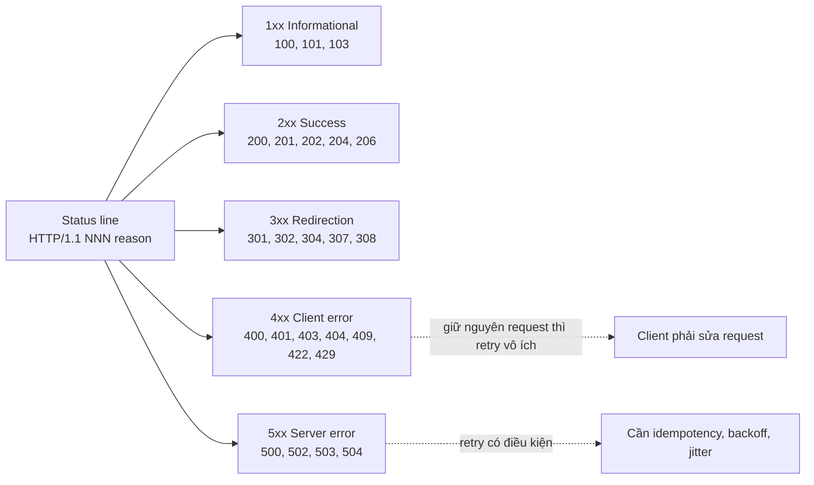
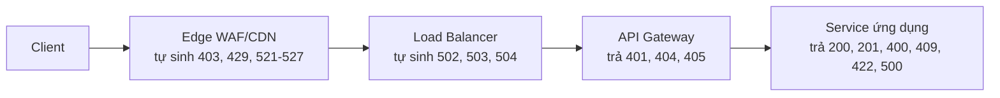
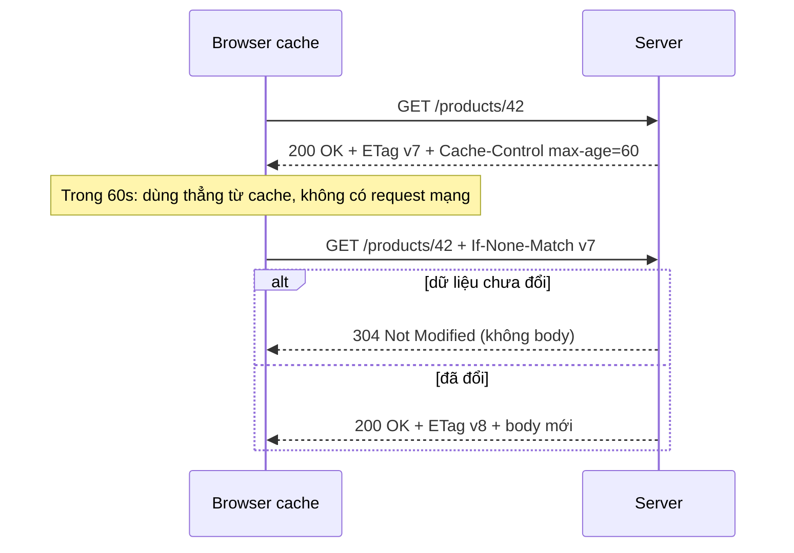
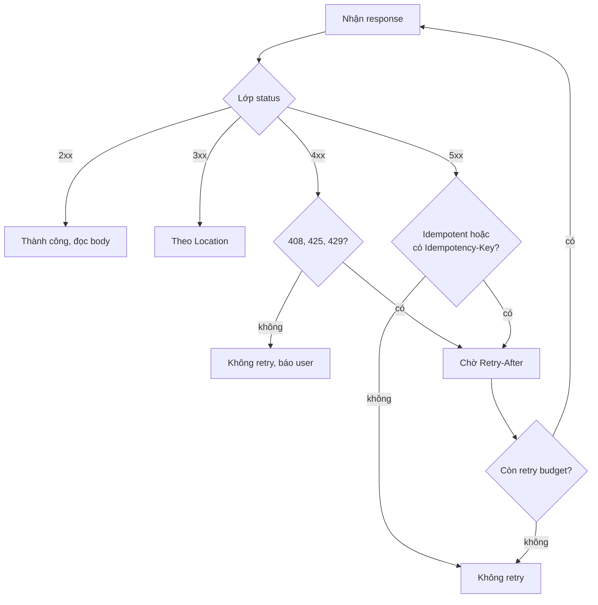

# What are common HTTP status codes and their meanings?

> HTTP status code là số nguyên ba chữ số trong response line, quyết định hành vi của cache, proxy, load balancer và retry logic.

Chủ đề: Networking · Ngày: 2026-10-15

## 1. Là gì

HTTP status code là ba chữ số (100–599) trong dòng đầu tiên của HTTP response, do server hoặc proxy đặt để báo kết quả xử lý request. Chữ số đầu xác định lớp: **1xx Informational**, **2xx Success**, **3xx Redirection**, **4xx Client Error**, **5xx Server Error**.

**Trả lời 30 giây:** HTTP status code là hợp đồng giữa client và server. Ba chữ số chia thành năm lớp theo RFC 9110: 1xx báo "đang xử lý" (100 Continue, 103 Early Hints), 2xx báo thành công (200 OK, 201 Created, 204 No Content), 3xx báo chuyển hướng (301, 302, 304, 307, 308), 4xx báo lỗi do request (400, 401, 403, 404, 422, 429), 5xx báo lỗi do server (500, 502, 503, 504). Proxy có thể tự sinh 502/503/504 mà ứng dụng phía sau không biết. Client phải xử lý mã lạ theo lớp của nó (ví dụ 425 coi như 400).



*Sơ đồ: năm lớp status code và hành vi mặc định của client.*

## 2. Cơ chế cốt lõi

### Bước 1. Ai đặt mã — qua các tầng

Mã có thể được đặt bởi bất kỳ tầng nào trên đường đi, theo thứ tự:



Ứng dụng phía sau không biết proxy đã ghi đè mã. `curl -w '%{http_code}'` in `000` khi kết nối reset trước khi nhận response — đó không phải mã trên dây.

### Bước 2. Phân lớp theo RFC 9110

- **1xx** (100 Continue, 101 Switching Protocols, 103 Early Hints): gửi trước response cuối. Không cacheable, không có body.
- **2xx** (200 OK, 201 Created kèm `Location`, 202 Accepted cho async, 204 No Content, 206 Partial Content cho Range).
- **3xx** (301/308 cache được, 302/307 giữ method, 303 ép GET, 304 Not Modified — không có body, client dùng cache).
- **4xx** (400 Bad Request, 401 Unauthorized kèm `WWW-Authenticate`, 403 Forbidden, 404 Not Found, 409 Conflict, 422 Unprocessable Content, 429 Too Many Requests kèm `Retry-After`).
- **5xx** (500 Internal Server Error, 502 Bad Gateway khi upstream trả rác, 503 Service Unavailable kèm `Retry-After`, 504 Gateway Timeout khi upstream quá chậm).

Quy tắc RFC 9110 mục 15: client xử lý mã lạ như mã `x00` của lớp đó. 425 coi như 400, 507 coi như 500. Nhờ vậy thêm mã mới không phá client cũ.

### Bước 3. Cache và conditional GET

Cache quyết định dựa trên bốn thứ theo thứ tự: `Cache-Control: no-store` → freshness (`max-age`, `Expires`) → validator (`ETag`, `If-None-Match`) → heuristic.



304 tiết kiệm bandwidth nhưng vẫn tốn 1 RTT. 200 có thể không cacheable nếu có `no-store` (dữ liệu cá nhân). 401 không bao giờ cacheable. 404 có thể cacheable trong vài giây.

### Bước 4. Idempotency và retry

- **Idempotent method** (RFC 9110): `GET`, `HEAD`, `PUT`, `DELETE` — retry an toàn.
- **Non-idempotent**: `POST`, `PATCH` — retry chỉ khi có `Idempotency-Key`.



*Retry decision tree: kiểm lớp → kiểm idempotency → kiểm retry budget.*

Quy tắc: exponential backoff + jitter, base 500ms, max 30s, tối đa 5 lần. `delay = min(max, base * 2^n) * (0.5 + random())`.

### Bước 5. Problem details (RFC 9457)

Error body chuẩn:

```json
{
  "type": "https://api.example.com/errors/order-not-found",
  "title": "Order not found",
  "status": 404,
  "detail": "Order 1002 does not exist for tenant acme",
  "instance": "/orders/1002",
  "trace_id": "abc123"
}
```

`Content-Type: application/problem+json`. Client switch theo `type`/`code` thay vì parse message. Trace ID giúp debug.

### Bước 6. Status line trên dây và Vary

Trên HTTP/1.1, mã nằm ở status line dạng `HTTP/1.1 404 Not Found`. Reason phrase chỉ để người đọc, client không được dựa vào nó. Trên HTTP/2 và HTTP/3 không còn reason phrase, mã đi qua pseudo-header `:status` và được nén bằng HPACK hoặc QPACK. Cache còn phải xét `Vary`: cùng một URL nhưng `Accept-Encoding` hoặc `Accept-Language` khác nhau thì là các entry khác nhau, và một 200 không có `Vary` đúng có thể bị phục vụ nhầm cho client khác.

### Ví dụ chạy từng bước

Kịch bản: trang thanh toán checkout gọi `POST /api/charge` tới payment gateway, gateway trả về chuỗi status không đồng nhất, team phải tìm cách tránh trừ tiền hai lần.

**Bước 1.** Khách `POST /api/charge` với body `{order_id: 1002, amount: 250000, Idempotency-Key: 7e9b-...}`. Trước khi gọi gateway, server sinh `Idempotency-Key` UUID ngẫu nhiên. Lưu `(key, status="processing")` vào Redis bằng `SET key value NX EX 86400` (NX = SETNX, chỉ set nếu chưa tồn tại; EX = TTL 24 giờ).

| Thời điểm | Client | Server | Gateway | Redis store |
|---|---|---|---|---|
| t=0ms | POST /charge | ghi SETNX processing | — | `(7e9b…, processing)` |

**Bước 2.** Server gọi `POST https://gateway.example/charge`. Gateway mất 3 giây trả lời vì upstream Visa lỗi. Server timeout ở 2 giây, kết nối bị đóng — server chưa biết gateway đã xử lý xong hay chưa. Redis vẫn là `processing` (chưa commit DB, chưa cập nhật store).

**Bước 3.** Server trả client `503 Service Unavailable` kèm `Retry-After: 2`. Client retry với cùng `Idempotency-Key` 7e9b. Server lại SETNX — entry đã tồn tại nhưng status="processing", coi như request đang xử lý, trả `409 Conflict` hoặc chờ. Đây là follow-up Câu 8.

**Bước 4.** Gateway thật ra đã commit ở phía họ (đã trừ thẻ). Gateway gửi webhook `charge.succeeded` tới server. Server xử lý webhook: cập nhật Redis `(7e9b…, status=200, body={receipt:…})`. Lần retry tiếp theo của client nhận lại response cũ, không gọi gateway lần hai.

| Sau webhook | Client | Server | Gateway | Redis store |
|---|---|---|---|---|
| t=5500ms | (đang chờ retry) | nhận webhook | đã commit thẻ | `(7e9b…, 200, body)` |

**Nếu gateway trả 502 thay vì timeout:** Server biết upstream trả rác, không biết đã trừ tiền chưa. Retry vẫn cần Idempotency. Nếu admin rollback Redis store do sự cố, các key cũ bị xóa → retry không idempotent, có nguy cơ double-charge. Đây là điểm follow-up Câu 4: idempotency store phải tách khỏi database chính, TTL ≥ thời gian retry tối đa + buffer.

Điều rút ra: chuỗi 503 → 503 → 200 với cùng `Idempotency-Key` không phải lỗi mà là hành vi đúng của idempotency; trả lời Câu 8 phỏng vấn.

## 3. Câu hỏi phỏng vấn

### 3A. Câu hỏi đào sâu
<details class="qa">
<summary>Câu 1. Năm lớp status code là gì, và vì sao client phải xử lý mã lạ theo lớp?</summary>

**Trả lời ngắn:** Năm lớp: 1xx Informational, 2xx Success, 3xx Redirection, 4xx Client Error, 5xx Server Error. Client xử lý mã lạ như mã `x00` của lớp đó (RFC 9110 mục 15). Nhờ vậy mã mới (425, 451, 507) không phá client cũ.

**Đào sâu:**
- 1xx: gửi trước response cuối. 100 Continue cho phép gửi body sau header. 103 Early Hints gửi trước để client preload tài nguyên.
- 2xx: 201 kèm `Location`, 202 cho async, 204 không body (DELETE thành công), 206 cho Range request (video streaming).
- 3xx: 301/308 cache được vĩnh viễn, 302/307 giữ method, 303 ép GET, 304 không body (dùng cache).
- 4xx: client phải sửa request. 400 parse lỗi, 401 chưa authn, 403 không đủ authz, 409 conflict, 422 validate ngữ nghĩa lỗi, 429 kèm `Retry-After`.
- 5xx: retry có điều kiện. 500 exception chung, 502 upstream trả rác, 503 từ chối có kiểm soát, 504 upstream quá timeout.

**Bẫy:** Dùng mã CDN (Cloudflare 520-527, nginx 499) làm hợp đồng API — không nên, vì không có trong RFC và không ổn định giữa vendor.

**Follow-up:** Client cũ không hiểu 429 thì sao? Coi như 400, không retry, user tự xử lý. Vẫn an toàn nhờ quy tắc lớp.
</details>

<details class="qa">
<summary>Câu 2. 401 và 403 khác nhau ở đâu, và khi nào nên trả 404 thay 403?</summary>

**Trả lời ngắn:** 401 nghĩa là chưa có danh tính hợp lệ, kèm `WWW-Authenticate` để client biết cách xin credential. 403 nghĩa là có danh tính nhưng không đủ quyền. Trả 404 thay 403 khi lộ sự tồn tại là rủi ro (đơn hàng, hồ sơ y tế) — attacker không biết ID nào tồn tại.

**Đào sâu:**
- 401: token thiếu, hết hạn, hoặc sai chữ ký. Client phải refresh token rồi retry. Luôn kèm `WWW-Authenticate: Bearer realm="orders"`.
- 403: token hợp lệ nhưng không đủ scope/role/ownership. Refresh token không giúp, báo user.
- 403 + `WWW-Authenticate: ... error="insufficient_scope"` (RFC 6750): dùng khi token thiếu scope cụ thể.
- 404 thay 403: chống IDOR scanning. Cả ID không tồn tại và ID không có quyền đều trả 404.
- Cache: 401 và 403 không bao giờ cacheable. 404 có thể cacheable.

**Bẫy:** Nghĩ "401 Unauthorized" nghĩa là không có quyền — sai, nghĩa thật là unauthenticated. Nhiều API dùng 404 thay 403 mà không ghi docs.

**Follow-up:** Token hết hạn nhưng client không refresh được thì sao? Kiểm IdP key rotation gần đây, kiểm clock skew (NTP), kiểm JWKS cache TTL.
</details>

<details class="qa">
<summary>Câu 3. 502, 503, 504 khác nhau thế nào, và retry mỗi mã ra sao?</summary>

**Trả lời ngắn:** 502 Bad Gateway = upstream trả response không hợp lệ (không phải HTTP hoặc parse lỗi). 503 Service Unavailable = server chủ động từ chối, kèm `Retry-After`. 504 Gateway Timeout = upstream quá timeout. Retry: 503 đợi `Retry-After`; 502/504 retry nếu idempotent hoặc có `Idempotency-Key`.

**Đào sâu:**
- 502: proxy không parse được upstream response. Upstream có thể đã xử lý xong (cần idempotency). Nguyên nhân: upstream crash, trả HTML thay JSON, hoặc protocol mismatch.
- 503: server quá tải, bảo trì, hoặc pool cạn. Có thể request chưa chạm ứng dụng. Luôn kèm `Retry-After`.
- 504: upstream có trả response nhưng trễ quá timeout. Upstream có thể đã xử lý xong. Tăng timeout upstream tạm thời.
- Retry: 503 đợi đúng `Retry-After`, 502/504 dùng backoff + jitter. Không retry mù vì tạo retry storm.
- Cảnh báo: 502/504 tăng đồng thời nhiều route → pool cạn. 503 tăng một route → service quá tải.

**Bẫy:** Retry mọi 5xx tự động — gây retry storm khi service đang hồi phục. 503 không kèm `Retry-After` — client retry ngay, đè thêm tải.

**Follow-up:** 500 có nên retry không? Chỉ khi có `Idempotency-Key` và đã xác nhận exception có thể phục hồi (deadlock tạm, không phải NullPointer).
</details>

<details class="qa">
<summary>Câu 4. Thiết kế status code cho API thanh toán. Làm sao tránh trừ tiền hai lần khi mạng rớt?</summary>

**Trả lời ngắn:** Mọi `POST /charge` yêu cầu `Idempotency-Key`. Server lưu key + response vào Redis (TTL 24h) trước khi xử lý. Retry trùng key → trả response cũ, không chạy lại nghiệp vụ. 200 cho thành công, 503 + `Retry-After` khi gateway lỗi.

**Đào sâu:**
- Client gửi `Idempotency-Key: <uuid>` cho mọi POST. UUID ngẫu nhiên, không dùng timestamp hay user ID.
- Server dùng SETNX (atomic) để tránh race condition khi hai request cùng key tới đồng thời. Request thứ hai nhận 409 hoặc chờ.
- TTL: tối thiểu bằng thời gian retry tối đa + buffer. Thanh toán phổ biến 24h, subscription có thể 7 ngày.
- Key trùng nhưng body khác: trả 422 (client bug), không cho qua.
- Quan sát: metric `idempotency_cache_hit_total` — tăng nghĩa là upstream đang chậm, retry đang chạy.
- Stripe, PayPal dùng pattern này. Stripe retry webhook 5xx, nên server phải idempotent.

**Bẫy:** Retry `POST /charge` không có `Idempotency-Key` — trừ tiền hai lần. Không có store, dùng database unique constraint cho "đã xử lý" không đủ vì timeout có thể xảy ra sau khi DB commit nhưng trước khi gửi response.

**Follow-up:** Webhook từ payment gateway có cần idempotency không? Có, dùng `event_id` của gateway làm key. Gateway retry 5xx.
</details>

<details class="qa">
<summary>Câu 5. Thiết kế cache cho trang tin tức 10 triệu URL. Khi nào 200, 304, 404?</summary>

**Trả lời ngắn:** URL công khai: 200 + `Cache-Control: public, max-age=60, stale-while-revalidate=600`. Hết hạn: gửi `If-None-Match` → 304 nếu chưa đổi. URL không tồn tại: 404 + `Cache-Control: public, max-age=30` để giảm tải bot dò.

**Đào sâu:**
- `stale-while-revalidate=600`: serve response cũ trong khi refresh ngầm. Origin chết → serve stale đến hết stale window, sau đó mới 503.
- URL có biến thể: thêm `Vary: Accept-Encoding` (gzip), `Vary: Accept-Language` (i18n). Cache key bao gồm header này. Không có `Vary` → cache trả nhầm bản nén cho client không hỗ trợ.
- URL cá nhân hoá: `Cache-Control: no-store` hoặc `private`. Không cache ở shared CDN. Dùng `Vary: Authorization` nếu cần cache riêng theo user ở edge.
- ETag: sinh từ hash nội dung hoặc version, không ngẫu nhiên. Ngẫu nhiên → 304 không bao giờ trigger → cache hit rate = 0.
- Purge: dùng surrogate-key (Fastly) hoặc tag-based purge (Cloudflare Enterprise). Mỗi response gắn tag `article-12345`, khi cập nhật gọi `purge_tag(article-12345)`.

**Bẫy:** 200 cho response có dữ liệu cá nhân mà không có `Cache-Control: no-store` → CDN cache và phục vụ cho người khác. Dùng `max-age=3600` cho dữ liệu cá nhân.

**Follow-up:** Cache hit rate giảm đột ngột, kiểm gì? Kiểm ETag có ổn định không, kiểm CDN có bị purge không, kiểm `Vary` có thay đổi không.
</details>

<details class="qa">
<summary>Câu 6. Rate limit đặt ở đâu, dùng mã nào, thông số bao nhiêu?</summary>

**Trả lời ngắn:** Đặt ở API gateway hoặc reverse proxy (không ở ứng dụng). Dùng 429 Too Many Requests kèm `Retry-After`, `X-RateLimit-Limit/Remaining/Reset`. Khởi đầu ~100 request/phút/user, đo pattern thật rồi chỉnh.

**Đào sâu:**
- Vị trí: gateway/protocol-level. Đặt ở ứng dụng tốn thread và RAM.
- Thuật toán: token bucket (cho phép burst, phổ biến) hoặc sliding window (chính xác hơn, tốn bộ nhớ).
- Key: theo IP cho endpoint công khai, theo `sub` cho endpoint có authn, theo API key cho B2B. Có thể kết hợp (IP + user).
- Phân cấp: global limit + route limit + user limit. Vượt limit nào thì 429.
- Thông số: API thường 60-100 req/phút/user, B2B 1000 req/phút/user, endpoint đắt (search, export) 5-10 lần thấp hơn. Đo pattern thật trước khi đặt.
- Bypass: IP nội bộ, service-to-service qua mTLS, user VIP qua config.

**Bẫy:** Limit quá thấp → 429 cho người thật (SPA mở trang tạo 20 request). Limit quá cao → không bảo vệ được backend. Không cho `Retry-After` → client retry ngay, đè tải.

**Follow-up:** 429 tăng đột biến, phân biệt bot và người thật thế nào? Bot gọi đều đặn, người gọi theo cluster (mở trang → click). Dùng WAF hoặc bot management (Cloudflare Bot Management).
</details>

<details class="qa">
<summary>Câu 7. Sáng thứ Hai 5xx tăng từ 0.3% lên 5% sau deploy. Điều tra thế nào?</summary>

**Trả lời ngắn:** Tách 5xx theo lớp trước. 502/504 đồng thời → upstream pool cạn. 500 một mình → bug code. 503 → quá tải. So với lịch deploy, diff code, kiểm upstream, kiểm dependency. Rollback nếu root cause không rõ sau 15 phút.

**Đào sâu:**
1. Tách 5xx: `http_responses_total{status=~"5.."}` theo route và upstream. 502/504 cùng route → LB/upstream. 500 cùng endpoint → code.
2. So với deploy: diff library, dependency, config. Xem log baseline 1 giờ trước.
3. Kiểm upstream: pool size, health check, connection pool. Pod nào đang chết?
4. Kiểm dependency: DB latency p99, cache hit rate, service khác.
5. Quyết định: root cause rõ và fix < 30 phút → fix forward. Ngược lại → rollback.
6. Sau sự cố: tại sao CI không bắt? Tại sao monitoring không alert sớm?

**Bẫy:** Restart tất cả cùng lúc — gây sập thêm. Rollback mà chưa chẩn đoán — mất cơ hội học. 200 tăng cùng 500 — có thể endpoint mới trả 200 thay vì 4xx.

**Follow-up:** Canary deploy thế nào để không ảnh hưởng? 5% traffic bản mới → đo metric 5 phút → tăng dần → auto rollback nếu 5xx vượt ngưỡng.
</details>

<details class="qa">
<summary>Câu 8. Client gọi đúng, idempotency key đúng, nhưng nhận 503 rồi 503 rồi 200. Giải thích?</summary>

**Trả lời ngắn:** Hành vi đúng của idempotency. Lần 1 và 2: chưa commit nghiệp vụ (DB timeout) nên chưa lưu store, trả 503. Lần 3: commit thành công, lưu store, trả 200. Retry tiếp → trả lại 200 + response cũ. Idempotency đảm bảo không trùng side effect, không phải "cùng key trả cùng response mọi lần".

**Đào sâu:**
- Idempotency store lưu (key, response) sau khi commit nghiệp vụ thành công. Chưa commit → chưa lưu → retry vẫn chạy lại.
- Race condition: hai request cùng key tới cùng lúc. Dùng SETNX (atomic) → chỉ một request được vào, request kia nhận 409 hoặc chờ.
- Key trùng nhưng body khác: trả 422, không cho qua — đây là client bug.
- Store tách khỏi database chính: nếu DB sập thì idempotency cũng mất → tăng nguy cơ double-charge.
- TTL phải đủ dài: bằng thời gian retry tối đa + buffer. Retry chậm 10 phút mà TTL 5 phút → key đã hết hạn, retry không nhận được response cũ.

**Bẫy:** Dev nghĩ idempotency phải trả cùng response từ lần đầu → lưu response ngay khi nhận request → phức tạp hoá, không cần thiết.

**Follow-up:** Store hết hạn giữa lúc xử lý thì sao? Thiết kế đúng: lưu store với status="processing" (SETNX) → xử lý → update store với response. Nếu store hết hạn giữa chừng, coi như request mới.
</details>

### 3B. Câu hỏi phỏng vấn liên quan
<details class="qa">
<summary>Câu 9. 200 và 204 khác nhau khi nào? Khi nào dùng 201, 202?</summary>

**Trả lời:** 200 OK mang body. 204 No Content không body — dùng cho `DELETE`. 201 Created cho `POST`/`PUT` tạo resource, kèm `Location`. 202 Accepted cho job async, server đã nhận nhưng chưa xong.
</details>

<details class="qa">
<summary>Câu 10. 301 vs 308, 302 vs 307, 303 — khác nhau ở method được giữ?</summary>

**Trả lời:** 301/308: redirect vĩnh viễn, cache được; 301 có thể đổi `POST` thành `GET`, 308 giữ method. 302/307: redirect tạm; 302 có thể đổi method, 307 giữ. 303 See Other ép `GET` cho response tiếp theo — chuẩn cho OAuth callback sau khi authn xong.
</details>

<details class="qa">
<summary>Câu 11. 412 Precondition Failed dùng với header nào và mục đích gì?</summary>

**Trả lời:** 412 trả khi `If-Match` (kèm ETag) không khớp, ví dụ client `PUT /docs/1` với `If-Match: "v3"` nhưng server đã ở `v5` — tránh ghi đè mất dữ liệu (lost update). 412 nói rõ client phải nạp lại resource và thử lại với ETag mới.
</details>

<details class="qa">
<summary>Câu 12. 410 Gone và 404 Not Found khác nhau thế nào?</summary>

**Trả lời:** 404 nghĩa là không biết resource có từng tồn tại hay chưa. 410 Gone nghĩa là resource từng tồn tại và đã bị xoá có chủ đích, không quay lại. Cho API: 410 cho client biết không cần retry hay dò lại, khác 404 mơ hồ.
</details>

<details class="qa">
<summary>Câu 13. Mã 520-527 từ Cloudflare nghĩa là gì, có phải chuẩn không?</summary>

**Trả lời:** 520-527 là mã riêng Cloudflare cho lỗi origin: 521 Web Server Is Down, 522 Connection Timed Out, 525 SSL Handshake Failed. Không thuộc RFC 9110, không ổn định giữa vendor (nginx 499 tương tự). Không dùng làm hợp đồng API; map về 5xx chuẩn.
</details>

<details class="qa">
<summary>Câu 14. `Retry-After` có những định dạng nào?</summary>

**Trả lời:** Hai dạng theo RFC 9110: (1) delta-seconds — `Retry-After: 120`. (2) HTTP-date — `Retry-After: Fri, 31 Dec 2027 23:59:59 GMT`. Nên dùng delta-seconds. 429 bắt buộc kèm, 503 khuyến nghị kèm.
</details>

<details class="qa">
<summary>Câu 15. Webhook từ payment gateway retry như thế nào để tránh xử lý trùng?</summary>

**Trả lời:** Gateway (Stripe, PayPal) retry webhook 5xx với backoff lũy thừa. Server phải idempotent: dùng `event_id` của gateway làm `Idempotency-Key`, lưu (key, response) với TTL ≥ thời gian retry tối của gateway. Trả 2xx khi đã xử lý; trả 5xx khi lỗi thật.
</details>

<details class="qa">
<summary>Câu 16. 503 trong k8s rolling update khác gì với 503 khi quá tải?</summary>

**Trả lời:** Rolling update: pod đang drain connection, readiness probe fail → proxy trả 502 hoặc 503. Quá tải: pool cạn, circuit breaker mở → app chủ động trả 503 + `Retry-After`. Phân biệt qua metric: rolling update kèm `ContainerReady=false`; quá tải kèm CPU/memory saturation hoặc connection pool exhausted.
</details>

<details class="qa">
<summary>Câu 17. Monitoring: tỉ lệ 4xx và 5xx nên cảnh báo ở ngưỡng nào?</summary>

**Trả lời:** Tuỳ dịch vụ, không có con số vạn năng. Tham khảo: 5xx > 1% trong 5 phút là bất thường cho hầu hết API (Stripe công khai mục tiêu ~0.1%). 4xx cảnh báo theo endpoint: 401/403/404 tăng đột biến có thể là tấn công (credential stuffing, IDOR scan). Alert nên dựa trên *delta* so với baseline.
</details>

<details class="qa">
<summary>Câu 18. True or false: "5xx luôn retry được, 4xx thì không retry."</summary>

**Trả lời:** Sai. Trong 4xx có 408 Request Timeout, 425 Too Early, 429 Too Many Requests là *retry được* với backoff và `Retry-After`. 500 cũng không retry an toàn nếu là bug hoặc không có `Idempotency-Key`. Quy tắc đúng: retry khi idempotent (GET/HEAD/PUT/DELETE) hoặc có `Idempotency-Key`, đọc `Retry-After` nếu có.
</details>

## 4. Đánh đổi và sự cố production

### So sánh các mã lỗi thường gặp

| Tiêu chí | 400 | 401 | 403 | 404 | 409 | 422 |
|---|---|---|---|---|---|---|
| Ngữ nghĩa | Parse lỗi | Chưa authn | Không đủ authz | Không tồn tại | Xung đột trạng thái | Validate ngữ nghĩa lỗi |
| Retry | Không | Không (refresh token) | Không | Không | Có thể (kèm Idempotency-Key) | Không |
| Cacheable | Không | Không | Không | Có (vài giây) | Không | Không |
| Header bắt buộc | — | `WWW-Authenticate` | — | — | — | — |
| Header nên có | — | — | — | — | — | `Retry-After` |

| Tiêu chí | 500 | 502 | 503 | 504 |
|---|---|---|---|---|
| Nguồn | Ứng dụng | Proxy/LB | Proxy/LB/Ứng dụng | Proxy/LB |
| Ngữ nghĩa | Exception chung | Upstream trả rác | Từ chối có kiểm soát | Upstream quá timeout |
| Retry | Có điều kiện | Có điều kiện | Đợi `Retry-After` | Có điều kiện |
| `Retry-After` | Không bắt buộc | Không bắt buộc | Bắt buộc | Không bắt buộc |
| Alert | Có | Có (upstream pool) | Có (quá tải) | Có (upstream chậm) |

### Các failure mode

| Triệu chứng | Nguyên nhân gốc | Kiểm tra | Xử lý |
|---|---|---|---|
| 5xx tăng đột biến sau deploy | Bug code, dependency thay đổi | Tách theo lớp, so với lịch deploy | Rollback hoặc fix forward |
| 502/504 tăng đồng thời nhiều route | Upstream pool cạn, upstream chết | `upstream_pool_size`, health check | Restart upstream, tăng timeout tạm |
| 503 không kèm `Retry-After` | Gateway/code lỗi cấu hình | Kiểm response header | Fix cấu hình, thêm `Retry-After` |
| Retry storm làm sập service đang hồi phục | Client retry mù, không backoff | Metric retry count, p99 tăng | Exponential backoff + jitter, circuit breaker |
| CDN cache lộ dữ liệu cá nhân | 200 không có `no-store`, cache key theo path | `CF-Cache-Status: HIT` cho `/profile` | Purge cache, thêm `Cache-Control: no-store` |
| 401 hàng loạt sau key rotation | IdP gỡ khóa cũ trước khi token cũ hết hạn | `reason=unknown_kid`, `reason=bad_sig` | JWKS cache TTL ngắn (5-15 phút), quy trình chồng lấn |

## 5. Cheat sheet

| Chủ đề | Quy tắc cần nhớ |
|---|---|
| Năm lớp | 1xx Informational, 2xx Success, 3xx Redirection, 4xx Client Error, 5xx Server Error. Mã lạ xử lý như `x00` của lớp. |
| 401 vs 403 | 401 = chưa authn + `WWW-Authenticate`. 403 = có danh tính nhưng không đủ quyền. |
| 502 vs 503 vs 504 | 502 = upstream trả rác. 503 = từ chối có kiểm soát + `Retry-After`. 504 = upstream quá timeout. |
| Cacheable mặc định | 200, 203, 204, 206, 300, 301, 308, 404, 405, 410, 414, 501 (RFC 9111). `no-store` chặn mọi cache. |
| Idempotency | `GET`, `HEAD`, `PUT`, `DELETE` idempotent. `POST`, `PATCH` cần `Idempotency-Key`. |
| Retry 5xx | Chỉ khi idempotent hoặc có `Idempotency-Key`. Backoff + jitter, tối đa 5 lần. |
| 404 thay 403 | Khi lộ sự tồn tại là rủi ro (chống IDOR scanning). |
| RFC 9457 | `Content-Type: application/problem+json`, trường: `type`, `title`, `status`, `detail`, `instance`. |
| 304 | Tiết kiệm bandwidth, vẫn tốn 1 RTT. Phải có ETag ổn định. |

**Học tiếp:** [Authentication vs Authorization](authn-vs-authz.md) · [HTTP vs HTTPS](http-vs-https.md) · [DNS - how it works](dns-how-it-works.md) · [CDN performance](cdn-performance.md) · [OSI model](osi-model.md)
