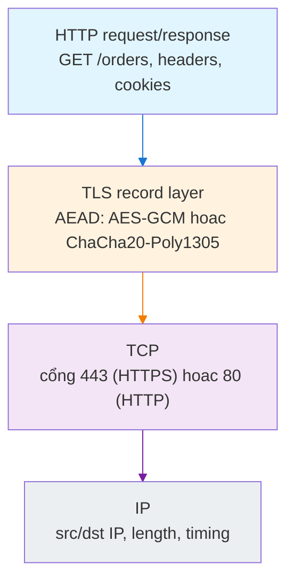
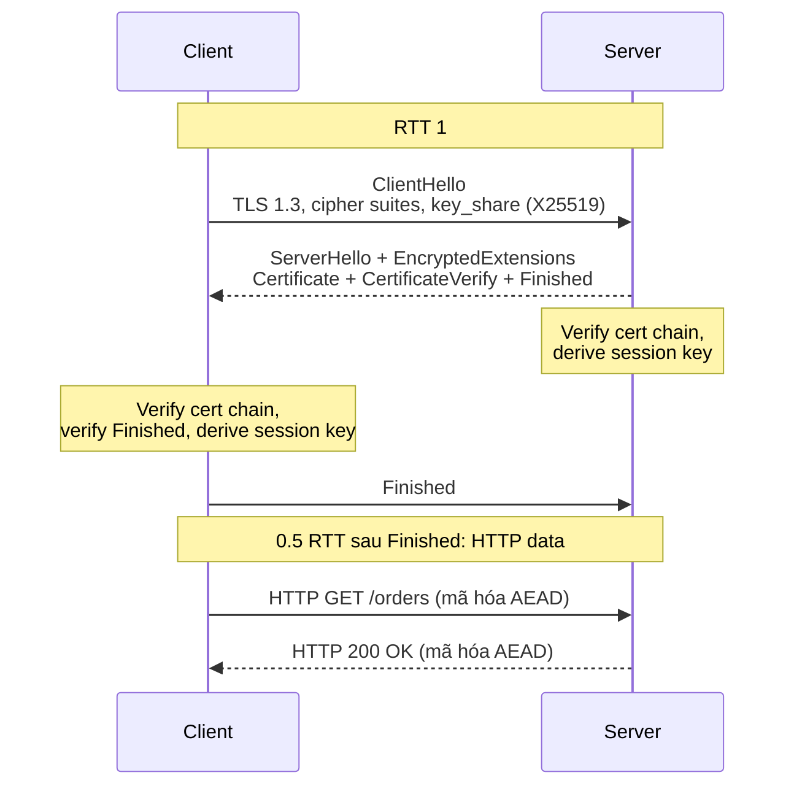

# What is the difference between HTTP and HTTPS?

> HTTPS là HTTP chạy bên trong một phiên TLS, cộng thêm xác thực máy chủ qua chứng chỉ X.509 và mã hóa AEAD. Bài này tập trung vào handshake TLS 1.3 (1-RTT, ECDHE, AEAD), chain of trust, forward secrecy, và những gì HTTPS không ẩn được.

Chủ đề: Networking · Ngày: 2026-10-15

## 1. Là gì

**Định nghĩa.** HTTP (RFC 9110) là giao thức tầng ứng dụng, text-based, trao đổi qua TCP cổng 80. Mọi byte trên dây — URL path, header, cookie, body — đều plaintext.

HTTPS (HTTP Secure) là HTTP chạy bên trong TLS (RFC 8446). Về ứng dụng, cấu trúc request/response không đổi; về truyền tải, mọi byte sau bắt tay đều được mã hóa bằng AEAD và xác thực toàn vẹn, kèm chứng chỉ X.509 để client xác minh server. Cổng mặc định: 443.

Hai thứ HTTPS thêm vào HTTP: (1) bí mật và toàn vẹn dòng byte nhờ AEAD (AES-GCM, ChaCha20-Poly1305); (2) xác thực server qua chuỗi chứng chỉ X.509 do CA ký.

HTTPS không thay đổi ngữ nghĩa HTTP (status code, header, cookie, cache). HTTPS không tự xác thực người dùng. HTTPS không ẩn: IP nguồn/đích, cổng, tên miền trong SNI (trừ ECH), kích thước, timing, ALPN.

Giả định: bài này nói HTTPS qua TLS 1.2 và 1.3 trên TCP. SSL 2.0/3.0 và TLS 1.0/1.1 đã deprecated.



*Sơ đồ vị trí: HTTP nằm trên TLS, TLS nằm trên TCP, TCP nằm trên IP. HTTPS thêm lớp TLS giữa HTTP và TCP.*

**Trả lời 30 giây.** HTTP truyền mọi thứ dạng plaintext trên cổng 80. HTTPS là HTTP bọc trong TLS trên cổng 443. TLS cung cấp mã hóa AEAD (AES-GCM, ChaCha20-Poly1305) để bảo vệ bí mật và toàn vẹn, cộng thêm chuỗi chứng chỉ X.509 do CA ký để xác thực server. TLS 1.3 bắt tay 1 RTT, mặc định forward secrecy qua ECDHE. HTTPS không ẩn IP, SNI, kích thước hay timing.

## 2. Cơ chế cốt lõi

### Bước 1. TCP three-way handshake (1 RTT)

TCP phải mở kết nối ở cổng 443 trước khi TLS nói chuyện. Ba gói SYN, SYN-ACK, ACK tốn 1 RTT. Không đổi so với HTTP. Bước này tương tự cho cả HTTP và HTTPS.

### Bước 2. TLS 1.3 handshake (1 RTT)

TLS 1.3 rút handshake còn 1 RTT so với 2 RTT ở TLS 1.2.

**ClientHello** gửi từ client chứa: phiên bản TLS (1.3), danh sách cipher suite (thường 5 bộ, ví dụ `TLS_AES_256_GCM_SHA384`, `TLS_CHACHA20_POLY1305_SHA256`), key share ECDHE (client sinh cặp khóa tạm thời X25519 hoặc P-256), và extension: SNI, ALPN, supported_versions, key_share, supported_groups.

**ServerHello** trả về chọn một cipher và một key share, kèm EncryptedExtensions (ALPN đã chọn, ví dụ `h2`), Certificate (chuỗi cert: leaf → intermediate → root), CertificateVerify (chữ ký server lên handshake transcript, chứng minh server giữ khóa riêng), và Finished (HMAC toàn transcript để client xác minh).

Quan trọng: ngay sau ServerHello, mọi thứ server gửi đã được mã hóa bằng key derive từ ECDHE key share. Kẻ nghe lén chỉ thấy ClientHello và ServerHello (plaintext để đồng bộ), không thấy Certificate, EncryptedExtensions, Finished.

Client verify cert chain: kiểm tra chữ ký từng bậc (leaf → intermediate → root), hostname trong SAN, validity (now nằm giữa notBefore và notAfter), OCSP stapling hoặc CRL. Sau đó gửi Finished.



*Sơ đồ TLS 1.3 handshake: 1 RTT trước khi có HTTP data đầu tiên. ClientHello và ServerHello là plaintext; mọi thứ sau ServerHello đã mã hóa.*

Tổng RTT: TCP 1 RTT + TLS 1 RTT + HTTP request 1 RTT = 3 RTT cho request đầu tiên. TLS 1.2 cần 2 RTT handshake → 4 RTT tổng.

### Bước 3. Chain of trust

Khi client nhận Certificate message, chứa chuỗi: leaf cert → intermediate CA → root CA. Client verify từng bậc:

1. Verify chữ ký intermediate lên leaf, root lên intermediate.
2. Verify hostname trong SAN khớp với domain client đang kết nối.
3. Verify now nằm trong khoảng notBefore → notAfter.
4. Verify OCSP stapling (server đính kèm) hoặc CRL.

Nếu pass hết: chap nhận kết nối. Nếu sai bất kỳ bước nào: từ chối với lỗi tương ứng (unknown_ca, hostname mismatch, certificate expired, certificate revoked).

Certificate Transparency (CT, RFC 9162): mỗi cert phải được log vào ít nhất 2 CT log (Chrome yêu cầu 2). Mục đích: CA không thể âm thầm cấp cert cho domain mà chủ sở hữu không biết. SCT (Signed Certificate Timestamp) được đính kèm trong cert extension hoặc TLS handshake.

### Bước 4. AEAD — mã hóa kèm xác thực

Sau handshake, mỗi record TLS được mã hóa bằng AEAD. Cấu trúc:

```
[TLS record header: type | version | length]
[Nonce: implicit (từ session key) + explicit (số sequence)]
[Ciphertext: plaintext XOR keystream]
[Authentication tag: 16 byte]
```

AES-256-GCM lấy key 256 bit, sinh keystream, XOR với plaintext, đồng thời tính GHASH để ra tag 128 bit. ChaCha20-Poly1305 dùng stream cipher ChaCha20 cho keystream và Poly1305 cho MAC, phù hợp CPU không có AES-NI (mobile, IoT).

Nếu attacker sửa một byte trong ciphertext, authentication tag không khớp → receiver phát hiện và đóng kết nối.

### Bước 5. Forward secrecy — ECDHE

ECDHE (Elliptic Curve Diffie-Hellman Ephemeral) sinh cặp khóa tạm thời cho mỗi session. Cả client và server gửi public key tạm thời, cùng sinh shared secret bằng ECDH. Shared secret đi vào HKDF để sinh session key.

Đặc tính: dù long-term key (khóa RSA/ECDSA trong cert) bị lộ sau này, kẻ tấn công cũng không tính lại được session key vì session key phụ thuộc ephemeral key. TLS 1.3 bỏ hoàn toàn RSA key exchange (không forward secrecy).

TLS 1.3 0-RTT: client dùng PSK (Pre-Shared Key) để gửi data ngay trong ClientHello, tiết kiệm 1 RTT. Nhược điểm: dữ liệu có thể bị replay, không có forward secrecy. Chỉ dùng cho idempotent request (GET, HEAD). RFC 8446 cảnh báo rõ.

**Quan sát.** Kiểm tra handshake TLS 1.3 thực tế:

```bash
# Xem chi tiết handshake, cipher suite, cert
openssl s_client -connect github.com:443 -servername github.com -tls1_3 \
  </dev/null 2>/dev/null | openssl x509 -noout -subject -issuer -dates

# Xem cipher suite đang dùng
openssl s_client -connect github.com:443 -servername github.com \
  </dev/null 2>/dev/null | grep "Cipher"

# Bắt gói và lọc ClientHello
sudo tcpdump -i en0 -s 0 'host github.com and port 443' -w /tmp/tls.pcap
# Mở Wireshark: filter tls.handshake.type == 1 (ClientHello)
# Xem Extension: server_name (SNI), application_layer_protocol_negotiation (ALPN)
```

### Ví dụ chạy từng bước

Kịch bản: ngân hàng X triển khai HTTPS cho `api.bank.example.com`. Backend API nằm ở Frankfurt, edge LB ở Singapore, khách truy cập từ Hà Nội.

**Bước 1.** Khách gõ `https://api.bank.example.com/orders`. DNS trả A 203.0.113.50 (LB Singapore). Khởi tạo TCP tới 203.0.113.50:443. RTT Hà Nội → Singapore ~80 ms (đã đo: bài này dùng con số này để nhất quán với các bài khác trong repo). Tốn 1 RTT.

**Bước 2.** TLS 1.3 handshake: ClientHello gửi `h2` trong ALPN, key_share ECDHE X25519, SNI `api.bank.example.com`. Server trả ServerHello chọn `h2`, EncryptedExtensions, Certificate (leaf CN `api.bank.example.com`, SAN `*.bank.example.com`), CertificateVerify (chữ ký ECDSA P-256 lên transcript), Finished. Client verify chain qua intermediate đến root ISRG Root X1 (Let's Encrypt), hostname match, validity còn 47 ngày. Tốn thêm 1 RTT.

| Bước | RTT đã dùng | Trạng thái |
|---|---|---|
| TCP SYN | 1 | SYN_SENT |
| TLS ClientHello + ServerHello + Finished | 1 | Handshake xong, session key derive xong |
| TLS session key | 0 | AES-128-GCM + ECDHE X25519 |

**Bước 3.** Client gửi HTTP request `GET /orders` qua encrypted record. LB Singapore terminate TLS, đọc HTTP, forward qua TLS mới tới backend Frankfurt (TLS end-to-end mạng nội bộ). Backend trả `200 OK` body JSON, LB forward về client. Tổng RTT = 80 ms (TCP) + 80 ms (TLS) + 80 ms (HTTP request đến LB) + 80 ms (LB → backend) + 80 ms (response về client) = 400 ms lý tưởng, thực tế có processing nên ~450-500 ms.

**Bước 4.** Lần thứ hai truy cùng session ticket (PSK): TLS handshake rút từ 1 RTT còn 0 RTT (0-RTT chỉ dùng cho GET idempotent). Tổng RTT giảm còn TCP 80 + HTTP 160 = 240 ms. Nếu bật HTTP/2 + TLS 1.3 session resumption cho static assets, TTFB giảm đáng kể.

**Nếu cert sắp hết hạn:** Monitoring `certificate_expiry_timestamp_seconds` cảnh báo < 14 ngày. Certbot chạy ở LB Singapore renew qua ACME, reload nginx. Nếu renew fail (ACME challenge chặn bởi firewall), browser hiện `NET::ERR_CERT_DATE_INVALID` vào ngày hết hạn — đây là failure mode trong bảng Phần 4.

Điều rút ra: tổng RTT khi mở kết nối mới phụ thuộc khoảng cách địa lý nhiều hơn phụ thuộc chi phí tính toán TLS; trả lời Câu 12 (3B) về "HTTPS có làm chậm không".

## 3. Câu hỏi phỏng vấn

### 3A. Câu hỏi đào sâu
<details class="qa">
<summary>Câu 1. HTTP và HTTPS khác nhau ở đâu ở mức giao thức? HTTPS thêm gì vào HTTP?</summary>

**Trả lời ngắn:** HTTPS không phải giao thức mới, là HTTP bọc trong TLS ở cổng 443. TLS thêm: mã hóa AEAD (AES-128/256-GCM, ChaCha20-Poly1305), xác thực toàn vẹn (authentication tag), xác thực server qua chuỗi cert X.509. Cấu trúc HTTP (status code, header, cache, cookie) không đổi.

**Đào sâu:**
- URL scheme `https://` chỉ báo client mở kết nối TLS trước khi gửi HTTP.
- RTT tăng: HTTP thuần cần 2 RTT (TCP + request). HTTPS cần thêm 1-2 RTT cho TLS handshake. TLS 1.3: +1 RTT. TLS 1.2: +2 RTT. Session resumption và 0-RTT giảm chi phí.
- HTTPS không ẩn: IP nguồn/đích, cổng, SNI (trừ ECH), kích thước request/response, timing, ALPN. Những thứ này dùng để fingerprinting lưu lượng.
- HTTPS không tự xác thực người dùng. TLS xác thực server, không xác thực client (trừ mTLS). Authn người dùng vẫn qua HTTP (cookie, token, OAuth).

**Bẫy:** Nói "HTTPS là giao thức riêng", "HTTPS bảo vệ mọi thứ", hoặc "TLS thay thế TCP".

**Follow-up:** TLS 1.3 giảm RTT so với TLS 1.2 như thế nào? TLS 1.2 cần 2 RTT: ClientHello → ServerHello + Cert → ClientKeyExchange + Finished → Server Finished. TLS 1.3 gộp thành 1 RTT: client gửi key share trong ClientHello, server trả Cert + Finished ngay, client Finished gửi cùng request HTTP đầu tiên.
</details>

<details class="qa">
<summary>Câu 2. Mô tả TLS 1.3 handshake. Mỗi bước trao đổi gì và vì sao?</summary>

**Trả lời ngắn:** ClientHello chứa cipher suite, key share ECDHE (X25519/P-256), SNI, ALPN. Server trả ServerHello + EncryptedExtensions + Certificate + CertificateVerify (chữ ký server lên handshake transcript) + Finished. Client verify cert chain, hostname trong SAN, validity, gửi Finished. Cả hai bên derive session key từ ECDHE shared secret qua HKDF.

**Đào sâu:**
- ClientHello plaintext (cần để client và server đồng bộ). Phần còn lại: mã hóa bằng key derive từ ECDHE.
- CertificateVerify: server ký lên toàn bộ handshake transcript (ClientHello + ServerHello + ...). Client verify bằng public key trong cert. Mục đích: chứng minh server giữ private key tương ứng với cert, đồng thời chống MITM.
- TLS 1.3 bỏ hoàn toàn: cipher không AEAD (CBC), static RSA key exchange, renegotiation (lỗi CVE-2009-3555).
- Mặc định forward secrecy: mọi key exchange đều ECDHE, ephemeral key bị xóa sau session.
- 0-RTT tùy chọn: client gửi data ngay trong ClientHello bằng PSK, tiết kiệm 1 RTT. Nhược: replay risk, không forward secrecy.

**Bẫy:** Không phân biệt được ClientHello plaintext và phần sau ServerHello đã mã hóa. Không hiểu CertificateVerify chứng minh gì.

**Follow-up:** Vì sao ECDHE quan trọng? Static RSA key exchange (server mã hóa premaster secret bằng private key RSA) không có forward secrecy. Lộ private key sau này → giải mã được mọi phiên đã ghi lại. ECDHE dùng key tạm thời, xóa sau session.
</details>

<details class="qa">
<summary>Câu 3. Forward secrecy nghĩa là gì, đạt được bằng cách nào, và vì sao quan trọng?</summary>

**Trả lời ngắn:** Forward secrecy: dù khóa bí mật dài hạn của server (khóa RSA/ECDSA trong cert) bị lộ sau này, kẻ tấn công cũng không giải mã được các phiên đã ghi lại. Đạt được nhờ ECDHE: cả client và server sinh cặp khóa tạm thời cho mỗi session, ephemeral key bị xóa sau khi session kết thúc.

**Đào sâu:**
- Không có forward secrecy nếu dùng static RSA key exchange (server dùng private key RSA mã hóa premaster secret). TLS 1.3 bỏ hoàn toàn RSA key exchange.
- TLS 1.3 mặc định forward secrecy. TLS 1.2 phụ thuộc cipher: `ECDHE_*` có, `RSA_*` không có.
- 0-RTT không có forward secrecy: data mã hóa bằng PSK cũ. Nếu PSK bị lộ, attacker giải mã được 0-RTT data đã ghi lại.
- Quan trọng vì: lộ khóa server là sự cố thường gặp (Heartbleed 2014). Nếu không có forward secrecy, attacker đợi lộ khóa rồi giải mã toàn bộ traffic đã ghi trong nhiều năm.

**Bẫy:** Nghĩ forward secrecy nghĩa là "không bao giờ bị hack", hoặc nhầm HSTS/HPKP có liên quan (không có).

**Follow-up:** ECDHE dùng curve nào? X25519 (Curve25519) phổ biến: nhanh, an toàn về implementation (không timing attack như P-256 trên một số thư viện cũ). P-256 cũng được hỗ trợ rộng rãi.
</details>

<details class="qa">
<summary>Câu 4. Bạn thiết kế TLS cho API của ngân hàng, hàng triệu user trên mobile. Quyết định: terminate TLS ở đâu, cert nào, cipher nào, có bật HSTS không, có pinning không?</summary>

**Trả lời ngắn:** Terminate TLS ở edge (CDN/LB). Dùng Let's Encrypt wildcard `*.bank.example.com`, ECDSA P-256. Chỉ ECDHE + AEAD, ưu tiên X25519 + AES-128-GCM. Bật HSTS max-age 1 năm + includeSubDomains + preload. KHÔNG bật pinning cho web (HPKP deprecated).

**Đào sâu:**
- Terminate TLS ở edge: giảm CPU backend, đơn giản hóa cert management, tận dụng CDN cache và DDoS protection. Backend chỉ nghe HTTP ở localhost. Nếu backend cần bảo vệ payload trong DC (multi-tenant), thêm end-to-end TLS.
- Cert: Let's Encrypt + wildcard, ECDSA P-256 (chữ ký 64 byte vs 256 byte RSA, verify nhanh hơn 5 lần trên mobile). Rotate 60-90 ngày qua certbot hoặc cert-manager. SAN chứa mọi subdomain.
- Cipher: TLS 1.3 + TLS 1.2 fallback. Chỉ ECDHE + AEAD. Ưu tiên X25519, AES-128-GCM, ChaCha20-Poly1305 (cho device cũ không có AES-NI). Tắt CBC, RC4, 3DES, MD5, SHA-1.
- HSTS: bật với max-age 1 năm, includeSubDomains, preload. Chống SSL stripping (attacker chặn HTTP đầu tiên, ép user dùng HTTP giả).
- Pinning: KHÔNG bật cho web (HPKP deprecated vì làm hỏng site khi admin sai key). Certificate Transparency là giải pháp tốt hơn. Trong app native: cân nhắc pin SPKI với 2-3 backup key.
- 0-RTT: không bật cho API thanh toán (POST/PUT có rủi ro replay). Chỉ bật cho CDN static GET idempotent.

**Bẫy:** Pin cứng không backup, bật 0-RTT cho POST, để TLS 1.0/1.1, quên OCSP stapling.

**Follow-up:** Nếu backend cần IP gốc của client (rate limit, geo) thì sao? LB thêm `X-Forwarded-For` và `X-Real-IP` vào HTTP header. Nếu cần bảo mật hơn, dùng PROXY protocol v1/v2 truyền IP qua TCP header thay vì HTTP.
</details>

<details class="qa">
<summary>Câu 5. Mixed content là gì, tại sao nguy hiểm, cách phòng?</summary>

**Trả lời ngắn:** Mixed content: trang HTTPS nhúng tài nguyên (script, ảnh, CSS, iframe) qua HTTP. Browser chặn hoàn toàn active content (script, stylesheet, iframe). Passive content (ảnh, video) trước đây cảnh báo, Chrome hiện chặn luôn.

**Đào sâu:**
- Nguy hiểm: attacker chặn HTTP (không cần cert) thay thế script bằng mã độc. HTTPS của trang chính bị "lủng" vì phần tải qua HTTP có thể đọc/sửa.
- Ví dụ: trang `https://bank.com` nhúng `<script src="http://bank.com/analytics.js">`. Attacker sửa script thành `fetch('/api/transfer?amount=10000', {credentials:'include'})`. Vì script chạy trong context HTTPS, nó có cookie session.
- Cách phòng: dùng URL HTTPS tuyệt đối. CSP header `upgrade-insecure-requests` tự động rewrite HTTP thành HTTPS. CSP `block-all-mixed-content` chặn hẳn. DevTools Network filter `block:http` để audit.
- HSTS giúp: lần đầu client truy cập `https://bank.com`, server gửi `Strict-Transport-Security`. Từ lần sau, browser tự chuyển `http://` sang `https://` trước khi tạo request.

**Bẫy:** Chỉ chặn script mà quên CSS, font, iframe. Dùng protocol-relative (`//cdn.example.com/script.js`) mà CDN không hỗ trợ HTTPS.

**Follow-up:** `upgrade-insecure-requests` khác gì `block-all-mixed-content`? Upgrade rewrite HTTP thành HTTPS (request vẫn chạy nếu server hỗ trợ HTTPS). Block chặn hẳn. Upgrade tốt hơn cho giai đoạn transition, block cho security hardening.
</details>

<details class="qa">
<summary>Câu 6. TLS termination tại LB có đánh đổi gì so với TLS end-to-end?</summary>

**Trả lời ngắn:** TLS termination tại LB: client mã hóa với LB, LB giải mã, HTTP plaintext tới backend. Ưu: đơn giản cert management, backend không cần TLS, LB phân tích request. Nhược: backend nhận plaintext, sniff nội bộ khả thi. TLS end-to-end: payload được bảo vệ cả trong DC nhưng phức tạp hơn, mỗi backend cần cert.

**Đào sâu:**
- TLS termination tại LB: phù hợp web thông thường, CDN, microservices không nhạy cảm trong cùng DC.
- TLS end-to-end: phù hợp multi-tenant DC, môi trường compliance (PCI-DSS), khi backend cần verify client (mTLS).
- TLS passthrough (LB chỉ forward TCP): LB không giải mã, payload bảo vệ nhưng LB không phân tích được request. Cần L4 LB.
- mTLS giữa các service: SPIFFE/SPIRE cấp workload identity, cert tự động rotate mỗi vài giờ. Bảo vệ khỏi service giả mạo trong DC.
- 0-RTT: chỉ cho idempotent GET ở CDN. Không bật cho POST thanh toán.

**Bẫy:** Nghĩ termination là mặc định duy nhất. Bỏ qua chi phí mTLS khi số service nhiều (cert rotation, SPIRE setup).

**Follow-up:** Cert cho mTLS trong DC quản lý thế nào? SPIFFE (Secure Production Identity Framework For Everyone) cấp workload identity, SPIRE là implementation. Cert rotate tự động, mount vào workload qua volume. Internal CA cấp cert ngắn hạn (7-30 ngày).
</details>

<details class="qa">
<summary>Câu 7. Triệu chứng: site không truy cập được, browser hiện "Your connection is not private". Bạn kiểm tra gì theo thứ tự nào?</summary>

**Trả lời ngắn:** Kiểm tra cert expiry → kiểm tra chain (thiếu intermediate?) → kiểm tra cipher → kiểm tra hostname mismatch → kiểm tra OCSP revocation.

**Đào sâu:**
1. **Cert expiry:** `openssl s_client -connect example.com:443 < /dev/null | openssl x509 -noout -dates`. Lỗi `certificate has expired` → renew cert.
2. **Chain thiếu intermediate:** `openssl s_client -connect example.com:443 -showcerts < /dev/null`. Nếu chỉ có 1 cert (leaf), server không gửi intermediate. Sửa: trỏ `ssl_certificate` đến `fullchain.pem` (leaf + intermediate).
3. **Cipher bị từ chối:** `testssl.sh example.com:443` hoặc Qualys SSL Labs. Lỗi `ERR_SSL_VERSION_OR_CIPHER_MISMATCH` → server không hỗ trợ cipher client yêu cầu. Kiểm tra TLS 1.2/1.3 được bật, cipher AEAD được phép.
4. **Hostname mismatch:** lỗi `Hostname mismatch` → cert SAN không chứa hostname client đang kết nối. Kiểm tra: `openssl x509 -noout -text | grep DNS:` xem SAN.
5. **OCSP revoked:** `openssl s_client -connect example.com:443 -status < /dev/null`. Nếu OCSP stapling trả `revoked` → CA đã thu hồi cert, cần issue cert mới.
6. **Trust store:** cert tự ký hoặc CA không có trong trust store của OS/browser. Nếu internal: cài cert vào OS trust store.

**Bẫy:** Kiểm tra ứng dụng trước khi kiểm tra TLS. Error 401/403 có thể do cert không phải ứng dụng.

**Follow-up:** Làm sao monitor cert expiry tự động? Prometheus `cert_exporter` scrape endpoint `/metrics`, export `certificate_expiry_timestamp_seconds`. Alert Prometheus rule: sắp hết hạn < 30 ngày warning, < 7 ngày critical.
</details>

<details class="qa">
<summary>Câu 8. Thiết kế: SaaS B2B có 3.000 khách hàng, mỗi khách có domain riêng, phục vụ từ 6 vùng. TLS cần đạt: 1.3 mặc định, cert tự động rotate, HSTS + preload, OCSP staple, theo dõi expiry, hỗ trợ custom domain.</summary>

**Trả lời ngắn:** CDN terminate TLS ở edge, ACME tự động rotate cert, regional LB có cert cho domain chính, custom domain xử lý qua CDN SNI routing.

**Đào sâu:**
- **CDN (Cloudflare/Fastly) terminate TLS ở edge:** giảm tải backend, cache content, tận dụng global network. CDN cung cấp universal SSL cert (SAN nhiều domain) hoặc dedicated cert (enterprise). SNI routing chọn đúng cert cho từng custom domain.
- **Regional LB (nginx/Envoy) terminate TLS cho domain chính `*.saas.com`:** CDN có thể miss, hoặc cần gọi API nội bộ, hoặc EU customer cần LB ở EU.
- **ACME (Let's Encrypt) + cert-manager:** rotate tự động, hook reload nginx/Envoy khi cert mới. Vì sao: cert miễn phí, tự động hóa giảm sai sót thủ công. Rotate 60-90 ngày, 30-50 cert/ngày.
- **Custom domain:** CDN xử lý SNI routing. Mỗi khách hàng có cert riêng qua CNAME hoặc dedicated cert.
- **HSTS:** bật cho domain chính `*.saas.com` max-age 1 năm + includeSubDomains + preload. KHÔNG bật preload cho custom domain (do khách hàng quản lý).
- **OCSP stapling:** bật ở CDN và LB. Client không gọi CA mỗi handshake.
- **Monitoring:** `cert_exporter` Prometheus alert 30/14/7/1 ngày. `tls_handshake_duration_seconds` p99 > 200ms cảnh báo.
- **Điểm nghẽn:** cert rotation hàng loạt (30-50 cert/ngày), CDN upload cert, LB reload config. Mở rộng: cert rotation queue với rate limit, CDN batch upload, rolling restart.

**Bẫy:** Bật HSTS preload cho custom domain (không kiểm soát được). Dùng RSA cert thay vì ECDSA (chữ ký lớn, verify chậm trên mobile). Quên OCSP stapling → client gọi CA mỗi handshake.

**Follow-up:** Nếu CDN gặp sự cố, cert rotation queue tích lại thì sao? Queue có rate limit (Let's Encrypt: 50 cert/tài khoản/ngày). Retry exponential backoff. Alert nếu queue > 100 pending.
</details>

### 3B. Câu hỏi phỏng vấn liên quan

<details class="qa">
<summary>Câu 9. TLS session resumption khác gì 0-RTT, và khi nào nên dùng cái nào?</summary>

**Trả lời:** Session resumption (TLS 1.2 session ID/ticket hoặc TLS 1.3 PSK) bỏ qua TLS handshake nhưng vẫn đợi 1 RTT, an toàn. 0-RTT (chỉ TLS 1.3) gửi data ngay trong ClientHello, tiết kiệm thêm 1 RTT nhưng data có thể bị replay. 0-RTT chỉ dùng cho idempotent GET/HEAD, không dùng cho POST.
</details>

<details class="qa">
<summary>Câu 10. SNI là gì, tại sao cần SNI, và ECH giải quyết vấn đề gì?</summary>

**Trả lời:** SNI (Server Name Indication) là extension TLS client gửi hostname muốn kết nối trong ClientHello để server chọn đúng cert khi một IP phục vụ nhiều domain. SNI là plaintext nên ISP/GFW thấy được. ECH (Encrypted ClientHello) mã hóa SNI bằng public key lấy từ HTTPS RR DNS, ẩn hostname; triển khai còn hạn chế, phụ thuộc client/server/DNS.
</details>

<details class="qa">
<summary>Câu 11. Tại sao TLS 1.2 vẫn cần được hỗ trợ dù TLS 1.3 đã ra, và khi nào nên tắt?</summary>

**Trả lời:** Vì còn client cũ (Windows 7, Android 6, IoT) chỉ hỗ trợ TLS 1.2. Tắt khi đo rằng phần lớn traffic tới từ client TLS 1.3, domain mới không cần tương thích ngược, hoặc compliance yêu cầu cipher hiện đại. Tắt sai dẫn tới handshake fail từ browser/IoT cũ, log kiểu `ERR_SSL_VERSION_OR_CIPHER_MISMATCH`.
</details>

<details class="qa">
<summary>Câu 12. HTTPS có làm chậm đáng kể không, và làm sao giảm chi phí TLS?</summary>

**Trả lời:** TLS 1.3 chiếm ~1-2% throughput so với HTTP thuần, không đáng kể. Tốn CPU ở handshake ECDHE+verify cert (~50.000-100.000 handshake/s trên 1 lõi tuỳ hardware, không chắc cho mọi máy). Giảm: TLS 1.3, ECDSA cert, session resumption, AES-NI, terminate ở edge/LB.
</details>

<details class="qa">
<summary>Câu 13. Cert self-signed có dùng được cho HTTPS production không, khi nào chấp nhận?</summary>

**Trả lời:** Không dùng cho HTTPS public vì browser từ chối (lỗi `NET::ERR_CERT_AUTHORITY_INVALID`). Chấp nhận cho dev/staging nội bộ, service-to-service trong DC có internal CA riêng (CA cert cài vào trust store), VPN nội bộ. Production phải dùng cert từ CA trong trust store của OS/browser.
</details>

<details class="qa">
<summary>Câu 14. TLS 0-RTT replay attack nguy hiểm thế nào, và cách giảm?</summary>

**Trả lời:** Attacker capture 0-RTT request (vd `POST /api/like?item=42`) rồi replay nhiều lần. Server không phân biệt được vì cùng PSK. Giảm: chỉ cho idempotent GET, thêm timestamp/nonce và reject nếu quá cũ, dùng `unique_init_key` ở server, hoặc tắt 0-RTT. POST có side-effect tuyệt đối không bật.
</details>

<details class="qa">
<summary>Câu 15. Nếu cert bị thu hồi (revoked) trước expiry, user có bị chặn ngay không và cơ chế nào dùng?</summary>

**Trả lời:** Có thể bị chặn nếu client check OCSP/CRL. OCSP stapling đính kèm OCSP response trong handshake, client không phải gọi CA; nếu `revoked`, browser hiện `NET::ERR_CERT_REVOKED`. Nếu client không check revocation (mobile thường bỏ qua vì query chậm), vẫn kết nối; trình duyệt hiện đại dùng CRLSets hoặc OCSP must-staple.
</details>

<details class="qa">
<summary>Câu 16. True or false: "HTTPS chỉ thêm TLS, nên cũng ẩn IP và hostname server."</summary>

**Trả lời:** Sai. TLS mã hóa payload HTTP sau handshake, nhưng IP nguồn/đích, cổng (443), SNI trong ClientHello (trừ ECH), cỡ record, timing, ALPN đều plaintext và quan sát được. HTTPS ẩn nội dung, không ẩn metadata kết nối; dùng HTTPS không có nghĩa ISP/CDN không biết user truy cập `bank.com`.
</details>

## 4. Đánh đổi và sự cố production

### So sánh TLS 1.2 vs TLS 1.3

| Tiêu chí | TLS 1.2 | TLS 1.3 |
|---|---|---|
| Handshake RTT | 2 RTT | 1 RTT |
| Cipher | Nhiều (CBC, RC4, MD5, SHA-1 được phép) | 5 bộ, tất cả ECDHE + AEAD |
| Forward secrecy | Tùy cipher (ECDHE: có, RSA: không) | Mặc định có |
| RSA key exchange | Được phép (không FS) | Bỏ hoàn toàn |
| Renegotiation | Được phép (có lỗi CVE-2009-3555) | Bỏ |
| 0-RTT | Không | Có (replay risk) |
| Chi phí CPU | Cao hơn (nhiều cipher, nhiều round-trip) | Thấp hơn |
| Tương thích | Client cũ | Client hiện đại |

### So sánh kiểu triển khai HTTPS

| Tiêu chí | TLS termination tại LB | TLS end-to-end | TLS passthrough |
|---|---|---|---|
| Độ trễ request đầu tiên | 3 RTT (TLS 1.3) | 4 RTT (mỗi đoạn) | 3 RTT |
| Payload bảo vệ trong DC | Không (HTTP plaintext) | Có | Có |
| Cert management | Một chỗ (LB) | Nhiều chỗ (mỗi backend) | LB đơn giản |
| LB thấy payload | Có | Không | Không |
| Độ phức tạp | Thấp | Cao | Trung bình |

### Failure mode

| Triệu chứng | Nguyên nhân gốc | Cách kiểm tra | Cách sửa |
|---|---|---|---|
| `NET::ERR_CERT_DATE_INVALID` | Cert hết hạn | `openssl s_client -connect x:443 < /dev/null \| openssl x509 -noout -dates` | Renew cert, reload server |
| `unable to get local issuer certificate` | Server không gửi intermediate chain | `openssl s_client -showcerts x:443 < /dev/null` | Đổi sang fullchain.pem |
| `ERR_SSL_VERSION_OR_CIPHER_MISMATCH` | Cipher không tương thích | `testssl.sh x:443` | Bật TLS 1.2/1.3, thêm cipher |
| `hostname mismatch` | SAN không chứa hostname | `openssl x509 -noout -text \| grep DNS` | Issue cert đúng hostname |
| `NET::ERR_CERT_REVOKED` | Cert bị thu hồi | Kiểm tra OCSP stapling | Issue cert mới |
| Request 0-RTT bị xử lý 2 lần | Replay attack | Log request idempotency key | Tắt 0-RTT hoặc giới hạn GET |
| Mixed content blocked | Trang HTTPS tải tài nguyên HTTP | DevTools Console filter `http://` | CSP `upgrade-insecure-requests` |
| SNI block ở Trung Quốc | GFW chặn SNI plaintext | Test từ IP Trung Quốc | Bật ECH, đổi CDN |

### Điểm không chắc

- Số liệu bậc độ lớn (AES-GCM ~5-10 GB/s, ECDHE ~50.000-100.000 handshake/s trên 1 lõi) là ước lượng, phụ thuộc phần cứng, cần đo lại trên hệ thống thật.
- ECH triển khai thực tế: Cloudflare và Firefox 2025+ hỗ trợ, nhưng tỷ lệ deploy còn thấp.
- Post-quantum TLS (ML-KEM): Chrome đã thử nghiệm song song X25519+Kyber768, nhưng chuẩn cuối chưa hoàn tất.

## 5. Cheat sheet

| Chủ đề | Con số / quy tắc |
|---|---|
| HTTP vs HTTPS | HTTPS = HTTP bên trong TLS, cổng 443. Cấu trúc HTTP không đổi. |
| TLS cung cấp | Confidentiality (AEAD), Integrity (authentication tag), Server authentication (X.509). |
| TLS 1.3 handshake | 1 RTT. Client gửi key share ECDHE trong ClientHello. Server trả Cert + CertVerify + Finished. |
| TLS 1.2 handshake | 2 RTT. Sắp deprecated, vẫn cần cho client cũ. |
| Forward secrecy | Đạt nhờ ECDHE. Lộ long-term key cũng không giải mã phiên cũ. |
| Cipher nên dùng | TLS 1.3: 5 bộ AEAD. TLS 1.2: ECDHE + AEAD. |
| Cipher cấm | CBC, RC4, 3DES, MD5, SHA-1, static RSA. |
| Cert | Let's Encrypt, ECDSA P-256, SAN đầy đủ, auto-rotate 60-90 ngày. |
| Chain of trust | Leaf → Intermediate → Root. Phải gửi full chain (`fullchain.pem`). |
| OCSP stapling | Server gửi OCSP response trong handshake. Client không gọi CA. |
| HSTS | max-age ≥ 1 năm, includeSubDomains, preload cho domain chính. |
| Mixed content | Script/CSS/iframe: chặn hoàn toàn. CSP `upgrade-insecure-requests` tự rewrite. |
| 0-RTT | Tiết kiệm 1 RTT. Chỉ cho idempotent GET. Nguy cơ replay. |
| SNI | Plaintext trong ClientHello. ECH mã hóa được. |
| Cert expiry | Alert 30/14/7/1 ngày. Monitoring tách khỏi app monitoring. |
| HTTPS không ẩn | IP, SNI, cổng, kích thước, timing, ALPN. |
| RTT đầy đủ | TCP + TLS 1.3 + HTTP: 3 RTT. TLS 1.2: 4 RTT. TLS 1.3 + 0-RTT: 2 RTT. |
| Test tool | Qualys SSL Labs, `testssl.sh`, `openssl s_client -showcerts`. |

**Học tiếp:** [HTTP/2 và HTTP/3](http-status-codes.md) · [OSI model](osi-model.md) · [DNS](dns-how-it-works.md)
