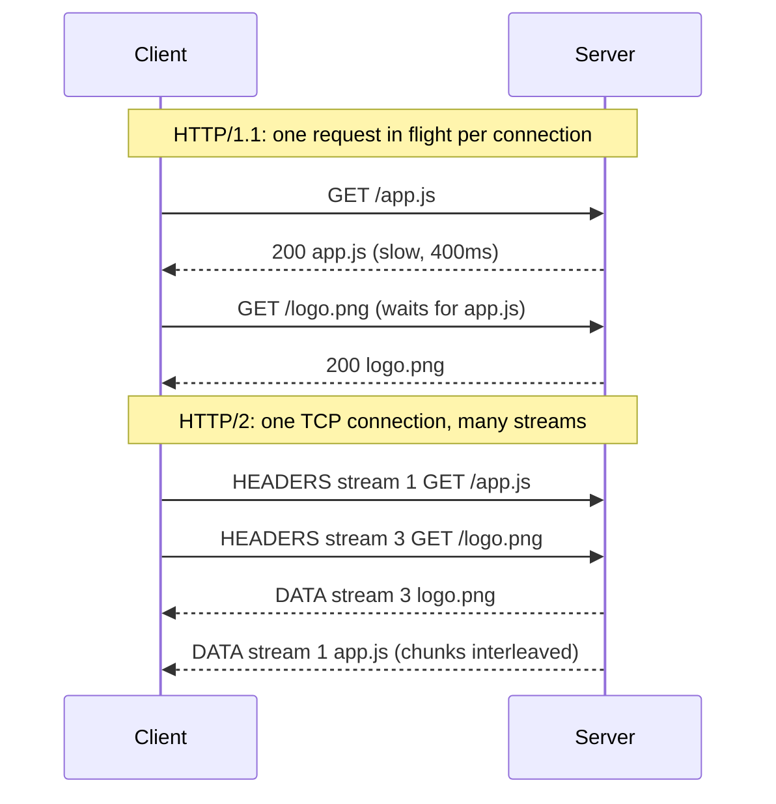

# What is the difference between HTTP/1.1 and HTTP/2?

> HTTP/2 giữ nguyên ngữ nghĩa HTTP (method, status, header) nhưng đổi cách đóng gói trên dây: binary frame, nhiều stream song song trên một kết nối TCP, và nén header bằng HPACK. Bài này tập trung vào multiplexing, head-of-line blocking ở hai tầng, HPACK và những gì HTTP/2 không giải quyết được.

Chủ đề: Networking · Ngày: 2026-10-15

## 0. Nền tảng trước khi đọc

**Bối cảnh:** Cách trình duyệt, ứng dụng và máy chủ gửi dữ liệu cho nhau. Mỗi bước có giao thức, độ trễ và kiểu lỗi riêng.

**Nói đơn giản:** HTTP/1.1 gửi các request theo text và dễ bị chờ tuần tự; HTTP/2 dùng frame nhị phân và nhiều stream trên một kết nối.

**Từ khóa cần biết:** client = bên gửi request; server = bên phục vụ; packet = mảnh dữ liệu đi qua mạng.

**Ví dụ dễ hình dung:** Trang có nhiều ảnh dùng nhiều stream HTTP/2 trên một TCP connection thay vì mở nhiều connection HTTP/1.1.

Khi đọc, luôn hỏi ba câu: nó giải quyết vấn đề gì, nó làm việc theo những bước nào, và khi nào không nên dùng?

**Cách học bài này:** Đọc phần này trước để nắm từ khóa; đọc phần 1 để lấy câu trả lời 30 giây; đọc phần 2 để hiểu cơ chế; cuối cùng mở từng câu hỏi ở phần 3 để luyện nói. Các con số và lệnh trong bài là bằng chứng cho câu trả lời, không cần học thuộc nếu chưa hiểu cơ chế.

## 1. Là gì


## 2. Cơ chế cốt lõi
### Đọc nhanh trước khi đi sâu

**Ý chính:** HTTP/1.1 gửi các request theo text và dễ bị chờ tuần tự; HTTP/2 dùng frame nhị phân và nhiều stream trên một kết nối.

**Ví dụ interview:** Trang có nhiều ảnh dùng nhiều stream HTTP/2 trên một TCP connection thay vì mở nhiều connection HTTP/1.1.

**Luồng 4 bước:**

1. Ứng dụng tạo request với tên host, port và dữ liệu.
2. OS và các giao thức mạng tìm đường rồi chuyển packet tới server.
3. Server xử lý request và trả response qua kết nối phù hợp.
4. Client kiểm tra response, cache hoặc render dữ liệu cho người dùng.

**Nói như trong interview:** HTTP/1.1 gửi các request theo text và dễ bị chờ tuần tự; HTTP/2 dùng frame nhị phân và nhiều stream trên một kết nối. Hãy nói theo bốn bước trên trước; nếu interviewer hỏi sâu, chuyển sang cơ chế **Đọc nhanh trước khi đi sâu**, rồi nêu trade-off và failure mode ở các phần sau.

### Bước 1. Chọn giao thức bằng ALPN
Trong TLS handshake, ClientHello liệt kê `h2` và `http/1.1` trong extension ALPN (Application-Layer Protocol Negotiation). Server chọn một giá trị, không tốn thêm RTT. Server không hỗ trợ `h2` thì trình duyệt tự rơi về HTTP/1.1.

### Bước 2. HTTP/1.1: một request bay mỗi kết nối
Kết nối TCP là persistent (keep-alive mặc định). Response phải trả đúng thứ tự request. Pipelining có trong đặc tả nhưng trình duyệt hầu như tắt vì head-of-line blocking (HOL) và proxy lỗi. Trình duyệt bù bằng ~6 kết nối song song mỗi host, mỗi kết nối tốn thêm TCP + TLS handshake.

### Bước 3. HTTP/2: connection preface và SETTINGS
Client gửi chuỗi magic `PRI * HTTP/2.0` rồi frame SETTINGS. Hai bên khai báo giới hạn: `SETTINGS_MAX_CONCURRENT_STREAMS`, `SETTINGS_INITIAL_WINDOW_SIZE` (mặc định 65.535 byte), `SETTINGS_MAX_FRAME_SIZE` (mặc định 16.384 byte), `SETTINGS_HEADER_TABLE_SIZE` (mặc định 4.096 byte).

### Bước 4. Frame và stream
Mọi thứ là frame binary, header 9 byte: length (24 bit), type, flags, stream ID (31 bit). Mỗi request/response là một stream. Client mở stream với ID lẻ. Frame của nhiều stream xen kẽ trên cùng một kết nối, nên response chậm không chặn response nhanh ở tầng HTTP.



*Sơ đồ so sánh: HTTP/1.1 phải chờ response trước xong; HTTP/2 gửi hai stream cùng lúc và xen kẽ DATA.*

### Bước 5. HPACK nén header
HPACK (RFC 7541) dùng static table (61 mục, ví dụ `:method GET`), dynamic table theo từng kết nối và Huffman coding. Header lặp lại (cookie, user-agent) chỉ còn vài byte sau request đầu. Bảng dynamic là state chung của kết nối, nên header block phải được xử lý đúng thứ tự.

### Bước 6. Flow control và kết thúc
Flow control áp dụng riêng cho từng stream và cho cả kết nối, bằng frame WINDOW_UPDATE. Cửa sổ mặc định 65.535 byte nhỏ với đường truyền RTT cao, phải tăng thì mới đạt băng thông. Đóng nhẹ nhàng bằng GOAWAY; hủy một stream bằng RST_STREAM mà không phá kết nối.

### Quan sát

```bash
# In phiên bản HTTP thực tế được thương lượng (2 nghĩa là h2)
curl -sI --http2 -o /dev/null -w '%{http_version}\n' https://example.com/

# Xem ALPN, SETTINGS và từng frame ở mức header
curl -sv --http2 -o /dev/null https://example.com/ 2>&1 | grep -i "alpn\|HTTP/2\|settings"
```

Cách đọc: dòng đầu in `2` khi ALPN chọn `h2`, in `1.1` khi server rơi về HTTP/1.1. Dòng thứ hai lọc output chi tiết của curl; câu chữ chính xác của dòng ALPN khác nhau giữa các phiên bản curl. Output minh họa, chưa chạy trong phiên này.

### Ví dụ chạy từng bước

Kịch bản: trang product detail tải **N=20 resource** (JS, CSS, ảnh), mỗi resource **80 KB**, RTT với server **80 ms** (cross-region proxy), băng thông **10 MB/s** giữa client và server. So sánh tải qua HTTP/1.1 (6 connection keep-alive) và HTTP/2 (1 connection multiplex).

**Bước 1.** Với HTTP/1.1: trình duyệt mở 6 connection keep-alive tới cùng origin. Mỗi connection phục vụ tuần tự request. Tính thời gian trên 1 connection với N/6 ≈ 4 resource: `(4 - 1) × 0.080s + 4 × 0.008s = 0.272s` (3 lần RTT cho request thứ 2-4 + thời gian truyền 4 file 80KB qua đường 10MB/s). Connection dài nhất quyết định tổng: ~271 ms (đã tính lại bằng script).

**Bước 2.** Với HTTP/2: 1 connection TCP, client mở 20 stream ID lẻ (1, 3, 5, …, 39). Server đáp DATA frame trên cùng connection, xen kẽ giữa các stream. Tổng thời gian = 1 RTT cho request đầu đến server + toàn bộ payload: `0.080s + (20 × 80KB) / 10MB/s = 0.080 + 0.160 = 0.240s` ≈ 236 ms (đã tính lại bằng script).

| Giao thức | Số connection | Tổng thời gian (đã tính) |
|---|---|---|
| HTTP/1.1, 6 conn keep-alive | 6 | ~271 ms |
| HTTP/2, multiplex | 1 | ~236 ms |
| Chênh lệch | — | HTTP/1.1 chậm hơn ~15% (~35 ms) |

**Bước 3.** Nếu trang yêu cầu N=100 resource (nặng hơn, phổ biến ở trang SPA), HTTP/1.1 với 6 connection phải xếp hàng ~17 resource mỗi connection: `(17-1) × 80ms + 17 × 8ms = 1.413s` (đã tính lại bằng script). HTTP/2 vẫn throughput-bound: `80ms + (100 × 80KB)/10MB/s = 80 + 781 = 861 ms` (đã tính lại bằng script). Lúc này HTTP/2 nhanh hơn ~39% (~552 ms) — khoảng cách mở rộng theo số resource.

**Bước 4.** Nếu mạng mất gói 5% (mobile yếu): HTTP/1.1 với 6 connection độc lập có thể chịu mất gói trên mỗi connection khác nhau; một connection khựng không ảnh hưởng 5 kia. HTTP/2 có 1 connection — TCP HOL blocking làm cả 20 stream khựng cùng lúc nếu segment mất. Đây là follow-up Câu 3 và Câu 5.

**Nếu client chỉ hỗ trợ HTTP/1.1:** server vẫn phục vụ được nhưng không có multiplex. Đây là lý do trong Phần 4 khuyên kiểm tra `curl -sI --http2 -o /dev/null -w '%{http_version}\n'` để chắc chắn giao thức thực sự được thương lượng.

Điều rút ra: HTTP/2 thắng nhờ giảm HOL blocking ở tầng HTTP và dồn bandwidth vào một connection, nhưng thua khi mạng mất gói vì TCP HOL ở tầng dưới; trả lời Câu 1 và Câu 17 phỏng vấn.

## 3. Câu hỏi phỏng vấn

### 3A. Câu hỏi đào sâu

<details class="qa">
<summary>Câu 1. What is the core difference between HTTP/1.1 and HTTP/2?</summary>

**Trả lời ngắn:** Ngữ nghĩa HTTP giữ nguyên, khác ở cách đóng gói và dùng kết nối. HTTP/1.1 là text, một request bay mỗi kết nối. HTTP/2 là binary frame, nhiều stream ghép trên một kết nối TCP, header nén bằng HPACK.

**Đào sâu:**
- HTTP/1.1 bù bằng ~6 kết nối song song mỗi host, mỗi kết nối tốn thêm handshake TCP + TLS.
- HTTP/2 dùng một kết nối, nên chỉ trả một lần handshake và một cửa sổ congestion.
- HPACK giảm header lặp (cookie, user-agent) xuống vài byte sau request đầu.
- Ngữ nghĩa (method, status, cache, cookie) thuộc RFC 9110, dùng chung cho cả hai.

**Bẫy:** Nói "HTTP/2 luôn nhanh hơn". Với một request lớn duy nhất hoặc mạng mất gói cao, lợi ích nhỏ, thậm chí chậm hơn.

**Follow-up:** HTTP/2 có bắt buộc TLS không? Đặc tả cho phép h2c không mã hóa, nhưng trình duyệt chỉ hỗ trợ `h2` qua TLS.
</details>

<details class="qa">
<summary>Câu 2. How does HTTP/2 multiplexing work, and what HOL blocking does it remove?</summary>

**Trả lời ngắn:** Mỗi request/response là một stream có ID riêng. Dữ liệu được cắt thành frame, frame của nhiều stream xen kẽ trên cùng một kết nối. Response chậm không chặn response nhanh ở tầng HTTP, nên bỏ được HOL blocking của HTTP/1.1.

**Đào sâu:**
- Header frame 9 byte có stream ID 31 bit; client dùng ID lẻ, server push dùng ID chẵn.
- Số stream đồng thời bị giới hạn bởi `SETTINGS_MAX_CONCURRENT_STREAMS` (giá trị mặc định do hai bên thỏa thuận; không chắc con số phổ biến của từng server).
- Flow control riêng cho từng stream và cả kết nối, qua WINDOW_UPDATE.
- Có priority nhưng phần cây ưu tiên của RFC 7540 đã bị RFC 9113 đánh dấu deprecated; hành vi phụ thuộc server.

**Bẫy:** Nói "HTTP/2 hết head-of-line blocking". Chỉ hết ở tầng HTTP; tầng TCP vẫn còn (câu 3).

**Follow-up:** Một stream bị lỗi thì sao? Gửi RST_STREAM cho riêng stream đó, kết nối vẫn sống.
</details>

<details class="qa">
<summary>Câu 3. Why does HTTP/2 still suffer from head-of-line blocking, and how does HTTP/3 fix it?</summary>

**Trả lời ngắn:** HTTP/2 ghép mọi stream vào một TCP byte stream có thứ tự. Một segment mất thì kernel giữ lại mọi byte phía sau cho tới khi retransmit xong, nên tất cả stream khựng, kể cả stream không liên quan. HTTP/3 chạy trên QUIC (UDP), mỗi stream được phục hồi mất gói độc lập.

**Đào sâu:**
- TCP chỉ giao dữ liệu cho ứng dụng theo đúng thứ tự byte. Mất gói thì chờ ít nhất ~1 RTT (fast retransmit) hoặc RTO nếu không có dup ACK.
- Mạng mất gói cao (ví dụ di động, vài %): một kết nối HTTP/2 có thể chậm hơn vài kết nối HTTP/1.1, vì mỗi kết nối HTTP/1.1 có cửa sổ và trạng thái mất gói riêng. Mức chênh phụ thuộc điều kiện mạng, không có con số chung.
- QUIC mã hóa gói ở tầng truyền tải và theo dõi mất gói theo stream; HTTP/3 dùng QPACK thay HPACK để header block không phụ thuộc thứ tự toàn cục.
- Đổi lại HTTP/3 tốn CPU hơn (xử lý UDP ở user space) và một số mạng chặn hoặc hạn chế UDP 443.

**Bẫy:** Nói "HTTP/2 giải quyết HOL blocking". Đúng cho tầng HTTP, sai cho tầng TCP.

**Follow-up:** Làm sao client biết server có HTTP/3? Qua header `Alt-Svc` hoặc bản ghi DNS HTTPS; client thử QUIC và rơi về TCP nếu thất bại.
</details>

<details class="qa">
<summary>Câu 4. How does HPACK work, and is it safe to compress headers?</summary>

**Trả lời ngắn:** HPACK nén header bằng static table (61 mục), dynamic table theo từng kết nối và Huffman coding. Header đã gửi trước đó chỉ còn là chỉ số trong bảng, nên cookie lặp lại tốn vài byte. Thiết kế tránh được tấn công kiểu CRIME vì không dùng DEFLATE trên cả khối.

**Đào sâu:**
- Dynamic table là state chung của kết nối, giới hạn bởi `SETTINGS_HEADER_TABLE_SIZE` (mặc định 4.096 byte).
- Vì state chung, header block phải được giải mã đúng thứ tự gửi. Đây là lý do HTTP/3 phải đổi sang QPACK.
- HPACK nén theo từng trường header, không nén trộn bí mật với dữ liệu kẻ tấn công kiểm soát trong cùng một chuỗi như DEFLATE. Rủi ro đoán từng giá trị vẫn còn, nên các ứng dụng nhạy cảm có thể đánh dấu header là never-indexed.
- Lợi ích rõ nhất khi request nhỏ nhưng header lớn (cookie vài KB, nhiều request mỗi trang).

**Bẫy:** Nói "HTTP/2 nén cả body". HPACK chỉ nén header; body vẫn cần `Content-Encoding` (gzip, br).

**Follow-up:** Tại sao nên giữ cookie nhỏ dù có HPACK? Request đầu tiên và mỗi lần bảng bị đẩy ra vẫn gửi đủ; ngoài ra cookie lớn làm tăng kích thước header block mà server giới hạn.
</details>

<details class="qa">
<summary>Câu 5. Debug: after enabling HTTP/2 on the load balancer, page load got slower on mobile. What do you check, in order?</summary>

**Trả lời ngắn:** Kiểm tra trước hết giao thức thực sự được thương lượng, rồi đến mất gói và cấu hình cửa sổ. Bắt đầu từ client, sau đó LB, cuối cùng backend.

**Đào sâu:**
- Bước 1: xác nhận giao thức: `curl -sI --http2 -o /dev/null -w '%{http_version}\n' https://host/` in `2` nếu ALPN chọn h2. Trong DevTools, cột Protocol hiện `h2`.
- Bước 2: LB nói h2 với client nhưng nói HTTP/1.1 với backend? Khi đó chỉ mặt trước được multiplex, backend vẫn có thể là nút thắt (số kết nối upstream).
- Bước 3: kiểm tra mất gói trên đường mobile (`ping`, `mtr`). Mất gói cao làm HOL ở TCP nổi lên, một kết nối duy nhất khựng toàn bộ.
- Bước 4: so sánh waterfall trước và sau. Nếu bỏ domain sharding mà vẫn còn nhiều host, mỗi host vẫn tốn một kết nối riêng.
- Bước 5: thử `curl --http1.1` cùng URL để có số so sánh cùng điều kiện (số này đo trên máy bạn, không có con số chuẩn).

**Bẫy:** Kết luận "HTTP/2 chậm" mà không kiểm tra giao thức thực tế. Có thể client vẫn dùng HTTP/1.1 và thay đổi nằm ở chỗ khác (TLS, cấu hình LB).

**Follow-up:** Cách kiểm tra HTTP/3? `curl --http3` nếu bản curl build có hỗ trợ; không chắc mọi bản đều có.
</details>

<details class="qa">
<summary>Câu 6. Design: serve an e-commerce product page with ~80 assets over HTTP/2. What decisions matter?</summary>

**Trả lời ngắn:** Dùng một kết nối cho mỗi origin, bỏ domain sharding, giữ bundle ở kích thước vừa phải để cache hiệu quả, và dùng preload cho tài nguyên quan trọng. Điểm nghẽn thường chuyển từ số kết nối sang băng thông, mất gói và thứ tự ưu tiên.

**Đào sâu:**
- Yêu cầu: giảm thời gian đến nội dung chính (LCP), cache hiệu quả khi deploy thường xuyên.
- Bỏ domain sharding: nhiều host chia nhỏ phá multiplexing, thêm DNS + TLS cho mỗi host.
- Bỏ việc gộp tất cả vào một bundle khổng lồ: một thay đổi nhỏ làm mất cache cả bundle. Chia theo mức độ thay đổi, tên file có hash nội dung.
- Dùng `Link: <...>; rel=preload` cho font và CSS tới hạn. Server push gần như đã bị bỏ (câu 7).
- Điểm nghẽn còn lại: TCP HOL khi mất gói, cửa sổ nhỏ ở RTT cao, CPU server khi giải nén header với số request lớn.

**Bẫy:** Giữ nguyên tối ưu của thời HTTP/1.1 (sprite, inline, sharding) rồi mong HTTP/2 tự nhanh hơn.

**Follow-up:** Có nên bỏ hoàn toàn bundling? Không, vì nén tốt hơn trên file lớn và giảm overhead mỗi request; chọn mức vừa phải, đo bằng waterfall.
</details>

<details class="qa">
<summary>Câu 7. Is HTTP/2 server push worth using?</summary>

**Trả lời ngắn:** Hiếm khi. Server push cho phép server gửi resource trước khi client xin, nhưng server không biết client đã cache chưa, nên hay gửi thừa. Chrome đã gỡ hỗ trợ; thay bằng `103 Early Hints` và `rel=preload`.

**Đào sâu:**
- Cơ chế: server gửi frame PUSH_PROMISE trên stream gốc, rồi DATA trên stream chẵn mới.
- Vấn đề: không có cách chuẩn để server biết cache của client, push thừa tốn băng thông và có thể tranh chấp với resource quan trọng hơn.
- Client có thể hủy bằng RST_STREAM, nhưng dữ liệu đã bay trên dây.
- Phiên bản: việc gỡ push khỏi Chrome là thông tin tôi nhớ từ tài liệu công khai, không chắc phiên bản cụ thể; kiểm tra lại trước khi trích dẫn.

**Bẫy:** Coi push là "tính năng chính" của HTTP/2 và đề xuất bật mặc định.

**Follow-up:** Early Hints khác push ở đâu? Server chỉ gợi ý URL cần preload qua status 103 khi còn đang xử lý; client quyết định có tải không, nên tôn trọng cache.
</details>

<details class="qa">
<summary>Câu 8. What security or availability risks come specifically with HTTP/2?</summary>

**Trả lời ngắn:** Vì một kết nối mang nhiều stream, kẻ tấn công có thể tạo và hủy stream với tốc độ cao để làm server quá tải. Ví dụ điển hình là Rapid Reset (CVE-2023-44487). Giảm thiểu bằng giới hạn tốc độ tạo stream, giới hạn số stream đồng thời và cập nhật server/LB.

**Đào sâu:**
- Rapid Reset: client gửi HEADERS rồi RST_STREAM liên tục; stream bị hủy không còn tính vào giới hạn đồng thời nhưng server đã tốn công xử lý.
- Các hướng khác: flood SETTINGS, PING, hoặc frame nhỏ để ép server tốn CPU. Tôi không liệt kê CVE cụ thể ngoài Rapid Reset vì không chắc số hiệu.
- Giảm thiểu ở LB/CDN: đếm stream reset theo kết nối, đóng kết nối vượt ngưỡng bằng GOAWAY.
- Request smuggling qua downgrade h2 sang HTTP/1.1 ở LB là rủi ro riêng; xem [HTTP vs HTTPS](http-vs-https.md) cho phần TLS.

**Bẫy:** Nghĩ rằng rate limit theo số request là đủ. Request bị hủy sớm có thể không được đếm.

**Follow-up:** Một kết nối làm sao bảo vệ? Giới hạn theo kết nối (số stream mở mới mỗi giây) chứ không chỉ theo IP.
</details>

### 3B. Câu hỏi phỏng vấn liên quan

<details class="qa">
<summary>Câu 9. Is HTTP/2 binary or text, and why does it matter?</summary>

**Trả lời:** HTTP/2 là binary framing. Parser đơn giản và ít lỗi hơn vì không phải đoán ranh giới message bằng dấu xuống dòng như HTTP/1.1, và là điều kiện để ghép nhiều stream trên một kết nối. Debug khó hơn: không đọc được bằng `telnet` hay `nc`, phải dùng `curl -v`, Wireshark hoặc DevTools.
</details>

<details class="qa">
<summary>Câu 10. How does the browser decide between h2 and HTTP/1.1?</summary>

**Trả lời:** Qua ALPN trong TLS handshake: client liệt kê `h2` và `http/1.1`, server chọn một. Không tốn thêm RTT. Nếu server không hỗ trợ ALPN hoặc `h2`, kết nối rơi về HTTP/1.1.
</details>

<details class="qa">
<summary>Câu 11. What happens to many parallel connections once you move to HTTP/2?</summary>

**Trả lời:** Trình duyệt dùng một kết nối cho mỗi origin (có thể gộp nhiều host nếu cùng IP và chứng chỉ bao phủ, gọi là connection coalescing). Tập trung vào một kết nối cũng nghĩa là một cửa sổ congestion duy nhất và một điểm chịu mất gói duy nhất.
</details>

<details class="qa">
<summary>Câu 12. Does HTTP/2 change cookies, caching or status codes?</summary>

**Trả lời:** Không. Các thứ đó thuộc ngữ nghĩa HTTP (RFC 9110). Điểm khác nhỏ: HTTP/2 dùng pseudo-header như `:method`, `:path`, `:status` thay cho request line và status line, và header name phải viết thường.
</details>

<details class="qa">
<summary>Câu 13. Why can HTTP/1.1 pipelining not be used as an alternative to multiplexing?</summary>

**Trả lời:** Response vẫn phải trả đúng thứ tự request nên HOL blocking còn nguyên: request đầu chậm thì mọi response sau phải chờ. Thêm vào đó nhiều proxy và server xử lý sai, nên trình duyệt gần như tắt hẳn.
</details>

<details class="qa">
<summary>Câu 14. What is the difference between HTTP/2 flow control and TCP flow control?</summary>

**Trả lời:** TCP flow control áp dụng cho cả kết nối, qua receive window. HTTP/2 thêm một lớp riêng cho từng stream và cho cả kết nối, qua WINDOW_UPDATE, để một stream chậm không chiếm hết buffer của bên nhận. Cửa sổ mặc định 65.535 byte nhỏ với RTT cao, nên server hoặc client thường tăng lên.
</details>

<details class="qa">
<summary>Câu 15. What does GOAWAY do, and why does it matter during a deploy?</summary>

**Trả lời:** GOAWAY báo bên kia ngừng mở stream mới, kèm ID stream cuối cùng đã được xử lý. Stream đang chạy vẫn hoàn tất. Khi rolling deploy hoặc drain backend, LB gửi GOAWAY để client chuyển sang kết nối mới mà không mất request đang bay. Request có ID lớn hơn mức ghi trong GOAWAY chưa được xử lý nên client có thể gửi lại an toàn.
</details>

<details class="qa">
<summary>Câu 16. Do gRPC and HTTP/2 have any relationship?</summary>

**Trả lời:** gRPC dùng HTTP/2 làm tầng truyền tải: mỗi RPC là một stream, hỗ trợ streaming hai chiều trên stream đó. Hệ quả vận hành: LB phải hiểu HTTP/2 (L7) để cân bằng theo request. Nếu chỉ cân bằng L4 thì một kết nối dài hạn dồn toàn bộ RPC vào một backend.
</details>

<details class="qa">
<summary>Câu 17. True or false: "HTTP/2 makes each request faster, so latency per request always drops."</summary>

**Trả lời:** Sai. HTTP/2 giảm chi phí nhiều request song song (ít handshake, header nhỏ, không HOL ở tầng HTTP). Một request đơn lẻ vẫn chịu RTT, TCP slow start và băng thông như cũ. Với mất gói cao, một kết nối HTTP/2 có thể kém hơn nhiều kết nối HTTP/1.1.
</details>

<details class="qa">
<summary>Câu 18. How do you quickly check which protocol a site uses?</summary>

**Trả lời:** `curl -sI --http2 -o /dev/null -w '%{http_version}\n' https://example.com` in `2` khi h2 được chọn (đã dùng cờ `-w` và biến `http_version` của curl; chưa chạy trên máy này). Trong DevTools, bật cột Protocol ở tab Network để thấy `h2`, `http/1.1` hoặc `h3`.
</details>

## 4. Đánh đổi và sự cố production

### So sánh HTTP/1.1, HTTP/2, HTTP/3

| Tiêu chí | HTTP/1.1 | HTTP/2 | HTTP/3 |
|---|---|---|---|
| Transport | TCP | TCP | QUIC trên UDP |
| Song song | ~6 kết nối mỗi host (trình duyệt) | 1 kết nối, nhiều stream | 1 kết nối, nhiều stream |
| HOL blocking | Tầng HTTP và TCP | Chỉ còn ở TCP | Không dùng chung thứ tự byte giữa stream |
| Nén header | Không | HPACK | QPACK |
| Handshake mới | TCP + TLS | TCP + TLS | QUIC gộp transport và TLS 1.3 |
| Rủi ro vận hành | Nhiều kết nối, nhiều handshake | Rapid Reset, mất gói làm khựng cả kết nối | UDP bị chặn, CPU cao hơn |

### Failure mode

| Triệu chứng | Nguyên nhân gốc | Cách kiểm tra | Cách sửa |
|---|---|---|---|
| Bật h2 mà trang không nhanh hơn | Client vẫn dùng HTTP/1.1 (ALPN không chọn h2) | DevTools cột Protocol; `curl -sI --http2 -o /dev/null -w '%{http_version}\n' URL` | Bật h2 trên listener TLS của LB, kiểm tra cấu hình ALPN |
| Chậm trên mạng di động mất gói | HOL ở TCP, một kết nối duy nhất | So waterfall, thử `--http1.1`, đo mất gói bằng `mtr` | Cân nhắc HTTP/3, giảm số byte quan trọng |
| gRPC dồn vào một backend | LB L4, kết nối h2 sống lâu | Số request mỗi backend lệch | LB L7 hiểu h2, hoặc giới hạn tuổi kết nối |
| Mất request khi deploy | Đóng kết nối đột ngột, không GOAWAY | Lỗi reset ở client khi rolling deploy | Drain bằng GOAWAY, đặt thời gian chờ stream đang chạy |
| CPU LB tăng đột ngột, nhiều stream reset | Tấn công kiểu Rapid Reset | Đếm RST_STREAM theo kết nối trên LB | Giới hạn tốc độ stream, cập nhật phần mềm LB |

## 5. Cheat sheet

| Điều cần nhớ | Giá trị |
|---|---|
| Ngữ nghĩa HTTP | RFC 9110, dùng chung cho mọi phiên bản |
| HTTP/1.1 message | RFC 9112, text |
| HTTP/2 | RFC 9113, binary frame |
| HPACK | RFC 7541, static table 61 mục |
| Frame header | 9 byte, stream ID 31 bit |
| Cửa sổ flow control mặc định | 65.535 byte |
| Kích thước frame mặc định | 16.384 byte |
| Chọn giao thức | ALPN: `h2` hoặc `http/1.1` |
| HTTP/2 hết HOL ở đâu | Tầng HTTP, không phải TCP |
| Server push | Gần như bỏ, thay bằng preload / 103 Early Hints |
| Drain khi deploy | GOAWAY |
| Rủi ro nổi tiếng | Rapid Reset, CVE-2023-44487 |

**Học tiếp:** [HTTP vs HTTPS](http-vs-https.md), [TCP vs UDP](tcp-vs-udp.md), [HTTP status codes](http-status-codes.md), [OSI model](osi-model.md)
