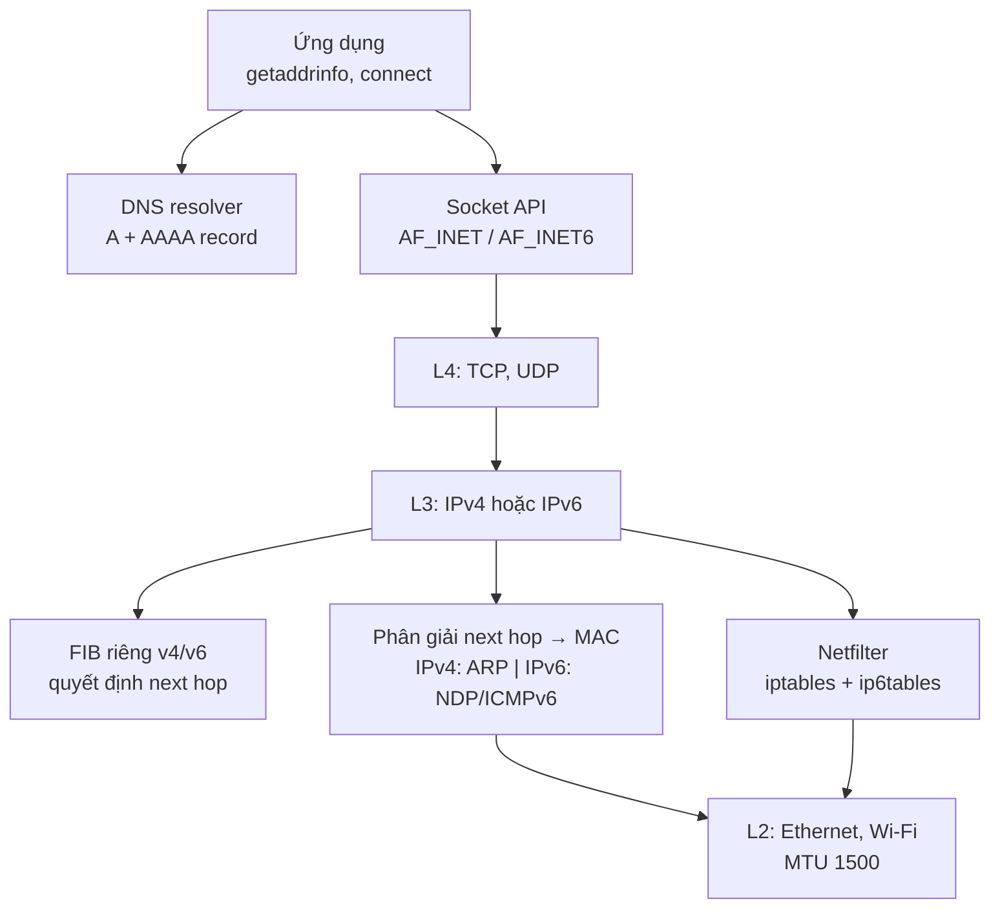
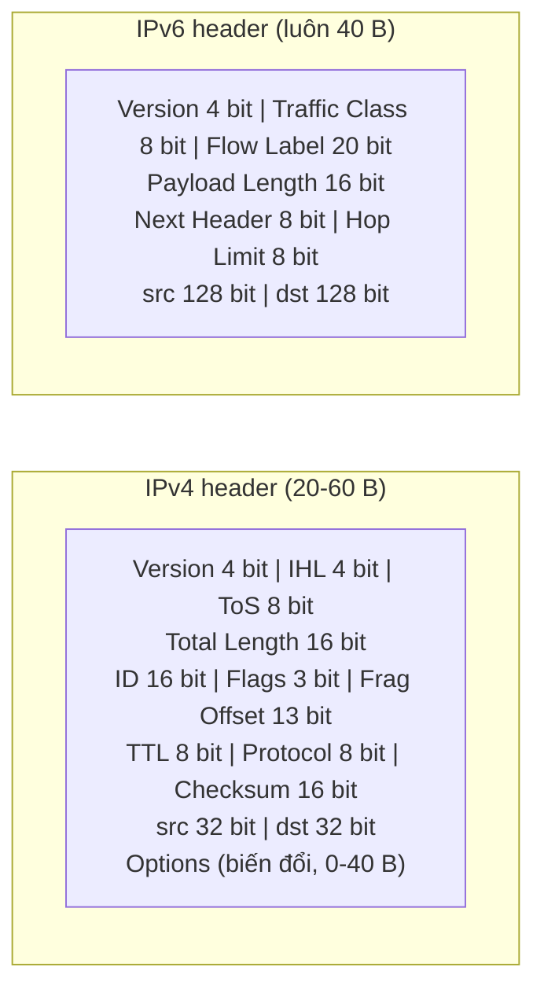
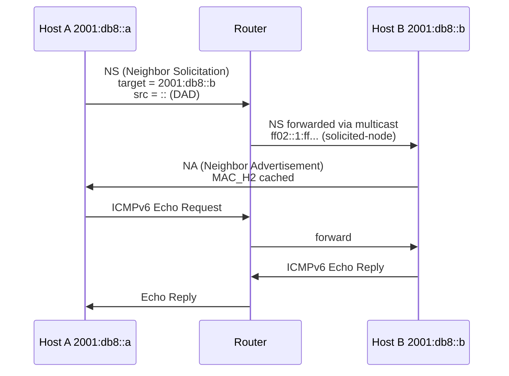
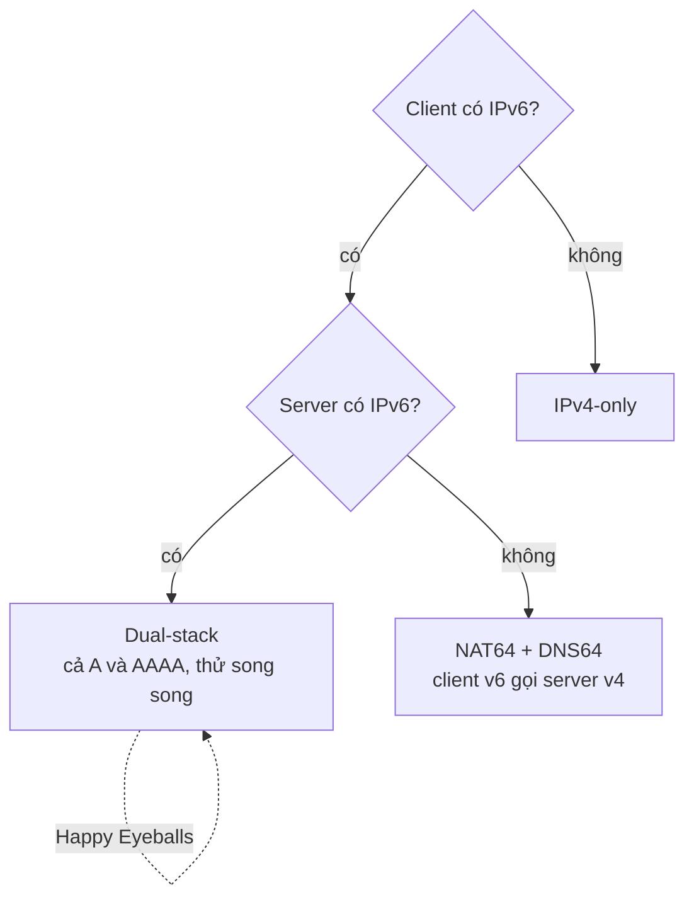

# What is the difference between IPv4 and IPv6?

> IPv4 và IPv6 đều là giao thức tầng mạng (L3) mang datagram từ host này tới host khác qua router. IPv4 dùng địa chỉ 32 bit, có checksum header, cho phép router phân mảnh. IPv6 dùng địa chỉ 128 bit, bỏ checksum, cấm router phân mảnh, dùng ICMPv6 thay ARP. Sự khác biệt cốt lõi là giới hạn địa chỉ: ~4,3 tỷ địa chỉ IPv4 đã cạn kiệt, buộc dùng NAT; IPv6 có ~3,4×10³⁸ địa chỉ, xóa lý do tồn tại kỹ thuật của NAT.

Chủ đề: Networking · Ngày: 2026-10-15

## 1. Là gì

### Định nghĩa

IPv4 (RFC 791, 1981): địa chỉ 32 bit, header tối thiểu 20 byte, có checksum, router có thể phân mảnh (fragment) gói tin.

IPv6 (RFC 8200, 2017): địa chỉ 128 bit, header cố định 40 byte, không checksum, router không được phân mảnh, dùng ICMPv6 cho mọi thông tin điều khiển (NDP, PMTU, MLD).

Cả hai cùng nằm ở tầng 3 OSI, cùng khái niệm hop và TTL/Hop Limit, cùng được mang trong Ethernet, Wi-Fi, PPP. Khác biệt nằm ở header, phân giải láng giềng, cơ chế chuyển tiếp, và không gian địa chỉ.

Giả định: bài viết cho kỹ sư backend/SRE phỏng vấn Senior/Staff. Con số là bậc độ lớn, phụ thuộc OS và kernel. Khác biệt theo implementation sẽ ghi rõ.

### Vị trí trong hệ thống

*Sơ đồ: IP nằm giữa socket/L4 và L2; DNS, FIB, netfilter và phân giải MAC đều tách riêng cho v4 và v6.*

### Trả lời 30 giây

"IPv4 và IPv6 cùng làm một việc: mang datagram qua nhiều router. IPv4 dùng địa chỉ 32 bit — đã cạn kiệt từ thập kỷ 2010, buộc dùng NAT để chia sẻ một IP public cho nhiều thiết bị. IPv6 dùng 128 bit — không gian gần vô hạn, mỗi host có IP global, không cần NAT. Về cơ chế, IPv4 dùng ARP (broadcast L2) và có checksum header tính lại mỗi hop; IPv6 dùng NDP qua ICMPv6 (multicast, hiệu quả hơn) và bỏ checksum. IPv6 cấm router phân mảnh, dùng PMTU discovery thay thế. Cả hai cùng tồn tại trong thập kỷ tới, dual-stack là phổ biến nhất, Happy Eyeballs giúp client chọn kết nối nhanh nhất."

## 2. Cơ chế cốt lõi

### So sánh header IPv4 và IPv6

Cùng kích thước khi IPv4 có 20 byte cơ bản (không options), nhưng cấu trúc rất khác:

*IPv4 biến đổi 20-60 byte có checksum và fragment fields. IPv6 cố định 40 byte, bỏ checksum, dùng extension headers để mở rộng.*

Field IPv4 có mà IPv6 bỏ và lý do:

| Field | Lý do bỏ |
|---|---|
| **IHL** | IPv6 header luôn 40 byte, không cần đánh dấu độ dài |
| **Header Checksum** | L2 (Ethernet CRC) và L4 (TCP/UDP) đã đủ; IPv4 checksum phải tính lại mỗi hop vì TTL đổi |
| **ID + Flags + Fragment Offset** | IPv6 cấm router phân mảnh, chỉ host cuối được; dùng PMTU discovery |
| **Options** | Biến đổi, phức tạp parser. IPv6 thay bằng extension headers (cố định 8 byte mỗi loại) |

Field mới ở IPv6: **Flow Label** (20 bit) — định danh luồng để router xử lý đặc biệt (QoS real-time).

### Bước 1: Khởi tạo địa chỉ IPv6 — SLAAC và DHCPv6

1. Host tự sinh **link-local address** (fe80::/10) từ interface ID (EUI-64 từ MAC, hoặc random RFC 7217).
2. Host thực hiện **DAD** (Duplicate Address Detection): gửi NS tới multicast solicited-node. Có NA trả lời → địa chỉ trùng, sinh lại.
3. Host gửi **RS** (Router Solicitation) tới ff02::2 (mọi router multicast).
4. Router trả **RA** (Router Advertisement) chứa: prefix (vd 2001:db8::/64), MTU, default gateway, flag M/O.
5. Host nhận RA:
   - Có prefix global → tự tạo address bằng **SLAAC** (prefix + interface ID), không cần server.
   - Flag M bật → dùng **DHCPv6 stateful** cho address.
   - Flag O bật, M tắt → SLAAC cho address + DHCPv6 cho DNS (**stateless DHCPv6**).
6. Host đăng ký địa chỉ mới với router qua NS, cập nhật neighbor cache.

### Bước 2: Phân giải láng giềng — NDP thay ARP

*NDP dùng ICMPv6 multicast (NS/NA), hiệu quả hơn ARP broadcast. PMTU phát hiện qua ICMPv6 Packet Too Big.*

NDP message chính:
- **NS (type 135)** = ARP Request. Source IPv6: địa chỉ sender hoặc `::` khi DAD. Target: địa chỉ cần phân giải.
- **NA (type 136)** = ARP Reply. Source: MAC và IPv6 của chủ sở hữu.
- **RS (type 133)**: host xin thông tin mạng từ router.
- **RA (type 134)**: router thông báo prefix, MTU, lifetime, flag M/O.

### Bước 3: Path MTU Discovery

IPv6 cấm router phân mảnh → PMTU discovery bắt buộc:

1. Host gửi datagram với payload = MTU interface (thường 1500). IPv6 ngầm không fragment.
2. Router có MTU nhỏ hơn → hủy datagram, gửi **ICMPv6 Packet Too Big (type 2)** về host kèm MTU nhỏ nhất.
3. Host cache MTU mới, giảm payload, gửi lại.
4. Lặp đến khi đến đích hoặc chạm minimum 1280 byte (RFC 8200).
5. PMTU cache timeout ~10 phút (Linux), host định kỳ thử lại MTU cao hơn.

Nếu ICMPv6 type 2 bị chặn → TCP kết nối được, nhưng data lớn treo ở `write()`.

### Bước 4: Chuyển tiếp — dual-stack, NAT64, Happy Eyeballs

*Dual-stack là phổ biến nhất. NAT64/DNS64 cho client v6-only gọi server v4-only.*

**Happy Eyeballs (RFC 8305)** — client algorithm khi DNS trả cả A và AAAA:
1. `getaddrinfo` trả cả A và AAAA.
2. Đợi DNS 50 ms (resolution delay).
3. Gửi **SYN IPv6** trước.
4. Đợi 250 ms (connection delay) — ngưỡng user cảm nhận chờ.
5. Không có SYN-ACK IPv6 → gửi **SYN IPv4 song song**.
6. Kết nối nào thắng trước dùng cái đó, kết nối thua hủy.

### Ví dụ chạy từng bước

Kịch bản: công ty XYZ có một DC ở Hà Nội. Địa chỉ IPv4 công ty được cấp `203.0.113.0/24`, địa chỉ IPv6 công ty được cấp `2001:db8:cafe::/48`. Kế toán cần tách thành 4 VLAN: Kế toán, Kỹ thuật, Sales, HR.

**Bước 1.** Chia IPv4 `203.0.113.0/24` thành 4 subnet /26. Mỗi subnet có `2^6 = 64` địa chỉ, trừ 2 (network + broadcast) còn **62 host dùng được** (đã tính bằng script).

| VLAN | Network | First host | Last host | Broadcast |
|---|---|---|---|---|
| Kế toán | 203.0.113.0/26 | 203.0.113.1 | 203.0.113.62 | 203.0.113.63 |
| Kỹ thuật | 203.0.113.64/26 | 203.0.113.65 | 203.0.113.126 | 203.0.113.127 |
| Sales | 203.0.113.128/26 | 203.0.113.129 | 203.0.113.190 | 203.0.113.191 |
| HR | 203.0.113.192/26 | 203.0.113.193 | 203.0.113.254 | 203.0.113.255 |

Mỗi subnet /26 cho 62 host dùng được (đã tính).

**Bước 2.** Chia IPv6 `2001:db8:cafe::/48`. Site HN dùng `/56`: `2001:db8:cafe:0000::/56`. Mỗi VLAN nhận một `/64`. Interface ID 64 bit có thể là EUI-64 từ MAC hoặc random RFC 7217, mỗi subnet /64 có `2^64` địa chỉ.

| VLAN | Prefix IPv6 | Interface ID (ví dụ) |
|---|---|---|
| Kế toán | 2001:db8:cafe:0000:0001::/64 | ::a (EUI-64 từ MAC 02:00:00:00:00:0a) |
| Kỹ thuật | 2001:db8:cafe:0000:0002::/64 | ::b |
| Sales | 2001:db8:cafe:0000:0003::/64 | ::c |
| HR | 2001:db8:cafe:0000:0004::/64 | ::d |

**Bước 3.** Router HN chạy `radvd` gửi RA với prefix `2001:db8:cafe:0000::/64` và flag M=0, O=1. Host tự sinh địa chỉ bằng SLAAC (không cần DHCPv6 server cho địa chỉ), DNS lấy qua stateless DHCPv6.

**Bước 4.** Một nhân viên kế toán ở HCM phải dùng IPv6-only (ISP cấp IPv6-only). Họ gọi tới server nội bộ vẫn còn IPv4-only `203.0.113.10`. DNS64 tổng hợp AAAA: `64:ff9b::203.0.113.10` (prefix `64:ff9b::/96` RFC 7050). NAT64 dịch xuống IPv4. Đây là follow-up Câu 4.

**Nếu thiếu IPv6 ở router HN:** host nhận RA không có prefix global, chỉ có link-local `fe80::/10`. Không truy cập được Internet IPv6. Đây là failure mode "Chỉ có link-local fe80::, không có global" trong Phần 4.

Điều rút ra: IPv6 /64 cho mỗi subnet là bắt buộc cho SLAAC, địa chỉ host gần như không cạn; IPv4 /26 chỉ 62 host, đủ cho mạng nội bộ nhưng sẽ cạn nếu mở rộng — trả lời Câu 7 (3B) và Câu 11 (3B).

## 3. Câu hỏi phỏng vấn

### 3A. Câu hỏi đào sâu

Câu 1. So sánh header IPv4 và IPv6. Field nào IPv6 bỏ và vì sao?

**Trả lời ngắn:** IPv6 cố định 40 byte, bỏ checksum, IHL, fragment fields và options. IPv4 biến đổi 20-60 byte. Lý do: checksum L2 và L4 đã đủ; fragment ở router dễ bị tấn công; options biến đổi làm phức tạp parser.

**Đào sâu:**
- **IHL (IPv4)**: đánh dấu độ dài header vì options biến đổi. IPv6 header cố định 40 byte → không cần.
- **Header Checksum (IPv4)**: router tính lại mỗi hop vì TTL đổi, tốn ~vài chục ns CPU. IPv6 bỏ vì Ethernet CRC (L2) và TCP/UDP checksum (L4) đã phát hiện lỗi. Trên router lõi xử lý hàng trăm Gbps, bỏ checksum tiết kiệm ~10-20% CPU.
- **Fragment fields (IPv4)**: router có thể phân mảnh, nhưng fragment dễ bị tấn công (overlap, tiny fragment, ping of death) và tốn CPU/RAM để reassembly. IPv6 cấm router phân mảnh.
- **Options (IPv4)**: ít dùng, một số deprecated vì bảo mật (source route). IPv6 thay bằng extension headers — cố định 8 byte mỗi loại, router có thể bỏ qua nếu không cần.
- **Field mới IPv6**: Flow Label (20 bit) để router nhận diện luồng real-time.

**Bẫy:** Nói "IPv6 bỏ checksum vì nhanh hơn" mà không giải thích tại sao không cần. Hoặc nghĩ IPv6 không có checksum ở mọi tầng — TCP/UDP vẫn có.

**Follow-up:** Nếu MTU đường nhỏ hơn payload, IPv6 xử lý sao? Host thực hiện PMTU discovery — nhận ICMPv6 Packet Too Big, giảm payload, gửi lại. Nếu vẫn quá lớn và không có ICMPv6, TCP MSS clamp ở router ghi đè MSS trong SYN.

Câu 2. NDP khác ARP ở đâu, và tại sao ICMPv6 quan trọng?

**Trả lời ngắn:** ARP dùng giao thức riêng ở L2 (EtherType 0x0806) với broadcast. NDP dùng ICMPv6 (protocol 58) với multicast tới solicited-node — chỉ host liên quan nhận, giảm broadcast storm. NDP còn thay thế ICMP Router Discovery và ICMP Redirect. Chặn ICMPv6 → vỡ NDP, PMTU, MLD cùng lúc.

**Đào sâu:**
- ARP: broadcast L2, mọi host nhận. NDP: multicast L2 tới ff02::1:ffXX:XXXX, chỉ host có địa chỉ đó nhận.
- ARP có 4 message; NDP có 5: NS, NA, RS, RA, Redirect. DAD (Duplicate Address Detection) dùng NS với source `::` — ARP không có cơ chế này, dẫn tới xung đột IP không phát hiện.
- Router Advertisement là khái niệm hoàn toàn mới ở NDP, chứa prefix, MTU, lifetime, flag M/O — ARP không có.
- ICMPv6 mang cả NDP, PMTU (type 2), Multicast Listener Discovery (MLD). Một rule firewall chặn ICMPv6 → ba cơ chế cùng vỡ.
- Linux neighbor cache timeout: ~30-60 giây cho entry chưa xác nhận, ~1 giờ cho entry đã xác nhận (tunable qua `net.ipv6.neigh.eth0.gc_stale_time`).

**Bẫy:** Nghĩ NDP chỉ thay thế ARP. Thực tế NDP thay thế cả ICMP Router Discovery và ICMP Redirect.

**Follow-up:** Làm sao bảo mật NDP? SEND (RFC 3971) dùng CGA (Cryptographically Generated Addresses), triển khai phức tạp. Thực tế dùng RA Guard ở switch, port-security, 802.1X.

Câu 3. Tại sao IPv6 cấm router phân mảnh, và PMTU discovery hoạt động sao?

**Trả lời ngắn:** Fragment ở router dễ bị tấn công (overlap, tiny fragment) và tốn CPU/RAM để reassembly. IPv6 cấm, dùng PMTU discovery: host thử payload lớn nhất, router có MTU nhỏ hơn gửi ICMPv6 Packet Too Big, host giảm payload và thử lại. Nếu ICMPv6 type 2 bị chặn → PMTU vỡ, TCP kết nối được nhưng data lớn treo.

**Đào sâu:**
- 4 lý do cấm fragment ở router: (1) dễ bị tấn công overlap/tiny fragment; (2) tốn RAM giữ fragment; (3) một fragment mất thì phải gửi lại toàn bộ; (4) PMTU cho kết quả tốt hơn.
- Minimum MTU IPv6: 1280 byte (RFC 8200). Mọi đường truyền IPv6 phải chấp nhận 1280. IPv4 minimum là 68 byte.
- TCP MSS clamp: router/firewall ghi đè MSS trong SYN thành MTU - 40 (IPv6) - 20 (TCP) = 1220 khi MTU < 1500. Linux bật mặc định cho IPv6, một số OS không.
- PMTU cache timeout ~10 phút (Linux). Host định kỳ thử lại MTU cao hơn nếu đường đổi.

**Bẫy:** Nghĩ PMTU chỉ cần khi biết đường có tunnel. Thực tế mọi đường đều có thể có đoạn MTU nhỏ (PPPoE 1492, VPN 1400), nên PMTU luôn cần.

**Follow-up:** Làm sao debug PMTU? `ping6 -M do -s 1400 <host>` — nếu "message too long" với 1400 nhưng 1280 đi được → PMTU ở đâu đó nhỏ hơn 1400. Kiểm tra ICMPv6 type 2 có bị firewall chặn không.

Câu 4. Khi nào dùng dual-stack, NAT64, hay IPv4-only?

**Trả lời ngắn:** Dual-stack là mặc định cho service mới — dễ nhất, không ràng buộc reach. NAT64/DNS64 cho mobile network IPv6-only gọi server v4-only. IPv4-only cho hệ thống cũ không có kế hoạch nâng cấp.

**Đào sâu:**
- **Dual-stack**: vận hành hai stack song song, hai bộ firewall, hai bộ log/metric. Phù hợp khi audience gồm cả client v4 và v6 không kiểm soát được. Happy Eyeballs giúp client chọn kết nối nhanh nhất.
- **NAT64/DNS64**: cho client v6-only (T-Mobile US, Reliance Jio, mạng 4G/5G mới). DNS64 tổng hợp AAAA từ A bằng prefix 64:ff9b::/96. NAT64 dịch header ở biên, overhead ~vài ms. Tiết kiệm IPv4, đơn giản hóa core network.
- **IPv4-only**: hệ thống cũ, audience chắc chắn chỉ có IPv4 (một số enterprise, hệ thống công nghiệp). Thường là kết quả "chưa triển khai" chứ không phải chọn có chủ đích.
- **464XLAT**: CLAT ở thiết bị + PLAT ở ISP, cho app dùng IPv4 trong mạng IPv6. Ít phổ biến.

**Bẫy:** Chọn IPv6-only cho server mà audience có 30-40% client IPv4. Hoặc nghĩ dual-stack là "tạm thời rồi bỏ IPv4" — thực tế IPv4 còn tồn tại hàng chục năm.

**Follow-up:** Nếu 40% traffic là IPv6, có nên tắt IPv4 không? Không, trừ khi chi phí duy trì IPv4 vượt doanh thu từ 40% kia. Đây là quyết định kinh doanh, không phải kỹ thuật.

Câu 5. Không có NAT nghĩa là gì về bảo mật và vận hành?

**Trả lời ngắn:** IPv6 mỗi host có IP global — server thấy IP thật của client, log truy vết trực tiếp, rate limit chính xác, P2P/WebRTC/VoIP không cần NAT traversal. Nhưng lộ IP thật, vẫn cần firewall. Privacy Extensions tạo địa chỉ random thay đổi vài giờ/lần — tốt cho user privacy, khó cho log audit.

**Đào sâu:**
- **Tích cực**: log truy vết trực tiếp (không cần map ngược qua NAT log), rate limit theo IP chính xác hơn, zero-trust security và service mesh dễ triển khai khi mỗi host có identity riêng.
- **Tiêu cực**: IP thật lộ, attacker có thể quét và tấn công trực tiếp. Địa chỉ IPv6 stable (không Privacy Extensions) có thể dùng làm cookie theo dõi client.
- **Firewall vẫn cần**: không NAT ≠ không cần firewall. Phải chặn incoming không mong muốn. "NAT = bảo mật" là sai lầm phổ biến.
- **Privacy Extensions (RFC 4941)**: địa chỉ random thay đổi vài giờ/lần. Linux/Windows/macOS bật mặc định. Server muốn stable IP để log → tắt Privacy Extensions (`net.ipv6.conf.default.use_tempaddr = 0`). Enterprise muốn track device dùng SLAAC stable-private (RFC 7217).
- **NAT66**: một số operator dùng NAT giữa hai dải IPv6 vì lý do "bảo mật" — sai lầm, mất lợi ích end-to-end. Đó là quyết định chính trị, không phải kỹ thuật.

**Bẫy:** Tin "không NAT = không cần firewall". Rất sai, gây nhiều vụ rò rỉ dữ liệu vì admin chỉ cấu hình `iptables` mà quên `ip6tables`.

**Follow-up:** Khi audit log, dùng stable IP hay temporary IP? Phụ thuộc mục đích. Truy vết thiết bị → stable. User privacy → temporary. App nên dùng session_id hoặc user_id làm identifier, không phụ thuộc IP.

Câu 6. Site bật IPv6 xong, user phản ánh chậm vài giây lúc đầu. Điều tra sao?

**Trả lời ngắn:** Happy Eyeballs thử IPv6 trước 250 ms rồi mới fallback IPv4. Nếu v6 path chậm thật (route ISP, MTU, congested link), user cảm nhận chậm dù eventually dùng v4. Quy trình: xác định phạm vi → kiểm tra Happy Eyeballs → so sánh mtr v4/v6 → kiểm tra PMTU → kiểm tra server.

**Đào sâu:**
1. **Xác định phạm vi**: tất cả user hay một số? Chỉ lúc đầu phiên hay liên tục? Log tỉ lệ v6/v4.
2. **Happy Eyeballs**: nếu v6 SYN-ACK đến trước 250 ms, client dùng v6. Nếu v4 thắng 50 ms mà v6 thắng 250 ms, client vẫn chọn v6 → cảm giác chậm. RFC 8305 không so sánh RTT, chỉ so sánh "ai thắng trước".
3. **`mtr -6` và `mtr -4`** tới server: so sánh số hop, RTT, mất gói. Nếu v6 có nhiều hop hơn hoặc RTT cao hơn → route ISP cho v6 kém.
4. **PMTU**: `ping6 -M do -s 1400 <server>`. Fail → PMTU nhỏ hơn 1500 ở đâu đó (tunnel, PPPoE). TCP SYN thành công vì MSS nhỏ, nhưng data lớn treo.
5. **Server side**: `curl -6 http://[::1]/` là baseline. `ss -tlnp` xem socket có nghe `[::]` không.
6. **DNS**: `dig +short AAAA service` có trả không? TTL bao nhiêu?

**Bẫy:** Vội tắt IPv6 vì "chậm" mà không điều tra. Có thể v6 chậm vì route ISP, tắt thì user IPv6-only không dùng được.

**Follow-up:** Cải thiện v6 path? Liên hệ ISP về route policy. Dùng CDN có PoP cả v4 và v6 gần user. Đổi region server gần user hơn.

### 3B. Câu hỏi phỏng vấn liên quan

Câu 7. What is an IPv6 /64 prefix, and why do subnets always use /64?

**Trả lời:** /64 nghĩa là 64 bit đầu là prefix mạng, 64 bit sau là interface ID cho host. Theo RFC 4291 / RFC 4862, subnet IPv6 phải dùng /64 để SLAAC hoạt động — interface ID cần đúng 64 bit cho EUI-64 hoặc random RFC 7217. Cấp /65 thì SLAAC vỡ, phải dùng DHCPv6.

Câu 8. Phân biệt địa chỉ private IPv4 (RFC 1918) và ULA IPv6 (fc00::/7). Chúng có cùng mục đích không?

**Trả lời:** Không hoàn toàn. RFC 1918 (10/8, 172.16/12, 192.168/16) sinh ra vì IPv4 cạn, dùng kèm NAT. ULA fc00::/7 (RFC 4193) cho phạm vi nội bộ và không cần NAT — mỗi host IPv6 vẫn có global address song song. Nhìn thấy ULA không có nghĩa là host nằm sau NAT.

Câu 9. What happens if the IPv6 router stops sending RA?

**Trả lời:** Host dùng prefix từ RA để tạo global address qua SLAAC — không còn RA thì không có prefix mới. Address hiện tại vẫn dùng đến khi hết valid lifetime (mặc định 30 ngày), default route cũng mất. DNS có thể vỡ nếu resolver chỉ phân giải qua prefix SLAAC.

Câu 10. So sánh SLAAC và DHCPv6. Khi nào nên dùng cái nào?

**Trả lời:** SLAAC tự cấp address + default route + MTU từ RA, không cần server. DHCPv6 cần server riêng và cấp thêm option (DNS, NTP). Flag M/O trong RA chọn mode: stateful (M=1), stateless DHCPv6 (O=1, M=0), hoặc SLAAC thuần. SLAAC cho mạng nhỏ; DHCPv6 khi cần kiểm soát DNS hoặc audit địa chỉ cấp.

Câu 11. Mấy con số worth-remembering: IPv6 minimum MTU, prefix length cho subnet, address space?

**Trả lời:** Minimum MTU IPv6 = 1280 byte (RFC 8200) — gói nhỏ hơn router có quyền drop vì IPv6 cấm fragment ở router. Subnet chuẩn dùng /64 (bắt buộc cho SLAAC). Address space IPv6 = 2¹²⁸ ≈ 3.4×10³⁸ địa chỉ, chia cho 7 tỷ người còn ~5×10²⁸ mỗi người.

Câu 12. Scenario: API gateway của payment service chỉ có IPv4, một ISP cho khách hàng IPv6-only. Đường nào để giải quyết?

**Trả lời:** NAT64 + DNS64 ở biên mạng. DNS64 tổng hợp AAAA từ A bằng prefix `64:ff9b::/96` (RFC 7050). Client kết nối tới `64:ff9b::203.0.113.7`, NAT64 dịch xuống IPv4. Overhead ~1-3 ms. Alternative: cấp dual-stack cho gateway.

Câu 13. Phân biệt IPsec AH và ESP. Khi nào nên dùng cái nào?

**Trả lời:** AH (protocol 51) xác thực toàn bộ IP datagram và payload, không mã hoá. ESP (protocol 50) mã hoá payload và cũng xác thực. ESP phổ biến vì mã hoá quan trọng hơn chỉ xác thực; AH không bảo vệ khi payload đã được TLS mã hoá. IPv6 có IPsec trong spec nên dễ triển khai hơn IPv4.

Câu 14. Server thiết lập TCP với IPv6 xong, gửi data lớn thì `write()` treo. Nguyên nhân và cách xác nhận?

**Trả lời:** ICMPv6 Packet Too Big (type 2) bị chặn, PMTU discovery vỡ. TCP handshake xong vì MSS thương lượng trong SYN (mặc định 1440 cho IPv6). Xác nhận: `ping6 -M do -s 1400 <server>` fail nhưng `-s 1200` đi được. Mở ICMPv6 type 2 hoặc giảm MSS xuống 1220.

Câu 15. Host tự sinh IPv6 address từ MAC như thế nào, và Privacy Extensions ảnh hưởng gì?

**Trả lời:** EUI-64 chèn `ff:fe` vào giữa MAC 48-bit, flip bit universal/local (bit 7 byte đầu) — MAC `00:1a:2b:3c:4d:5e` thành `021a:2bff:fe3c:4d5e`. Privacy Extensions (RFC 4941) thay interface ID bằng random 64-bit định kỳ, bật mặc định. Log audit dùng IPv6 không ổn định — dùng user_id hoặc session_id.

Câu 16. True or false: "IPv6 không có NAT nên bảo mật yếu hơn IPv4 vì IP thật lộ ra Internet."

**Trả lời:** Sai, NAT không phải cơ chế bảo mật. IPv4 dùng NAT che IP private nhưng attacker vẫn truy cập được service public. IPv6 mỗi host có IP global và phải dùng firewall (ip6tables, nftables) chặn incoming — đây là yêu cầu bắt buộc. Bảo mật thật sự đến từ stateful firewall + patching + segmentation, không phải NAT.

## 4. Đánh đổi và sự cố production

### Bảng so sánh nhanh IPv4 và IPv6

Số liệu là bậc độ lớn, cần đo lại trên hệ thống của bạn. Một số khác biệt là quy ước, một số là ràng buộc giao thức.

| Tiêu chí | IPv4 | IPv6 |
|---|---|---|
| Địa chỉ | 32 bit, dotted-quad | 128 bit, hex-8 với `::` viết tắt |
| Header cố định | 20 byte (có thể mở rộng) | 40 byte (cố định) |
| Header checksum | Có, mỗi hop tính lại | Không, tin L2/L4 checksum |
| Fragment ở router | Có, dùng DF flag | Cấm, dùng PMTU discovery |
| Phân giải láng giềng | ARP (broadcast L2) | NDP/NS-NA (multicast ICMPv6) |
| Cấu hình địa chỉ | DHCP hoặc tĩnh | SLAAC, DHCPv6, tĩnh |
| Không gian địa chỉ | ~4.3 × 10⁹ | ~3.4 × 10³⁸ (2¹²⁸) |
| Địa chỉ private | 10/8, 172.16/12, 192.168/16 | fc00::/7 (ULA) |
| Địa chỉ loopback | 127.0.0.1 | ::1 |
| Link-local | 169.254/16 | fe80::/10 |
| Multicast | 224.0.0.0/4 | ff00::/8, link-local ff02::/16 |
| Anycast | Có (không chính thức) | Có (chính thức, RFC 4291) |
| NAT | Phổ biến (1:N, N:1) | Không cần cho global |
| ICMP | ICMP (RFC 792) | ICMPv6 (RFC 4443), mang cả NDP |
| PMTU minimum | 68 byte | 1280 byte |
| Hỗ trợ OS | Mọi OS | Linux 2.6+ (2003), Windows Vista+ (2007), macOS 10.3+ (2003) |

### Các trục đánh đổi

| Trục | Chiều được chọn trong bài | Cái giá |
|---|---|---|
| Đơn giản (header) vs Linh hoạt (options) | IPv6 cố định 40 byte | IPv4 vẫn còn options; IPv6 dùng extension header nếu cần mở rộng |
| Hiệu năng (PMTU) vs An toàn (fragment attack) | IPv6 cấm fragment ở router | PMTU bắt buộc, ICMPv6 type 2 phải mở; chặn nhầm làm vỡ kết nối |
| Địa chỉ dồi dào vs Theo dõi | IPv6 cấp /64 cho mỗi mạng | Interface ID cố định từ MAC có thể dùng làm cookie theo dõi |
| End-to-end vs Che giấu topology | IPv6 bỏ NAT | Server thấy IP thật client, dễ truy vết nhưng lộ vị trí địa lý |
| Triển khai từ từ vs Phức tạp | Dual-stack, NAT64, 464XLAT | Phải vận hành hai stack song song nhiều năm, tăng bề mặt lỗi cấu hình |

### Failure mode phổ biến

Mỗi sự cố dưới đây đã xảy ra ở ít nhất một hệ thống production. Mục tiêu: nhận ra triệu chứng, kiểm tra nhanh, xử lý tạm thời trước khi root-cause.

| Triệu chứng | Nguyên nhân gốc | Kiểm tra | Xử lý |
|---|---|---|---|
| IPv6 không có mạng, link lên | Firewall chặn toàn bộ ICMPv6 | `ip6tables -L -n`, `ip -6 neigh show` trống | Mở ICMPv6 types 1-127 (RFC 4890) |
| TCP kết nối được, data lớn treo ở `write()` | ICMPv6 type 2 bị chặn → PMTU vỡ | `ping6 -M do -s 1400` fail, 1280 đi được | Mở ICMPv6 type 2; giảm MSS xuống 1220 |
| Chỉ có link-local fe80::, không có global | Router không gửi RA (radvd crash, firewall block) | `tcpdump -i eth0 icmp6` không thấy type 134 | Restart `radvd`; kiểm tra firewall ở router |
| Hai host cùng IPv6, một bị mất kết nối | Clone VM/container không regen MAC, DAD fail | `ip -6 addr show` thấy `dadfailed` | Bật RFC 7217 hoặc Privacy Extensions |
| Client IPv6-only không kết nối | Application chỉ bind `0.0.0.0` | `ss -tlnp` không có `[::]` | Bind riêng `[::]:port`; viết unit test cho cả hai socket |
| Happy Eyeballs chọn v6 nhưng v6 chậm | Route ISP cho v6 qua transit xấu; PMTU thấp dọc đường | `mtr -6` vs `mtr -4`; `ping6 -M do -s 1400` | Liên hệ ISP; dùng CDN có PoP v6 gần user; giảm FallbackDelay |

### Chi phí ẩn khi triển khai IPv6

- **Vận hành hai stack song song**: log, metric, alert tách theo family. Hai bộ firewall. Hai bộ monitoring. Gấp đôi bề mặt quản trị.
- **Debug khó hơn**: lỗi "không truy cập được IPv6" có thể do DNS, route, firewall, RA, NDP, PMTU, application bind — 7 chỗ phải kiểm. IPv4 thường chỉ 3-4 chỗ (DNS, route, firewall, app).
- **Onboarding SRE**: tài liệu training, runbook, checklist. Mỗi thành viên mới phải học thêm về ICMPv6, NDP, PMTU.
- **Tương thích thiết bị cũ**: switch, router, firewall đời cũ có thể không hỗ trợ IPv6 hoặc hỗ trợ không đầy đủ (không MLD snooping, không filter theo prefix v6). Phải audit toàn bộ.
- **Third-party chưa sẵn sàng**: WAF, IDS, log shipper, APM có thể parse IPv6 sai (coi prefix là octet, không nhận `::`). Phải verify từng công cụ trước khi bật v6.
- **Privacy Extensions phá log audit**: nếu log dùng IPv6 làm identifier, host đổi địa chỉ mỗi vài giờ → phải dùng thêm user_id hoặc session_id.

*Quan điểm:* chi phí ẩn lớn nhất của IPv6 không phải kỹ thuật mà là tổ chức. Triển khai thành công cần SRE team hiểu L3, có quy trình change-management, có khả năng debug end-to-end. Nếu team chỉ biết "L4 trở lên", IPv6 là thảm họa. Đầu tư training cần thiết trước khi đầu tư hạ tầng.

## 5. Cheat sheet

Mang vào phòng phỏng vấn (hoặc dán cạnh màn hình khi debug): 10 dòng bao gồm con số và quy tắc IPv4/IPv6 hay bị hỏi nhất. Đã chọn lọc, bỏ những chi tiết hiếm khi xuất hiện trong câu hỏi Senior/Staff.

| Chủ đề | Con số / quy tắc |
|---|---|
| Header | IPv4: 20-60 B có checksum. IPv6: 40 B cố định, không checksum. |
| Địa chỉ | IPv4 32 bit. IPv6 128 bit. Prefix: IPv4 CIDR, IPv6 /64 cho mỗi subnet. |
| Fragment | IPv4: router được. IPv6: cấm, dùng PMTU. Minimum MTU: IPv4 68 B, IPv6 1280 B. |
| ICMPv6 | Mang NDP, PMTU, MLD. Chặn types 1-127 = vỡ L3. Chặn 128-129 = chỉ vỡ ping. |
| NDP | NS/NA = ARP (multicast). RS/RA = Router Discovery. Có DAD. |
| SLAAC | Host tự sinh address từ prefix trong RA + interface ID. Valid 30 ngày, preferred 7 ngày. |
| Happy Eyeballs | v6 SYN trước 250 ms, v4 SYN song song. Kết nối thắng trước dùng. |
| NAT64/DNS64 | Client v6-only gọi server v4-only. Prefix NAT64: 64:ff9b::/96. |
| Firewall | Phải cấu hình cả `iptables` (v4) và `ip6tables`/`nft` (v6). |
| Lệnh | `ip -6 addr`, `ip -6 route`, `ip -6 neigh`, `ping6`, `traceroute6`, `mtr -6`, `tcpdump ip6`, `curl -6`. |

**Học tiếp:**
- [OSI model](osi-model.md) — IP ở tầng nào, khác gì TCP/UDP
- [TCP vs UDP](tcp-vs-udp.md) — reliability chồng lên IP, MSS clamp khi MTU nhỏ
- [DNS how it works](dns-how-it-works.md) — A vs AAAA, Happy Eyeballs liên quan DNS
