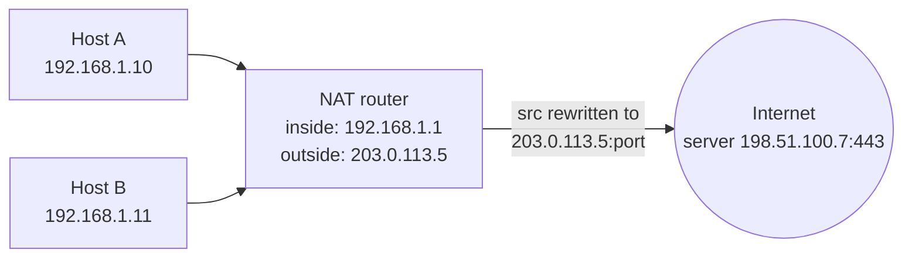
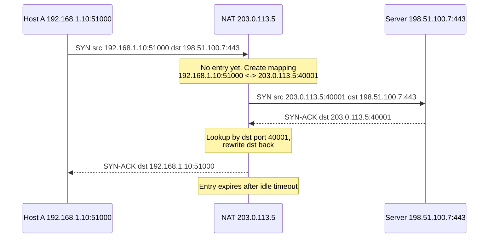

# Explain how NAT works.

> NAT (Network Address Translation) viết lại địa chỉ IP và cổng trong header gói tin khi đi qua router, để nhiều host dùng địa chỉ private chia sẻ một địa chỉ public. Bài này tập trung vào bảng ánh xạ của PAT/NAPT, vòng đời entry, các loại hành vi NAT, và vì sao NAT gây khó cho kết nối đến, P2P và một số giao thức.

Chủ đề: Networking · Ngày: 2026-10-15

## 1. Là gì

**Định nghĩa.** NAT là kỹ thuật router sửa địa chỉ (và thường cả cổng) nguồn hoặc đích trong header IP/TCP/UDP của gói tin khi chuyển tiếp, kèm cập nhật checksum. Dạng phổ biến nhất ở nhà và văn phòng là NAPT (còn gọi PAT, masquerade): nhiều host private dùng chung một IP public, phân biệt nhau bằng cổng nguồn.

NAT là giải pháp thực dụng cho việc IPv4 cạn kiệt. Địa chỉ private theo RFC 1918: `10.0.0.0/8`, `172.16.0.0/12`, `192.168.0.0/16`. NAT không phải tường lửa, dù hành vi mặc định (chặn kết nối đến chưa có entry) trông giống vậy.

Giả định: bài này nói NAT44 (IPv4 sang IPv4) kiểu NAPT trên Linux/router gia đình. IPv6 không cần NAT cho mục đích tiết kiệm địa chỉ.



*Sơ đồ vị trí: nhiều host private đi ra Internet qua một router NAT, router viết lại địa chỉ nguồn thành IP public.*

**Trả lời 30 giây.** NAT router giữ một bảng ánh xạ (private IP:port) sang (public IP:port). Gói đi ra: router tạo entry nếu chưa có, thay nguồn bằng IP public và một cổng mới. Gói trả về: router tra bảng theo cổng đích, viết lại đích về host private. Entry bị xóa khi hết thời gian idle (TCP established thường dài hơn UDP; giá trị cụ thể phụ thuộc thiết bị). Hệ quả: kết nối từ ngoài vào không có entry nên bị bỏ, đó là lý do cần port forwarding, STUN, hoặc relay.

## 2. Cơ chế cốt lõi

### Bước 1. Gói đi ra và tạo entry
Host A (`192.168.1.10:51000`) gửi SYN tới `198.51.100.7:443`. Router thấy 5-tuple (giao thức, src IP, src port, dst IP, dst port) chưa có trong bảng, nên tạo entry mới. Trên Linux, bảng này là conntrack của netfilter.

### Bước 2. Viết lại nguồn (SNAT)
Router chọn một cổng nguồn public còn trống (ví dụ `40001`) và thay `192.168.1.10:51000` bằng `203.0.113.5:40001`. Router cập nhật lại checksum IP và TCP/UDP. Cổng được chọn sao cho 5-tuple phía ngoài không trùng với kết nối khác.

### Bước 3. Gói trả về và viết lại đích
Server trả lời tới `203.0.113.5:40001`. Router tra entry theo cổng đích, viết lại đích về `192.168.1.10:51000` rồi chuyển vào mạng nội bộ. Gói không khớp entry nào (không ai khởi tạo) bị bỏ.



*Sơ đồ luồng NAPT: router tạo mapping khi gói đầu đi ra, dùng mapping để dịch ngược gói trả về, xóa khi idle.*

### Bước 4. Vòng đời entry
TCP: entry theo dõi trạng thái (SYN, ESTABLISHED, FIN). Entry bị xóa sau khi kết nối đóng, hoặc sau timeout idle khi không có gói. UDP không có trạng thái kết nối, nên chỉ có timeout idle (thường ngắn hơn TCP established). Giá trị cụ thể phụ thuộc thiết bị và cấu hình, không chắc có con số chung. Ứng dụng giữ kết nối lâu (VPN, game, WebSocket) gửi keepalive định kỳ ngắn hơn timeout đó để entry không bị xóa giữa chừng.

### Bước 5. Các loại NAT
- Static NAT: ánh xạ 1-1 cố định giữa IP private và public.
- Dynamic NAT: lấy IP public từ một pool, vẫn 1-1.
- NAPT/PAT: nhiều host chung một IP public, phân biệt bằng cổng.
- DNAT / port forwarding: viết lại địa chỉ đích của gói đi vào, để đưa kết nối từ ngoài tới một host nội bộ.

### Bước 6. Hành vi NAT với UDP (RFC 4787)
Full-cone: mọi host ngoài gửi tới cổng public đã ánh xạ đều tới được host trong. Restricted-cone và port-restricted: chỉ nhận từ IP (hoặc IP:port) mà host trong đã gửi tới. Symmetric: mỗi đích khác nhau có một cổng public khác nhau, nên hole punching thường thất bại. Đây là phân loại cổ điển; thiết bị thực tế hay lai.

### Quan sát
Các lệnh dưới là lệnh thật trên Linux; output chưa chạy trong phiên này.

```bash
# Xem bảng conntrack (cần gói conntrack-tools)
sudo conntrack -L

# Xem quy tắc NAT trong iptables
sudo iptables -t nat -L -n -v

# Bật masquerade cho giao diện ra ngoài eth0
sudo iptables -t nat -A POSTROUTING -o eth0 -j MASQUERADE
```

Cách đọc: mỗi dòng `conntrack -L` có hai chiều (original và reply); chiều reply cho thấy địa chỉ sau khi dịch.

### Ví dụ chạy từng bước

Kịch bản: văn phòng Hà Nội có 4 máy (A/B/C/D) sau NAT gateway 203.0.113.5, mỗi máy mở TCP tới payment API 198.51.100.7:443. Đây là cổng web thật; output minh họa, chưa chạy.

**Bước 1.** A (192.168.1.10) gửi SYN tới 198.51.100.7:443 với src port 51000. Gateway chưa có entry, tra 5-tuple → tạo mapping mới. Chọn cổng public 40001 (chưa dùng cho 5-tuple đích). Router sửa header: `192.168.1.10:51000` → `203.0.113.5:40001`, cập nhật checksum TCP và IP.

| Client trong | SYN đi (trước SNAT) | SYN ra (sau SNAT) |
|---|---|---|
| A | 192.168.1.10:51000 → 198.51.100.7:443 | 203.0.113.5:40001 → 198.51.100.7:443 |

**Bước 2.** B, C, D lần lượt gửi SYN, cũng với src port 51000 (OS chọn ephemeral trùng nhau là bình thường). Gateway cấp 40002, 40003, 40004 sao cho 5-tuple phía ngoài không đụng nhau. Cùng IP public, cùng đích, khác cổng nguồn public (đã tính bằng script).

| Client trong | SYN đi (trước SNAT) | SYN ra (sau SNAT) |
|---|---|---|
| A | 192.168.1.10:51000 → 198.51.100.7:443 | 203.0.113.5:40001 → 198.51.100.7:443 |
| B | 192.168.1.11:51000 → 198.51.100.7:443 | 203.0.113.5:40002 → 198.51.100.7:443 |
| C | 192.168.1.12:51000 → 198.51.100.7:443 | 203.0.113.5:40003 → 198.51.100.7:443 |
| D | 192.168.1.13:51000 → 198.51.100.7:443 | 203.0.113.5:40004 → 198.51.100.7:443 |

**Bước 3.** Server trả SYN-ACK về 203.0.113.5:40001. Gateway tra entry theo dst port 40001 → đích viết lại về 192.168.1.10:51000, chuyển vào LAN. Tương tự cho 40002/3/4. Kết nối bốn máy ở trạng thái ESTABLISHED trong conntrack.

| Trạng thái conntrack | A | B | C | D |
|---|---|---|---|---|
| SYN_SENT → ESTABLISHED | TCP | TCP | TCP | TCP |
| Timeout ESTABLISHED | 432000 s (Linux mặc định) | 432000 s | 432000 s | 432000 s |

**Bước 4.** Một host trong LAN gửi tiếp 200 request/giây tới 198.51.100.7:443 (4 máy × 50 req/s) — gateway cần 200 entry đồng thời cho 4 máy × 50 đường keep-alive. Giới hạn thật: cổng khả dụng cho cặp (203.0.113.5, 198.51.100.7:443) là 64.511 (đã tính 65535 - 1024 reserved), trừ mọi entry khác tới đích đó. Khi gần đầy, `insert_failed` trong `conntrack -S` tăng và gói mới bị drop (failure mode trong Phần 4).

**Nếu một máy trong mở kết nối UDP 200 luồng tới DNS 8.8.8.8:53** và giữ im lặng: entry UDP hết hạn sau timeout idle (thường 30-120 s tuỳ thiết bị, không có con số chung). Gói tiếp theo sau khi entry bị xóa sẽ được tạo entry mới với cổng public khác — đó là lý do UDP cần ứng dụng gửi keepalive nếu muốn giữ mapping ổn định.

Điều rút ra: cùng một IP public, cùng đích:port, khác cổng nguồn public là đủ để phân biệt 4 kết nối; giới hạn thật của NAPT là số cổng khả dụng cho cặp (IP public, đích), không phải băng thông — trả lời Câu 1 và Câu 6 phỏng vấn.

## 3. Câu hỏi phỏng vấn

### 3A. Câu hỏi đào sâu

<details class="qa">
<summary>Câu 1. How does NAT (NAPT) let many hosts share one public IP?</summary>

**Trả lời ngắn:** Router giữ bảng ánh xạ từ (IP private, cổng nguồn) sang (IP public, cổng public). Gói đi ra được viết lại nguồn, gói trả về được tra theo cổng đích rồi viết lại ngược. Cổng là thứ phân biệt các host dùng chung IP public.

**Đào sâu:**
- Khóa tra cứu là 5-tuple: giao thức, src IP, src port, dst IP, dst port.
- Router cập nhật checksum IP và TCP/UDP sau khi sửa header.
- Giới hạn: số cổng khả dụng mỗi IP public (~64k mỗi giao thức và mỗi đích, tùy cách router cấp cổng) và dung lượng bảng conntrack.
- Gói đến không khớp entry nào bị bỏ, nên mặc định chặn kết nối từ ngoài vào.

**Bẫy:** Nói "NAT là tường lửa". Việc chặn chỉ là tác dụng phụ của việc không có entry; NAT không thay thế quy tắc lọc gói.

**Follow-up:** Hai host cùng chọn cổng nguồn 51000 thì sao? Router đổi một trong hai sang cổng public khác, vì mapping dùng cổng ngoài chứ không dùng cổng gốc.
</details>

<details class="qa">
<summary>Câu 2. What is the difference between SNAT, DNAT and masquerade?</summary>

**Trả lời ngắn:** SNAT sửa địa chỉ nguồn của gói đi ra. DNAT sửa địa chỉ đích của gói đi vào, dùng cho port forwarding. Masquerade là SNAT tự lấy IP hiện tại của giao diện ra, hợp với IP public cấp động (DHCP, PPPoE).

**Đào sâu:**
- Trên Linux iptables, SNAT và MASQUERADE nằm ở chain POSTROUTING, DNAT ở chain PREROUTING của bảng `nat`.
- SNAT với IP cố định nhanh hơn một chút vì không phải tra IP giao diện mỗi lần; chênh lệch nhỏ, không có con số chuẩn.
- Masquerade xóa entry khi giao diện mất IP, SNAT cố định thì không.
- Gói trả về của kết nối đã có entry được dịch ngược tự động, không cần viết quy tắc thứ hai.

**Bẫy:** Dùng DNAT để "ra Internet". DNAT dành cho hướng vào; hướng ra cần SNAT hoặc masquerade.

**Follow-up:** Cloud thường dùng loại nào? NAT gateway của nhà cung cấp cloud làm SNAT cho subnet private; chi tiết giới hạn cổng mỗi đích phụ thuộc từng nhà cung cấp.
</details>

<details class="qa">
<summary>Câu 3. Why can't an outside host connect to a machine behind NAT, and how do you fix it?</summary>

**Trả lời ngắn:** Không có entry nào được tạo từ phía trong, nên gói đến bị bỏ. Cách xử lý: port forwarding (DNAT cấu hình sẵn), UPnP/NAT-PMP tự mở ánh xạ, hoặc để host trong chủ động kết nối ra một relay.

**Đào sâu:**
- Port forwarding: ánh xạ tĩnh `public:8443` tới `192.168.1.10:443`.
- Reverse tunnel hoặc relay: host trong giữ kết nối đi ra, bên ngoài nói chuyện qua relay.
- CGNAT (carrier-grade NAT, ISP đặt thêm một tầng NAT): bạn không điều khiển được router ngoài cùng nên port forwarding ở nhà không đủ.
- IPv6 không cần NAT, nhưng vẫn cần tường lửa để chặn kết nối vào.

**Bẫy:** Mở port ở router nhà rồi thắc mắc vì sao vẫn không vào được khi ISP dùng CGNAT. Kiểm tra IP WAN của router có khớp IP public thấy từ ngoài không.

**Follow-up:** Làm sao biết đang sau CGNAT? IP WAN trên router nằm ở dải `100.64.0.0/10` hoặc RFC 1918 thay vì IP public thật.
</details>

<details class="qa">
<summary>Câu 4. How do two peers behind different NATs connect directly (WebRTC, games)?</summary>

**Trả lời ngắn:** Mỗi peer hỏi một STUN server để biết địa chỉ public:port của mình, trao đổi qua kênh signaling, rồi cả hai gửi UDP cho nhau cùng lúc (hole punching). Mỗi bên gửi ra nên tạo entry, và gói của bên kia lọt vào. Thất bại thì rơi về relay TURN.

**Đào sâu:**
- Hoạt động tốt với full-cone, restricted-cone, port-restricted vì cổng public không đổi theo đích.
- Symmetric NAT cấp cổng khác cho mỗi đích, nên cổng STUN báo về không dùng được với peer: punching thường thất bại.
- ICE là khung chọn đường: thử trực tiếp trước, rồi qua STUN reflexive, cuối cùng TURN relay.
- Relay tốn băng thông của nhà vận hành, nên tỷ lệ thành công của punching ảnh hưởng chi phí. Tôi không có con số tỷ lệ đáng tin để nêu.

**Bẫy:** Nghĩ STUN relay dữ liệu. STUN chỉ báo địa chỉ public; dữ liệu qua TURN mới đi qua relay.

**Follow-up:** Vì sao hay dùng UDP? NAT TCP cần simultaneous open, khó và kém ổn định hơn nhiều với hole punching.
</details>

<details class="qa">
<summary>Câu 5. Debug: a service behind a NAT gateway intermittently fails with connection timeouts to one external API. What do you check, in order?</summary>

**Trả lời ngắn:** Nghi ngờ cạn cổng SNAT hoặc entry bị xóa do idle. Kiểm tra số entry và lỗi chèn conntrack trên gateway, rồi xem kết nối có sống lâu không hoạt động, cuối cùng xem phía API.

**Đào sâu:**
- Bước 1: trên Linux gateway, `sudo conntrack -C` đếm entry hiện tại, so với `cat /proc/sys/net/netfilter/nf_conntrack_max`. Gần đầy thì gói mới bị bỏ.
- Bước 2: `dmesg | grep conntrack` tìm thông báo `table full, dropping packet`.
- Bước 3: `sudo conntrack -S` xem bộ đếm `insert_failed` và `drop`; tăng đều là dấu hiệu tranh chấp cổng hoặc bảng đầy.
- Bước 4: nhiều kết nối ngắn tới cùng một IP:port đích dùng chung một IP public sẽ cạn số cổng khả dụng cho 5-tuple đó (giới hạn cụ thể phụ thuộc cách cấp cổng và nhà cung cấp).
- Bước 5: lỗi xuất hiện sau thời gian im lặng? Entry idle đã hết hạn, gói tiếp theo bị bỏ hoặc nhận RST. Bật TCP keepalive ngắn hơn timeout của NAT.

**Bẫy:** Chỉ tăng timeout của client. Nếu nguyên nhân là cạn cổng thì timeout dài hơn chỉ làm lỗi lâu hơn.

**Follow-up:** Giảm áp lực cổng bằng cách nào? Dùng connection pool/keep-alive, thêm IP public vào NAT, hoặc đi thẳng qua private endpoint thay vì qua NAT.
</details>

<details class="qa">
<summary>Câu 6. Design: size and operate a NAT gateway for ~500 services calling a few external payment APIs. What are the key decisions?</summary>

**Trả lời ngắn:** Giới hạn thật sự là số cổng khả dụng cho mỗi cặp (IP public, IP:port đích), không phải băng thông. Quyết định chính: số IP public, tái sử dụng kết nối, và theo dõi bộ đếm lỗi cấp cổng.

**Đào sâu:**
- Yêu cầu: nhiều service cùng gọi một vài IP:port đích, nên mọi kết nối cạnh tranh trên cùng không gian cổng của IP public.
- Quyết định 1: connection pooling và keep-alive, để số kết nối đồng thời thấp thay vì mở mới mỗi request.
- Quyết định 2: thêm IP public vào gateway để nhân không gian cổng; cách thêm tùy nền tảng.
- Quyết định 3: giám sát bộ đếm cấp cổng của gateway (tên metric tùy nhà cung cấp, kiểm tra tài liệu) và cảnh báo trước khi chạm trần.
- Điểm nghẽn: gateway là điểm lỗi chung; triển khai nhiều gateway theo vùng sẵn sàng để không phụ thuộc một cái.

**Bẫy:** Chỉ nhìn băng thông. Gateway đủ băng thông vẫn có thể rớt kết nối vì hết cổng.

**Follow-up:** Tránh NAT hoàn toàn được không? Với dịch vụ có private endpoint, đi thẳng không qua NAT; với API công khai thì không.
</details>

<details class="qa">
<summary>Câu 7. What is hairpin NAT (NAT loopback), and when do you need it?</summary>

**Trả lời ngắn:** Hairpin NAT là khi host trong mạng truy cập một dịch vụ nội bộ qua chính địa chỉ public của router. Router phải DNAT gói tới host đích và SNAT nguồn về chính nó, để phản hồi quay lại qua router thay vì đi thẳng.

**Đào sâu:**
- Không SNAT thì server trả lời thẳng cho client cùng LAN bằng IP private; client thấy gói từ địa chỉ khác với địa chỉ nó đã gửi tới nên bỏ qua.
- Nhiều router gia đình hỗ trợ kém hoặc không hỗ trợ; hành vi phụ thuộc thiết bị.
- Cách tránh: split-horizon DNS trả IP private cho client nội bộ.

**Bẫy:** Nghĩ dịch vụ hỏng chỉ vì từ trong LAN không vào được qua IP public, trong khi từ ngoài vào bình thường.

**Follow-up:** Kiểm tra thế nào? Truy cập bằng IP private từ LAN; nếu chạy được mà IP public thì không, nhiều khả năng hairpin chưa bật.
</details>

<details class="qa">
<summary>Câu 8. Which protocols break under NAT, and why?</summary>

**Trả lời ngắn:** Giao thức nhúng địa chỉ IP hoặc cổng trong payload (FTP chế độ active, SIP, một số giao thức VoIP) bị hỏng vì router chỉ sửa header. Các giao thức bảo vệ toàn vẹn header như IPsec AH cũng không đi qua NAT được.

**Đào sâu:**
- FTP active: client gửi lệnh `PORT` chứa IP private trong payload, server kết nối ngược về địa chỉ không định tuyến được. Router dùng ALG (application-level gateway) để sửa payload, hoặc dùng FTP passive.
- SIP/RTP: SDP chứa IP và cổng media; cần ALG, STUN/ICE hoặc SBC.
- IPsec ESP cần NAT-T (đóng gói trong UDP, cổng 4500) để đi qua NAT.
- TLS mã hóa payload nên ALG không sửa được; ứng dụng phải tự không phụ thuộc địa chỉ nhúng.

**Bẫy:** Cho rằng NAT trong suốt với mọi ứng dụng. Nó chỉ trong suốt khi ứng dụng không dùng địa chỉ làm dữ liệu.

**Follow-up:** Vì sao ALG đôi khi gây lỗi? Nó can thiệp payload theo giả định cứng, và gói bị sửa sai khi phiên bản giao thức khác kỳ vọng.
</details>

### 3B. Câu hỏi phỏng vấn liên quan

<details class="qa">
<summary>Câu 9. What are the private IPv4 ranges?</summary>

**Trả lời:** Theo RFC 1918: `10.0.0.0/8`, `172.16.0.0/12` (172.16.0.0 đến 172.31.255.255) và `192.168.0.0/16`. Các dải này không định tuyến trên Internet công cộng.
</details>

<details class="qa">
<summary>Câu 10. NAT vs PAT: are they the same thing?</summary>

**Trả lời:** PAT (NAPT) là dạng NAT phổ biến nhất: nhiều host chung một IP public, phân biệt bằng cổng. "NAT" theo nghĩa hẹp có thể là ánh xạ 1-1 giữa IP private và IP public, không đổi cổng. Trong đời thường, người ta dùng "NAT" để chỉ PAT.
</details>

<details class="qa">
<summary>Câu 11. What is CGNAT, and what does it break?</summary>

**Trả lời:** CGNAT (carrier-grade NAT) là ISP đặt thêm một tầng NAT, nhiều thuê bao dùng chung IP public, thường dùng dải `100.64.0.0/10` (RFC 6598) ở giữa. Hệ quả: port forwarding ở router nhà không có tác dụng với kết nối từ Internet, và nhiều người chia sẻ cùng IP nên blocklist theo IP dễ chặn nhầm.
</details>

<details class="qa">
<summary>Câu 12. Does NAT hide your internal topology and improve security?</summary>

**Trả lời:** Che một phần: bên ngoài chỉ thấy IP public. Nhưng đó không phải biện pháp bảo mật thật. Kết nối đi ra vẫn lộ qua cookie, header, hành vi ứng dụng, và mã độc trong mạng chủ động kết nối ra ngoài vẫn đi qua NAT bình thường. Cần tường lửa với quy tắc rõ ràng.
</details>

<details class="qa">
<summary>Câu 13. How does NAT interact with IPv6?</summary>

**Trả lời:** IPv6 có không gian địa chỉ đủ để mỗi thiết bị có địa chỉ toàn cục, nên không cần NAT để tiết kiệm địa chỉ. Các cơ chế như NAT64/DNS64 dùng để IPv6-only client truy cập server IPv4. Vẫn cần tường lửa stateful để chặn kết nối vào.
</details>

<details class="qa">
<summary>Câu 14. What is the difference between a NAT table entry timeout for TCP and for UDP?</summary>

**Trả lời:** TCP có trạng thái, router biết khi nào kết nối đóng (FIN/RST) và có timeout dài cho ESTABLISHED. UDP không có tín hiệu kết thúc nên chỉ dựa vào timeout idle, thường ngắn hơn. Giá trị cụ thể phụ thuộc thiết bị, không có con số chung. Ứng dụng UDP sống lâu (VPN, game) gửi keepalive định kỳ để giữ entry.
</details>

<details class="qa">
<summary>Câu 15. How do you inspect NAT mappings on a Linux box?</summary>

**Trả lời:** `sudo conntrack -L` liệt kê entry với cả địa chỉ gốc và địa chỉ sau dịch, `sudo iptables -t nat -L -n -v` xem quy tắc kèm bộ đếm gói. Trên hệ dùng nftables thì dùng `sudo nft list ruleset`. Chưa chạy các lệnh này trong phiên này.
</details>

<details class="qa">
<summary>Câu 16. True or false: "NAT changes the destination IP of outgoing packets."</summary>

**Trả lời:** Sai với NAPT thông thường. Gói đi ra bị đổi địa chỉ và cổng nguồn (SNAT); địa chỉ đích giữ nguyên. Đích chỉ bị đổi ở DNAT (gói đi vào, port forwarding) hoặc khi dịch ngược gói trả về.
</details>

<details class="qa">
<summary>Câu 17. Why does a server logging client IPs see the same address for many users?</summary>

**Trả lời:** Nhiều người đứng sau cùng một NAT (văn phòng, trường học, CGNAT) nên chung một IP public. Rate limit hoặc ban theo IP dễ chặn nhầm cả nhóm. Giải pháp: giới hạn theo tài khoản hoặc token, và đọc IP thật phía sau proxy từ `X-Forwarded-For` (chỉ tin khi header do proxy tin cậy đặt).
</details>

## 4. Đánh đổi và sự cố production

### So sánh các kiểu NAT

| Tiêu chí | Static NAT | Dynamic NAT | NAPT / PAT | CGNAT |
|---|---|---|---|---|
| Ánh xạ | 1-1 cố định | 1-1 từ pool | N-1, phân biệt bằng cổng | N-1 ở phía ISP |
| Kết nối từ ngoài vào | Được, nếu firewall cho phép | Khó, IP đổi | Cần port forwarding | Gần như không |
| IP public cần | Một cho mỗi host | Theo pool | Một cho cả mạng | Chia sẻ giữa nhiều thuê bao |
| Trạng thái router | Ít | Có | Nhiều (conntrack) | Rất nhiều |
| Failure mode | Lộ host trực tiếp | Cạn pool | Cạn cổng, bảng đầy | Chặn nhầm theo IP, P2P thất bại |

### Failure mode

| Triệu chứng | Nguyên nhân gốc | Cách kiểm tra | Cách sửa |
|---|---|---|---|
| Timeout ngắt quãng tới một API ngoài | Cạn cổng SNAT cho cặp IP:port đích | `sudo conntrack -S` xem `insert_failed`; metric cấp cổng của gateway | Connection pool, thêm IP public, private endpoint |
| Gói bị bỏ khi tải cao | Bảng conntrack đầy | `sudo conntrack -C` so với `nf_conntrack_max`; `dmesg` tìm `table full` | Tăng giới hạn, giảm timeout, giảm số kết nối |
| Kết nối idle bị đứt, gói sau nhận RST hoặc bị bỏ | Entry hết hạn idle | Lỗi xuất hiện sau thời gian im lặng | TCP keepalive ngắn hơn timeout của NAT |
| Vào bằng IP public từ trong LAN thì không được | Hairpin NAT chưa bật | Thử IP private từ LAN | Bật hairpin hoặc dùng split-horizon DNS |
| Port forwarding đúng mà bên ngoài vẫn không vào | ISP dùng CGNAT | So IP WAN của router với IP public thấy từ ngoài | Dùng tunnel/relay hoặc xin IP public |

## 5. Cheat sheet

| Điều cần nhớ | Giá trị |
|---|---|
| Dải private (RFC 1918) | `10/8`, `172.16/12`, `192.168/16` |
| Dải CGNAT (RFC 6598) | `100.64.0.0/10` |
| Khóa tra cứu | 5-tuple: giao thức, src IP, src port, dst IP, dst port |
| SNAT / masquerade | Gói đi ra, chain POSTROUTING |
| DNAT / port forwarding | Gói đi vào, chain PREROUTING |
| Bảng trạng thái trên Linux | conntrack (`sudo conntrack -L`) |
| Giới hạn thật của NAT gateway | Số cổng mỗi cặp IP public và đích, kích thước bảng |
| NAT không phải | Tường lửa |
| P2P qua NAT | STUN, hole punching, TURN dự phòng, khung ICE |
| Symmetric NAT | Hole punching thường thất bại |
| Giao thức nhúng IP trong payload | FTP active, SIP: cần ALG hoặc cách khác |
| IPv6 | Không cần NAT để tiết kiệm địa chỉ |

**Học tiếp:** [IP differences](ip-differences.md), [TCP vs UDP](tcp-vs-udp.md), [ARP vs DNS](arp-vs-dns.md), [OSI model](osi-model.md)
