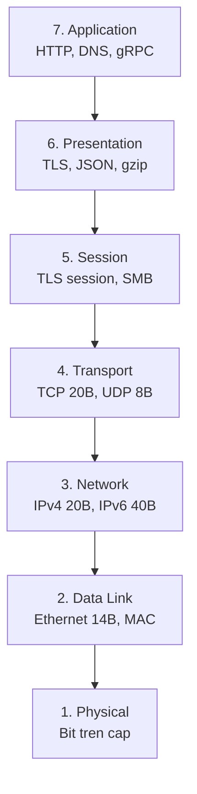
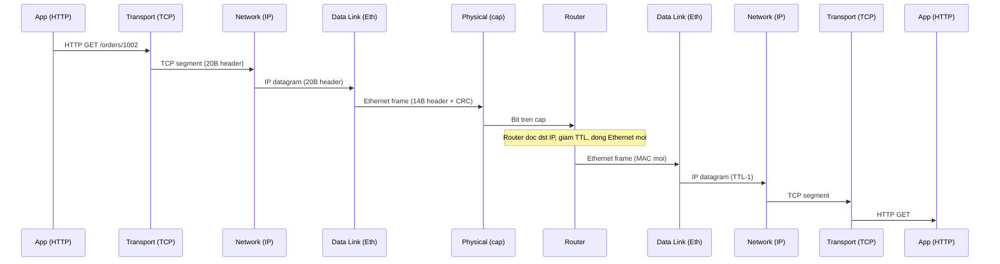

# Explain the OSI model — what happens at each layer?

> Mô hình OSI gồm 7 tầng trừu tượng hóa đường đi của một gói tin, từ bit trên dây đến HTTP request của ứng dụng. Mỗi tầng chỉ biết header của mình, đóng gói payload từ tầng trên rồi chuyển xuống. TCP/IP 4 tầng là stack thật của Internet.

Chủ đề: Networking · Ngày: 2026-10-15

## 1. Là gì

Mô hình OSI (Open Systems Interconnection, ISO/IEC 7498-1, 1984) là khung tham chiếu 7 tầng chia nhỏ việc truyền dữ liệu qua mạng. Mỗi tầng có ba đặc trưng: PDU (đơn vị dữ liệu nó trao đổi), chức năng, và ví dụ giao thức/thiết bị. Bảy tầng từ dưới lên: Physical, Data Link, Network, Transport, Session, Presentation, Application.

OSI là mô hình tham chiếu, không phải stack thật. Internet chạy TCP/IP 4 tầng: Application (gộp OSI 5-6-7), Transport, Internet, Link (gộp OSI 1-2). Mô hình 7 tầng vẫn có giá trị vì nó tách rõ ranh giới trách nhiệm — tiện khi troubleshoot và khi mô tả nơi lỗi xảy ra.

Giả định: bài này nói về mạng IP hiện đại (Ethernet + IPv4/IPv6 + TCP/UDP + TLS + HTTP/QUIC).

*Sơ đồ 7 tầng OSI: mỗi tầng nhận payload từ tầng trên, thêm header của mình rồi chuyển xuống tầng dưới.*

**Trả lời 30 giây:** OSI là khung 7 tầng mô tả cách dữ liệu đi từ ứng dụng A đến ứng dụng B. Application (HTTP) đóng gói dữ liệu, Transport (TCP) thêm cổng và số thứ tự, Network (IP) thêm địa chỉ nguồn/đích, Data Link (Ethernet) thêm MAC, Physical chuyển thành tín hiệu trên cáp. Mỗi hop router đọc IP rồi đóng Ethernet mới, nhưng không chạm payload bên trong. TCP đảm bảo byte đến đúng thứ tự qua ACK và retransmit, nhưng không đảm bảo thời gian.

## 2. Cơ chế cốt lõi

### 7 tầng và PDU

| Tầng | PDU | Giao thức tiêu biểu | Thiết bị |
|---|---|---|---|
| 7. Application | Message / data | HTTP, DNS, SMTP, gRPC | Reverse proxy, API gateway |
| 6. Presentation | Message | TLS, JSON, protobuf, gzip | Thư viện TLS, serializer |
| 5. Session | Message / record | TLS session ID, SMB | Thư viện TLS |
| 4. Transport | Segment (TCP) / Datagram (UDP) | TCP, UDP, QUIC | OS kernel, L4 load balancer |
| 3. Network | Packet / Datagram | IPv4, IPv6, ICMP, IPsec | Router, L3 switch |
| 2. Data Link | Frame | Ethernet, Wi-Fi, ARP, PPPoE | Switch, NIC, bridge |
| 1. Physical | Bit | 1000BASE-T, 10GBASE-SR | Hub, cáp, SFP, antenna |

Header thật: Ethernet 14B (+4B VLAN), IPv4 20B, TCP 20B, UDP 8B, TLS record 5-21B. TCP/IP độn ~40 byte header cho mỗi segment. MTU Ethernet mặc định 1500, tức application payload tối đa 1460 byte (MSS = MTU − 40).

### Encapsulation: đóng gói từ trên xuống

Khi browser gửi `GET /orders/1002 HTTP/1.1` tới `api.example.test`:

1. **Application (tầng 7):** HTTP request gồm method, URL, header, body → chuyển xuống Transport qua socket API.
2. **Transport (tầng 4):** TCP thêm 20 byte header: src port (ephemeral, ~51.234), dst port (443), sequence number, ACK, flags, window. Payload + TCP header = segment.
3. **Network (tầng 3):** IP thêm 20 byte header: src IP (10.0.0.5), dst IP (203.0.113.7), TTL (64), protocol (6=TCP). Segment + IP header = datagram.
4. **Data Link (tầng 2):** Ethernet thêm 14 byte header (dst MAC gateway, src MAC máy gửi, EtherType 0x0800) + 4 byte CRC-32 trailer. Datagram + Ethernet = frame. Frame tối đa 1518B (1522B với VLAN).
5. **Physical (tầng 1):** NIC chuyển frame thành tín hiệu điện/quang/radio trên cáp.

Một HTTP request 100 byte payload trên HTTPS tổng cộng: Ethernet 14B + IPv4 20B + TCP 20B + TLS ~40B + HTTP ~200B + payload 100B = ~394 byte trên dây. Hiệu suất ~25%.

*Quá trình encapsulation: mỗi tầng thêm header của mình. Router đọc IP rồi đóng Ethernet mới, không chạm payload TCP/HTTP.*

### Decapsulation: gỡ gói từ dưới lên

Khi frame đến máy nhận:

1. **Physical:** NIC nhận tín hiệu, chuyển thành bit, đưa frame lên driver.
2. **Data Link:** Driver kiểm CRC-32. Sai → drop. Đúng → bỏ Ethernet header, đưa IP datagram lên Network.
3. **Network:** IP kiểm dst IP là của mình, TTL > 0, header checksum. Đúng → bỏ IP header, đưa TCP segment lên Transport.
4. **Transport:** TCP kiểm sequence, ACK, đưa payload vào socket buffer của dst port. Wake up application đang `read()`.
5. **Presentation + Session:** TLS giải mã payload (5-21B header TLS record).
6. **Application:** HTTP parse request, xử lý, ghi response.

### Các giao thức lệch tầng

Một số giao thức không nằm gọn trong 7 tầng:

- **TLS** (RFC 8446): chèn giữa TCP và Application, mang chức năng cả tầng 5 (session) lẫn tầng 6 (mã hóa). Thực tế tính là "Application" trong stack TCP/IP.
- **ARP** (RFC 826): giữa tầng 2 và 3. Map IP → MAC trên cùng LAN. Gửi broadcast Ethernet "ai có IP này".
- **ICMP** (RFC 792): thuộc tầng 3. Dùng cho `ping` và `traceroute`. Báo lỗi: "Time exceeded", "Destination unreachable", "Fragmentation needed".
- **VXLAN** (RFC 7348): đóng Ethernet vào UDP/IP. Thêm 50 byte overhead (VXLAN 8B + UDP 8B + IP 20B + Ethernet 14B). MTU hiệu dụng bên trong tunnel = 1450.
- **QUIC** (RFC 9000): chạy trên UDP, nhưng cung cấp reliability (tương tự TCP) + mã hóa (tương tự TLS) + multiplexing. Vừa tầng 4 vừa tầng 5/6.

### TCP vs UDP ở tầng Transport

- **TCP:** connection-oriented (3-way handshake 1.5 RTT), ACK, retransmit, in-order, flow control (window), congestion control (cwnd). Overhead: 20B header + ACK. Phù hợp: HTTP, email, file transfer.
- **UDP:** connectionless, không ACK, không retransmit, không in-order đảm bảo. Overhead: 8B header. Phù hợp: DNS (query ~60B), VoIP, gaming, QUIC (tự xây reliability trên UDP).

### Ví dụ chạy từng bước

Kịch bản: browser gửi `POST /payments với body {"amount":5000,"token":"tok_xyz"}` tới `api.example.test`. TCP connection đã ESTABLISHED. Bảng theo dõi tổng byte trên dây sau mỗi bước.

| Bước | Tầng | Ai làm gì | Byte trên dây |
|---|---|---|---|
| 1 | App | Browser serialize JSON body 47 byte, gọi `send()` | — |
| 2 | App→TLS | TLS 1.3 record header 5B + encrypted content, gửi xuống TCP | 47B payload + TLS header 5B |
| 3 | TCP | TCP segment: src port 52741, dst port 443, seq=1001, ACK flags, window 65535 | +20B TCP header → 72B |
| 4 | IP | IP datagram: src 10.0.1.15, dst 203.0.113.42, TTL=64, proto=6(TCP) | +20B IP header → 92B |
| 5 | Eth | Ethernet frame: dst MAC gateway (e4:5f:01:2a:cf:d1), src MAC NIC (f4:5c:89:ab:cd:ef), EtherType 0x0800 | +14B header + 4B CRC → **110B** |
| 6 | — | NIC chuyển thành tín hiệu điện trên cáp, router đọc dst IP, giảm TTL xuống 63, đóng Ethernet mới với MAC kế tiếp | — |

Header tổng cộng: Eth 14B + IP 20B + TCP 20B + TLS 5B = 59B overhead. Application payload 47B. Hiệu suất = 47/110 ≈ 43%.

**Nếu MTU trên đường đi là 1450 (VXLAN tunnel):** MSS thỏa thuận trong SYN = 1460, nhưng MTU tunnel = 1450. Router phải fragment hoặc drop. Vì TCP SYN có cờ DF (Don't Fragment), router gửi ICMP "Fragmentation Needed" (type 3, code 4) về sender. Nếu ICMP bị firewall chặn, client không biết MTU thấp → cứ gửi packet 110B vẫn qua được (110 < 1450). Vấn đề xảy ra khi payload lớn hơn, ví dụ TLS alert packet ~60B → tổng ~119B, vẫn qua. Điều thực sự nguy hiểm là khi segment vượt MTU tunnel: MTU 1450 − 28 = 1422 payload tối đa; TLS record ~1400B + payload → vượt → drop im lặng nếu ICMP bị chặn.

Nếu Ethernet MTU mặc định 1500 (không có tunnel): segment 110B thoải mái trong MTU. Router đọc IP, giảm TTL, forward. Không fragment.

Điều rút ra: mỗi tầng thêm header cố định; tổng byte trên dây = payload + overhead. Khi có tunnel, overhead tích lũy có thể làm segment vượt MTU đường đi, và PMTUD black hole xảy ra khi ICMP bị chặn — triệu chứng "HTTPS treo ở handshake" trong [Câu 8, 3A](tcp-vs-udp.md).

## 3. Câu hỏi phỏng vấn

### 3A. Câu hỏi đào sâu

Câu 1. Mô tả 7 tầng OSI và PDU của từng tầng.

**Trả lời ngắn:** 7 tầng từ dưới lên: Physical (bit), Data Link (frame), Network (packet), Transport (segment/datagram), Session, Presentation, Application (message). TCP dùng segment, UDP dùng datagram, IP dùng packet/datagram, Ethernet dùng frame.

**Đào sâu:**
- PDU chính xác: tầng 1 bit, tầng 2 frame (Ethernet header 14B + CRC 4B), tầng 3 packet (IP header 20B), tầng 4 segment (TCP 20B) hoặc datagram (UDP 8B), tầng 5-7 message.
- Tầng 5 (Session) và 6 (Presentation) hầu như trống trong thực tế. TLS "lấp" chỗ trống đó.
- TCP/IP gộp 7 tầng thành 4: Application (OSI 5+6+7), Transport, Internet (OSI 3), Link (OSI 1+2).

**Bẫy:** Gộp nhầm TLS vào tầng 4. TLS nằm giữa TCP và Application, mang chức năng tầng 5 và 6.

**Follow-up:** TCP/IP 4 tầng gộp như thế nào? OSI 5+6+7 → Application; OSI 4 → Transport; OSI 3 → Internet; OSI 1+2 → Link.

Câu 2. Tính tổng byte trên dây của một HTTP request 100 byte qua HTTPS. Khi nào payload bị drop?

**Trả lời ngắn:** Ethernet 14B + IPv4 20B + TCP 20B + TLS ~40B + HTTP ~200B + payload 100B = ~394 byte. Payload bị drop khi tổng vượt MTU trên đường đi, ví dụ qua VXLAN tunnel (MTU 1450) thay vì Ethernet thường (MTU 1500).

**Đào sâu:**
- Ethernet frame tối đa 1518B (1522B với VLAN tag 4B). MTU 1500 = payload tối đa 1500B cho toàn IP datagram.
- MSS = MTU − 40 = 1460 byte. TCP không bao giờ gửi segment payload lớn hơn MSS thỏa thuận trong SYN.
- VXLAN thêm 50B overhead (VXLAN 8B + UDP 8B + IP 20B + Eth 14B), nên MTU hiệu dụng = 1500 − 50 = 1450.
- Khi gói SYN với payload lớn hơn MTU đường đi, router gửi ICMP "Fragmentation needed". Nếu ICMP bị firewall chặn, client không biết giảm → MTU blackhole.

**Bẫy:** Quên rằng IP header và TCP header nằm trong payload Ethernet chứ không cộng thêm.

**Follow-up:** Làm sao phát hiện MTU blackhole? `ping -M do -s 1472 host` (1472 + 8 ICMP = 1480, vượt MTU 1450). Nếu fail, có blackhole.

Câu 3. TCP và UDP khác nhau thế nào? Khi nào chọn UDP?

**Trả lời ngắn:** TCP connection-oriented (handshake 1.5 RTT), có ACK và retransmit đảm bảo in-order. UDP connectionless, không ACK, overhead 8B. Chọn UDP khi payload nhỏ (DNS ~60B), cần latency thấp (VoIP, gaming), hoặc tự quản lý reliability (QUIC trên UDP).

**Đào sâu:**
- TCP handshake: SYN → SYN-ACK → ACK = 1.5 RTT trước khi gửi data. UDP gửi ngay.
- TCP slow start: cwnd bắt đầu ~10 segment (RFC 6928), tăng gấp đôi mỗi RTT. File nhỏ (~vài trăm KB) qua WAN không kịp thoát slow start.
- UDP không có cwnd, không có retransmit. Application phải tự xây nếu cần.
- QUIC (HTTP/3) chạy trên UDP nhưng mang concept stream độc lập: mất một stream không block stream khác (khắc phục head-of-line blocking của TCP).
- TCP appropriate cho: HTTP, SSH, email, file transfer. UDP appropriate cho: DNS, NTP, VoIP, QUIC, broadcast.

**Bẫy:** Nói "UDP không đáng tin" rồi dừng. UDP là datagram, application tự quyết độ tin cậy. DNS trên UDP có retransmit ở application.

**Follow-up:** Head-of-line blocking là gì? TCP xử lý in-order: một segment mất block tất cả segment sau trong cùng connection. HTTP/2 stream trên TCP vẫn bị block. QUIC trên UDP giải quyết bằng stream độc lập.

Câu 4. Switch, router, firewall, load balancer khác nhau ở tầng nào?

**Trả lời ngắn:** Switch L2 hoạt động ở tầng 2 (MAC), router ở tầng 3 (IP), firewall thường ở tầng 3-4 (IP/port) có thể L7 (DPI), load balancer L4 (IP/port) hoặc L7 (HTTP). Thiết bị hiện đại thường đa tầng.

**Đào sâu:**
- **Switch L2:** forward frame theo MAC table. Học MAC từ src MAC đi qua. Flood khi không biết dst. Độ trễ <1 µs. Broadcast storm khi có loop (STP ngăn).
- **Router L3:** forward packet theo routing table. Định tuyến giữa các subnet. Có thể có firewall tích hợp.
- **Firewall L3/L4:** lọc theo src/dst IP, port, TCP flag. Có thể có DPI ở L7 (WAF).
- **Load balancer L4:** phân phối theo IP/port, độ trễ µs, không thấy HTTP. L7: phân phối theo HTTP header, path, cookie, độ trễ ~ms nhưng linh hoạt.
- L3 switch = router trong chip, nhanh như switch nhưng route được.

**Bẫy:** Nói "router tầng 3, switch tầng 2" rồi dừng. L3 switch vừa switch vừa route. Firewall hiện đại có L7 inspection.

**Follow-up:** Khi nào dùng L4 LB thay vì L7? L4 khi cần throughput cao (10 Gbps+), preserve client IP, hoặc không cần HTTP routing. L7 khi cần path-based routing, canary deploy, A/B test.

Câu 5. Mô tả quy trình troubleshoot "service B không gọi được service C" theo mô hình OSI.

**Trả lời ngắn:** Đi từ tầng thấp lên cao. Tầng 1-2: `ip link show`, `ethtool`. Tầng 3: `mtr`, `traceroute`, `ping`. Tầng 4: `nc -vz host port`, `tcpdump`. Tầng 6: `openssl s_client`. Tầng 7: `curl -v`, app log.

**Đào sâu:**
- Tầng 1-2: `ip -s link show eth0` xem link up/down, drop counter. `ethtool eth0` xem speed, duplex. Link down → xử lý vật lý trước.
- Tầng 2-3: `arp -n` xem gateway MAC đúng không. `ip neigh show` cho IPv6. ARP miss → không tạo được Ethernet frame.
- Tầng 3: `ip route get 203.0.113.7` xem route. `mtr -n 203.0.113.7` chạy 30 giây, tìm hop có loss. `ping -M do -s 1472` kiểm tra MTU.
- Tầng 4: `nc -vz C 443` kiểm TCP. `tcpdump -ni eth0 host C and port 443` xem SYN/SYN-ACK/RST. SYN không có SYN-ACK = firewall block.
- Tầng 6: `openssl s_client -connect C:443` xem TLS handshake fail hay không.
- Tầng 7: `curl -v https://C/` xem HTTP status, body, timing.

**Bẫy:** Nhảy thẳng vào app log mà không kiểm tra tầng dưới trước.

**Follow-up:** Làm sao phân biệt lỗi network hay application? Dùng `ss -ti` xem `rtt` và `cwnd`. RTT tăng đột biến → network. Status 5xx → application.

Câu 6. Thiết kế hệ thống CDN đơn giản. Đi qua những tầng nào?

**Trả lời ngắn:** User → DNS resolver (anycast) → CDN edge (L7 LB + cache) → origin (L4 LB + app + DB). CDN edge terminate TLS, cache response, chỉ miss mới đi origin.

**Đào sâu:**
- Tầng 7 (DNS): resolver trả IP edge gần user nhất (GeoIP hoặc BGP anycast). Anycast: cùng một IP quảng bá từ nhiều vùng, BGP đưa user đến edge gần nhất.
- Tầng 4-7 (TLS): browser → edge: TCP handshake + TLS handshake. Edge terminate TLS, không forward encrypted traffic.
- Tầng 7 (HTTP routing): edge kiểm path, header. Cache hit → trả ngay. Cache miss → forward tới origin.
- Tầng 4 (origin): origin L4 LB phân phối tới nhiều app instance.
- Tầng 7 (app): app đọc DB, trả response. Response cache ở edge với TTL từ `Cache-Control`.
- Thiết bị: DNS resolver, CDN edge (L7 LB + cache), firewall, router, origin server.

**Bẫy:** Mô tả chung chung "CDN cache" mà không nói từng tầng xử lý gì.

**Follow-up:** Cache invalidation hoạt động thế nào? TTL-based (`Cache-Control: max-age=N`) hoặc purge (origin gửi request xóa edge cache).

Câu 7. Tại sao HTTP/3 chạy trên QUIC (UDP) thay vì TCP?

**Trả lời ngắn:** QUIC giải quyết head-of-line blocking của TCP: mỗi HTTP/2 stream độc lập trên QUIC, mất một stream không block stream khác. QUIC tích hợp TLS 1.3 (1-RTT handshake thay vì 2-3 RTT với TCP+TLS). QUIC chạy trong userspace nên không cần kernel upgrade để thêm tính năng.

**Đào sâu:**
- TCP head-of-line blocking: kernel xử lý TCP in-order, không biết về HTTP stream. Một segment mất block tất cả segment sau dù thuộc stream khác.
- QUIC stream độc lập: mất packet trong stream A không block stream B.
- TLS 1.3 tích hợp: QUIC handshake 1-RTT, 0-RTT cho repeat connection (tiết kiệm 1 RTT so với TCP+TLS 1.3 thường 2 RTT).
- QUIC connection migration: đổi IP (Wi-Fi → 4G) không mất connection vì connection ID thay vì tuple (src IP, src port, dst IP, dst port).
- QUIC chạy trong userspace (UDP socket), không cần OS. CDN (Google, Cloudflare) triển khai từ 2020.
- Nhược điểm: UDP có thể bị firewall corporate chặn, CPU overhead cao hơn (userspace), triển khai phức tạp hơn TCP.

**Bẫy:** Nói "QUIC nhanh hơn TCP" mà không giải thích head-of-line blocking.

**Follow-up:** Khi nào vẫn dùng TCP? Khi corporate firewall chặn UDP, khi cần long-lived connection đơn giản (SSH), khi QUIC library chưa sẵn.

Câu 8. Triệu chứng: ping OK nhưng HTTPS treo ở TCP handshake. Nguyên nhân và kiểm tra gì?

**Trả lời ngắn:** Nghi PMTUD blackhole. Ping dùng ICMP, không phụ thuộc TCP/TLS. HTTPS treo ở handshake → SYN hoặc SYN-ACK bị drop do vượt MTU trên đường đi (thường do tunnel thêm overhead). Kiểm tra bằng `ping -M do -s 1472`.

**Đào sâu:**
- Ping < 1500 byte đi qua được vì ICMP payload nhỏ. TCP SYN với MSS 1460 + IP 20 + TCP 20 = 1500 → vừa khít Ethernet MTU, nhưng qua tunnel (VXLAN +50B) thành 1550 → bị drop.
- PMTUD gửi ICMP "Fragmentation needed" nhưng tunnel nhiều khi không nhận ra ICMP.
- Triệu chứng kinh điển: "ping được nhưng HTTPS timeout".
- Kiểm tra: `ping -M do -c 3 -s 1472 host` (1472 + 8 ICMP = 1480). Nếu fail → PMTUD blackhole.
- Fix: giảm MTU tunnel xuống 1450, hoặc clamp MSS: `iptables -t mangle -A FORWARD -p tcp --tcp-flags SYN,RST SYN -j TCPMSS --set-mss 1410`.

**Bẫy:** Restart server hoặc clear DNS cache trước khi kiểm tra MTU — không giải quyết vấn đề.

**Follow-up:** PMTUD có hoạt động với IPv6 không? Bắt buộc (RFC 8200), khác IPv4 có thể tùy chọn.

### 3B. Câu hỏi phỏng vấn liên quan

Câu 9. Phân biệt MTU và MSS. Khi nào mỗi cái được dùng?

**Trả lời:** MTU là kích thước frame L2 tối đa — Ethernet 1500, VXLAN tunnel 1450, PPPoE 1492. MSS là TCP payload tối đa trong một segment — Ethernet MSS = 1500 − 40 = 1460. Host tính MSS trong SYN, hai đầu lấy min. MSS clamp ở firewall (`TCPMSS`) dùng khi tunnel không thay đổi MTU.

Câu 10. L4 LB và L7 LB: latency và throughput thường là bao nhiêu?

**Trả lời:** L4 LB (HAProxy mode tcp, AWS NLB, IPVS) chỉ nhìn IP/port, độ trễ thường <100 µs, throughput 10-100 Gbps, không thấy HTTP. L7 LB (Nginx, Envoy, AWS ALB) nhìn HTTP header/path/cookie, độ trễ 1-10 ms, throughput thấp hơn do parse HTTP. Chọn L4 khi cần throughput cao hoặc UDP; chọn L7 khi cần path-based routing, canary deploy, hoặc A/B test.

Câu 11. Cache ARP đầy xảy ra khi nào và triệu chứng ra sao?

**Trả lời:** Cache ARP cần refresh khi host đi/đến trên LAN — entry mới không tạo được vì cache đầy sẽ drop traffic vài giây. Triệu chứng: `ping` đầu tới gateway/server cùng subnet fail, lần sau đi được. Nguyên nhân: IoT/VM scale nhanh, switch L2 có `mac-address-table` nhỏ, hoặc ARP storm từ thiết bị lỗi.

Câu 12. Scenario: chat application realtime (Slack) chạy qua TCP có khả thi không? Nên dùng transport nào?

**Trả lời:** Được nhưng có hạn chế. TCP head-of-line blocking: một segment mất block mọi segment sau, gây stall thấy được trong chat. WebSocket trên TCP dùng cho chat text OK. Cho voice/video hoặc multiplayer game dùng UDP-based (SRTP, custom UDP, QUIC/HTTP/3, hoặc WebRTC). Đánh đổi: UDP tự phục hồi mất gói, TCP chờ retransmit → latency cao hơn.

Câu 13. TTL mặc định của Linux, Windows, macOS và ý nghĩa?

**Trả lời:** Linux/Unix: 64. Windows: 128. macOS: 64. TTL giảm 1 mỗi hop; đến 0 thì drop và gửi ICMP "Time Exceeded". Linux 64 đủ cho ~30 hop WAN. TTL không chắc cho mọi bản distro hay container gốc.

Câu 14. traceroute hoạt động dựa trên cơ chế gì ở tầng 3?

**Trả lời:** traceroute gửi packet TTL=1, 2, 3... mỗi lần tăng 1. Router đầu giảm TTL xuống 0, drop, gửi ICMP "Time Exceeded" (kèm IP router). Lặp đến khi packet đến đích, ICMP "Port Unreachable" từ đích. Công cụ: `traceroute -n host`, `mtr -n host` (loss từng hop). Router tắt ICMP hoặc rate-limit → hiện `* * *`.

Câu 15. So sánh HTTP/1.1, HTTP/2, HTTP/3 về RTT và multiplexing.

**Trả lời:** HTTP/1.1 mỗi request một TCP connection (head-of-line ở L4). HTTP/2 multiplexing trên 1 TCP — vẫn bị TCP head-of-line blocking. HTTP/3 trên QUIC (UDP), mỗi stream độc lập. RTT khởi tạo: HTTP/1.1 = 1.5 RTT TCP + 1-2 RTT TLS. HTTP/2 cũng. HTTP/3 = 1 RTT QUIC (TLS 1.3 built-in), 0-RTT cho repeat.

Câu 16. Phân biệt `netstat` và `ss`. Khi nào nên dùng cái nào?

**Trả lời:** `netstat` (legacy) đọc `/proc/net/tcp` và tương tự, chậm với hàng trăm nghìn connection. `ss` (iproute2) đọc kernel trực tiếp qua netlink, nhanh hơn 10-100× trên hệ thống lớn. `ss -tin` xem thông tin TCP chi tiết (cwnd, rwnd, rtt). `ss -ltn` xem listening TCP. `netstat -s` cho thống kê theo protocol, vẫn dùng. Khuyến nghị: dùng `ss` cho debug trên production; `netstat` cho script cũ và fallback khi `iproute2` chưa cài.

Câu 17. Protocol number 6, 17, 1 là gì? Làm sao nhìn thấy chúng trong packet?

**Trả lời:** Protocol number nằm trong IP header 1 byte: 6 = TCP, 17 = UDP, 1 = ICMP, 41 = IPv6-in-IPv4, 47 = GRE, 50 = ESP, 51 = AH. EtherType L2: 0x0800 = IPv4, 0x86DD = IPv6, 0x8100 = VLAN, 0x0806 = ARP. Quan sát: `tcpdump -nnv host X` in `IP proto 6`, `EtherType 0x0800`.

Câu 18. True or false: "TCP hoạt động ở tầng 5 (Session) của mô hình OSI vì nó duy trì connection."

**Trả lời:** Sai. TCP ở tầng 4 (Transport). Tầng 5 trong thực tế gần như trống trong TCP/IP — TLS "lấp" bằng session ID/resumption. TCP có connection vì nó cung cấp cơ chế L4 (socket state, sequence number, ACK), không phải tầng 5. Nhầm phổ biến vì "connection" nghe giống "session" — định nghĩa OSI đặt session ở tầng 5, TCP ở tầng 4.

## 4. Đánh đổi và sự cố production

### Điểm nghẽn thường gặp

| Điểm nghẽn | Mô tả | Fix |
|---|---|---|
| Slow start WAN | cwnd bắt đầu ~10 segment, tăng gấp đôi mỗi RTT. File nhỏ qua WAN không kịp thoát cwnd ramp | keep-alive, HTTP/2 multiplexing, CDN gần user |
| MTU mismatch | Tunnel (VXLAN, VPN, GRE) độn overhead mà không giảm MTU | Clamp MSS hoặc giảm MTU interface |
| TLS handshake | 1.5-2.5 RTT trước data. Thêm overhead cho mỗi connection mới | TLS 1.3 (1-RTT), session resumption, hardware offload |
| conntrack overflow | NAT với nhiều short connection làm đầy conntrack table | Tăng limit, dùng connection pool, NOTRACK cho fast path |

### Đánh đổi: Layer 4 vs Layer 7 Load Balancer

- **L4 LB** (HAProxy mode tcp, AWS NLB, IPVS): chỉ nhìn IP/port, độ trễ < 100 µs, throughput 10-100 Gbps. Không thấy HTTP, không TLS termination (mặc định).
- **L7 LB** (Nginx, Envoy, AWS ALB): nhìn HTTP header, path, cookie. Độ trễ 1-10 ms, throughput thấp hơn. Có TLS termination, path-based routing, canary deploy.

Chọn L4 khi cần throughput cao, UDP, hoặc preserve client IP. Chọn L7 khi cần routing phức tạp, auth layer, A/B test.

### TCP vs UDP

- TCP đảm bảo in-order và no-duplication qua ACK và retransmit. Overhead: 20B header + handshake. Phù hợp: HTTP, SSH, email, file transfer.
- UDP đơn giản hơn, không handhake, overhead 8B. Phù hợp: DNS (~60B query), VoIP, gaming, QUIC (tự xây reliability trên UDP).
- TCP có slow start (cwnd ramp ~10 segment, tăng gấp đôi mỗi RTT). File nhỏ qua WAN không kịp thoát cwnd. UDP full speed ngay.
- Head-of-line blocking: TCP kernel xử lý in-order, một segment mất block tất cả sau. QUIC trên UDP giải quyết bằng stream độc lập.

### 5 failure mode phổ biến

| Triệu chứng | Nguyên nhân gốc | Kiểm tra | Fix |
|---|---|---|---|
| HTTPS treo ở handshake, ping OK | MTU blackhole (tunnel độn overhead) | `ping -M do -s 1472` | Giảm MTU tunnel xuống 1450, clamp MSS |
| Connection đang OK bị RST | conntrack table đầy, entries bị evict | `cat /proc/sys/net/netfilter/nf_conntrack_count` | Tăng `nf_conntrack_max`, dùng connection pool |
| TLS handshake > 1 giây dù RTT nhỏ | Certificate chain không đầy đủ, OCSP gọi chậm | `openssl s_client -connect host:443 -showcerts` | Thêm intermediate vào chain, bật OCSP stapling |
| VLAN chậm, broadcast cao bất thường | ARP storm (loop vật lý hoặc host phát ARP liên tục) | `tcpdump` xem lượng ARP broadcast | Shutdown port có broadcast cao, bật STP |
| Request timeout dù RTT bình thường | TCP cwnd nhỏ (vừa mất packet) | `ss -ti dst host:443` xem `cwnd` | Đợi cwnd tự phục hồi, hoặc dùng BBR |

### Chi phí ẩn khi vận hành

- Mỗi tầng cần tool riêng để observe: tcpdump cho packet, SNMP/netflow cho thiết bị mạng, SSL Labs cho TLS.
- NIC offload (TSO, LRO, checksum offload) có thể gây bug khi debug với tcpdump trên máy gửi. Tắt bằng `ethtool -K eth0 tx off rx off`.
- Firewall chặn ICMP có thể gây PMTUD blackhole: "ping được nhưng HTTPS treo" là triệu chứng kinh điển.
- BGP convergence chậm (30 giây đến vài phút) khi failover ISP. Dùng BFD để giảm xuống sub-second.

## 5. Cheat sheet

### Con số cần nhớ

| Chủ đề | Con số / quy tắc |
|---|---|
| 7 tầng | Application → Presentation → Session → Transport → Network → Data Link → Physical |
| TCP/IP 4 tầng | Application (OSI 5+6+7) → Transport → Internet (OSI 3) → Link (OSI 1+2) |
| PDU | Physical: bit, Data Link: frame, Network: packet, Transport: segment/datagram, 5-7: message |
| Header thật | Eth 14B, IPv4 20B, TCP 20B, UDP 8B, TLS 5-21B |
| MTU / MSS | MTU Eth = 1500B, MSS = 1460B. VXLAN MTU = 1450B |
| TCP handshake | 1.5 RTT trước data. TLS 1.3 thêm +1 RTT, 0-RTT (resumption) |
| Slow start | cwnd ~10 segment (RFC 6928), tăng gấp đôi mỗi RTT |
| RTT tham khảo | LAN ~0.5 ms, continent ~50-150 ms, transpacific ~150-200 ms |
| Tốc độ ánh sáng | ~5 µs/km cáp quang |
| TTL mặc định | Linux/Unix: 64, Windows: 128 |
| Protocol numbers | 6 = TCP, 17 = UDP, 1 = ICMP |
| EtherType | 0x0800 = IPv4, 0x86DD = IPv6, 0x8100 = VLAN |

### Công cụ theo tầng

| Tầng | Lệnh |
|---|---|
| 1-2 | `ip link show`, `ethtool eth0`, `ip -s link` |
| 2-3 | `arp -n`, `ip neigh show` |
| 3 | `ip route get`, `traceroute -n`, `mtr -n`, `ping -M do -s 1472` |
| 4 | `nc -vz host port`, `ss -ti`, `tcpdump -ni eth0 host X` |
| 6 | `openssl s_client -connect host:443` |
| 7 | `curl -v`, `dig`, app log |

### MTU blackhole — triệu chứng kinh điển

- Ping < 1500 byte OK, nhưng HTTPS treo ở TCP handshake.
- Nguyên nhân: tunnel (VXLAN, VPN, GRE) độn overhead, tổng vượt MTU thật.
- Kiểm tra: `ping -M do -s 1472 host` (1472 + 8 ICMP = 1480 byte).
- Fix: giảm MTU tunnel xuống 1450, hoặc clamp MSS: `iptables -t mangle -A FORWARD -p tcp --tcp-flags SYN,RST SYN -j TCPMSS --set-mss 1410`.

**Học tiếp:**
- [TCP vs UDP](tcp-vs-udp.md) — chi tiết transport layer, congestion control, QUIC
- [IP differences](ip-differences.md) — chi tiết IPv4 vs IPv6, routing, fragmentation
- [DNS how it works](dns-how-it-works.md) — tầng 7 application protocol phổ biến nhất
- [HTTP vs HTTPS](http-vs-https.md) — TLS handshake chi tiết, certificate chain
