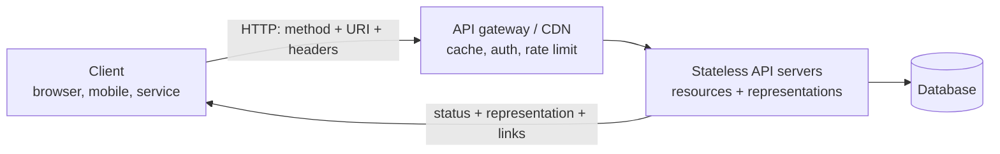
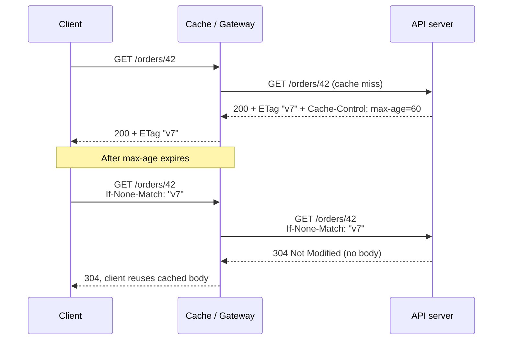

# Explain REST API principles.

> REST là một phong cách kiến trúc (Fielding, 2000) với các ràng buộc: client-server, stateless, cacheable, uniform interface, layered system. Bài này tập trung vào những ràng buộc đó thể hiện thế nào trong HTTP API: resource, method, idempotency, status code, cache và concurrency control.

Chủ đề: Networking · Ngày: 2026-10-15

## 1. Là gì

**Định nghĩa.** REST (Representational State Transfer) là tập ràng buộc kiến trúc cho hệ thống phân tán, do Roy Fielding mô tả trong luận án tiến sĩ. Client thao tác trên resource (định danh bằng URI) thông qua representation (JSON, HTML...) và các method có ngữ nghĩa chuẩn của HTTP (RFC 9110).

REST là phong cách, không phải chuẩn hay giao thức. "REST API" trong thực tế thường nghĩa là "HTTP API dùng JSON, URI theo resource", và thường không tuân thủ hết ràng buộc (đặc biệt HATEOAS).

Giả định: bài này nói REST trên HTTP, theo nghĩa phổ biến trong phỏng vấn backend.



*Sơ đồ vị trí: client gọi API qua gateway/CDN; server stateless trả representation của resource, state nằm ở database.*

**Trả lời 30 giây.** REST là phong cách kiến trúc dựa trên resource và các method chuẩn của HTTP. Ràng buộc chính: client-server, stateless (mỗi request tự chứa đủ thông tin), cacheable, uniform interface và layered system. Stateless cho phép scale ngang vì server nào cũng xử lý được request nào; cacheable cho phép CDN và client cache GET bằng `Cache-Control` và ETag. Đổi lại là mỗi request mang thêm context (token) và khó biểu diễn thao tác không thuần CRUD.

## 2. Cơ chế cốt lõi

### Bước 1. Resource và URI
Resource là danh từ (`/orders/42`), không phải hành động (`/getOrder`). Quan hệ cha-con biểu diễn bằng đường dẫn (`/orders/42/items`). Một resource có thể có nhiều representation, chọn bằng `Accept`.

### Bước 2. Method mang ngữ nghĩa
Ngữ nghĩa theo RFC 9110: GET đọc (safe, idempotent), PUT thay thế toàn bộ (idempotent), DELETE xóa (idempotent), POST tạo hoặc thao tác không idempotent, PATCH sửa một phần (không đảm bảo idempotent). Cache, proxy và retry dựa vào các thuộc tính này.

### Bước 3. Stateless
Server không giữ session của client giữa các request. Mỗi request mang đủ thông tin xác thực (ví dụ `Authorization: Bearer ...`) và tham số. Hệ quả: bất kỳ instance nào cũng xử lý được, scale ngang bằng cách thêm instance sau load balancer.

### Bước 4. Status code và representation
Server trả status code đúng lớp (2xx, 4xx, 5xx), kèm representation và header như `Location` sau khi tạo (201). Client không cần biết nội bộ server, chỉ cần hiểu status và media type. Xem [HTTP status codes](http-status-codes.md).

### Bước 5. Cache và conditional request
Response GET có thể kèm `Cache-Control` và `ETag`. Khi hết hạn, client gửi `If-None-Match`, server trả 304 không body nếu chưa đổi. Tiết kiệm băng thông, giảm tải backend.



*Sơ đồ conditional GET: sau khi hết max-age, client hỏi lại bằng If-None-Match và nhận 304 không body.*

### Bước 6. Uniform interface và HATEOAS
Uniform interface gồm: định danh resource, thao tác qua representation, message tự mô tả, và HATEOAS (response chứa link để client đi tiếp). HATEOAS là ràng buộc ít được áp dụng nhất trong API thực tế; nhiều API "REST" bỏ qua nó.

### Bước 7. Layered system và content negotiation
Client chỉ nói chuyện với lớp ngoài cùng (CDN, gateway) và không biết phía sau có bao nhiêu tầng. Gateway có thể xác thực, giới hạn tốc độ và cache mà không đổi hợp đồng API. Client chọn representation bằng `Accept`; server khai báo bằng `Content-Type` và `Vary: Accept` để cache không trộn lẫn các bản.

### Quan sát

```bash
# Xem header cache của một resource
curl -sI https://example.com/

# Gửi conditional GET với ETag đã biết, chỉ in status code
curl -s -o /dev/null -w '%{http_code}\n' -H 'If-None-Match: "v7"' https://example.com/
```

Cách đọc: dòng đầu cho biết `Cache-Control`, `ETag`, `Vary` mà cache nhìn thấy. Dòng thứ hai in `304` nếu ETag còn khớp và server hỗ trợ, in `200` nếu resource đã đổi hoặc server không hỗ trợ conditional request. Với `example.com` kết quả cụ thể không chắc; output minh họa, chưa chạy trong phiên này.

### Ví dụ chạy từng bước

Kịch bản: Alice và Bob cùng sửa đơn hàng `#order-1024` tại endpoint `PUT /orders/1024`. Cả hai đọc cùng lúc, cùng ETag `v7`, cùng `version=3`. Sử dụng optimistic concurrency (ETag + `If-Match`).

| Bước | Ai | Hành động | Trạng thái |
|---|---|---|---|
| 1 | Alice | `GET /orders/1024` → nhận `ETag: "v7"`, `version: 3` | Client: lưu ETag |
| 2 | Bob | `GET /orders/1024` → nhận `ETag: "v7"`, `version: 3` | Client: lưu ETag |
| 3 | Alice | `PUT /orders/1024` với `If-Match: "v7"`, body thay đổi address, `version: 3` | Server: `WHERE id=1024 AND version=3` → 1 dòng, tăng version → 4 |
| 4 | Alice | Server trả `200 OK`, `ETag: "v8"` | Database: version=4 |
| 5 | Bob | `PUT /orders/1024` với `If-Match: "v7"`, body thay đổi item, `version: 3` | Server: `WHERE id=1024 AND version=3` → 0 dòng |

**Trạng thái sau bước 5:** Bob nhận `412 Precondition Failed`. Bob phải `GET` lại, merge, gửi lại với ETag mới `"v8"` và `version: 4`.

| Bước | Ai | Hành động | Trạng thái |
|---|---|---|---|
| 6 | Bob | `GET /orders/1024` lại → nhận `ETag: "v8"`, `version: 4`, address mới của Alice | Client: rebase thay đổi |
| 7 | Bob | `PUT` với `If-Match: "v8"`, `version: 4` | Server: `WHERE version=4` → 1 dòng → version=5 |
| 8 | Bob | `200 OK`, `ETag: "v9"` | Database: version=5, cả hai thay đổi đều được áp dụng |

Nếu Alice và Bob gửi cùng lúc (bước 3 và 5 gần như song song): một trong hai nhận `412`, phải retry sau khi đọc lại. Đây là đánh đổi của optimistic concurrency — xung đột hiếm thì không vấn đề, xung đột thường xuyên thì tốc độ tụt vì retry. Với payment status (xung đột = tiền), nhiều team chọn pessimistic lock hoặc saga pattern.

Nếu Bob không gửi `If-Match`: server chấp nhận ghi đè mà không kiểm tra version → Alice thay đổi bị mất. Đây là lỗi "lost update" kinh điển mà không có câu hỏi phỏng vấn nào.

**Nếu server trả 200 thay vì 412 khi ETag không khớp:** đây là lỗi phổ biến khi team quên kiểm tra `If-Match`. Client tưởng thành công nhưng thực tế ghi đè bản mới hơn. Monitoring không phát hiện được trừ khi so sánh tỷ lệ 200 vs 412 hoặc dùng audit log. Trên thực tế, khi hai người cùng sửa Google Docs cùng lúc, server dùng OT (Operational Transform) hoặc CRDT (Conflict-free Replicated Data Type) để merge tự động, không bao giờ để lost update xảy ra — nhưng REST API không có cơ chế đó.

Điều rút ra: ETag + `If-Match` biến concurrent write thành "xung đột → retry" thay vì "ghi đè im lặng". Kịch bản này minh chứng [Câu 5, 3A](tcp-vs-udp.md) về optimistic concurrency.

## 3. Câu hỏi phỏng vấn

### 3A. Câu hỏi đào sâu

<details class="qa">
<summary>Câu 1. What are the REST constraints, and which one matters most for scaling?</summary>

**Trả lời ngắn:** Sáu ràng buộc của Fielding: client-server, stateless, cacheable, uniform interface, layered system, code-on-demand (tùy chọn). Stateless quan trọng nhất cho scale ngang vì instance nào cũng xử lý được request nào. Cacheable giảm tải đọc.

**Đào sâu:**
- Stateless: không giữ session phía server giữa các request; state nằm ở client (token) hoặc database.
- Cacheable: response tự khai báo có cache được hay không qua `Cache-Control`, `ETag`.
- Layered system: client không biết đang nói chuyện với server gốc hay CDN, gateway.
- Uniform interface: định danh resource, thao tác qua representation, message tự mô tả, HATEOAS.

**Bẫy:** Nói "REST là JSON qua HTTP". JSON không phải ràng buộc; REST là phong cách kiến trúc.

**Follow-up:** Code-on-demand dùng khi nào? Server gửi code (JavaScript) cho client chạy; tùy chọn và hiếm được nhắc đến trong API.
</details>

<details class="qa">
<summary>Câu 2. Which HTTP methods are safe and idempotent, and why does it matter?</summary>

**Trả lời ngắn:** GET và HEAD là safe và idempotent. PUT và DELETE idempotent nhưng không safe. POST không idempotent. PATCH không đảm bảo idempotent. Retry, cache và proxy dựa vào các thuộc tính này để quyết định có gửi lại hay lưu hay không.

**Đào sâu:**
- Safe: không thay đổi state phía server (về ý định). Idempotent: gọi N lần có cùng hiệu ứng như gọi 1 lần.
- PUT `/orders/42` với cùng body hai lần cho cùng kết quả; POST `/orders` hai lần tạo hai đơn.
- Client, proxy và thư viện HTTP có thể tự retry method idempotent khi mất kết nối; POST thì không nên.
- Idempotent nói về hiệu ứng trên server, không đòi hỏi response giống nhau (DELETE lần hai có thể trả 404).

**Bẫy:** Nói "PUT idempotent nên không bao giờ gây lỗi". Idempotent không chống được race giữa hai writer khác nhau (xem câu 5).

**Follow-up:** Làm POST thanh toán an toàn khi retry? Dùng idempotency key (câu 4).
</details>

<details class="qa">
<summary>Câu 3. How should you design URIs and choose status codes for an orders API?</summary>

**Trả lời ngắn:** URI là danh từ số nhiều, phân cấp theo quan hệ: `GET /orders`, `POST /orders`, `GET /orders/42`, `GET /orders/42/items`. Hành động thuộc về method, không nằm trong URI. Status code đúng lớp: 201 + `Location` khi tạo, 204 khi xóa, 400/422 khi dữ liệu sai, 404 khi không có, 409 khi xung đột.

**Đào sâu:**
- Tránh `/getOrder`, `/deleteOrder`: method đã mang động từ.
- Thao tác không thuần CRUD (hủy đơn): có thể mô hình hóa thành sub-resource (`POST /orders/42/cancellation`) hoặc thay đổi state bằng PATCH. Đây là lựa chọn thiết kế, không có đáp án duy nhất.
- 401 là chưa xác thực, 403 là đã xác thực nhưng không đủ quyền.
- Phân biệt 400 và 422 phụ thuộc quy ước của từng team; chọn một và nhất quán.

**Bẫy:** Luôn trả 200 kèm cờ lỗi trong body. Cache, monitor và retry mất khả năng đọc kết quả.

**Follow-up:** Phân trang thế nào? Offset đơn giản nhưng lệch khi dữ liệu đổi; cursor ổn định hơn với danh sách thay đổi liên tục.
</details>

<details class="qa">
<summary>Câu 4. How do you make a payment POST safe to retry?</summary>

**Trả lời ngắn:** Client sinh một idempotency key duy nhất cho mỗi thao tác và gửi kèm header (thường là `Idempotency-Key`). Server lưu key cùng kết quả; gặp lại key đó thì trả đúng kết quả cũ thay vì xử lý lần hai. Đây là quy ước phổ biến, không phải chuẩn bắt buộc của REST.

**Đào sâu:**
- Lưu key và kết quả trong cùng transaction với thao tác ghi, hoặc dùng unique constraint trên key để chặn hai request đồng thời.
- Hai request cùng key đến song song: một cái thắng, cái kia chờ hoặc nhận 409.
- Cùng key nhưng body khác: trả lỗi, không xử lý tiếp.
- Key cần TTL; giá trị TTL do từng hệ thống quyết định, không có con số chuẩn.

**Bẫy:** Chỉ dựa vào timeout và retry phía client. Server có thể đã xử lý xong mà response bị mất, retry sẽ trừ tiền lần hai.

**Follow-up:** Có thể dùng PUT thay cho POST không? Nếu client biết trước ID của resource (`PUT /payments/{id}`), PUT tự idempotent.
</details>

<details class="qa">
<summary>Câu 5. Two clients update the same order at the same time. How do you prevent lost updates?</summary>

**Trả lời ngắn:** Dùng optimistic concurrency bằng ETag. Client đọc resource kèm `ETag`, khi ghi gửi `If-Match` với giá trị đó. Nếu resource đã bị đổi, server trả 412 Precondition Failed và client phải đọc lại rồi thử lại.

**Đào sâu:**
- ETag có thể là hash nội dung hoặc số phiên bản (cột `version` trong database).
- Phía server, cập nhật có điều kiện: `UPDATE ... WHERE id = ? AND version = ?`, nếu 0 dòng bị ảnh hưởng thì trả 412.
- Thiếu `If-Match` ở thao tác ghi quan trọng: có thể trả 428 Precondition Required để ép client gửi.
- Phù hợp khi xung đột hiếm; xung đột thường xuyên thì khóa bi quan hoặc thiết kế lại thao tác.

**Bẫy:** Nghĩ PUT idempotent là đủ để tránh ghi đè. Idempotent chỉ nói gọi lại cùng request không đổi kết quả, không nói gì về hai client khác nhau.

**Follow-up:** 409 và 412 khác nhau thế nào? 412 là điều kiện header (If-Match) không thỏa; 409 là xung đột với trạng thái hiện tại của resource nói chung.
</details>

<details class="qa">
<summary>Câu 6. Debug: GET /products is slow and the CDN hit rate is near zero. What do you check, in order?</summary>

**Trả lời ngắn:** Xem response có cho phép cache không, rồi xem cache key có bị phá không, cuối cùng mới đến backend. Bắt đầu bằng header thực tế mà CDN nhìn thấy.

**Đào sâu:**
- Bước 1: `curl -sI https://api.example.com/products` đọc `Cache-Control`, `ETag`, `Vary`, `Set-Cookie`. `no-store`, `private` hoặc `Set-Cookie` thường khiến CDN không cache (hành vi cụ thể tùy CDN).
- Bước 2: `Vary: Cookie` hoặc `Vary: Authorization` làm mỗi người dùng một bản cache riêng, hit rate tụt.
- Bước 3: query string thay đổi mỗi lần (timestamp, tracking param) khiến mỗi URL là một cache key khác.
- Bước 4: header trạng thái cache của CDN (tên header khác nhau theo nhà cung cấp, ví dụ `X-Cache` hoặc `Age`) cho biết hit hay miss.
- Bước 5: nếu cache được mà vẫn chậm, đo thời gian backend và query database.

**Bẫy:** Tăng instance backend trước khi kiểm tra header cache. Vấn đề nằm ở cấu hình cache, không phải năng lực xử lý.

**Follow-up:** Dữ liệu cá nhân hóa thì sao? Tách phần dùng chung (cacheable) khỏi phần theo người dùng, hoặc dùng `Cache-Control: private`.
</details>

<details class="qa">
<summary>Câu 7. Design: evolve a public orders API without breaking existing mobile clients. What are the key decisions?</summary>

**Trả lời ngắn:** Ưu tiên thay đổi tương thích ngược (thêm field, thêm endpoint) và chỉ tạo phiên bản mới khi bắt buộc phải phá hợp đồng. Client cũ phải bỏ qua field lạ. Phiên bản cũ có lịch ngừng hỗ trợ rõ ràng.

**Đào sâu:**
- Yêu cầu: app mobile cũ không thể ép cập nhật, nên hợp đồng phải sống lâu.
- Thay đổi không phá: thêm field tùy chọn, thêm endpoint, thêm giá trị enum nếu client xử lý được giá trị lạ.
- Thay đổi phá: đổi tên hoặc xóa field, đổi kiểu dữ liệu, đổi ngữ nghĩa. Cần phiên bản mới.
- Chỗ đặt phiên bản: path (`/v2/orders`), header, hoặc media type. Path dễ thấy và dễ route ở gateway; không có lựa chọn duy nhất đúng.
- Điểm nghẽn: chạy song song nhiều phiên bản làm tăng chi phí test và bảo trì; đo tỷ lệ traffic mỗi phiên bản để quyết định thời điểm tắt phiên bản cũ.

**Bẫy:** Đổi ngữ nghĩa một field mà giữ nguyên tên. Client cũ vẫn chạy nhưng cho kết quả sai, khó phát hiện hơn lỗi rõ ràng.

**Follow-up:** Báo ngừng hỗ trợ thế nào? Có thể dùng header `Deprecation` và `Sunset` (đã có trong các RFC nhưng mức độ hỗ trợ của client không đồng đều).
</details>

<details class="qa">
<summary>Câu 8. When is REST a poor fit compared with gRPC or GraphQL?</summary>

**Trả lời ngắn:** REST kém phù hợp khi cần streaming hai chiều, gọi nội bộ có độ trễ thấp với nhiều service, hoặc client cần tự chọn tập field để tránh over-fetching. gRPC hợp cho service-to-service, GraphQL hợp cho client đa dạng cần truy vấn linh hoạt. REST vẫn mạnh ở cache HTTP và tính đơn giản cho API công khai.

**Đào sâu:**
- gRPC: hợp đồng protobuf, chạy trên HTTP/2, streaming; khó cache ở CDN và khó gọi từ trình duyệt trực tiếp.
- GraphQL: một endpoint, client chọn field; cache theo URL khó hơn, cần kiểm soát độ phức tạp truy vấn để tránh query nặng.
- REST: tận dụng cache HTTP, công cụ phổ biến, dễ debug bằng `curl`.
- Quan điểm: API công khai cho bên thứ ba thường chọn REST vì ít rào cản; nội bộ giữa service thường cân nhắc gRPC.

**Bẫy:** Nói một cái "tốt hơn" tuyệt đối. Mỗi lựa chọn đổi chi phí ở chỗ khác.

**Follow-up:** Over-fetching trong REST giải quyết ra sao? Tham số chọn field (`fields=`), hoặc endpoint tổng hợp cho từng màn hình (BFF).
</details>

### 3B. Câu hỏi phỏng vấn liên quan

<details class="qa">
<summary>Câu 9. What is the difference between PUT and PATCH?</summary>

**Trả lời:** PUT thay thế toàn bộ resource bằng representation gửi lên, nên idempotent. PATCH chỉ gửi phần thay đổi (ví dụ JSON Merge Patch hoặc JSON Patch), và không đảm bảo idempotent vì phụ thuộc cách patch được định nghĩa (patch kiểu "tăng thêm 1" thì không idempotent).
</details>

<details class="qa">
<summary>Câu 10. POST vs PUT for creating a resource: which one and when?</summary>

**Trả lời:** POST tới collection (`POST /orders`) khi server sinh ID; trả 201 kèm `Location`. PUT tới URI cụ thể (`PUT /orders/{id}`) khi client biết trước ID; lặp lại không tạo bản thứ hai. Cách thứ hai tự idempotent nên retry an toàn.
</details>

<details class="qa">
<summary>Câu 11. What does "stateless" actually forbid? Is a JWT or a cookie session stateless?</summary>

**Trả lời:** Stateless cấm server giữ context hội thoại của client giữa các request, không cấm có database. JWT gửi kèm mỗi request là stateless vì server không cần tra session store (đổi lại khó thu hồi trước hạn). Session ID trong cookie trỏ tới session lưu ở server thì là stateful, trừ khi session store dùng chung và coi như một phần của dữ liệu; nhiều tài liệu vẫn xếp nó là vi phạm nghiêm ngặt.
</details>

<details class="qa">
<summary>Câu 12. 401 vs 403 vs 404 for a resource the user is not allowed to see?</summary>

**Trả lời:** 401 khi chưa xác thực hoặc token không hợp lệ. 403 khi đã xác thực nhưng không có quyền. Trả 404 cho resource người dùng không được phép biết là có tồn tại là lựa chọn phổ biến để tránh lộ thông tin; đây là quy ước của từng hệ thống, không phải quy tắc cứng.
</details>

<details class="qa">
<summary>Câu 13. How do you paginate a large collection?</summary>

**Trả lời:** Offset/limit đơn giản, nhưng chậm với offset lớn (database vẫn phải bỏ qua các dòng) và lệch khi có insert/delete giữa các trang. Cursor (keyset) dùng giá trị khóa của dòng cuối (`?after=<cursor>`), ổn định và nhanh hơn với dữ liệu thay đổi liên tục. Trả link trang kế trong response hoặc header `Link`.
</details>

<details class="qa">
<summary>Câu 14. How would you rate-limit a REST API and tell the client?</summary>

**Trả lời:** Giới hạn theo API key hoặc user tại gateway (token bucket hoặc sliding window). Vượt ngưỡng trả 429 Too Many Requests kèm `Retry-After`. Tên header hiển thị hạn mức còn lại khác nhau giữa các nhà cung cấp, nên ghi rõ trong tài liệu API của bạn.
</details>

<details class="qa">
<summary>Câu 15. Is DELETE idempotent if the second call returns 404?</summary>

**Trả lời:** Có. Idempotent nói về trạng thái server sau khi gọi (resource không còn), không phải về status code. Lần đầu 204, lần sau 404 hoặc 204 đều hợp lệ; chọn một và nhất quán, thường để client coi cả hai là thành công.
</details>

<details class="qa">
<summary>Câu 16. True or false: "A REST API must return JSON and use only the four CRUD verbs."</summary>

**Trả lời:** Sai. REST không quy định định dạng; representation có thể là JSON, XML, HTML, ảnh. Cũng không giới hạn ở CRUD: HEAD, OPTIONS, PATCH đều là method HTTP hợp lệ, và thao tác đặc biệt có thể mô hình hóa thành sub-resource.
</details>

<details class="qa">
<summary>Câu 17. What does HATEOAS give you, and why is it rarely implemented?</summary>

**Trả lời:** Response chứa link tới các hành động tiếp theo hợp lệ, nên client đi theo link thay vì tự dựng URI, và server đổi URI mà không phá client. Ít ai làm vì client thực tế vẫn hard-code endpoint, chi phí thiết kế media type cao, và lợi ích khó thấy với API có một nhóm client quen thuộc. Quan điểm: với API công khai dài hạn, nó đáng cân nhắc; với API nội bộ thường không đáng.
</details>

## 4. Đánh đổi và sự cố production

### So sánh REST, gRPC, GraphQL

| Tiêu chí | REST (HTTP + JSON) | gRPC | GraphQL |
|---|---|---|---|
| Hợp đồng | OpenAPI (tùy chọn) | protobuf, bắt buộc | Schema, bắt buộc |
| Cache HTTP / CDN | Tốt, theo URL | Khó | Khó hơn, thường một endpoint POST |
| Streaming | Hạn chế (SSE, chunked) | Hai chiều trên HTTP/2 | Subscription, tùy triển khai |
| Over/under-fetching | Dễ gặp | Theo thiết kế method | Client chọn field |
| Gọi từ trình duyệt | Trực tiếp | Cần gRPC-Web hoặc proxy | Trực tiếp |
| Rủi ro vận hành | Phiên bản hóa, N+1 request | LB phải hiểu HTTP/2 | Query quá nặng cần giới hạn |

### Failure mode

| Triệu chứng | Nguyên nhân gốc | Cách kiểm tra | Cách sửa |
|---|---|---|---|
| Khách bị trừ tiền hai lần | POST không idempotent, client retry sau timeout | Tìm hai giao dịch cùng nội dung trong log | Idempotency key, unique constraint |
| Mất cập nhật khi hai người sửa cùng đơn | Ghi đè không kiểm tra phiên bản | So sánh trường version trước và sau | `If-Match` + ETag, trả 412 |
| CDN hit rate gần 0 | `Vary: Cookie`, `Set-Cookie`, query string đổi liên tục | `curl -sI` đọc `Cache-Control`, `Vary` | Chuẩn hóa cache key, tách phần cá nhân hóa |
| Client cũ hỏng sau deploy | Đổi tên hoặc ngữ nghĩa field | So sánh schema, xem log lỗi theo phiên bản app | Thêm field mới, giữ field cũ cho tới ngày ngừng hỗ trợ |
| Monitor không thấy lỗi | Trả 200 kèm lỗi trong body | Đếm tỷ lệ 5xx so với lỗi nghiệp vụ trong body | Trả status code đúng lớp |

## 5. Cheat sheet

| Điều cần nhớ | Giá trị |
|---|---|
| Nguồn gốc | Roy Fielding, luận án 2000 |
| Ràng buộc | Client-server, stateless, cacheable, uniform interface, layered, code-on-demand (tùy chọn) |
| Safe + idempotent | GET, HEAD |
| Idempotent, không safe | PUT, DELETE |
| Không idempotent | POST; PATCH không đảm bảo |
| Tạo resource | 201 + `Location` |
| Xóa thành công | 204 |
| Xung đột phiên bản | `If-Match` sai thì 412 |
| Quá tải | 429 + `Retry-After` |
| Retry thanh toán | Idempotency key |
| Cache | `Cache-Control`, `ETag`, 304 |
| Ràng buộc ít được làm | HATEOAS |

**Học tiếp:** [HTTP status codes](http-status-codes.md), [HTTP vs HTTPS](http-vs-https.md), [HTTP/1.1 vs HTTP/2](http1-vs-http2.md), [Authn vs Authz](authn-vs-authz.md)
