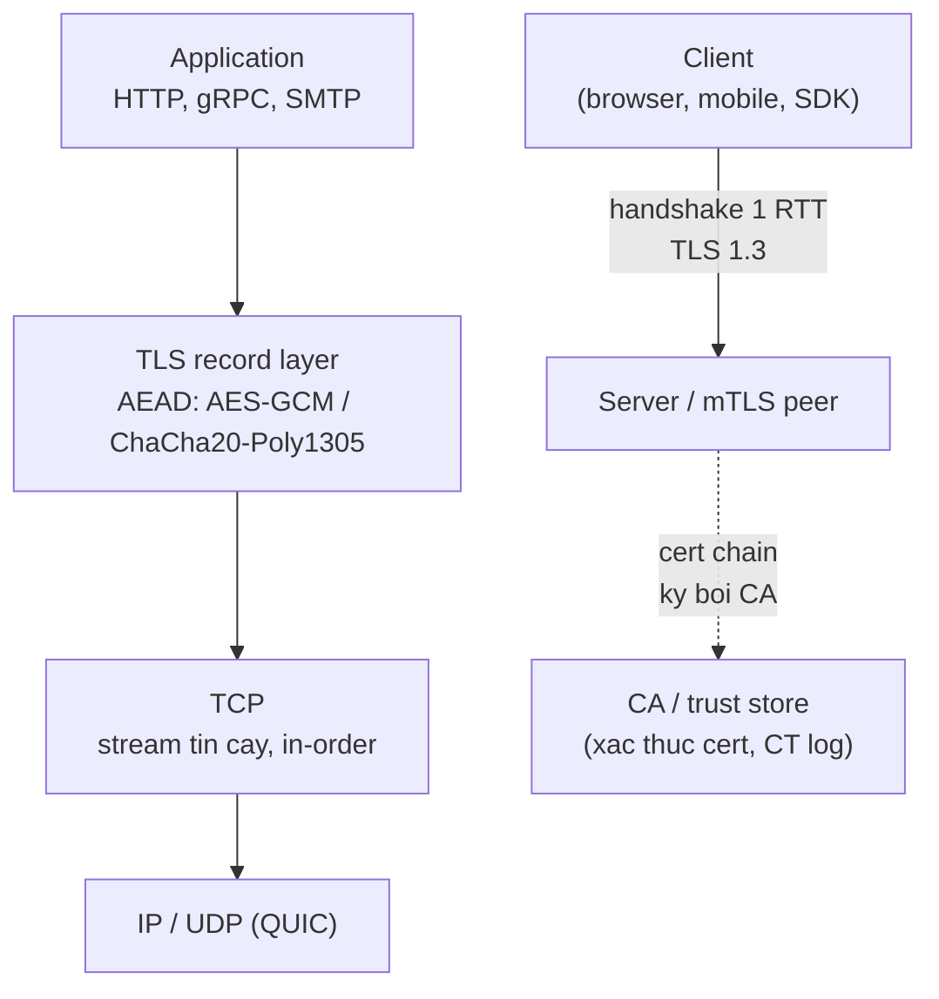
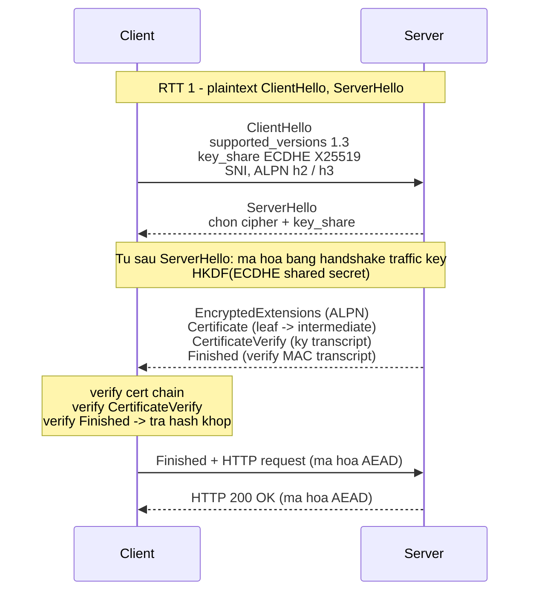
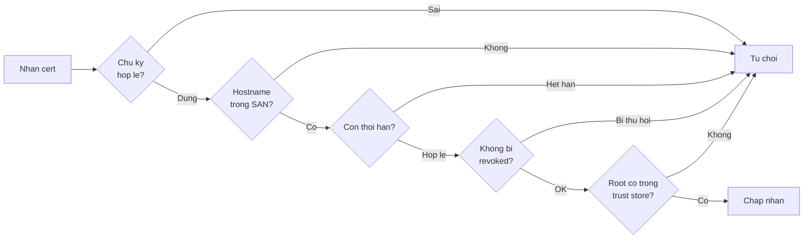

# How does TLS/SSL work?

> TLS cung cấp confidentiality, integrity và server authentication trên TCP. Bài đi sâu vào handshake TLS 1.3 (1 RTT, ECDHE, key schedule HKDF), record layer AEAD, chain of trust X.509, session resumption và 0-RTT, kèm cách debug "SSL handshake failed" và chiến lược termination ở load balancer.

Chủ đề: Networking · Ngày: 2026-10-15

## 1. Là gì

### Định nghĩa

TLS (Transport Layer Security, RFC 8446 cho 1.3) là giao thức tầng 4-5 chạy trên TCP (hoặc UDP qua QUIC) ở cổng 443, cung cấp ba thứ: confidentiality (mã hóa AEAD), integrity (authentication tag) và authentication (chuỗi cert X.509 do CA ký). "SSL" ngày nay chỉ là tên quen gọi: SSL 2.0/3.0 đã deprecated, TLS 1.0/1.1 cũng deprecated; thực tế còn dùng là TLS 1.2 và 1.3.

Ba mục tiêu theo thứ tự: (1) confidentiality nhờ AEAD (AES-GCM, ChaCha20-Poly1305); (2) integrity nhờ authentication tag 128 bit; (3) authentication nhờ chuỗi cert X.509 chain về root trong trust store. Server authentication là mặc định; client authentication (mTLS) tùy chọn.

TLS nằm giữa TCP và Application. QUIC (RFC 9000) tích hợp TLS 1.3 vào chính nó (HTTP/3 chạy trên QUIC). Forward secrecy là mặc định ở TLS 1.3 nhờ ECDHE ephemeral.

Giả định: trọng tâm TLS 1.3, so sánh với TLS 1.2 khi hành vi khác. Bài không đi sâu SSL 2.0/3.0, renegotiation, hoặc post-quantum. Xem bài [HTTP vs HTTPS](http-vs-https.md) cho ảnh tổng quan HTTP/TLS; bài này tách riêng phần crypto và trust.

### Vị trí trong hệ thống



*TLS nằm giữa Application và TCP. Cert chain do CA ký, trust do trust store quyết định.*

### Trả lời 30 giây

"TLS là giao thức trên TCP (cổng 443) cung cấp confidentiality, integrity và authentication. TLS 1.3 hoàn tất handshake trong 1 RTT: client gửi key share ECDHE (X25519) trong ClientHello, server trả Certificate + CertificateVerify + Finished, từ đây mọi thứ đã mã hóa bằng session key dẫn xuất từ ECDHE shared secret qua HKDF. Public-key chỉ dùng cho handshake; dữ liệu dùng symmetric AEAD vì nhanh hơn public-key cỡ 1000 lần. Server xác thực qua chuỗi cert X.509 chain về root; forward secrecy đạt nhờ ECDHE."

## 2. Cơ chế cốt lõi

### Bước 1. ClientHello (client -> server, plaintext)

Client mở TCP tới cổng 443 qua [TCP 3-way handshake](tcp-three-way-handshake.md) (1 RTT), rồi gửi ClientHello mang:

- `supported_versions`: chỉ `TLS 1.3` (TLS 1.2 dùng `record_version 0x0303`).
- `key_share`: client đã sinh sẵn cặp ECDHE ephemeral (X25519 hoặc P-256) và gửi public key trong extension. Đây là khác biệt lớn so với TLS 1.2.
- `supported_groups`: X25519, P-256, P-384.
- `cipher_suites`: danh sách 5 bộ AEAD của TLS 1.3, ví dụ `TLS_AES_256_GCM_SHA384`, `TLS_CHACHA20_POLY1305_SHA256`.
- `signature_algorithms`: chỉ chấp nhận RSA-PSS, ECDSA, Ed25519 (TLS 1.2 cho phép nhiều loại yếu hơn).
- Extension: `SNI` (tên miền, plaintext trong ClientHello, ECH mới mã hóa được), `ALPN` (`h2`, `http/1.1`, `h3`), `compress_certificate`, `psk_key_exchange_modes` (cho 0-RTT).

### Bước 2. ServerHello + phần mã hóa (server -> client, mixed)

Server chọn một cipher, một key share ECDHE, gửi ServerHello. Từ đây cả hai bên có đủ dữ liệu để derive `handshake traffic key` qua HKDF. Mọi message server gửi tiếp theo đều đã được mã hóa:

- **EncryptedExtensions**: ALPN đã chọn (`h2`), SNI đã xác nhận.
- **Certificate**: chuỗi cert X.509 (leaf -> intermediate -> root nếu server tự gửi root).
- **CertificateVerify**: server ký lên toàn bộ handshake transcript (từ ClientHello đến đây) bằng private key tương ứng public key trong leaf cert. Mục đích: chứng minh server giữ private key, đồng thời chống MITM (kẻ chặn không có private key để ký).
- **Finished**: HMAC (transcript hash) dùng traffic key. Client xác minh.



*Sơ đồ TLS 1.3 handshake: 1 RTT trước khi có HTTP data. ClientHello và ServerHello là plaintext để đồng bộ; mọi thứ từ EncryptedExtensions đã mã hóa bằng handshake_traffic_key dẫn xuất từ ECDHE qua HKDF.*

### Bước 3. Client verify cert chain



*Verify cert chain theo 5 bước. Sai bất kỳ bước nào -> client gửi alert tương ứng và đóng connection.*

Leaf cert chứa public key server, subject, `notBefore/notAfter`, và `Subject Alternative Name` (SAN) chứa domain. Chain từ leaf lên intermediate lên root: client verify chữ ký từng bậc (mỗi cert được ký bằng private key của cert cấp trên), kiểm hostname client đang kết nối có trong SAN không, kiểm now nằm trong khoảng `notBefore` -> `notAfter`, kiểm OCSP stapling (server đính kèm OCSP response trong handshake) hoặc CRL, kiểm root có trong trust store của OS/browser. Certificate Transparency (CT, RFC 9162) yêu cầu mỗi cert phải được log vào ít nhất hai CT log (Chrome bắt buộc), trả SCT đính trong cert extension hoặc TLS handshake; mục đích CA không âm thầm cấp cert cho domain.

Sau khi verify xong, client gửi Finished. Derive `application_traffic_key` từ HKDF rồi chuyển sang record layer.

### Bước 4. Record layer — AEAD

Mọi byte sau handshake được đóng gói thành TLS record. Mỗi record gồm header 5 byte (`type | version | length`) rồi ciphertext + nonce + authentication tag 16 byte. Cipher của TLS 1.3 là AEAD: vừa mã hóa (confidentiality), vừa xác thực toàn vẹn (integrity).

- **AES-128-GCM**: key 128 bit, nonce 96 bit, tag 128 bit. AES-NI trên CPU x86_64 đẩy throughput lên ~5-10 GB/s trên một lõi. Lưu ý: GCM gặp nonce reuse là lộ khóa; implementation phải đảm bảo nonce độc nhất trong vòng đời session.
- **ChaCha20-Poly1305**: stream cipher ChaCha20 cho keystream + Poly1305 cho MAC, key 256 bit. Phù hợp CPU không có AES-NI (mobile ARM cũ, embedded).

Vì sao symmetric chứ không phải public-key cho dữ liệu? Public-key (RSA 4096, ECDSA P-256) chậm hơn symmetric cỡ 1000-10000 lần; ECDHE đắt hơn AES-GCM ~1000-10000 lần theo operation. GCM throughput trên một lõi hiện đại ~vài GB/s, đủ cho 100 Gbps NIC cần ~10 lõi; ECDHE P-256 ~50.000-100.000 handshake/s, ECDHE X25519 ~100.000-150.000 handshake/s trên một lõi (ước lượng, phụ thuộc CPU).

### Bước 5. Key schedule (HKDF)

`HKDF` (RFC 5869) là hai bước: Extract và Expand. TLS 1.3 dùng nó để dẫn xuất nhiều key từ một secret:

- `ECDHE shared secret` (32 byte từ X25519) -> HKDF-Extract với salt = `0` -> `Early Secret`.
- `Early Secret` -> HKDF-Expand -> `binder_key`, `client_early_traffic_secret`, ...
- `Derive Secret` từ `Derived` và `shared secret` -> `Handshake Secret`.
- `Handshake Secret` -> HKDF-Expand -> `client_handshake_traffic_secret`, `server_handshake_traffic_secret`, `client_handshake_key`, `server_handshake_key`, ...
- `Derived` từ `Handshake Secret` -> `Master Secret`.
- `Master Secret` -> HKDF-Expand -> `client_application_traffic_secret`, `server_application_traffic_secret`, ...

Hai bên dẫn xuất độc lập nhưng ra cùng key set vì cùng transcript và cùng shared secret. Mỗi key dùng đúng một mục đích (mã hóa client->server khác server->client). Không có cách nào lấy application key mà không có shared secret.

### Bước 6. Session resumption và 0-RTT

Khi client kết nối lại, server cấp `session_ticket` (mã hóa bằng key server giữ). Client lưu PSK (Pre-Shared Key) tương ứng. Lần sau, client dùng PSK để derive `client_early_traffic_secret` và gửi data ngay trong ClientHello: **0-RTT**, tiết kiệm 1 RTT.

Hạn chế 0-RTT: server không đảm bảo data chỉ xử lý một lần vì attacker có thể capture rồi replay (RFC 8446 §8). Vì vậy 0-RTT chỉ dùng cho request idempotent (GET, HEAD) hoặc phải có server-side replay defense. Data 0-RTT không có forward secrecy vì dùng PSK từ session cũ.

### Quan sát

```bash
# Xem cipher, protocol, cert, verify return code
openssl s_client -connect host:443 -servername host </dev/null

# Bat buoc TLS 1.3
openssl s_client -connect host:443 -servername host -tls1_3 </dev/null

# Xem chain day du (leaf + intermediate)
openssl s_client -connect host:443 -servername host -showcerts </dev/null

# Kiem tra OCSP stapling
openssl s_client -connect host:443 -servername host -status </dev/null

# Doc cert sau khi lay tu s_client
openssl x509 -noout -subject -issuer -dates -ext subjectAltName
```

(output minh họa, chưa chạy). Các cờ `-servername`, `-showcerts`, `-status`, `-tls1_3` là tùy chọn ổn định của `openssl s_client` (theo `man openssl-s_client`).

### Ví dụ chạy từng bước

Kịch bản: mobile app gọi `POST /login` tới `api.bank.example` qua TLS 1.3, RTT client-edge đo 50 ms. Trước đó client chưa từng kết nối tới host này (cache lạnh).

**Bước 1 (t+50 ms, plaintext).** TCP 3-way đã xong (1 RTT). Client gửi `ClientHello` kèm `supported_versions: TLS 1.3` và `key_share` X25519 32 byte (client sinh sẵn khi mở socket). Cùng đi SNI `api.bank.example`, ALPN `h2`, `psk_key_exchange_modes: psk_dhe_ke` cho lần sau. Vì sao gửi key share ngay: client không muốn đợi server chọn group như TLS 1.2.

| Trường ClientHello | Giá trị | Vì sao |
|---|---|---|
| `supported_versions` | `TLS 1.3` | Server chọn phiên bản |
| `key_share` | X25519 pub 32 byte | ECDHE ephemeral, 1 RTT |
| `cipher_suites` | `TLS_AES_128_GCM_SHA256` | AEAD, có AES-NI |
| `psk_key_exchange_modes` | `psk_dhe_ke` | Dành cho 0-RTT lần sau |

**Bước 2 (t+100 ms, encrypted).** Server trả `ServerHello` chọn cùng suite + key share X25519. Hai bên tính `shared_secret = X25519(k_c, K_s)` 32 byte, HKDF-Extract -> `Early Secret` -> `Handshake Secret` -> 4 handshake traffic key. Server gửi 4 message mã hóa trong cùng 1 flight: `EncryptedExtensions` (ALPN `h2`), `Certificate` (leaf + intermediate), `CertificateVerify` (~256 byte ECDSA lên transcript), `Finished` (HMAC-SHA256 32 byte). Wire size ~3-4 KB. Gộp 4 message vì TLS 1.3 chỉ cho 1 RTT sau ClientHello.

**Bước 3 (t+150 ms).** Client verify chain: intermediate ký leaf, hostname có trong SAN, validity còn, OCSP stapled `OK`, root trong trust store. Pass. Derive `Master Secret` -> 4 application traffic key. Client gửi `Finished` + `POST /login` trong cùng flight.

| Trạng thái sau bước 3 | Client | Server |
|---|---|---|
| Shared secret | Có (X25519 32B) | Có |
| handshake traffic key | xoá | xoá tương tự |
| application traffic key | 2 key | 2 key |
| RTT đã tốn | 2 (TCP + TLS) | 2 |

**Bước 4 (t+200 ms).** Server trả `200 OK` mã hóa AEAD. Tổng tới byte đầu: 3 RTT = 150 ms, cộng server ~50 ms → 200 ms (đã tính lại bằng script `3*50+50=200`). Vì sao TLS chỉ 1 RTT: client gửi key share sớm + server gộp 4 message, không đợi `ServerHelloDone` như TLS 1.2.

**Biến thể "nếu lỗi".** Nếu cert chain thiếu intermediate, client fail ở bước 3 với alert `bad_certificate`, đóng TCP. Fix phía server: trỏ `ssl_certificate` tới `fullchain.pem`. Attacker replay ClientHello cũ ở lần sau, server vẫn phải chạy handshake mới vì không có PSK — đây chính là lý do 0-RTT chỉ dùng cho endpoint idempotent.

Điều rút ra: TLS 1.3 đạt 1 RTT nhờ hai quyết định thiết kế cộng lại — client gửi key share trong ClientHello và server gộp 4 message vào một flight — kèm HKDF dẫn xuất 8 traffic key từ một shared secret 32 byte. Nối với câu hỏi [câu 1 trong phần 3A](tls-ssl-how-it-works.md#câu-1): nếu giữ flow TLS 1.2 (chờ ClientKeyExchange), handshake trở lại 2 RTT.

## 3. Câu hỏi phỏng vấn

### 3A. Câu hỏi đào sâu

<details class="qa">
<summary>Câu 1. TLS và SSL khác nhau thế nào? TLS 1.3 cải thiện gì so với TLS 1.2?</summary>

**Trả lời ngắn:** "SSL" là tên cũ, SSL 2.0/3.0 đã bị deprecate. TLS 1.3 cải thiện: handshake 1 RTT (so với 2 RTT), chỉ AEAD cipher, mặc định forward secrecy, bỏ RSA key exchange.

**Đào sâu:**
- TLS 1.3 handshake: client gửi key_share trong ClientHello -> server chọn cipher + key_share -> cả hai bên derive handshake_traffic_key -> server gửi EncryptedExtensions + Certificate + CertificateVerify + Finished (tất cả đã mã hóa). TLS 1.2: thêm ClientKeyExchange -> 2 RTT.
- TLS 1.3 chỉ 5 bộ AEAD; TLS 1.2 cho phép CBC, RC4, MD5, SHA-1.
- TLS 1.3 bỏ hoàn toàn RSA key exchange (static, không FS) và renegotiation (CVE-2009-3555).

**Bẫy:** Nói "SSL/TLS giống nhau" rồi dừng. TLS 1.3 có handshake cấu trúc khác hẳn.

**Follow-up:** QUIC có TLS riêng không? QUIC tích hợp TLS 1.3 vào handshake của nó; không có TLS record layer riêng.
</details>

<details class="qa">
<summary>Câu 2. ECDHE hoạt động thế nào, và vì sao nó quan trọng với forward secrecy?</summary>

**Trả lời ngắn:** ECDHE dùng elliptic curve: mỗi bên sinh cặp khóa tạm thời (ephemeral), gửi public key, cùng tính shared secret bằng ECDH. Khóa tạm bị xóa sau session. Vì vậy lộ khóa dài hạn (trong cert) sau này cũng không tính lại được session key cũ.

**Đào sâu:**
- ECDHE key exchange: client gửi `client_ephemeral_public` (X25519: x-coordinate của kG), server gửi `server_ephemeral_public`. Shared secret = x-coordinate của (k_client × K_server). ECDH giả được coi khó (~2^128 operations cho cả P-256 và X25519).
- Không có forward secrecy nếu dùng RSA key exchange (TLS 1.2 với `RSA_*` cipher): server mã hóa premaster secret bằng private key RSA. Lộ private key RSA -> giải mã toàn bộ traffic đã ghi.
- TLS 1.3 bỏ hoàn toàn RSA key exchange. Mọi key exchange đều ECDHE.
- Curve: X25519 phổ biến, an toàn về implementation. P-256 được hỗ trợ rộng rãi nhưng có lịch sử timing leak.

**Bẫy:** Nghĩ "DH" là key exchange kiểu RSA. Không: DH/ECDHE là cả hai bên đóng góp vào shared secret, không ai giữ master secret ở một phía.

**Follow-up:** Diffie-Hellman (DHE) không dùng elliptic curve thì sao? DHE (mod prime) chậm hơn ECDHE 10-100 lần với cùng độ an toàn. Key size nhỏ hơn (32 byte vs 256 byte cho DHE-2048).
</details>

<details class="qa">
<summary>Câu 3. Cert chain verify hoạt động thế nào? Tại sao browser vẫn báo lỗi dù cert leaf đúng?</summary>

**Trả lời ngắn:** Client verify từng bậc: intermediate ký leaf, root ký intermediate. Mỗi bước: verify chữ ký + kiểm hostname SAN + validity + OCSP. Browser báo lỗi khi thiếu intermediate, root không có trong trust store, hoặc hostname mismatch.

**Đào sâu:**
- Leaf cert do CA phát hành, ký bằng intermediate CA. Intermediate CA được ký bằng root CA. Client có root CA trong trust store.
- CertificateVerify: server ký lên toàn bộ handshake transcript bằng private key leaf, chứng minh server giữ private key.
- Lỗi thường gặp nhất: server không gửi intermediate. Fix: trỏ `ssl_certificate` đến `fullchain.pem`.
- OCSP stapling: server đính kèm OCSP response trong handshake. OCSP responder sập -> soft fail.
- SAN hostname check: `a.example.com` không khớp cert chỉ có `b.example.com`. Wildcard `*.example.com` không khớp `example.com`.

**Bẫy:** Nghĩ cert leaf đúng là đủ. Intermediate phải được verify, root phải có trong trust store.

**Follow-up:** Self-signed cert nội bộ thì sao? Phải cài vào trust store hoặc dùng certificate pinning.
</details>

<details class="qa">
<summary>Câu 4. HKDF dẫn xuất key từ ECDHE shared secret như thế nào? TLS 1.3 dùng bao nhiêu key?</summary>

**Trả lời ngắn:** HKDF gồm Extract (chia sẻ entropy) và Expand (tạo nhiều byte ngẫu nhiên). TLS 1.3 dẫn xuất 6 loại key từ ECDHE shared secret: handshake keys (client/server), application keys (client/server), và traffic secrets. Mỗi hướng có key riêng.

**Đào sâu:**
- HKDF-Extract: shared secret (32 byte X25519) + salt (0) -> pseudorandom key 32 byte.
- HKDF-Expand: PRK + context + length -> byte stream. Dùng `HKDF-Expand-Label` (TLS wrapper) tránh label collision.
- TLS 1.3 dẫn xuất qua nhiều "Secret" level: Early Secret (PSK/0-RTT), Handshake Secret, Master Secret. Mỗi level expand thành traffic key + IV cho mỗi hướng.
- Application traffic key: mã hóa record sau handshake. IV cho AEAD: implicit part từ traffic secret, explicit part từ record sequence number.
- Key separation: mỗi key chỉ dùng cho một mục đích.

**Bẫy:** Nói "master secret" là khóa chính dùng để mã hóa data. Không: master secret là intermediate step, application data dùng `application_traffic_secret`.

**Follow-up:** TLS 1.2 dùng PRF khác gì HKDF? TLS 1.2 dùng PRF dựa trên HMAC-MD5/SHA-256. TLS 1.3 dùng HKDF đơn giản và an toàn hơn.
</details>

<details class="qa">
<summary>Câu 5 (Debug). Triệu chứng: "SSL handshake failed", "certificate verify failed", "works in browser but not in curl or Java". Theo thứ tự nào bạn kiểm tra?</summary>

**Trả lời ngắn:** 1) `openssl s_client` xác nhận protocol, cipher, chain, verify return code. 2) `curl -v` xem TLS version. 3) Kiểm theo nguyên nhân: thiếu intermediate, SNI sai, đồng hồ lệch, cert hết hạn, trust store khác.

**Đào sâu:**
- `openssl s_client -connect host:443 -servername host </dev/null`. Đọc `Verify return code: 0` (OK) hoặc số khác. Lỗi 20 (`unable to get local issuer certificate`): thiếu intermediate -> dùng `fullchain.pem`. Lỗi 7 (`certificate signature failure`): chữ ký không hợp lệ.
- `curl -v https://host/`. Nếu browser OK mà curl fail -> curl thiếu intermediate CA trong bundle.
- Nguyên nhân cụ thể:
  - SNI: `-servername` phải khớp hostname.
  - Đồng hồ lệch: `date` trên client. Cert validity fail nếu client >30 giây lệch.
  - Cert hết hạn: `openssl x509 -noout -dates`.
  - Trust store: Java dùng `cacerts` keystore, khác OS trust store.

**Bẫy:** Restart server trước khi kiểm cert chain. Error 502 có thể che lỗi TLS.

**Follow-up:** Java 11+ dùng trust store ở đâu? Mặc định `$JAVA_HOME/conf/security/jssecacerts`, fallback `$JAVA_HOME/lib/security/cacerts`.
</details>

<details class="qa">
<summary>Câu 6. Session resumption (PSK/session ticket) tiết kiệm gì? 0-RTT khác resumption ở điểm nào?</summary>

**Trả lời ngắn:** Session resumption: client dùng PSK skip handshake, tiết kiệm 1 RTT. 0-RTT: client gửi data ngay trong ClientHello bằng PSK, tiết kiệm thêm cả RTT request đầu tiên. Nhưng 0-RTT có rủi ro replay.

**Đào sâu:**
- Session ticket (RFC 5077): server mã hóa session state bằng `session_ticket_key`, gửi cho client. Client gửi lại trong `ClientHello`. Server khôi phục state -> dẫn xuất lại application key. Tiết kiệm 1 RTT.
- 0-RTT (RFC 8446 §2.3): client dùng PSK để derive `client_early_traffic_secret`, mã hóa HTTP request rồi gửi ngay trong ClientHello. Server xử lý ngay.
- Replay attack: attacker capture ClientHello + 0-RTT data rồi replay. RFC 8446 §8 yêu cầu server không tăng non-idempotent action.
- 0-RTT không có forward secrecy: data mã hóa bằng PSK từ session cũ.

**Bẫy:** Bật 0-RTT cho POST/PUT thanh toán. Không: rủi ro replay -> double charge.

**Follow-up:** PSK có thể dùng mà không có certificate không? Có. PSK-only mode (RFC 8446 §2.2) dùng pre-shared key. Phổ biến cho IoT.
</details>

<details class="qa">
<summary>Câu 7 (Design). Thiết kế TLS termination tại load balancer: khi nào nên end-to-end, khi nào terminate, và cách xoay certificate tự động?</summary>

**Trả lời ngắn:** Terminate TLS tại LB khi backend không cần encrypted payload và cần giảm CPU. End-to-end khi backend cần verify client (mTLS), payload nhạy cảm trong DC, hoặc compliance yêu cầu. Cert tự động xoay bằng ACME + cert-manager, webhook reload LB khi cert mới.

**Đào sâu:**
- **TLS termination tại LB:** client -> LB (TLS 1.3, decrypt) -> backend (HTTP plaintext). Ưu: một chỗ quản lý cert, backend không tốn CPU. Nhược: backend nhận plaintext, sniff trong DC khả thi.
- **End-to-end:** client -> LB (passthrough TCP) -> backend (TLS). Ưu: payload bảo vệ toàn bộ. Nhược: mỗi backend cần cert.
- **mTLS service-to-service:** SPIFFE/SPIRE cấp workload identity, cert ngắn hạn tự động rotate.
- **Cert xoay tự động:** ACME (Let's Encrypt) + cert-manager (Kubernetes) + webhook reload LB. Xoay 60-90 ngày. Rate limit Let's Encrypt: 50 cert/tài khoản/ngày.
- **Điểm nghẽn:** reload LB đồng thời nhiều backend -> brief downtime. Fix: rolling reload.

**Bẫy:** Termination giữ nguyên client IP gốc. Không: LB thấy IP của LB. Dùng `X-Forwarded-For` hoặc PROXY protocol v2.

**Follow-up:** Backend cần client IP gốc cho geo/rate limit thì sao? PROXY protocol v2 an toàn hơn `X-Forwarded-For` vì không thể spoof.
</details>

<details class="qa">
<summary>Câu 8. Certificate Transparency (CT) là gì, giải quyết vấn đề gì, và client kiểm tra như thế nào?</summary>

**Trả lời ngắn:** CT là hệ thống log công khai mọi cert được CA cấp. Mỗi cert phải được log vào ít nhất 2 CT log trước khi browser chấp nhận. Mục đích: ngăn CA cấp cert âm thầm cho domain mà chủ sở hữu không biết.

**Đào sâu:**
- CT log lưu cert dưới dạng Merkle tree, append-only. Mỗi entry có SCT (Signed Certificate Timestamp) chứng minh cert đã được log.
- SCT đính kèm bằng: trong X.509 extension, trong TLS extension `signed_certificate_timestamp`, hoặc trong `OCSP SignedCertificateTimestampList`.
- Browser kiểm tra: SCT có trong handshake không? Log có trong danh sách chấp nhận không? Không có -> reject.
- Nếu CA cấp cert mà không log: browser reject. CT không giải quyết CA bị compromise hoàn toàn.

**Bẫy:** Nghĩ CT thay thế PKI. Không: CT chỉ giám sát, không thay đổi chain of trust.

**Follow-up:** Tại sao Chrome bắt buộc 2 CT log mà không chỉ 1? Một log có thể không đáng tin. Hai log giảm xác suất bị chấp nhận cert âm thầm.
</details>

<details class="qa">
<summary>Câu 9. TLS 1.2 vs 1.3: khi nào vẫn cần TLS 1.2? AEAD khác gì CBC + HMAC truyền thống?</summary>

**Trả lời ngắn:** TLS 1.2 vẫn cần cho client/server cũ (IE 11, Java 7, embedded). AEAD khác CBC + HMAC: AEAD là một primitive đồng thời mã hóa và xác thực, an toàn hơn CBC (padding oracle).

**Đào sâu:**
- TLS 1.2 vẫn cần: TLS 1.3 chỉ được ~95% browser hỗ trợ. Một số IoT, legacy Java, Windows 7 cần TLS 1.2.
- AEAD vs CBC + HMAC:
  - CBC: block cipher, cần padding. Padding oracle (POODLE, Lucky13) khai thác lỗi padding.
  - AEAD: đồng thời mã hóa và tạo tag. Không padding -> không padding oracle.
  - AES-GCM: GHASH + AES CTR. Nonce reuse là thảm họa.

**Bẫy:** Nghĩ AEAD chỉ là "CBC tốt hơn". Không: AEAD là cấu trúc toán học khác.

**Follow-up:** TLS 1.2 có thể dùng AEAD không? Có, `TLS_ECDHE_RSA_WITH_AES_128_GCM_SHA256` dùng AEAD. Nhưng handshake vẫn 2 RTT.
</details>

### 3B. Câu hỏi phỏng vấn liên quan

<details class="qa">
<summary>Câu 10. What is SNI and why does it exist?</summary>

**Trả lời:** SNI (Server Name Indication) là extension trong ClientHello cho server biết hostname client muốn kết nối. Nhờ đó một IP và một cổng 443 phục vụ nhiều domain, server chọn đúng certificate trước khi handshake tiếp tục. Không có SNI, server chỉ trả được một certificate mặc định. Vì ClientHello gửi plaintext, hostname lộ cho người quan sát trên đường đi, trừ khi dùng Encrypted Client Hello (ECH), mà hỗ trợ còn phụ thuộc client và server.
</details>

<details class="qa">
<summary>Câu 11. What is ALPN?</summary>

**Trả lời:** ALPN (Application-Layer Protocol Negotiation) là extension để client và server thỏa thuận giao thức tầng ứng dụng ngay trong handshake TLS, ví dụ `h2` hoặc `http/1.1`. Nhờ vậy không tốn thêm RTT để nâng cấp lên HTTP/2. HTTP/3 chạy trên QUIC cũng dùng ALPN (`h3`).
</details>

<details class="qa">
<summary>Câu 12. What is mutual TLS (mTLS) and where is it used?</summary>

**Trả lời:** Trong TLS thường chỉ server xuất trình certificate. Với mTLS, server gửi thêm CertificateRequest và client cũng xuất trình certificate để chứng minh danh tính. Dùng nhiều cho giao tiếp service-to-service (service mesh), API nội bộ và thiết bị IoT. Đổi lại phải vận hành PKI cho client: cấp phát, xoay vòng và thu hồi certificate.
</details>

<details class="qa">
<summary>Câu 13. What does HSTS do, and what does it not protect?</summary>

**Trả lời:** Header `Strict-Transport-Security` bảo trình duyệt chỉ truy cập domain qua HTTPS trong khoảng `max-age`, và tự nâng mọi request `http://` lên `https://` ở phía client. Nhờ đó chặn SSL stripping từ lần truy cập thứ hai. Lần truy cập đầu tiên vẫn có thể bị tấn công, trừ khi domain nằm trong danh sách HSTS preload của trình duyệt.
</details>

<details class="qa">
<summary>Câu 14. What is certificate revocation, and why is it hard to make work?</summary>

**Trả lời:** Khi private key bị lộ, CA có thể thu hồi certificate. Client kiểm tra qua CRL (danh sách tải về) hoặc OCSP (hỏi từng certificate). Cả hai đều có vấn đề: CRL lớn, OCSP tốn thêm kết nối và lộ domain bạn truy cập cho CA, và nhiều client "soft-fail" (coi như hợp lệ khi không kiểm tra được). OCSP stapling để server đính kèm kết quả OCSP vào handshake giúp giảm vấn đề; hỗ trợ và cách xử lý lỗi khác nhau giữa các client.
</details>

<details class="qa">
<summary>Câu 15. What does the TLS handshake cost in round trips on a fresh HTTPS connection?</summary>

**Trả lời:** Trên TCP, kết nối mới cần 1 RTT cho TCP handshake rồi thêm 1 RTT cho TLS 1.3 (2 RTT với TLS 1.2), trước khi gửi được request. Resumption và 0-RTT giảm được RTT của TLS cho kết nối lặp lại, nhưng dữ liệu 0-RTT có thể bị replay nên chỉ dùng cho request idempotent. Xem thêm [TCP three-way handshake](tcp-three-way-handshake.md).
</details>

<details class="qa">
<summary>Câu 16. True or false: "HTTPS means the website is safe and trustworthy."</summary>

**Trả lời:** Sai. HTTPS chỉ đảm bảo kênh truyền giữa trình duyệt và server được mã hóa, toàn vẹn, và server sở hữu domain trong certificate. Nó không nói gì về việc nội dung có độc hại hay không. Trang phishing vẫn có thể có certificate hợp lệ cho domain của chính nó.
</details>

## 4. Đánh đổi và sự cố production

### So sánh TLS termination và TLS end-to-end

| Tiêu chí | TLS termination tai LB | TLS end-to-end | TLS passthrough (L4) |
|---|---|---|---|
| Độ trễ request đầu tiên | 3 RTT (TCP + TLS 1.3 + HTTP) | 4 RTT (mỗi đoạn) | 3 RTT |
| Payload bảo vệ trong DC | Không (HTTP plaintext sau LB) | Có | Có |
| LB thấy HTTP header | Có | Không | Không |
| Cert management | Một chỗ (LB) | Mỗi backend cần cert | LB đơn giản |
| mTLS service-to-service | Cần thêm | Có thể | Cần thêm |
| Độ phức tạp vận hành | Thấp | Cao | Trung bình |

### So sánh session resumption vs 0-RTT

| Tiêu chí | Session resumption (1-RTT) | 0-RTT |
|---|---|---|
| RTT cho request đầu | 1 RTT | 0 RTT |
| Forward secrecy | Có | Không |
| Replay protection | Có (server state) | Không |
| Dùng cho | Mọi request | Chỉ idempotent (GET, HEAD) |
| Server state | Có (session ticket) | Có (PSK identity) |

### 5 failure mode phổ biến

| Triệu chứng | Nguyên nhân gốc | Cách kiểm tra | Cách sửa |
|---|---|---|---|
| `unable to get local issuer certificate` | Server không gửi intermediate chain | `openssl s_client -showcerts host:443` | Dùng `fullchain.pem` thay vì `cert.pem` |
| `certificate has expired` | Cert hết hạn | `openssl x509 -noout -dates < cert.pem` | Renew qua ACME, reload server |
| SNI mismatch hoặc 525 SSL handshake failed | Cloudflare/WAF: SNI không khớp cert | `openssl s_client -connect host:443 -servername host` | Kiểm SNI trong host header |
| Clock skew | Client đồng hồ lệch > leeway | `date` trên client so với NTP server | Sync đồng hồ NTP |
| `ERR_SSL_VERSION_OR_CIPHER_MISMATCH` | TLS 1.3 không được bật ở server | `testssl.sh host:443` | Bật TLS 1.3, kiểm cipher suite |

### Chiến lược TLS termination

**Terminate tại load balancer (phổ biến nhất):** Client -> TLS 1.3 với LB -> LB decrypt -> HTTP plaintext -> Backend. Phù hợp: web app thông thường, CDN, microservices cùng DC. Nhược: plaintext trong DC.

**End-to-end với mTLS:** Client -> TLS 1.3 với LB -> TLS 1.3 với Backend. Backend verify client cert. Phù hợp: multi-tenant DC, compliance (PCI-DSS), B2B API enterprise. Nhược: mỗi backend cần cert, SPIFFE/SPIRE complexity.

**Cert tự động xoay:** ACME (Let's Encrypt) + cert-manager (Kubernetes) + webhook reload LB. Xoay 60-90 ngày. Alert trước 30/14/7/1 ngày. Rate limit Let's Encrypt: 50 cert/tài khoản/ngày. ACME DNS-01 challenge phù hợp cho wildcard cert; ACME http-01 cần port 80 mở từ internet. Khi xoay cert có chain mới, cần verify LB/Envoy/nginx reload config (không phải restart) để không drop connection: `nginx -s reload` gửi SIGHUP, Envoy reload qua xDS.

**Proxy protocol và X-Forwarded-For:** TLS termination làm mất IP gốc client vì LB là điểm cuối TCP. Hai cách khôi phục: HTTP header `X-Forwarded-For` (dễ spoof, cần trust proxy list) hoặc PROXY protocol v1/v2 (truyền client IP qua TCP option, an toàn hơn). PROXY protocol v2 cần hỗ trợ ở cả LB và backend, ví dụ HAProxy + nginx (`set_real_ip_from` + `real_ip_header proxy_protocol`).

**Key rotation runtime:** LB nhận cert mới qua ACME không tự reload; cần hook. cert-manager webhook gọi `kubectl exec` reload nginx pod, hoặc LB watch file system (certbot --renew-hook). Reload nhiều backend đồng thời cần rolling restart: một pod reload, đợi ổn định, sang pod tiếp theo. Lỗi phổ biến: reload cả cluster cùng lúc gây spike CPU handshake, hoặc reload sai cách dẫn đến cert cũ vẫn được dùng.

## 5. Cheat sheet

Hai mươi dòng dưới là những con số và quy tắc cần nhớ khi trả lời phỏng vấn. Phỏng vấn về TLS thường quay quanh handshake, cipher, cert chain, hoặc lệnh kiểm tra — các dòng này phủ hết.

| Chủ đề | Con số / quy tắc |
|---|---|
| TLS cung cấp | Confidentiality (AEAD), Integrity (authentication tag), Authentication (X.509 chain). |
| SSL vs TLS | SSL deprecated. TLS 1.0/1.1 deprecated. Dùng TLS 1.2 và 1.3. |
| TLS 1.3 handshake | 1 RTT. Client gửi key_share ECDHE trong ClientHello. Server trả Certificate + CertificateVerify + Finished. |
| TLS 1.2 handshake | 2 RTT. RSA/ECDHE key exchange, sau đó ClientKeyExchange. |
| RTT tổng | TCP (1 RTT) + TLS 1.3 (1 RTT) + HTTP (1 RTT) = 3 RTT. |
| Key exchange | ECDHE: X25519 (32B pub key, nhanh) hoặc P-256. RSA key exchange không có forward secrecy. |
| AEAD cipher | AES-128/256-GCM (CPU x86 có AES-NI), ChaCha20-Poly1305 (CPU ARM, IoT). |
| Key schedule | HKDF-Extract -> Early / Handshake / Master Secret -> traffic keys. Key separation: mỗi key một mục đích. |
| Cert chain verify | 5 bước: chữ ký -> SAN hostname -> validity -> OCSP/CRL -> root in trust store. |
| OCSP stapling | Server đính kèm OCSP response trong handshake. Client không gọi CA. |
| Certificate Transparency | Mỗi cert phải log vào >=2 CT log. Chrome bắt buộc >=2 SCT. |
| Forward secrecy | Đạt nhờ ECDHE. Lộ long-term key cũng không giải mã phiên cũ. |
| Session resumption | PSK / session ticket: tiết kiệm 1 RTT. Server giữ state, client gửi PSK identity. |
| 0-RTT | Gửi data trong ClientHello bằng PSK. Tiết kiệm 1 RTT. Rủi ro replay. Chỉ idempotent. |
| Lệnh kiểm tra | `openssl s_client -connect host:443 -servername host` xem cipher, verify return code. |
| Lệnh kiểm chain | `openssl s_client -connect host:443 -servername host -showcerts`. |
| Cert expiry | Alert 30/14/7/1 ngày. `openssl x509 -noout -dates < cert.pem`. |
| mTLS | Client cert + server verify `CertificateVerify`. SPIFFE/SPIRE cho workload identity. |
| Nên dùng | TLS 1.3 + ECDHE + AEAD. HSTS max-age >= 1 năm. OCSP staple. |
| Không nên | TLS 1.0/1.1, CBC, RC4, MD5, SHA-1, static RSA key exchange. |

**Học tiếp:**
- [HTTP vs HTTPS](http-vs-https.md) — tổng quan TLS/HTTPS, HTTP structure
- [TCP vs UDP](tcp-vs-udp.md) — TCP handshake, QUIC, TLS trên UDP
- [Authentication vs Authorization](authn-vs-authz.md) — mTLS, authn máy, authn người dùng

Lưu ý khi trả lời: phỏng vấn TLS thường hỏi handshake flow (1 RTT, ECDHE, AEAD), cert chain, hoặc debug lệnh. Hãy nhớ cipher 5 bộ TLS 1.3 và ECDHE X25519 là mặc định hiện đại. Nếu bị hỏi về RSA key exchange, nhấn mạnh TLS 1.3 đã bỏ vì không có forward secrecy.

