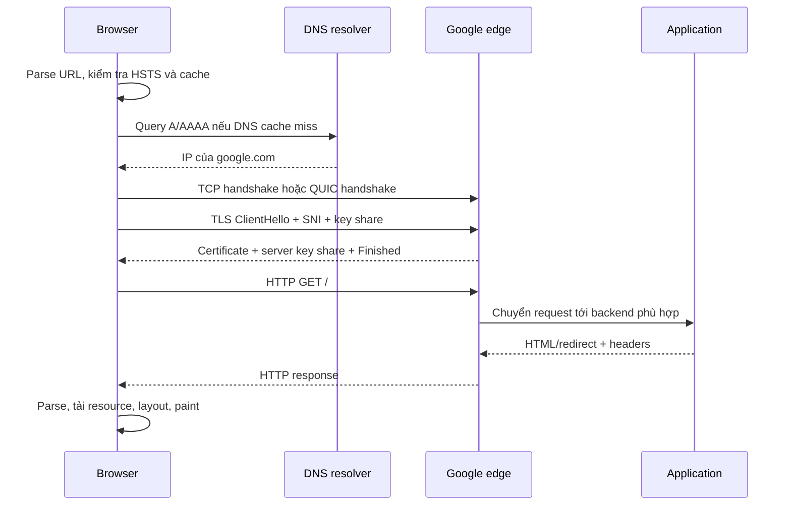

# What happens when you type google.com in a browser?

> Bài này trả lời theo đúng thứ tự thời gian: trình duyệt hiểu địa chỉ, tìm IP, mở kết nối, xác thực HTTPS, gửi HTTP request, nhận dữ liệu và vẽ trang. Mỗi bước có một giải thích ngắn trước khi đi vào từ khóa interview.

Chủ đề: Networking · Ngày: 2026-10-15

## 0. Nền tảng trước khi đọc

**Bối cảnh:** Browser là ứng dụng ở phía client. Google là server ở phía bên kia Internet. Giữa hai bên có DNS, router, TCP hoặc QUIC, TLS và HTTP.

**Nói đơn giản:** Tên `google.com` chỉ dễ nhớ với người. Máy phải đổi tên đó thành IP, mở một kênh liên lạc an toàn, gửi request, nhận HTML rồi biến HTML thành pixel trên màn hình.

**Từ khóa cần biết:** `DNS` = dịch tên miền thành IP; `TLS` = mã hóa và xác thực kết nối; `HTTP` = quy tắc request/response giữa browser và server.

**Ví dụ dễ hình dung:** Với trang đặt hàng, browser cũng làm gần như vậy: tìm IP của API, mở HTTPS, gửi `GET /orders`, nhận JSON rồi hiển thị danh sách đơn.

**Cách học bài này:** Nhớ 8 bước ở phần 1 trước. Khi interviewer chọn một bước để đào sâu, dùng phần 2 và các câu hỏi ở phần 3 để trả lời.

## 1. Là gì

### Đọc nhanh trước khi đi sâu

**Ý chính:** Một lần gõ URL đi qua parse, DNS, kết nối TCP hoặc QUIC, TLS, HTTP, server, trình duyệt và nhiều lớp cache.

**Ví dụ interview:** Browser tra DNS, tìm route, mở connection, tải HTML rồi tiếp tục tải CSS, JavaScript và ảnh.

**Luồng 4 bước:**

1. Browser parse `google.com`, chọn HTTPS và kiểm tra HSTS/cache.
2. DNS đổi tên miền thành IP; OS chọn route và tìm MAC của gateway nếu cần.
3. Browser mở TCP + TLS, hoặc QUIC nếu dùng HTTP/3, rồi gửi HTTP GET.
4. Google trả HTML; browser parse DOM/CSS, tải resource, layout và vẽ pixel.

**Nói như trong interview:** Một lần gõ URL đi qua parse, DNS, kết nối TCP hoặc QUIC, TLS, HTTP, server, trình duyệt và nhiều lớp cache. Hãy nói theo bốn bước trên trước; nếu interviewer hỏi sâu, chuyển sang cơ chế **Luồng thời gian**, rồi nêu trade-off và failure mode ở các phần sau.

## 2. Cơ chế cốt lõi

### Luồng thời gian

*Sơ đồ tuần tự: DNS, kết nối, TLS, HTTP và rendering xảy ra theo chuỗi; các resource phụ có thể tải song song sau khi browser thấy chúng.*

### Bước 1 — Browser hiểu điều người dùng gõ

Browser phải phân biệt đây là URL hay từ khóa tìm kiếm. Với `google.com`, nó tạo host `google.com` và path `/`; scheme thường được nâng lên `https` theo chính sách của browser, HSTS và redirect của site.

HSTS preload là danh sách host mà browser biết trước là chỉ được dùng HTTPS. HSTS giúp tránh request HTTP đầu tiên bị kẻ đứng giữa đổi hướng, nhưng không thay thế việc server cấu hình certificate đúng.

### Bước 2 — DNS đổi tên thành địa chỉ IP

Browser có thể tìm thấy IP trong host cache. Nếu không có, nó gọi resolver của OS; OS kiểm tra cache và file `hosts`, rồi gửi query tới recursive resolver (ISP, công ty hoặc public resolver như `1.1.1.1`).

Nếu recursive resolver cũng cache miss, nó hỏi theo cây DNS: root chỉ tới TLD `.com`, TLD chỉ tới authoritative server của `google.com`, authoritative trả A (IPv4) hoặc AAAA (IPv6). Resolver cache kết quả theo TTL rồi trả IP cho browser.

**Điểm interview:** không phải mọi request đều đi root → TLD → authoritative. Đó là đường khi các cache đều miss; cache hit thường chỉ tốn một lần hỏi resolver hoặc không tốn network round-trip nào.

### Bước 3 — OS chọn đường ra mạng

OS dùng routing table để chọn interface và next hop. Nếu server ở ngoài LAN, frame đầu tiên đi tới default gateway, không đi thẳng tới MAC của Google.

Nếu chưa biết MAC của gateway, IPv4 dùng ARP; IPv6 dùng Neighbor Discovery (NDP). Đây là bước trong mạng nội bộ, khác với DNS: ARP tìm **MAC của next hop**, còn DNS tìm **IP của host**.

### Bước 4 — Mở kênh vận chuyển

Với HTTP/1.1 hoặc HTTP/2, browser mở TCP bằng SYN → SYN-ACK → ACK, tốn một RTT. Với HTTP/3, QUIC chạy trên UDP nhưng tự cung cấp reliability, congestion control và nhiều stream; nó gộp transport handshake với TLS để giảm số RTT.

QUIC không phải lúc nào cũng nhanh hơn. 0-RTT chỉ dùng được khi browser có thông tin phiên trước đó và request an toàn để replay; mạng chặn UDP có thể khiến browser quay về HTTP/2.

### Bước 5 — TLS bảo vệ kết nối

Browser gửi ClientHello, trong đó có phiên bản TLS, cipher suites, SNI (`google.com`), ALPN (`h2` hoặc `h3`) và key share. Server chọn tham số, gửi certificate chain, chữ ký `CertificateVerify` và `Finished`.

Browser kiểm tra hostname, thời hạn và chữ ký certificate tới một Root CA được tin cậy. Hai bên dùng ECDHE để tạo session key; sau handshake, headers, cookie và body HTTP được mã hóa. TLS xác thực server và bảo vệ dữ liệu trên đường truyền, nhưng không tự đăng nhập user.

### Bước 6 — Browser gửi HTTP request

Request thường có method `GET`, path `/`, authority/host, `User-Agent`, `Accept`, `Accept-Encoding` và cookie phù hợp. HTTP/2 và HTTP/3 truyền các trường này trong binary frames/pseudo-headers; không nên nói request line trên dây luôn là text `GET / HTTP/2`.

Browser có thể dùng connection pool, nên request tiếp theo không cần lặp lại TCP và TLS. Redirect `301` sang host khác là một response hợp lệ nhưng có thể buộc browser thực hiện thêm DNS/kết nối/TLS.

### Bước 7 — Edge và backend xử lý request

Request tới edge hoặc reverse proxy của Google. Hạ tầng có thể làm TLS termination, chống abuse, chọn backend, kiểm tra cache và trả response. Tên thành phần cụ thể như GFE, Maglev hay cấu trúc backend là chi tiết implementation; trong interview chỉ nêu khi interviewer hỏi về hạ tầng Google.

Response có status như `200` hoặc `301`, headers như `Content-Type`, `Content-Encoding`, `Cache-Control`, `Strict-Transport-Security`, rồi body HTML. Không nên khẳng định luôn là `200`: behavior `google.com` → `www.google.com` phụ thuộc deployment và thời điểm.

### Bước 8 — Browser biến response thành pixel

Browser nhận byte và parse HTML thành DOM. Preload scanner có thể phát hiện CSS, JavaScript, font và image để tải song song. CSSOM được tạo từ CSS; DOM + CSSOM tạo render tree.

Sau đó browser tính kích thước/vị trí (**layout**), rasterize chữ và hình (**paint**), rồi ghép các layer (**composite**, thường có GPU hỗ trợ). JavaScript không có `async`/`defer` có thể chặn HTML parser; CSS có thể chặn lần render đầu để tránh vẽ trang chưa có style.

### Con số cần nói có điều kiện

| Đoạn | Bậc độ lớn | Điều kiện |
|---|---:|---|
| Browser/OS cache | dưới 1 ms đến vài ms | cache hit trong RAM |
| DNS khi resolver cache miss | khoảng 10–200 ms | phụ thuộc RTT và số cache miss |
| TCP handshake | 1 RTT | connection mới |
| TLS 1.3 | khoảng 1 RTT sau TCP | full handshake, không reuse |
| HTTP response | vài ms đến hàng trăm ms | edge hit hay phải đi origin |
| Render | phụ thuộc HTML/CSS/JS | thiết bị và kích thước trang |

Đây là các bậc độ lớn để giải thích trade-off, không phải SLA cố định của Google. Muốn biết nguyên nhân thật phải đo bằng DevTools waterfall, `curl -w`, browser performance panel hoặc tracing.

### Cách debug khi trang không tải

1. `dig google.com` — kiểm tra DNS có trả A/AAAA hay không.
2. `curl -sS -o /dev/null -w 'dns:%{time_namelookup} connect:%{time_connect} tls:%{time_appconnect} ttfb:%{time_starttransfer} total:%{time_total}\n' https://google.com` — tách thời gian DNS, connect, TLS và byte đầu tiên.
3. DevTools Network — xem redirect, status, TTFB, resource bị block và lỗi certificate; chỉ dùng `tcpdump`/`openssl s_client` khi cần xuống tầng packet/TLS.

## 3. Câu hỏi phỏng vấn

### 3A. Câu hỏi đào sâu

Câu 1. Liệt kê theo thứ tự thời gian các bước từ khi nhấn Enter tới khi thấy pixel trên màn hình. Bước nào chiếm nhiều thời gian nhất?

**Trả lời ngắn:** Parse URL → HSTS preload → DNS (cache browser → OS → resolver → authoritative) → ARP cho gateway → TCP handshake (1 RTT) → TLS 1.3 handshake (1 RTT) → HTTP/2 GET → CDN edge xử lý → response HTML (hoặc 301 redirect rồi lặp lại) → HTML parse + preload scanner → fetch subresource song song → layout → paint. Bước chiếm nhiều thời gian nhất khi cache lạnh là DNS và TCP+TLS, mỗi cái tốn 1–3 RTT (~50–200 ms). Khi cache ấm, DNS gần 0 ms, TCP+TLS session resume ~1 RTT.

**Đào sâu:**
- DNS cache miss: trình duyệt tra browser cache (vài phút), miss → OS `getaddrinfo` (vài phút), miss → resolver (10–50 ms), miss → root → TLD → authoritative (3 RTT × 30 ms = 90 ms). Tổng DNS lạnh: 50–200 ms.
- TCP + TLS từ đầu: 1 RTT TCP + 1 RTT TLS = 2 RTT × 50 ms = 100 ms. Có thể 0-RTT nếu QUIC hoặc TLS session ticket.
- Redirect 301 từ `google.com` sang `www.google.com` (deployment-dependent) thêm 1–2 RTT nữa: DNS lại + TCP lại + TLS lại. Đây là lý do một số triển khai trả thẳng từ `google.com`.
- Preload scanner chạy trong khi HTML đang streaming, phát hiện `<link>`, `<script>`, `` sớm, không phải đợi HTML parse xong.
- Render gồm: DOM tree → CSSOM → render tree → layout → paint → composite. JS không `async`/`defer` chặn parser, CSS chặn render.

**Bẫy:** Nói "browser gọi HTTP" mà không nhắc DNS, HSTS, ARP, TCP, TLS. Hoặc nhầm TCP+TLS tốn 2 RTT — TLS 1.3 chỉ tốn 1 RTT sau TCP.

**Follow-up:** 301 redirect có đáng kể không? Có — nếu triển khai trả redirect, phải lặp lại DNS + TCP + TLS. Nên trả thẳng 200 từ domain gốc nếu có thể, hoặc dùng HSTS preload để browser tự nâng mà không cần round-trip.

Câu 2. DNS cache ở những tầng nào? Khi nào cache miss xảy ra?

**Trả lời ngắn:** DNS cache ở bốn tầng: browser (Chrome host cache, vài phút), OS (Windows DNS Client, macOS mDNSResponder, Linux nss, vài phút đến 1 giờ), router/resolver ISP (theo TTL authoritative), và recursive resolver công cộng (8.8.8.8, 1.1.1.1). Cache miss khi TTL hết, hoặc negative cache (NXDOMAIN) cũng có TTL riêng.

**Đào sâu:**
- Browser cache: Chrome giữ host cache trong process, ~1–5 phút. Firefox không có host cache riêng, hỏi OS trực tiếp. Flush qua `chrome://net-internals/#dns`.
- OS cache: Windows DNS Client mặc định 1 ngày cho success, 5 phút cho NXDOMAIN. macOS mDNSResponder cache theo TTL. Linux dùng nsswitch → nscd hoặc systemd-resolved. Flush: `dscacheutil -flushcache` (macOS), `systemd-resolve --flush-caches` (Linux).
- Recursive resolver: cache theo TTL authoritative. `google.com` TTL A record là 300s. Public resolver (8.8.8.8) tuân theo TTL + áp min-TTL.
- Negative cache: NXDOMAIN cũng được cache theo SOA min TTL, tránh hỏi lại domain không tồn tại.
- EDNS Client Subnet (ECS): resolver gửi subnet của client tới authoritative để authoritative trả IP gần, nhưng điều này có thể làm miss cache vì cache key thay đổi.

**Bẫy:** Nghĩ DNS chỉ có một cache. Hoặc flush OS cache rồi vẫn thấy trình duyệt nhanh vì browser có cache riêng.

**Follow-up:** DoH thay đổi gì? Trình duyệt gửi DNS query qua HTTPS (port 443) tới resolver, thay vì UDP/53. Tăng privacy, nhưng bypass DNS server mạng nội bộ. Chrome mặc định dùng system resolver; Firefox ưu tiên DoH qua Cloudflare (TRR Mode 2).

Câu 3. Mô tả TLS 1.3 handshake. Khác gì TLS 1.2 và vì sao nhanh hơn?

**Trả lời ngắn:** TLS 1.3 gửi ClientHello kèm `key_share` (X25519) trong 1 RTT. Server phản hồi ServerHello, EncryptedExtensions, Certificate, Finished. Tổng 1 RTT sau TCP. TLS 1.2 cần 2 RTT (ClientHello → ServerHello+Cert → ClientKeyExchange+Finished → Finished). TLS 1.3 nhanh hơn vì gộp key exchange vào RTT đầu, bỏ ChangeCipherSpec, và bỏ cipher suite cũ (RC4, 3DES, RSA key exchange). 0-RTT khả thi nếu client có session ticket.

**Đào sâu:**
- TLS 1.3 RTT 1: ClientHello + `key_share` → ServerHello + `key_share` + EncryptedExtensions + Certificate + Finished → Finished. Tổng 1 RTT sau TCP, tức ~2 RTT từ đầu nếu không có TCP reuse.
- TLS 1.2 RTT 2: ClientHello → ServerHello + Certificate + ServerHelloDone → ClientKeyExchange + ChangeCipherSpec + Finished → ChangeCipherSpec + Finished.
- TLS 1.3 bỏ: RSA key exchange (không có forward secrecy), RC4, 3DES, MD5, SHA-1, ChangeCipherSpec. Chỉ còn AEAD (AES-GCM, ChaCha20-Poly1305) với (EC)DHE key exchange.
- 0-RTT: dùng PSK (pre-shared key) từ session ticket lần trước, gửi encrypted data ngay trong ClientHello, không cần round-trip. Nhược điểm: có thể bị replay, chỉ dùng cho GET idempotent.
- CertificateVerify: server ký digest của handshake messages bằng private key, client verify bằng public key trong cert. Đảm bảo server sở hữu private key tương ứng cert.
- OCSP staple: server stapling sẵn OCSP response để client không phải hỏi CA, giảm 1–2 RTT cho CRL/OCSP lookup.

**Bẫy:** Nghĩ TLS 1.3 chỉ nhanh hơn 1 RTT mà không nhắc bỏ cipher suite cũ và forward secrecy. Hoặc dùng 0-RTT cho request có side effect (POST).

**Follow-up:** Session ticket có rủi ro gì? Nếu ticket bị lộ, attacker có thể resume session. TLS 1.3 dùng PSK thay vì ticket đối xứng, có TTL ngắn và one-time use.

Câu 4. HTTP/1.1, HTTP/2, HTTP/3 — khi nào chọn cái nào?

**Trả lời ngắn:** HTTP/1.1 cho server đơn giản, lưu lượng thấp. HTTP/2 cho đa số trang web 2026 nhờ multiplexing, ít rủi ro. HTTP/3 cho mạng mất gói cao (4G, Wi-Fi công cộng), cần 0-RTT, hoặc connection migration (Wi-Fi sang 4G). Triển khai thực tế: HTTP/2 mặc định, bật HTTP/3 nếu CDN hỗ trợ.

**Đào sâu:**
- HTTP/1.1: 6 kết nối per host (Chrome limit). Một trang 30 ảnh cùng host phải xếp hàng. Keep-alive mặc định giảm handshake nhưng vẫn tuần tự.
- HTTP/2: multiplexing trên TCP — nhiều request/response song song trên một kết nối. Nhưng TCP là stream, một gói mất chặn tất cả stream (head-of-line blocking ở transport).
- HTTP/3: QUIC chạy trên UDP, stream độc lập. Gói UDP mất chỉ chặn stream đó. Hỗ trợ 0-RTT và connection migration (Wi-Fi → 4G không cần bắt tay lại). Cần server hỗ trợ QUIC (Linux 4.9+, nginx 1.25+). Một số firewall chặn UDP 443.
- ALPN negotiate: TLS ClientHello chứa trường ALPN (`h2`, `h3`) để server chọn giao thức tốt nhất trong handshake.
- HTTP/3 không nhanh hơn đáng kể trên Wi-Fi gia đình ổn định. Vượt trội trên mạng 4G và Wi-Fi công cộng.

**Bẫy:** Chọn HTTP/3 cho mọi thứ vì "hiện đại" mà quên UDP bị chặn ở một số mạng. Hoặc không bật HTTP/2 vì "đã có keep-alive".

**Follow-up:** Chi phí server HTTP/3 cao hơn HTTP/1.1 không? Có — QUIC chạy trong userland, tốn CPU hơn TCP kernel. Nhưng Cloudflare và Google đã tối ưu, CPU overhead không đáng kể.

Câu 5. Trang chậm toàn cầu — bạn debug thế nào?

**Trả lời ngắn:** Mở Chrome DevTools Network, xem waterfall. Tách LCP thành TTFB + render delay + resource load delay. TTFB cao → backend/CDN. Resource load delay → subresource nặng. Kiểm tra thay đổi gần đây (deploy, CDN config). Chạy `curl -w` đo chi phí từng giai đoạn.

**Đào sâu:**
- Bước 1: xác nhận phạm vi. Toàn cầu hay một vùng? Một thiết bị hay nhiều? Dùng RUM (Real User Monitoring) theo region, device, connection type.
- Bước 2: tách nguyên nhân. `curl -sS -w 'dns:%{time_namelookup} tcp:%{time_connect} tls:%{time_appconnect} ttfb:%{time_starttransfer} total:%{time_total}\n' -o /dev/null https://example.com` — dns lớn → DNS miss, tcp lớn → firewall, tls lớn → cipher suite, ttfb lớn → server/CDN.
- Bước 3: kiểm tra từng RTT. `traceroute -n host` hoặc `mtr -n -r -c 30 host` xem hop nào tăng latency. `tcpdump` bắt packet để xem retransmit.
- Bước 4: kiểm tra CDN. Cache hit ratio < 80% → TTL quá ngắn hoặc cache key quá rộng. Origin shield giúp giảm load lên origin.
- Bước 5: kiểm tra browser. `chrome://net-internals/#dns` flush cache, `netlog_viewer.html` xem chi tiết socket reuse, TLS session resume.

**Bẫy:** Vội kết luận "mạng chậm" mà không tách được TTFB và render delay. Hoặc tăng cache TTL vô tội vạ mà không giải quyết gốc.

**Follow-up:** Synthetic monitoring nào tốt? WebPageTest cho waterfall chi tiết, Chrome User Experience Report cho field data, Datadog Synthetic cho monitoring từ nhiều vùng.

Câu 6. Thiết kế: trang web tĩnh cho 50 triệu user/ngày, LCP p95 < 1.5s toàn cầu, deploy không downtime, rollback 1 phút.

**Trả lời ngắn:** CDN edge có PoP toàn cầu (Cloudflare, Fastly, Akamai), DNS Anycast trỏ tới PoP gần nhất. Asset tĩnh (JS, CSS, ảnh) có hash trong URL, cache 1 năm. HTML cache ngắn (60–300s), purge qua API khi deploy. TLS 1.3 + HSTS preload + OCSP staple. HTTP/3 ở edge.

**Đào sâu:**
- DNS Anycast:resolver trả IP của PoP gần nhất theo BGP, giảm RTT đầu tiên. Không cần logic phức tạp.
- Edge cache: asset có hash (`app.a1b2c3.js`) cache `max-age=31536000, immutable`. URL đổi khi code đổi, không cần invalidation. HTML cache 60–300s, purge qua CDN API khi deploy.
- Origin: object storage (S3, GCS) + CDN pull. Chi phí thấp, scale tự động, bền vững.
- Deploy không downtime: push asset mới lên origin với hash mới, CDN cache tự warm. HTML chỉ chứa hash mới sau khi asset sẵn sàng. Rollback: revert HTML trỏ về hash cũ, purge CDN.
- HTTP/3 + 0-RTT: giảm RTT cho user mobile ở 4G, connection migration khi chuyển mạng.
- Multi-region origin: fallback nếu một origin region down. CDN tự failover.
- Monitoring: cache hit ratio > 80% cho static, TTFB p95 < 200ms, LCP p95 < 1.5s.

**Bẫy:** Cache HTML lâu mà không purge API → user thấy nội dung cũ sau deploy. Hoặc không có hash trong asset URL → invalidation không hiệu quả.

**Follow-up:** Multi-CDN có đáng không? Đáng nếu global, nhưng tăng độ phức tạp vận hành. Cân nhắc khi một CDN có outage nghiêm trọng.

### 3B. Câu hỏi phỏng vấn liên quan

Câu 7. HSTS preload là gì, tại sao không chỉ dùng 301 redirect lên HTTPS?

**Trả lời:** HSTS preload là danh sách host ép HTTPS nhúng vào mã nguồn trình duyệt. User gõ `http://example.com` thấy host trong preload list → browser tự nâng HTTPS nội bộ, không cần round-trip. 301 redirect cũng đưa lên HTTPS nhưng tốn thêm 1 request và bị MITM ở chính request đầu tiên (chưa có HTTPS). Header chuẩn: `Strict-Transport-Security: max-age=31536000; includeSubDomains; preload`.

Câu 8. Browser connection pool: HTTP/1.1 tối đa 6 per host, HTTP/2 là bao nhiêu?

**Trả lời:** HTTP/1.1 Chrome mặc định 6 kết nối TCP song song cho cùng origin. HTTP/2 dùng một kết nối TCP duy nhất, multiplex nhiều stream (giới hạn bởi CONCURRENT_STREAMS, thường 100-250). HTTP/3 (QUIC) cũng 1 connection nhưng mỗi stream độc lập về loss → TCP HOL blocking biến mất. Trang 50 ảnh trên HTTP/1.1 phải xếp hàng batch 6; HTTP/2 giải quyết nhưng vẫn chịu TCP HOL.

Câu 9. preconnect vs preload, dùng cái nào khi nào?

**Trả lời:** `<link rel="preconnect">` mở TCP+TLS sớm cho host, không tốn bandwidth — dùng khi chưa biết asset nào cần. `<link rel="preload" as="font">` tải resource cụ thể ngay, tốn bandwidth — dùng cho font, hero image, critical CSS biết URL chính xác. Lạm dụng preconnect mở 10 host không dùng tốn TCP/TLS; lạm dụng preload phản tác dụng.

Câu 10. Phân biệt Cache-Control: max-age, no-cache, no-store, must-revalidate?

**Trả lời:** `max-age=N`: cache tối đa N giây không hỏi server. `no-cache`: không dùng cache mà không revalidate (vẫn hỏi If-None-Match, nhận 304 nếu còn mới). `no-store`: cấm cache hoàn toàn (RAM, disk, CDN). `must-revalidate`: hết max-age phải revalidate, không dùng stale cache khi offline. Kết hợp: `max-age=31536000, immutable` cho asset hash; `no-cache` cho HTML cần cập nhật; `no-store` cho response cá nhân.

Câu 11. OCSP Stapling giải quyết vấn đề gì của HTTPS?

**Trả lời:** Chuẩn ban đầu client gửi OCSP tới CA để kiểm tra cert còn hiệu lực. CA chậm/down → browser chờ 1-3 giây hoặc fail → HTTPS load chậm. OCSP Stapling (RFC 6066) cho server lấy OCSP response theo lịch (mỗi vài giờ), ký và đính kèm trong TLS handshake (CertificateStatus). Client nhận ngay trong TLS, không phải query CA. Cloudflare, Google Front End bật stapling mặc định.

Câu 12. HTTP keep-alive idle timeout đặt bao nhiêu?

**Trả lời:** HTTP/1.1 thường 60-120 giây (Apache `KeepAliveTimeout 5`, nginx `keepalive_timeout 75`). Quá ngắn → handshake lại 1-2 RTT + TLS; quá dài → tốn FD và memory. Mục tiêu: gom 5-10 request/connection, không quá 5 phút. HTTP/2/3 dùng 1 TCP/UDP connection nhưng có PING / RTT estimator riêng; HTTP/1.1 keep-alive không còn ý nghĩa với HTTP/2+.

Câu 13. True or false: "Wireshark capture HTTPS request là đọc được plaintext"?

**Trả lời:** Sai. Wireshark bắt được TCP/TLS segment nhưng từ ClientHello trở đi mọi byte được mã hoá bằng keys trao đổi qua handshake — headers HTTP, body, cookie, URL path đều không đọc được. Debug HTTPS mà thấy plaintext phải bật Chrome `SSLKEYLOGFILE=/tmp/keylog.txt` rồi trỏ Wireshark dùng file đó — đây là cơ chế forensic chuẩn, không phải lỗ hổng TLS. Production đúng triển khai: capture gần như vô dụng cho attacker không có key.

Câu 14. DNS cache poisoning là gì, cách phòng chống hiện nay?

**Trả lời:** Attacker inject record giả vào cache DNS resolver để user truy cập IP sai. Kaminsky 2008 đoán transaction ID để trả response giả trước authoritative. Mitigation: random source port (16-bit), random transaction ID, DNSSEC ký record, 0x20 bit encoding. DoH/DoT mã hoá query client-resolver chặn attacker on-path. User phổ thông: dùng 1.1.1.1 / 8.8.8.8 (DNSSEC), bật DoH (Firefox TRR mode 2).

## 4. Đánh đổi và sự cố production

### Bảng so sánh giao thức truyền tải

| Tiêu chí | HTTP/1.1 | HTTP/2 | HTTP/3 |
|---|---|---|---|
| Số RTT trước byte đầu | 3 (TCP, TLS, HTTP) | 3 (TCP, TLS, HTTP) | 2 (QUIC+gộp TLS, HTTP) |
| 0-RTT | Không | Không (TLS session ticket) | Có (QUIC PSK) |
| Multiplexing | Không | Có | Có |
| HoL blocking | Không | Có (TCP) | Không |
| Connection migration | Không | Không | Có |
| Yêu cầu server | Phổ biến | Phổ biến | QUIC support |
| Debug dễ | tcpdump trực tiếp | tcpdump + HPACK decode | Phức tạp (qlog) |

### Ba failure mode phổ biến

| Triệu chứng | Nguyên nhân gốc | Cách kiểm tra | Cách xử lý |
|---|---|---|---|
| `ERR_NAME_NOT_RESOLVED` | NXDOMAIN, DNS provider lỗi, domain hết hạn | `dig +trace google.com` | Đổi DNS resolver, kiểm tra TTL trước khi đổi provider |
| `ERR_CONNECTION_TIMED_OUT` | Firewall chặn 443, server down, SYN drop | `traceroute -n host`, `tcpdump 'tcp port 443'` | Kiểm tra firewall, tăng `net.core.somaxconn`, retry qua HTTP/3 |
| `ERR_CERT_DATE_INVALID` | Cert hết hạn, đồng hồ client sai | `openssl s_client -connect host:443` | Gia hạn cert, sync NTP, monitor expiry 30 ngày trước |

### Quan điểm

90% trường hợp "trang web chậm" đến từ: TTFB cao (server/CDN), JS bundle quá nặng, hoặc cache không hiệu quả. Trước khi tối ưu HTTP/3 hay QUIC, hãy đo TTFB thật và xem waterfall.

### Hướng tối ưu ưu tiên

Khi LCP p75 vượt ngưỡng, thứ tự can thiệp theo tác động lớn trước, chi phí thấp trước:

- **Giảm TTFB trước tiên**: bật CDN edge, tăng cache hit ratio bằng cách thêm `Vary` hẹp, dùng `stale-while-revalidate` để user không chờ origin. Một CDN edge gần user có thể giảm TTFB từ 500 ms xuống 50 ms.
- **Giảm kích thước subresource**: nén ảnh (WebP, AVIF), defer JS không quan trọng, inline critical CSS, lazy load ảnh dưới fold. Một trang có 20 ảnh 200 KB sẽ chậm hơn nhiều so với 20 ảnh 50 KB cùng kích thước hiển thị.
- **Preconnect và preload**: `<link rel="preconnect" href="https://cdn.example.com">` mở TCP+TLS sớm cho host quan trọng. `<link rel="preload" as="font" href="..." crossorigin>` tải font sớm, tránh FOIT.
- **HTTP/3**: bật nếu user chủ yếu ở 4G/Wi-Fi công cộng. Nếu user chủ yếu ở Wi-Fi gia đình ổn định hoặc desktop, lợi ích không đáng kể.
- **Service Worker**: cache HTML và asset tĩnh cho lần truy cập thứ hai. Cache-first cho asset có hash, network-first cho HTML.

### Khi nào không nên can thiệp

- **Cố bật HTTP/3 cho 100% user**: nếu tỉ lệ UDP bị chặn ở thị trường của bạn > 5%, HTTP/3 sẽ làm tăng tỉ lệ lỗi, không giảm.
- **Tối ưu TCP backlog ở client**: client thường không kiểm soát được. Tập trung vào server.
- **Thêm PoP CDN ở vùng ít user**: chi phí vận hành tăng mà ROI thấp. Đo lượng user trước khi mở rộng.
- **Cache HTML quá lâu (TTL 1 năm)**: HTML thay đổi khi deploy, dùng `stale-while-revalidate` với TTL ngắn (60–300s) thay vì tắt cache hoàn toàn.

## 5. Cheat sheet

Một vài quy tắc cần nhớ trước khi vào phòng phỏng vấn: thứ tự từ Enter tới pixel là cố định (parse URL → HSTS → DNS → ARP → TCP → TLS → HTTP → response → render). Cache là chìa khoá: browser, OS, resolver, CDN, HTTP, TLS, Service Worker — mỗi tầng tiết kiệm một phần RTT. TLS 1.3 ưu tiên tuyệt đối: 1 RTT, PFS, bỏ cipher suite cũ. HTTP/2 là mặc định 2026, HTTP/3 cho mạng mất gói cao. Mọi thứ liên quan tới thời gian: nói kèm "RTT" và "~", không nói số chính xác khi không đo.

| Chủ đề | Con số / quy tắc |
|---|---|
| Các bước end-to-end | Parse URL → HSTS → DNS → ARP → TCP → TLS → HTTP → response → parse → render |
| DNS cache | Browser ~1–5 phút, OS vài phút – 1 giờ, resolver theo TTL authoritative |
| TCP handshake | 1 RTT, ~30–100 ms tuỳ vị trí |
| TLS 1.3 | 1 RTT sau TCP; 0-RTT với session ticket |
| TLS 1.2 | 2 RTT sau TCP; bỏ nếu có thể |
| HTTP/2 multiplexing | 1 kết nối TCP cho nhiều request; TCP HoL vẫn chặn |
| HTTP/3 QUIC | Stream độc lập, mất gói chỉ ảnh hưởng 1 stream |
| Cache-Control immutable | `max-age=31536000, immutable` cho asset có hash |
| HSTS preload | `Strict-Transport-Security: max-age=31536000; includeSubDomains; preload` |
| CDN cache hit | > 80% cho static asset là mục tiêu |
| LCP p75 mục tiêu | < 2.5s cho trang web |
| Connection limit | Chrome: 6 kết nối HTTP/1.1 per host, HTTP/2 unlimited |
| 301 redirect cost | +1–2 RTT (DNS + TCP + TLS lại) — deployment-dependent |

**Học tiếp:** [DNS How It Works](dns-how-it-works.md) · [HTTP vs HTTPS](http-vs-https.md) · [TCP vs UDP](tcp-vs-udp.md) · [OSI Model](osi-model.md) · [CDN Performance](cdn-performance.md)
