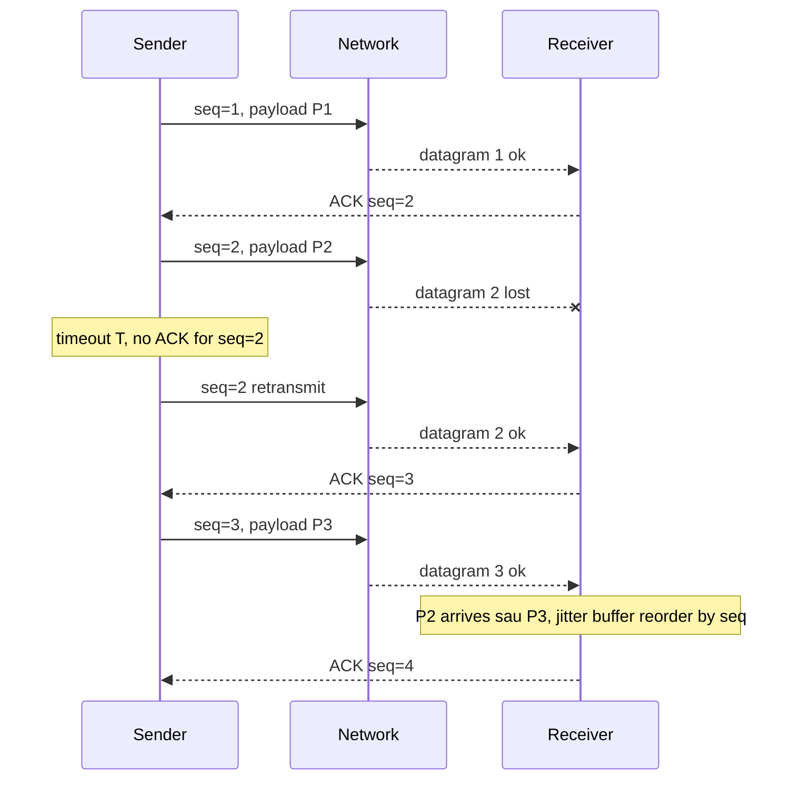
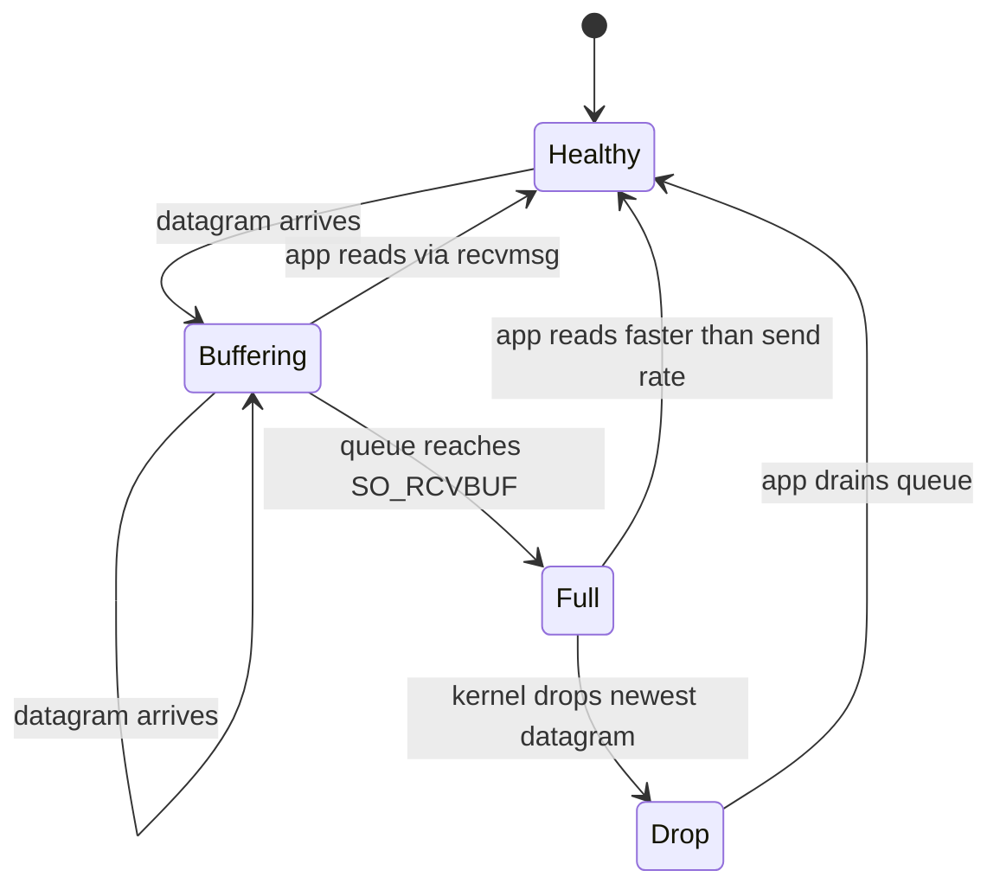

# When would you use UDP instead of TCP?

> UDP đúng khi dữ liệu cũ vô giá trị (state mới thay thế), cần broadcast/multicast, request-response 1 RTT, hoặc tự code reliability. TCP đúng khi cần đúng thứ tự + đủ dữ liệu. Bài này tập trung vào cây quyết định chọn UDP, cạm bẫy MTU/NAT/firewall và cách tự build reliability.

Chủ đề: Networking · Ngày: 2026-10-15

## 0. Nền tảng trước khi đọc

**Bối cảnh:** Cách trình duyệt, ứng dụng và máy chủ gửi dữ liệu cho nhau. Mỗi bước có giao thức, độ trễ và kiểu lỗi riêng.

**Nói đơn giản:** Dùng UDP khi dữ liệu mới quan trọng hơn dữ liệu cũ hoặc ứng dụng tự xử lý retry, thứ tự và mất gói.

**Từ khóa cần biết:** client = bên gửi request; server = bên phục vụ; packet = mảnh dữ liệu đi qua mạng.

**Ví dụ dễ hình dung:** Voice call ưu tiên âm thanh hiện tại hơn việc chờ một packet cũ, nên có thể bỏ packet mất thay vì retransmit.

Khi đọc, luôn hỏi ba câu: nó giải quyết vấn đề gì, nó làm việc theo những bước nào, và khi nào không nên dùng?

**Cách học bài này:** Đọc phần này trước để nắm từ khóa; đọc phần 1 để lấy câu trả lời 30 giây; đọc phần 2 để hiểu cơ chế; cuối cùng mở từng câu hỏi ở phần 3 để luyện nói. Các con số và lệnh trong bài là bằng chứng cho câu trả lời, không cần học thuộc nếu chưa hiểu cơ chế.

## 1. Là gì


## 2. Cơ chế cốt lõi
### Đọc nhanh trước khi đi sâu

**Ý chính:** Dùng UDP khi dữ liệu mới quan trọng hơn dữ liệu cũ hoặc ứng dụng tự xử lý retry, thứ tự và mất gói.

**Ví dụ interview:** Voice call ưu tiên âm thanh hiện tại hơn việc chờ một packet cũ, nên có thể bỏ packet mất thay vì retransmit.

**Luồng 4 bước:**

1. Ứng dụng tạo request với tên host, port và dữ liệu.
2. OS và các giao thức mạng tìm đường rồi chuyển packet tới server.
3. Server xử lý request và trả response qua kết nối phù hợp.
4. Client kiểm tra response, cache hoặc render dữ liệu cho người dùng.

**Nói như trong interview:** Dùng UDP khi dữ liệu mới quan trọng hơn dữ liệu cũ hoặc ứng dụng tự xử lý retry, thứ tự và mất gói. Hãy nói theo bốn bước trên trước; nếu interviewer hỏi sâu, chuyển sang cơ chế **Đọc nhanh trước khi đi sâu**, rồi nêu trade-off và failure mode ở các phần sau.

### Bước 1. Datagram, MTU và giới hạn kích thước

Một UDP datagram gồm 8 byte header + payload, đi nguyên một IP packet. Ethernet chuẩn có MTU 1500 byte, IPv4 header 20 byte, UDP header 8 byte → payload tối đa 1472 byte. IPv6 header 40 byte → 1452 byte. Nếu datagram lớn hơn MTU, router hoặc host nguồn phải fragment — chỉ cần 1 fragment mất là cả datagram bị IPv4 stack hủy.

Thực tế QUIC chọn payload tối đa 1200 byte cho initial datagram (RFC 9000 §14.1) để vừa qua hầu hết tunnel VPN/PPPoE mà không fragment. Khi gửi UDP thuần, payload nên giữ ≤ 1200 byte trừ khi biết rõ MTU đường truyền. Dùng `tracepath -n <dest>` (Linux) hoặc `ping -D -s 1400 <dest>` (macOS) để phát hiện PMTU. Fragmentation chỉ an toàn khi ICMP "too big" không bị firewall chặn — PMTUD black hole khiến datagram đi vào mà mất im lặng.

### Bước 2. Tự build reliability trên UDP

Khi cần in-order delivery trên UDP (file transfer, command channel của game), ứng dụng tự code 4 thứ TCP làm hộ:

1. **Sequence number** trong header mỗi datagram, đánh số tăng dần. Receiver sắp xếp lại theo seq, phát hiện khoảng trống.
2. **ACK có chọn lọc** (SACK-style): receiver báo seq đã nhận cao nhất, có thể kèm bitmap seq lân cận đã có. Sender chỉ retransmit gap, không cả từ điểm mất.
3. **Retransmit có timeout** (RTO ứng dụng): tương tự TCP, Jacobson/Karels qua mẫu RTT. QUIC dùng RFC 9002.
4. **Jitter buffer** ở receiver: chờ một khoảng (vài chục ms) trước khi phát, sắp xếp gói đến muộn, giảm giật cho audio/video. Voice/video RTP target ~40-80 ms.



*Reliability tự xây trên UDP: seq + ACK + retransmit. P2 retransmit đến sau P3 nhưng receiver xếp lại theo seq, app thấy P1→P2→P3 đúng thứ tự.*

Tự build khác dùng QUIC: viết 4 thành phần trên tốn 2-6 tháng. QUIC cho sẵn ACK, SACK, loss recovery, congestion control (NewReno hoặc BBR), chỉ tích hợp. Khi nào tự build: latency budget cực thấp (<10 ms RTT) và profile mất gói đặc thù (game), hoặc cần FEC ở application layer.

### Bước 3. Congestion control — không có thì làm nghẽn mạng

UDP không có congestion control. Nếu bơm 1 Gbps qua kết nối WiFi 50 Mbps, queue router đầy rồi tràn, drop ảnh hưởng mọi flow khác — "UDP không fair". Comcast bị phạt năm 2008 vì bittorrent qua UDP chiếm băng thông TCP người dùng khác.

Ba hướng xử lý: (1) dùng congestion control của QUIC, (2) tự code rate limit theo RTT sample (slow start + AIMD), (3) hardcode bitrate thấp. Live video 1080p thường chọn (3) với target ~2-5 Mbps; DNS chọn (1) hoặc (3) vì rate rất thấp.

### Bước 4. NAT, firewall, keepalive

UDP qua NAT có entry mapping tạm thời: NAT tạo entry khi packet đi ra, mapping 4-tuple internal ↔ external. Mapping hết hạn sau ~30-120 giây nếu không có packet mới (không chuẩn hoá, phụ thuộc vendor). Hết hạn → peer gửi vào bị NAT drop. VoIP/UDP phải gửi keepalive ~mỗi 15-25 giây.

Firewall thường chặn UDP inbound mặc định — phổ biến hơn TCP vì UDP không có handshake flag để firewall nhận biết "đây là response hợp lệ". Deploy UDP service cần firewall rule rõ port.

### Bước 5. Receive buffer đầy và `SO_RCVBUF`

UDP socket có receive buffer giới hạn (Linux mặc định `net.core.rmem_default` ~212 KB, macOS ~16 KB). Khi buffer đầy, kernel drop datagram mới nhất im lặng — ứng dụng không nhận signal, chỉ thấy counter tăng.



*Máy trạng thái UDP receive buffer: buffer đầy → drop. Counter Linux: `netstat -su` RcvbufErrors. Counter macOS: `netstat -s -p udp` socket buffer overflows.*

### Quan sát

```bash
# Linux: UDP socket, buffer và drop counter
ss -u -a
# Recv-Q: bytes đang chờ trong kernel buffer
# Nếu Recv-Q tiệm cận SO_RCVBUF → app đọc chậm

netstat -su
# "RcvbufErrors" tang = kernel drop do buffer đầy

# macOS: UDP drop
netstat -s -p udp
# "socket buffer overflows" tang = drop vì SO_RCVBUF đầy

# Kiem tra MTU / fragmentation (Linux)
tracepath -n 8.8.8.8
# macOS: ping datagram lớn
ping -D -s 1400 8.8.8.8
```

### Ví dụ chạy từng bước

Kịch bản: server game multiplayer 100 player, snapshot state 4 KB, gửi mỗi 33 ms tới 99 client còn lại. RTT server-client ~50 ms, profile mất gói LAN 0.5%. Mục tiêu: thấy vì sao custom UDP đúng chỗ này và tự build reliability ở đâu.

**Bước 1 (chunking theo MTU).** Wire 4 KB snapshot chia thành 3 datagram 1472 byte (IPv4 MTU 1500 - IP 20 - UDP 8 = 1472). Datagram > MTU + DF bị fragment hoặc drop.

| Kênh | Giao thức | Tần suất | Payload | Tại sao |
|---|---|---|---|---|
| Snapshot unreliable | UDP | 30 Hz | 3 × 1472 byte | state mới thay thế cũ |
| Input client → server | UDP | 60 Hz | 50 byte | tick 16 ms, frame mới đủ |
| Reliable event | UDP seq+ACK | event | < 200 byte | join/leave cần đủ |
| Match-making | TCP/HTTPS | theo yêu cầu | lobby | thứ tự + đủ dữ liệu |

**Bước 2 (gửi unreliable).** Server broadcast snapshot tới 99 client: 100 × 4 KB × 30 Hz = 12 MB/s upload. Đã tính lại bằng script: với delta compression (chỉ entity thay đổi) giảm 10× → 1.2 MB/s. Mất gói LAN 0.5% chấp nhận được — frame sau đã có thông tin mới hơn.

**Bước 3 (reliable event kênh join).** Player A disconnect → server gửi `seq=42, event=LEAVE`. Client miss → ACK cao nhất `seq=41`. Server retransmit seq=42 sau RTO ~100 ms. Seq + ACK bitmap SACK-style.

**Bước 4 (reorder ở receiver).** Datagram seq=1, 2, 3 tới nhưng 2 đến sau 3. Jitter buffer chờ 40 ms, xếp lại theo seq. Frame 2 trễ coi là miss, client nội suy từ 1 và 3.

**Bước 5 (NAT keepalive).** UDP qua NAT mapping hết hạn sau ~30-120s. Server (hoặc client) gửi keepalive ~15-20s để giữ. TCP có FIN/RST, UDP không — NAT chỉ biết qua timeout.

**Bước 6 (`SO_RCVBUF` đầy).** Server Linux mặc định `rmem_default` ~212 KB. Spike snapshot 50 datagram tới trong 1 ms và app đọc chậm → kernel drop im lặng. Counter `netstat -su` `RcvbufErrors` tăng → scale app hoặc tăng buffer.

**Biến thể "nếu lỗi".** Nếu dev tự build reliability mà quên congestion control, khi 100 player đồng thời reconnect sau downtime, server bơm 1 Gbps qua uplink 200 Mbps → queue router tràn → drop hết flow khác. Khắc phục: AIMD slow-start với cwnd ban đầu bằng 1 MTU, sample RTT qua ACK echo.

Điều rút ra: UDP đúng vì "dữ liệu cũ vô giá trị" — snapshot mới hơn đã có thông tin tốt hơn, không phải vì UDP "nhanh hơn TCP". Nối với câu hỏi [câu 14 trong phần 3B](when-to-use-udp.md#câu-14): nói "UDP nhanh hơn TCP" là sai — TCP+TLS có throughput tương đương khi mạng ổn định, UDP chỉ thắng khi app chấp nhận mất gói và không cần HOL blocking.

## 3. Câu hỏi phỏng vấn

### 3A. Câu hỏi đào sâu

<details class="qa"><summary>Câu 1. Khi nào UDP đúng thay vì TCP?</summary>
<div>
<p><strong>Trả lời ngắn:</strong> UDP khi dữ liệu cũ vô giá trị (state mới thay thế), cần broadcast/multicast, request-response 1 RTT payload nhỏ, hoặc tự code reliability với semantic riêng. TCP khi cần đúng thứ tự + đủ dữ liệu. Lý do cốt lõi: head-of-line blocking của TCP.</p>

<h4>Đào sâu</h4>
<ul>
<li>Game state 60 Hz: mỗi tick ~50 byte input, 30-60 lần/giây, RTT budget ~50 ms. Mất 1% packet chấp nhận được, frame mới đã có thông tin mới.</li>
<li>Voice/video RTP: mỗi frame ~20 ms audio hoặc ~33 ms video, mất 1 frame che bằng interpolation. Retransmit đến lúc đó đã trễ, vô giá trị.</li>
<li>DNS query ~50 byte: TCP overhead 40 byte header vs UDP 8 byte, và TCP tốn 1 RTT handshake trước khi gửi query. DNS fallback TCP khi response > 512 byte (RFC 6891).</li>
<li>Broadcast/multicast: TCP là point-to-point, không có khái niệm "gửi tới nhiều peer cùng lúc". DHCP discover, mDNS query đều cần multicast/broadcast → UDP.</li>
<li>QUIC/HTTP/3 dùng UDP làm chỗ dựa: cần in-order + reliable như TCP nhưng trong user-space để sửa HOL blocking và đổi IP không reconnect.</li>
</ul>

<h4>Bẫy</h4>
<p>Trả lời "UDP nhanh hơn TCP vì overhead thấp" — chỉ đúng với payload rất nhỏ. Với payload lớn và mạng ổn định, TCP+TLS 1.3 có throughput tương đương hoặc cao hơn vì TCP có cwnd tối ưu.</p>

<h4>Follow-up</h4>
<p><em>Tại sao DNS dùng UDP nhưng fallback TCP?</em> DNS chuẩn giới hạn UDP 512 byte. Response lớn hơn (DNSSEC, zone transfer) phải TCP. TCP cũng tránh truncation attack.</p>
</div>
</details>

<details class="qa"><summary>Câu 2. Head-of-line blocking của TCP là gì, và UDP giải quyết thế nào?</summary>
<div>
<p><strong>Trả lời ngắn:</strong> HOL blocking = segment bị mất chặn mọi byte phía sau nó trong byte stream cho đến khi segment được retransmit. UDP datagram độc lập nên gói sau đến trước gói mất vẫn được xử lý. QUIC dùng tính chất này cho stream độc lập.</p>

<h4>Đào sâu</h4>
<ul>
<li>TCP đảm bảo in-order delivery ở byte level: receiver chỉ đưa byte lên application khi đã nhận đủ mọi byte trước đó. Mất segment 5 chặn segment 6, 7, 8 dù chúng đã đến.</li>
<li>HTTP/2 multiplex streams trên 1 TCP: mất 1 TCP segment chặn cả connection, kéo theo mọi stream. Google đo được HOL blocking chiếm phần lớn tail latency HTTP/2.</li>
<li>QUIC chạy trên UDP, mỗi stream có phạm vi retransmit riêng. Mất gói stream 4 không chặn stream 6. Đây là động lực kỹ thuật chuyển HTTP/3 sang QUIC.</li>
<li>UDP thuần không có stream, app tự quyết định gói nào vẫn còn giá trị sau khi gói khác mất.</li>
</ul>

<h4>Bẫy</h4>
<p>Nói "UDP không có HOL blocking nên nhanh hơn TCP" — chỉ đúng khi app tự build reliability và chờ đủ thứ tự. Nếu app đợi đủ datagram trước khi xử lý (FEC), HOL blocking quay lại.</p>

<h4>Follow-up</h4>
<p><em>HTTP/2 trên 1 request thì có còn lợi hơn HTTP/1.1 không?</em> Không nhiều. Lợi HTTP/2 là multiplexing nhiều request, nhưng HOL blocking TCP triệt tiêu lợi đó khi loss. Trên mạng loss cao, HTTP/1.1 với nhiều connection đôi khi nhanh hơn.</p>
</div>
</details>

<details class="qa"><summary>Câu 3. UDP có bị amplification DDoS không? Ví dụ?</summary>
<div>
<p><strong>Trả lời ngắn:</strong> Có, và là vector DDoS lớn nhất trong lịch sử. Attacker gửi request UDP nhỏ tới server có response lớn hơn nhiều, spoof source IP, response đổ về nạn nhân. Ba vụ lớn: DNS (~28-54x), NTP (~556x), memcached (~51000x).</p>

<h4>Đào sâu</h4>
<ul>
<li>Cơ chế: UDP không handshake nên dễ spoof source IP. Attacker gửi 60-byte DNS query với source IP = nạn nhân, server phản hồi 3000-byte response về nạn nhân. Hệ số khuếch đại ~50x.</li>
<li>Memcached 2018: 15-byte request → 750 KB response, ~51000x. Tấn công GitHub ~1.7 Tbps.</li>
<li>DNS amplification 2006: ~50x. Phòng chống: response rate limiting (RRL) ở authoritative, BCP38 ingress filtering.</li>
<li>NTP monlist 2014: 200-byte request → 500-byte response ~500x. Đã sửa ở NTP 4.2.7+.</li>
<li>TCP khó spoof vì cần 3-way handshake — SYN-ACK đi về nạn nhân, không phải attacker.</li>
</ul>

<h4>Bẫy</h4>
<p>Trả lời "UDP amplification do thiếu authentication" — sai. Vấn đề là UDP cho spoof source IP, không phải không có auth.</p>

<h4>Follow-up</h4>
<p><em>Tại sao TCP khó spoof hơn?</em> TCP cần 3-way handshake. Attacker spoof source IP nhưng SYN-ACK từ server đi về nạn nhân, không về attacker → attacker không hoàn tất handshake.</p>
</div>
</details>

<details class="qa"><summary>Câu 4. NAT timeout ảnh hưởng UDP thế nào?</summary>
<div>
<p><strong>Trả lời ngắn:</strong> NAT giữ mapping internal ↔ external trong bảng state, entry tự hết hạn sau ~30-120 giây không có traffic. UDP không có FIN như TCP nên NAT không biết khi nào connection "đóng". Khi entry hết hạn, peer gửi vào bị drop.</p>

<h4>Đào sâu</h4>
<ul>
<li>RFC 4787 khuyến nghị NAT UDP timeout tối thiểu 5 phút, nhưng nhiều vendor dùng 30-120s. Carrier-Grade NAT (CGN) thường 30-60s.</li>
<li>Giải pháp: keepalive gửi packet nhỏ định kỳ, nhanh hơn NAT timeout. WebRTC dùng STUN binding request mỗi 15-25s. VoIP tương tự.</li>
<li>TCP khác: FIN hoặc RST báo NAT xóa mapping ngay. UDP phải dùng timeout.</li>
<li>Tricky case: peer A gửi UDP ra ngoài, NAT tạo mapping. A im lặng 60s, mapping hết hạn. Peer B gửi vào external port — NAT drop. Peer A không biết B vừa gửi.</li>
</ul>

<h4>Bẫy</h4>
<p>Cho rằng "UDP qua NAT y hệt TCP" — sai. TCP có FIN/RST. UDP NAT phải dùng timeout, phụ thuộc vendor, không xác định được trước.</p>

<h4>Follow-up</h4>
<p><em>Có cách nào biết NAT timeout không?</em> Không chính xác. Thử bằng STUN: gửi binding request, đo khoảng thời gian mapping tồn tại khi không có traffic.</p>
</div>
</details>

<details class="qa"><summary>Câu 5. Tự build reliability trên UDP khác dùng QUIC ở điểm nào?</summary>
<div>
<p><strong>Trả lời ngắn:</strong> Tự build cho kiểm soát hoàn toàn (unreliable ordered, FEC, custom retransmit) nhưng tốn công và phải tự chứng minh congestion control. QUIC cho sẵn ACK, SACK, congestion control, TLS 1.3 — chỉ tích hợp.</p>

<h4>Đào sâu</h4>
<ul>
<li>Thành phần tối thiểu để reliable trên UDP: seq number, ACK, retransmit timeout, congestion control. Tự code đầy đủ tốn ~2-6 tháng.</li>
<li>QUIC cho sẵn: NewReno hoặc BBR congestion control, SACK, loss detection, TLS 1.3 tích hợp, connection migration qua CID. Thư viện: ngtcp2, quiche (Rust), msquic (C).</li>
<li>Khi nào tự build: cần unreliable ordered (WebRTC data channel cũ), cần FEC application-layer với parity matrix riêng, latency budget cực thấp, hoặc IoT resource-constrained không chạy được TLS 1.3.</li>
<li>Khi nào dùng QUIC: HTTP/3, app general-purpose, cần encryption, mobile roaming đổi IP không reconnect.</li>
</ul>

<h4>Bẫy</h4>
<p>"Tự build nhanh hơn QUIC vì không có encryption" — encryption chỉ ~5-15% CPU overhead, không đáng so với bảo mật mất đi.</p>

<h4>Follow-up</h4>
<p><em>Game protocol thường chọn gì?</em> Tùy studio: Riot Games, Epic tự build custom UDP transport. Lý do: cần partial reliability (join bắt buộc, snapshot có thể miss), tick rate cao. Server authority vẫn dùng TCP/HTTPS cho match-making và payment.</p>
</div>
</details>

<details class="qa"><summary>Câu 6 (Debug). Cuộc gọi video bị giật, audio drop liên tục. Bạn kiểm tra gì theo thứ tự nào?</summary>
<div>
<p><strong>Trả lời ngắn:</strong> 1) Đo loss/jitter bằng WebRTC `getStats()`. 2) Xem RcvbufErrors trên host gửi và nhận. 3) Bắt gói kiểm tra MTU/fragmentation. 4) Kiểm NAT timeout và firewall rule. 5) Test codec/bitrate với bandwidth thực.</p>

<h4>Đào sâu</h4>
<ul>
<li>Bước 1: WebRTC `getStats()` cung cấp `packetsLost`, `jitter`, `roundTripTime`. Loss > 5% hoặc jitter > 50 ms → mạng có vấn đề. Mở chrome://webrtc-internals để xem realtime.</li>
<li>Bước 2: trên Linux, `ss -u -a` xem Recv-Q. Nếu gần `SO_RCVBUF` → app đọc chậm, kernel drop. `netstat -su` RcvbufErrors tăng → kernel drop do buffer đầy. Trên macOS: `netstat -s -p udp` cho socket buffer overflows.</li>
<li>Bước 3: `tcpdump -i any -n udp and host <peer-ip>` bắt packet, xem datagram size. Nếu > 1200 byte và có ICMP "frag needed" bị chặn → PMTUD black hole. Fix: giảm payload ≤ 1200 byte.</li>
<li>Bước 4: NAT mapping hết hạn khi không có traffic > 30-120s. Keepalive ~15-20s là giải pháp. Firewall thường chặn UDP high port inbound — kiểm bằng `iptables -L -n` (Linux) hoặc `pfctl -sr` (macOS).</li>
<li>Bước 5: bitrate 1080p30 ~2-5 Mbps. Nếu bandwidth thực < 1 Mbps → codec tự giảm nhưng gây giật. Test bằng `iperf3 -c <peer> -u -b 5M -t 30` xem loss%.</li>
</ul>

<h4>Bẫy</h4>
<p>Restart UDP service khi thấy drop — che giấu triệu chứng. Phải đo RcvbufErrors trước, biết nguyên nhân rồi mới scale hoặc tăng buffer.</p>
</div>
</details>

<details class="qa"><summary>Câu 7 (Thiết kế). Thiết kế đồng bộ trạng thái game realtime 60 Hz cho 100 player. Yêu cầu, quyết định chính, điểm nghẽn?</summary>
<div>
<p><strong>Yêu cầu:</strong> Mỗi player gửi input ~50 byte/frame, 60 Hz; server tính snapshot thế giới ~4 KB mỗi 33 ms; broadcast tới 99 player còn lại. RTT budget ~50 ms. Chịu mất 1-2% packet, chống cheat.</p>

<p><strong>Quyết định chính:</strong></p>
<ul>
<li>Chọn UDP với custom protocol, không TCP: TCP HOL blocking khi mất 1 packet chặn snapshot 4 KB, không kịp frame 33 ms.</li>
<li>Server authority: client chỉ gửi input, server simulate, broadcast snapshot. Client không được tự tính vị trí player khác → chống cheat.</li>
<li>Hai kênh: kênh unreliable (snapshot state, mất vài frame OK) và kênh reliable (player join/leave, item pickup — dùng seq + ACK + retransmit).</li>
<li>Client-side prediction: client tự ước lượng vị trí mình dựa trên input, che giật khi snapshot đến trễ.</li>
<li>Delta compression: chỉ gửi entity thay đổi so với snapshot trước, giảm 70-90% bandwidth.</li>
</ul>

<p><strong>Điểm nghẽn:</strong></p>
<ul>
<li>Bandwidth: 100 player × 4 KB × 30 Hz = 12 MB/s upload từ server. Delta + interest management (chỉ gửi entity gần player) giảm 10x.</li>
<li>Server CPU: 100 player × 60 tick/s = 6000 simulation step/s, O(N×M) cho va chạm. Cần ECS và broadphase culling.</li>
<li>Snapshot 33 ms: mất gói → skip, dùng interpolation phía client.</li>
<li>Anti-cheat: server phải validate mọi input (không teleport).</li>
</ul>

<p><strong>Stack thường dùng:</strong> UDP custom cho gameplay, HTTPS/REST cho match-making và payment. Thư viện: ENet, GameNetworkingSockets (Valve).</p>
</div>
</details>

### 3B. Câu hỏi phỏng vấn liên quan

<details class="qa">
<summary>Câu 8. Why does DNS use UDP, and when does it fall back to TCP?</summary>

**Trả lời:** Một truy vấn DNS điển hình là một request và một response nhỏ, nên UDP tiết kiệm được handshake và không cần giữ state cho mỗi truy vấn. Khi response bị cắt (cờ TC được đặt) hoặc cần truyền zone (AXFR), client thử lại bằng TCP. DNS over TLS và DNS over HTTPS cũng chạy trên TCP hoặc QUIC. Giới hạn 512 byte của UDP DNS cũ được nới bằng EDNS0, nhưng gói lớn dễ bị phân mảnh nên nhiều nơi giữ payload quanh 1232 byte.
</details>

<details class="qa">
<summary>Câu 9. What does calling connect() on a UDP socket actually do?</summary>

**Trả lời:** Không có handshake và không gửi gói nào. `connect()` chỉ ghi địa chỉ peer vào socket trong kernel. Sau đó bạn dùng `send()` thay vì `sendto()`, kernel chỉ chuyển lên socket các datagram đến từ đúng peer đó, và lỗi ICMP như port unreachable mới được báo về ứng dụng (thường là `ECONNREFUSED` ở lần gọi kế tiếp). Chưa kết nối thì lỗi ICMP bị bỏ qua.
</details>

<details class="qa">
<summary>Câu 10. Why do some UDP packets vanish with no error at all?</summary>

**Trả lời:** UDP không có cơ chế báo mất. Gói có thể bị bỏ ở nhiều chỗ: receive buffer đầy (`SO_RCVBUF`), router quá tải, checksum sai, firewall hoặc NAT không có mapping, hoặc gói vượt MTU mà cờ DF được đặt. Kiểm tra bằng `netstat -s -p udp` (counter như `dropped due to full socket buffers`) để biết gói bị bỏ ở host hay ở giữa đường.
</details>

<details class="qa">
<summary>Câu 11. Is the UDP checksum mandatory?</summary>

**Trả lời:** Với IPv4, checksum UDP là tùy chọn (giá trị 0 nghĩa là không dùng), nhưng thực tế gần như luôn bật. Với IPv6 thì bắt buộc, vì IPv6 header không có checksum riêng. Checksum chỉ phát hiện lỗi bit, không sửa và không đảm bảo gói tới nơi.
</details>

<details class="qa">
<summary>Câu 12. What is the maximum safe UDP payload size, and why?</summary>

**Trả lời:** Để tránh phân mảnh IP trên Ethernet MTU 1500, payload an toàn là khoảng 1472 byte với IPv4 (1500 trừ 20 byte IP và 8 byte UDP), thấp hơn với IPv6 hoặc khi có tunnel/VPN. Thực tế nhiều ứng dụng giữ quanh 1200 byte (QUIC dùng mức này) vì đường đi thật có thể có MTU nhỏ hơn. Mất một fragment là mất cả datagram.
</details>

<details class="qa">
<summary>Câu 13. How do multicast and broadcast relate to UDP?</summary>

**Trả lời:** TCP là kết nối điểm-điểm nên không gửi được broadcast hay multicast. UDP gửi được một datagram tới địa chỉ broadcast hoặc nhóm multicast, nên được dùng cho service discovery (mDNS, SSDP) và phân phối dữ liệu cho nhiều receiver. Multicast qua Internet công cộng gần như không dùng được vì router không định tuyến; chủ yếu trong mạng nội bộ có kiểm soát.
</details>

<details class="qa">
<summary>Câu 14. True or false: "UDP is faster than TCP, so always prefer it for performance."</summary>

**Trả lời:** Sai. UDP bỏ được handshake và retransmit, nhưng nếu ứng dụng cần độ tin cậy thì phải tự build lại, và bản tự build thường chậm hơn hoặc kém ổn định hơn TCP đã được tối ưu nhiều năm trong kernel. Thiếu congestion control còn làm nghẽn mạng và chính bạn bị mất gói. UDP đúng khi bài toán không cần các đảm bảo của TCP, không phải vì nó nhanh hơn theo mặc định.
</details>

## 4. Đánh đổi và sự cố production

UDP thuần, QUIC và TCP mỗi giao thức đánh đổi khác nhau. UDP thuần tối ưu độ trễ và tính linh hoạt nhưng đánh đổi reliability và fairness. QUIC nằm ở giữa: reliable như TCP nhưng không có HOL blocking, chạy trên UDP để được connection migration và user-space transport. TCP vẫn là lựa chọn mặc định cho mọi thứ cần đúng thứ tự + đủ dữ liệu.

Trục đánh đổi cốt lõi: chọn UDP thuần khi latency thấp hơn reliability (game, VoIP) và sẵn sàng tự xây reliability. Chọn QUIC khi cần HTTP/3 hoặc mobile roaming mà vẫn muốn reliability và encryption sẵn có. Chọn TCP khi dữ liệu phải đến đủ và đúng thứ tự, hoặc khi hạ tầng chỉ hỗ trợ TCP (load balancer, TLS terminator trong data center).

Chi phí vận hành tăng dần: UDP thuần chỉ tốn CPU/network, QUIC cần thư viện và theo dõi connection state, TCP cần vận hành cả hệ sinh thái (connection pool, keepalive, backlog tuning). UDP có vẻ đơn giản nhưng hidden cost là tự debug reliability và congestion control. Ngoài ra, UDP thường bị firewall chặn ở môi trường restrictive (doanh nghiệp, trường học), trong khi TCP port 443 gần như luôn open. Fairness là vấn đề thực tế: UDP không có cwnd nên có thể chiếm toàn bộ bandwidth của các TCP flow cùng router. Khi triển khai UDP ở production, cần giám sát buffer utilization và packet loss riêng — TCP có sẵn công cụ như `ss -ti` cho cwnd và retransmission, UDP yêu cầu custom instrumentation.

### So sánh UDP thuần, QUIC và TCP

| Tiêu chí | UDP thuần | QUIC / HTTP/3 | TCP |
|---|---|---|---|
| Độ trễ setup | 0 RTT | 1 RTT (0-RTT cho request lặp) | 1-2 RTT + TLS |
| Reliability | Không, ứng dụng tự lo | Có (ACK, retransmit, SACK) | Có |
| Congestion control | Không | Có (NewReno, BBR) | Có |
| HOL blocking | Không (datagram độc lập) | Không (stream riêng) | Có (segment) |
| Header overhead | 8 byte | 4-39 byte (QUIC header) | 20-60 byte |
| NAT traversal | Khó (phụ thuộc timeout) | Khó (QUIC over UDP) | Tốt |
| Encryption | Ứng dụng tự lo | TLS 1.3 tích hợp | TLS riêng |
| Phù hợp khi | Game state, VoIP, telemetry, broadcast | HTTP/3, mobile roaming, real-time | API, file transfer, thanh toán |

### Năm failure mode

| Triệu chứng | Nguyên nhân gốc | Cách kiểm tra | Cách sửa |
|---|---|---|---|
| Gọi video giật, audio drop | Jitter buffer quá nhỏ, loss > 5% | WebRTC `getStats()` loss%, jitter | Tăng jitter buffer, giảm codec bitrate |
| Metric mất 5% nhưng kernel counter sạch | Mạng upstream drop | `mtr -u -c 100 <peer-ip>` loss% | Báo ISP |
| UDP server nhận packet nhưng app không xử lý | App đọc chậm, kernel buffer đầy | `netstat -su` RcvbufErrors tăng | Tăng `SO_RCVBUF`, scale app |
| Call setup lâu hoặc fail | NAT timeout, firewall chặn UDP | Bắt gói không thấy response | Keepalive ~15s, mở firewall rule |
| Server bị amplification DDoS | Service expose UDP không limit response | Traffic vọt, CPU server bình thường | BCP38 ingress filtering, RRL |

## 5. Cheat sheet

Cheat sheet này tổng hợp con số và quy tắc cần nhớ trước khi vào phòng phỏng vấn. Điều kiện đi kèm con số: "thường", "~", bậc độ lớn. Không nhớ con số tuyệt đối nếu không chắc.

| Chủ đề | Con số / quy tắc |
|---|---|
| UDP header | 8 byte cố định (port, length, checksum). Không có MSS. |
| MTU | Ethernet 1500, payload UDP tối đa 1472 byte. QUIC chọn ≤ 1200 byte. |
| NAT timeout | 30-120 giây, không chuẩn hoá. Keepalive mỗi 15-25 giây. |
| HOL blocking + congestion | TCP: mất segment chặn cả connection. UDP/QUIC: datagram/stream độc lập. UDP không có congestion control. |
| Amplification | DNS ~50x, NTP ~500x, memcached ~51000x. BCP38 ingress filtering. |
| SO_RCVBUF | Kernel drop im lặng khi buffer đầy. Counter: `netstat -su` (Linux), `netstat -s -p udp` (macOS). |
| QUIC vs UDP thuần | QUIC: reliable, TLS 1.3, stream độc lập, connection migration, 1-RTT. UDP thuần: game state, VoIP, telemetry, broadcast, tự build protocol. |

**Học tiếp:** [TCP vs UDP](tcp-vs-udp.md) — so sánh header, handshake, congestion control TCP (bài này tập trung vào quyết định chọn UDP, không viết lại so sánh header/handshake). [DNS how it works](dns-how-it-works.md) — DNS dùng UDP/53 rồi fallback TCP khi response > 512 byte. [HTTP vs HTTPS](http-vs-https.md) — TLS handshake tốn RTT, QUIC/HTTP/3 cải thiện bằng 1-RTT handshake.
