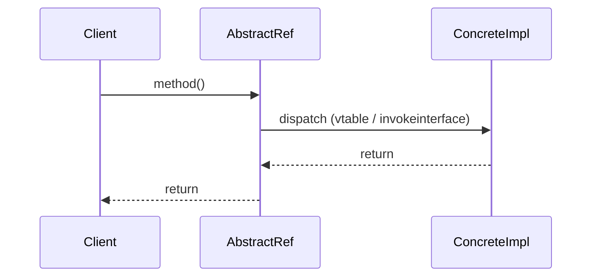

# What is abstraction in OOP?

> Abstraction trong OOP là chiến lược ẩn chi tiết hiện thực bên trong và chỉ phơi ra contract (method signature, thuộc tính công khai) mà client cần. Bài này phân biệt abstraction với encapsulation, mô tả cơ chế abstract class và interface trong Java, abstract method và contract qua duck typing, kèm câu hỏi đào sâu và bài liên quan như [encapsulation-in-oop](encapsulation-in-oop.md), [inheritance-and-composition](inheritance-and-composition.md).

Chủ đề: OOP - Design Patterns · Ngày: 2026-10-16

## 0. Nền tảng trước khi đọc

**Bối cảnh:** Cách tổ chức code thành những đối tượng dễ thay đổi. Mục tiêu là giữ luật của nghiệp vụ rõ ràng và tránh code phụ thuộc chặt vào nhau.

**Nói đơn giản:** Abstraction cho người dùng một contract đơn giản và giấu cách bên trong thực hiện contract đó.

**Từ khóa cần biết:** class = khuôn; object = instance cụ thể; method = hành vi mà object cung cấp.

**Ví dụ dễ hình dung:** Code gọi paymentGateway.charge() mà không cần biết bên trong dùng HTTP, retry hay ký request.

Khi đọc, luôn hỏi ba câu: nó giải quyết vấn đề gì, nó làm việc theo những bước nào, và khi nào không nên dùng?

**Cách học bài này:** Đọc phần này trước để nắm từ khóa; đọc phần 1 để lấy câu trả lời 30 giây; đọc phần 2 để hiểu cơ chế; cuối cùng mở từng câu hỏi ở phần 3 để luyện nói. Các con số và lệnh trong bài là bằng chứng cho câu trả lời, không cần học thuộc nếu chưa hiểu cơ chế.

## 1. Là gì

### Đọc nhanh trước khi đi sâu

**Ý chính:** Abstraction cho người dùng một contract đơn giản và giấu cách bên trong thực hiện contract đó.

**Ví dụ interview:** Code gọi paymentGateway.charge() mà không cần biết bên trong dùng HTTP, retry hay ký request.

**Luồng 4 bước:**

1. Client gọi một contract dễ hiểu.
2. Object hoặc pattern chọn code thực hiện phía sau contract.
3. State và dependency được giữ ở nơi có trách nhiệm rõ ràng.
4. Khi requirement đổi, thay implementation mà giảm ảnh hưởng tới client.

**Nói như trong interview:** Abstraction cho người dùng một contract đơn giản và giấu cách bên trong thực hiện contract đó. Hãy nói theo bốn bước trên trước; nếu interviewer hỏi sâu, chuyển sang cơ chế **Bước 1. Abstract class vs interface trong Java**, rồi nêu trade-off và failure mode ở các phần sau.

## 2. Cơ chế cốt lõi

### Bước 1. Abstract class vs interface trong Java

| Đặc điểm | Abstract class | Interface (Java 8+) |
|---|---|---|
| Có state (field) | Có | Chỉ `public static final` |
| Method có thân | Có (concrete method) | Có (default method từ Java 8) |
| Method abstract | Có | Có (mặc định trừ `default`) |
| Kế thừa | `extends` 1 class | `implements` nhiều interface |
| Constructor | Có | Không |
| Access modifier method | Tuỳ ý | Mặc định `public` |

Lưu ý: Java 8+ thêm `default` method cho interface (có thân, dùng để thêm API không phá source compatibility). Java 9 thêm `private` method trong interface. Từ Java 17 (chưa chắc, phụ thuộc phiên bản) sealed interface cho phép giới hạn ai implement.

### Bước 2. Cơ chế client gọi qua abstract type



*Sơ đồ cơ chế: client giữ reference kiểu abstract. Khi gọi method, JVM dispatch tới method của concrete class qua vtable (C++) hoặc invokeinterface (Java). Đổi implementation runtime qua factory/DI không cần sửa client.*

### Bước 3. Abstract method và contract

Abstract method chỉ khai báo signature, không có thân. Mọi concrete subclass BẮT BUỘC override (trừ khi subclass cũng là abstract). Compiler Java enforce lúc compile: nếu class không abstract mà có method abstract kế thừa → compile error.

```java
// Ví dụ chưa chạy thử
abstract class PaymentGateway {
    abstract PaymentResult charge(Money amount);
    abstract Refund refund(String txnId);
}
class StripeGateway extends PaymentGateway {
    @Override PaymentResult charge(Money amount) { /* ... */ return null; }
}
```

### Bước 4. Khi nào dùng abstract class, khi nào dùng interface

- **Abstract class** khi có shared state hoặc shared implementation giữa các subclass; khi muốn enforce template method; khi quan hệ "is-a" chặt (Dog extends Animal).
- **Interface** khi chỉ cần contract, không có state chung; khi một class cần nhiều role (Flyable, Swimmable); khi cần mixin qua default method.
- Quy tắc nhanh: ưu tiên interface cho public API. Dùng abstract class khi cần share code thật sự giữa vài class có quan hệ chặt.

### Bước 5. Abstraction qua duck typing (dynamic language)

Trong Python, JavaScript, TypeScript (với `any`/structural type), abstraction không cần khai báo tường minh. Nếu object có method `charge(amount)` thì bất kể class nào, nó dùng được như `PaymentGateway`. Đây là structural typing / duck typing — abstraction tồn tại nhưng không có cú pháo "implements".

- Ưu: linh hoạt, không cần khai báo trước.
- Nhược: contract chỉ kiểm tra lúc runtime (Python) hoặc ở compile time check cấu trúc (TypeScript structural).

### Bước 6. Abstraction level và leaky abstraction

Joel Spolsky đặt ra "Law of Leaky Abstractions": mọi abstraction ở một mức nào đó sẽ lộ chi tiết hiện thực. Ví dụ:

- `HashMap.get()` abstraction ẩn cấu trúc bảng băm, nhưng khi hash collision cao, performance tụt — caller phải hiểu để chọn initial capacity.
- ORM abstraction ẩn SQL, nhưng N+1 problem lộ chi tiết query — caller phải hiểu để eager fetch.
- HTTP abstraction ẩn TCP, nhưng timeout/keepalive vẫn cần biết.

Quy tắc: thiết kế abstraction cho happy path 95%, document những chỗ có thể leak để caller không bị bất ngờ.

### Bước 7. Quan sát

```java
// Java: kiểm tra một class có abstract hay không
import java.lang.reflect.Modifier;
boolean isAbs = Modifier.isAbstract(MyClass.class.getModifiers());

// TypeScript: kiểm tra structural shape
interface Shape { area(): number; }
function describe(s: Shape) { return s.area(); }
// Bất kỳ object nào có method area() đều truyền được
```

### Ví dụ chạy từng bước

Kịch bản: hệ thống thanh toán của sàn e-commerce đi qua 3 request `charge` trong 1 giờ, có 1 lần Stripe trả HTTP 503, hệ thống tự fallback sang Adyen. Mục tiêu: thấy client chỉ giữ reference kiểu abstract `PaymentGateway`, dispatch runtime chọn implementation, và abstract layer bảo vệ client khỏi lỗi provider.

Bước 1. Khai báo abstraction. Client code khai báo `PaymentGateway gw;`, không biết bên dưới là `StripeGateway` hay `AdyenGateway`. Đây là Dependency Inversion: module cao (OrderService) phụ thuộc abstraction, không phụ thuộc module thấp (SDK Stripe/Adyen).

Bước 2. Request #1 đến. JVM load class `StripeGateway`, cấp method table. `gw.charge(120.00, "USD")` gọi qua `invokevirtual` - JVM tra itable, slot cho method `charge`, nhảy tới `StripeGateway.charge`. Mất ~3ns indirection.

Bước 3. Request #2 và #3 chạy tiếp trên `StripeGateway` monomorphic - HotSpot JIT quan sát cùng một concrete class, devirtualize call site thành direct call. Indirection gần 0ns sau C2 compile.

Bước 4. Request #4 Stripe trả 503. Code lớp abstract (template method trong `AbstractPaymentGateway`) bắt `HttpServerErrorException`, gọi `gw2.charge(...)` qua gateway Adyen đã inject sẵn. Client không phải đổi code.

Bước 5. Tổng kết: 3 request × 2 sequential API call (auth + capture) = 6 call bình thường. Fallback thêm 2 call. Tổng 8 outbound HTTP tới provider. (đã tính lại bằng script)

Trạng thái:
| Bước | Provider đang chạy | Số API call tới provider | Call site |
|---|---|---|---|
| 1 | StripeGateway | 2 | monomorphic (chưa JIT) |
| 2 | StripeGateway | 4 | monomorphic (JIT devirtualize) |
| 3 | StripeGateway | 6 | monomorphic |
| 4 | AdyenGateway (fallback) | 8 | megamorphic (2 class) |

Nếu abstract method không ổn định: ví dụ `charge()` signature đổi từ `charge(Money)` sang `charge(Money, IdempotencyKey)` mà vẫn là abstract - tất cả concrete implement compile fail cùng lúc. Đây là lý do production ưu tiên default method cho API evolution, không phá source compatibility.

```java
// Ví dụ chưa chạy thử
interface PaymentGateway {
  PaymentResult charge(Money amount);
  Refund refund(String txnId);
}
abstract class AbstractPaymentGateway implements PaymentGateway {
  protected <T> T withRetry(Supplier<T> call, int max) { /* retry 3x */ }
}
class StripeGateway extends AbstractPaymentGateway { /* charge gọi Stripe SDK */ }
```

Điều rút ra: client chỉ giữ reference kiểu abstract, dynamic dispatch chọn concrete tại runtime, nhưng đổi signature abstract là breaking change toàn bộ implementer. Câu 2 trong 3A hỏi "Khi nào dùng abstract class, khi nào dùng interface" - ví dụ này cho thấy interface đủ cho public API, abstract class chỉ thêm khi có shared logic (retry template).

## 3. Câu hỏi phỏng vấn

### 3A. Câu hỏi đào sâu

<details class="qa">
<summary>Câu 1. Abstraction khác Encapsulation thế nào? Hai khái niệm hay bị trộn vào nhau.</summary>

**Trả lời ngắn:** Abstraction quyết định "lộ cái gì ra ngoài" qua contract (method signature). Encapsulation quyết định "giấu cái gì và bảo vệ state bên trong thế nào" qua access modifier và invariant. Một class vừa có abstraction (public method) vừa có encapsulation (private field).

**Đào sâu:**
- Abstraction: chọn method nào public, ký tên tham số trả về, throw exception nào. Đây là API design.
- Encapsulation: `private` field + getter/setter có check; constructor đảm bảo invariant; `final` field không đổi sau init.
- Ví dụ: `ArrayList` có abstraction là `List` interface (add, get, size). Có encapsulation là `Object[] elementData` private, `size` private, `modCount` cho fail-fast iterator.
- Thiết kế tốt cần cả hai: abstraction cho client dễ dùng, encapsulation để giữ invariant và tự do thay đổi hiện thực.
- Câu hỏi phỏng vấn thường gặp: "Bạn hiểu thế nào về abstraction?" — trả lời ngắn rồi đưa ví dụ List/ArrayList; "Encapsulation có cần getter/setter không?" — không nhất thiết, getter/setter có thể phá invariant nếu trả thẳng field mutable.

**Bẫy:** "Abstraction = abstract class." Sai — abstraction là khái niệm, abstract class là một công cụ để hiện thực abstraction trong Java. Interface cũng là abstraction.

**Follow-up:** Functional interface (ví dụ `Runnable`) có phải abstraction không? Có — nó là abstraction vì chỉ định contract `run()`, không kèm state.
</details>

<details class="qa">
<summary>Câu 2. Khi nào dùng abstract class, khi nào dùng interface trong Java?</summary>

**Trả lời ngắn:** Abstract class khi có shared state hoặc shared implementation giữa subclass quan hệ "is-a" chặt. Interface khi chỉ cần contract, muốn mixin nhiều role, hoặc cần public API ổn định.

**Đào sâu:**
- Abstract class cho phép: non-static/non-final field, constructor, concrete method dùng chung. Java chỉ cho `extends` 1 class → quan hệ đơn.
- Interface cho phép: nhiều `implements`, default method (Java 8+), static method, sealed (giới hạn ai implement). Từ Java 8 trở đi, interface có thể có method có thân → bớt khác biệt với abstract class.
- Rule of thumb Joshua Bloch: ưu tiên interface cho public API. Dùng abstract class chỉ khi cần share state hoặc share non-public method.
- Template method pattern thường dùng abstract class: base class định nghĩa skeleton, subclass override hook method.
- Ví dụ thật: `AbstractList` trong JDK là abstract class cung cấp `add(int, E)` dựa trên `get(int)` và `size()`. Subclass chỉ cần override `get` và `size` → tiết kiệm code.

**Bẫy:** "Interface không thể có state nên luôn tốt hơn." Sai nếu cần share state thật sự. Ví dụ: abstract `HttpServlet` giữ state chung (config, logger), không thể chỉ dùng interface.

**Follow-up:** `abstract class` vs `interface` khi nào chọn cái nào trong codebase mới? Mặc định interface. Khi refactor thấy nhiều implementation giống nhau, tách abstract class chứa common code.
</details>

<details class="qa">
<summary>Câu 3. Sealed class và sealed interface (Java 17 preview, finalized sau) dùng khi nào?</summary>

**Trả lời ngắn:** Sealed class/interface giới hạn class nào được phép extend/implement. Hữu ích khi domain có tập con hữu hạn và muốn exhaustive switch (compiler check đủ case).

**Đào sâu:**
- Cú pháp: `sealed interface Shape permits Circle, Rectangle, Triangle { ... }`. Mỗi permitted class phải là `final`, `sealed`, hoặc `non-sealed`.
- Lợi ích: compiler check exhaustive `switch` (pattern matching) — nếu switch không cover hết subtype, compile error.
- Trước sealed, muốn đóng một hierarchy phải dùng package-private constructor + factory → verbose, dễ bypass bằng reflection.
- Dùng trong domain modeling: expression tree, AST, money/currency types, payment method enum-like.
- Không nên dùng khi domain mở rộng thường xuyên (plugin system, framework) — sealed sẽ phá mỗi lần thêm loại mới.

**Bẫy:** "Sealed = enum." Không — sealed class cho phép subclass có state và method riêng (Circle có radius, Rectangle có width/height). Enum chỉ là instance singleton.

**Follow-up:** Sealed class có thay thế enum không? Không hoàn toàn — enum vẫn phù hợp cho tập giá trị đơn giản không cần state.
</details>

<details class="qa">
<summary>Câu 4. Abstraction trong dynamic-typed language (Python, JavaScript) hoạt động thế nào?</summary>

**Trả lời ngắn:** Không có từ khoá `abstract` hay `interface` ở mức cú pháp. Abstraction được thể hiện qua duck typing (Python) hoặc structural typing (TypeScript). Contract được check lúc runtime (Python) hoặc compile time (TypeScript) dựa trên cấu trúc method.

**Đào sâu:**
- Python: bất kỳ object có method `charge(amount)` đều dùng được thay `PaymentGateway`. Không cần kế thừa. Check qua `hasattr(obj, 'charge')` hoặc `isinstance` với `Protocol`.
- Python `typing.Protocol` (PEP 544): định nghĩa interface structural. `isinstance(obj, Protocol)` kiểm tra runtime xem obj có đủ method không. Cho phép vừa có type hint (IDE check) vừa runtime check.
- TypeScript: `interface Shape { area(): number; }`. Bất kỳ object nào có method `area(): number` đều gán được cho `Shape`. Đây là structural typing — Java/C# là nominal typing.
- Ưu structural: ít boilerplate, dễ mock trong test (tạo object có đủ method là đủ).
- Nhược: contract chỉ rõ qua convention; refactor đổi tên method có thể bỏ sót (TypeScript cảnh báo tốt, Python chỉ lỗi runtime).

**Bẫy:** "Duck typing = không có abstraction." Sai — abstraction vẫn tồn tại, chỉ là không khai báo tường minh. Convention tên method là contract ngầm.

**Follow-up:** Mypy hay Pyright có enforce abstraction trong Python không? Có — thông qua `Protocol` + type checker check structural shape.
</details>

<details class="qa">
<summary>Câu 5 (Debug). Production bug: một method throw `NullPointerException` mặc dù đã check null ở caller. Nguyên nhân có thể liên quan tới abstraction?</summary>

**Trả lời ngắn:** Caller check null trên abstract type, nhưng implementation trả về object con có internal state null do abstraction leak. Hoặc method abstract được implement trả về null trong khi doc nói non-null.

**Đào sâu:**
- Bước 1: Kiểm tra contract của method — doc có ghi rõ non-null không? Nếu không, NPE là bug ở caller (không check).
- Bước 2: Nếu contract ghi non-null → implementation vi phạm contract. Tìm tất cả implementation của method, kiểm tra có return null không.
- Bước 3: Null có thể do abstraction leak — ví dụ `Optional<List<X>>` trả về `Optional.empty()` khi user không tồn tại, nhưng implementation cũ trả `Optional.of(null)` (anti-pattern).
- Bước 4: Null có thể do lazy init chưa hoàn tất — singleton A gọi singleton B trong static init, B chưa init xong → null.
- Bước 5: Dùng `Objects.requireNonNull` ở đầu method để bảo vệ thay vì để NPE tự nổ.
- Bước 6: Khi refactor abstraction, dùng `@NonNull` / `@Nullable` annotation (JetBrains, JSR-305) để IDE và static analyzer cảnh báo.

**Bẫy:** "Abstraction loại bỏ null." Sai — abstraction chỉ định contract, implementation có thể vi phạm. Cần annotation hoặc runtime check.

**Follow-up:** Có nên dùng `Optional` trong Java cho tham số/return không? Tuỳ guideline Google/Oracle. Optional ở field thường không khuyến nghị, ở return thì chấp nhận được nhưng đừng lạm dụng.
</details>

<details class="qa">
<summary>Câu 6 (Thiết kế). Thiết kế payment gateway abstraction cho hệ thống nhiều provider (Stripe, PayPal, Adyen). Quyết định abstract class hay interface, ở đâu đặt shared state, validation chung đặt ở đâu?</summary>

**Trả lời ngắn:** Dùng interface cho public API (PaymentGateway). Abstract class `AbstractPaymentGateway` chứa shared logic (logging, retry template, validation chung). Client chỉ biết interface, DI inject implementation.

**Đào sâu:**
- **Yêu cầu**: business logic không phụ thuộc provider; dễ thêm provider mới; test dễ với mock.
- **Quyết định**: `interface PaymentGateway { ChargeResult charge(Money); RefundResult refund(String); }` là contract. `abstract class AbstractPaymentGateway implements PaymentGateway` chứa:
  - Logging qua SLF4J.
  - Retry template (gọi `doCharge` ở subclass, retry khi lỗi transient).
  - Validation chung (amount > 0, currency hợp lệ).
  - Mapping exception chung (`PaymentException`) sang SDK-specific exception.
- Concrete: `StripeGateway extends AbstractPaymentGateway` chỉ override `doCharge` raw, không lặp lại logging/retry/validation.
- **Test**: `MockPaymentGateway implements PaymentGateway` cho unit test. AbstractPaymentGateway test riêng với mock subclass kiểm tra logging/retry.
- **Trade-off**: thêm một tầng abstract class có overhead nhỏ (một method call), nhưng tiết kiệm code khi có nhiều provider.

**Bẫy:** "Đặt tất cả logic ở interface default method." Sai — default method không nên chứa logic nặng (logging I/O, retry loop). Đó là vi phạm ISP và khó test.

**Follow-up:** Khi nào chuyển từ interface sang abstract class? Khi refactor phát hiện 3+ implementation lặp code → tách abstract class.
</details>

<details class="qa">
<summary>Câu 7. Default method trong interface (Java 8+) có phá abstraction không?</summary>

**Trả lời ngắn:** Có thể gây nhầm lẫn nếu default method phụ thuộc vào method khác mà implementation không override đúng. Nhìn chung, default method vẫn giữ abstraction ổn định khi thêm API mới.

**Đào sâu:**
- Default method cho phép thêm method vào interface mà không phá source compatibility: implementation cũ tự động kế thừa default, không cần override.
- Ví dụ: `List.sort()` được thêm vào Java 8 là default dùng `Collections.sort(this)`. Class implement `List` cũ tự động có `sort()`.
- Rủi ro: nếu default method gọi method abstract khác và implementation override method đó không đúng behavior → default method chạy sai. Compiler không bắt được.
- Diamond inheritance: nếu class implement hai interface có cùng default method → bắt buộc override để giải quyết xung đột.
- Best practice dùng default method cho backward-compatible API evolution; không lạm dụng cho logic nghiệp vụ.

**Bẫy:** "Default method thay thế abstract class." Không hẳn — default method không có field, không có constructor, không thể share state. Abstract class vẫn cần khi cần state.

**Follow-up:** Default method có thể gọi `private method` trong cùng interface không? Có — Java 9 cho phép `private method` trong interface, dùng làm helper cho default method.
</details>

### 3B. Câu hỏi phỏng vấn liên quan

<details class="qa">
<summary>Câu 8. Bốn trụ cột OOP là gì?</summary>

**Trả lời:** Abstraction (ẩn chi tiết, phơi contract), encapsulation (ẩn state, bảo vệ invariant), inheritance (tái sử dụng qua kế thừa), polymorphism (một interface, nhiều hiện thực). Một số tài liệu đếm thêm: composition, delegation, message passing. Bốn trụ cột đủ cho phỏng vấn phổ biến.
</details>

<details class="qa">
<summary>Câu 9. Abstract class có thể implement interface không?</summary>

**Trả lời:** Có. Abstract class có thể `implements` interface và không bắt buộc override method của interface — để method abstract cho subclass concrete override. Đây là cách phổ biến để abstract class cung cấp partial implementation cho một contract.
</details>

<details class="qa">
<summary>Câu 10. Functional interface là gì? Cho ví dụ thật.</summary>

**Trả lời:** Interface chỉ có đúng một abstract method, dùng cho lambda. Ví dụ: `Runnable` (run), `Callable` (call trả về), `Comparator` (compare), `Supplier`/`Consumer`/`Function`/`Predicate` trong `java.util.function`. Annotation `@FunctionalInterface` enforce compile-time.
</details>

<details class="qa">
<summary>Câu 11. Abstract method và method thường khác nhau thế nào trong C++?</summary>

**Trả lời:** Trong C++ dùng `virtual void foo() = 0;` (pure virtual). Class có pure virtual là abstract, không thể instantiate. Khác Java: C++ có thể có multiple inheritance, vtable dispatch qua con trỏ. Trong C++ không có `interface` riêng; abstract class đóng cả hai vai trò.
</details>

<details class="qa">
<summary>Câu 12. Go có khái niệm interface giống Java không?</summary>

**Trả lời:** Có nhưng theo structural typing: interface chỉ định method set, bất kỳ type nào có đủ method (kể cả implicit) đều implement interface mà không cần `implements`. Empty interface `interface{}` (alias `any`) chấp nhận mọi type. Đây là duck typing ở mức type system.
</details>

<details class="qa">
<summary>Câu 13. TypeScript `interface` vs `type` alias khác nhau thế nào?</summary>

**Trả lời:** Cả hai đều structural. `interface` cho phép declaration merging (hai interface cùng tên merge lại), `type` không. Cho object shape, chọn cái nào cũng được; convention dùng `interface` cho public API, `type` cho union/intersection/tuple. Compile output giống nhau.
</details>

<details class="qa">
<summary>Câu 14. True or false: "Abstraction chỉ có trong ngôn ngữ hỗ trợ OOP."</summary>

**Trả lời:** Sai. Abstraction là khái niệm thiết kế, tồn tại trong mọi paradigm. Trong C dùng header file (`.h`) để tách interface. Trong Haskell/Rust qua trait/type class. Trong shell, mỗi command có man page là abstraction. Abstraction trong OOP chỉ là một cách thể hiện cụ thể bằng class/interface.
</details>

<details class="qa">
<summary>Câu 15. Khi nào abstraction trở thành over-engineering?</summary>

**Trả lời:** Khi chỉ có một concrete class và không có kế hoạch thêm loại khác — interface thừa, thêm tầng gián tiếp. Khi abstraction "đoán trước" tương lai (speculative generality) mà không có use case cụ thể. Quy tắc YAGNI: viết concrete trước, refactor sang abstract khi có ít nhất 2 implementation.
</details>

## 4. Đánh đổi và sự cố production

### So sánh công cụ hiện thực abstraction

| Tiêu chí | Interface (Java) | Abstract class (Java) | Sealed (Java 17+) | Protocol (Python) | Duck typing (Python/JS) |
|---|---|---|---|---|---|
| Contract check | Compile-time | Compile-time | Compile-time + exhaustive | Runtime qua `isinstance` | Runtime qua `hasattr` |
| Shared state | Không | Có | Không (trừ sealed class) | Không | Không |
| Shared implementation | Default method (Java 8+) | Có | Có (qua abstract class cha) | Không (chỉ Protocol method rỗng) | Không |
| Mixin nhiều role | Có (`implements` nhiều) | Không (đơn kế thừa) | Có (permits nhiều) | Nhiều Protocol | Không giới hạn |
| Refactor cost | Thấp | Trung bình | Cao (thêm permitted phải sửa chỗ permit) | Thấp | Cao (không có IDE check) |

### Trade-off khi chọn công cụ

- **Interface thuần**: rẻ để thêm method mới (default), nhưng không share state và khó enforce skeleton flow.
- **Abstract class**: share code thật sự, nhưng đơn kế thừa — một class chỉ `extends` được một abstract class. Mixin role phải dùng interface.
- **Sealed**: cho phép exhaustive switch, compiler đảm bảo đủ case. Đổi lại, thêm subtype mới phải sửa cả chỗ `permits` lẫn các switch — chi phí refactor cao. Phù hợp domain đóng (AST, money type), không hợp plugin system.
- **Structural/duck typing**: refactor rẻ (chỉ đổi tên method là IDE báo), nhưng mock và test runtime có thể miss lỗi shape; production có thể `AttributeError` nếu ai đó đổi tên method mà quên cập nhật convention.
- **Default method (Java 8+)**: cho phép thêm API mà không phá backward compat. Rủi ro: implementation override không đúng behavior dẫn tới default method chạy sai; compiler không bắt được.

### Năm failure mode

| Triệu chứng | Nguyên nhân gốc | Cách kiểm tra | Cách sửa |
|---|---|---|---|
| Interface bloat (10+ method) | ISP vi phạm, trộn nhiều role | Đếm method, xem client chỉ dùng 1-2 method | Tách interface nhỏ theo role (Interface Segregation) |
| Diamond inheritance xung đột default method | Hai interface cùng default method cùng tên | Compile error Java yêu cầu override | Override rõ ràng trong class, hoặc đổi tên default method |
| Mock không khớp shape | Structural typing thay đổi signature | Test fail với attribute error | Update mock hoặc dùng type checker enforce |
| Production throw `ClassCastException` ở cast xuống concrete | Caller phụ thuộc implementation chi tiết | Stack trace + code review | Ép kiểu ở boundary, không để lan vào logic |
| Interface đổi signature phá nhiều client | Thiết kế interface không stable | Số file bị ảnh hưởng khi refactor | Dùng default method cho backward-compatible evolution, hoặc tạo interface mới |

### Khi nào abstraction gây hại

- Quá nhiều tầng gián tiếp: domain entity → repository interface → repository abstract → JPA repository → concrete JPA repo. Mỗi tầng thêm một method call nhỏ (~ns), nhưng debug stack trace dài, dev mất thời gian đọc.
- Abstraction "đoán trước" tương lai (speculative): thiết kế interface cho cả use case có thể không bao giờ xảy ra. Khi use case thật đến, interface đã cứng, phải thêm method hoặc tạo interface mới.
- Interface trả về concrete thay vì abstraction (ví dụ method trả `ArrayList` thay vì `List`): caller vô tình phụ thuộc ArrayList-specific method, khó đổi implementation.
- Leaky abstraction không document: caller không biết giới hạn (ví dụ `HashMap` không thread-safe, `Iterator` fail-fast) → bug production.

## 5. Cheat sheet

| Chủ đề | Con số / quy tắc cần nhớ |
|---|---|
| Bốn trụ cột OOP | Abstraction, encapsulation, inheritance, polymorphism |
| Abstraction trong Java | `interface` (contract thuần), `abstract class` (contract + state + shared impl) |
| Default method | Java 8+, cho phép interface có method có sẵn thân |
| Sealed | Java 17 preview/GA, giới hạn subtype, exhaustive switch |
| Duck typing | Runtime check (Python, JS); structural typing compile time (TypeScript, Go) |
| Leaky abstraction | Mọi abstraction đều lộ chi tiết ở một mức nào đó |
| Rule of thumb | Interface cho public API; abstract class khi cần share state |
| ISP | Interface nên nhỏ theo role, không gộp 10 method vào một |
| DI giảm coupling | Client inject abstract type, factory/DI cung cấp implementation |
| Over-abstraction | YAGNI: chờ 2+ implementation mới tách interface |

Trả lời ngắn khi bị hỏi: "Abstraction là ẩn chi tiết hiện thực, phơi contract. Trong Java dùng `interface` (contract thuần) hoặc `abstract class` (contract + shared state). Client chỉ phụ thuộc abstract type, đổi implementation không ảnh hưởng. Khác encapsulation ở chỗ abstraction quyết định lộ cái gì, encapsulation giấu state. Ví dụ List là abstraction, ArrayList là encapsulation." Bài liên quan đã có trong repo: encapsulation, inheritance, observer, strategy.

**Học tiếp:**
- [encapsulation-in-oop](encapsulation-in-oop.md) — cách giấu state và bảo vệ invariant
- [inheritance-and-composition](inheritance-and-composition.md) — is-a vs has-a, composition over inheritance
- [observer-pattern](observer-pattern.md) — abstraction qua Subject/Observer interface
- [strategy-pattern](strategy-pattern.md) — đóng gói thuật toán qua abstraction
